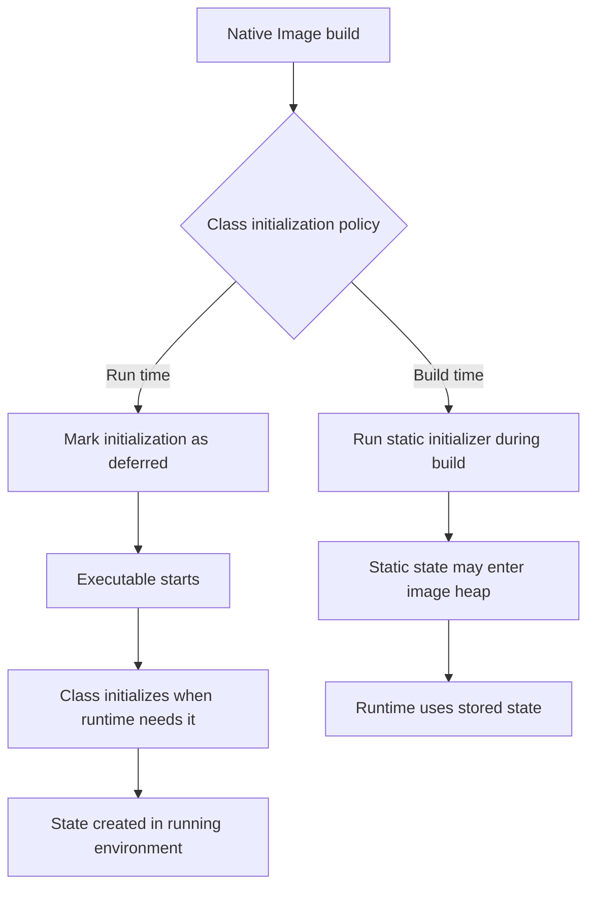

# --initialize-at-run-time and Deferring Initialization

## 1. Class Initialization at Build Time vs. Runtime

A Java class can contain static fields, static initializers (`static { ... }`), and static initialization expressions. On a standard JVM, a class is initialized when the JVM performs one of the operations that trigger initialization under Java rules. A static initializer may read the clock, environment variables, files, system configuration, generate random seeds, or load native libraries.

**GraalVM Native Image** can execute initialization of certain classes during the image build process. Static state created at build time can be stored in the image heap and appear when the executable starts. This can reduce startup work, but is only safe when the initialization result does not depend on the runtime environment and does not contain state that must be freshly created per run.

The **`--initialize-at-run-time`** option instructs Native Image to defer initialization of the specified classes until runtime. Then the static initializer runs in the native process when the class is initialized under Java rules, instead of running during image build.

In the **SPRING_BOOT_NATIVE_IMAGE** module, this choice is important when a Spring Boot application's dependency has static state depending on the environment, timestamp, random seeds, native libraries, or runtime resources. Do not apply this flag indiscriminately; identify the problematic class, understand the initializer's side effects, and test behavior after shifting initialization timing.



## 2. Example of an Environment-Dependent Static Initializer

Consider a class that reads an environment variable during initialization:

```java
public final class EndpointConfig {
    static final String API_ENDPOINT =
        System.getenv("PAYMENT_API_ENDPOINT");

    private EndpointConfig() {
    }
}
```

If the class is initialized at build time, the value read may be the value in the CI/build environment (or `null` if the variable does not exist). That static value can be stored in the image heap. When the container runs in production with a different `PAYMENT_API_ENDPOINT`, the class does not necessarily re-read the environment variable; the application may continue using the value recorded at build time.

Setting the class to runtime initialization ensures reading the environment variable occurs inside the running process:

```bash
native-image --initialize-at-run-time=com.example.config.EndpointConfig ...
```

This is an example of Native Image option syntax. When building Spring Boot, pass options through the GraalVM Native Build Tools or Spring Boot plugin configuration appropriate for your version, rather than invoking an illustrative command manually with an incomplete classpath.

However, a better design is usually to read configuration through Spring `Environment` or `@ConfigurationProperties` at runtime, rather than holding environment configuration in static fields. Runtime initialization only changes when the initializer runs; it does not turn a static field into a refreshable property or automatically handle configuration changes after the class has initialized.

## 3. Syntax and Scope of --initialize-at-run-time

Native Image supports specifying classes or packages to initialize at runtime. Example:

```bash
native-image --initialize-at-run-time=com.example.crypto.RandomProvider -jar app.jar
```

Multiple classes/packages can be specified according to the option syntax of the GraalVM version in use. Illustrative example:

```bash
native-image \
  --initialize-at-run-time=com.example.crypto.RandomProvider,com.example.config.EndpointConfig \
  -jar app.jar
```

For packages, confirm the exact syntax and scope in the Native Image documentation for your version; avoid accidentally moving an entire large package to runtime if only one class has an issue.

Key points to remember:

- The option affects the **class initialization policy**, not how every class is loaded.
- It does not replace reflection, resource, proxy, or JNI metadata.
- The class may be initialized later, but when initialized it must still have all required dependencies, resources, and runtime permissions.
- A static initializer can throw exceptions; moving it to runtime can cause errors to appear when the application runs rather than at build time.
- Related classes and dependencies must be checked, because initialization policies can interact with superclasses and other classes.

## 4. When Should Initialization Be Deferred?

A class is worth considering for runtime initialization when its static initializer:

- Reads environment variables, system properties, or machine-dependent files.
- Captures the current time or creates state that must be fresh per process.
- Generates random seeds, nonces, key material, or security state that must not be fixed at build time.
- Loads native libraries dependent on OS/architecture or runtime paths.
- Initializes clients connecting to external services.
- Holds global state that varies by container, tenant, or request.
- Detects runtime capabilities or hardware configuration.

Timestamp creation example:

```java
public final class BuildClock {
    static final Instant CREATED_AT = Instant.now();
}
```

If initialized at build time, `CREATED_AT` may reflect the build timestamp rather than when the native process started. If runtime timing is required, defer initialization or better yet provide a method/service that reads the time when needed.

Random seed example:

```java
public final class TokenSeed {
    static final SecureRandom RANDOM = new SecureRandom();
}
```

Initializing security-sensitive state at build time may be inappropriate. Follow provider/GraalVM guidance regarding entropy and secure randomness; do not arbitrarily force crypto classes into build time solely to reduce startup.

## 5. When Is Build-Time Initialization Beneficial?

Build-time initialization can be suitable when:

- Static state is completely deterministic from code/constants.
- It does not read environment data or the runtime filesystem.
- It does not generate random/security-sensitive state that must be fresh at runtime.
- It does not load target-runtime-dependent native libraries in an unsupported way.
- It does not hold objects with state or resources valid only in the build environment.

Immutable lookup table example built from constants:

```java
public final class CurrencyTable {
    static final Map<String, Integer> SCALE = Map.of(
        "USD", 2,
        "JPY", 0,
        "KWD", 3
    );
}
```

If the data depends only on code and is safe to exist in the image heap, build-time initialization can reduce runtime work. However, simply having static fields does not make a class automatically safe; inspect the entire initializer logic and the resulting object graph.

## 6. Relationship with --initialize-at-build-time

Native Image also has `--initialize-at-build-time` to require a class to be initialized during the build. Some classes may be handled at build time by default or via framework/toolchain settings. Do not add a build-time option for a class just to silence a runtime error without understanding its static state.

Example:

```bash
native-image \
  --initialize-at-build-time=com.example.constants.CurrencyTable \
  --initialize-at-run-time=com.example.config.EndpointConfig \
  -jar app.jar
```

This example illustrates policies for two different groups of classes. If a class is simultaneously specified in conflicting groups, Native Image may report an error or apply version-specific rules; do not declare overlapping policies. Always check logs and documentation for your GraalVM version.

A build-time initialized class can carry state into the image heap. If that state contains threads, sockets, file handles, timestamps, random seeds, or references to the build environment, it can cause errors or unintended behavior when the executable runs.

## 7. Common Build-Time Initialization Errors

Several signs can appear in Native Image logs:

- Build-time initialization fails when a static initializer reads a file absent on CI.
- Native Image warns that a class initialized at build time and state was saved into the image heap.
- Errors related to objects that cannot be placed into the image heap.
- Runtime uses stale configuration values or state created from the build machine.
- A native library cannot be loaded in the build or target environment.

Example class creating a file handle in a static initializer:

```java
public final class LocalCache {
    static final FileInputStream INPUT;

    static {
        try {
            INPUT = new FileInputStream("/etc/myapp/cache.bin");
        } catch (IOException ex) {
            throw new ExceptionInInitializerError(ex);
        }
    }
}
```

This is a problematic design: file handles should not be stored as static state in the image heap. Switching the class to runtime initialization may allow the file to be opened at runtime, but lifecycle/stream closing must still be managed properly. It is better to open the file on demand via a service with a clear lifecycle and runtime path configuration.

## 8. Configuring via Gradle and Maven

With Gradle GraalVM Native Build Tools, build arguments can be configured in the extension/task block according to the plugin version. Illustrative example:

```groovy
graalvmNative {
    binaries {
        main {
            buildArgs.add("--initialize-at-run-time=com.example.config.EndpointConfig")
        }
    }
}
```

Configuration location and API may differ by plugin version. Some projects use `buildArgs` on the extension, while others use task configuration or convention plugins. Check the Native Build Tools plugin version in your project and inspect the actual task command line.

With the Spring Boot Gradle Plugin, the `bootBuildImage` task can build a native image via buildpacks using its own configuration. Build arguments for Native Image and buildpack build environments are not always configured in the same place. Check the Spring Boot documentation for your version and buildpack logs to confirm the option reached the `native-image` process.

With Maven, the Native Build Tools Maven Plugin provides corresponding build argument configuration. Identify which plugin actually executes native compilation in your project's lifecycle; do not add options to a plugin/task that is never invoked.

After configuring, inspect the `native-image` logs or build output to confirm the option appears. Checking `pom.xml`/`build.gradle` alone is not enough if a different profile or task is being executed.

## 9. Impact on Spring Boot and Spring AOT

Spring AOT processes the application context and generates code/hints before GraalVM Native Image compiles it. Class initialization policy operates at the Native Image layer; it does not replace Spring bean graph configuration.

For example:

- `@Profile` and `@ConditionalOnProperty` decide which beans exist in the AOT context.
- Runtime Hints describe needed reflection, resources, proxies, and serialization.
- `--initialize-at-run-time` decides when a class's static initializer executes.

These three mechanisms solve three different problems. If a bean is not created due to an AOT profile, deferring class initialization will not make the bean appear. If a resource lacks metadata, runtime initialization will not automatically package the resource. If a static initializer needs to read runtime configuration, moving the class to runtime may be right, though you should still consider using Spring `Environment` instead of static globals.

## 10. Dependencies with Native Libraries or Static State

A dependency may initialize a class to:

- Locate native libraries by OS.
- Read properties such as `java.library.path`.
- Select an implementation based on CPU architecture.
- Create a global native context.
- Initialize a crypto provider or random source.

Do not apply `--initialize-at-run-time` to an entire dependency package by guesswork. First read the library's GraalVM/native support documentation, inspect class initialization logs, and identify which class actually has side effects.

If the library already provides reachability metadata or initialization guidance, prefer using the vendor-verified configuration. Changing initialization policies may cause part of the logic to run later and expose missing files, permissions, or libraries in the container.

## 11. Diagnosing with Native Image Build Output

When encountering an error, gather evidence:

1. Which class was initialized at build time?
2. What did the static initializer do?
3. Did it read environment variables, files, network, clock, randomness, or native libraries?
4. What objects were created and were they saved into the image heap?
5. Did the error occur at build time or on first use at runtime?
6. Can the side effect be removed or the state converted into a managed dependency?

Native Image provides class initialization diagnostic options; option names and output formats vary by version. Check `native-image --help` and the documentation for your exact GraalVM version before using tracing/reporting options. Do not copy diagnostic flags from another version without verifying them.

You can use verbose Gradle/Maven build logs and enable `native-image` verbose output as supported by your plugin. Once the class is identified, test modifying that specific class in an isolated build to verify your hypothesis, then run runtime tests.

## 12. Practical Example: Configuring an Endpoint at Runtime

Static field design:

```java
public final class PaymentClientConfig {
    static final String ENDPOINT =
        System.getenv("PAYMENT_API_ENDPOINT");
}
```

More Spring-friendly design:

```java
@ConfigurationProperties(prefix = "payment.api")
public record PaymentApiProperties(URI endpoint) {
}
```

```java
@Configuration
@EnableConfigurationProperties(PaymentApiProperties.class)
class PaymentClientConfiguration {

    @Bean
    PaymentClient paymentClient(PaymentApiProperties properties) {
        return new PaymentClient(properties.endpoint());
    }
}
```

With runtime configuration, Spring binds properties from the running environment into the created bean. AOT still requires the bean structure to be statically well-defined, while the endpoint value can be supplied from environment/config files at runtime by design. This approach is clearer than packaging environment values inside static fields.

If a dependency cannot be changed and still uses a static initializer reading the environment, runtime initialization may be necessary for that class, though you should check the dependency's official configuration capabilities first.

## 13. Testing After Switching to Runtime Initialization

When changing class initialization policies:

- Rebuild the native executable from scratch or ensure task inputs force native image regeneration.
- Run in an environment with environment variables/configuration different from the build environment.
- Verify that static state reflects the expected runtime environment.
- Test cases where variables/files are absent to confirm clear error reporting.
- Verify thread, connection, native library, and resource initialization are properly lifecycle-managed.
- Run concurrent requests to uncover race conditions in static initialization or lazy state.
- Re-measure startup time because moving initialization to runtime can increase startup or first-access latency.
- Run integration tests inside a container matching the target OS/architecture.

Java guarantees synchronized class initialization per JVM rules, but static logic after class initialization can still contain mutable state and application-created race conditions. Runtime initialization does not automatically make a class thread-safe.

## 14. Performance and Security Impact

Deferring initialization can make executable builds more stable and avoid packaging build-environment state. However, it comes with trade-offs:

| Impact | Build-time initialization | Run-time initialization |
|---|---|---|
| Startup work | May decrease | May increase |
| Runtime environment dependency | Unsuitable if state is fixed at build time | Can read the running environment |
| State in image heap | May store initialized state | Created fresh in process |
| Initializer errors | May surface at build time | May surface at startup/first use |
| Random/security state | Requires caution | Usually better suited when fresh runtime state is needed |
| Build reproducibility | Can be good if initializer is pure and deterministic | Can reduce dependence on the build environment |

Do not place secrets, tokens, private keys, or production environment data into static state initialized at build time. If you suspect sensitive data has entered the image heap or artifact, create a fresh build from a clean environment and audit your release pipeline; merely changing a runtime flag does not erase data already written into an old artifact.

## 15. Checklist for Choosing --initialize-at-run-time

- Identify classes with static initializers or environment-dependent static state.
- Read Native Image logs to see which phase initializes the class.
- Prefer removing side effects or moving configuration to Spring `Environment`.
- Specify only the specific classes/packages requiring runtime initialization.
- Do not apply a broad flag to entire dependencies without evidence.
- Check superclasses, dependencies, and class initialization interactions.
- Confirm the option is actually passed to the `native-image` process.
- Rebuild a fresh executable.
- Test with an environment different from the build environment.
- Measure startup and first-call latency after the change.
- Verify native libraries, filesystem permissions, and resources in the container.

## 16. Self-Check Questions

1. What is the difference between build-time initialization and runtime initialization?
2. Why can a static field reading an environment variable retain the build machine's value in a native executable?
3. How does `--initialize-at-run-time` change when a static initializer runs?
4. Why should you avoid applying this option to an entire package just to fix one error?
5. Does runtime initialization automatically solve missing reflection/resource/JNI metadata?
6. When moving a class to runtime initialization, what kinds of errors might only appear when the executable starts?
7. Why is `@ConfigurationProperties` usually a better design than a static field holding a runtime endpoint?
8. Which metrics should be re-measured after changing an initialization policy?

**Key takeaway:** `--initialize-at-run-time` defers static initialization so environment-dependent state is created inside the native process. Identify classes with side effects accurately, prefer explicit Spring runtime configuration, apply options narrowly, and test the executable in the real deployment environment.
