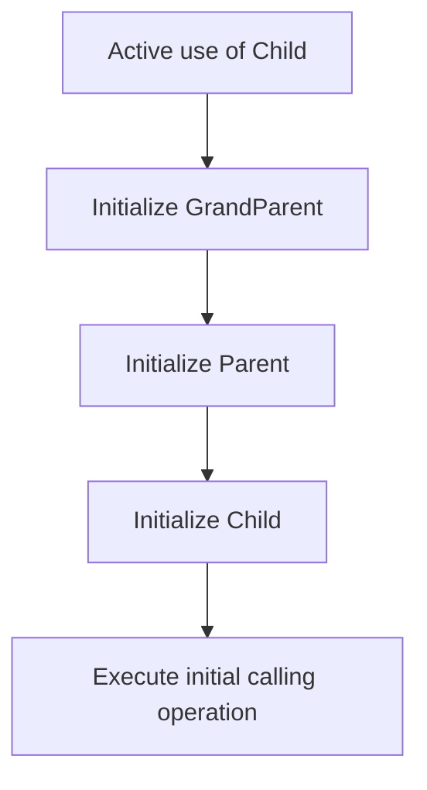

# Initialization Relationships Between Superclasses, Subclasses, and Referenced Types

## 1. What Is Class Initialization?

In Java, a class can be **loaded**, **linked**, and **initialized** at different times. The fact that the JVM has found the bytecode or created a `Class` object does not mean the class's static initializers have executed.

**Class initialization** is the step where the JVM executes initial value assignments for static fields and static initializers (`static { ... }`) of a class or interface. The JVM guarantees this step happens according to specification rules and is synchronized across threads.

In a Spring Boot application compiled into a **GraalVM Native Image**, class initialization timing also involves native-image build decisions: some classes can be initialized during the build to place static state into the image; classes dependent on the runtime environment must be kept to initialize when the executable runs.

This lesson belongs to the **Class Initialization** chapter of the **SPRING_BOOT_NATIVE_IMAGE** module, focusing on:

- Initialization order relationships between superclasses and subclasses.
- How interfaces with default methods participate in class initialization.
- Differences between a referenced type and the type actually initialized.
- Behavior of static fields, compile-time constants, and class literals.
- Initialization cycles, thread safety, and the initialization-on-demand holder idiom.
- Impact of build-time/runtime class initialization in GraalVM Native Image.

## 2. Loading, Linking, and Initialization Are Not One Operation

The JVM processes a class in three broad phases:

| Phase | Main work | Runs static initializer? |
| --- | --- | --- |
| **Loading** | Locates bytecode and creates the class representation in the JVM | Not necessarily |
| **Linking** | Verification, preparation, and resolution | Does not run the class's `<clinit>` in the normal initialization sense |
| **Initialization** | Assigns initial values to static fields and runs static initializers | Yes |

During the **preparation** phase, static fields receive their type default values: numbers get `0`, booleans get `false`, references get `null`. Initialization expressions written by the developer run during the initialization phase, in source declaration order.

Example:

```java
class StartupRegistry {

    static int retryCount = 3;
    static String endpoint = loadEndpoint();

    static {
        System.out.println("StartupRegistry initialized");
    }

    private static String loadEndpoint() {
        return "https://api.example.com";
    }
}
```

When `StartupRegistry` is initialized, the JVM assigns `retryCount`, calls `loadEndpoint()` to assign `endpoint`, and then runs the static block in exact source declaration order. If a static block appears before another static field declaration, it executes before that field's initializer.

A class can be loaded or verified without being initialized yet. For example, obtaining `StartupRegistry.class` only yields the class literal; it does not run `StartupRegistry`'s static block.

## 3. When Does the JVM Begin Initializing a Class?

The JVM performs initialization upon an **active use** as defined by the Java Language Specification. Common scenarios:

- Creating a new instance via `new SomeClass()`.
- Calling a static method declared by the class/interface.
- Reading or writing a non-compile-time-constant static field declared by the class/interface.
- Certain reflection operations requiring class initialization, such as `Class.forName(name)` with the default `initialize = true`.
- The startup class chosen by the JVM containing `main` is also initialized before invoking `main`.

Example:

```java
class RuntimeSettings {

    static {
        System.out.println("RuntimeSettings initialized");
    }

    static void printStatus() {
        System.out.println("ready");
    }
}

public class Main {
    public static void main(String[] args) {
        RuntimeSettings.printStatus();
    }
}
```

The call `RuntimeSettings.printStatus()` is an active use, so the JVM initializes `RuntimeSettings` before executing the static method body.

### 3.1. Operations that do not automatically initialize the referenced type

Merely naming a class in a declaration or obtaining a class literal is generally not an active use:

```java
class ReferencedType {
    static {
        System.out.println("ReferencedType initialized");
    }
}

class ReferenceHolder {
    static ReferencedType value;

    static ReferencedType create() {
        return null;
    }
}

public class ReferenceExample {
    public static void main(String[] args) {
        Class<?> type = ReferencedType.class;
        ReferencedType[] items = new ReferencedType[5];

        System.out.println(type.getName());
        System.out.println(items.length);
    }
}
```

In this example, obtaining `ReferencedType.class` and creating a `ReferencedType[]` array do not initialize `ReferencedType`. Declaring a field of type `ReferencedType` or a method return type of `ReferencedType` also does not initialize that type on its own.

Conversely, `new ReferencedType()` initializes the class before creating the instance. Calling a static method or reading a non-constant static field of `ReferencedType` also triggers initialization according to the corresponding rules.

### 3.2. Class.forName has two distinct behaviors

```java
Class.forName("com.example.ReferencedType");
```

The single-parameter overload is equivalent to requesting class initialization. If you only want to load a class without running its static initializer yet, use the overload with `initialize = false`:

```java
ClassLoader loader = Thread.currentThread().getContextClassLoader();

Class<?> type = Class.forName(
    "com.example.ReferencedType",
    false,
    loader
);
```

This is useful when a framework scans types or inspects metadata before actually using the class. However, subsequent reflection steps may cause active use or require initialization; clearly distinguish finding a class from running its initializer.

## 4. Initialization Order Between Superclass and Subclass

When a class is initialized, the JVM must initialize its superclass first. The superclass's initializers finish before the subclass's initializers run.

Example:

```java
class ParentService {

    static {
        System.out.println("1. ParentService static block");
    }

    static int parentValue = initParentValue();

    private static int initParentValue() {
        System.out.println("2. ParentService field initializer");
        return 10;
    }
}

class ChildService extends ParentService {

    static int childValue = initChildValue();

    static {
        System.out.println("4. ChildService static block");
    }

    private static int initChildValue() {
        System.out.println("3. ChildService field initializer");
        return 20;
    }
}

public class InitializationOrderDemo {
    public static void main(String[] args) {
        System.out.println(ChildService.childValue);
    }
}
```

Output order:

```text
1. ParentService static block
2. ParentService field initializer
3. ChildService field initializer
4. ChildService static block
20
```

Within each class, static field initializers and static blocks execute in **source declaration order**. All initialization of the superclass completes before the JVM executes the subclass's initialization.

### 4.1. Multi-level inheritance chains

With `GrandParent -> Parent -> Child`, active use of `Child` causes the JVM to initialize in order:



This ensures static state in a superclass that the subclass relies on is established under Java rules before the subclass runs its static initializer.

### 4.2. Reading an inherited static field via a subclass name

An easily confused detail: a static field belongs to the class that **declares** it, not to each subclass. Therefore:

```java
class Parent {
    static int parentValue = initializeParent();
    static int initializeParent() {
        System.out.println("Parent initialized");
        return 10;
    }
}

class Child extends Parent {
    static {
        System.out.println("Child initialized");
    }

    static int childValue = 20;
}

public class StaticFieldOwnerDemo {
    public static void main(String[] args) {
        System.out.println(Child.parentValue);
    }
}
```

`parentValue` is declared in `Parent`. Accessing `Child.parentValue` is still accessing `Parent`'s field; it initializes `Parent` without initializing `Child` just because `Child` appears in the expression.

If `Child.childValue` is accessed, the JVM initializes `Parent` first, then `Child`, and then reads the value. When analyzing initialization triggers, identify **the class that actually declares the static member**, not just the type written on the left side of the dot.

The same rule applies when calling an inherited static method: initialization is tied to the class/interface declaring the invoked method.

## 5. Interfaces and Default Methods in Initialization Order

Interfaces can also have static fields and static initializers. However, interface initialization rules differ from classes:

- Initializing an interface **does not automatically initialize its superinterfaces**.
- When initializing a class, the JVM initializes its superclass first, then initializes superinterfaces (including indirect superinterfaces) **that declare default methods**, in the specified traversal order, before running the class's initializer.
- An interface that is merely implemented without declaring any default methods is not always initialized before the implementing class.

Example:

```java
interface AuditContract {

    int AUDIT_VERSION = initializeAudit();

    private static int initializeAudit() {
        System.out.println("AuditContract initialized");
        return 1;
    }

    default void audit() {
        System.out.println("audit");
    }
}

interface MarkerContract {

    int MARKER_VERSION = initializeMarker();

    private static int initializeMarker() {
        System.out.println("MarkerContract initialized");
        return 1;
    }
}

class PaymentService implements AuditContract, MarkerContract {

    static {
        System.out.println("PaymentService initialized");
    }
}
```

Upon active use of `PaymentService`, the JVM initializes `AuditContract` because this interface declares the default method `audit()`. `MarkerContract` declares no default methods, so it is not initialized solely because `PaymentService` implements it. After processing superclasses and superinterfaces with default methods, the JVM runs `PaymentService`'s static initializer.

This is a rule about **default methods**—an interface having static fields does not automatically initialize when a class implements it.

### 5.1. Directly accessing an interface's static field

If code reads a non-compile-time-constant static field declared in an interface, the declaring interface itself is initialized:

```java
interface FeatureFlags {
    int CURRENT_VERSION = loadVersion();

    private static int loadVersion() {
        System.out.println("FeatureFlags initialized");
        return 2;
    }
}

class FeatureService implements FeatureFlags {
}

public class InterfaceInitializationDemo {
    public static void main(String[] args) {
        System.out.println(FeatureFlags.CURRENT_VERSION);
    }
}
```

Accessing `FeatureFlags.CURRENT_VERSION` triggers initialization of `FeatureFlags`. That differs from merely instantiating `FeatureService`, which implements an interface without default methods.

## 6. Compile-Time Constants vs. Regular Static Fields

Not every static field read causes initialization. A **constant variable** per the JLS is `final` of primitive type or `String`, initialized with a constant expression. Its value can be inlined by the compiler at call sites.

Example:

```java
class BuildInfo {

    static {
        System.out.println("BuildInfo initialized");
    }

    static final int API_LEVEL = 3;
    static final String RELEASE_NAME = "native-demo";

    static final Integer BOXED_LEVEL = 3;
    static final int COMPUTED_LEVEL = Integer.parseInt("3");
}
```

The differences:

| Field | Is it a constant variable? | Does reading it initialize `BuildInfo`? |
| --- | --- | --- |
| `static final int API_LEVEL = 3` | Yes | No |
| `static final String RELEASE_NAME = "native-demo"` | Yes | No |
| `static final Integer BOXED_LEVEL = 3` | No, because type is not primitive/`String` | Yes |
| `static final int COMPUTED_LEVEL = Integer.parseInt("3")` | No, because initializer is not a constant expression | Yes |

Example accessing both constants:

```java
System.out.println(BuildInfo.API_LEVEL);
System.out.println(BuildInfo.RELEASE_NAME);
```

These two values can be embedded by the compiler directly into the bytecode at the usage sites, so `BuildInfo` does not need to be initialized. Accessing `BuildInfo.BOXED_LEVEL` or `BuildInfo.COMPUTED_LEVEL` accesses a non-constant static field and will trigger initialization.

This also has implications when upgrading libraries: if a constant is inlined into a consumer, changing the constant value in the library without recompiling the consumer can cause the consumer to keep using the old value.

## 7. Initializer Order Within the Same Class

Within a class, static field initializers and static blocks run in textual order. It is not true that all static fields receive their expression values before all static blocks run.

```java
class InitializationSequence {

    static int first = log("first field", 1);

    static {
        log("first static block", 0);
    }

    static int second = log("second field", 2);

    static {
        log("second static block", 0);
    }

    private static int log(String name, int value) {
        System.out.println(name);
        return value;
    }
}
```

Output when the class is initialized:

```text
first field
first static block
second field
second static block
```

During preparation, static fields already received default values. During initialization, the JVM runs each initializer in declaration order. Consequently, a static block can observe the default value of a field declared below it if that field's initializer has not run yet.

## 8. Initialization Cycles Between Classes

Two classes can reference each other's static fields inside their initializers. When a cycle exists, one class may read the default value of the other class if that class is currently undergoing initialization on the same thread.

Example:

```java
class Alpha {
    static int value = Beta.value + 1;
}

class Beta {
    static int value = Alpha.value + 1;
}

public class CircularInitializationDemo {
    public static void main(String[] args) {
        System.out.println(Alpha.value);
        System.out.println(Beta.value);
    }
}
```

If `Alpha` is initialized first:

1. `Alpha.value` currently holds its default value `0`.
2. `Alpha`'s initializer requests `Beta.value`, so the JVM begins initializing `Beta`.
3. `Beta`'s initializer reads `Alpha.value` while `Alpha` is initializing on the same thread; it observes the current value `0`.
4. `Beta.value` becomes `1`.
5. `Alpha.value` resumes and becomes `2`.

The outcome depends on which class receives active use first. If `Beta` is initialized first, the result may differ. This is why circular static initializer chains should be avoided.

The fix is to move dependencies into constructors or a clearly ordered bean lifecycle, use explicit holders or factories, and avoid having one class's static initializer call back into another class.

## 9. Thread Safety and Errors During Initialization

The JVM synchronizes class initialization using the class's initialization lock. If multiple threads concurrently perform active use of an uninitialized class:

- One thread performs initialization.
- Other threads must wait for the result.
- After initialization succeeds, subsequent threads observe the established static state.
- If initialization fails, the class is marked erroneous; later active uses typically receive `NoClassDefFoundError`.

A dependency cycle can also cause a deadlock between two threads: thread A is initializing `Alpha` and then needs `Beta`, while thread B is initializing `Beta` and then needs `Alpha`. Each thread may wait on the initialization lock held by the other. Therefore, static initializers should be brief, avoid waiting on external work, and avoid calling back and forth across classes.

If an initializer throws an exception that is not an `Error`, the JVM typically wraps it in `ExceptionInInitializerError` for the first initialization attempt. If the initializer itself throws an `Error`, that error may propagate directly. Subsequent uses after the class is marked erroneous will not retry running the initializer as a fresh initialization.

Example:

```java
class RemoteRegistry {

    static final String CONFIG = loadConfig();

    private static String loadConfig() {
        throw new IllegalStateException("Cannot load config");
    }
}

public class InitializationFailureDemo {
    public static void main(String[] args) {
        System.out.println(RemoteRegistry.CONFIG);
    }
}
```

If `loadConfig()` fails during the first initialization, the error appears immediately upon accessing `RemoteRegistry.CONFIG`. Subsequent accesses do not re-run `loadConfig()` to recover.

Therefore, avoid placing error-prone or environment-dependent operations such as network calls, database access, reading secrets, creating threads, or opening sockets inside static initializers. With Spring Boot, such tasks are usually better suited to the bean lifecycle, startup runners, or a service that can handle errors and retries.

## 10. Initialization-on-Demand Holder

A common Java technique is using a nested holder class to defer singleton initialization until first needed:

```java
public final class PaymentRegistry {

    private PaymentRegistry() {
        System.out.println("PaymentRegistry created");
    }

    private static class Holder {
        static final PaymentRegistry INSTANCE = new PaymentRegistry();
    }

    public static PaymentRegistry getInstance() {
        return Holder.INSTANCE;
    }
}
```

When `PaymentRegistry` is loaded or when a method not using `Holder` is called, the nested class `Holder` is not necessarily initialized yet. The first call to `getInstance()` reads `Holder.INSTANCE`, triggering initialization of `Holder` and thus creating the singleton.

Advantages:

- Lazy initialization triggered by active use.
- Relies on JVM thread-safety guarantees of class initialization.
- No manual synchronization required on first access.
- Dependencies and instantiation timing are explicit.

In Spring Boot applications, prefer Spring beans when objects need dependency injection, lifecycle management, proxies, or container scoping. The holder idiom is useful for standalone Java libraries or truly static registries that do not require Spring.

## 11. Spring AOT and Class Initialization in GraalVM Native Image

Spring AOT and GraalVM class initialization are two distinct mechanisms:

| Mechanism | Timing | Role |
| --- | --- | --- |
| **Spring AOT** | Build time | Analyzes Spring configuration, generates bean/context initialization code and runtime hints |
| **Native Image reachability analysis** | Build time | Identifies code, classes, and resources needed in the executable |
| **Build-time class initialization** | During native image creation | Runs designated initializers and stores required static state in the image |
| **Runtime class initialization** | When the native executable runs | Runs initializers in the actual runtime process environment |

Spring AOT **does not mean all application classes are initialized at build time**. AOT may generate bean instantiation code, while deciding which classes GraalVM initializes at build time vs. runtime is a separate part of the Native Image class initialization policy.

Native Image may allow designating groups of classes to initialize at build time or keep for runtime. Depending on the toolchain version, common options look like:

```text
--initialize-at-build-time=com.example.staticdata.ImmutableRegistry
--initialize-at-run-time=com.example.runtime.RuntimeEnvironment
```

This is the general GraalVM Native Image option syntax; how options are passed via Maven/Gradle plugins or Buildpacks depends on the plugin version and project configuration.

### 11.1. When is build-time initialization suitable?

A class may be suitable if its initializer:

- Produces static, immutable, and deterministic data.
- Only constructs lookup tables from constants known at build time.
- Does not depend on hostname, IP, environment variables, or system properties of the target machine.
- Does not read configuration files that change per environment.
- Does not create threads, sockets, database connections, or native handles.
- Does not generate values dependent on current time or runtime randomness.

Example of an immutable registry:

```java
final class CurrencyTable {

    static final Map<String, Integer> FRACTION_DIGITS = Map.of(
        "VND", 0,
        "USD", 2,
        "JPY", 0
    );
}
```

If the data is genuinely fixed per artifact, build-time initialization can shift table construction cost to build time. However, consider image heap size and whether data might need environment-specific updates.

### 11.2. When must runtime initialization be preserved?

Classes depending on runtime environment state should be initialized when the executable runs, for example:

- Reading `System.getenv()` or `System.getProperty()` to select environment configuration.
- Calling `InetAddress.getLocalHost()` to determine container hostname/IP.
- Reading configuration files or secrets mounted after the image is built.
- Creating `SecureRandom`, random seeds, or values dependent on runtime entropy.
- Initializing logging, metrics, tracing, database drivers, or clients connecting to external services.
- Creating threads, executors, sockets, or native resources whose lifecycle is tied to the process.

If classes containing these values are initialized at build time, static state may get frozen in the image. For instance, the build machine's hostname or system properties may be carried into production; timestamps or random seeds may be improperly shared across processes. For runtime-dependent state, keep class initialization at runtime and initialize resources within the proper lifecycle.

### 11.3. Superclass relationships and class initialization policy

Java rules regarding superclasses and superinterfaces still apply when Native Image executes initialization. GraalVM must also guarantee valid ordering when handling class initialization during image build. If a class is designated build-time while its superclass/interface chain or dependencies hold state that should only be created at runtime, the toolchain may detect a conflict, shift initialization timing according to supported rules, or report a configuration error.

Therefore:

1. Check whether the designated class's initializer calls static methods or reads fields of superclasses or other classes.
2. Verify whether those types read environment values or create runtime resources.
3. Do not force an entire package to build-time initialization just because one small registry can initialize early.
4. Read class initialization warnings from the Native Image build log.
5. Run the native executable on the target container/OS/CPU and inspect actual static values.

If GraalVM reports that a class initialized earlier than expected or holds unsafe state in the image heap, adjust the policy for that class and separate initializers holding runtime state from immutable data.

## 12. How to Investigate Class Initialization During Native Builds

When a native build reports errors related to class initialization, determine **which class** was initialized, **what triggered it**, and **what state** was stored in the image.

Practical workflow:

1. Read the class name in the error or warning message.
2. Open the static field initializers and static blocks of that class.
3. Follow calls to superclasses, superinterfaces with default methods, and classes referenced inside the initializer.
4. Identify whether the initializer reads environment variables, files, clock, randomness, network, or threads.
5. Check if the class can separate immutable data from runtime configuration.
6. Designate build-time or runtime initialization for a narrow scope.
7. Rebuild the native executable and test in the deployment environment.

Some errors may only surface when a class initializes during the build process, such as a missing file absent on CI. Other errors only surface when a runtime initializer tries to access a native library missing in the runtime image. Distinguishing the two moments helps pinpoint the root cause.

### 12.1. Example of separating static data from the runtime environment

Problematic design:

```java
final class RuntimeEnvironment {

    static final String HOST =
        System.getenv("SERVICE_HOST");

    static final String CONFIG_PATH =
        System.getProperty("app.config");
}
```

If this class is initialized at build time, values may be captured from the build environment instead of the container. Runtime configuration can be separated into a component/service:

```java
import org.springframework.core.env.Environment;
import org.springframework.stereotype.Component;

@Component
class RuntimeEnvironment {

    private final String host;
    private final String configPath;

    RuntimeEnvironment(Environment environment) {
        this.host = environment.getProperty("SERVICE_HOST");
        this.configPath = environment.getProperty("app.config");
    }

    String host() {
        return host;
    }

    String configPath() {
        return configPath;
    }
}
```

Spring creates the bean within the application context lifecycle, reading configuration from the runtime environment. This is generally a better model for environment-varying configuration than static initializers.

## 13. Hands-on Exercise: Observing Initialization Order and Native Impact

**Context:** An application has `ParentSettings`, `ChildSettings`, an interface with a default method, and a `ReferencedType` used as a field type. The goal is to pinpoint exactly which classes initialize and when.

**Steps to perform:**

1. Create a superclass and subclass, each with a static field initializer and a static block printing the class name.
2. Run the program performing active use only of a superclass static field via the subclass name; record which classes initialize.
3. Access a static field declared in the subclass; compare the order.
4. Create an interface with a default method and an interface with only constants; have a class implement both and observe initialization.
5. Obtain the class literal and create an array of `ReferencedType`; verify this operation does not automatically initialize the component class.
6. Read a compile-time constant and then read a non-constant static field; compare outputs.
7. Create a circular static initializer in two classes to observe default values and active-use ordering.
8. Build a native executable and inspect class initialization logs.
9. If testing build-time initialization, select only classes with immutable static data; do not select classes reading environment variables or opening connections.
10. Run the binary in a container with configuration different from the build environment and confirm runtime values reflect the container environment.

**Completion criteria:**

| Item | Completion condition |
| --- | --- |
| Superclass/subclass | Can explain that the superclass initializes before the subclass |
| Static members | Identifies the class that actually declares the field/method and its corresponding trigger |
| Interfaces | Distinguishes interfaces with default methods from interfaces merely implemented |
| Referenced types | Knows class literals, field signatures, and array creation do not initialize the component class |
| Constant variables | Distinguishes primitive/`String` compile-time constants from runtime static fields |
| Circularity | Explains reading default values while initialization is in progress |
| Native Image | Distinguishes Spring AOT from build-time class initialization |
| Runtime state | Does not freeze environment, clock, random, or network state into the image |

## 14. Summary

The JVM initializes a class only upon active use, and initializing a subclass initializes its superclass first. For classes, superinterfaces declaring default methods also participate in initialization order; merely referencing a type, taking a class literal, or creating an array of that type does not initialize the referenced type. Static constant variables may also be inlined by the compiler, so reading them does not necessarily trigger the initializer.

In GraalVM Native Image, distinguish Spring AOT from class initialization policies. Build-time initialization suits static, immutable, deterministic state; classes depending on the environment, files, clock, randomness, threads, or network must be handled at runtime. Understanding superclass/interface chains and active uses helps choose the right initialization timing, avoid frozen state in the image, and ensure the native executable behaves properly in the deployment environment.
