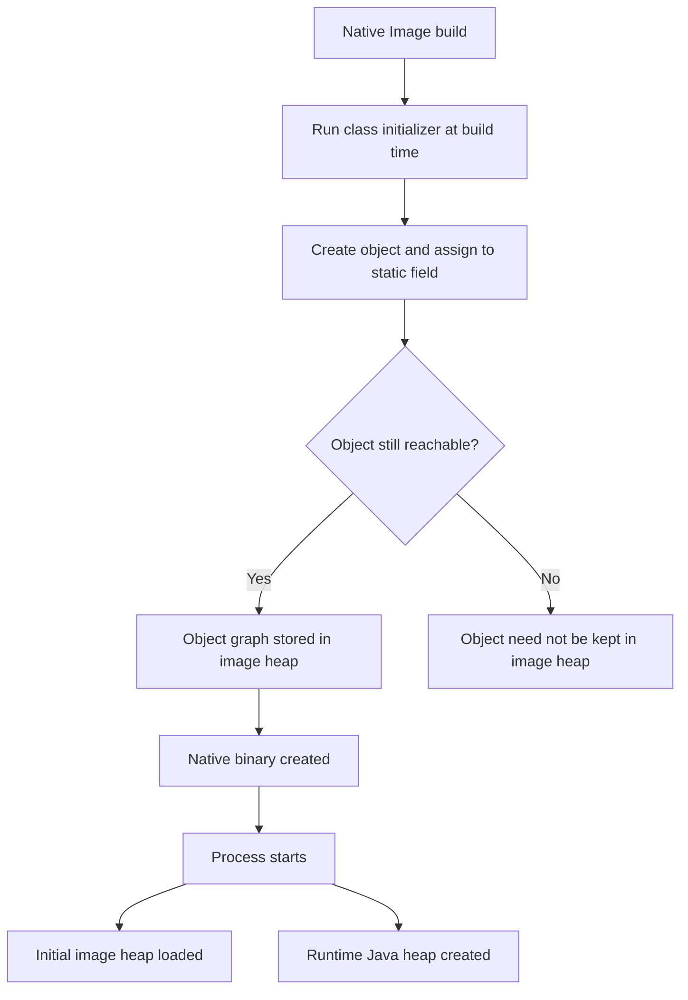
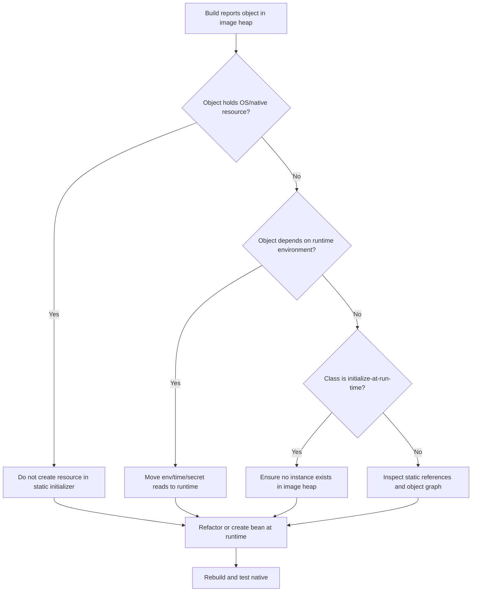

# Objects Unsuitable for Existing in the Image Heap

> **Chapter: Class Initialization.** The **SPRING_BOOT_NATIVE_IMAGE** module compiles Spring Boot applications into GraalVM Native Image using Spring AOT. When a class is initialized at build time, its static state can be stored into the executable. This lesson helps identify objects unsuitable for the image heap, understand why a build is rejected or why build-machine state gets frozen, and choose how to move initialization to runtime.

## 1. Learning Objectives

After this lesson, you will be able to:

1. Explain the image heap as the initial snapshot of objects created at build time that remain reachable.
2. Distinguish objects that cannot be stored in the executable from objects that can be stored but carry incorrect or sensitive state.
3. Identify file descriptors, running threads, sockets/connections, and native resources unsuitable for the image heap.
4. Detect time-, environment-, hostname-, path-, or secret-dependent data frozen in static state.
5. Read image heap errors and use diagnostic options to locate where objects are created.
6. Move initialization to runtime by fixing static initializers, creating beans at application startup, or configuring `--initialize-at-run-time`.

## 2. What Does the Image Heap Store?

Native Image has two heap areas to distinguish:

- **The image heap** is the initial state stored inside the binary. It contains objects created during the build that remain reachable from the application, `Class` metadata, and certain constant objects embedded in code.
- **The runtime Java heap** is created when the executable starts running. Objects the application allocates while serving requests, opening connections, or executing regular work reside in this area.

When the native executable starts up, the runtime loads the initial image heap from the binary. Therefore, objects stored in the image heap already exist in state before the production process runs.



Example:

```java
public final class BuildSnapshot {
    static final String MESSAGE = System.getProperty("message");

    private BuildSnapshot() {
    }
}
```

If `BuildSnapshot` is initialized at build time, the `message` value is read in the build environment and stored alongside the class's static state. When the executable runs with a different `-Dmessage`, the `MESSAGE` field still retains the value snapshotted at build time.

This does not mean every object created during the build is stored. An object must remain reachable from the image heap; temporary, unreferenced objects can be garbage-collected before the image is built. The problem arises when an object must be retained yet its lifecycle belongs to the runtime process or environment.

## 3. Two Categories of Unsuitable Objects

Not every case manifests the same way. Divide them into two categories:

1. **Cannot safely exist in the executable:** objects holding OS resources or native state meaningful only in the build process. Native Image may reject the build if these objects remain reachable.
2. **Can be stored, but semantically wrong:** objects containing ordinary Java data, but computed from the build machine's clock, environment variables, hostname, paths, secrets, or random state. The build may succeed, yet every process running from the binary receives that snapshot.

| Category | Examples | Risk |
|---|---|---|
| Open OS resources | File descriptors, open `FileInputStream`, sockets, channels | Handles tied to the build process/machine; cannot be used as runtime resources |
| Threads and running work | Started `Thread`, active timers, executors with started workers | Build-machine threads cannot continue running inside the native process later |
| Native resources | Native pointers, handles from JNI or managed C libraries | Addresses and lifecycles depend on the build process/host |
| Environment-dependent state | `System.getenv`, system properties, hostname, temp directories | Build-host values get frozen and do not reflect deployment |
| Time-dependent state | `Instant.now()`, timestamps, expiration times computed in static initializers | Every process gets the build timestamp instead of runtime time |
| Secrets and security state | Passwords, tokens, private keys, random generator seeds | Sensitive data may get embedded in the binary or shared across processes |
| Pre-initialized caches or clients | Caches loaded from environment data, connection pools, open-connection clients | Stale data, invalid connections, or side effects occurring at build time |

`static final` does not make an object safe. `final` only prevents reassigning the reference; the referenced object can still be mutable and can still hold resources or sensitive data.

## 4. OS Resources and Native Handles

File descriptors, open sockets, running threads, and native handles are classic examples that must not be saved into the executable. These values are bound to a specific process or operating system. A binary built on a build machine cannot carry those handles over to a new process on a production host.

### 4.1. Open files and streams

Do not open a file in a static initializer and hold the stream in a static field:

```java
public final class RuntimeFiles {
    // Unsuitable: file descriptor opened during build.
    static final FileInputStream CONFIG =
            new FileInputStream("/etc/orders/application.yml");
}
```

The build may fail because the object graph holds a `FileDescriptor` or related resource. Even if the path exists on the build machine, the file may not exist or may have different contents in the production container.

Open the file when the application actually needs to read it and close the stream afterward:

```java
public String readExternalConfig(Path configPath) throws IOException {
    try (InputStream input = Files.newInputStream(configPath)) {
        return new String(input.readAllBytes(), StandardCharsets.UTF_8);
    }
}
```

If this is a deployment configuration file, supply it via a volume, secret, or config mount. If it is an immutable template packaged with the application, place it on the classpath and declare a Resource Hint when needed; do not open the file as a stream at build time and hold that stream in a static field.

### 4.2. Sockets, channels, and connections

An open socket or connection depends on the network namespace, DNS, credentials, ports, and process at the moment it was opened. Do not create them in static initializers:

```java
public final class RemoteConnectionHolder {
    // Unsuitable: connection opened during image build.
    static final Socket SOCKET = connectToRemoteService();
}
```

Instead, create clients/connections after the application starts and has runtime configuration. With Spring Boot, let connection pools or clients be created by bean lifecycle/autoconfiguration at runtime. Close resources using appropriate lifecycle callbacks (`close`, `shutdown`, `destroyMethod`) when the context stops.

### 4.3. Threads and executors

Running threads cannot be packaged like ordinary Java objects. Do not start threads or schedulers in static initializers:

```java
public final class BackgroundJobs {
    static final ScheduledExecutorService EXECUTOR =
            Executors.newSingleThreadScheduledExecutor();

    static {
        EXECUTOR.scheduleAtFixedRate(
                BackgroundJobs::refresh,
                0, 1, TimeUnit.MINUTES
        );
    }

    private static void refresh() {
        // Refresh data.
    }
}
```

An executor may start worker threads when tasks are submitted; even if threads have not started immediately, executors and state-managing objects still should not be created in build-time static state. Let Spring create the executor when the runtime context starts:

```java
@Configuration(proxyBeanMethods = false)
class JobConfiguration {

    @Bean(destroyMethod = "shutdown")
    ScheduledExecutorService jobExecutor() {
        return Executors.newScheduledThreadPool(2);
    }
}
```

The bean method above runs when Spring creates the bean in the application process. It does not mean the executor is created and stored in the image heap simply because Spring AOT analyzed the bean definition.

## 5. Objects Containing Build-Machine State

Some objects contain neither file descriptors nor native handles yet still should not be snapshotted. They can be validly stored in the image heap, but their values reflect the build environment.

### 5.1. Time and timestamps

Example:

```java
public final class BuildTime {
    static final Instant STARTED_AT = Instant.now();
}
```

If the class is initialized at build time, `STARTED_AT` is the time of image creation. Every container running the same binary will observe that exact same timestamp, even though each process started at a different time.

If you need the current time, obtain it at runtime:

```java
@Component
class RuntimeClock {

    private final Clock clock;

    RuntimeClock(Clock clock) {
        this.clock = clock;
    }

    Instant now() {
        return Instant.now(clock);
    }
}
```

Spring Boot can provide a dedicated `Clock` bean if the application needs controlled time testing. What matters is calling `Instant.now(clock)` during business processing, not computing a fixed timestamp inside a static initializer.

### 5.2. Environment, system properties, and hostname

Example:

```java
public final class BuildEnvironment {
    static final String API_URL = System.getenv("ORDERS_API_URL");
    static final String HOST = System.getProperty("user.name");
}
```

If the static initializer runs at build time, the values read may be stored in the image heap. When deployed with a different `ORDERS_API_URL`, the static field still does not automatically re-read the environment.

Bind configuration at runtime:

```java
@ConfigurationProperties(prefix = "orders.remote")
public record RemoteServiceProperties(URI baseUrl) {
}
```

Register the properties class with `@ConfigurationPropertiesScan` or `@EnableConfigurationProperties`. Spring Boot reads values from `Environment` when building application configuration; containers can provide environment variables or config mounts specific to each deployment.

Hostname, IP, working directory, temp directory, default locale, and default timezone can also depend on the environment. Do not cache them in static state snapshotted at build time if the values must reflect the running machine.

### 5.3. Random seeds and security data

Do not create security seeds or secrets in a static initializer that runs at build time:

```java
public final class TokenGenerator {
    // Random state may be generated and snapshotted during build.
    static final SecureRandom RANDOM = new SecureRandom();
}
```

Native Image may store information computed inside a static initializer into the executable. For sensitive data, this can cause passwords, keys, or random seeds to appear in the snapshot; for environment-dependent data, values may be unexpectedly reused.

Create security objects within the runtime lifecycle and manage secrets with a secret manager:

```java
@Configuration(proxyBeanMethods = false)
class SecurityRuntimeConfiguration {

    @Bean
    SecureRandom secureRandom() {
        return new SecureRandom();
    }
}
```

This illustrates when objects should be created. Use random-number generation APIs suited to your security purpose and deployed GraalVM/JDK runtime; do not seed manually using timestamps or commit values.

## 6. Caches, Singletons, and Prematurely Initialized Clients

A plain Java cache can be stored in the image heap if the entire object graph is valid. That does not mean cached data is appropriate to snapshot:

- A cache may hold data fetched from a database or API during the build.
- Entries may contain expiration times already elapsed by the time production starts.
- A cache may depend on a tenant, profile, or pipeline environment.
- A cache may hold objects from libraries using threads, files, sockets, or native memory.

Similarly, HTTP clients, Redis clients, Kafka clients, datasources, and connection pools should not be initialized via static initializers. Some clients merely construct configuration objects without opening connections yet, but libraries can change behavior across versions; the safe choice is letting Spring create beans within the runtime lifecycle and checking the dependency's Native Image compatibility.

Example to avoid:

```java
public final class GlobalServices {
    static final DataSource DATA_SOURCE = createDataSource();
    static final HttpClient CLIENT = HttpClient.newHttpClient();
}
```

With Spring Boot, configure datasources and HTTP clients via properties/beans:

```java
@Configuration(proxyBeanMethods = false)
class RemoteClientConfiguration {

    @Bean
    HttpClient ordersHttpClient() {
        return HttpClient.newBuilder()
                .connectTimeout(Duration.ofSeconds(3))
                .build();
    }
}
```

The bean is created when the runtime application context starts. If the client requires background threads, native transports, or OS resources, check the provider's documentation and shutdown cleanup behavior.

## 7. Relationship Between Class Initialization and the Image Heap

Native Image can execute static initializers at build time. When a class is initialized at that point, the resulting static state can become part of the image heap.

An important rule: **instances of a class designated for runtime initialization must not exist in the image heap**. If an object of a runtime-initialized class has already been created and remains reachable in the initial heap, Native Image cannot keep it before its class initializer has run; the build will fail with an error.

This produces two common failure patterns:

1. A build-time initialized class creates an object that cannot be stored in the executable, such as an object holding a file descriptor or running thread.
2. An object of a class configured for runtime initialization is instantiated during the build and remains reachable from a static field of another class.

Do not solve errors by arbitrarily forcing all classes to build time. If an object is unsuitable for the image heap, forcing build-time initialization can worsen the error or freeze wrong data.

### 7.1. Example of an object belonging to a runtime-initialized class

Suppose `RuntimeClientHolder` is configured for runtime initialization, yet another class instantiates it inside a static initializer:

```java
public class RuntimeClientHolder {
    public RuntimeClientHolder() {
        // Initialize runtime-dependent state.
    }
}

public class StaticRegistry {
    // Unsuitable if RuntimeClientHolder is initialize-at-run-time.
    static final RuntimeClientHolder CLIENT =
            new RuntimeClientHolder();
}
```

Fix by not creating the instance in static state:

```java
@Component
class RuntimeClientRegistry {

    private final RuntimeClientHolder client;

    RuntimeClientRegistry() {
        this.client = new RuntimeClientHolder();
    }

    RuntimeClientHolder client() {
        return client;
    }
}
```

In a real application, you can use constructor injection or `@Bean` to create the client when the runtime context starts. The example only illustrates moving the object out of the static image heap; the client's constructor and dependencies must still be runtime-compatible.

## 8. How to Fix: Moving State and Side Effects to Runtime

When an unsuitable object is detected, handle it in order:

1. Identify the static field or constant object holding the reference.
2. Follow the object graph to locate the runtime resource or state.
3. Identify what code creates the object: static initializer, static field initializer, indirectly called library, or build-time callback.
4. Move object creation to a runtime method, factory, or Spring bean.
5. Use class initialization policies only when a library cannot be modified or when initializer timing must be controlled.
6. Rebuild and test on the native executable with a production-equivalent environment.

### 8.1. Before and after refactoring

Before:

```java
public final class LegacyRemoteClient {
    static final String ENDPOINT = System.getenv("ORDERS_ENDPOINT");
    static final ExecutorService EXECUTOR =
            Executors.newFixedThreadPool(4);
    static final Instant CREATED_AT = Instant.now();

    private LegacyRemoteClient() {
    }
}
```

After:

```java
@ConfigurationProperties(prefix = "orders.remote")
public record RemoteProperties(URI endpoint) {
}

@Configuration(proxyBeanMethods = false)
class RemoteRuntimeConfiguration {

    @Bean(destroyMethod = "shutdown")
    ExecutorService ordersExecutor() {
        return Executors.newFixedThreadPool(4);
    }

    @Bean
    Clock applicationClock() {
        return Clock.systemUTC();
    }
}
```

`RemoteProperties` receives the endpoint from runtime configuration; the executor is created within Spring's lifecycle; time is read from `Clock` when business logic needs it. This separates configuration data, runtime resources, and time values from the static image heap.

## 9. When Refactoring Is Not Possible: Configuring initialize-at-run-time

Native Image supports specifying classes or packages to initialize at runtime:

```bash
native-image \
  --initialize-at-run-time=com.example.orders.LegacyRemoteClient \
  -cp target/classes:target/dependency/* \
  com.example.orders.Application
```

This option instructs `LegacyRemoteClient`'s class initializer to run when the native executable operates, rather than during image creation. Multiple classes can be specified as a comma-separated list; syntax and argument passing should be verified against your GraalVM release.

**Important:** `--initialize-at-run-time` does not make an object already instantiated at build time valid. You must ensure no instance of that class resides in the image heap. If another class's static field holds an instance, remove that reference path or move instance creation to runtime.

### 9.1. Configuring via GraalVM Native Build Tools

Gradle example with the Native Build Tools plugin:

```groovy
graalvmNative {
    binaries {
        main {
            buildArgs.add(
                "--initialize-at-run-time=com.example.orders.LegacyRemoteClient"
            )
        }
    }
}
```

Maven example with `native-maven-plugin`:

```xml
<plugin>
    <groupId>org.graalvm.buildtools</groupId>
    <artifactId>native-maven-plugin</artifactId>
    <configuration>
        <buildArgs>
            <buildArg>--initialize-at-run-time=com.example.orders.LegacyRemoteClient</buildArg>
        </buildArgs>
    </configuration>
</plugin>
```

Place the option in the project's actual Native Image build plugin/goal. If the Spring Boot Maven/Gradle plugin drives the native build, pass build arguments using the mechanism supported by that plugin and version; do not configure the wrong task that only packages a JAR or builds a JVM container image.

### 9.2. Do not overuse initialize-at-build-time

`--initialize-at-build-time` can reduce startup work and store static state in the image heap, but must be used selectively:

- Choose only classes with pure, deterministic static initializers independent of the runtime environment.
- Avoid applying it to entire large packages without inspecting their classes.
- Do not use it to mask errors caused by file descriptors, threads, sockets, native handles, or secrets.
- Check impacts on class hierarchy and initialization order.
- Measure startup, image size, and runtime behavior after changes.

For most applications, let Native Image select safe classes by default. Adjust specific classes only with evidence and clear understanding of the snapshotted static state.

## 10. Diagnosing Objects Placed into the Image Heap

When a build fails, read the full message instead of looking only at the last class. Messages usually reveal:

- The invalid object type or affected class.
- The reference path from a static field or root object to that object.
- Which classes were initialized at build time or runtime.
- Suggestions to switch a class to runtime initialization or remove the object from the image heap.

Useful tools:

```bash
# Print class initialization information during the build.
native-image -H:+PrintClassInitialization ...

# Trace where instances of the suspected class are created.
native-image --trace-object-instantiation=java.lang.Thread ...

# Check version and supported options.
native-image --version
native-image --help
```

`-H:+PrintClassInitialization` is a version-dependent diagnostic option; if your GraalVM release does not recognize it, check the equivalent option in the documentation or `native-image --help`. `--trace-object-instantiation` accepts a fully qualified class name and helps locate where objects are instantiated during the image build.

### 10.1. Troubleshooting decision tree



### 10.2. Symptom matrix

| Symptom | Common cause | Action |
|---|---|---|
| Reports `FileDescriptor` or file handle in image heap | Stream/file opened at build time remains reachable | Open file at runtime, use try-with-resources |
| Reports thread or thread-related object | Thread/scheduler started in static initializer | Create executor when runtime Spring context starts |
| Reports object of a runtime-initialized class | Instance created in static field or build-time callback | Remove instance from image heap; instantiate after process starts |
| Build passes but endpoint points to wrong host | URL/hostname read in static initializer | Bind endpoint from runtime properties |
| Every process shares the exact same timestamp | `Instant.now()` called during build | Read `Clock` at runtime |
| Secret appears in binary or scan report | Static initializer read secret during build | Remove secret from build context; use runtime secret manager |
| Identical random sequence across processes | Random state/seed was snapshotted | Create generator at runtime, do not seed from build metadata |
| Build fails after changing initialize policy | Object graph still contains instance of runtime-initialized class | Find static references and instantiation sites; do not just flip options |

## 11. Specific Notes for Spring Boot AOT

Spring AOT analyzes the application context structure and generates code/hints so Native Image can compile the application. This process may execute some build-time logic, so static initializers in application code and dependencies must be reviewed carefully.

However, **Spring AOT does not mean all production Spring beans are instantiated and saved into the image heap**. AOT generates necessary initialization information and configuration; business beans, datasources, executors, and runtime clients are still instantiated according to the application context lifecycle when the native process starts.

Practical principles:

- Let Spring manage the lifecycle of `DataSource`, connection pools, HTTP clients, Redis/Kafka clients, and executors.
- Do not call `SpringApplication.run()` or initialize `ApplicationContext` inside a static initializer.
- Do not access secrets, databases, or the network in code that only runs to generate the image.
- Put environment-specific configuration into `@ConfigurationProperties` or `Environment`, read inside the runtime context.
- If a dependency initializes resources in its static initializer, upgrade to a Native Image-compatible version or configure class initialization per the library's guide.
- Test the same image with two different sets of environment values to detect snapshotted data.

## 12. Hands-on Exercise

A legacy library has a class:

```java
public final class LegacySettings {
    static final String API_HOST = System.getenv("PAYMENT_HOST");
    static final Instant CREATED_AT = Instant.now();
    static final ExecutorService EXECUTOR =
            Executors.newSingleThreadExecutor();
}
```

A Spring Boot application uses this class in a payment service. During native builds, the team encounters warnings or errors related to threads and notices the binary always uses the build pipeline's endpoint.

Tasks:

1. Identify which field holds an OS/runtime resource and which fields hold snapshotted data.
2. Use `--trace-object-instantiation` or class initialization logs to find where the executor is created.
3. Refactor the endpoint to `@ConfigurationProperties` and read the value from the runtime environment.
4. Create the executor as a Spring bean with an explicit shutdown lifecycle.
5. Replace the static timestamp with `Clock` and read the time when processing requests.
6. If the library cannot be modified yet, try `--initialize-at-run-time` for that exact class while ensuring no instance of it remains in the image heap.
7. Test twice from the same binary with two different `PAYMENT_HOST` values; verify each process uses the correct runtime endpoint.
8. Verify the binary and build logs contain no secrets from the CI environment.

Report template:

| Check | Before refactor | After refactor |
|---|---|---|
| When is the thread/executor created? | Build time / runtime | Build time / runtime |
| When is the endpoint read? | Build time / runtime | Build time / runtime |
| What moment does the timestamp reflect? | Build / startup / request | Build / startup / request |
| Does the image heap hold OS handles? | Yes/No | Yes/No |
| Do two runtime environments yield distinct expected results? | Yes/No | Yes/No |
| Native build and smoke test | Pass/Fail | Pass/Fail |

## 13. Self-Check Questions

1. How do the image heap and runtime Java heap differ in creation time and lifecycle?
2. Why can an open file descriptor or running thread not be snapshotted into a native executable?
3. Why does `static final` not guarantee that the referenced object is safe?
4. What kind of bug can a `static final String` field read from `System.getenv()` cause even if the build succeeds?
5. Why can `Instant.now()` inside a static initializer corrupt production data?
6. What rule applies to instances of a class configured with `initialize-at-run-time`?
7. Why does `--initialize-at-run-time` not automatically fix an object already created and stored in the image heap?
8. When should you refactor a static initializer vs. apply a class initialization option?
9. Which two problems do `--trace-object-instantiation` and `-H:+PrintClassInitialization` help investigate?
10. How does Spring AOT differ from snapshotting the entire Spring bean graph into the image heap?

## Key Takeaway

**The image heap is the initial state snapshotted into the native executable.** Keep open OS resources, running threads, native handles, connections, and sensitive runtime state out of static object graphs created at build time. Some objects can still be stored while carrying build-machine data such as time, environment variables, hostnames, or secrets. Move side effects and environment-dependent state to the runtime lifecycle, use `--initialize-at-run-time` selectively when needed, and verify with native builds and tests across multiple runtime configurations.

## Official References

- [GraalVM — Native Image Basics](https://www.graalvm.org/latest/reference-manual/native-image/basics/): image heap, build time, runtime, and class initialization.
- [GraalVM — Native Image Compatibility Guide](https://www.graalvm.org/latest/reference-manual/native-image/metadata/Compatibility/): file descriptors, running threads, and potential differences when running Native Image.
- [GraalVM — Class Initialization in Native Image](https://www.graalvm.org/dev/reference-manual/native-image/optimizations-and-performance/ClassInitialization/): class initialization rules and policies.
- [GraalVM — Specify Class Initialization Explicitly](https://www.graalvm.org/latest/reference-manual/native-image/guides/specify-class-initialization/): `--initialize-at-build-time` and `--initialize-at-run-time`.
- [GraalVM — Security Considerations in Native Image](https://www.graalvm.org/latest/security-guide/native-image/): sensitive data and random seeds in build-time snapshots.
- [GraalVM SDK — RuntimeClassInitialization](https://www.graalvm.org/sdk/javadoc/org/graalvm/nativeimage/hosted/RuntimeClassInitialization.html): API for controlling class initialization during the build.
- [GraalVM — Native Image Command-line Options](https://www.graalvm.org/latest/reference-manual/native-image/overview/Options/): build options and checking options by version.
- [Spring Boot — GraalVM Native Images](https://docs.spring.io/spring-boot/reference/packaging/native-image/introducing-graalvm-native-images.html): Spring AOT and creating native executables.
