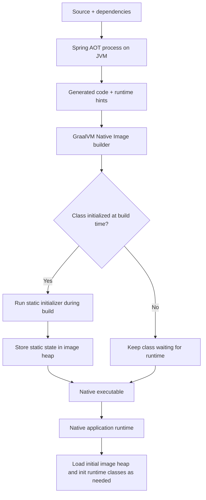

# Randomness, Time, Environment Variables, and Build-Machine-Bound State

A Spring Boot application may run fine on the JVM yet produce unexpected results after compilation into a **GraalVM Native Image** if static initializers read data from the build machine. Values such as random numbers, the current timestamp, environment variables, home directories, hostnames, locales, or truststores can be saved into the executable if the corresponding classes are **initialized at build time**.

When that happens, the binary may carry the state of the CI runner or developer workstation. At deployment time, changing environment variables or container configuration does not automatically re-run static initializers. To make the application read per-instance data at startup, you need to keep the relevant classes at **runtime initialization** or move data reading into beans/services instantiated at runtime.

## 1. Learning Objectives

After this lesson, you will be able to:

- Explain static initializers and when a Java class is initialized.
- Distinguish class initialization in the Spring AOT process from class initialization in the GraalVM Native Image builder.
- Describe how build-time initialized classes store static state into the image heap.
- Identify risks when static initializers read random seeds, time, environment variables, system properties, locale, filesystem, network, or secrets.
- Use `--initialize-at-build-time` and `--initialize-at-run-time` for the appropriate classes.
- Configure class initialization arguments in Maven/Gradle Native Build Tools.
- Design Spring beans using `Environment`, `Clock`, and runtime randomness sources instead of machine-dependent static state.
- Verify class initialization policies, build reproducibility, and behavior on the native executable.

## 2. Class Initialization in Java

A Java class can contain static fields and static initializers:

```java
public class ApplicationMetadata {
    static final String NAME = "order-service";
    static final Instant CREATED_AT = Instant.now();

    static {
        System.out.println("ApplicationMetadata initialized");
    }
}
```

The JVM does not run static initializers immediately when the class file is loaded. Under Java rules, a class is **initialized** before its first active use, such as accessing a non-constant static field, calling a static method, or creating an instance. Initialization occurs only once within the corresponding class loader's lifecycle.

In a typical JVM application, if the first reference to `ApplicationMetadata.CREATED_AT` happens while the service is running, `Instant.now()` is evaluated at that runtime moment.

Native Image adds another option: a class can be initialized during executable creation. When that occurs, the static initializer runs on the JVM performing the build and the static state is stored in the binary.

## 3. Build Time, Spring AOT, and Runtime Are Three Different Moments

When building a Spring Boot Native Image, distinguish three processes:

1. **Spring AOT process:** Maven/Gradle launches the application on the JVM to analyze Spring configuration, bean definitions, and generate AOT code/metadata.
2. **GraalVM Native Image builder:** analyzes bytecode, applies class initialization policies, may execute static initializers, and builds the image heap.
3. **Native application runtime:** the executable is deployed, initializes runtime state, and handles requests.



The two kinds of build-time processing are related but not identical:

- Spring AOT may evaluate `@Profile` or `@ConditionalOnProperty` and construct the bean graph based on build-time configuration.
- GraalVM class initialization decides whether a class's static initializer runs during the Native Image build or when the executable runs.

For example, Spring AOT might decide whether an audit bean is present based on a property. That is a container-structure decision. By contrast, a `BuildMetadata` class with `static final Instant CREATED_AT = Instant.now()` is only frozen into the image heap if the class is actually initialized at build time.

## 4. How Does Native Image Store Build-Time State?

When a class is initialized at build time:

1. The class's static initializer runs in the Native Image builder process.
2. Values assigned to static fields become the class's state.
3. Objects remaining reachable from static fields can be placed into the **image heap**.
4. The native executable stores the initial snapshot of the image heap.
5. When the native process starts, the initial image heap is used as the starting state; static initializers of build-time initialized classes do not run again.

Example:

```java
public final class BuildSnapshot {
    static final String REGION =
            System.getenv().getOrDefault("APP_REGION", "unknown");
    static final Instant CREATED_AT = Instant.now();
    static final long RANDOM_SEED = new Random().nextLong();

    private BuildSnapshot() {
    }

    public static void print() {
        System.out.println("region=" + REGION);
        System.out.println("createdAt=" + CREATED_AT);
        System.out.println("seed=" + RANDOM_SEED);
    }
}
```

If `BuildSnapshot` is initialized at build time, the three values reflect the builder's environment:

- `REGION` is the `APP_REGION` value visible during the build.
- `CREATED_AT` is the moment the static initializer ran during the build.
- `RANDOM_SEED` is the number generated during the build.

When the executable runs, changing `APP_REGION` to another value does not update `REGION`. Likewise, the timestamp and seed are not regenerated simply because a new native process starts.

### 4.1. One executable can carry identical initial state to multiple processes

If a random generator object is created inside a build-time static initializer and stored in the image heap, native processes launched from the same executable may start from the exact same generator state. If those processes execute the same call sequence, they risk producing identical output sequences.

This is especially dangerous when that state is used for session identifiers, request identifiers, randomized backoff, nonces, tokens, or values that must differ across instances. Never use a static random generator snapshotted at build time to produce data that must be unique per process or request. For security values, use an appropriate runtime entropy source such as `SecureRandom`.

## 5. GraalVM's Default Class Initialization Policy

Do not assume that Native Image initializes **all application classes** at build time by default.

Under current policy:

- Application classes are generally initialized at **runtime**.
- Native Image can automatically initialize at build time those application classes it proves are **safe**.
- Many JDK classes are initialized at build time under Native Image's policy.
- Users or frameworks can explicitly request initialization timing via build arguments.

Simply loading a class does not mean its static initializer has run. Whether a class initializes at build time depends on policy, initialization relationships between classes, and operations performed during analysis.

### 5.1. Safe initialization

Native Image tries to determine which classes can be safely initialized at build time. Analysis inspects the initializer and related classes. Calls that may enter native code, virtual calls with unresolved targets, or certain methods substituted by Native Image can prevent a class from being proven safe.

Therefore, do not assume a class with simple static fields will certainly be build-time initialized. Check the class initialization report for your exact GraalVM version and build configuration.

### 5.2. When is explicit configuration needed?

Explicit configuration is useful when:

- A class holds build-machine-dependent state and must be moved to runtime initialization.
- A class computes pure, immutable data and can benefit from early initialization.
- Build reports show a class is being initialized at an undesired time.
- A library/framework requires a specific class initialization policy.

Prefer configuring **individual classes** rather than applying broadly to entire packages without understanding the initializers inside.

## 6. Sources of State Easily Frozen

| Data source | Example in static initializer | Risk if build-time initialized |
| --- | --- | --- |
| Time | `Instant.now()`, `LocalDate.now()`, `System.currentTimeMillis()` | Build time becomes the executable's value |
| Randomness | `new Random().nextLong()`, static random generator | Processes may start from the same seed/state |
| Environment | `System.getenv("APP_REGION")` | Binary carries the CI/build host's value |
| System properties | `System.getProperty("user.home")`, `user.name` | Builder's paths/user get saved |
| Hostname/network | `InetAddress.getLocalHost()`, network interface lookup | Builder's hostname/IP may be snapshotted or build depends on network |
| Locale/timezone | `Locale.getDefault()`, `ZoneId.systemDefault()` | Caches may reflect the builder's locale/timezone |
| Filesystem | Reading config files, home directory, temp directory | Builder's file contents or paths become initial state |
| Security material | Reading tokens, keys, certificates, or truststores | Builder's secrets or trust configuration may enter the image |
| CPU/process state | Processor count, process ID, OS-specific values | Values may not match the runtime node |

Not every call in this table is always executed by Native Image at build time. The risk arises when the call is performed by the initializer of a build-time initialized class, or when another build-time mechanism stores the result into a generated artifact or the image heap.

### 6.1. Time

Example:

```java
final class BuildClock {
    static final Instant CREATED_AT = Instant.now();
}
```

If the class is build-time initialized, `CREATED_AT` reflects when the image was created. If the goal is recording when the process starts or when a request arrives, read the clock at runtime instead of caching time in a static field.

### 6.2. Environment variables and system properties

Example:

```java
final class DeploymentEnvironment {
    static final String REGION = System.getenv("APP_REGION");
    static final String HOME = System.getProperty("user.home");
}
```

If the class initializes during the build, values may point to the runner or user performing the build. When running the container in production, a new `APP_REGION` or `user.home` does not overwrite static fields already snapshotted.

### 6.3. Truststores and certificates

Native Image has a notable operational caveat: according to GraalVM security documentation, the default behavior of `native-image` is to capture the default TrustStore from the host environment at build time. Runtime behavior can be changed using `javax.net.ssl.trustStore` and related system properties.

This means an image built on a machine with a customized truststore may not have the same TLS behavior as an image built on a clean runner. For applications calling HTTPS or TLS databases, explicitly define the truststore source and test on the actual runtime image.

### 6.4. Secrets

If a static initializer reads an API token or private key from the environment and the class is initialized at build time, that value can be stored in the image heap and become part of the executable. Removing the environment variable from the container after the build does not erase data already snapshotted.

Do not supply production secrets to the `native-image` builder unless necessary. Use a minimal build environment, secret scanning, and runtime credential delivery mechanisms.

## 7. Moving Classes to Runtime Initialization

Native Image supports two key options:

| Option | Meaning |
| --- | --- |
| `--initialize-at-build-time=<class-or-package>` | Requests initializing the class/package while creating the executable |
| `--initialize-at-run-time=<class-or-package>` | Defers initialization of the class/package until the native executable runs |

Example:

```bash
# Request the class to read the environment when the native process runs
native-image \
  --initialize-at-run-time=com.example.DeploymentEnvironment \
  -o order-service \
  com.example.Application
```

Once a class is designated for runtime initialization, its static initializer will run in the native process when the class is first used under Java rules. At that time, values such as environment variables and timestamps are read from the runtime environment.

### 7.1. Explicitly specifying build-time initialization for pure classes

A class that only computes static data from literals may be suitable for build-time initialization:

```java
import java.util.Map;

final class CurrencyTable {
    static final Map<String, Integer> SCALE = Map.of(
        "USD", 2,
        "JPY", 0,
        "KWD", 3
    );
}
```

Once verified that the initializer is pure and environment-independent, you can specify:

```bash
native-image \
  --initialize-at-build-time=com.example.CurrencyTable \
  -o order-service \
  com.example.Application
```

Benefits can include reducing runtime initialization work or allowing Native Image to eliminate code only needed during computation. However, do not trade correctness and image size just to increase the count of early-initialized classes.

### 7.2. Avoid configuring entire packages indiscriminately

The following example has a broad scope:

```bash
--initialize-at-build-time=com.example
```

If the package contains classes reading environment variables, randomness, time, the filesystem, or secrets, they may get pulled into build-time initialization. Start with specific classes:

```bash
--initialize-at-run-time=com.example.DeploymentEnvironment
--initialize-at-run-time=com.example.RandomState
```

Class initialization rules carry constraints on related superclasses and superinterfaces. If a class is initialized at build time, superclasses/relevant superinterfaces that must initialize before it may also be affected. A class requested for runtime initialization can also pull in related subtypes. When policies conflict or an object is already in the image heap, Native Image may report an error; read the message and adjust the specific classes.

## 8. Configuring Maven and Gradle Native Build Tools

Arguments must be passed to the **Native Image builder**, not merely set in the application shell after the executable has been built.

### 8.1. Maven

With the GraalVM Native Build Tools Maven plugin, build arguments can be added:

```xml
<plugin>
    <groupId>org.graalvm.buildtools</groupId>
    <artifactId>native-maven-plugin</artifactId>
    <configuration>
        <buildArgs>
            <buildArg>--initialize-at-run-time=com.example.DeploymentEnvironment</buildArg>
            <buildArg>--initialize-at-run-time=com.example.RandomState</buildArg>
            <buildArg>-H:+PrintClassInitialization</buildArg>
        </buildArgs>
    </configuration>
</plugin>
```

This is a plugin configuration snippet to place in the `pom.xml` of a project already configured with compatible Native Build Tools. Then run the native goal configured by the project, for example:

```bash
./mvnw -Pnative native:compile
```

`-Pnative` is only a Maven profile if the project declares that profile. It does not automatically add class initialization arguments if they have not been configured.

### 8.2. Gradle Groovy DSL

With the GraalVM Native Build Tools Gradle plugin:

```groovy
graalvmNative {
    binaries {
        main {
            buildArgs.add(
                '--initialize-at-run-time=com.example.DeploymentEnvironment'
            )
            buildArgs.add(
                '--initialize-at-run-time=com.example.RandomState'
            )
            buildArgs.add('-H:+PrintClassInitialization')
        }
    }
}
```

Run:

```bash
./gradlew nativeCompile
```

Task names and binary configurations depend on the plugin version. If the project has multiple native binaries, apply arguments to the correct binary instead of assuming every task shares the same configuration.

### 8.3. When using Spring Boot buildpacks

When using `spring-boot:build-image` or `bootBuildImage`, GraalVM Native Image typically runs inside a CNB builder. Class initialization arguments must be passed via the corresponding buildpack/builder's native build configuration mechanism. Do not add `--initialize-at-run-time` to the runtime container's environment expecting it to change the policy of an already compiled executable.

Pin the builder/buildpacks version and consult how that version passes `native-image` build arguments. After building, inspect the builder logs to confirm the arguments were received.

## 9. Designing Spring Boot to Read Data at Runtime

The durable approach is generally to avoid reading mutable state in static initializers. Move environment-dependent data into beans or services created when the native application starts.

### 9.1. Using Environment for deployment configuration

```java
import org.springframework.core.env.Environment;
import org.springframework.stereotype.Component;

@Component
class DeploymentSettings {
    private final String region;

    DeploymentSettings(Environment environment) {
        this.region = environment.getRequiredProperty("app.region");
    }

    String region() {
        return region;
    }
}
```

In `application.properties`:

```properties
app.region=${APP_REGION:local}
```

When the bean is created in the native application runtime, Spring reads runtime configuration and passes it into the constructor. This lets the same executable run across multiple environments with different `APP_REGION` values, provided the property is not used to alter the bean graph during AOT.

### 9.2. Using Clock instead of static Instant.now()

```java
import java.time.Clock;
import java.time.Instant;
import org.springframework.context.annotation.Bean;
import org.springframework.context.annotation.Configuration;

@Configuration(proxyBeanMethods = false)
class TimeConfiguration {
    @Bean
    Clock applicationClock() {
        return Clock.systemUTC();
    }
}

@Service
class ReportService {
    private final Clock clock;

    ReportService(Clock clock) {
        this.clock = clock;
    }

    Instant createdAt() {
        return Instant.now(clock);
    }
}
```

`Clock` is provided when Spring creates the bean at runtime. Tests can substitute `Clock.fixed(...)` for deterministic testing; production uses `Clock.systemUTC()` to read real time.

### 9.3. Creating randomness sources at runtime

```java
import java.security.SecureRandom;
import org.springframework.context.annotation.Bean;
import org.springframework.context.annotation.Configuration;

@Configuration(proxyBeanMethods = false)
class RandomConfiguration {
    @Bean
    SecureRandom secureRandom() {
        return new SecureRandom();
    }
}
```

Inject `SecureRandom` into components needing to generate tokens/nonces instead of keeping a static instance initialized in a build-time initialized class. Verify that the relevant class/provider is supported by Native Image and entropy is sourced at runtime per platform configuration.

### 9.4. When are static fields still appropriate?

Static fields are appropriate for data that is:

- Constants declared directly in source and independent of the environment.
- Lookup tables constructed entirely from fixed literals.
- Immutable patterns or structures containing no per-process state.
- Build version metadata intentionally stamped and meant as **build metadata**, not runtime information.

Avoid using static initializers to cache values that can vary by container, node, tenant, request, or execution time.

## 10. Distinguishing Bean Graph Configuration from Class Initialization

Both categories of issues can appear together in Spring Boot Native Image, yet require different solutions:

| Issue | Mechanism | Resolution |
| --- | --- | --- |
| Bean absent due to `@ConditionalOnProperty` at AOT | Spring AOT analyzed config and built the graph | Build with the appropriate structural property/profile |
| Static field holds builder's environment value | Class was initialized at build time | Use runtime initialization or read `Environment` in a runtime bean |
| Static timestamp reflects build time | Static initializer ran during Native Image build | Use `Clock` at runtime or keep field as intentional build metadata |
| Random generator has identical initial state | Random object resides in the image heap | Instantiate generator at runtime |
| Truststore differs from deployment environment | Native Image captured default truststore from build host | Configure runtime truststore and test TLS |
| Incorrect host path or locale | Static cache stored builder state | Read at runtime, avoid caching build-host values |

For example, changing `APP_REGION` at runtime cannot restore a bean excluded from the graph by an AOT condition. Conversely, if a bean already exists in the graph and only needs to read region to pick an endpoint, using `Environment` in a runtime bean is the right approach.

## 11. Diagnosing Class Initialization

### 11.1. Printing the class initialization report

Native Image supports:

```bash
-H:+PrintClassInitialization
```

This argument lets you see which classes are initialized at build time, which at runtime, and policy-related details. Use the report to verify whether environment-dependent classes are being initialized prematurely.

When reading the output, focus on:

1. Classes containing environment-dependent static fields.
2. Classes containing static initializers calling random, clock, filesystem, or security APIs.
3. Classes initialized early because of another class.
4. Superclasses or dependencies also pulled into the policy.
5. Why a class was deemed safe or required to be build-time/runtime.

### 11.2. Using native-image build output and security reports

Inspect Native Image logs for class initialization policies and related warnings. Security reports can help identify security surface area, though they do not replace auditing static initializers in your application and dependencies.

If an executable might contain sensitive data, treat the image heap and native binary as artifacts capable of carrying that data. Audit the build environment, CI logs, binary scanning, and artifact registry access controls.

### 11.3. Do not rely solely on JVM tests

JVM tests usually run static initializers at runtime in the test class loader. That does not prove the native image uses the same class initialization policy. You must build the native executable and test exact scenarios:

- Build with environment A, run with environment B.
- Build on a runner with a different timezone/locale, run on the production container.
- Launch multiple processes from the same executable and inspect random state.
- Use the truststore/certificates matching the deployment environment.
- Verify whether static timestamps are build metadata or runtime timestamps as intended.

## 12. Build and Runtime Testing Matrix

Suppose an application has `BuildSnapshot` with three values: `REGION`, `CREATED_AT`, and `RANDOM_SEED`.

| Build input | Class policy | Runtime input | Expected result |
| --- | --- | --- | --- |
| `APP_REGION=builder` | Build time | `APP_REGION=prod` | Region remains `builder`; timestamp/seed reflect build |
| `APP_REGION=builder` | Runtime | `APP_REGION=prod` | Region reads `prod`; timestamp/seed created at runtime |
| `APP_REGION=dev` | Runtime | `APP_REGION=prod` | Same binary can use runtime configuration `prod` |
| `APP_REGION=prod` | Build time | `APP_REGION=prod` | May look right in this environment yet is not portable to other regions |

### 12.1. Standalone experiment

To observe the mechanism clearly, you can use a standalone Java class:

```java
package com.example;

import java.time.Instant;
import java.util.Random;

public class BuildSnapshot {
    static final String REGION =
            System.getenv().getOrDefault("APP_REGION", "unknown");
    static final Instant CREATED_AT = Instant.now();
    static final long SEED = new Random().nextLong();

    public static void main(String[] args) {
        System.out.println("region=" + REGION);
        System.out.println("createdAt=" + CREATED_AT);
        System.out.println("seed=" + SEED);
    }
}
```

Compile the class first:

```bash
javac -d out src/main/java/com/example/BuildSnapshot.java
```

Build-time initialization:

```bash
APP_REGION=builder native-image \
  -cp out \
  --initialize-at-build-time=com.example.BuildSnapshot \
  -o snapshot-build \
  com.example.BuildSnapshot

APP_REGION=production ./snapshot-build
```

The `region` output remains the build value read inside the static initializer. The timestamp and seed were also generated during the build.

Runtime initialization:

```bash
APP_REGION=builder native-image \
  -cp out \
  --initialize-at-run-time=com.example.BuildSnapshot \
  -o snapshot-runtime \
  com.example.BuildSnapshot

APP_REGION=production ./snapshot-runtime
```

In the second run, the static initializer executes inside the native process, so `region` and timestamp are taken from the runtime environment. The standalone example demonstrates the class initialization mechanism; with Spring Boot, pass arguments via your project's Native Build Tools or buildpacks rather than assuming every executable JAR can be fed directly to a raw `native-image` command.

## 13. Common Errors and Fixes

| Symptom | Possible cause | Resolution |
| --- | --- | --- |
| Environment variable changes at runtime but static field does not | Class was initialized at build time | Move class to runtime init or read `Environment` via a bean |
| Multiple processes start with the same random sequence | Random state was snapshotted in the image heap | Instantiate random generator at runtime, avoid build-time static state |
| Application timestamp is older than deployment time | `Instant.now()` ran in static initializer at build time | Use `Clock`/`Instant.now(clock)` at runtime |
| Path points to CI directory | Static field cached `user.home`, `java.io.tmpdir`, or build-host path | Construct path from runtime configuration/filesystem |
| TLS works on build host but fails in production | Default truststore was captured or runtime truststore is wrong | Configure `javax.net.ssl.trustStore*` and test in the final image |
| Native Image errors when forcing a class to runtime | Class/object was already initialized or placed in image heap by another policy | Read the error, inspect class dependencies, and narrow the policy |
| Build-time init embeds secrets in binary | Static initializer read credentials from build environment | Remove secrets from builder; use runtime secret provider |
| Class still initializes early despite marking another class runtime | Related class was initialized by dependency/hierarchy | Use `-H:+PrintClassInitialization` to find the cause |
| Native build behavior differs from JVM | JVM tests and native class initialization policies differ | Test native binary with an environment different from the build host |

## 14. Best Practices

1. **Default environment-dependent classes to runtime initialization.** Only request build-time init after confirming the initializer is pure and yields clear benefits.
2. **Avoid static initializers with I/O.** Do not read deployment config files, call the network, or fetch secrets inside static blocks.
3. **Do not generate runtime random seeds at build time.** Especially avoid static random state used for tokens or identifiers.
4. **Use Clock and Environment injection.** Allows the application to read time/configuration at runtime and test deterministically with fixed clocks.
5. **Specify concrete classes.** Avoid `--initialize-at-build-time` on large packages without inspecting every initializer.
6. **Check the class initialization report.** Use `-H:+PrintClassInitialization` during investigation.
7. **Keep the build environment clean.** Do not pass production secrets to the `native-image` builder and manage truststores carefully.
8. **Test with distinct build and runtime environments.** A binary tested only on the build machine can hide snapshot bugs.
9. **Record policy alongside artifacts.** Store build arguments, GraalVM version, commit, and checksum for reproducibility.
10. **Read documentation for your exact GraalVM version.** Safe initialization rules and options can vary across releases.

## 15. Comprehensive Exercise

**Context:** a Spring Boot service needs a region, a report-creation timestamp, and random tokens. The native binary will be built in CI and deployed across multiple regions.

Tasks:

1. Find static fields/static initializers calling `System.getenv`, `System.getProperty`, `Instant.now`, `new Random`, or `SecureRandom`.
2. Determine which classes Native Image initializes at build time using `-H:+PrintClassInitialization`.
3. Move region to `app.region` configuration and inject `Environment` into a runtime bean.
4. Move timestamps to an injected `Clock` and generate `Instant.now(clock)` when needed.
5. Move randomness sources into a bean/runtime service; do not hold snapshotted static generators.
6. For library classes still needing runtime initialization, add `--initialize-at-run-time` for the specific class via Maven/Gradle build arguments.
7. Build the executable with `APP_REGION=build-region`, then run the container with `APP_REGION=prod-region`.
8. Confirm the app uses `prod-region`, timestamps are generated at runtime, and random state is initialized per process.
9. Verify TLS truststore, filesystem paths, and permissions in the final container image.
10. Save the build arguments, class initialization report, and executable checksum.

**Self-check question:** Why does changing `APP_REGION` in a Kubernetes Deployment fail to update a static field that was read in a build-time initialized class? Because that value was evaluated in the static initializer on the build machine and saved into the image heap; the native process only receives the initial snapshot and does not re-run the initializer. Runtime initialization or reading configuration via a runtime bean/service is required.

## 16. Summary

- Java static initializers run when a class is initialized, not immediately when the class is merely loaded.
- GraalVM Native Image defaults most application classes to runtime initialization, except classes proven safe; many JDK classes have build-time policies.
- If a class is initialized at build time, static state and reachable objects can be stored in the image heap and appear in the executable.
- Random seeds, time, environment variables, system properties, filesystem paths, locale, hostname, truststores, and secrets require careful review.
- `--initialize-at-run-time` keeps static initialization for the native process; `--initialize-at-build-time` shifts work to build time and should only be used for classes with deterministic, machine-independent initializers.
- Spring AOT conditions and GraalVM class initialization are two distinct mechanisms: one prepares the bean graph, while the other decides when static initializers run.
- Use `Environment`, `Clock`, and runtime randomness services to read data per deployment/process.
- Check `-H:+PrintClassInitialization`, build with an environment different from runtime, and test the native executable to detect frozen state.

By clearly separating which data is **build metadata** and which data must be read from the **runtime environment**, you prevent the native executable from accidentally carrying build-machine state while preserving the ability to deploy the same artifact across environments.

## Official References

- [GraalVM Native Image — Specify Class Initialization Explicitly](https://www.graalvm.org/latest/reference-manual/native-image/guides/specify-class-initialization/): default runtime initialization, safe classes, and the two class initialization options.
- [GraalVM Native Image — Native Image Basics](https://www.graalvm.org/latest/reference-manual/native-image/basics/): build time, run time, image heap, and static state stored in the executable.
- [GraalVM Native Image — Class Initialization](https://www.graalvm.org/latest/reference-manual/native-image/optimizations-and-performance/ClassInitialization/): initialization policies, safe initialization, and class initialization reports.
- [GraalVM Security Considerations in Native Image](https://www.graalvm.org/latest/security-guide/native-image/): risks of snapshotting secrets/random seeds and truststores captured from the build host.
