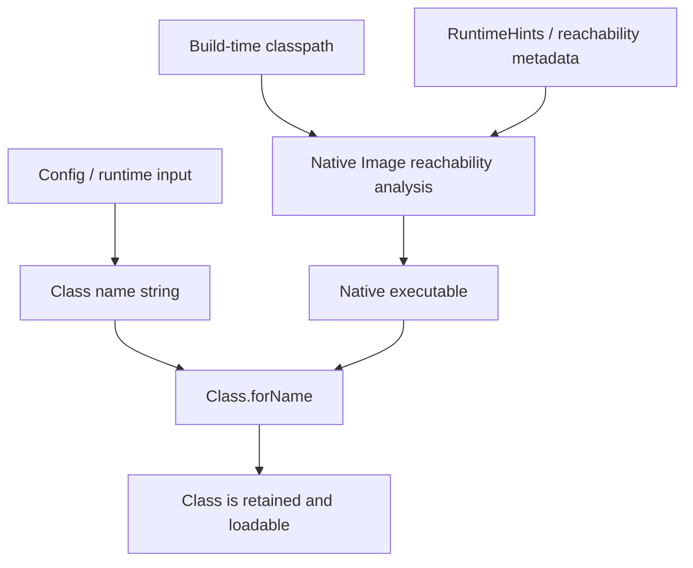

# Class.forName with Class Names Only Known at Runtime

## 1. Dynamic Class Loading and Native Image Limitations

Java allows loading a class by a name determined at runtime via `Class.forName`. This mechanism is commonly used in plugin systems, driver discovery, frameworks, serializers, custom dependency injection, and applications selecting implementations from configuration.

On a standard JVM, a classloader can look up a class by name when the program runs, provided the class is on the classpath/module path and the classloader has access. With **GraalVM Native Image**, the build process analyzes the set of classes that may be used under a closed-world model. The compiler cannot by default keep every class that could potentially be named by an arbitrary string in the future.

For example:

```java
String className = environment.getProperty("plugin.class");
Class<?> pluginClass = Class.forName(className);
Object plugin = pluginClass.getDeclaredConstructor().newInstance();
```

The compiler sees the `Class.forName` call, but does not necessarily know the value of `className` at build time. If the target class is not identified and retained in the executable, the call may succeed on the JVM yet fail in the native executable.

In the **SPRING_BOOT_NATIVE_IMAGE** module, you need to explicitly design the list of allowed loadable classes, ensure those classes are on the runtime classpath, register the necessary metadata, and test on the native executable. Reflection hints address dynamic access rights; they do not automatically bring missing dependencies into the application.



## 2. What Does Class.forName Do?

Common overloads:

```java
Class<?> type = Class.forName("com.example.plugins.CsvPlugin");
```

The single-parameter overload requests initializing the class according to the API's default behavior. You can explicitly specify initialization and the classloader:

```java
Class<?> type = Class.forName(
    "com.example.plugins.CsvPlugin",
    false,
    Thread.currentThread().getContextClassLoader()
);
```

The second parameter:

- `true`: initializes the class if needed; static initializers may run.
- `false`: loads the class without requiring immediate initialization at this call site.

The third parameter is the classloader used to locate the class. Classloader selection matters in applications with plugins, application servers, or libraries that create custom classloaders. Native Image does not necessarily support every form of dynamic class loading like the JVM; check the limitations of your GraalVM version and application architecture.

Once you have the `Class<?>`, the application can query constructors, methods, annotations, or instantiate objects. Each of those reflection operations may require separate metadata.

## 3. Why Are Arbitrary Class Names Unsuitable for Closed-World Analysis?

Suppose the application receives a class name from a request:

```java
String name = request.getParameter("implementation");
Class<?> implementation = Class.forName(name);
```

If a user can send any string, the potential set of classes is unbounded from the build's perspective. Native Image cannot automatically bundle every class from every library into the executable simply because a `String` variable might contain its name.

There are three separate issues:

1. **Reachability**: is the class included in the native executable or eliminated?
2. **Reflection access**: have the constructors/methods/fields accessed dynamically been registered?
3. **Class availability**: is the dependency containing the class actually on the application module's runtime classpath?

Adding a reflection hint does not fix a missing dependency. Adding a dependency also does not automatically guarantee that reflectively accessed constructors or methods are retained.

## 4. Using an Allowlist Instead of Loading Arbitrary Names

If the business logic only supports a fixed set of implementations, define an allowlist in code or controlled configuration:

```java
public enum PluginKind {
    CSV,
    JSON
}
```

Static registry:

```java
@Component
class PluginRegistry {

    private final Map<PluginKind, Supplier<Plugin>> factories = Map.of(
        PluginKind.CSV, CsvPlugin::new,
        PluginKind.JSON, JsonPlugin::new
    );

    Plugin create(PluginKind kind) {
        Supplier<Plugin> factory = factories.get(kind);
        if (factory == null) {
            throw new IllegalArgumentException("Unsupported plugin");
        }
        return factory.get();
    }
}
```

This creates static references to the implementations. Native Image recognizes the classes and constructors more easily, and the application does not have to accept Java class names directly from external input.

If mapping from configured names is needed:

```java
private static final Map<String, Supplier<Plugin>> PLUGINS = Map.of(
    "csv", CsvPlugin::new,
    "json", JsonPlugin::new
);

Plugin create(String configuredName) {
    Supplier<Plugin> factory = PLUGINS.get(configuredName);
    if (factory == null) {
        throw new IllegalArgumentException("Unsupported plugin: " + configuredName);
    }
    return factory.get();
}
```

Do not concatenate input strings with a package prefix and call `Class.forName` as a security measure. An allowlist should map business values to known classes/factories; avoid letting clients choose arbitrary classes.

## 5. When Is Class.forName Still Needed?

There are cases where plugins or extensions are distributed independently and the implementation is only chosen from configuration at runtime. In that situation, class names can still be used, but with clear constraints:

- The list of valid classes is declared and controlled before building.
- The classes are on the artifact's runtime classpath.
- The classes are registered with appropriate reflection/reachability metadata.
- Required constructors and methods have corresponding metadata.
- The chosen classloader matches the packaging model.
- External input cannot specify arbitrary classes.

Example of allowlist checking:

```java
private static final Map<String, Class<? extends Plugin>> ALLOWED = Map.of(
    "csv", CsvPlugin.class,
    "json", JsonPlugin.class
);

Plugin create(String key) throws ReflectiveOperationException {
    Class<? extends Plugin> type = ALLOWED.get(key);
    if (type == null) {
        throw new IllegalArgumentException("Unknown plugin");
    }
    return type.getDeclaredConstructor().newInstance();
}
```

Class literals in the map create static references to the implementations, while the constructor is still invoked via reflection. If you keep this instantiation style, register the required constructor or use factories directly to avoid unnecessary reflection.

## 6. Registering Reflection with Spring RuntimeHints

Spring AOT provides `RuntimeHintsRegistrar` to register classes and members needing dynamic access. Example:

```java
public class PluginRuntimeHints implements RuntimeHintsRegistrar {

    @Override
    public void registerHints(RuntimeHints hints, ClassLoader classLoader) {
        hints.reflection().registerType(
            CsvPlugin.class,
            MemberCategory.INVOKE_DECLARED_CONSTRUCTORS
        );

        hints.reflection().registerType(
            JsonPlugin.class,
            MemberCategory.INVOKE_DECLARED_CONSTRUCTORS
        );
    }
}
```

Register the registrar:

```java
@Configuration
@ImportRuntimeHints(PluginRuntimeHints.class)
class PluginConfiguration {
}
```

The example uses class literals for known implementations. The category must match the actual operation: if only invoking public constructors, pick the appropriate public scope; if invoking declared constructors, use the corresponding category and verify Java access restrictions.

Do not register all methods/fields if the plugin only needs a constructor. If the application later calls methods via reflection, add metadata for the exact methods and signatures.

## 7. Loading Classes by Name While Keeping Static References

You can combine a list of known classes with configured names:

```java
Map<String, Class<? extends Plugin>> allowed = Map.of(
    "csv", CsvPlugin.class,
    "json", JsonPlugin.class
);

Class<?> type = allowed.get(configuredName);
if (type == null) {
    throw new IllegalArgumentException("Unsupported plugin");
}

Object instance = type.getDeclaredConstructor().newInstance();
```

This approach still uses reflection for instantiation, but the target classes are statically referenced. Register constructor hints if Native Image needs reflection invocation. Unless a framework specifically requires it, a factory map using `Supplier` is usually simpler and requires less metadata.

## 8. Class.forName and Static Initialization

The `Class.forName(String)` overload initializes the class by default. That means static initializers can run right when the class is loaded via this call.

Example:

```java
public class NativePlugin {
    static {
        System.out.println("Plugin initialized");
    }
}
```

If Native Image's class initialization policy allows the class to be initialized at build time, static state may be created during the build. If the class needs to read the environment, current time, random seeds, or load runtime-dependent native libraries, you must consider an appropriate initialization policy.

The `Class.forName(name, false, loader)` overload defers initialization at that call site, but does not replace Native Image's class initialization configuration. The class can still be initialized when a subsequent operation requires it. Refer to the lesson on `--initialize-at-run-time` to understand initialization timing choices.

## 9. ServiceLoader as an Option for Plugin Ecosystems

If plugins conform to an interface and are packaged as providers, Java `ServiceLoader` is often a cleaner mechanism than reading class names from properties manually.

Interface:

```java
public interface Exporter {
    String export(Object value);
}
```

Providers registered in file:

```text
META-INF/services/com.example.export.Exporter
```

File contents list implementation classes, one provider per line:

```text
com.example.export.CsvExporter
com.example.export.JsonExporter
```

Usage:

```java
ServiceLoader<Exporter> exporters =
    ServiceLoader.load(Exporter.class);

for (Exporter exporter : exporters) {
    // Use provider.
}
```

`ServiceLoader` standardizes discovery and decouples consumers from concrete class names. However, in Native Image you still must verify service provider support and GraalVM/Spring metadata for your version. Do not assume that merely having `META-INF/services` in a JAR makes all providers work automatically in a native executable.

Spring also has its own discovery/auto-configuration mechanisms. If a plugin is actually a Spring bean, consider registering the bean via Spring configuration rather than manually instantiating it outside the container.

## 10. ClassLoader and Module Path

`Class.forName` can use the default classloader or an explicitly passed classloader. In complex applications, the context classloader may differ from the caller class's classloader.

Example:

```java
ClassLoader loader = Thread.currentThread().getContextClassLoader();
Class<?> type = Class.forName(className, false, loader);
```

Keep in mind:

- The context classloader can be `null` in some environments; provide an appropriate fallback.
- A classloader cannot load classes that are not present in the runtime image.
- Module access and visibility can restrict access to constructors/members.
- Some custom classloader creation or dynamic bytecode loading mechanisms may be incompatible with Native Image's closed-world model.
- Do not use class names from untrusted data as an arbitrary extensibility mechanism.

## 11. Checking Classpath and Dependencies Before Adding Hints

With Gradle, inspect the runtime classpath of the exact application module:

```bash
./gradlew :api-app:dependencies --configuration runtimeClasspath
./gradlew :api-app:dependencyInsight --dependency plugin-library --configuration runtimeClasspath
```

With Maven:

```bash
./mvnw dependency:tree
```

Then check whether the JAR contains the implementation and service metadata:

```bash
jar tf path/to/plugin-library.jar
```

If the class is missing from the runtime dependency graph, a reflection hint cannot package it on its own. Fix scope/exclusions/dependencies first, then re-run Spring AOT and the Native Image build.

## 12. Distinguishing Class Loading Errors from Reflection Errors

| Symptom | Common Cause | Where to Check |
|---|---|---|
| `ClassNotFoundException` | Class does not exist or classloader cannot find it | Runtime classpath, class name, classloader |
| `NoClassDefFoundError` | Class or related dependency unavailable at linking/loading time | Dependency graph and transitive dependencies |
| `NoSuchMethodException` | Constructor/method signature is wrong or does not exist | Verify class and signature |
| `IllegalAccessException` | Member inaccessible due to access/module rules | Visibility, module access, and hints |
| `UnsupportedFeatureError` | Dynamic class loading/bytecode mechanism unsupported as used | Plugin architecture and Native Image limitations |
| Works on JVM, fails in native | Class/member not retained or missing metadata | RuntimeHints/reachability metadata and native tests |
| Class loads but initialization fails | Static initializer or runtime dependency failed | Class initialization policy and stack trace |

Read the root exception and identify at which step the failure occurs: finding the class, linking dependencies, initializing the class, finding the constructor, or instantiating. Do not treat everything by broadening reflection hints.

## 13. Testing Class.forName on Native Image

A practical workflow:

1. Create JVM tests for every valid plugin and invalid name cases.
2. Verify each plugin's dependencies are on the runtime classpath.
3. Register RuntimeHints for dynamically accessed classes/constructors/members.
4. Run Spring AOT with the right profile and application module.
5. Build the Native Image from the fresh AOT output.
6. Run the native executable and exercise each valid plugin.
7. Verify error handling when a key is not in the allowlist.
8. Run tests in a container matching the target OS/architecture.
9. Record the artifact digest, toolchain, and list of supported plugins.

Smoke tests checking only startup are not enough. You must actually exercise the code paths using `Class.forName` or the corresponding factories.

## 14. Safe Design for Spring Boot Applications

- Prefer static dependency injection and bean registration when implementations are known at build time.
- Use a registry/factory map for a fixed set of plugins.
- Use `ServiceLoader` when a Spring-independent SPI is needed and Native Image support is verified.
- If `Class.forName` must be used, enforce an allowlist and only permit classes inside controlled artifacts.
- Do not accept arbitrary fully-qualified class names from HTTP requests or untrusted messages.
- Register the minimal constructor/method reflection needed.
- Distinguish class reachability from reflection access and runtime dependencies.
- Check static initializers, native libraries, and classloaders.
- Test each provider on the native executable, not just on the JVM.

## 15. Self-Check Questions

1. Why can `Class.forName` with a name known only at runtime work on the JVM yet fail in Native Image?
2. What is the difference between class reachability and reflection access?
3. Why can't a reflection hint replace a dependency missing from the runtime classpath?
4. When is a static registry or `Supplier` more suitable than loading classes by name?
5. What does `Class.forName(name, false, loader)` change and what does it not solve?
6. How does `ServiceLoader` help organize plugins and why is native testing still necessary?
7. Why is accepting arbitrary class names from requests a security risk?
8. What tests should be run to confirm all plugins are supported in the native executable?

**Key takeaway:** `Class.forName` can only load classes the runtime can locate; Native Image also needs to know which classes/members must be retained and dynamically accessed. Constrain class names with an allowlist, prefer static registries or appropriate `ServiceLoader` setups, register minimal metadata, and test every plugin on the native executable.
