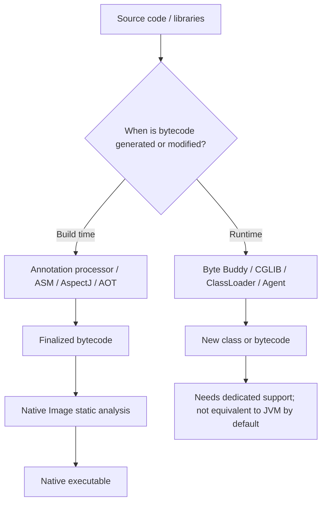

# Runtime Bytecode Generation, Transformation, and Dynamic Class Creation

## 1. Why Is This an Important Limitation?

Java applications on the JVM can perform many dynamic operations: generating new classes from bytecode, modifying bytecode before a class is loaded, loading plugins from new JARs, generating proxies with Byte Buddy/CGLIB, or using a Java agent to alter the behavior of running classes. These techniques are very useful for frameworks, ORM libraries, mocking, instrumentation, and plugin systems.

When compiling **Spring Boot to a GraalVM Native Image**, the execution model changes. Native Image analyzes code at build time under the *closed-world* assumption: code that can be invoked must be known upfront so the compiler can include it in the executable. Spring AOT also analyzes the `ApplicationContext` ahead of time and generates source code, bytecode, and runtime hints.

Therefore, it is necessary to distinguish three activities often lumped together as "dynamic code":

1. **Reflection:** finding existing classes, methods, or fields by name or metadata at runtime.
2. **Runtime class generation/loading:** creating new bytecode and then defining new classes through a class loader.
3. **Runtime bytecode transformation:** modifying a class's bytecode before loading or redefining/retransforming a class after it has been loaded.

Reflection can work in Native Image once the required classes/members are included in reachability metadata. That does **not** mean the executable can create arbitrary brand-new classes at runtime like the JVM. Similarly, proxies with a known list of interfaces can be prepared in advance, whereas a plugin creating arbitrary class/interface combinations after release is a different problem.

After this lesson, you will be able to:

- Explain the closed-world assumption and distinguish pre-existing classes from bytecode generated at runtime.
- Identify libraries or frameworks that dynamically generate, transform, or load classes.
- Choose among build-time code generation, Spring AOT, metadata, predefined classes, and experimental runtime class loading.
- Evaluate the limitations of Java agents, class loaders, Byte Buddy, CGLIB, and plugin architectures.
- Plan tests to catch dynamic code failures before releasing a native executable.

## 2. Distinguishing Reflection, Class Loading, and Bytecode Generation

### 2.1. Reflection Accesses Existing Classes

Example:

```java
package com.example.orders;

import java.lang.reflect.Method;
import org.springframework.context.ApplicationContext;

public class ReflectionExample {

    public Object invokeReflectively(ApplicationContext applicationContext)
            throws ReflectiveOperationException {
        OrderService orderService = applicationContext.getBean(OrderService.class);
        Class<?> type = Class.forName("com.example.orders.OrderService");
        Method method = type.getMethod("findById", String.class);
        return method.invoke(orderService, "ORD-100");
    }
}
```

Here `OrderService` and the `findById` method already exist in the application. The code only looks them up and invokes them via reflection. With Native Image, GraalVM needs to know about dynamically accessed classes and members to retain them in the executable. Spring can infer some cases automatically; the rest require `RuntimeHints` or reachability metadata.

### 2.2. Runtime Class Generation Creates New Classes

A library like Byte Buddy can generate bytecode for a new subclass and load that class:

```java
import com.example.orders.OrderService;
import net.bytebuddy.ByteBuddy;
import net.bytebuddy.dynamic.loading.ClassLoadingStrategy;

Class<? extends OrderService> generatedType = new ByteBuddy()
        .subclass(OrderService.class)
        .name("com.example.orders.generated.AuditedOrderService")
        .make()
        .load(OrderService.class.getClassLoader(), ClassLoadingStrategy.Default.INJECTION)
        .getLoaded();

OrderService instance = generatedType.getDeclaredConstructor().newInstance();
```

The class `AuditedOrderService` does not exist in the original JAR. It is created from bytecode after the program starts. This is the fundamental difference compared to reflection.

This example assumes `OrderService` is not `final`, has a constructor callable by a subclass, and Byte Buddy is declared as a dependency. This illustrates JVM behavior; to run in Native Image you need to choose one of the approaches in the later sections.

### 2.3. Bytecode Transformation Modifies Classes Before Execution

A tool such as ASM, Byte Buddy, or AspectJ can modify the bytecode of existing classes—for example, inserting timing instructions into methods. There are two different transformation times:

- **Build-time transformation:** modifying `.class` files during the build, after which the AOT/native-image compiler analyzes the modified bytecode.
- **Runtime transformation:** using `ClassFileTransformer`, a Java agent, or redefine/retransform mechanisms to alter bytecode while the application is running.

Native Image fits better with the build-time transformation path. Runtime instrumentation relying on JVM/JVMTI and dynamically loaded bytecode has major limitations; you cannot assume that a Java agent running well on HotSpot will work inside a native executable.



## 3. How Does the Closed-World Assumption Affect This?

### 3.1. The Class Set and Call Graph Are Determined at Build Time

Native Image begins analysis from entry points and determines which methods, fields, and classes can be reachable. The goal is to include only what is needed in the executable to reduce size, startup time, and memory usage.

Practical consequences:

- The classpath and dependencies are fixed at build time.
- Native Image does not have a lazy class loading mechanism like HotSpot; packaged code and classes are handled under the built executable model.
- An unreachable class can be eliminated from the executable.
- Classes looked up via runtime strings need metadata or must be inferred by the compiler from constant expressions.
- Reflection, resources, serialization, JNI, and JDK proxies require additional information when static analysis cannot infer enough.
- A new class file created and loaded after the executable starts does not naturally become part of the already-analyzed call graph.

Spring AOT adds container-level constraints: the bean set is determined at build time; profiles and properties affecting `@Conditional` must be chosen when AOT runs; beans registered via `registerSingleton` and bean definitions with arbitrary instance suppliers are not transformed by AOT in the standard way.

### 3.2. A Reflection Hint Is Not a Class-Generation Hint

Example of registering reflection for an existing class:

```java
package com.example.orders;

import org.springframework.aot.hint.MemberCategory;
import org.springframework.aot.hint.RuntimeHints;
import org.springframework.aot.hint.RuntimeHintsRegistrar;
import org.springframework.context.annotation.Configuration;
import org.springframework.context.annotation.ImportRuntimeHints;

@ImportRuntimeHints(OrderReflectionHints.class)
@Configuration(proxyBeanMethods = false)
class OrderConfiguration {
}

class OrderReflectionHints implements RuntimeHintsRegistrar {
    @Override
    public void registerHints(RuntimeHints hints, ClassLoader classLoader) {
        hints.reflection().registerType(
                OrderService.class,
                MemberCategory.INVOKE_PUBLIC_METHODS);
    }
}
```

This hint lets Native Image retain the metadata needed to invoke public methods of `OrderService` reflectively. It does not generate `AuditedOrderService`, does not add plugin JARs, and does not permit modifying `OrderService` bytecode at runtime.

| Need | Suitable Mechanism |
|---|---|
| Invoke a known method via reflection | Reflection hints or static analysis |
| Create a JDK proxy for known interfaces | Proxy hints / Spring AOT |
| Generate subclass proxies before native compilation | Spring AOT or build-time code generation |
| Create a subclass from completely new bytecode after startup | Requires supported runtime class loading; not equivalent to JVM by default |
| Modify class files before native compilation | Build-time bytecode transformation |
| Redefine loaded classes in a native process | Do not assume JVM instrumentation/JVMTI is supported |

## 4. Libraries That Commonly Generate or Transform Bytecode

| Technology | Typical JVM Behavior | What to Check for Native Builds |
|---|---|---|
| Byte Buddy | Generates subclasses, proxies, implementations, and classes from DSLs | May generate classes at runtime; check if it can move to build time or needs experimental runtime class loading |
| CGLIB | Generates subclass proxies for classes | Spring AOT can generate required proxies at build time; arbitrary runtime proxies need separate evaluation |
| Javassist | Creates classes, modifies methods/bytecode, and loads classes | APIs like `toClass`, `defineClass`, or class pools may require runtime class loading and extra setup |
| ASM | Reads, generates, and modifies bytecode | Works well at build time; generating new classes at runtime is a separate use case |
| AspectJ load-time weaving | Uses a class loader/agent to weave classes as they load | Prefer compile-time weaving or build-time weaving; do not assume LTW works like the JVM |
| Mockito / mocking libraries | Creates mocks via proxies or bytecode generation | Check mock makers and native test support; JVM tests do not replace native tests |
| Hibernate / ORM | May use proxies, enhancement, and bytecode metadata | Use a version with AOT/native support; prefer build-time enhancement and check proxy/lazy loading |
| Groovy or Java compiler API | Compiles scripts/sources into classes at runtime | Compilers, class loaders, and runtime-generated bytecode may be absent from the image or require experimental features |

Do not conclude a library is completely incompatible solely from the technology name. A library may support both JVM and Native Image by picking a different implementation path when native mode is detected. Check the native documentation for the exact version and inspect actual class generation in your application's code paths.

## 5. How Does Spring AOT Handle Proxies and Code Generation?

### 5.1. Generating Code and Proxies at Build Time

Spring AOT processes the `ApplicationContext` during the build, applying configuration and discovery decisions that normally happen at runtime startup. Output typically includes:

- Java source code to restore the bean factory state.
- Bytecode, typically used for required dynamic proxies.
- `RuntimeHints` for reflection, resources, serialization, and JDK proxies.

With Spring Boot, some proxies that Spring Framework needs on the JVM can be pre-generated during the AOT build so GraalVM includes them in the native executable. Therefore, having Spring AOP or CGLIB in dependencies does not automatically mean native image cannot be used.

### 5.2. Proxy Structure Is Decided from Known Configuration

Example AOP configuration:

```java
import org.aspectj.lang.ProceedingJoinPoint;
import org.aspectj.lang.annotation.Around;
import org.aspectj.lang.annotation.Aspect;
import org.springframework.context.annotation.Configuration;
import org.springframework.context.annotation.EnableAspectJAutoProxy;
import org.springframework.stereotype.Component;

@Configuration(proxyBeanMethods = false)
@EnableAspectJAutoProxy
class OrderAopConfiguration {
}

@Aspect
@Component
class OrderTimingAspect {

    @Around("execution(* com.example.orders.OrderService.*(..))")
    Object measure(ProceedingJoinPoint invocation) throws Throwable {
        long started = System.nanoTime();
        try {
            return invocation.proceed();
        }
        finally {
            long elapsed = System.nanoTime() - started;
            // Record metric according to the application's mechanism.
        }
    }
}
```

When the bean, aspect, and pointcut are all present in the configuration analyzed by Spring AOT, Spring can prepare the corresponding proxy in the AOT output. This differs from a post-deployment plugin introducing an arbitrary new aspect and expecting Spring to generate a new proxy.

### 5.3. Related Spring AOT Limitations

- The classpath must be fully determined at build time.
- The bean set cannot change arbitrarily after the executable is created.
- `@Profile` and properties affecting `@Conditional` are evaluated when AOT runs.
- Beans registered via `registerSingleton(...)` are not transformed by AOT in the standard way.
- Bean definitions whose instance supplier is a lambda or method reference are not transformed ahead-of-time in a general way.
- Bean declaration types should be concrete so Spring can analyze required constructors, methods, and proxies.

For applications needing multiple configuration variants, build separate artifacts for each chosen bean/profile set. If extensibility via arbitrary runtime plugins is required, consider splitting plugins into a separate JVM process or designing a fixed registry inside the native image.

## 6. Approaches for Handling Runtime Class Generation

There is no single solution for every library. Choose based on whether the bytecode can be known in advance.

### 6.1. Option 1: Eliminate Runtime Class Generation

If the goal is simply picking an implementation or adding behavior, you can often use:

- Pre-compiled interfaces and implementations.
- A strategy/factory/registry with a fixed list of implementations.
- Spring `@Bean`, `@Import`, `@Conditional` resolved during the AOT build.
- JDK proxies with an upfront known list of interfaces.
- Static callbacks or decorators instead of arbitrarily generated subclasses.

Example of a static registry:

```java
package com.example.orders;

import org.springframework.stereotype.Component;

public interface OrderPricingPolicy {
    long calculate(Order order);
}

@Component
class StandardPricingPolicy implements OrderPricingPolicy {
    @Override
    public long calculate(Order order) {
        return order.subtotal();
    }
}

@Component
class PriorityPricingPolicy implements OrderPricingPolicy {
    @Override
    public long calculate(Order order) {
        return Math.round(order.subtotal() * 0.95);
    }
}
```

The application selects an implementation from runtime data without creating new classes. Both implementations are already in the executable and can be analyzed by Spring AOT. If the selection condition alters the bean graph, resolve that condition at build time; if it only selects behavior among existing implementations, it can be decided at runtime in business logic.

### 6.2. Option 2: Move Generation to Build Time

This is usually the best option when generated classes only depend on schemas, configuration, or sources known at build time.

Example workflow:

1. Read schemas or model definitions at build time.
2. Use an annotation processor, ASM, Byte Buddy, or generator to produce source/bytecode.
3. Place generated classes into the module's build output.
4. Run Spring AOT after generation completes so AOT sees the new classes.
5. Run the Native Image compiler on the finalized classpath.


If classes need to be generated by a static initializer of a dedicated class during the image build, GraalVM documents storing the generated `Class<?>` in a static field and initializing the generator class at build time with `--initialize-at-build-time=<class_name>`. This is for special cases; the generator must be able to run in the build environment, and any state persisted into the image heap must be valid at runtime.

Example configuration flag:

```bash
native-image \
  --initialize-at-build-time=com.example.codegen.BuildTimeProxyCatalog \
  -jar app.jar order-service
```

Do not indiscriminately build-time initialize classes whose static initializers read production files, make network calls, fetch secrets, open sockets, start threads, or depend on the clock/randomness. Those side effects run on the build machine; invalid state could be frozen into the executable or break the build.

### 6.3. Option 3: Use Predefined Classes Collected by the Native Image Agent

For legacy applications where dynamically class-generating libraries cannot easily be changed, GraalVM provides an experimental/best-effort **predefined classes** mechanism. The Native Image Agent can record bytecode of classes generated during a JVM run so the image builder can package them.

Example running the application on the JVM with the agent:

```bash
java \
  -agentlib:native-image-agent=config-output-dir=target/native-agent,experimental-class-define-support \
  -jar target/order-service.jar
```

Exercise all required proxy/class generation scenarios during the agent run. The output directory produced by the agent may contain `agent-extracted-predefined-classes` and corresponding metadata. Pass this directory as input to the native-image build following the documentation for your exact GraalVM version.

Limitations to understand clearly:

- The agent only captures classes created along code paths actually executed during tracing.
- When the native executable runs, the class must match **both name and bytecode** of a captured class.
- Classes whose names or bytecode vary by sequence numbers, UUIDs, timestamps, or random data usually cannot match reliably.
- A predefined class can only be loaded once per execution and through a single class loader.
- Classes are initialized upon loading at runtime and cannot be build-time initialized under this mechanism.
- This is a compatibility workaround for some legacy use cases, not a guarantee for plugins or proxies with arbitrary variations.
- Predefined classes cannot be combined with the `-H:+RuntimeClassLoading` option.

Do not hand-author `predefined-classes-config.json`; let the agent generate metadata and bytecode in the schema GraalVM expects.

### 6.4. Option 4: Enable Experimental Runtime Class Loading

Starting in the GraalVM 25.1 line, Native Image offers initial/experimental support for defining classes from bytecode while the executable is running. The `-H:+RuntimeClassLoading` option allows class loaders to use `ClassLoader.defineClass(...)` within the scope of this feature.

Example command from GraalVM documentation:

```bash
native-image \
  -H:+UnlockExperimentalVMOptions \
  -H:+RuntimeClassLoading \
  -H:-UnlockExperimentalVMOptions \
  -jar app.jar order-service
```

With Gradle Native Build Tools, you can pass the corresponding build arguments to the `main` binary if supported by your GraalVM and plugin versions:

```groovy
graalvmNative {
    binaries {
        main {
            buildArgs.addAll(
                    '-H:+UnlockExperimentalVMOptions',
                    '-H:+RuntimeClassLoading',
                    '-H:-UnlockExperimentalVMOptions'
            )
        }
    }
}
```

This is an **experimental** feature; verify the documentation for your exact GraalVM distribution/version. Enabling the flag does not mean every Byte Buddy, Javassist, `URLClassLoader`, or Java compiler library will automatically work without extra configuration.

Documented limitations include:

- A class loader cannot define two classes with the same binary name; defining a variant requires a different name or a different defining class loader.
- Runtime-loaded classes can link against classes analyzed at build time, but static analysis may have eliminated methods or static fields it did not see as reachable. When all elements in a package must be preserved, consider `-H:Preserve=package=...`.
- Parallel class loading is not yet supported.
- `URLClassLoader` and loading classes via JDK/application class loaders may require additional setup.
- Image size and memory usage may increase.
- Cannot be combined with predefined classes.

Enable this option only when the application genuinely needs to define bytecode after startup, version support is confirmed, and integration tests cover the generated class loaders/bytecode.

## 7. Bytecode Transformation and Java Agents

### 7.1. Build-Time Weaving Fits Native Image

If you want to inject logging, metrics, transactions, or validation into classes, prefer modifying bytecode before AOT/native compilation:

- AspectJ compile-time weaving.
- Byte Buddy Maven/Gradle plugin or a build task running before AOT.
- An ASM task generating new classes into `build/generated` or the module's output directory.
- Annotation processors generating source code instead of creating classes via a class loader at runtime.

The build order must ensure transformed classes appear on the classpath when Spring AOT and Native Image analyze it. If AOT runs before weaving, generated initializers may reflect the old classes.

### 7.2. Runtime Instrumentation Is Not the Tracing Agent

The Java Instrumentation API (`java.lang.instrument`) and JVMTI are commonly used to install a `ClassFileTransformer`, or redefine/retransform running classes on HotSpot. Native Image is a native executable without HotSpot's full bytecode/JIT model; GraalVM documentation states that JVMTI and bytecode-based tooling are not supported as on the JVM.

Distinguish the two agent types:

| Agent Type | Purpose | Usage with Native Image |
|---|---|---|
| Java instrumentation agent | Transforms classes in the JVM on load/redefine/retransform | Do not assume it works in a native executable; move instrumentation to build time if possible |
| GraalVM Native Image Tracing Agent | Runs the application on the JVM to collect metadata on reflection, proxies, resources, JNI, and some dynamically created classes | Used during build preparation; the agent does not turn a native executable into a JVM |

The Tracing Agent is not a mechanism for attaching an agent and modifying bytecode after a native application is already running. It records behavior during an instrumented JVM run and produces metadata/bytecode to assist the native-image build.

## 8. Designing Plugin Architectures for Native Applications

### 8.1. Plugins Installed After Release

A JVM system can scan a `plugins/` directory, find new JARs, create a `URLClassLoader`, load implementations, and register beans/services at runtime. This is a flexible architecture, but it conflicts with Spring AOT and Native Image assumptions:

- The executable's classpath is fixed.
- New classes in external JARs are not automatically analyzed by the compiler.
- The bean graph cannot change arbitrarily after AOT generates initializers.
- Custom class loaders may require experimental runtime class loading and face extra constraints.

### 8.2. Alternative Design Approaches

| Extensibility Requirement | Better-Suited Design |
|---|---|
| A known set of plugins at release time | Package all implementations in the image and select via a runtime registry |
| Different plugins per customer/environment | Build separate artifacts per plugin/configuration group |
| Plugins only supply business rules | Use a DSL, JSON/YAML schema, or rule engine with a native-compatible interpreter instead of loading new Java bytecode |
| Plugins need arbitrary Java libraries | Run plugins in a separate JVM process and communicate via HTTP/gRPC/message broker |
| Plugins need independent updates | Split into services or workers with independent release lifecycles |
| A stable set of generated classes | Generate at build time or use predefined classes if limits are verified |
| Class bytecode truly changes after every startup | Evaluate experimental `-H:+RuntimeClassLoading` or keep this component in a separate JVM |

If using a rule engine or scripting, verify that the engine has a Native Image-compatible runtime implementation. Interpreting a DSL from data does not mean you can compile arbitrary Java source into new classes.

## 9. Practice Exercise: Evaluating Byte Buddy and Spring AOT

**Context:** `order-service` has a use case that uses Byte Buddy to generate an audit subclass when running on the JVM. The goal is to keep the auditing functionality in the native executable.

### Step 1 — Identify Current Behavior

Record:

- The class-generation library and version in use.
- The API performing generation (`make`, `defineClass`, `load`, `ClassLoader.defineClass`, or equivalent).
- Whether generated class names are stable.
- Whether bytecode changes per request, customer data, timestamp, or UUID.
- Whether custom class loaders, parallel class loading, or classpath plugins are used.

### Step 2 — Check Feasibility of Moving to Build Time

If classes only depend on known configuration, move generation into a Gradle/Maven build task. Place generated classes into the build output and run Spring AOT afterward. If the goal is simply auditing a service bean, try Spring AOP or a static decorator first.

### Step 3 — Inspect AOT Output

For a Gradle Spring Boot project, run the AOT task per plugin configuration and inspect the output generated classes/proxy bytecode. For Maven, inspect Spring AOT's generated classes directory. Confirm that required proxies are created before the native compiler runs.

### Step 4 — If Generation Cannot Be Moved

Evaluate in order:

1. Can a static registry or static implementation be used?
2. Can classes be generated at build time and the needed `Class<?>` references retained?
3. Can predefined classes match names/bytecode across runs?
4. Does the deployed GraalVM version support experimental runtime class loading, and are the class loader constraints acceptable?
5. Should the generator/plugin be split into a separate JVM process?

### Step 5 — Run Native Tests

Build the native executable and exercise the exact audit code path. Verify proxy classes are created or loaded properly, handlers execute, dependencies are found, and there are no races from parallel class loading. Also run integration tests in the actual deployment container/platform.

### Recording Sheet

| Item | Result to Record |
|---|---|
| Bytecode generation library | _(name and version)_ |
| Class creation/loading API | _(note)_ |
| Are class name and bytecode stable? | _(yes/no, reason)_ |
| Class loader | _(note)_ |
| Moved to build-time generation? | _(yes/no)_ |
| Did Spring AOT see the proxy/generated class? | _(evidence)_ |
| RuntimeClassLoading or predefined classes | _(unused / version + options)_ |
| Native build | PASS/FAIL |
| Native integration test | PASS/FAIL |
| Image size/RSS after change | _(measured)_ |

## 10. Common Errors

| Symptom | Possible Cause | Resolution |
|---|---|---|
| `ClassNotFoundException` for config-named class | Class missing from classpath/build output or name only appears at runtime | Package the class, use constant names/metadata, or move generation to build time |
| `UnsupportedFeatureError` on `defineClass` | Using runtime class loading without enabling support or unsupported version | Prefer build-time generation; only try `-H:+RuntimeClassLoading` when version support is confirmed |
| Reflection hints exist yet Byte Buddy still fails | Reflection metadata does not generate new class bytecode | Identify the class generation path; use AOT, predefined classes, or experimental runtime class loading |
| Spring proxy works on JVM, fails in native | Proxy generated after AOT or Spring AOT missed the bean/config | Inspect AOT output and bean/proxy config; add hints for the exact proxy type needing support |
| Plugin JAR added after startup is not loaded | Classpath is closed at build time | Package plugins before building, split into a JVM process, or evaluate experimental runtime class loading |
| Same class name defined a second time | One class loader cannot define the same binary name multiple times | Use a different name or a different defining class loader per supported design |
| Runtime-generated class calls build-time method, method missing | Static analysis stripped methods/fields not seen as reachable | Retain needed methods via reachability or consider `-H:Preserve=package=...` |
| Predefined class not found | Name or bytecode differs from data collected by the agent | Stabilize name/bytecode, run the agent across all code paths, or switch approaches |
| Runtime class loading fails under concurrency | Parallel class loading is unsupported in the experimental feature | Serialize load operations or avoid this feature for that use case |
| Java agent does not run in native executable | Agent relies on JVM instrumentation/JVMTI | Move instrumentation to build time or use corresponding native observability |

## 11. Pre-Release Checklist for Native Image

- [ ] Located class-generation or bytecode-transformation APIs in dependencies and application code.
- [ ] Distinguished reflection from defining new classes.
- [ ] Checked `ClassLoader`, `URLClassLoader`, Byte Buddy, CGLIB, Javassist, and Java agents if used.
- [ ] Moved predictable code generation to build time.
- [ ] Spring AOT runs after all necessary generation/weaving steps.
- [ ] Spring-managed proxies are generated in AOT output.
- [ ] If using predefined classes, verified bytecode/name stability and class loader constraints.
- [ ] If using runtime class loading, verified GraalVM version, experimental flags, and operational limits.
- [ ] Ran tests covering all class generation/loading code paths.
- [ ] Measured executable size, RSS, and startup after enabling additional dynamic features.

## 12. Conclusion

Runtime bytecode generation, class transformation, and dynamic class loading are powerful JVM capabilities, but they require dedicated consideration when migrating Spring Boot to GraalVM Native Image. Reflection hints only enable dynamic access to known classes/members; they do not inherently allow creating new classes.

Prefer moving code generation and bytecode weaving to build time so Spring AOT and the Native Image compiler see the complete result. When maintaining legacy applications, you can explore predefined classes collected by the Native Image Agent. GraalVM 25.1 and later also provide experimental runtime class loading support, though you must accept limitations around class loaders, parallel loading, image size, and memory. If plugins must load arbitrary Java bytecode after release, splitting that part into a separate JVM process is usually easier to control.

### Official References

- [GraalVM — Run-Time Class Loading](https://www.graalvm.org/dev/reference-manual/native-image/runtime-class-loading/)
- [GraalVM — Reachability Metadata: Defining Classes at Run Time](https://www.graalvm.org/jdk25/reference-manual/native-image/metadata/)
- [GraalVM — Experimental Agent Options: Predefined Classes](https://www.graalvm.org/jdk25.5/reference-manual/native-image/metadata/ExperimentalAgentOptions/)
- [GraalVM 25.1 Release Notes](https://www.graalvm.org/release-notes/25.1/)
- [GraalVM — Native Image Compatibility Guide](https://www.graalvm.org/dev/reference-manual/native-image/metadata/Compatibility/)
- [Spring Framework — Ahead of Time Optimizations](https://docs.spring.io/spring-framework/reference/core/aot.html)
- [Spring Boot — Introducing GraalVM Native Images](https://docs.spring.io/spring-boot/reference/packaging/native-image/introducing-graalvm-native-images.html)
