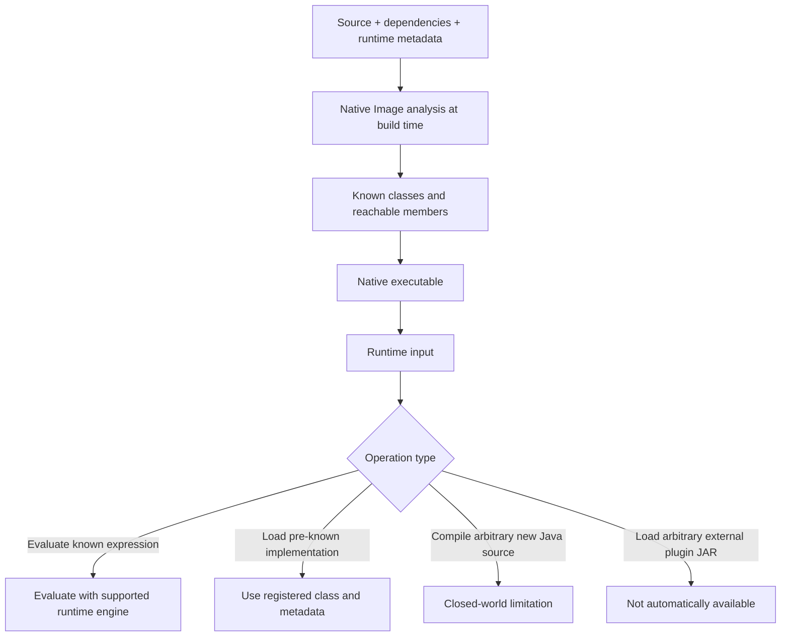
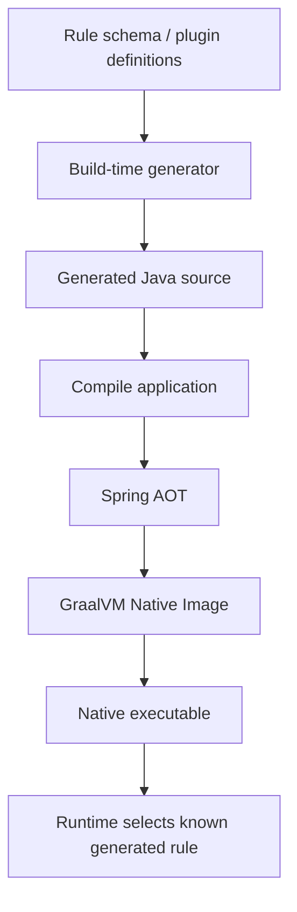

# Script Engines, Expressions, and Libraries Using Dynamic Compilation

## 1. Why Must Dynamic Mechanisms Be Considered Separately?

A Spring Boot application may allow users to write expressions, run scripts, compile Java code at runtime, or load plugins from external JARs. These capabilities typically rely on class discovery, bytecode generation, loading new classes, or invoking members by name while the process is running.

On a standard JVM, mechanisms such as the Java Compiler API, custom classloaders, scripting engines, or bytecode libraries can generate and load new code at runtime when conditions are met. **GraalVM Native Image** operates under the closed-world assumption: the compiler analyzes reachable classes and paths at build time and produces an executable from a known set of code. It does not automatically turn a released binary into a general-purpose JVM capable of compiling arbitrary Java source or loading any plugin class that appears later.

Therefore, when designing **SPRING_BOOT_NATIVE_IMAGE**, it is essential to distinguish:

- **Expression evaluation:** evaluating an expression in an existing language or model, such as Spring Expression Language (SpEL).
- **Scripting:** executing scripts using an engine such as JavaScript or another embedded language.
- **Dynamic compilation:** translating source or a DSL into bytecode/machine code while the application is running.
- **Dynamic class loading/plugins:** loading classes or JARs not present in the image at build time.

These categories have different limitations. You should not conclude that all expressions are unusable in native, or that every script engine works merely because the dependency compiles on the JVM.

## 2. How Closed-World Affects Runtime-Generated Code

Native Image analyzes the classpath, metadata, and identifiable entry points during the build. Classes invoked directly or registered via hints can be retained. However, registering reflection for a known class does not mean you can load a completely new Java class from a user-uploaded file after the executable has been built.



A native application can still process dynamic data, parse expressions, or select an implementation from a known set of classes. The limitation appears when runtime needs to create or load new code that the build could not know about beforehand.

## 3. Distinguishing Expression Evaluation from Compilation

An expression is typically data interpreted by an existing engine's parser. For example:

```text
order.total > 100000 && customer.active
```

The engine can parse the expression into an AST or internal structure and evaluate it against runtime objects. It does not necessarily have to compile the expression into a new Java class.

In contrast, dynamic compilation may receive source code:

```java
public class DiscountRule {
    public BigDecimal apply(Order order) {
        return order.total().multiply(new BigDecimal("0.9"));
    }
}
```

and then invoke a Java compiler or bytecode generator to create a new class. Loading and executing the newly created class is a different requirement from parsing an expression.

| Mechanism | Input | Primary Work | Native Image Considerations |
|---|---|---|---|
| SpEL | Expression text | Parse/evaluate per SpEL | Spring/SpEL capabilities and reflection access paths |
| Rule DSL | Business syntax | Parse into AST or rule model | Existing parser, model, and evaluator |
| Script engine | Script source | Engine executes scripting language | Whether the engine supports Native Image and runtime code generation |
| Java Compiler API | Java source | Compile source into bytecode | Compiler implementation, filesystem, and class loading |
| Bytecode library | Class/method model | Generate bytecode | Dynamic class definition and runtime compiler constraints |
| Plugin classloader | External JAR/classes | Load new implementations | Closed class set at build time and ability to load new code |

This classification is based on activity. An expression engine may use internal bytecode generation for optimization; in that case, you must still inspect the engine's specific implementation mechanism.

## 4. Spring Expression Language (SpEL)

SpEL allows reading and evaluating expressions against objects, invoking properties/methods, accessing collections, and using operators. Example:

```java
ExpressionParser parser = new SpelExpressionParser();

Expression expression =
        parser.parseExpression("quantity * unitPrice");

EvaluationContext context = new StandardEvaluationContext(order);

BigDecimal total = expression.getValue(
        context, BigDecimal.class);
```

SpEL parses the expression into an expression tree and evaluates it against a context. For simple expressions, no new Java class loading is required. This differs from taking Java source and compiling it into a class.

However, SpEL can invoke methods, access properties via reflection, or use type references/constructor expressions. Those dynamic paths must be examined in Native Image. Do not assume all SpEL expressions are automatically supported just because the parser can initialize.

Points to check:

- Does the expression invoke methods via reflection?
- Does it use `T(com.example.SomeType)` for type references?
- Does it invoke constructors with `new` inside the expression?
- Does it access classes/members by name from runtime data?
- Does it use custom property accessors, method resolvers, or type converters?
- Is the set of accessible types fixed and registrable at build time?

If the application only needs a small set of business calculations, a restricted DSL or strongly typed evaluator is usually easier to control than an expression engine allowing arbitrary access to any class.

## 5. Security Boundaries When Evaluating Expressions

Expression evaluation can become a security risk if untrusted users are allowed to invoke methods, access beans, or instantiate arbitrary objects.

For example, do not pass user-supplied expressions directly into a context with access to all Spring beans or system APIs. An expression capable of calling methods can open paths to read data, mutate state, or perform unintended actions.

Safer design:

- Allow only the required set of operators and business properties.
- Use a context object containing curated data; do not expose the entire ApplicationContext.
- Restrict type references, method calls, and constructor access.
- Set limits on expression length/complexity and evaluation time if supported by the engine.
- Enforce authorization on who can create/modify rules.
- Do not treat Native Image as a security sandbox for expressions.

Native Image restricts the set of code that can be packaged, but it does not replace authorization, validation, or sandboxing of an expression language.

## 6. Script Engines and javax.script

The Java Scripting API (`javax.script`) defines abstractions like `ScriptEngineManager`, `ScriptEngine`, and `Bindings`. Example on the JVM:

```java
ScriptEngineManager manager = new ScriptEngineManager();
ScriptEngine engine = manager.getEngineByName("javascript");

if (engine == null) {
    throw new IllegalStateException(
            "JavaScript engine is not available");
}

Object result = engine.eval("1 + 2");
```

This API is only a lookup mechanism for engines; it does not supply every scripting language by itself. The engine must be added to the classpath/module path and be compatible with the JDK in use.

Since JDK 15, Nashorn was removed from the JDK after deprecation. Therefore, do not assume `getEngineByName("javascript")` returns Nashorn on modern JDKs. Other engines have their own distribution mechanisms and levels of Native Image support.

When bringing a script engine into native, verify:

- Does the engine support Native Image in that exact version?
- How does the engine use reflection, method handles, classloaders, or bytecode generation?
- Does the engine need resources, locale data, modules, or external files?
- Are scripts compiled to new bytecode or interpreted by an interpreter?
- Does the engine require separate runtime components or native libraries?

A dependency compiling cleanly does not prove the engine works fully in a native executable.

## 7. GraalJS and Other Engines

GraalVM includes polyglot language technologies such as GraalJS. However, distinguish **GraalJS running on the GraalVM runtime/JVM** from embedding the engine inside an application packaged as a Native Image. Capabilities, configuration, and limitations depend on the GraalVM version, engine distribution, and embedding approach.

When choosing an engine:

1. Identify an engine version compatible with the project's GraalVM/JDK.
2. Check the engine's Native Image documentation, not only its JVM documentation.
3. Build a small spike using the real embedding API.
4. Build native and test real scripts, including errors, module imports, and required libraries.
5. Measure startup, memory, compile/evaluation time, and security boundaries.
6. Check licensing and how runtime components are distributed.

Do not assume a script engine can generate arbitrary bytecode in native simply because it is called a GraalVM language. Some engines may require specific configurations or modes; rely on official documentation for the deployed version.

## 8. The Java Compiler API and Compiling Java Source at Runtime

The Java Compiler API resides in the `java.compiler` module, typically entered via `ToolProvider.getSystemJavaCompiler()`. On a full JDK, an application can compile source into bytecode:

```java
JavaCompiler compiler =
        ToolProvider.getSystemJavaCompiler();

if (compiler == null) {
    throw new IllegalStateException(
            "Java compiler is not available");
}
```

In Native Image, do not assume the JDK's compiler implementation can be packaged and run as on a full JDK. A native executable is not a JDK distribution. The compiler may not be present in the runtime image, required modules may not be supported as expected, and defining new classes continues to hit closed-world limitations.

Even if bytecode can be produced by a separate library, the next step is loading and executing the new class. That capability must be evaluated independently; reflection hints only describe members of known types, and do not turn a native executable into a general-purpose Java compiler environment.

If the product strictly requires customers to submit new Java source after deployment, consider offloading the dynamic compilation/execution part to a dedicated JVM service or sandboxed execution environment.

## 9. Bytecode Generation and Runtime Class Definition

Some libraries create classes via bytecode rather than invoking the Java compiler. For example, ASM, Byte Buddy, or CGLIB may be used to generate proxies/subclasses.

On the JVM, a library can generate a byte array and define a class via a classloader or equivalent mechanism. In Native Image, arbitrary dynamic class definition does not work like a standard JVM because the class set is determined beforehand. Some libraries offer Native Image integrations or alternative mechanisms for bounded use cases, but you should not extrapolate that support to all kinds of class generation.

Distinguish:

- **JDK dynamic proxy:** a proxy implementing known interfaces; can be declared ahead of time via proxy hints.
- **Spring AOP proxy:** Spring AOT can analyze and prepare the required proxies.
- **Arbitrary runtime-generated subclass:** may require creating new classes outside the build-time known set; this is difficult or unsuitable for Native Image.
- **Build-time bytecode enhancement:** can fit if classes are generated before Native Image analysis and included in build inputs.

If a library generates proxies or subclasses, check whether it supports AOT/native and whether a build-time generation mechanism exists. Do not try to fix runtime class definition by registering reflection hints for classes that do not exist at build time.

## 10. Plugins and JARs Loaded After Release

A JVM plugin model typically uses `URLClassLoader` to load JARs from a `plugins/` directory after the application starts. Native Image does not inherently carry the ability to load arbitrary new classes that way.

If a plugin class is not in the class set analyzed at build time, adding a JAR to the runtime filesystem does not automatically make the plugin's code reachable or compiled into the executable.

Design options:

| Requirement | Appropriate Direction |
|---|---|
| Plugin set fixed at build time | Include plugins in dependencies/build inputs, register types/hints, and rebuild |
| Selecting one of several implementations | Register all known implementations, choose via runtime configuration |
| Plugins change independently after deploy | Offload the plugin host to a JVM service or separate process |
| Logic changes frequently | Use a DSL/rule data interpreted by an already-packaged engine |
| Running untrusted code | Use dedicated sandboxing/process isolation; do not rely on Native Image as a sandbox |

If a plugin is a JAR built alongside the application and only selected at runtime, ensure the classes and metadata are already inside the image. Runtime selection only picks from the available set of implementations.

## 11. Shifting Dynamic Compilation to Build-Time Generation

A frequently effective strategy is shifting code generation into the build pipeline:



For example, an application has a set of rules managed in a repository. Rather than accepting Java source and compiling it whenever the process runs, the pipeline can:

- Validate rule definitions.
- Generate Java source or classes before the build.
- Compile them into the application output.
- Feed the classes into Spring AOT/Native Image analysis.
- Select existing rules at runtime by ID or configuration.

The advantage is that compile errors are caught in CI, the code set is controlled, and the native executable contains all necessary classes. The downside is that rule changes may require building/releasing a new artifact.

For rules that must change independently, keeping rules as data and using a restricted interpreter/DSL can avoid rebuilds, provided the evaluator supports Native Image.

## 12. Designing a DSL/Interpreter Instead of Compiling Arbitrary Code

If business logic only needs conditions, arithmetic, and operations over a small data model, accepting Java source may be unnecessary. You can define a DSL:

```text
IF order.total > 100000
THEN discount = 0.10
ELSE discount = 0
```

The parser turns the DSL into an AST:

```text
GreaterThan
├── Property(order.total)
└── Number(100000)
```

The interpreter walks the AST and computes the result over an allowed context. All nodes and operations are known classes inside the native image. Rule data can be read from an external file at runtime.

Design aspects to control:

- Supported grammar and operators.
- Data types, null semantics, and parse errors.
- Limits on AST depth, node count, and evaluation time.
- Which properties are allowed to be accessed.
- Which functions are allowed to be called.
- Permissions to create/edit/activate rules.
- DSL versioning and backward compatibility with older rules.

A small DSL is usually easier to test and secure than letting users execute arbitrary Java code.

## 13. What Do RuntimeHints Help With and What Don't They?

RuntimeHints describe runtime capabilities that Native Image needs to retain, such as reflection, resources, proxies, serialization, and JNI. Hints are useful when classes/members are already known but accessed through dynamic paths that the compiler cannot infer automatically.

| Scenario | Can Hints Help? |
|---|---|
| Invoking a method reflectively on a known class | Yes, if the exact member is registered |
| Reading a classpath resource with a dynamic name in a known set | Yes, via resource hints |
| Creating a JDK proxy from known interfaces | Yes, via proxy hints |
| Native code calling a known Java method | Yes, via JNI hints |
| Loading a brand-new class from a JAR after the image is built | Does not solve this on its own |
| Compiling arbitrary Java source after the image is built | Does not turn a native executable into a general-purpose JVM compiler/runtime |
| Generating new class bytecode and defining it arbitrarily | Not guaranteed by reflection hints alone |

This is an important boundary: hints add metadata for the set of types/operations the image can support; they do not expand the image into an execution environment for unforeseen new code.

## 14. Diagnosing Script and Dynamic Compilation Errors

| Symptom | Possible Cause | Where to Check |
|---|---|---|
| `ScriptEngineManager` cannot find the engine | Engine missing at runtime or service provider resource missing | Check dependencies, provider metadata, and resources |
| Engine runs on JVM but fails in native | Engine uses unsupported dynamic class loading/bytecode generation | Check Native Image support matrix and diagnostics |
| `ToolProvider.getSystemJavaCompiler()` returns null | Compiler implementation not present at runtime | Check module/JDK distribution and do not assume native includes `javac` |
| Generated class cannot be loaded | Dynamic class definition incompatible with closed-world | Move generation to build time or a separate JVM process |
| Plugin JAR added after deploy is not recognized | Class not part of image build inputs | Include plugin in build or split out plugin host |
| SpEL expression fails in native | Dynamic method/type access or missing metadata | Identify the expression operation and register known types/members |
| Runtime rule needs no new classes yet fails | Parser/resource/reflective access lacks support | Check resources, hints, and evaluator |
| Build succeeds but a rare script fails | Untested engine branch or missing metadata | Create fixtures for the script and native integration tests |

When investigating, separate failures in engine discovery, resource loading, reflection, bytecode generation, class definition, and business expressions. Not every error can be fixed by adding reflection hints.

## 15. Process for Evaluating a Dynamic Library Before Choosing Native Image

Before bringing a script/expression/plugin library into native production, run a small spike:

1. Record the library name, version, JDK/GraalVM version, and intended use.
2. Determine whether the library interprets data or generates new bytecode/classes.
3. Check official GraalVM Native Image support documentation.
4. Identify reflection, resource, proxy, JNI, and classloader behavior.
5. Build a sample app using the library's actual APIs.
6. Build native with minimal configuration; do not pile on broad hints to mask errors.
7. Test typical scripts/rules, malformed scripts, module imports, and runtime configuration.
8. Measure startup, RSS, parse/compile/evaluate times, and artifact size.
9. Review security, sandboxing, resource limits, and code origins.
10. Decide whether to keep the engine in native, switch to a DSL, or split into a JVM service.

A test that only calls `engine.getEngineByName(...)` is not enough. You must execute real scripts, including all library branches used in production.

## 16. Practice Exercise: Replacing Runtime Java Source with a Rule DSL

**Context:** a discount system currently accepts Java source snippets provided by administrators, compiles them into classes, and loads them into the application. The team wants to deploy the core processor as a native executable.

**Step 1 — Document the use case.** List the Java constructs current rules actually use: numeric comparisons, boolean conditions, arithmetic operations, field access, and return values.

**Step 2 — Design a restricted DSL.** Define a grammar allowing only the necessary operators and business properties. Disallow invoking arbitrary classes/methods.

**Step 3 — Write the parser and AST.** Create fixed node classes such as `And`, `GreaterThan`, `Property`, `NumberLiteral`, and `DiscountAction`.

**Step 4 — Write the interpreter.** Evaluate the AST against a context containing only permitted order data. Add depth and node-count limits.

**Step 5 — Test on the JVM.** Run the same rule fixtures for valid results, syntax errors, missing properties, and boundary values.

**Step 6 — Build native.** Run Spring AOT and GraalVM Native Image. Verify the parser, AST classes, and rule resources are packaged properly.

**Step 7 — Run native with updated rules.** Update external rule data and re-run the process per the designed reload policy; no new class loading required.

**Step 8 — Compare with a JVM compiler service approach.** Evaluate flexibility, security, latency, memory, and operational cost.

Completion criteria: rules can be changed as required without compiling new classes inside the native process; grammar and access permissions are constrained; identical fixtures yield consistent results on JVM/native; resource limits and error cases are covered by tests.

## 17. Conclusion

Script engines, expression evaluators, and dynamic compilers do not share the same level of suitability for GraalVM Native Image. **Expressions over a known set of types** can often work if the engine and its reflection/resource paths are supported. **Compiling new source, generating arbitrary classes, or loading plugin JARs after release** conflicts with the closed-world model unless specialized support mechanisms are in place.

With Spring Boot Native Image, inspect how a library executes scripts rather than looking only at its surface API. When business logic only requires dynamic rules, consider a DSL/interpreter with a constrained grammar or build-time code generation. If the product genuinely must compile and load arbitrary Java code after deployment, offload that capability to a dedicated JVM service or execution environment with proper permission and resource controls.
