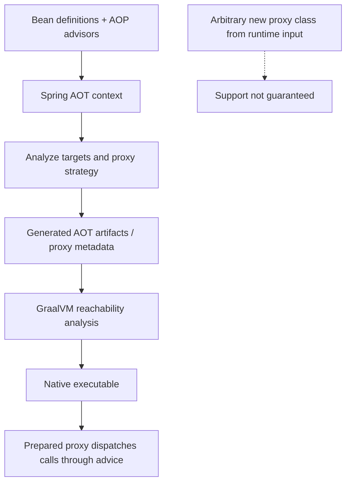

# Runtime Proxies and Cases Where Metadata Cannot Replace an Incompatible Design

## 1. Runtime Dynamic Proxies and Native Image Limitations

Spring AOP uses proxies to place an interceptor between a caller and a target bean. Proxies can handle transactions, security, logging, retries, or metrics. In a JVM application, some libraries create proxies on the fly using JDK dynamic proxies or by generating subclasses/bytecode with CGLIB, Byte Buddy, or ASM.

GraalVM Native Image applies a closed-world analysis model: the compiler needs to determine upfront which classes and dynamic behaviors are required to build the executable. Consequently, a library that relies on **arbitrarily generating new proxy classes at runtime** may not work in a native executable, even though it runs normally on HotSpot.

Two cases must be distinguished:

- **Determinable proxies**: target classes, interfaces, advisors, and the required proxy set can be recognized and prepared at build time by Spring AOT or an integrated library.
- **Arbitrarily runtime-created proxies**: classes/interfaces or bytecode are only decided after the executable has been built, such as compiling new classes from data received at runtime. Native Image cannot by default generate every kind of dynamic class like the JVM.

Runtime hints describe which accesses or proxies need to be retained. They are not a general-purpose bytecode compiler and cannot turn a library dependent on unsupported class generation into a native-compatible one.

## 2. Common Proxy Types

| Mechanism | How It Works | What to Check in Native Image |
|---|---|---|
| JDK dynamic proxy | Creates an object implementing a set of interfaces and dispatches calls via `InvocationHandler` | Interface set must be known; needs proxy metadata if AOT cannot infer it automatically |
| Class-based proxy (CGLIB/subclass) | Generates a subclass and overrides methods to insert interceptors | Needs framework AOT support; target class/methods must be subclassable/overridable |
| Custom Byte Buddy/ASM | Generates or modifies bytecode per library logic | Must verify Native Image compatibility; do not assume runtime class generation is supported |
| Spring AOP proxy | Spring creates proxies based on beans, advisors, and AOP configuration | Use supported Spring AOT integration paths and test on the executable |
| Runtime plugin-compiled proxy | Creates classes from metadata/scripts received after build | Usually requires redesigning to pre-known registries/proxies or another mechanism |

Not every application using CGLIB or Byte Buddy fails automatically. Some frameworks integrate with AOT to prepare the required classes. The question is whether **the specific proxy-creation path** is supported and prepared ahead of time by the framework.

## 3. How Does Spring AOT Prepare Proxies?

Spring AOT processes the application context during the build phase. When the framework identifies a bean needing a proxy and a determinable proxy type, it can generate AOT artifacts or metadata for Native Image to analyze.

A conceptual pipeline:



Exact mechanisms and generated artifacts depend on the Spring Framework/Spring Boot version, proxy type, and library integrations. Do not assume all proxies are generated the same way or that generated class names are always identical.

When investigating, check:

- Which beans are proxied and why.
- Whether the proxy strategy is JDK or class-based.
- Which advisors/aspects apply.
- Whether Spring AOT discovers the bean/proxy in the build-time context.
- Whether the proxy-creating library provides an AOT contribution or Native Image documentation.
- Whether the native executable actually executes through the expected proxy and advice.

## 4. What Can Metadata Solve?

Different metadata categories address different needs:

| Metadata | Solves | Does Not Solve |
|---|---|---|
| JDK ProxyHints | Declares the interface set needing a JDK proxy | Does not generate arbitrary subclasses |
| Reflection hints | Permits reflective access to classes/constructors/methods/fields | Does not generate new class bytecode |
| Resource hints | Retains classpath files that need to be read | Does not create proxies |
| Serialization hints | Supports types used with Java serialization | Does not guarantee an arbitrary proxy/handler is serializable |
| JNI hints | Describes interactions across JNI | Does not fix a native library with the wrong ABI |
| Class initialization options | Chooses when static initializers run | Does not add missing classes or methods |

Example JDK proxy hint:

```java
hints.proxies().registerJdkProxy(
    PaymentService.class,
    Auditable.class
);
```

This describes a proxy implementing known interfaces. It does not ask Native Image to generate a subclass of an arbitrary class and does not replace reflection metadata if the `InvocationHandler` also invokes the target via reflection.

## 5. Cases Where Metadata Cannot Replace Design

### 5.1. Generating a Subclass from a Class Name Received at Runtime

For example, a library takes a class name from configuration and generates a new subclass:

```java
Class<?> targetType = Class.forName(configuredClass);
Class<?> proxyType = bytecodeGenerator.createSubclass(targetType);
Object proxy = proxyType.getDeclaredConstructor().newInstance();
```

Reflection hints for the target class may support certain reflective operations, but they do not automatically provide the ability to compile/generate arbitrary subclass bytecode after the native executable is built.

If there is only a known set of target classes, check whether the library offers an AOT/pre-generated proxy mode. Otherwise, switch to an interface registry or a proxy strategy that can be prepared upfront.

### 5.2. Compiling Java Source or Scripts into New Classes

A plugin allowing operators to upload Java code and compile it directly inside the native process will need a compiler, classloader, and dynamic class definition. This is a different model from reflectively calling a method on an already-packaged class.

Adding `RuntimeHints` for existing classes does not provide a compiler, does not put new classes into the native image, and does not turn a dynamic classloader into a fully supported mechanism. Move compilation into the build/deployment pipeline or run plugins in a separate JVM process/service if runtime compilation is a hard requirement.

### 5.3. Libraries Needing Class Redefinition/Retransformation

Instrumentation mechanisms such as class redefinition/retransformation rely on JVM agent/instrumentation capabilities. You must not assume all Java Instrumentation features are available in Native Image. Check official support for your GraalVM version; if the library must modify bytecode arbitrarily at runtime, change the architecture or choose an appropriate runtime.

## 6. Limitations of Class-Based Proxies

Class-based proxies rely on subclassing and overriding. Standard Java language constraints still apply:

- The target class cannot be `final` for standard subclassing.
- `final` methods cannot be overridden to insert advice.
- `private` methods cannot be overridden.
- `sealed` classes can restrict subclassing outside their `permits` list.
- Constructors and visibility/package access can affect subclassing capability.
- `native` methods cannot be overridden like ordinary Java methods.

No reflection hint removes these inheritance rules. If a class cannot be subclassed, consider interface-based proxies, composition/decorators, or splitting out a service contract.

## 7. Alternative Design: Interfaces and Decorators

If the application needs to alter behavior based on runtime configuration, you can use a stable interface and select among known implementations:

```java
public interface PaymentProcessor {
    PaymentResult process(PaymentCommand command);
}
```

Decorator:

```java
public final class AuditingPaymentProcessor implements PaymentProcessor {
    private final PaymentProcessor delegate;
    private final AuditService audit;

    public AuditingPaymentProcessor(
            PaymentProcessor delegate,
            AuditService audit) {
        this.delegate = delegate;
        this.audit = audit;
    }

    @Override
    public PaymentResult process(PaymentCommand command) {
        audit.record(command);
        return delegate.process(command);
    }
}
```

Spring can register implementations and decorators as static beans in the context. AOT sees the dependency structure; runtime simply selects beans/behaviors already present in the graph according to the designed configuration strategy.

If bean selection depends on profiles or conditional properties, resolve those conditions at AOT time. If selection must change at runtime, keep the registry/service bean stable and pick the delegate from the packaged implementations.

## 8. Using a Registry/Factory Instead of New Proxy Classes

When behavior selection depends on configuration, a static factory is often enough:

```java
@Component
class PaymentProcessorRegistry {
    private final Map<String, PaymentProcessor> processors;

    PaymentProcessorRegistry(
            @Qualifier("cardProcessor") PaymentProcessor card,
            @Qualifier("bankProcessor") PaymentProcessor bank) {
        this.processors = Map.of(
            "card", card,
            "bank", bank
        );
    }

    PaymentProcessor get(String name) {
        PaymentProcessor processor = processors.get(name);
        if (processor == null) {
            throw new IllegalArgumentException("Unsupported processor");
        }
        return processor;
    }
}
```

This approach generates no new classes. All implementations are created and managed by Spring within a known bean graph. Runtime merely looks up an existing object.

Do not accept arbitrary class names from HTTP requests to build proxies. Use business keys on an allowlist and enforce authorization over implementation selection.

## 9. When Third-Party Libraries Create Proxies

If errors come from a dependency, do not rush to add hints for every class. Investigate systematically:

1. Identify the exact library and version on the runtime classpath.
2. Locate where CGLIB, Byte Buddy, ASM, `Proxy.newProxyInstance`, or class definition APIs are called.
3. Determine whether the proxy is created during AOT/build or only when triggered by a runtime request.
4. Check if the library has an AOT processor, Spring `RuntimeHints`, or official GraalVM reachability metadata.
5. Read the Native Image documentation for both the library version and GraalVM version.
6. Write a small integration test exercising the exact proxy path in the native executable.
7. If the mechanism is unsupported, change versions, adjust configuration/proxy strategy, or redesign.

A dependency may support Native Image in a newer release while lacking support in an older one. Specify exact versions instead of applying a generic workaround across all versions.

## 10. Diagnosing Proxy Errors on Native Image

| Symptom | Possible Cause | Resolution |
|---|---|---|
| Missing JDK proxy metadata | Interface set not discovered/registered | Check Spring AOT and `ProxyHints` |
| Reflection exception creating target | Constructor/member not registered | Add reflection hints for the exact member |
| Cannot create subclass | Class is `final`/`sealed` or method cannot be overridden | Switch to interface proxy/composition |
| Runtime bytecode generation fails | Library needs dynamic class generation that is unsupported | Use AOT/pre-generated proxies or change architecture |
| Aspect does not execute | Pointcut/advisor mismatch, self-invocation | Inspect Spring context and call path |
| Bean does not exist | Wrong AOT profile/condition/classpath | Inspect bean graph and dependencies |
| Proxy works on JVM, fails in native | Missing AOT integration or unprepared dynamic path | Verify library support and native integration tests |

Distinguish metadata errors from design errors. If a proxy class is only created by compiling arbitrary bytecode after the program starts, registering extra reflection hints for the target will not fix the root cause.

## 11. End-to-End Testing Workflow

A test suite should span from Spring configuration to the final executable:

1. **JVM baseline**: verify beans are created, the proxy strategy is right, advice executes, and target results are accurate.
2. **AOT**: run Spring AOT with the exact profile/properties and dependency graph.
3. **AOT artifacts**: inspect generated output/logs and verify the proxy library was processed.
4. **Native build**: run native compilation with the exact toolchain version.
5. **Native behavior**: launch the executable and invoke the code paths that create proxies/execute advice.
6. **Negative cases**: test unsupported classes, inputs outside the allowlist, `final` targets, or missing metadata as appropriate.
7. **Container**: run the target image, verifying OS/architecture, filesystem permissions, and runtime configuration.
8. **Release evidence**: save test reports, commit hash, toolchain versions, and artifact digest.

A test confirming only successful startup is insufficient. You must invoke an endpoint or service method that actually traverses the proxy.

## 12. Decision Checklist: Can Metadata Suffice or Must Design Change?

- Does the proxy have a fixed set of interfaces/target classes before the build?
- Can Spring AOT or the library detect and prepare that proxy?
- Is the proxy mechanism a JDK proxy, subclass proxy, or runtime bytecode generation?
- Is the target class `final`/`sealed`, or does it have un-overridable methods?
- Are reflection hints truly what is missing, or is the issue class generation?
- Do the dependency and version support GraalVM Native Image?
- Can it be replaced by an interface, decorator, registry, or generated implementation?
- Have native integration tests exercised the exact code path?

If the answer to preparing the proxy before the build is no, and the library requires arbitrary runtime bytecode generation, change the design or choose an appropriate runtime environment. Do not endlessly expand hints to mask an incompatible mechanism.

## 13. Self-Check Questions

1. What is the difference between a proxy prepared by Spring AOT and a proxy class generated arbitrarily at runtime?
2. Why can't JDK `ProxyHints` replace runtime bytecode generation?
3. Which operations do reflection hints solve, and what do they not solve?
4. Why do `final` classes or `final` methods restrict class-based proxies?
5. When a third-party dependency creates dynamic proxies, what details should you check before editing configuration?
6. How do registries/factories or decorators help reduce reliance on dynamic proxies?
7. What tests are needed to confirm proxies actually work in the native executable and container?

**Key takeaway:** metadata helps Native Image retain identified classes, members, and proxies; it is not a general-purpose runtime bytecode generation mechanism. Leverage Spring AOT and official library support, prefer proxies that can be prepared ahead of time, and redesign when an application relies on arbitrary post-build proxy generation.
