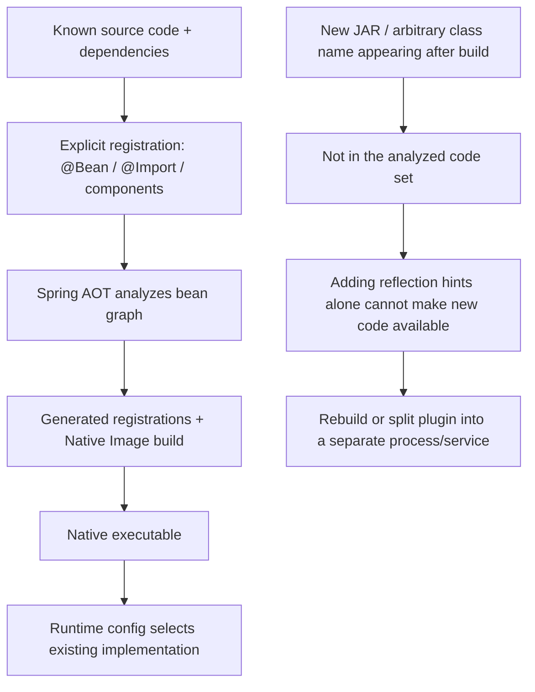

# Choosing Explicit Registration Over Fully Dynamic Scanning or Discovery

On the JVM, a Spring application can use classpath scanners, reflection, class names read from configuration, or plugin libraries to locate implementations at runtime. That approach is flexible, but when moving to **Spring AOT and GraalVM Native Image**, the compiler needs to know upfront which classes and access paths may be used. A native binary cannot by default load a new JAR or instantiate an arbitrary class simply because a class name appeared in a database or configuration file after the build.

A native-friendly design usually **registers the set of implementations explicitly in source code or build-time dependencies**, then uses runtime configuration/data to choose among the existing implementations. Spring Dependency Injection, `@Bean`, `@Import`, `List<T>`, and `Map<String, T>` help build typed, testable registries that Spring AOT can analyze.

This lesson belongs to the **Dynamic Limitations** chapter of the `SPRING_BOOT_NATIVE_IMAGE` module. We will distinguish component scanning handled by Spring AOT from arbitrary runtime discovery, replace reflection-based plugin lookups with explicit registries, select implementations via runtime configuration, and determine when to rebuild or split plugins into separate processes/services.

## 1. Why Is Explicit Registration Needed?

GraalVM Native Image uses *closed-world* analysis: during the build, the compiler must identify runnable code, types to retain, and dynamic accesses requiring metadata. Spring AOT likewise analyzes the ApplicationContext to pre-generate bean registrations and initialization support.

Therefore, distinguish two cases:

- **Class set known at build time:** implementations reside in source code or dependencies and are declared via components/configuration/imports or AOT-compatible registry mechanisms. Spring AOT and Native Image can analyze this set.
- **Class set discovered arbitrarily only at runtime:** the application scans a JAR directory, reads a class name from a database, or receives an implementation name in a request and tries to load a class unknown when the binary was built. This model is difficult or unsuitable for native images.

This **does not mean Spring component scanning is prohibited**. Component scanning across the application's classpath is a normal part of Spring AOT. The limitation lies in expecting the binary to discover brand-new code it did not know about at build time.



## 2. Discovery Patterns to Distinguish

| Mechanism | When Implementation Is Found | AOT/Native Suitability |
| --- | --- | --- |
| Spring component scanning on packages in the build | Build/AOT analyzes context | Suitable if packages/classpath and conditions are fixed |
| `@Bean` and `@Import` | Explicitly registered in configuration | Suitable; bean creation paths appear in the AOT context |
| Injecting `List<T>` or `Map<String, T>` | Spring collects registered beans | Suitable; bean set is determinable at AOT time |
| `ServiceLoader` with packaged providers | Runtime reads service descriptors and providers already in the artifact | Usable if providers and native metadata are handled; test with exact toolchain |
| Scanning arbitrary packages/JARs at runtime with a scanner library | Runtime finds classes by package/JAR | Risky; cannot extend code beyond the built set |
| `Class.forName(name)` with name from database/request | Runtime loads class by dynamic name | Works only for classes already in the image with metadata support; cannot load arbitrary new code |
| Reading external JSON/YAML files to pick a key | Runtime reads data | Suitable if the key only selects an already-registered implementation |
| Mounting a new plugin JAR after deploy | Runtime expects to add bytecode | Not Native Image's default extensibility model |

A common misconception: **explicit registration does not mean hard-coding every operational value**. We fix the set of runnable code, while configuration can still select implementations, endpoints, timeouts, or rule data at runtime.

## 3. Unsuitable Example: Looking Up Classes by Name from Config

Suppose the application has an exporter interface:

```java
package com.example.export;

public interface DocumentExporter {
    byte[] export(String content);
}
```

An implementation relying on a class name:

```java
// Example illustrating dynamic discovery; avoid using as the default for native.
Object createExporter(String className) throws ReflectiveOperationException {
    Class<?> type = Class.forName(className);
    return type.getDeclaredConstructor().newInstance();
}
```

Suppose external configuration contains:

```yaml
export:
  implementation: com.example.export.PdfExporter
```

On the JVM, if the class is on the classpath and has a matching constructor, the application can instantiate it. With a native image, however:

- The native compiler may not know which class will be loaded through the `className` string.
- The class may be stripped from the executable if no other reachability path exists.
- Reflectively accessed constructors/members may lack metadata.
- If the implementation lives in a JAR mounted after release, its bytecode is absent from the binary.
- Adding a reflection hint only describes how to access an existing class; it does not add JARs or compile new code into the image.

If the list of implementations is finite and known upfront, register them as beans and use a configuration key to select among them.

## 4. Using Spring DI to Build an Explicit Registry

Suppose there are two document export formats: CSV and JSON. Both are packaged with the application.

### 4.1. Declare the Contract and Implementations

```java
package com.example.export;

public interface DocumentExporter {
    byte[] export(String content);
}
```

```java
package com.example.export;

import java.nio.charset.StandardCharsets;

import org.springframework.stereotype.Component;

@Component("csv")
public class CsvExporter implements DocumentExporter {

    @Override
    public byte[] export(String content) {
        return ("CSV," + content).getBytes(StandardCharsets.UTF_8);
    }
}
```

```java
package com.example.export;

import java.nio.charset.StandardCharsets;

import org.springframework.stereotype.Component;

@Component("json")
public class JsonExporter implements DocumentExporter {

    @Override
    public byte[] export(String content) {
        String escaped = content.replace("\\", "\\\\").replace("\"", "\\\"");
        return ("{\"content\":\"" + escaped + "\"}")
                .getBytes(StandardCharsets.UTF_8);
    }
}
```

The bean names `csv` and `json` are declared explicitly. Spring component scanning discovers these classes in known packages when building the context/AOT.

### 4.2. Inject Map<String, DocumentExporter>

Spring can inject a map where keys are bean names and values are bean instances:

```java
package com.example.export;

import java.util.Map;

import org.springframework.beans.factory.annotation.Value;
import org.springframework.stereotype.Service;

@Service
public class ExportService {

    private final Map<String, DocumentExporter> exporters;
    private final String defaultFormat;

    public ExportService(
            Map<String, DocumentExporter> exporters,
            @Value("${export.default-format:csv}") String defaultFormat) {
        this.exporters = Map.copyOf(exporters);
        this.defaultFormat = defaultFormat;
    }

    public byte[] export(String format, String content) {
        String selected = (format == null || format.isBlank())
                ? defaultFormat
                : format;

        DocumentExporter exporter = exporters.get(selected);
        if (exporter == null) {
            throw new IllegalArgumentException(
                    "Unsupported export format: " + selected);
        }
        return exporter.export(content);
    }
}
```

Spring knows the `csv` and `json` beans in the context. The `export.default-format` property simply picks a key from the map when the bean is created; requests can select another key within the existing set of implementations. There is no need to call `Class.forName`, scan JARs, or instantiate objects via reflection manually.

If the format comes from an HTTP request, validate the value and return an appropriate 400 error instead of letting an internal exception become a 500 error. If the format comes from a startup property, you can fail fast on invalid values to prevent the app from starting with a bad configuration.

### 4.3. Selecting the Default Implementation at Runtime

`application.yaml` can define the default:

```yaml
export:
  default-format: csv
```

Staging can use:

```bash
EXPORT_DEFAULT_FORMAT=json ./target/export-service
```

The same native executable can start with different default formats because both beans are already in the bean graph. Changing the environment variable after `ExportService` has been created will not automatically update `defaultFormat`; hot reloading requires a dedicated dynamic config design.

## 5. When to Use List<T>, Map<String, T>, or a Custom Registry?

| Injection Style | When Appropriate | Advantages |
| --- | --- | --- |
| `List<Strategy>` | Iterate over all strategies, run in sequence, or apply multiple handlers | Simple; does not depend on bean names |
| `Map<String, Strategy>` | Select an implementation by key/bean name | Clear lookup; key can come from runtime configuration |
| Specific bean via constructor | Only one dependency is needed | Explicit dependency and compile-time type safety |
| Dedicated registry class | Aliases, validation, fallbacks, priorities, or complex selection policies | Centralizes selection logic and eases testing |
| `ObjectProvider<Strategy>` | Defer fetching/initializing a bean or handle optional dependencies | Lazy access to already-registered beans |
| `ApplicationContext.getBean(name)` | Special integration requiring lookup by a known name | Usable, though tied to container API and less transparent than injection |

Example using `List` to assemble ordered processing steps:

```java
public interface ExportStep {
    byte[] apply(byte[] input);
}
```

```java
import java.nio.charset.StandardCharsets;

import org.springframework.core.annotation.Order;
import org.springframework.stereotype.Component;

@Component
@Order(10)
class TrimExportStep implements ExportStep {
    @Override
    public byte[] apply(byte[] input) {
        return new String(input, StandardCharsets.UTF_8)
                .trim().getBytes(StandardCharsets.UTF_8);
    }
}
```

```java
import java.nio.charset.StandardCharsets;

import org.springframework.core.annotation.Order;
import org.springframework.stereotype.Component;

@Component
@Order(20)
class PrefixExportStep implements ExportStep {
    @Override
    public byte[] apply(byte[] input) {
        String value = new String(input, StandardCharsets.UTF_8);
        return ("[EXPORT]" + value).getBytes(StandardCharsets.UTF_8);
    }
}
```

```java
import java.nio.charset.StandardCharsets;
import java.util.List;

import org.springframework.stereotype.Component;

@Component
class ExportPipeline {

    private final List<ExportStep> steps;

    ExportPipeline(List<ExportStep> steps) {
        this.steps = List.copyOf(steps);
    }

    byte[] export(String content) {
        byte[] current = content.getBytes(StandardCharsets.UTF_8);
        for (ExportStep step : steps) {
            current = step.apply(current);
        }
        return current;
    }
}
```

If order matters, declare `@Order` or `Ordered` explicitly; do not rely on accidental classpath ordering. If you only need to pick one implementation by name, a `Map` usually expresses intent better.

`ObjectProvider` only defers retrieving or lazily creating a bean; it **does not discover new classes** from external JARs after the native image is built.

## 6. Explicit Registration with @Bean and @Import

Component scanning is not the only option. If you want the set of implementations visible in one place, use a configuration class:

This example is an **alternative** to placing `@Component` in the previous section. If using `@Bean` to register exporters, remove `@Component` from those classes or adjust component scanning so the same implementation is not registered twice.

```java
import org.springframework.context.annotation.Bean;
import org.springframework.context.annotation.Configuration;

@Configuration(proxyBeanMethods = false)
class ExporterConfiguration {

    @Bean
    DocumentExporter csvExporter() {
        return new CsvExporter();
    }

    @Bean
    DocumentExporter jsonExporter() {
        return new JsonExporter();
    }
}
```

If implementation classes are not component-scanned or reside in another package, import the configuration:

```java
import org.springframework.context.annotation.Configuration;
import org.springframework.context.annotation.Import;

@Configuration(proxyBeanMethods = false)
@Import(ExporterConfiguration.class)
class ExportApplicationConfiguration {
}
```

This is explicit registration because the configuration classes and factory methods are declared in the build. Spring AOT can analyze these bean definitions.

Do not simultaneously declare `@Component("csv")` and a `@Bean` creating another bean for the same purpose without a clear reason; if both are registered, the application will have two beans of the same type and injection becomes ambiguous.

### 6.1. Using @Import for a Known Set of Configurations

`@Import` is useful when a module supplies a fixed set of configurations:

```java
@Configuration(proxyBeanMethods = false)
@Import({
        CsvExporterConfiguration.class,
        JsonExporterConfiguration.class
})
class ExportFeatureConfiguration {
}
```

Configuration classes must be in build dependencies/classpath. If an implementation is only loaded from an arbitrary JAR mounted after deploy, `@Import` cannot make that JAR part of the already-created native image.

## 7. Select Runtime Behavior, Do Not Mutate the Bean Graph Arbitrarily

A common mistake is using `@ConditionalOnProperty` to toggle a bean and expecting runtime properties to always change the outcome.

Example:

```java
@Bean
@ConditionalOnProperty(
        name = "export.pdf.enabled",
        havingValue = "true")
DocumentExporter pdfExporter() {
    return new PdfExporter();
}
```

This condition may be evaluated when Spring AOT analyzes the ApplicationContext. If the bean is excluded at that point, passing `--export.pdf.enabled=true` when running the native binary will not add the bean definition back.

If the same binary must be able to select CSV/JSON/PDF depending on the environment, register all required implementations in the bean graph and use a registry/router to choose. If the PDF implementation belongs only to a specific release flavor, build a separate artifact variant with the matching condition.

| Requirement | Design |
| --- | --- |
| Select CSV or JSON per request | Both beans present; Map registry selects per request |
| Default CSV locally, JSON in staging | Both beans present; runtime property selects default |
| Slim build containing only CSV | Condition/build profile decides beans at AOT; build separate artifact |
| Toggle PDF permission per tenant | PDF bean must be in the binary; policy/feature data decides if the tenant may use it |
| Add new implementation after release | Rebuild native binary or split implementation into a separate service/process |

## 8. ServiceLoader: Use Only When Providers Are Packaged and Native-Tested

Java `ServiceLoader` is the standard mechanism for finding providers by service interface. A library may contain the file:

```text
META-INF/services/com.example.export.DocumentExporter
```

with contents:

```text
com.example.export.CsvExporter
com.example.export.JsonExporter
```

Application loads providers:

```java
import java.util.ServiceLoader;
import java.util.List;

ServiceLoader<DocumentExporter> loader =
        ServiceLoader.load(DocumentExporter.class);

List<DocumentExporter> exporters = loader.stream()
        .map(ServiceLoader.Provider::get)
        .toList();
```

`ServiceLoader` suits a set of providers packaged with the application/dependencies. Native Image and Native Build Tools support certain `ServiceLoader` paths, but you must verify metadata/provider discovery for your exact GraalVM version. Provider classes and constructors must reside in the artifact and be recognized by the compiler.

If a provider uses reflection, resources, or dynamic proxies, corresponding metadata is still required. Do not treat `ServiceLoader` as a way to load arbitrary JARs after the binary is released. In a Spring application, if providers need to be managed by Spring (dependency injection, lifecycle, configuration), injecting `List<T>` or `Map<String,T>` is usually simpler.

## 9. Build-Time Generation for Large Plugin Lists

Some systems have many implementations contributed by different modules. Hand-maintaining a huge registry can be tedious. You can generate the registry **before AOT runs** using an annotation processor or build plugin:

1. Modules declare plugins with annotations/descriptors following a clear schema.
2. A build tool collects descriptors from existing source/dependencies.
3. An annotation processor or task generates Java source containing an explicit registry.
4. Generated source is compiled with the application.
5. Spring AOT analyzes the registry and bean graph.
6. GraalVM builds the native image from the known code set.

An example generated registry might look like:

```java
final class GeneratedExporterRegistry {

    static Map<String, Supplier<DocumentExporter>> providers() {
        return Map.of(
                "csv", CsvExporter::new,
                "json", JsonExporter::new
        );
    }
}
```

This illustrates the structure of generated source; in a real Spring application, consider generating configuration/bean definitions so dependency injection and lifecycle are properly managed. If constructors need other dependencies, avoid raw `new` and generate factory methods receiving dependencies from Spring.

Advantages of build-time generation:

- The provider list can be inspected in generated source.
- Explicit class references let the compiler see required types.
- Duplicate IDs and missing providers can be caught right during the build.
- Changing the plugin set triggers a reproducible new build.

Limitation: the generator only sees modules/dependencies included in the build. It cannot predict JARs an operator will mount after the binary is released.

## 10. When Should Plugins Be Split into Separate Processes/Services?

If the product requirement is that users can install new plugin code post-deploy without rebuilding the main application, a native executable is usually not an appropriate plugin host for an arbitrary classloader model.

There are three architectural options:

| Option | How It Works | Suitable When |
| --- | --- | --- |
| Rebuild the native image | Add plugin dependency, re-run AOT and native compilation | Plugins change per release |
| Separate plugin/JVM process | Each plugin runs in its own process; native app calls via HTTP/gRPC/messaging | Plugin code must be installed/upgraded independently |
| External service | Extension functionality deployed as a service communicating via API | Plugins have independent lifecycles, scaling, or access permissions |

Process separation establishes clear boundaries for classloaders, dependencies, and crash isolation. In return, you must manage networking, timeouts, authentication, version contracts, retries, and observability. Do not turn every tiny strategy into a microservice; use this only when independent code updates are genuinely required.

## 11. "Semi-Explicit" Approaches and Their Limits

Several mechanisms keep the class set predictable while still supporting data-level dynamic selection:

- **Class allowlist:** configuration contains keys; a registry maps keys to registered beans.
- **Generated index:** an index file lists build-time providers; native metadata must still cover how providers are loaded.
- **ServiceLoader:** provider descriptors and classes packaged inside dependencies.
- **Reflection hints:** permit dynamic access to members of classes already in the image.
- **External config:** changes endpoints/rules/feature data without changing code.

These mechanisms do not replace one another:

| Mechanism | Can Do | Cannot Do |
| --- | --- | --- |
| Allowlist key → bean | Select among registered implementations | Create a new class from an arbitrary name |
| Generated index | Record providers known at build time | Find new JARs after release |
| ServiceLoader metadata | Assist discovery of packaged providers | Guarantee any new runtime plugin loads |
| Reflection hint | Permit member access on existing types | Add bytecode/classes not in the image |
| External config | Change data or runtime selection | Add new native code into the executable |

### 11.1. Why Doesn't Adding Runtime Hints Solve All Dynamic Loading?

Example:

```java
hints.reflection().registerType(
        PdfExporter.class,
        MemberCategory.INVOKE_DECLARED_CONSTRUCTORS);
```

This hint can allow calling the `PdfExporter` constructor reflectively if the class was included in the build and metadata matches. If `PdfExporter` sits in `pdf-plugin.jar` and is only mounted into the container after the native executable was created, the hint does not add that class to the binary. You must include the dependency in the build and rebuild, or run the plugin in a separate JVM/process.

## 12. Testing the Registry and Bean Graph

An explicit registry should have tests for both the provider set and selection behavior.

Example unit test:

```java
package com.example.export;

import java.nio.charset.StandardCharsets;
import java.util.Map;

import org.junit.jupiter.api.Test;

import static org.assertj.core.api.Assertions.assertThat;
import static org.assertj.core.api.Assertions.assertThatThrownBy;

class ExportServiceTests {

    @Test
    void selectsCsvExporter() {
        DocumentExporter csv = content -> "csv".getBytes(StandardCharsets.UTF_8);
        DocumentExporter json = content -> "json".getBytes(StandardCharsets.UTF_8);

        ExportService service = new ExportService(
                Map.of("csv", csv, "json", json),
                "csv");

        assertThat(new String(
                service.export(null, "hello"),
                StandardCharsets.UTF_8)).isEqualTo("csv");
    }

    @Test
    void rejectsUnknownFormat() {
        DocumentExporter csv = content -> content.getBytes(StandardCharsets.UTF_8);
        ExportService service = new ExportService(Map.of("csv", csv), "csv");

        assertThatThrownBy(() -> service.export("xml", "hello"))
                .isInstanceOf(IllegalArgumentException.class);
    }
}
```

Example Spring context test verifying registered beans:

```java
package com.example.export;

import java.util.Map;

import org.junit.jupiter.api.Test;
import org.springframework.beans.factory.annotation.Autowired;
import org.springframework.boot.test.context.SpringBootTest;

import static org.assertj.core.api.Assertions.assertThat;

@SpringBootTest
class ExporterRegistrationTests {

    @Autowired
    Map<String, DocumentExporter> exporters;

    @Test
    void registersAllBuildTimeExporters() {
        assertThat(exporters).containsKeys("csv", "json");
    }
}
```

This context test assumes the `@SpringBootApplication` class resides in `com.example.export` or a parent package so Spring Boot locates the main configuration. These tests verify registry logic and the bean graph on the JVM. To verify native behavior, run native tests or the native executable and invoke the actual usage paths. If the registry uses serialization/reflection/resources inside implementations, add tests for those paths too.

## 13. Inspecting Spring AOT Output

After running AOT, search for generated registrations of the required beans.

Maven:

```bash
./mvnw spring-boot:process-aot
rg -n "CsvExporter|JsonExporter|ExportService" target/spring-aot
```

Gradle:

```bash
./gradlew processAot
rg -n "CsvExporter|JsonExporter|ExportService" build/generated
```

Output locations depend on plugin/version. Search by bean name/type rather than relying on fixed generated class names.

When reading the output, verify:

1. Do the required implementations have bean definitions?
2. Do bean names/keys match the registry logic?
3. Are constructors/factories and dependencies represented?
4. Did any conditions/profiles affect the bean set?
5. Were reflection/resource/proxy hints for implementations contributed?

If a bean is missing, check the AOT profile and conditions before adding reflection hints. A reflection hint cannot fix a bean definition that was excluded from the bean graph.

## 14. Common Errors When Migrating from Dynamic Discovery to a Registry

| Symptom | Cause | Resolution |
| --- | --- | --- |
| Native cannot find class from database name | Class is not in native image or lacks metadata | Replace with a key → bean registry; rebuild if adding new classes |
| Map injection misses expected provider | Component not scanned/imported, condition excluded bean, or bean name differs | Check packages, configuration, profiles, and generated registrations |
| `NoUniqueBeanDefinitionException` | Injecting an interface with multiple implementations without collection/qualifier | Use `Map<String,T>`, `List<T>`, `@Qualifier`, or `@Primary` |
| Changing runtime property does not make implementation appear | Bean excluded by condition during AOT | Include implementation in graph and select via router, or build a variant |
| ServiceLoader cannot find provider | Missing descriptor/provider or metadata | Check `META-INF/services`, dependencies, and native tests |
| Added reflection hint yet still gets class not found | Hints do not add classes/bytecode to the image | Include dependency in build or split plugin to another process |
| Newly mounted provider does not load | Native image is not an arbitrary JVM plugin host | Rebuild or use a JVM/service plugin host |
| Strategy order varies across environments | Relied on unspecified discovery order | Use `@Order` or explicit priority in the registry |
| Native runs but uses wrong provider | Config key, default, or alias mismatch | Validate configuration and test each key/unknown key |

## 15. Process for Replacing a Dynamic Scanning Mechanism

When refactoring a system that uses a package scanner or reflection:

1. **List existing providers:** names, interfaces, dependencies, and where they are registered.
2. **Define the provider set:** which providers are actually permitted in a release?
3. **Define stable keys:** e.g., `csv`, `json`, `pdf`; do not use fully-qualified class names as a config API.
4. **Register beans explicitly:** components, `@Bean`, `@Import`, or build-time generated registry source.
5. **Select via a typed registry:** inject `Map<String,T>` or a registry class with validation.
6. **Separate code and data:** provider code belongs to the build; rules/templates/catalogs can be runtime if they are purely data.
7. **Write tests:** test the bean set, valid selection, unknown keys, and side effects.
8. **Run AOT/native:** inspect the generated bean graph, metadata, and real invocation paths.
9. **Define plugin lifecycle:** if post-deploy code additions are required, move plugins to a separate process/service or accept building a new release.

## 16. AOT/Native-Compatible Design Checklist

- [ ] Distinguished Spring component scanning on the build classpath from arbitrary runtime discovery.
- [ ] Required implementations exist in source/dependencies at build time.
- [ ] Beans are registered via components/configuration/imports or an AOT-compatible mechanism.
- [ ] Used `List<T>` or `Map<String,T>` instead of class scanning and reflection where appropriate.
- [ ] Bean names or registry keys are stable, validated, and handle unknown keys.
- [ ] Not relying on classpath order; using `@Order` or explicit priority.
- [ ] Not using `@ConditionalOnProperty` expecting to alter the bean graph arbitrarily after AOT.
- [ ] Reflection hints are used only for types/members already in the native image.
- [ ] `ServiceLoader` providers and metadata are tested on the exact native toolchain.
- [ ] If plugin code needs independent updates, chose either rebuilding or a process/service boundary.
- [ ] Inspected generated AOT output to confirm the bean graph.
- [ ] Native integration tests cover all providers and selection branches.

### Self-Assessment Questions

1. Why can Spring component scanning on the build classpath remain AOT-compatible while arbitrary post-deploy JAR scanning is risky?
2. What does Spring injecting `Map<String, T>` enable for building implementation registries?
3. Why doesn't `ObjectProvider<T>` help load new classes from a JAR absent from the native image?
4. When should `@Bean`/`@Import` be preferred over `@Component`?
5. Why might a property in `@ConditionalOnProperty` fail to change the bean set when running native?
6. Which parts of dynamic class access can reflection hints solve, and what are their limits?
7. When is `ServiceLoader` appropriate, and when should a Spring DI registry be used?
8. If installing new plugin code after application release is required, why might process/service separation be a better choice?

## References

- [Spring Framework — Ahead-of-Time Optimizations](https://docs.spring.io/spring-framework/reference/core/aot.html): Spring AOT, bean registration, and runtime hints.
- [Spring Framework — Java-based Container Configuration](https://docs.spring.io/spring-framework/reference/core/beans/java.html): declaring beans with `@Configuration` and `@Bean`.
- [Spring Framework — Classpath Scanning and Managed Components](https://docs.spring.io/spring-framework/reference/core/beans/classpath-scanning.html): component scanning and how Spring discovers managed components.
- [Spring Framework — Dependency Injection](https://docs.spring.io/spring-framework/reference/core/beans/dependencies/factory-collaborators.html): injecting dependencies and bean collections/maps.
- [GraalVM Native Image — Dynamic Features](https://www.graalvm.org/latest/reference-manual/native-image/dynamic-features/): limitations and metadata for reflection, resources, proxies, and `ServiceLoader`.

**Expected outcome:** replace fully dynamic class scanning or discovery with typed registries and implementation sets determined at build time. The application can still choose behavior via runtime configuration, while all runnable code is included in the native image and verified via Spring AOT/native tests. When requirements call for installing new code after release, design plugin boundaries at build/release or process/service level instead of relying on an arbitrary dynamic classpath.
