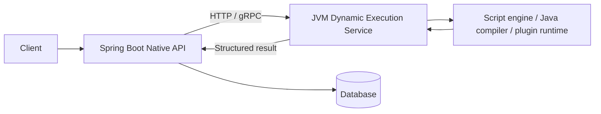
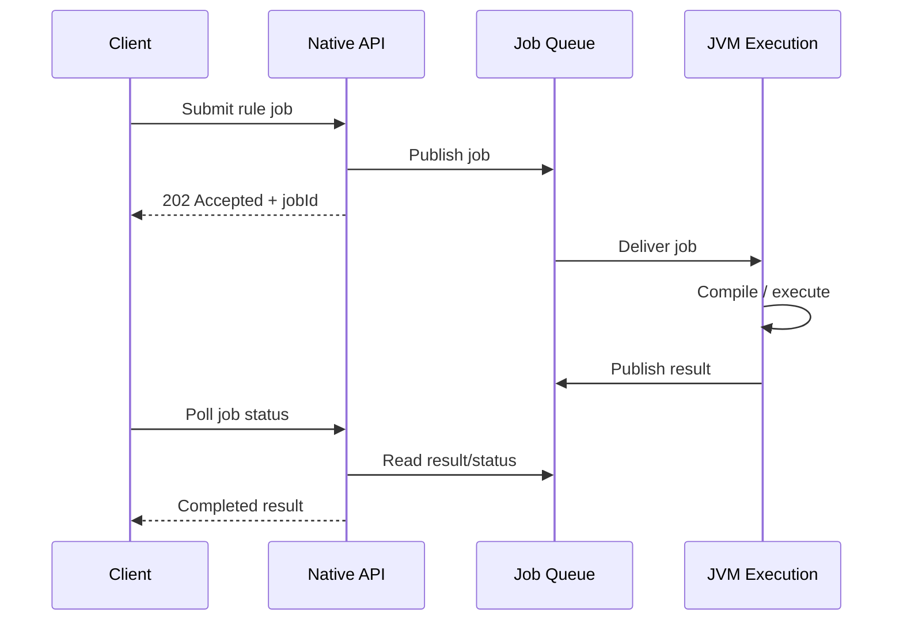

# Splitting Incompatible Components Across a Service Boundary When Appropriate

## 1. When Should a Component Be Split Out of Native Image?

Spring Boot Native Image suits many services that need fast startup, a small footprint, and compact container deployments. However, an application may depend on a component requiring strong dynamic capabilities: compiling Java source at runtime, loading plugin JARs after release, using a script engine that lacks Native Image support, or relying on classloader/bytecode generation that cannot be analyzed upfront.

When a library is incompatible with Native Image, there are three main directions: replace the library with a compatible alternative, change the design to use a pre-known code set, or **split that capability across a service boundary**. Splitting into a separate service fits when the dynamic capability is an independent concern, can communicate via an API, and has a clear operational rationale.

For example: an Order API is built as a native executable, yet business requirements allow administrators to submit new Java rules and compile them at runtime. Rather than forcing the entire Order API to run on the JVM, you can extract the compiler/rule execution into a dedicated JVM service. The Order API sends requests over HTTP/gRPC or a message broker and receives results following a stable contract.

The goal of this lesson is to help decide split boundaries, design contracts, implement communication, and evaluate trade-offs within the **SPRING_BOOT_NATIVE_IMAGE** module.

## 2. Distinguishing Technical Limitations from Architectural Reasons

Do not split a service merely because a dependency reports a native error. First understand the actual limitation:

- Does the component genuinely create new classes or load code outside the known set?
- Does it only use reflection on known classes where `RuntimeHints` can be added?
- Does the library provide reachability metadata or a release supporting Native Image?
- Can code generation be moved to build time?
- Does the business need independent logic updates after the native artifact is released?
- Can that capability be invoked through a small API with clear inputs and outputs?

| Scenario | Approach to Evaluate First |
|---|---|
| Reflection on a fixed set of classes | `RuntimeHints`/metadata |
| Classpath resources selected from a pre-known list | Resource hints |
| JDK proxy with known interfaces | Proxy hints |
| Plugins fixed at build time | Include in dependencies/build inputs and register metadata |
| Arbitrary Java source compiled after deploy | Dedicated JVM service or compiler environment |
| Script engine without Native Image support | Check alternative engines, DSLs, or split execution |
| Native library with incompatible ABI | Choose a compatible builder/runtime or split process if needed |

A service boundary is an architectural decision, not a workaround for every build failure. Split only when there is a sound business and operational boundary.

## 3. Typical Architecture: Native API and JVM Execution Service

A common pattern keeps the main API in native and moves the dynamic part to a JVM service:



The native API handles authentication, validation, core business logic, and appropriate data access. The JVM execution service handles compiling/running dynamic code, loading plugins, or running incompatible engines.

Both processes have independent lifecycles, resource limits, and deployments. They can share a repository or pipeline, but should produce separate artifacts/runtimes so the dynamic component's toolchain does not force the entire system onto one runtime.

## 4. Defining Responsibility Boundaries

A sound boundary should have a small contract and clear responsibilities:

The **native service** is typically responsible for:

- Receiving client requests and authenticating the caller.
- Checking permissions to use the dynamic capability.
- Validating input size, schema, and types.
- Assigning request IDs, deadlines, and idempotency keys.
- Calling the execution service over an internal protocol.
- Applying timeouts, bounded retries, and error handling.
- Validating/normalizing the result before returning it.

The **JVM execution service** is typically responsible for:

- Managing engine/compiler versions.
- Compiling or evaluating scripts/rules per policy.
- Loading plugins within permitted bounds.
- Enforcing sandboxing/limits on CPU, memory, duration, and filesystem.
- Returning results conforming to a schema, not internal Java objects.
- Recording logs/audits and metrics for each execution.

Do not let the execution service make business authorization decisions that the native API is responsible for enforcing. Conversely, the native API should not have to know details about classloaders, compiler options, or scripting-engine internals.

## 5. Designing a Stable API Contract

Communication across a service boundary should use schema-defined data, without passing Java objects or internal serialized classes between the two processes.

Example request:

```json
{
  "requestId": "req-8f21",
  "ruleId": "discount-v3",
  "ruleVersion": "3",
  "input": {
    "orderTotal": 250000,
    "customerTier": "GOLD"
  },
  "deadlineMs": 1500
}
```

Success response:

```json
{
  "requestId": "req-8f21",
  "status": "COMPLETED",
  "result": {
    "discountRate": 0.1,
    "discountAmount": 25000
  },
  "executionMs": 18
}
```

Structured error response:

```json
{
  "requestId": "req-8f21",
  "status": "REJECTED",
  "error": {
    "code": "RULE_VALIDATION_FAILED",
    "message": "Rule expression is invalid"
  }
}
```

The contract should specify:

- Required fields, data types, and size limits.
- API version and rule/engine version.
- Timeout/deadline semantics.
- Stable, classifiable error codes.
- Idempotency and retry handling for re-submitted requests.
- Correlation/request IDs.
- Input/output limits and encoding.
- Backward-compatibility rules.

Do not expose stack traces, filesystem paths, secret contents, or internal details in public error responses.

## 6. Example: Native Spring Boot Calling a JVM Service via HTTP

The native service can use a Spring HTTP client to call the execution API. Example with `RestClient`:

```java
@Configuration
class ExecutionClientConfiguration {

    @Bean
    RestClient executionRestClient(
            RestClient.Builder builder,
            ExecutionProperties properties) {
        return builder
                .baseUrl(properties.baseUrl().toString())
                .build();
    }
}
```

Properties:

```java
@ConfigurationProperties(prefix = "execution")
public record ExecutionProperties(URI baseUrl) {
}
```

Client:

```java
@Service
class RuleExecutionClient {

    private final RestClient restClient;

    RuleExecutionClient(RestClient executionRestClient) {
        this.restClient = executionRestClient;
    }

    ExecutionResponse execute(ExecutionRequest request) {
        return restClient.post()
                .uri("/internal/v1/execute")
                .body(request)
                .retrieve()
                .body(ExecutionResponse.class);
    }
}
```

This is a conceptual example; register `@ConfigurationProperties` via scan/enable, configure timeouts/connection pooling according to the underlying HTTP client, and add exception mapping. Different Spring Boot versions may configure `RestClient` slightly differently.

Use strongly typed DTOs/records for requests and responses. Do not transmit `Class<?>`, `Method`, lambdas, or classloader-bound objects over the network; transmit only contract-defined data.

## 7. HTTP, gRPC, or Message Broker?

Choose the protocol based on workload characteristics:

| Protocol | Suitable When | What to Watch Out For |
|---|---|---|
| HTTP/REST + JSON | Simple request/response, easy observability and integration | Large payloads, schema evolution, timeouts |
| gRPC + Protobuf | Typed contracts, low latency, service-to-service calls | Schema versioning, tooling, streaming, and proxies |
| Message broker | Asynchronous execution, long-running tasks, or buffering needed | Delivery semantics, duplicates, ordering, dead-letter queues |
| Queue/job API | Tasks needing status tracking and independent retries | Polling, retention, cancellation |

For compile jobs taking several seconds or longer, an asynchronous API usually makes more sense than a synchronous HTTP call. The native service submits the job, receives a job ID, and then queries status or receives a callback/event.

Do not introduce a message broker simply because one already exists in the infrastructure. A small REST API may suffice if latency and throughput meet requirements.

## 8. Timeouts, Retries, and Circuit Breakers

Splitting a service introduces an extra network hop and new failure modes. The native service must configure explicit timeouts for connection, response, and overall request deadlines.

Principles:

- Downstream deadlines must not exceed the original request's deadline.
- Retry only on transient errors and idempotent operations or with an idempotency key.
- Never retry validation errors, syntax errors, or policy rejections.
- Cap retry attempts and apply backoff/jitter.
- Circuit breakers can prevent piling requests onto a failing service.
- Bulkheads/concurrency limits keep execution jobs from exhausting the API's resources.
- When downstream is unavailable, return a handleable error or place the job into a pending state per contract.

Illustrative timeout configuration example:

```yaml
execution:
  base-url: http://rule-runtime:8080
  connect-timeout: 500ms
  response-timeout: 2s
```

Property names must be wired into the actual HTTP client. Do not assume declaring YAML keys automatically enforces timeouts if the client bean never reads those values.

## 9. Securing the Service Boundary

The execution service may run code provided by users or tenants. This poses a higher risk surface than typical business APIs. Process separation provides stronger isolation, but **does not create a secure sandbox by itself**.

Necessary controls:

- Service-to-service authentication, such as mTLS or tokens with appropriate audience/scopes.
- Authorization by tenant, rule ID, and execute permission.
- Limits on payload size, duration, CPU, memory, and concurrent executions.
- Run as an unprivileged user with a read-only filesystem where feasible.
- Restrict network egress and access to metadata services.
- Do not mount unnecessary secrets into the execution container.
- Restrict filesystem access, process spawning, and native capabilities.
- Audit who creates/modifies/activates rules and which versions execute.
- Isolate tenants if trust levels differ.

When executing untrusted code, also evaluate process/container isolation, seccomp/AppArmor, or environment-specific sandboxes. Do not assume `SecurityManager`, classloaders, or Native Image automatically block malicious behavior.

## 10. Versioning Engines and Reproducible Results

When the execution service deploys independently, manage engine and rule versions. Each request should identify which rule/version or policy version to run.

Example fields to capture in responses/logs:

- API version.
- Engine name and engine version.
- Rule ID and rule version.
- Execution service build/image digest.
- Input schema version.
- Execution status and duration.
- Request/correlation ID.

If the same rule version yields different results after an engine upgrade, you need to know which version ran. For financial or high-stakes decisions, storing an input snapshot/hash, engine version, and output may be needed for auditing.

Never mutate rule contents under an existing version ID. Clear versioning enables rollbacks and behavior comparisons across releases.

## 11. Deploying Two Runtimes in Containers

A deployment can consist of two images:

```text
orders-native-api
  - GraalVM Native Image executable
  - minimal runtime base
  - HTTP client calling execution service

rule-execution-jvm
  - JVM + script/compiler/plugin dependencies
  - engine runtime
  - engine resources and configuration
```

The native API can use a minimal base image if binary and shared library dependencies match. The JVM execution service needs a JRE/JDK matching the engine; if using the Java Compiler API, verify the runtime image contains the necessary compiler implementation/modules—typically requiring an appropriate JDK runtime rather than a minimal JRE.

Configure service discovery via internal DNS or platform service names. Do not hard-code container IPs because addresses can change. Manage secrets and certificates per service with least privilege.

The two services can scale independently: the API scales with incoming request traffic; the execution service scales with CPU/memory and active jobs. Compile jobs are often CPU/memory intensive, so set dedicated resource requests/limits.

## 12. Observability Across the Service Boundary

Because a request spans two processes, traces and logs must correlate. Propagate correlation IDs or trace context following OpenTelemetry/W3C Trace Context standards if already used in the system.

Useful metrics:

**Native API**
- Request rate, error rate, latency.
- Downstream call latency.
- Timeouts, retries, and circuit breaker state.
- Number of requests awaiting execution.

**Execution service**
- Queue depth and active jobs.
- Compile/evaluation duration.
- CPU/RSS per engine/tenant.
- Compile failures, script rejections, and runtime exceptions.
- Engine cache hit/miss counts.
- Job cancellations and timeouts.

Do not log full source/scripts or sensitive inputs by default. When auditing is required, store logs with appropriate retention, access controls, and masking.

## 13. Synchronous vs. Asynchronous: Choose by Execution Time

### Synchronous Calls

Fits when execution is brief and the caller needs an immediate result:

```text
Client -> Native API -> JVM execution service -> Result -> Client
```

Requires end-to-end timeouts, concurrency caps, and handling for downstream unavailability.

### Asynchronous Calls

Fits when compilation/evaluation takes longer or can be queued:



A job API should define states such as `QUEUED`, `RUNNING`, `COMPLETED`, `FAILED`, `CANCELLED`; result retention periods; retry policies; duplicate handling; cancellation semantics; and dead-letter handling.

## 14. Trade-Offs of Service Splitting

| Benefits | Costs / Risks |
|---|---|
| Native API avoids carrying hard-to-adapt dynamic engines | Adds network hops and latency |
| Engine/JVM can be upgraded independently | Two artifacts and pipelines to manage |
| Scale compiler CPU/memory separately | Higher infrastructure and operational cost |
| Isolates dependencies and runtimes | Requires service discovery, auth, and observability |
| Full JVM ecosystem available for dynamic code | Must enforce sandboxing and resource controls |
| Small native service with fast startup | Distributed failures, timeouts, retries, and eventual consistency |

Splitting a service does not guarantee lower total memory usage. Two processes carry separate overhead; the JVM execution service may need a sizable heap. Benchmark the full system under realistic workloads.

## 15. When Should You Not Split?

Do not split if:

- The issue is just a few missing reflection/resource/proxy hints that can be resolved cleanly.
- The library already has a Native Image-compatible release and simply needs a dependency upgrade.
- The logic can move to build-time generation without harming business workflows.
- The dynamic portion is tiny, lacks an independent contract, and splitting adds disproportionate complexity.
- Network latency or downstream availability cannot meet business SLAs.
- The team lacks capacity to operate, secure, and observe an additional service.

Also consider a modular JVM process as an intermediate step if independent scaling/deployment is not yet needed. The goal is choosing the smallest boundary that solves the real problem.

## 16. Decision and Implementation Process

Follow these steps before splitting:

1. **Reproduce the limitation:** build a small sample confirming the library/mechanism is genuinely incompatible with Native Image.
2. **Check native solutions:** investigate metadata, `RuntimeHints`, proxy/resource support, and compatible releases.
3. **Evaluate design changes:** can a DSL/interpreter or build-time code generation meet business needs?
4. **Identify an independent capability:** does the compiler/script/plugin runtime have a clean input/output API?
5. **Design the contract:** schema, versioning, error codes, deadlines, idempotency, and size limits.
6. **Choose the protocol:** HTTP/gRPC for synchronous, or a broker/job API for asynchronous.
7. **Design security:** identity, authorization, tenant isolation, sandboxing, and resource quotas.
8. **Build a spike:** native caller invoking the JVM worker inside real containers.
9. **Test failure modes:** timeouts, worker crashes, duplicate requests, overload, and version mismatches.
10. **Measure end-to-end:** latency, throughput, RSS, CPU, queue time, deployment complexity, and cost.
11. **Plan rollout:** canary, fallback, rollback, and API compatibility.

Do not split a service based solely on a single compile error. Gather evidence that the new boundary satisfies functional and operational needs better than keeping them together.

## 17. Practice Exercise: Splitting a Rule Compiler into a JVM Service

**Context:** the Order API must allow administrators to update Java rules after release. Native Image does not fit the requirement to compile and load arbitrary classes at runtime.

**Step 1 — Define the current contract.** Document rule inputs, order data, outputs, and compiler/runtime errors. Decouple business data from internal objects.

**Step 2 — Create the JVM execution service.** Use a compatible JDK/runtime and compiler/engine. Expose an internal endpoint accepting rule ID/version and JSON input.

**Step 3 — Create the native caller.** Use a Spring HTTP client to invoke the endpoint; configure base URL, timeouts, and authentication via runtime properties.

**Step 4 — Standardize errors.** Distinguish rule validation errors, compile failures, execution timeouts, worker unavailability, and internal errors.

**Step 5 — Add security.** Authenticate service identity, enforce tenant limits, payload caps, CPU/memory limits, and execution worker network restrictions.

**Step 6 — Test.** Run identical fixtures through the old implementation and the new service; test timeouts, duplicates, worker restarts, and version mismatches.

**Step 7 — Package.** Build the native API image and JVM worker image separately; configure service discovery, resource limits, and health/readiness checks.

**Step 8 — Measure and roll out.** Compare end-to-end latency, combined RSS, CPU, throughput, queueing, and operational cost; roll out gradually while preserving rollback capability.

Completion criteria: the native API has no dependency on the dynamic compiler; the execution worker honors the contract; network/worker errors are controlled; data and results are traceable by version; the full system is measured in a production-equivalent deployment environment.

## 18. Conclusion

Splitting an incompatible component into a separate service is the right choice when dynamic capabilities such as compiling Java source, loading plugins, or running script engines require a flexible runtime with an independent lifecycle. Spring Boot Native Image can keep suitable APIs and business logic native, while the JVM service handles dynamic capabilities across a clean data contract.

This decision brings network latency, distributed failures, security, observability, and operational costs. Verify technical limits first, consider hints or build-time generation, and split only when a clear business boundary exists. Versioned contracts, bounded timeouts/retries, sandboxing, and end-to-end testing enable both runtimes to collaborate safely for long-term operations.
