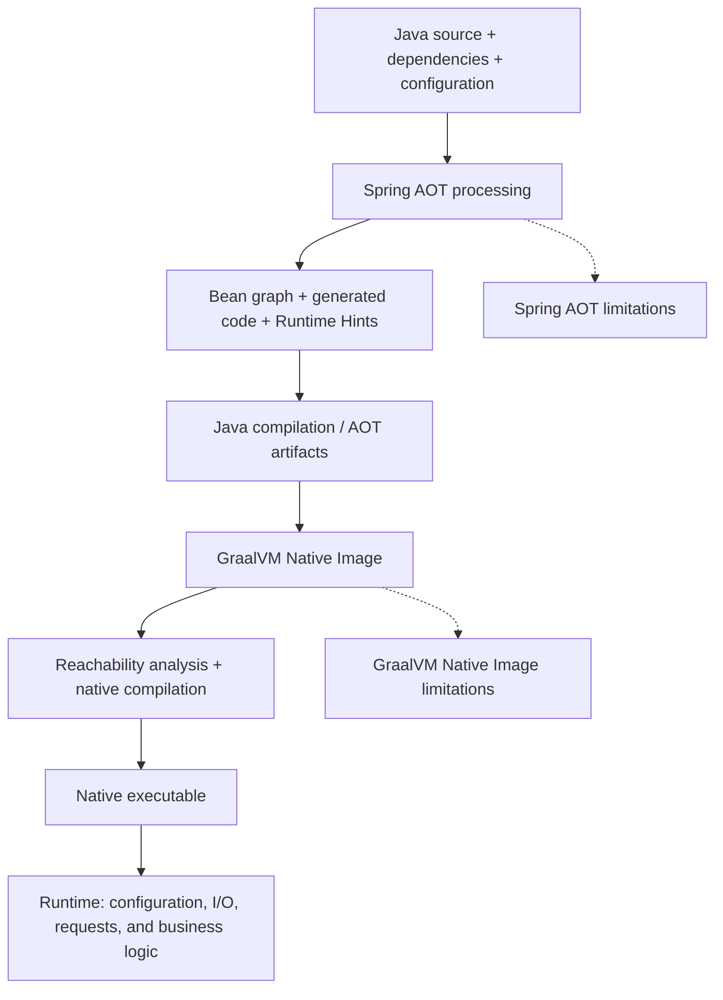
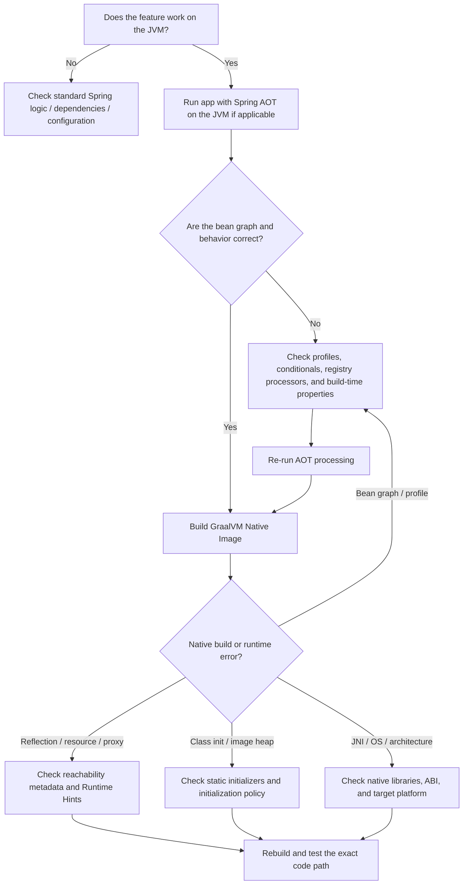

# Distinguishing GraalVM Limitations from Spring AOT-Specific Limitations

## Learning Objectives

When migrating a Spring Boot application to **GraalVM Native Image**, some features may behave differently than on the JVM. The reasons usually come from two technology layers:

- **Spring AOT** analyzes the application and prepares bean definitions, bootstrap code, and runtime hints at build time.
- **GraalVM Native Image** analyzes reachable code, compiles it into an executable, and enforces the closed-world model to produce the native program.

These two layers collaborate, yet they are not the same thing. A limitation stemming from Spring AOT fixing the bean graph at build time differs from a Native Image limitation requiring reflection metadata or resource configuration. Without distinguishing them, you risk fixing the wrong layer—adding Runtime Hints for a profile error, or tweaking Spring configuration when the real cause is a dynamically class-generating library.

After this lesson, you will be able to:

- Distinguish the responsibilities and limitations of Spring AOT versus GraalVM Native Image.
- Identify whether an error belongs to the bean graph/build-time configuration or closed-world/reachability.
- Understand problem categories across reflection, resources, proxies, class loading, JNI, and class initialization.
- Choose the appropriate fix using Spring configuration, Runtime Hints, dependency changes, or redesign.
- Build a diagnostic workflow from JVM to AOT and native executable.

## 1. Two Technologies, Two Sets of Limitations

### 1.1. What Does Spring AOT Do?

**Spring AOT (Ahead-of-Time processing)** analyzes Spring configuration in a dedicated build-time environment. Spring builds the bean definition model, evaluates configuration conditions determinable at that point, and generates Java code and metadata to assist `ApplicationContext` initialization.

Tasks Spring AOT can prepare include:

- Registering bean definitions and context initialization code.
- Processing `@Configuration`, `@Bean`, component scanning, and applicable conditions.
- Analyzing certain dependencies and bean structures.
- Generating runtime hints for reflection, resources, proxies, and serialization that Spring or integrated libraries can determine.
- Generating bootstrap support code to reduce work required at application startup.

Spring AOT focuses on the **Spring application model**. It is not the compiler that turns Java into machine code.

### 1.2. What Does GraalVM Native Image Do?

**GraalVM Native Image** takes bytecode, dependencies, AOT code/metadata, and build options to produce a native executable. During this process, the compiler analyzes reachable code and determines which elements must be retained in the binary.

Native Image applies the **closed-world** model: required classes, methods, resources, and dynamic access capabilities must be known or appropriately registered at build time. Behaviors that are flexible on the JVM—such as arbitrary reflection, loading external plugin JARs after the program is built, or generating arbitrary classes at runtime—require separate consideration.

Native Image focuses on **the set of code and resources included in the executable**. It does not decide for the application which business beans to use per profile; that belongs to Spring configuration and AOT processing.

### 1.3. Overall Pipeline



| Layer | Core Question | Example Limitation |
|---|---|---|
| Spring AOT | Which beans and Spring configurations are prepared at build time? | Profiles/conditionals already locked the bean graph; bean registration logic depends on data only available at runtime |
| GraalVM Native Image | Which code, resources, and dynamic accesses are kept in the executable? | Unregistered reflection, resources omitted from the image, dynamically loaded classes, or runtime-generated code |
| Both | Was framework knowledge translated into metadata the native compiler understands? | Proxies or reflection generated by a library lacking proper AOT integration/runtime hints |

**An application can use Spring AOT on the JVM without building a native executable.** In that mode, it can still encounter limitations from the build-time bean graph, without yet hitting every closed-world limitation of Native Image. Conversely, a non-Spring Java application can still hit reflection/resource issues when compiled with Native Image.

## 2. Limitations Primarily Belonging to GraalVM Native Image

### 2.1. Closed-World and Reachability Analysis

On the JVM, classes can be loaded at runtime as needed, provided they are on the classpath and class loading permits. Native Image must pre-analyze the runnable code set to create an executable. Code not determined to be reachable may be eliminated from the binary.

Example:

```java
String implementation = configuration.getProperty("serializer.class");
Class<?> type = Class.forName(implementation);
Object serializer = type.getDeclaredConstructor().newInstance();
```

On the JVM, this snippet can instantiate the configured class if the class is present and the constructor is accessible. With Native Image, the compiler needs to know which classes may be loaded and which constructors invoked reflectively.

If the class name comes only from an arbitrary runtime data source, the compiler cannot determine every class to keep in the executable. There are two distinct situations:

- The class is already in the application/dependencies and included in the image, but reflective access is unregistered: Runtime Hints may be needed.
- The class only appears in a JAR/plugin installed after the executable was built: adding reflection hints alone cannot insert new code into an already-built binary; you must rebuild with that dependency or use a separate-process plugin architecture.

**Closed-world does not mean all reflection is forbidden.** Reflection remains supported when the accessed classes/members are retained and metadata is properly declared.

### 2.2. Reflection and Metadata

Libraries may use reflection to:

- Look up constructors and instantiate objects.
- Read/write fields or invoke methods by name.
- Inspect annotations and generic metadata.
- Perform serialization/deserialization.
- Build custom mappers, validators, or dependency injection.

Native Image needs to know which reflective operations are used. Without metadata, the application may fail to build or fail only when reaching that dynamic code path at runtime.

For example, a library instantiating a DTO via constructor reflection:

```java
Class<?> type = Class.forName("com.example.dto.PaymentRequest");
Object request = type.getDeclaredConstructor().newInstance();
```

If the class and constructor are already in the binary yet unregistered, add hints with the right scope. If the class is absent from build inputs, hints cannot substitute for the dependency.

### 2.3. Resources Are Not Automatically Always Included in the Image

On the JVM, `ClassLoader.getResource()` or `getResourceAsStream()` typically reads resources from the classpath/JARs. With Native Image, resources must be identified and bundled into the executable.

Example:

```java
String template = "invoice-" + request.getLocale() + ".html";
try (InputStream input =
        getClass().getResourceAsStream("/templates/" + template)) {
    // Read template
}
```

Dynamically constructed resource names can prevent tooling from identifying which files to package. Patterns or specific resources must be registered in ways supported by Spring/GraalVM.

Resources external to the image—such as mounted files, secret volumes, or external configuration files—can still be read from the filesystem at runtime. Distinguish **resources packaged inside the binary** from **files deployed externally**.

### 2.4. Dynamic Proxies and Bytecode Generation

Native Image supports certain kinds of proxies, but needs to know the interfaces and proxy types upfront. Frameworks that generate classes themselves using Byte Buddy, CGLIB, ASM, or a Java compiler at runtime may need special support or be incompatible with the native model.

Distinguish:

- **JDK dynamic proxy:** a proxy implementing a set of interfaces; interfaces must be recognized/registered.
- **Spring AOP proxy:** Spring AOT can prepare proxies and hints for many framework-managed cases.
- **Classes generated arbitrarily at runtime:** the compiler cannot automatically embed an unknown class into the executable simply because the application calls bytecode-generation APIs.

Not every proxy error calls for adding reflection hints. Determine whether the proxy is created by Spring, by a third-party library, or generated by the application itself.

### 2.5. Class Loading, Plugins, and ServiceLoader

A JVM system can discover implementations from an expanded classpath or plugins installed after release. A native executable is typically built with classes and dependencies known at build time.

Mechanisms like `ServiceLoader` can still be supported if providers and their metadata are included in the image. However, a plugin JAR copied into a directory after the native binary is built does not automatically become part of the executable.

If the product requires independent plugins installable post-release, consider:

- Rebuilding the native executable for the supported plugin set.
- Using a static registry/extension point with a known list of implementations.
- Running plugins in a separate JVM/process and communicating over HTTP, gRPC, or a message broker.
- Using a JVM runtime for the component that genuinely needs arbitrary plugin loading.

### 2.6. JNI and Native Libraries

Applications may call C/C++ or OS libraries via JNI/JNA. Native Image does not remove compatibility requirements for those libraries.

Check:

- Is the native library available in both build and runtime environments?
- Are ABI, libc, and library versions compatible?
- Do the executable's OS and CPU architecture match the deployment environment?
- Do JNI-accessed methods/classes have the required metadata?

A Linux x86-64 native executable cannot simply be renamed to `.exe` to run on Windows. In containers, builder and run images must match architecture, base libraries, and runtime requirements.

### 2.7. Class Initialization and the Image Heap

Native Image can initialize classes at build time. Static initializers might read the environment, current time, locale, or instantiate objects. Values created then can become state stored in the image heap.

This is a limitation/mechanism belonging to **Native Image class initialization**, not Spring AOT automatically freezing every static field.

Example:

```java
final class HostInfo {
    static final String HOST = System.getenv("HOSTNAME");
    static final Instant CREATED_AT = Instant.now();
}
```

If the class is initialized at build time, values may reflect the build machine rather than the runtime machine. Define the class initialization policy, defer dynamic state to runtime, or move configuration into beans/runtime properties.

## 3. Limitations Primarily Belonging to Spring AOT

### 3.1. The Bean Graph Is Determined During AOT Processing

Spring AOT analyzes configuration and bean definitions in a build environment. The generated output reflects the bean set Spring observed during that run.

Example:

```java
@Configuration(proxyBeanMethods = false)
class PaymentConfiguration {

    @Bean
    @Profile("sandbox")
    PaymentGateway sandboxGateway() {
        return new SandboxPaymentGateway();
    }

    @Bean
    @Profile("production")
    PaymentGateway productionGateway() {
        return new ProductionPaymentGateway();
    }
}
```

If the AOT build ran with the `sandbox` profile, the bean graph generated for that variant contains the sandbox configuration. Simply changing `SPRING_PROFILES_ACTIVE=production` at runtime cannot generate registration code for production beans that were omitted from the AOT model.

With Spring Boot AOT, active profiles used during AOT processing must align with runtime profiles. Depending on version and setup, Spring Boot may detect a mismatch and fail startup; in any case, do not rely on switching profiles at runtime to add beans absent from the AOT output.

### 3.2. Conditional Configuration Is Evaluated Against the Build Environment

Conditions such as:

- `@Profile`
- `@ConditionalOnProperty`
- `@ConditionalOnClass`
- `@ConditionalOnBean`
- `@ConditionalOnMissingBean`

can govern whether a bean definition is registered. With AOT, conditions affecting bean structure are resolved during analysis.

Example:

```java
@Configuration(proxyBeanMethods = false)
class AuditConfiguration {

    @Bean
    @ConditionalOnProperty(
            prefix = "audit",
            name = "enabled",
            havingValue = "true"
    )
    AuditPublisher auditPublisher() {
        return new HttpAuditPublisher();
    }
}
```

If `audit.enabled` determines whether the bean exists, the property value must be present in the AOT environment to build the right bean graph. Changing the property only at runtime cannot automatically add back a bean excluded from the build model.

Conversely, a property merely supplying a URL, timeout, or API key to an already-registered bean can usually be read at runtime. Not all properties are frozen.

### 3.3. Bean Registration Logic Depending on Runtime Data

Some applications use `BeanDefinitionRegistryPostProcessor`, `BeanFactoryPostProcessor`, or custom code to register beans based on files, databases, endpoints, or plugins discovered at startup.

Example:

```java
registry.registerBeanDefinition(
        beanName,
        new RootBeanDefinition(resolveImplementationFromDatabase())
);
```

If the implementation list can only be known while the application is running, Spring AOT cannot by default reproduce that exact bean graph during an offline build. Processors and bean-registration logic must be AOT-compatible, runnable in the build environment, and produce deterministic results.

Consider:

- Moving the implementation list into explicit build configuration.
- Using explicit bean definitions and conditions Spring can analyze.
- Writing a `BeanFactoryInitializationAotProcessor` or `BeanRegistrationAotProcessor` when custom AOT integration is required.
- Shifting dynamic registries to runtime data read by an already-registered bean, if creating extra beans is unnecessary.
- Splitting a dynamic plugin system into a separate process if post-release extensibility is mandatory.

### 3.4. Component Scanning and Classpath Are Processed at Build Time

Spring AOT analyzes components/configurations and the build's classpath. A JAR dropped into an external folder after the native executable is built will not automatically be component-scanned and registered as beans.

If build variants have different dependencies, produce separate artifacts with the corresponding classpaths. If only runtime configurations vary while the bean graph stays constant, use `@ConfigurationProperties` or runtime configuration sources rather than relying on dynamic component scanning.

### 3.5. Runtime Mutation of Bean Definitions

An application might have code registering or modifying bean definitions during startup. With AOT, those changes must be executed and reflected during AOT processing, or supported by a corresponding AOT mechanism.

Do not assume every mutation to `BeanDefinitionRegistry` after generated code is produced will be replayed in the native executable. In particular, loading a module/plugin and registering new beans from data only available post-deploy requires a different design or variant build workflow.

## 4. Cases Involving Both Layers

Some features do not belong exclusively to one layer. Spring AOT can generate metadata, while Native Image consumes that metadata to retain necessary elements.

### 4.1. Reflection

Spring AOT can infer certain reflective operations from the bean model and integrate with Runtime Hints. GraalVM Native Image is the component applying reachability and metadata when producing the executable.

If the application uses reflection unknown to Spring, hints must be declared. If the class is missing from dependencies/build inputs, hints still cannot add new classes to the binary.

### 4.2. Resources

Spring or integrated libraries can register resource hints. Native Image uses those declarations to bundle resources into the executable. An external configuration file mounted at runtime is a different case: it must exist on the filesystem and be read via a runtime path.

### 4.3. Proxies and AOP

Spring AOT can prepare proxies/hints for AOP beans that the framework manages. Native Image needs to know interfaces, classes, and metadata required for proxies. Libraries generating proxies without AOT integration may need extra configuration or usage changes.

### 4.4. Serialization

Spring can supply hints for certain framework-known types. However, serialization libraries that discover classes, constructors, and fields at runtime still need Native Image-compatible metadata. Identify the exact serializer and data types to retain.

### 4.5. Quick Classification Table

| Symptom | Primary Layer to Check | Diagnostic Question |
|---|---|---|
| Changing runtime profile does not change beans | Spring AOT | Which profile was active during AOT processing? |
| `@ConditionalOnProperty` does not create expected bean | Spring AOT | Was the property set correctly during the AOT build? |
| Reflection reports missing constructor/method | GraalVM Native Image / Runtime Hints | Is the class in the image and is the accessed member registered? |
| Cannot read packaged JSON/template | GraalVM Native Image / resource hints | Was the resource included in the image? |
| Post-build plugin JAR is not loaded | Native Image and AOT design | Is the plugin in build inputs and the bean graph? |
| Custom bean registry differs between build and runtime | Spring AOT | Does the registry processor depend on runtime data? |
| Spring AOP proxy not created in native | Both | Did Spring AOT generate the proxy/hints, and does native image have matching metadata? |
| Static field holds CI machine's hostname | Native Image class initialization | Was the class initialized at build time? |
| JNI library fails to load | GraalVM/OS runtime | Are ABI, architecture, and libraries compatible? |

## 5. What Do Runtime Hints Solve and What Don't They?

### 5.1. Declaring Reflection and Resources

Spring provides the `RuntimeHints` API to describe required dynamic accesses. Example:

```java
import org.springframework.aot.hint.MemberCategory;
import org.springframework.aot.hint.RuntimeHints;
import org.springframework.aot.hint.RuntimeHintsRegistrar;
import org.springframework.aot.hint.TypeReference;

final class PaymentRuntimeHints implements RuntimeHintsRegistrar {

    @Override
    public void registerHints(
            RuntimeHints hints,
            ClassLoader classLoader) {

        hints.reflection().registerType(
                TypeReference.of(PaymentPlugin.class),
                MemberCategory.INVOKE_DECLARED_CONSTRUCTORS,
                MemberCategory.INVOKE_PUBLIC_METHODS
        );

        hints.resources().registerPattern(
                "plugins/payment/*.json"
        );
    }
}
```

Register the registrar:

```java
@Configuration(proxyBeanMethods = false)
@ImportRuntimeHints(PaymentRuntimeHints.class)
class PaymentNativeConfiguration {}
```

Imports and APIs must match your project's Spring Framework/Spring Boot version. Register only the members that genuinely need reflection; do not enable broad access unnecessarily.

### 5.2. Hints Cannot Fix Every Error

Runtime Hints help Native Image retain metadata and dynamically accessed elements, but they cannot:

- Add a new dependency/JAR into an already-built executable.
- Recreate a bean excluded from the bean graph by a profile/condition during AOT.
- Make a class absent from build inputs reachable.
- Turn a self-invocation call into a call routed through a Spring AOP proxy.
- Supply missing JNI/OS libraries or fix an ABI mismatch.
- Turn a build-time initialized object into fresh runtime configuration.

Before adding hints, determine whether the error lies in dynamic access metadata, the bean graph, dependencies, or the runtime environment.

## 6. Layer-by-Layer Diagnostic Examples

### 6.1. Case A: Profile Does Not Create the Expected Bean

Code:

```java
@Bean
@Profile("production")
PaymentGateway productionGateway() {
    return new ProductionPaymentGateway();
}
```

Symptom: the native binary was built with `sandbox` active, yet when run with `production`, the `ProductionPaymentGateway` bean does not appear or Spring reports a profile mismatch.

Diagnosis:

1. Verify `SPRING_PROFILES_ACTIVE` during the AOT step.
2. Check the `processAot` task/logs.
3. Inspect generated bean registrations.
4. Build a new variant with the `production` profile.
5. Run the binary with the profile matching the built variant.

This is a **Spring AOT and bean graph** issue. Adding reflection hints for `ProductionPaymentGateway` will not make the bean appear in the context.

### 6.2. Case B: Reflection Cannot Find a Constructor

Code:

```java
Class<?> type = Class.forName("com.example.plugin.JsonPaymentPlugin");
Object plugin = type.getDeclaredConstructor().newInstance();
```

Symptom: works on the JVM, but native reports constructor not found or inability to access the class via reflection.

Diagnosis:

1. Confirm the class is in build-time dependencies/classpath.
2. Register the class and constructor via Runtime Hints or appropriate metadata.
3. Verify the class is reachable and not stripped from the image.
4. Rebuild the native executable and run that exact code path.

This is primarily a **Native Image reachability/reflection metadata** issue. If the class resides in a JAR installed after build, you must rebuild with that JAR; hints alone are not enough.

### 6.3. Case C: Resource Exists on the JVM but Missing in Native

Code:

```java
try (InputStream input =
        getClass().getResourceAsStream("/templates/invoice.html")) {
    // Read template
}
```

Symptom: the JVM finds the resource in the JAR, yet the native executable returns `null`.

Diagnosis:

1. Confirm the resource is in the right location under `src/main/resources`.
2. Verify the resource is packaged in the JVM artifact.
3. Register the resource pattern via Runtime Hints if Native Image did not detect it.
4. Rebuild and test the endpoint/processing path using the resource.

This is a **Native Image resource inclusion** issue, unless the resource was never part of build inputs.

### 6.4. Case D: Beans Created from a Database at Startup

A `BeanDefinitionRegistryPostProcessor` queries a database for a list of connector types and registers one bean per row. On the JVM, the database is reachable at startup; during an offline CI AOT build, the data is absent or differs from production.

Diagnosis:

1. Identify which AOT phase the processor runs in.
2. Check whether it depends on a database, network, or secrets.
3. If the connector set is fixed, move the list into explicit build configuration.
4. If the list must change after deploy, register a fixed registry/service bean and read connector data at runtime rather than creating new beans from that data.
5. If plugins must be installed post-release, consider a separate process or JVM runtime for the plugin part.

This is primarily a **Spring AOT limitation for runtime-data-dependent bean structures**, and may also hit closed-world limits if plugin classes are absent from the binary.

## 7. Diagnostic Workflow from JVM to Native

Do not start by adding bulk hints. Reproduce and pinpoint the failing layer in sequence:



### 7.1. Evidence to Collect

| Stage | Evidence |
|---|---|
| JVM baseline | Tests, startup logs, bean types, profiles, and business results |
| Spring AOT | Active profiles/build properties, generated source, bean registrations, AOT logs |
| Native compilation | GraalVM version, target OS/CPU, reachability/class-init errors, build arguments |
| Native runtime | Stack traces, resource/reflection failures, environment, thread/transaction behavior |
| Container/deployment | Image architecture, shared libraries, mounted files, secrets, and runtime configuration |

Keep the exact same source revision and dependencies when comparing JVM/AOT/native. Changing multiple variables at once makes root causes hard to isolate.

## 8. When Should You Redesign?

| Application Need | Suitable Design |
|---|---|
| Pick one of a few known implementations | Use `@Profile`/conditionals and explicit build variants |
| Only change URL, credentials, or timeout | Keep the bean graph fixed, supply configuration at runtime |
| Reflection on a class already in the binary | Register precise Runtime Hints |
| Read a resource inside the image | Register resource hints or patterns |
| Load a plugin JAR after release | Use a JVM/plugin process or rebuild native for the plugin set |
| Create beans from database data at startup | Use a fixed runtime registry/service or generate build variants from deterministic data |
| Generate dynamic proxies from a library | Look for AOT/native integration; otherwise change proxy approach or library |
| Connect JNI/native library | Package library matching OS/CPU/ABI and declare needed metadata |
| Static state depending on runtime machine | Move to runtime initialization or runtime beans/configuration |

Not every application fits native image. If a product depends heavily on arbitrary plugins, runtime bytecode generation, or a classpath that changes post-deploy, the JVM may be the sensible choice for that part.

## 9. Checklist Before Concluding a Feature Is Incompatible

- Reproduced the issue on the JVM baseline?
- Identified whether the failure happens during Spring AOT processing, native compilation, or native runtime?
- Confirmed the bean is registered in AOT output?
- Verified profiles, conditions, and build-time properties are accurate?
- Confirmed the class is in build-time dependencies/classpath during the native build?
- Verified needed reflective members have metadata?
- Confirmed the resource is in the image or at the expected runtime filesystem path?
- Determined whether proxies are Spring-managed or library-generated?
- Checked for post-build bytecode generation or plugin loading?
- Checked whether static initializers read time, environment, secrets, or build-machine resources?
- Verified JNI/shared libraries match OS, CPU, and ABI?
- Rebuilt and tested the exact code path on the native executable?

## 10. Practice Exercises

### Exercise 1 — Classify Failures

Create three intentional failures:

1. Use `@Profile` to choose different implementations and run the AOT build with one profile.
2. Use `Class.forName()` to instantiate a class present in dependencies without registering reflection.
3. Read a resource using a dynamically concatenated name.

For each failure, document the responsible layer, logs/evidence to look for, and the fix. Do not use a single Runtime Hints workaround for all three cases.

### Exercise 2 — Runtime Hints

Register a reflectively accessed constructor/method and a resource pattern via `RuntimeHintsRegistrar`. Build native, exercise the exact code path, and confirm reflection/resources work.

### Exercise 3 — AOT Bean Graph

Create two bean implementations under `@Profile("sandbox")` and `@Profile("production")`. Run AOT builds for each profile in separate workspaces or sequentially while preserving artifacts. Verify each binary holds the right implementation and matches its runtime profile.

### Exercise 4 — Architectural Decision

Suppose an application must load plugins from a directory where administrators can drop arbitrary JARs after deployment. Explain why Runtime Hints are not enough to add new code into an already-built native executable. Propose an approach using a JVM/plugin process or rebuilding native per plugin list.

### Self-Check Questions

1. What does Spring AOT decide that GraalVM Native Image does not?
2. Why can `@ConditionalOnProperty` cause a bean to be absent in a native variant?
3. Is reflection forbidden in Native Image? What part does metadata solve?
4. Why can't adding a Runtime Hint put a new plugin JAR into an already-built binary?
5. Which layer does a missing resource error belong to, and what should be checked before adding a hint?
6. When should configuration move from a static initializer to `@ConfigurationProperties`?

**Key takeaway:** Spring AOT prepares the Spring application structure at build time; GraalVM Native Image determines and compiles the runnable code and resources into the native executable. Profiles, conditionals, and dynamic bean-registration logic are usually AOT concerns. Reflection, resources, proxies, class loading, JNI, and class initialization are usually Native Image concerns or integration between both layers. Identify the right layer before choosing a fix.
