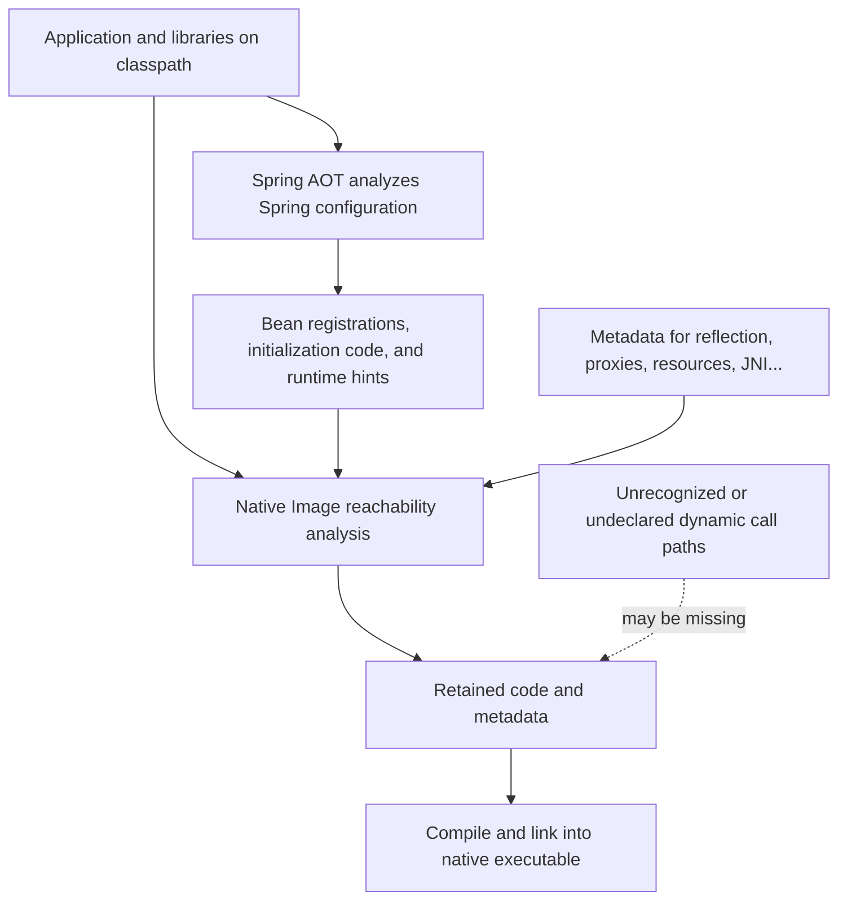

# Closed-World Assumption and the Requirement to Know the Class Set at Build Time

When running a Spring Boot application on the JVM, the program can load additional classes and inspect class structures dynamically at runtime. GraalVM Native Image takes a different approach: it analyzes ahead of time which parts of the code can potentially be used, compiles them into machine code, and packages them into a native executable. This approach is built on the **closed-world assumption**.

Understanding this assumption is foundational for using **Spring AOT (Ahead-of-Time)**, handling reflection, resources, and dynamic proxies, as well as explaining why a Spring Boot application that runs smoothly on the JVM can still fail in its native build.

## 1. What Does “Closed-World” Mean?

In the context of Native Image, the *world* is the set of types, methods, fields, and behaviors that the program might need at runtime. A **closed world** means the build tool assumes that the required set of code and dynamic access patterns can be determined or declared **before creating the binary**. The analyzer starts from the *entry points*, follows the calls and relationships it recognizes, and generates native code for what is considered *reachable*.

This is an assumption for **reachability analysis**; it does not mean the tool must include *every* class on the classpath in the binary. Classes not deemed necessary can be eliminated. Conversely, having a class in a dependency at build time does **not guarantee** that all of its constructors, methods, or fields will be usable via reflection at runtime.

| Aspect | Spring Boot Running on JVM | Spring Boot Compiled to Native Image |
| --- | --- | --- |
| Application code compilation | Bytecode is executed by the JVM and can be optimized by the JIT at runtime | Reachable code is AOT-compiled into machine code before running |
| Class loading | Class loaders can load additional classes from the classpath or configured sources at runtime | The binary's set of classes is essentially fixed at build time; the binary cannot be treated like a JVM where arbitrary JARs can be added |
| Reflection | The JVM can look up classes and members by name at runtime | Dynamic reflection access needs to be recognized by the analyzer or described with metadata/hints |
| Rarely used code | Can still be loaded and executed later | Code not marked as reachable may be excluded from the binary |
| Classpath resources | Can be read from JARs or directories on the classpath at runtime | Resources must be packaged into the binary using appropriate configuration |

**Key takeaway:** Native Image needs to know the *possible scope* of the program at build time, while the program can still receive data, choose `if` branches, call network APIs, and process varying inputs at runtime. “Closed” here refers to the universe of code and required metadata, not business data.

## 2. How Does Native Image Find Which Classes to Keep?

Imagine a graph: nodes are types, methods, or members; edges are call or access relationships. Native Image starts from the entry points and expands the set of reachable nodes. A direct call such as `new InvoiceService()` is usually easier to analyze than `Class.forName(name)` when `name` is only known at runtime.



The process can be understood through three cooperating parts:

1. **GraalVM static analysis:** finds call paths and data types that the compiler can prove or estimate may be used, including dynamic call cases that can be inferred at build time.
2. **Spring AOT:** pre-processes much of the information about the application context, bean definitions, dependency injection, configuration, and recognized Spring components; from there it generates code or registers runtime hints that Native Image can use.
3. **Additional reachability metadata:** describes interactions that are hard to infer from static code, such as constructors invoked via reflection by name, JDK proxies created from a list of interfaces, or JSON files that must be read from the classpath.

For example, a `new EmailSender()` call clearly shows the required type. However, `Class.forName(configuredClassName)` might receive different class names depending on deployment configuration. It is not possible to safely infer every class name from a string whose value only exists at runtime. The tool therefore needs additional information about the **set of classes and members that can be accessed**, rather than being allowed to guess or load code that was never built.

### “Reachable” Classes vs. “Dynamically Accessible” Members

A class being retained due to a normal Java call does not mean its entire reflection API is exposed. For instance, an application might call `new Customer()` directly yet still lack the ability to call `Customer.class.getDeclaredConstructor().newInstance()` in a code path that only uses dynamic reflection. Therefore, when declaring hints, you need to specify **which type** and **which operation** (calling constructors, invoking methods, accessing fields, etc.) are actually used.

## 3. Why Do Dynamic Mechanisms Easily Cause Errors?

The following example selects a formatter by class name from configuration or a request. The interface and implementation are placed in **two separate Java files**, in the same `com.example.nativeimage` package:

```java
// OrderFormatter.java
package com.example.nativeimage;

public interface OrderFormatter {
    String format(String orderCode);
}
```

```java
// UppercaseOrderFormatter.java
package com.example.nativeimage;

public final class UppercaseOrderFormatter implements OrderFormatter {
    public UppercaseOrderFormatter() {}

    @Override
    public String format(String orderCode) {
        return orderCode.toUpperCase(java.util.Locale.ROOT);
    }
}
```

```java
// FormatterFactory.java
package com.example.nativeimage;

public final class FormatterFactory {
    public OrderFormatter createFormatter(String configuredClassName)
            throws ReflectiveOperationException {
        Class<? extends OrderFormatter> type = Class.forName(configuredClassName)
                .asSubclass(OrderFormatter.class);
        return type.getDeclaredConstructor().newInstance();
    }
}
```

On the JVM, if the class can be found by the class loader and the constructor has appropriate visibility, the program can instantiate it. With Native Image, if the value of `configuredClassName` only appears at runtime, the analyzer does not necessarily recognize `UppercaseOrderFormatter` and the constructor to be called. The result can be a class lookup error or a reflection registration error, even though the source code and dependencies have not changed.

Similar situations commonly occur in Spring Boot applications:

| Mechanism | Information That May Not Be Inferred at Build Time | Resolution Approach |
| --- | --- | --- |
| `Class.forName`, `getDeclaredConstructor`, `Method.invoke` | Class name and constructor/method accessed dynamically | Register the type and exact reflection members using runtime hints or metadata |
| Jackson dynamic type serialization/deserialization | DTO, constructor, or fields determined only from runtime data/configuration | Prefer explicit types; add binding/reflection hints for types not automatically recognized by AOT |
| JDK dynamic proxy | List of interfaces passed to `Proxy.newProxyInstance` | Register the proxy interface set; for Spring-managed proxies, check AOT's automatic hint generation first |
| Classpath resources | Dynamically constructed paths to `.json`, `.xml`, templates, etc. | Register an appropriate resource pattern and include the files in build sources |
| Serialization, JNI, specialized framework integrations | Special types and APIs needed at runtime | Use the corresponding reachability metadata type and test actual execution paths |

Do not lump all native errors together as reflection issues. A `.json` file missing from the binary will not be fixed by registering a constructor; conversely, declaring a resource does not grant reflection access to a DTO.

## 4. What Does Spring AOT Solve and When Are Hints Still Needed?

Spring Boot integrates AOT processing to turn many operations normally performed by the framework at startup into pre-prepared code or descriptors. For example, Spring-managed beans, controllers, and configurations can be analyzed by Spring AOT to generate initialization code and register the required hints.

However, AOT cannot always know class names coming from a database, API payloads, external configuration plugins, filenames computed at runtime, or direct reflection calls in application code. **Runtime hints are a contract between the developer/framework and the Native Image build process** regarding which dynamic capabilities must exist in the binary.

In the `UppercaseOrderFormatter` example, if this class must be instantiated via reflection, its constructor can be registered through a `RuntimeHintsRegistrar`:

```java
package com.example.nativeimage;

import org.springframework.aot.hint.MemberCategory;
import org.springframework.aot.hint.RuntimeHints;
import org.springframework.aot.hint.RuntimeHintsRegistrar;
import org.springframework.context.annotation.Configuration;
import org.springframework.context.annotation.ImportRuntimeHints;

final class OrderFormatterHints implements RuntimeHintsRegistrar {
    @Override
    public void registerHints(RuntimeHints hints, ClassLoader classLoader) {
        hints.reflection().registerType(
                UppercaseOrderFormatter.class,
                MemberCategory.INVOKE_PUBLIC_CONSTRUCTORS
        );
    }
}

@Configuration(proxyBeanMethods = false)
@ImportRuntimeHints(OrderFormatterHints.class)
class NativeHintsConfiguration {
}
```

In this example, `UppercaseOrderFormatter` resides in the `com.example.nativeimage` package, has a `public` constructor, and the configuration class is scanned or imported into the application context by Spring. The hint tells Native Image to preserve the ability to **invoke the public constructor via reflection** on the registered class. When more supported formatters are added, each appropriate type must be reviewed and declared; registering one class does not allow loading an arbitrary number of unknown JARs.

Similarly, if the application reads `rules/discounts.json` via `getResourceAsStream()` or a resource loader, it can be declared separately:

```java
// Place inside registerHints(...) when this resource needs to be packaged.
hints.resources().registerPattern("rules/discounts.json");
```

That file must actually exist in the application's resources at build time, for example `src/main/resources/rules/discounts.json`. If a group of files is needed, register a sufficiently narrow pattern and test new files as well. The runtime hints API can support reflection, resources, proxies, and several other metadata forms; use the hint type that matches how the resource or member is accessed.

**When do you not need to declare hints manually?** If Spring or a library already provides the appropriate hints, re-declaring them offers no benefit. For controllers, repositories, beans, and common mechanisms, build and test the native binary first. Only add hints for undetected behavior, especially reflection or resource loading code written by the application itself. The scope of automatic support depends on the Spring Boot version, libraries, and how APIs are used.

### Runtime Hints Are Different from Classpath Setup

Adding a dependency ensures the library's bytecode is present for the build tool to analyze; it does **not** guarantee every type or reflection member in the library will be retained. Conversely, declaring hints for a class not on the build classpath will not make that class magically appear. To support a fixed set of implementations, you need both the **class code in the build inputs** and the **required metadata for dynamic access**.

## 5. Difference Between Reachability and Class Initialization

The following two questions are often confused:

- **Reachability:** is this method, class, or member retained and used in the binary?
- **Class initialization:** will static initialization (`static` fields, `static` blocks) be executed at build time or when the native program runs?

GraalVM supports choosing the initialization timing for suitable classes; in some cases, options such as `--initialize-at-run-time` are used to defer static initialization. However, changing initialization timing **does not replace** reflection hints, does not make an unreachable class reachable, and does not turn the binary into an environment that can arbitrarily load new classes.

For example, if a `static` block reads an environment variable from the build machine, baking that value into pre-initialized state can lead to incorrect behavior when running in a different container. This is an initialization timing or configuration design issue that should be diagnosed separately from missing reflection metadata.

## 6. From Source Code to Native Binary in a Spring Boot Application

Conceptually, the workflow consists of:

1. **Preparing inputs:** application code, dependencies, and build configuration; any classes that may be used must exist in this input set.
2. **Running Spring AOT:** collecting and processing information understood by Spring; generating helper code and automatic runtime hints.
3. **Analyzing with GraalVM Native Image:** combining code and metadata to compute reachability and determine required reflection members, proxies, resources, and characteristics.
4. **Compiling and linking:** producing a native executable or a container image containing the native program.
5. **Running and testing the native build:** executing business flows, especially dynamic class invocation branches, resource reading, and real-world data serialization.

Common example commands in a project configured with Spring Boot and GraalVM Native Build Tools:

```bash
# Maven: profile and goal depend on the project's pom.xml configuration
./mvnw -Pnative native:compile

# Gradle: when the native build tools plugin has been applied
./gradlew nativeCompile
```

The commands above illustrate the build step, not a sufficient condition for any arbitrary project: compatible JDK/GraalVM, native build tools, and plugins are required. Packaging with buildpacks/containers is the subsequent deployment step; whether building the binary locally or via an image builder, closed-world rules still apply.

Changing an annotation, adding a dependency, or introducing a dynamically used implementation can alter the reachability graph. Therefore, you **must rebuild** the binary to apply new code and metadata; copying an extra JAR into the container holding the executable is not equivalent to extending the JVM classpath.

## 7. Diagnosing Closed-World Related Errors

An application running on the JVM or starting up natively only proves that the executed paths work. Errors caused by missing reachability metadata may only appear when calling a rare endpoint, selecting a new DTO type, or enabling an integration via runtime configuration.

| Symptom in the Native Build | Question to Check | Reasonable Approach |
| --- | --- | --- |
| A class cannot be found when the class name is only determined at runtime | Is the class in the build inputs and registered for dynamic use? | Verify dependencies and declare reflection metadata for the supported class set |
| `MissingReflectionRegistrationError` or constructor/method invocation failure | Is the exact constructor, method, or field being called registered? | Add the exact `MemberCategory`/member metadata; avoid registering everything unnecessarily |
| `getResourceAsStream(...)` returns `null` | Is the file in the build resources, and does the resource pattern match? | Check the path, register the resource, and rebuild |
| Error creating a JDK proxy in a special branch | Do the dynamic proxy's interfaces have corresponding metadata? | Register the proxy interfaces when the framework does not do so automatically |
| JVM runs properly but native fails only on a specific profile/business flow | Have AOT and tests covered the corresponding configuration, branch, and integration? | Test the native build with real-world configuration, expand hints, or redesign the dynamic access |

Practical investigation workflow:

1. **Reproduce on the native executable** using the same configuration and failing data; identify the first operation that breaks.
2. **Classify the operation:** missing type, missing reflection member, resource, proxy, class initialization issue, or incompatible library error.
3. **Check code and hints provided by Spring/libraries** before adding duplicate configuration.
4. **Add the smallest sufficient scope**, rebuild, and re-test the same path on the native build.
5. **Run behavioral test suites against the native build**, including deserialization, background scheduled jobs, and production-only paths if any.

In scenarios with extensive, hard-to-observe reflection, the *GraalVM tracing agent* running alongside the JVM application can help record metadata from executed paths. However, the recorded metadata depends on the **coverage of the scenarios run under the agent**: paths not exercised will not be recorded. The agent is an information-gathering aid, not an automatic guarantee that the entire application is compatible.

## 8. Common Misconceptions

**“Native Image must know every class in every library.”** False. It needs to know the code and dynamic access required for the paths the application supports. Dumping every class and every method into metadata typically increases build cost or binary size without solving the root cause.

**“Using Spring AOT means all reflection is handled.”** False. Spring AOT handles information it can observe from the Spring model and library integrations well; it cannot automatically infer arbitrary class name strings or plugins selected from runtime data.

**“Registering reflection lets you load any new plugin.”** False. Hints describe types and members known at build time. If the architecture requires loading completely new Java code without rebuilding, consider running extensions on a separate JVM or communicating via API/process rather than treating the native executable as an open class loader.

**“A successful native build proves the application is correct.”** False. A successful build and application startup are two necessary signals, while true compatibility depends on having tested the dynamic access paths that need to be supported.

## 9. Self-Check Exercise

Suppose a Spring Boot service receives `formatterClassName` from deployment configuration. The application provides two fixed implementations, `UppercaseOrderFormatter` and `LowercaseOrderFormatter`, and instantiates the implementation via reflection to process orders.

1. Explain why `Class.forName(formatterClassName)` can run on the JVM but fail in the native executable.
2. Identify the classes and constructors that need hint registration if either implementation can be selected at runtime. Explain what happens when deploying a new implementation without rebuilding the binary.
3. If the implementation reads `rules/discounts.json` from the classpath, what metadata besides reflection must be added?
4. Design a native test scenario covering both configuration values and the resource-reading branch, rather than only verifying the health endpoint.

**Passing criteria:** distinguish between classes on the classpath and classes/members accessible in the binary, explain the roles of GraalVM reachability analysis and Spring AOT, and choose the right metadata type when encountering reflection, proxies, or dynamic resources.
