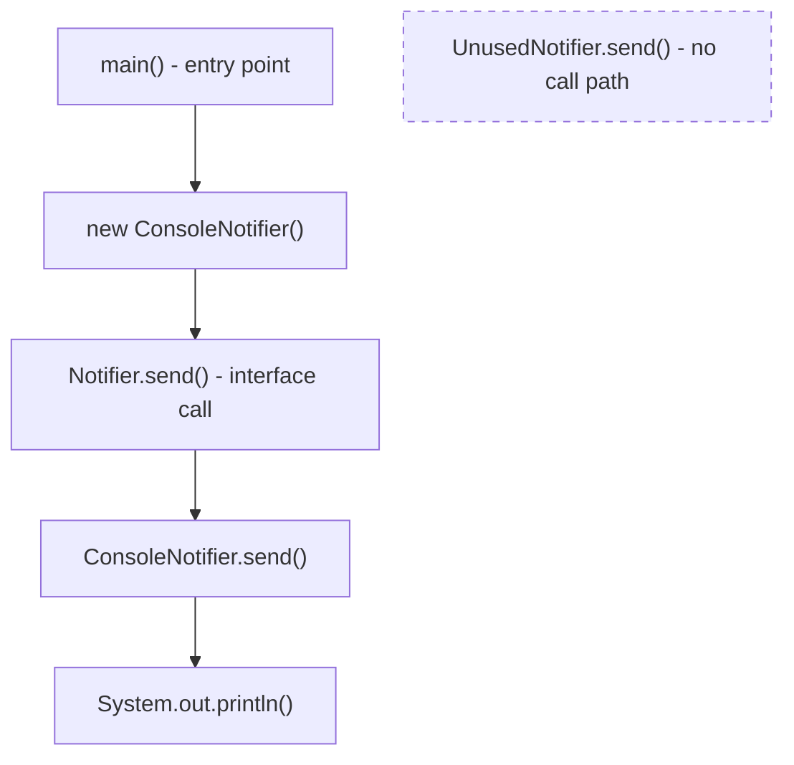
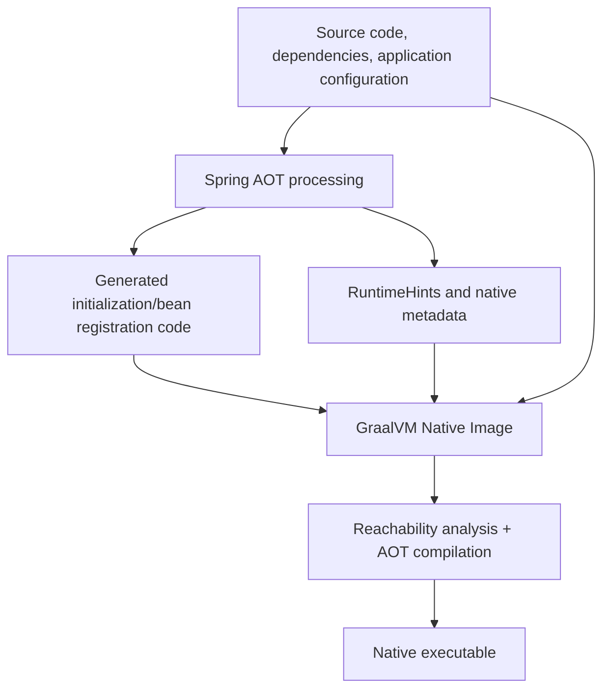

# Analyzing Reachability from the Program's Entry Points

## 1. Why Must Native Image Know Which Code Can Be Called?

When running a typical Java application, the JVM can load classes, inspect bytecode, perform JIT compilation, and discover additional code to use throughout the application's lifetime. GraalVM Native Image takes a different path: it analyzes the application at **build time**, then compiles it ahead of time into an executable for the target operating system and architecture (*ahead-of-time compilation*, AOT).

Therefore, the build tool must answer a central question:

> Starting from known **entry points**, which classes, methods, and execution branches **can potentially** be used when the application runs?

This process of determining the set of usable code is called **reachability analysis**. It is a foundational mechanism of GraalVM Native Image. It ties directly into the goals of Spring Boot Native Image: reducing the amount of code and metadata included in the executable, supporting fast startup, and typically lowering runtime memory usage. Specific results still depend on the application, libraries, and build configuration.

A defining characteristic of Native Image is the **closed-world assumption**: the executable code set must be sufficiently determined at image creation time. A new JAR file or an arbitrary class appearing after the build cannot simply be loaded and executed as on a traditional JVM.

In the **SPRING_BOOT_NATIVE_IMAGE** module, Spring AOT and GraalVM Native Image work together to address this. Spring AOT generates initialization code and hints tailored to how Spring uses dependency injection, annotations, reflection, proxies, and resources; GraalVM uses those inputs alongside the bytecode to perform native analysis and compilation.

### After This Lesson, Learners Can

- Explain entry points, the call graph, reachable methods, and unreachable code.
- Predict cases where direct calls can be analyzed versus dynamic calls that require additional metadata.
- Describe the role of Spring AOT while GraalVM Native Image analyzes a Spring Boot application.
- Read a native error scenario caused by reflection or resources and choose an appropriate inspection and remediation approach.

## 2. Mental Model: Traversing from Roots Through the Call Graph

Represent the program as a **call graph**: each node represents a method or related operation; an edge represents the possibility that an operation at the source node leads to executing the target node.

1. **Identify the root set:** typically includes the `main()` entry point and other entry points or callbacks that the runtime environment, libraries, or native configuration require retaining.
2. **Traverse possible calls:** from already-reachable methods, find direct calls, virtual calls through interfaces/superclasses, object instantiations, class accesses, and other analyzable call paths.
3. **Iterate until convergence:** a newly marked reachable method may introduce additional methods or data types that need analysis.
4. **Build the image based on the result:** compile the necessary code and include the required runtime components/metadata. Unreachable parts may be eliminated, depending on analysis results and optimizations.

This is a **reachability analysis**, not a log of which functions actually executed during a single test run. If a conditional branch only executes on the last day of the month, the analyzer must still consider that branch if it can occur. Conversely, a method present in the source code with no path leading to it from any root, and not flagged to be retained via metadata, may not exist in the native executable.

### Pure Java Example

```java
public class ReachabilityDemo {
    interface Notifier {
        void send(String message);
    }

    static class ConsoleNotifier implements Notifier {
        public void send(String message) {
            System.out.println(message);
        }
    }

    static class UnusedNotifier implements Notifier {
        public void send(String message) {
            System.out.println("unused: " + message);
        }
    }

    public static void main(String[] args) {
        Notifier notifier = new ConsoleNotifier();
        notifier.send("Native Image");
    }
}
```

In this example, `main()` creates a `ConsoleNotifier` and calls `send()`. A simplified graph looks like:



`UnusedNotifier` is never instantiated, not referenced through any other dynamic mechanism, and has no metadata forcing it to be retained in the sample program. Consequently, the analyzer can omit its code from the image. This example illustrates the logic; the actual retained code set also depends on analysis details, accompanying configurations, and subsequent optimizations.

### Does Calling Through an Interface Mean It Cannot Be Analyzed?

**No.** `notifier.send()` is a virtual call, but Native Image can analyze the object types that can reach the call site. In the example above, the instantiated implementation type is `ConsoleNotifier`. If the program can create multiple different implementations, the analysis must preserve all possible call targets, even if only one implementation is chosen in an actual run.

Three concepts must be distinguished:

| Concept | Meaning | Example |
|---|---|---|
| **Reachable** | Has a potential execution path from an entry point or is declared to be retained | `ConsoleNotifier.send()` |
| **Executed** | Actually ran during a specific execution | An `if` branch selected based on input data |
| **Included in image** | Code or metadata exists in the final native file | A reachable method may be compiled, inlined, or optimized into another form |

Do not infer that a method has executed merely because it is reachable; nor should you search for individual method names in the binary to conclude for certain that one was eliminated, because the compiler may inline or alter its representation.

## 3. Entry Points Are More Than Just `main()`

`main()` is usually where application analysis starts, yet a real-world system also contains components invoked indirectly:

- **Framework callbacks:** HTTP handlers, listeners, scheduled tasks, lifecycle hooks, or code invoked by the framework when events occur.
- **Reflection:** instantiating objects or invoking methods via class names, method names, and metadata at runtime.
- **Dynamic proxies and proxy generation mechanisms:** the framework creates objects implementing interfaces or intermediate classes to handle transactions, security, interception, etc.
- **JNI, native callbacks, and special entry points:** native code may need to call back into Java in ways the build tool must know beforehand.
- **Resources and configuration data:** files opened by path or pattern at runtime are not method-call edges, yet must also be included in the image if the application needs them.

Reachability analysis handles call paths it can understand from bytecode and supplied metadata. For dynamic mechanisms where the call target is only known from runtime data, **reachability metadata configuration** or an alternative design is needed so the build tool knows which components must be supported.

### Direct Calls vs. Dynamic Calls

| Call Form | What Can the Build Tool Know? | Things to Watch Out For |
|---|---|---|
| `service.calculate()` | Bytecode and potential object types of `service` | Usually able to construct edges in the call graph |
| `new ReportService()` | Directly instantiated type | Has a clear path to the constructor and related components |
| `Class.forName(name)` | Knows there is class loading by name; may not know the value of `name` | Depends on whether the value and reflection pattern can be statically determined |
| `method.invoke(target)` | Knows reflection is used, but the target may come from config or runtime data | May require registering the method/constructor to be called |
| `getResourceAsStream(path)` | Knows a resource read occurs, not necessarily the runtime path | Must ensure required resources are packaged into the image |
| `Proxy.newProxyInstance(...)` | Knows a JDK proxy is created, not necessarily the interface set at build time | May require declaring the proxy's interface set |

**Note:** not every use of reflection requires manual configuration. GraalVM can infer some cases automatically when the class name, type, or reflection operation can be determined through static analysis. Inference capability depends on code patterns, GraalVM version, and build configuration. Do not rely on assuming reflection will always work or always fail.

## 4. How Does Spring AOT Help GraalVM Analyze a Spring Boot Application?

Spring Boot creates many objects and wires them together through framework mechanisms: component scanning, injection, conditional configuration, HTTP mapping, converters, serialization, and proxies. Looking solely at the `SpringApplication.run(...)` call, a bytecode analyzer cannot necessarily deduce all relationships that Spring normally resolves dynamically.

**Spring AOT** bridges a major part of this gap. During the build, Spring analyzes application configuration and bean definitions that can be inferred ahead of time, generates helper code for application startup, and provides `RuntimeHints` for components needing reflection, resources, serialization, or proxies. GraalVM Native Image then analyzes this combined code and metadata.



Thanks to the generated code and hints, GraalVM gains more information to identify execution paths and components to retain. This **does not mean** Spring AOT will know every configuration value from the production environment, every class name fetched from a database, or every plugin chosen only at runtime. Application code using dynamic mechanisms outside what Spring can infer may still require manual hint registration.

### How Does an HTTP Request Enter the Analysis?

Simple example:

```java
@Service
class GreetingService {
    String message(String name) {
        return "Hello, " + name;
    }
}

@RestController
class GreetingController {
    private final GreetingService greetingService;

    GreetingController(GreetingService greetingService) {
        this.greetingService = greetingService;
    }

    @GetMapping("/greet")
    String greet(@RequestParam String name) {
        return greetingService.message(name);
    }
}
```

When the application runs, `main()` does not directly call `GreetingController.greet()`. An HTTP request to `/greet` is routed to the handler by the Web MVC subsystem. The necessary Spring MVC components and the mechanisms Spring uses to instantiate, discover, or invoke the handler must be available in the image. Spring AOT and framework-supplied hints help support these links.

The processing chain can be pictured conceptually as:

```text
Application starts
    -> Spring ApplicationContext and web infrastructure
    -> register / resolve handler for GET /greet
    -> receive HTTP request at runtime
    -> Spring MVC handler invocation mechanism
    -> GreetingController.greet(name)
    -> GreetingService.message(name)
```

The flow above describes the **runtime workflow** for understanding; it does not claim every arrow is a direct Java call in the call graph. For handler invocation mechanisms based on reflection or framework metadata, the ability to invoke the method also depends on the data Spring AOT/hints supply to Native Image.

## 5. When Static Analysis Cannot See the Call Target: Reflection

Consider an application selecting a plugin from a configuration value at runtime:

```java
interface Plugin {
    String execute();
}

// Class name retrieved from deployment environment configuration, e.g.:
// app.plugin.class=com.example.plugins.DefaultPlugin
String className = environment.getRequiredProperty("app.plugin.class");
Class<?> pluginType = Class.forName(className);
Plugin plugin = (Plugin) pluginType.getDeclaredConstructor().newInstance();
String result = plugin.execute();
```

From the bytecode, GraalVM sees the sequence `Class.forName(...)`, `getDeclaredConstructor()`, and `newInstance()`, but may **not know the concrete class** because the class name only appears in runtime environment configuration. A regular JVM build can locate the class on the classpath; a native image does not by default have the ability to load arbitrary additional bytecode from the classpath at runtime.

Suppose `DefaultPlugin` is already packaged into the application at build time. We can provide **Spring RuntimeHints** so GraalVM knows the constructor needs reflection support:

```java
import org.springframework.aot.hint.MemberCategory;
import org.springframework.aot.hint.RuntimeHints;
import org.springframework.aot.hint.RuntimeHintsRegistrar;
import org.springframework.context.annotation.Configuration;
import org.springframework.context.annotation.ImportRuntimeHints;

class PluginRuntimeHints implements RuntimeHintsRegistrar {
    @Override
    public void registerHints(RuntimeHints hints, ClassLoader classLoader) {
        hints.reflection().registerType(
            DefaultPlugin.class,
            MemberCategory.INVOKE_DECLARED_CONSTRUCTORS
        );
    }
}

@Configuration(proxyBeanMethods = false)
@ImportRuntimeHints(PluginRuntimeHints.class)
class PluginNativeConfiguration {
}
```

In this example, `DefaultPlugin` is an application-defined class implementing `Plugin`, has a suitable constructor, and must be present in dependencies at build time. Registering `INVOKE_DECLARED_CONSTRUCTORS` allows Spring/GraalVM to provide reflective constructor invocation. If the application also calls methods via `Method.invoke`, those exact methods must be registered, for example via `registerMethod(...)` or an appropriate `MemberCategory`.

**Two limitations to understand clearly:**

1. Hints only describe components **already present at build time**; they do not turn the native executable into a JVM capable of loading arbitrary plugin JARs after release.
2. Hints must match the **exact runtime operation**. Registering a constructor does not automatically grant reflection access to every field and method of the class. Components that do not need reflection should not be broadly registered either.

Another design option is to register plugins as Spring beans and select them via an interface or `Map<String, Plugin>`. Spring AOT then has more information to generate initialization configuration while avoiding some string-based class loading. This approach works well if the set of plugins is known at build time.

## 6. What Is Reachability Metadata For?

In a Spring Boot native application, you must distinguish **code being called** from **accessibility of metadata or runtime data**. The same code may execute yet still fail when reaching a reflection operation, resource load, or proxy creation.

| Category | Runtime Need | Common Handling with Spring AOT |
|---|---|---|
| **Reflection** | Inspect constructors, methods, fields; instantiate or invoke via reflection | `hints.reflection()`; framework or dependency may already register it |
| **Resource** | Read templates, certificates, config files, classpath data | `hints.resources()` to register files/patterns to package |
| **JDK dynamic proxy** | Create proxies for a defined set of interfaces | `hints.proxies()` for the required interface set |
| **Serialization** | Serialize/deserialize types handled via serialization mechanisms | `hints.serialization()` or appropriate metadata |
| **JNI** | Exchange data / invoke Java methods from native code | JNI metadata when the application or library actually uses it |

For example, an application reads a resource named in configuration:

```java
String templatePath = environment.getRequiredProperty("app.report-template");
try (InputStream input = getClass().getClassLoader()
        .getResourceAsStream(templatePath)) {
    if (input == null) {
        throw new IllegalStateException("Template not found: " + templatePath);
    }
    // Read the template content.
}
```

If `templates/report.txt` is not included in the native image, the code can still be reachable while `getResourceAsStream(...)` returns `null`. You can add it to the registrar shown above:

```java
hints.resources().registerPattern("templates/report.txt");
```

Registering a resource is **not equivalent** to registering reflection for a class; similarly, registering reflection does not automatically package every file on the classpath. Each mechanism has its own requirements. Spring Framework, Spring Boot, and many native-compatible libraries already provide built-in hints; only add configuration when genuinely needed.

## 7. Distinguishing Reachability, Class Initialization, and Optimization

Three easily confused stages/concepts:

**Reachability analysis** answers *what might be needed at runtime?* For example, `OrderService.placeOrder()` can be invoked from a handler and must therefore be considered in the reachable code set.

**Class initialization** answers *when does the class's static initializer run?* Native Image can run initialization of some classes at build time and others at runtime according to relevant rules/configuration. A reachable class is **not by default** initialized at build time. Eagerly initializing state that depends on the runtime environment (files, sockets, passwords, timestamps, native handles, etc.) can cause incorrect behavior or build failures.

**Compiler optimization** answers *how is the reachable code ultimately represented?* The compiler may inline methods, specialize calls, or eliminate branches proven unreachable. Therefore, the source graph and machine code in the binary do not need a one-to-one correspondence.

A practical scenario: `PriceCalculator.calculate()` is reachable from an API but gets inlined into the handler. Not finding a standalone symbol named `calculate` in the executable is **insufficient** to conclude it was eliminated. Use build logs/diagnostics and runtime behavioral testing to evaluate.

## 8. Hands-On Observation and Verification on a Spring Boot Application

To experiment, create a Spring Boot project with Spring AOT/GraalVM Native Build Tools support, an endpoint like `/greet`, and at least one dynamic call path to test. The build machine must have a native image toolchain matching the target OS and architecture.

### Step 1: Run on the JVM as a Baseline

Start the JVM application and invoke the endpoint with various test inputs. If there are plugins, reflection, resources, JSON binding, or proxies, actually trigger those branches. An application running fine on the JVM only confirms that the JVM logic/setup works; it **does not prove** the native build will have sufficient metadata.

### Step 2: Build Native

Common example commands when the project has the corresponding plugin/profile configured:

```bash
# Maven (native profile configured in pom.xml)
./mvnw -Pnative native:compile

# Or Gradle (with GraalVM Native Build Tools applied)
./gradlew nativeCompile
```

If the project packages containers using buildpacks, the appropriate native build configuration must be passed into the image build process; a regular JVM image does not automatically become a native executable. Exact build commands and output file locations depend on Maven/Gradle configuration, plugin versions, and operating system.

In the build log, look for analysis and compilation steps as well as messages about unsupported features, class initialization, or metadata. Native Image's `--verbose` and `--diagnostics-mode` can provide extra detail during investigation, though support and how flags are passed via Maven/Gradle depend on the tool versions in use.

### Step 3: Execute the Binary and Exercise Specific Branches

Run the built native program and re-test **the same suite of scenarios** as on the JVM: normal requests, error paths, external configuration, serialization/deserialization, transactions/proxies, resources, and plugins. Prioritize testing branches that the framework or application invokes indirectly.

Example result classification:

| Symptom | Possibility to Investigate | Verification Approach |
|---|---|---|
| Native build reports an unsupported dynamic operation | Feature or library incompatible under current configuration | Read the stack trace, locate the offending code/library; check native support and alternative designs |
| JVM invokes constructor via reflection, native fails | Accessed constructor or class lacks appropriate metadata | Check `RuntimeHints`, actual types, and constructors invoked |
| Endpoint works but cannot read classpath file | Resource not packaged or wrong path | Check resource name/path and `hints.resources()` configuration |
| Only one HTTP branch or plugin fails | That branch wasn't exercised during metadata generation/testing, or uses a distinct dynamic mechanism | Reproduce with specific input; audit reflection, proxies, serialization, and runtime config |
| Build succeeds but startup misses expectations | Application characteristics, class initialization, I/O, runtime config | Measure startup, RSS/memory, and actual load separately; compare JVM vs. native under equivalent conditions |

### Step 4: Use the Tracing Agent When Needed to Discover Dynamic Operations

GraalVM provides the **Native Image tracing agent** to record certain dynamic operations while the application runs on the JVM. Example command format:

```bash
java -agentlib:native-image-agent=config-output-dir=./native-config -jar app.jar
```

After starting the JVM with the agent, trigger the key requests and business flows to collect metadata. The output can help diagnose issues or supplement native configuration for libraries/apps. However, the agent only observes **the paths that actually ran**; it cannot guess untested branches. In Spring Boot applications, prefer Spring AOT/`RuntimeHints` mechanisms and review agent-generated metadata before integrating it to avoid retaining redundant entries or creating hard-to-maintain configuration.

## 9. A Reasoning Workflow When Encountering Reachability Errors

When the JVM build works well but native fails, start from the **actual failing operation** instead of immediately adding metadata for every class:

1. Identify the failing operation: object instantiation, method invocation, JSON deserialization, proxy creation, file reading, or native library loading.
2. Identify values only known at runtime: class name, method name, interface list, resource path, or configuration-based selection.
3. Check whether Spring AOT or the dependency already declares hints for that component; verify that the build configuration actually enables AOT.
4. Register **the exact missing metadata type and scope**, or adjust the design so the call target is clear at build time.
5. Rebuild the native image and run tests directly against the binary, including the previously failing branch.

Note an important limitation: reachability analysis aims to determine **what can happen**, not measure usage frequency. A rarely called endpoint may still need full code and metadata. Conversely, benchmarks showing only a few endpoints are heavily called are not grounds for removing valid branches from the image.

## 10. Self-Check Exercise

**Scenario A.** An application has a `@RestController` handling `GET /orders/{id}` and calling `OrderService.findById(id)`. In the source code, `main()` does not directly call the controller method. Does that mean the method will be omitted from the Native Image?

**Hint:** No. Spring's web infrastructure and the information supplied by AOT/hints make the handler available in the native image. Distinguish direct Java calls from callbacks/handlers invoked indirectly by the framework.

**Scenario B.** An application reads `com.example.plugins.FastPlugin` from an environment variable and calls its constructor via reflection. The JVM build runs, while the native build fails. Does adding `FastPlugin.class` to a regular Java list without using that list guarantee solving the problem?

**Hint:** Not guaranteed. You must specify the reflected constructor/method and corresponding metadata, or switch to a Spring-managed plugin configuration. Remember that the class must be present at image build time.

**Scenario C.** A method is completely inlined in the binary; its method name no longer appears as a separate symbol. Is it unreachable?

**Hint:** No. Reachability and how the compiler optimizes machine code are two different concepts.

## Conclusion

Reachability analysis is the step where GraalVM Native Image determines the code set **potentially able to execute**, starting from known entry points and expanding along possible call paths. Spring AOT clarifies many Spring-created relationships by generating initialization code and `RuntimeHints`, helping Native Image support the required handlers, beans, and dynamic operations. When an application uses class names, methods, or resources that only appear at runtime, developers must verify static inferability and add appropriate metadata if needed. Understanding the difference between *reachable*, *executed*, *available metadata*, and *final machine code* is the key to explaining compatibility errors and properly evaluating a Spring Boot native build.
