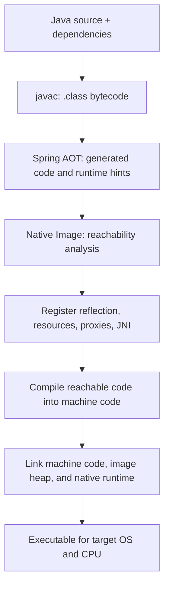

# Compiling Java Code and Runtime Components into an Executable

## 1. What Does Native Image Actually Package?

In a traditional Spring Boot application, Maven or Gradle packages compiled Java code into bytecode (`.class` files inside a JAR). At startup, the **JVM** loads classes, verifies bytecode, interprets or JIT-compiles executed code, and provides garbage collection, thread management, and various runtime services.

With **GraalVM Native Image**, the `native-image` tool analyzes the application and the libraries it uses at **build time**. The tool ahead-of-time (AOT) compiles reachable code into machine code, combining initialization data and required runtime components to produce a **native executable for a specific operating system and CPU architecture**. When run, the program does not need to start a separate HotSpot JVM to interpret bytecode or perform JIT compilation.

This **does not mean** every line of the JDK or every dependency is placed into the binary. Native Image selects reachable code based on analysis results, metadata configuration, and tool rules; some OS native libraries may still be dynamically linked.

| Component | Spring Boot Running on JVM | Spring Boot Native Image |
|---|---|---|
| Application code | Bytecode in JAR; can be JIT-compiled at runtime | AOT-compiled machine code inside the executable |
| Java, Spring, and JDK libraries | Classes loaded on demand | Code and data determined to be reachable are included in the image |
| Java runtime | External JVM/HotSpot running the application | Lightweight Native Image runtime, typically based on Substrate VM, linked into the executable |
| Reflection, dynamic proxies, resources | The JVM can dynamically load/discover many cases | Must be analyzed or declared with appropriate metadata at build time |
| Delivery artifact | JAR plus a compatible Java environment | Native executable (and required system libraries) for the target platform |

## 2. From Source Code to Executable: Key Steps



### Step 1 — Java Compilation and Spring AOT Preparation

`javac` still produces Java bytecode first. The Spring Boot plugin invokes **Spring AOT** to process application configuration early: from bean definitions and configuration conditions determinable at build time, Spring generates initialization code and provides **runtime hints** for reflection, resources, proxies, or serialization. These steps reduce the need for fully dynamic application structure discovery when the program runs.

Spring AOT and GraalVM Native Image have distinct roles: **Spring AOT prepares the Spring application**, whereas **Native Image analyzes all execution paths and compiles them into an executable**. Not all dynamic behavior can be inferred at build time; the application must still properly configure the remaining cases.

### Step 2 — Reachability Analysis

Native Image starts from the program's **entry points** and additionally registered objects, classes, and methods. It determines which code branches can be called, which types can be instantiated, and which data must be retained, using static analysis under the **closed-world assumption**: at image creation time, the required set of code and dynamic components must be sufficiently determined for compilation.

For example, if the application only calls `OrderService.calculateTotal()` through a normal flow, Native Image can retain that method's code and its related calls. A `LegacyReportExporter` that is unreachable from entry points or metadata can be omitted from the image. If the application tries to load `LegacyReportExporter` solely from a runtime configuration string, execution may fail because the analyzer did not know to include that class in the executable.

Reachability analysis **does not prove** all runtime paths have been tested. It only defines the scope the tool needs to compile based on known code and metadata.

### Step 3 — Machine Code Generation and Runtime Linking

The Graal compiler translates selected methods into machine code for the target CPU. Native Image combines:

- **Application code**: controllers, services, repositories, configuration classes, and reachable application methods.
- **Library code**: required parts of Spring Framework, Spring Boot, dependencies, and the Java standard library.
- **Native Image runtime**: memory allocation, garbage collection, thread management, synchronization, exception handling, and supported Java services.
- **Image heap and metadata**: objects permitted to be initialized at build time, type information, and data needed for execution.
- **Platform linking**: native code and system libraries required by the target.

The result is an executable that can launch on a compatible platform without running a `java -jar` process or needing a JVM JIT compiler at runtime. However, the executable is **not completely OS-independent**: for instance, a Linux x86-64 binary does not automatically run on Windows or Linux ARM64; dynamic linking mode may also require a compatible libc and system libraries.

## 3. What Runtime Still Exists Without the HotSpot JVM?

A common misconception is that native compilation removes the Java runtime entirely. In reality, the executable must still fulfill the language's core guarantees: object lifecycle management, garbage collection, threads, locks, exception handling, and supported Java APIs.

GraalVM Native Image uses a lightweight runtime (commonly referred to as **Substrate VM**) to support those tasks. Because the executable already contains precompiled machine code, it does not use HotSpot's warm-up/JIT mechanism. In return, dynamic optimization based on live workload profiles can differ from the JVM; long-running processing performance is **not faster by default** merely because startup is faster.

For example, when an HTTP request arrives at a Spring `@RestController`, the request-handling code, JSON conversion, and business logic processed by AOT execute as native machine code. Memory allocated for request objects is still managed and reclaimed by the native runtime via GC.

## 4. Build-Time Initialization vs. Run-Time Initialization

Native Image can execute **certain class initializers** during the build and persist suitable object state into the **image heap**. This reduces re-initialization when the executable starts up. Classes that need to read current environment state, open network connections, generate random keys, read current time, or hold native handles are unsuitable for arbitrary build-time initialization.

```java
final class PriceRules {
    static final java.math.BigDecimal TAX_RATE =
            new java.math.BigDecimal("0.10");
}
```

An immutable value like `TAX_RATE` is an intuitive example of data that can be prepared early. Conversely:

```java
final class RuntimeEnvironment {
    static final String ACTIVE_REGION =
            System.getenv("ACTIVE_REGION");
}
```

If a class like `RuntimeEnvironment` is initialized at build time, the environment value of the **build machine** risks being frozen into the executable. You must ensure environment-dependent state is read at runtime. Native Image provides options such as `--initialize-at-run-time=<class-name>` and `--initialize-at-build-time=<class-name>`; apply them only after understanding the side effects of the class and its related classes. In Spring Boot, prefer supported configuration and AOT mechanisms instead of manually forcing bulk class initialization.

**Distinction:** compiling a method's machine code at build time does not mean that class's *static initializer* must also run at build time. Those are two separate decisions.

## 5. Why Do Reflection and Resources Need Metadata?

A regular Java application can discover classes by string name, invoke constructors via reflection, create proxies, or load resources by path at runtime. Static analysis cannot always see the true target, especially when the class name or path comes from config files, user input, or external plugins.

Example:

```java
String handlerName = System.getenv("ORDER_HANDLER_CLASS");
Class<?> handlerClass = Class.forName(handlerName);
Object handler = handlerClass.getDeclaredConstructor().newInstance();
```

If the value of `ORDER_HANDLER_CLASS` is only known at runtime, Native Image cannot be certain which class and constructor to retain. You can declare appropriate **reachability metadata** (such as reflection registration) or redesign it as a bean/strategy selection recognized by Spring AOT. Likewise, templates, certificates, config files, or resources read with `getResourceAsStream` must be included in the image via proper resource configuration.

In a Spring Boot application, runtime hints can be declared explicitly:

```java
import org.springframework.aot.hint.RuntimeHints;
import org.springframework.aot.hint.RuntimeHintsRegistrar;
import org.springframework.aot.hint.MemberCategory;

class OrderHandlerHints implements RuntimeHintsRegistrar {
    @Override
    public void registerHints(RuntimeHints hints, ClassLoader classLoader) {
        hints.reflection().registerType(
                LegacyOrderHandler.class,
                MemberCategory.INVOKE_DECLARED_CONSTRUCTORS
        );
        hints.resources().registerPattern("templates/orders/*.html");
    }
}
```

Register the registrar with `@ImportRuntimeHints(OrderHandlerHints.class)` on an appropriate Spring configuration class. `LegacyOrderHandler` here is a hypothetical application class; the example illustrates constructor and resource registration rather than replacing actual dependency inspection. For certain libraries, existing metadata in the GraalVM ecosystem or Spring-provided hints already handle most cases.

Technologies to review when migrating to native include reflection, dynamic proxies, serialization, JNI, resource loading, classpath scanning, and dynamic code loading. Compatibility depends on the versions of Spring Boot, GraalVM, dependencies, and how the application uses them.

## 6. Hands-On Building and Testing the Executable

The examples below assume a Spring Boot project that supports AOT and includes the corresponding Spring Boot plugin. You need a **GraalVM JDK with Native Image**, native compilation tools, and the required OS build libraries. Task names may vary by configuration and plugin version.

**Maven** (Spring Boot Maven Plugin):

```bash
./mvnw -Pnative native:compile
```

**Gradle** (GraalVM Native Build Tools configured):

```bash
./gradlew nativeCompile
```

Typically, the executable can be found under `target/` (Maven) or `build/native/nativeCompile/` (Gradle); the final path/filename depends on the project. Run the executable on the matching build platform and test key endpoints and business flows.

```bash
# Illustrated for Linux/macOS; replace app with the actual executable name
./target/app

# Compare against the JVM build of the same application
java -jar target/app.jar
```

When measuring both modes, use the same configuration profile, input data, load level, and resource limits; separately measure **startup time**, **time to first ready request**, **RSS/actual memory**, throughput, and post-warm-up latency. Those metrics answer different questions: Native Image often shines in startup time and memory footprint for many applications, yet actual results must be measured on the specific service.

For containers, you can use Spring Boot's native-capable image build workflow or copy the compiled executable into a base image compatible with its libc/architecture. Also verify dynamically linked libraries, execute permissions, CA certificates, DNS, timezone, and runtime resource files; do not assume the binary runs on every minimal base image.

## 7. Failure Scenarios and Reasoning from the Compilation Mechanism

| Symptom | Possible Cause | Investigation Direction |
|---|---|---|
| Native Image build reports a class initialization error | A class ran its static initializer too early, creating state incompatible with the image heap | Inspect the stack trace, locate the side-effecting class, and defer initialization to runtime when needed |
| JVM works but native fails with `ClassNotFoundException` or reflection error | Dynamic call target was not recognized by reachability analysis/metadata | Check runtime hints, library metadata, and dynamic invocation paths |
| Template or resource not found | Resource was not packaged into the image | Check resource patterns and the path names used by the application |
| Native build succeeds but deployment fails to load a library | Architecture mismatch or missing dynamically linked native library | Check target architecture, libc, and executable dependencies |
| Configuration value differs unexpectedly between build and runtime | Environment state may have been initialized and captured at build time | Audit static initializers and when environment variables are read |

Errors often surface on **one specific business path**: the application may start up successfully yet fail when handling an uncommon request type. Therefore, actually test flows involving JSON binding, persistence, validation, templates, security, messaging, scheduling, and external integrations.

## 8. Summary of the Mechanism

Native Image transforms a Java application from a **bytecode + runtime JVM/JIT** model to **AOT machine code + linked native runtime**. Spring AOT helps convert many dynamic Spring Boot configurations into analyzable information and generated code. Reachability analysis decides what code must exist in the executable; reflection, resources, and dynamic behaviors require accurate metadata. The image heap and class initialization optimize startup while imposing strict requirements on the boundary between build time and runtime.

Understanding these components explains both the startup/memory advantages and the root causes of compatibility errors when building, testing, containerizing, and operating a Spring Boot native build.
