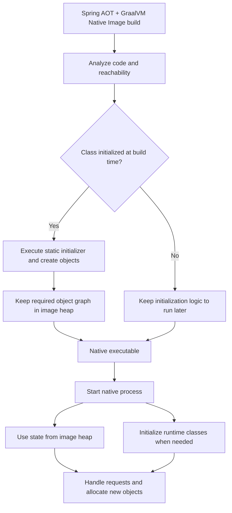

# Image Heap and Object State Created During the Build Phase

In the **Native Image Mechanism** chapter, an important aspect of compiling a **Spring Boot** application with **Spring AOT** and **GraalVM Native Image** is that certain Java objects can be created right at compile time and their state embedded into the native executable. This mechanism is called the **image heap**. Understanding it explains why a native executable starts fast, why data sometimes appears “frozen” at build time, and why some libraries fail during native compilation.

This lesson focuses on object lifecycle, class initialization timing, state correctness, and how to test in real applications. It is part of the `SPRING_BOOT_NATIVE_IMAGE` topic: using Spring AOT and GraalVM to build native applications, evaluating startup time and memory, resolving compatibility issues, and packaging and operating native builds.

## 1. Learning Objectives

After this lesson, you can:

- Explain what the **image heap** is and distinguish it from the heap allocated while the application runs.
- Describe the relationship between **class initialization**, reachable objects, and data stored in the native executable.
- Analyze which state can be safely stored from build time and which state must be recreated at runtime.
- Experiment with Spring Boot to observe build-time created values, runtime mutations, and behavior across process restarts.
- Isolate errors related to class initialization and the image heap, and choose the right remediation.

## 2. What Is the Image Heap?

In a Java application running on a typical JVM, objects are usually created while the process is running, via `new`, factory methods, deserialization, dependency injection, etc. Native Image allows **performing part of that work ahead of time at build time**. If a class is initialized during the build phase, objects still referenced by that class's static state can be written into the **image heap** for the native executable to use at runtime.

You can picture the image heap as a **snapshot of part of the Java object graph** prepared during native executable creation. Upon launch, the program uses this embedded state without necessarily re-running the code that created it.

Three concepts to distinguish:

| Concept | Meaning | Relevant Timing |
|---|---|---|
| **Build-time heap** | Object memory of the native image build process; many objects exist only temporarily to support analysis and compilation. | While running the `native-image` tool |
| **Image heap** | Object state retained and packaged into the native executable after analyzing which objects must be present at runtime. | Formed at build time, used at runtime |
| **Runtime heap** | New objects allocated inside the native process while the application is running. | While running the native executable |

**Not every object created in the build-time heap ends up in the image heap.** Temporary objects with no references needed at runtime can be omitted. Conversely, an object still reachable from a `static` field of a build-time initialized class is a typical candidate for the image heap; the exact outcome also depends on Native Image analysis and optimizations.

### Lifecycle Illustration



The diagram above is a conceptual model. GraalVM may eliminate, merge, or represent data in more optimized forms; not every `new` expression corresponds to an intact object inside the binary.

## 3. What Does Class Initialization Determine?

In Java, **class initialization** includes executing static initializers and static field initialization expressions that need to run, commonly grouped under the internal `<clinit>` method. GraalVM Native Image distinguishes:

**Build-time initialization:** class initialization code runs while creating the native executable. Suitable state still needed at runtime can enter the image heap. The native executable typically does not re-run that class's `<clinit>`.

**Run-time initialization:** class initialization is deferred until the native executable runs. Objects produced by this initialization are runtime state, not a snapshot embedded in the binary at build time.

Native Image decides or infers the initialization policy based on the tool version, code safety, and configuration options. **Do not assume that all application classes are initialized at build time, or that all classes are initialized at runtime.** For classes with sensitive state, determine the actual policy explicitly.

Example:

```java
package com.example.nativeimage;

import java.time.Instant;
import java.util.ArrayList;
import java.util.List;

public final class StartupState {
    static final Instant INITIALIZED_AT = Instant.now();
    static final List<String> TAGS = new ArrayList<>(List.of("ready"));

    private StartupState() {}
}
```

If `StartupState` is initialized at **build time**, `INITIALIZED_AT` reflects the build timestamp and the still-reachable `Instant`/`ArrayList` graph can reside in the image heap. If the class is initialized at **runtime**, `INITIALIZED_AT` reflects when the class was initialized in the running process.

Note two nuances:

1. `static final` only fixes the **field reference** after initialization; it **does not make the referenced object immutable**. `TAGS.add("extra")` can still mutate the list within a process, if that operation is permitted and free of concurrency issues.
2. Compile-time constants, such as `static final int LIMIT = 10` or constant string literals, may be embedded directly at use sites; seeing `static final` alone is not enough to conclude an object exists in the image heap.

### Which Objects Are Typically Safe to Pre-Store?

| State | Potentially Suitable for Image Heap? | Reason |
|---|---|---|
| Fixed lookup tables, read-only data structures | Usually yes | Content does not depend on runtime environment and does not vary across processes |
| Compiled patterns, immutable config data known at build time | Conditionally | Safe only if valid for every environment that will run the binary |
| Current clock, startup timestamp | Should not | Build time and startup time are two different moments |
| Environment variables, host paths, hostname, deployment config | Usually should not | Can differ across build machines, runtime hosts, and individual containers |
| Tokens, passwords, secret keys | No | Risks embedding sensitive data in distributable artifacts and breaking secret rotation/lifecycles |
| Sockets, streams, threads, file descriptors, native handles | No | Resources tied to the OS or process at creation time |
| Stateful random generators, caches holding dynamic data | Needs very careful review | Seeds/caches may be stale or retained; some types are explicitly disallowed in the image heap by Native Image |

An object may be **type-compatible** for storage yet **semantically unsafe** to store if its content depends on runtime.

## 4. From Object Graph to Image Heap

Consider an example:

```java
final class Lookup {
    static final Entry ROOT = new Entry("Spring", new Entry("GraalVM", null));

    record Entry(String name, Entry next) {}
}
```

When `Lookup` is initialized at build time and `ROOT` is still needed at runtime, Native Image can retain an **object graph** containing the first `Entry`, the second `Entry`, and the corresponding `String` instances. It is not just the `ROOT` variable, but **the objects reachable through its references** that you need to observe.

```text
Lookup.ROOT
     │
     ▼
Entry(name="Spring") ──next──▶ Entry(name="GraalVM") ──next──▶ null
     │                                  │
     ▼                                  ▼
  "Spring"                           "GraalVM"
```

Conversely, the following temporary object is not necessarily kept in the image heap:

```java
static {
    StringBuilder temporary = new StringBuilder("will not be retained");
    temporary.append(" after initialization");
    // No reference needed at runtime retains temporary.
}
```

Optimizations such as dead code or dead data elimination may cause the actual outcome to differ from the diagram. The key idea is the **reference graph still alive at runtime**, not the number of `new` calls executed during the build.

### Where Does the Image Heap Live When the Application Runs?

Image heap data is packaged as data inside the native executable. When the operating system loads the program, the Native Image runtime can use the corresponding data regions, including writable and read-only regions depending on the object and optimizations. Mutable objects can still be modified at runtime; do not think of the entire image heap as immutable memory.

Each application process has its **own runtime state**. If two containers launch from the same native executable and the same initial image heap objects, a state change in container A does not automatically appear in container B. The OS may share read-only memory pages across processes, but that is not a mechanism for sharing mutable Java objects.

The image heap is also **not synonymous with total application memory**. When evaluating memory footprint, include the runtime heap, mapped image heap, stacks, native data, libraries, and how the OS accounts for resident memory; you cannot deduce RAM savings solely from executable file size.

## 5. Practice: Observing Build-Time State in Spring Boot

The example below fits a Spring Boot application with Spring AOT and GraalVM Native Image support. We create a class holding only static state and an endpoint reading that state.

**`src/main/java/com/example/nativeimage/BuildState.java`**

```java
package com.example.nativeimage;

import java.time.Instant;
import java.util.ArrayList;
import java.util.List;
import java.util.concurrent.atomic.AtomicInteger;

public final class BuildState {
    public static final Instant CREATED_AT = Instant.now();
    public static final List<String> LABELS = new ArrayList<>(List.of("initial"));
    public static final AtomicInteger REQUESTS = new AtomicInteger(0);

    private BuildState() {}
}
```

**`src/main/java/com/example/nativeimage/NativeInfoApplication.java`**

```java
package com.example.nativeimage;

import org.springframework.boot.SpringApplication;
import org.springframework.boot.autoconfigure.SpringBootApplication;
import org.springframework.web.bind.annotation.GetMapping;
import org.springframework.web.bind.annotation.RestController;

@SpringBootApplication
@RestController
public class NativeInfoApplication {
    public static void main(String[] args) {
        SpringApplication.run(NativeInfoApplication.class, args);
    }

    @GetMapping("/native-state")
    public String state() {
        return "createdAt=" + BuildState.CREATED_AT
                + ", requests=" + BuildState.REQUESTS.incrementAndGet()
                + ", labels=" + BuildState.LABELS;
    }
}
```

The application needs the `spring-boot-starter-web` dependency and proper native build tool configuration. To **intentionally demonstrate build-time initialization** for this specific example class, pass the following option to Native Image:

```text
--initialize-at-build-time=com.example.nativeimage.BuildState
```

If using **Maven** with `org.graalvm.buildtools:native-maven-plugin`, it can be configured in the plugin:

```xml
<configuration>
    <buildArgs>
        <buildArg>--initialize-at-build-time=com.example.nativeimage.BuildState</buildArg>
    </buildArgs>
</configuration>
```

Then run the native build command according to your Spring Boot project configuration, typically:

```bash
./mvnw -Pnative native:compile
```

If using **Gradle** with GraalVM Native Build Tools, for example in `build.gradle` (Groovy DSL):

```groovy
graalvmNative {
    binaries {
        main {
            buildArgs.add('--initialize-at-build-time=com.example.nativeimage.BuildState')
        }
    }
}
```

Corresponding build command:

```bash
./gradlew nativeCompile
```

The commands above assume the project already has GraalVM/Native Image, the Spring Boot plugin, and GraalVM Native Build Tools installed; the generated executable path depends on the project name and build tool. Once running the executable, call the endpoint twice:

```bash
curl http://localhost:8080/native-state
curl http://localhost:8080/native-state
```

Illustrative output (the timestamp is just an example):

```text
createdAt=2026-01-05T08:00:00Z, requests=1, labels=[initial]
createdAt=2026-01-05T08:00:00Z, requests=2, labels=[initial]
```

Observations to explain:

- `CREATED_AT` was determined when the native image was built. Running the executable later, or restarting the same binary, does not change that timestamp.
- `REQUESTS` starts at `0` in the image heap but is incremented while handling requests. Starting a new process from the binary gives it its own initial counter.
- `LABELS` is a mutable `ArrayList`. Being created at build time **does not automatically make it read-only**; if runtime logic adds elements, the state changes in that process.

For comparison, replace the build argument with:

```text
--initialize-at-run-time=com.example.nativeimage.BuildState
```

Rebuild the binary, hit the endpoint, and observe: now `CREATED_AT` is established when `BuildState` initializes at runtime. If you restart the process, the timestamp is generated anew. You must **rebuild** after changing the option because the initialization policy is part of building the native executable.

**Limitation of the example:** this is an intentional experiment to clarify the mechanism. Do not force every application or library class into build-time initialization merely to optimize startup. A class whose static initializer touches runtime resources can be unsafe or cause the build to fail.

## 6. What Errors Can Build-Time State Cause?

### 6.1. “Frozen” Configuration Data

```java
final class AppEnvironment {
    static final String REGION = System.getenv("APP_REGION");
}
```

If the class is initialized at build time, `REGION` may hold the value from the **build machine**. Deploying the same binary across different environments will not automatically re-read `APP_REGION` on launch. If that variable was absent during the build, the captured value may be `null`.

For configuration that must vary by deployment, read it at runtime via Spring Boot's configuration mechanisms (such as `@ConfigurationProperties` or `Environment`) or a function actually invoked at runtime. Avoid placing environment reads inside static initializers that run during the build. **Never let tokens, passwords, or private keys enter the image heap**, as the data can persist inside the distributable artifact.

### 6.2. Invalid Operating System Resources

Objects representing threads, sockets, file streams, file descriptors, process-bound timers, or native handles must not be carried over from the build machine to a new process. Even if a Java object holds a valid reference inside the build process, the OS resource it points to no longer corresponds to anything valid at runtime.

The solution is usually to defer class initialization, create resources within the Spring bean lifecycle at runtime, and close them with appropriate lifecycle hooks. For example, a connection pool should be created when the application actually launches with that environment's configuration.

### 6.3. Random Seeds, Caches, and Determinism

Random number generators or caches may carry seeds, preloaded data, or build-time-dependent state. Certain classes carrying such state are even blocked from entering the image heap by GraalVM, producing a compilation error. When randomness or dynamic data is needed, instantiate the object at runtime and clearly define its lifecycle.

Do not try to “fix” an error simply by switching an entire package to `--initialize-at-build-time`; that can introduce additional unsafe state into the binary. Find the exact class causing the state and the exact object being retained.

### 6.4. Confusing Spring AOT with the Image Heap

**Spring AOT** analyzes the application and generates code/metadata for early startup, reducing the need for runtime inference or dynamic reflection in native mode. **GraalVM Native Image** then performs analysis, ahead-of-time compilation, and may initialize certain classes at build time.

Spring AOT processing bean definitions **does not mean every Spring bean is pre-instantiated in the image heap**. Most beans are still instantiated in the running application process according to the Spring lifecycle. For example, `@PostConstruct` on a regular bean is invoked when the bean is created at runtime; do not infer it runs at build time just because the app uses Spring AOT.

Similarly, **reflection metadata**, **resource metadata**, and the **image heap** are distinct mechanisms:

| Mechanism | Purpose | Example |
|---|---|---|
| Spring AOT generated code | Pre-generate configuration/initialization code to reduce dynamic processing | Helper code for bean registration and creation |
| Reachability metadata / Runtime Hints | Preserve information needed for reflection, serialization, proxies, resources, JNI | `RuntimeHints.reflection()` or `resources()` |
| Image heap | Carry Java object state from build time to runtime | Static list initialized at build time |
| Runtime heap | Allocate and hold objects created while the program runs | Request objects, beans created at startup |

Registering reflection metadata **does not fix** environment values captured in the image heap; changing class initialization **does not automatically add** missing reflection metadata.

## 7. Diagnosing Errors and Adjusting Initialization Policy

When a native build reports an error related to an object in the image heap or a class initialized at the wrong time, follow this reasoning chain:

1. **Identify the offending object type** in the Native Image message, such as an OS resource or random number generator that the tool forbids storing in the image heap.
2. **Trace the reference path and initializing class** retaining that object, typically a `static` field or static cache. Read the stack trace/diagnostic printed by the tool, rather than only patching the final object type.
3. **Classify the state:** constant across all processes, or dependent on time, environment, secrets, or OS resources?
4. **Pick the narrowest fix:** defer initialization of the exact class with `--initialize-at-run-time=...`, move dynamic data to runtime, or redesign the static cache so it does not hold sensitive state.
5. **Rebuild and test** in a runtime environment different from the build environment; run multiple processes if static state could cause divergence.

Useful Native Image options:

```text
--initialize-at-run-time=com.example.SomeClass
--initialize-at-build-time=com.example.ImmutableLookup
--trace-object-instantiation=java.security.SecureRandom
```

The two `--initialize-at-...` options express intent regarding when initialization occurs. The trace option helps investigate instantiation of a specific object type during the build, when supported by your GraalVM version; check `native-image --help-extra` and actual error messages for details. Replace the class names in the examples with the offending class in your project.

**Example with a class reading an environment variable:**

```java
// Unsuitable if the class is initialized at build time.
final class BadRuntimeConfig {
    static final String API_BASE_URL = System.getenv("API_BASE_URL");
}

// An approach that reads when the application is actually running.
final class RuntimeConfig {
    static String apiBaseUrl() {
        return System.getenv("API_BASE_URL");
    }
}
```

In Spring Boot, framework configuration mechanisms are usually a better fit than calling `System.getenv()` directly. The runtime method only illustrates **when state is read**; real applications should handle missing values, validate formats, and consider using `@ConfigurationProperties`.

An important caveat: moving a class to runtime initialization can affect dependent classes or surface conflicts with other libraries. Read fresh diagnostics after each change and avoid applying options across an entire package without understanding the initialization graph.

## 8. Impact on Performance, Memory, and Containers

The image heap offers an opportunity to **pay part of the initialization cost upfront** during the build. At runtime, the application can immediately use prepared data, reducing allocations and initialization code that must execute. Combined with Spring AOT and precompiled machine code, this is one factor that can help Spring Boot Native Image start quickly and benefit workloads requiring rapid scaling or container execution.

However, the benefits depend on the application:

- A large image heap can make the **binary larger**, increase build time, or affect mapped memory regions.
- Runtime objects still require normal allocation, garbage collection, and synchronization; not the entire workload is precomputed into the binary.
- Some read-only data pages can be shared by the OS, whereas dirty/written pages incur per-process costs; RSS figures also depend on the OS and measurement method.
- A native app may reduce startup time yet still experience latency from database connections, config loading, DNS, HTTP clients, bean initialization, or runtime data loading.

When evaluating native versus JVM, use the same workload and environment, and distinguish **startup time**, **time to first request**, **RSS/working set**, **heap memory**, **image size**, and **build time**. Do not take a single number in isolation to claim the image heap definitely lowers overall RAM usage.

For containers, a binary built once is often promoted across multiple environments. Therefore, avoid baking service URLs, credentials, hostnames, or deployment-specific environment variable values into build-time class initializers. Runtime configuration keeps the artifact reusable and safer to deploy.

## 9. Reasoning Exercises

**Scenario 1 — timestamp:** class `Metrics` has `static final Instant BOOT_AT = Instant.now()` and is initialized at build time. Running the binary the next day, what timestamp does `BOOT_AT` represent?

**Answer:** the build timestamp. If you want the time the process actually started, initialize the field or time-tracking service at runtime.

**Scenario 2 — mutable list:** `static final List<String> CACHE = new ArrayList<>()` is placed in the image heap, and request A calls `CACHE.add("A")`. Can request B in the same process see the new element?

**Answer:** yes, if the requests share the same object and synchronization/memory visibility guarantees are satisfied. `final` does not lock the contents of the list. `ArrayList` is not safe for concurrent multi-threaded reads/writes without coordination. A new process still receives the initial state from the binary.

**Scenario 3 — different environments:** CI builds the image with `PAYMENT_ENDPOINT=https://staging.example` and a static class reads this variable at build time. Production runs the same binary with a new value. Which value might be used?

**Answer:** the staging value recorded at build time. Move config reading to runtime, verify the endpoint after deployment, and avoid storing secrets in the binary.

**Scenario 4 — native error:** a library creates `SecureRandom` in a static initializer, and Native Image reports an instance of this type in the image heap. Should you register reflection for that class?

**Answer:** registering reflection does not solve why the object must not exist in the image heap. Trace where it is instantiated and usually move class initialization or `SecureRandom` creation to runtime.

## 10. Checklist for a Spring Boot Native Image Project

- [ ] Identify which classes are actually initialized at build time; do not infer solely from the `static` keyword.
- [ ] Audit static fields holding timestamps, random generators, environment values, secrets, connections, threads, or environment-dependent caches.
- [ ] Keep only fixed, safe, and reusable state in the image heap.
- [ ] Use runtime initialization or Spring configuration/lifecycle mechanisms for per-run state.
- [ ] Distinguish class initialization errors from missing reflection/resource metadata errors.
- [ ] Test at least two runs from the same binary and a runtime environment with configuration differing from the build environment.
- [ ] Measure startup, first request, RSS, and binary size before drawing conclusions about performance and memory.

**Remember:** the image heap is object state carried from the **native executable build process** into the processes **running the executable**. It helps reduce startup work when that state is safe to precompute. Conversely, any state depending on environment, time, security, or OS resources must be evaluated so it is properly initialized at runtime.
