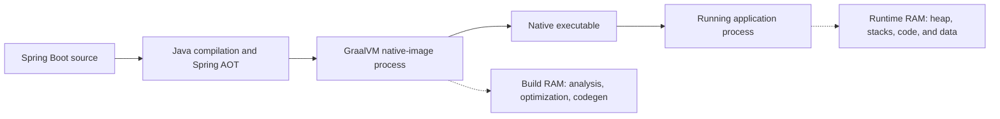

# Distinguishing Build-Time Process Memory from Native Application Memory

While creating a **GraalVM Native Image** for a Spring Boot application, learners often see the build command consume several gigabytes of RAM and conclude the native application will also need that much memory when running. These are two separate stages with different processes, purposes, and measurement methods. Understanding the difference helps size CI/CD resources accurately, interpret benchmarks fairly, and avoid misconfiguration when containerizing.

## 1. Two Processes, Two Memory Budgets

A Spring Boot project uses **Spring AOT (Ahead-of-Time)** to analyze application configuration and generate required code and metadata prior to native compilation. Next, the `native-image` tool analyzes the reachable component graph, optimizes, and produces an executable for the target OS/architecture.



| Attribute | **Build-Time** Memory | **Runtime** Memory |
|---|---|---|
| Main process | JVM running `native-image` (and possibly Maven/Gradle, compiler, AOT processes) | Compiled native executable |
| Purpose | Reachability analysis, type analysis, optimization, machine code generation, and linking | Handling HTTP requests, business logic, data access, object management |
| Timing | When creating the artifact on a developer machine or CI | When running the artifact on a server, container, or Kubernetes |
| Useful metrics | Peak RSS / peak memory across the build process group, build duration | RSS/PSS, used heap, peak RSS, startup time, load, and latency |
| How to control | Runner/build container RAM limit, native compiler heap limit | Application heap settings, container memory limit, application workload |

**Key takeaway:** `native-image` using 6 GB of RAM to *compile* does not mean the native executable needs 6 GB of RAM to *serve requests*. Conversely, a native app using little RAM at startup does not prove the build process will be lightweight.

## 2. How Is Memory Consumed During the Build Phase?

During a run of `mvn -Pnative native:compile` or Gradle's equivalent native task, the system can simultaneously consume RAM for:

1. **Maven/Gradle and Java/Spring AOT tasks:** compiling Java code, resolving dependencies, generating AOT code, resources, and runtime hints.
2. **GraalVM Native Image builder:** runs on a JVM, maintains the program model and metadata in the build process's own heap, performs reachability analysis, and runs optimizations.
3. **Native memory outside the builder's Java heap:** native data structures, the linker, libraries, and child processes can push total RSS above the `-Xmx` value.
4. **Operating system and build infrastructure:** page cache, daemons, compiler/linker, and other jobs sharing the same runner.

Therefore, **the builder's `-Xmx` limit is not the total RAM limit of the entire build**. If a CI machine has a low memory limit, a build can be OOM-killed by the OS or container even before the builder's heap reaches its limit. Larger projects, numerous dependencies, or complex analysis configurations generally raise memory pressure and build times; actual usage should be measured rather than guessed with a single universal number.

For example, with GraalVM Native Image, JVM options can be passed to the builder via `-J`:

```bash
native-image -J-Xmx4g -jar target/app.jar app
```

The command above only illustrates limiting the **builder JVM's** heap. With Spring Boot, use the AOT/native workflow configured by the Maven or Gradle plugin rather than assuming every Spring Boot fat JAR can be fed directly to `native-image -jar` without an AOT step. If the plugin supports forwarding arguments to `native-image`, the corresponding option can also be passed through the build configuration.

When building with Cloud Native Buildpacks, memory used during the **image build phase** belongs to the builder environment; the deployed application container's memory limit is a separate budget. Depending on the builder/buildpack version, how native-image flags are passed and automatic memory detection policies may differ; check build logs to confirm actual options.

## 3. What Makes Up a Native Application's Runtime Memory?

After compilation finishes, the native executable runs directly on the operating system without launching a HotSpot JVM to execute bytecode like a traditional JAR. However, **native does not mean no heap or no garbage collector**. The application still must allocate and reclaim objects using the runtime provided by Native Image.

Runtime memory consumers include:

- **Native runtime Java heap:** objects allocated while the program runs, caches, request/response objects, and application structures.
- **Image heap:** objects and data prepared at build time, embedded in the image, and mapped into the address space at runtime. Memory pages may be shared or demand-loaded depending on the OS and access patterns.
- **Native memory:** thread stacks, metadata, GC structures, native libraries, I/O buffers, and off-heap allocations.
- **Executable code and file-mapped regions:** pages holding the executable, shared libraries, and mapped resources.

Thus, `heap used` **does not equal** the process's RSS. The RSS figure includes many off-heap pages and does not necessarily reflect only the application's private physical memory. When comparing multiple processes sharing memory pages, PSS (Proportional Set Size) on Linux can be a useful supplementary metric.

### Runtime Heap Limits Differ from Builder Heap Limits

Suppose a native build is configured with `-J-Xmx4g`; that value applies only to the JVM running the compiler. It **does not set a 4 GB max heap for the generated application**. To tune the runtime heap, use runtime options compatible with your GraalVM Native Image version, for example:

```bash
./target/app -Xmx256m
```

In this example, `-Xmx256m` limits the heap **when running the native application**, provided the executable was built with a runtime supporting that flag. It does not cap total RSS at 256 MB. If running inside a container with a 384 MiB memory limit, leave headroom for stacks, GC, buffers, and native memory; do not set the heap equal to the entire container limit. Always check `./target/app --help` and the documentation for your Native Image version to confirm configuration flags.

## 4. Hands-On: Measuring Build and Runtime Separately on the Same Spring Boot App

Consider a simple Spring Boot API exposing `/actuator/health`. Use the same source code, configuration, and measurement host for both execution modes: JAR (HotSpot JVM) and native. To build with Maven, the project must have the Spring Boot plugin and appropriate native support configured.

**Step 1 — Build native and measure build-phase resources (Linux).**

```bash
/usr/bin/time -v ./mvnw -Pnative native:compile
```

In the output, inspect `Maximum resident set size` as a reference for the peak RSS of the process tracked by `time`. **Note:** depending on the tool and child-process model, this number is not necessarily the **combined** peak memory across all Maven, AOT, builder, and linker processes. To evaluate CI feasibility, monitor peak memory of the **entire build cgroup/container** or corresponding process group.

**Step 2 — Launch native and measure RSS.**

```bash
./target/app
```

In another terminal, find the exact PID of the executable and measure:

```bash
ps -o pid,rss,vsz,etime,comm -p <PID>
cat /proc/<PID>/status | grep -E 'VmRSS|VmHWM|VmSize'
```

`rss` in `ps` is typically reported in KiB; `VmRSS` is the current RSS, while `VmHWM` is the process's high-water mark (peak) RSS. `<PID>` is a placeholder to replace with the real PID—do not type literal angle brackets. On Windows/macOS, use the platform's process measurement tools because `/proc` is a Linux interface.

**Step 3 — Measure the JAR application under the same conditions.**

```bash
java -jar target/app.jar
```

Grab the Java PID running that exact JAR, and measure RSS and peak RSS using the same tool. When benchmarking, run **each variant separately** so the two servers do not compete for ports or share load. Test the same endpoint, profile, datasource config, request volume, and concurrency level. Measure both post-startup idle and steady-state load, because idle numbers do not substitute for numbers under realistic load.

**Step 4 — Tabulate the results.** Below is a **template for recording measurements**, not empirical benchmark results:

| Measurement | JAR on JVM | Native Executable |
|---|---:|---:|
| Peak build-process RAM | … MiB | … MiB |
| Build duration | … s | … s |
| Post-startup / steady idle RSS | … MiB | … MiB |
| Peak RSS under the same load | … MiB | … MiB |
| Time from launch command to app ready | … ms | … ms |
| p95 latency at the same throughput | … ms | … ms |

If using `time -v` for the build, clearly note the measurement scope (only the tracked process or the entire process group). When comparing startup, define the *ready* milestone consistently—such as when the readiness endpoint succeeds—rather than comparing differing log timestamps.

## 5. Real-World Scenario: CI Runs Out of RAM While Production Runs Light

A team deploys a Spring Boot Native Image service on containers that only need a few hundred MiB of RSS at idle. Yet the native compilation job on a 2 GiB RAM runner keeps getting OOM-killed. There is no contradiction: the runner is performing whole-program analysis and optimization, whereas the production container only executes the compiled output.

Sound ways to address this:

1. Identify which process/cgroup hit OOM in the **build job** and measure peak memory of the full build; distinguish `Java heap space` logs from kernel/container OOM-kills.
2. If the error stems from the builder's heap, consider increasing runner memory and tuning builder heap per your GraalVM version's guidance; if from cgroup limits, account for off-heap overhead.
3. Consider caching dependencies and splitting the native build into a dedicated job with adequate resources; caching helps download/preparation time but does not guarantee lower peak RAM during native analysis.
4. Set memory requests/limits on the **application runtime container** based on runtime measurements under representative load, plus headroom for traffic spikes and native memory.

In Kubernetes, memory limits on the service's runtime pod/container do not apply to the CI job that built the image. With multi-stage Docker builds, the compiler stage and the final executable stage also have very different RAM requirements. A native binary can be large on disk, yet file size does not directly indicate peak RSS at build time or runtime either.

## 6. Common Misconceptions

| Claim | Accurate Assessment |
|---|---|
| “Native build needs 8 GB so the production pod needs 8 GB.” | False: build and runtime resources are independent and must be measured separately. |
| “Limiting `-J-Xmx` also limits the native app's heap.” | False: `-J` forwards options to the builder JVM. |
| “Setting `-Xmx256m` guarantees RSS stays under 256 MiB.” | False: RSS includes off-heap regions and memory mappings. |
| “Native has no JVM so it has no GC.” | False: the native runtime still manages a heap and performs garbage collection. |
| “Measuring memory right after service startup is enough.” | Insufficient: measure under load, over sustained runs, and during traffic spikes. |
| “A smaller image always uses less RAM.” | No one-to-one relationship: file size, memory mapping, heap, and RSS are distinct. |

## 7. Self-Check Questions

1. Why can't the peak RAM of a `native:compile` job be used directly as the memory request for the application's runtime pod?
2. If you set `-J-Xmx4g` and see the build container consume more than 4 GiB of RAM, is that necessarily a configuration failure? Explain the other memory consumers.
3. Why is a native application's RSS usually higher than its reported `heap used`?
4. When comparing JAR and native builds, which variables must be held constant for memory consumption conclusions to be valid?

**Remember:** Spring AOT and GraalVM Native Image shift substantial analysis work to **build time** to produce fast-starting applications that often lower memory usage in many scenarios, though actual gains depend on the application and workload. Allocate separate budgets for build and runtime, and report exact metrics, measurement conditions, and tool versions.
