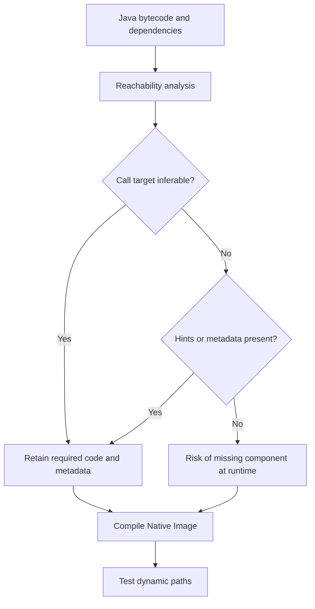

# Dynamic Access Preventing Static Analysis from Inferring Enough Information

## 1. Core Problem: The App Knows the Call Target at Runtime, the Compiler Must Know Ahead of Time

When running a Java application on the JVM, code can decide **which class to load, which constructor to call, which method to execute, or which resource to read** from data that only appears at runtime. For example, a class name may come from an environment variable, deployment config, a database record, or an HTTP request body.

With **Spring Boot Native Image**, Spring AOT prepares Spring configuration during the build phase, while GraalVM Native Image analyzes **reachability** to compile ahead of time into an executable. Native Image operates under a *closed-world* model: the code and metadata needed by the executable must be sufficiently known during image creation.

The difference lies in when the information is available:

- **On the JVM:** the program can request to load a class and inspect members via reflection at runtime, provided the class is on the classpath/module path and access rules allow it.
- **In Native Image:** the tool needs to know the relevant classes, members, proxy interfaces, resources, or serialization types in advance. Operations that cannot be inferred from static code require **reachability metadata** or **runtime hints** to be included properly in the image.

Not every use of reflection fails in native mode. Reflection calls with constant and sufficiently clear targets are sometimes recognized automatically by GraalVM. Problems arise when the target depends on runtime data and the tool cannot prove the possible targets.

## 2. Example from a Spring Boot Application

Suppose an ordering system allows selecting a fee calculation algorithm via configuration:

```java
public interface FeePolicy {
    long calculate(long subtotal);
}

public final class StandardFeePolicy implements FeePolicy {
    public StandardFeePolicy() {}

    @Override
    public long calculate(long subtotal) {
        return subtotal / 20;
    }
}
```

Selecting the class by name at runtime:

```java
String className = System.getenv("FEE_POLICY_CLASS");
Class<?> type = Class.forName(className);
FeePolicy policy = (FeePolicy) type.getDeclaredConstructor().newInstance();
long fee = policy.calculate(100_000);
```

Here, the compiler sees `Class.forName(className)` and `newInstance()`, but **does not know the value of `className`** at deployment time. Even if `StandardFeePolicy` is present in a build dependency, that does not guarantee its constructor is retained and permitted for reflective invocation.

A common scenario: the JVM build runs fine while the native executable fails only when the environment sets `FEE_POLICY_CLASS` to an unregistered class name. Depending on the case, the symptom might be a class lookup error, missing metadata to find the constructor, or another exception during the reflection operation. Do not assume all errors produce the exact same message.

## 3. What Does Reachability Analysis See?

The analyzer can follow direct calls:

```java
FeePolicy policy = new StandardFeePolicy();
policy.calculate(100_000);
```

It sees the constructor, implementation type, and related methods from the bytecode. However, with:

```java
Class<?> type = Class.forName(request.getParameter("implementation"));
```

the class name value is arbitrary data passed in at runtime, not a constant that can be reliably analyzed at build time.



The diagram illustrates an important principle: **a successful build does not prove all dynamic access is fully configured**. A branch that runs only upon receiving a special request type may never have been exercised in a smoke test.

## 4. Dynamic Access Mechanisms to Watch Out For

| Mechanism | Example | What the Analyzer May Be Missing |
|---|---|---|
| Reflection | `Class.forName(name)`, `getDeclaredConstructor()`, `Method.invoke()` | Class, constructor, field, or method needing retention and access permission |
| JDK dynamic proxy | `Proxy.newProxyInstance(loader, interfaces, handler)` | List of interfaces used to create the proxy |
| Resource loading | `getResourceAsStream(path)` | Specific resource file or pattern to package |
| Serialization | Converting JSON to a class determined by data | Constructors, fields, accessors, or serialization info |
| JNI/FFI | Native library calling back into Java or accessing Java members | Entry points and members invoked from native code |
| Service discovery | `ServiceLoader.load(service)` or plugin lookup | Providers needing presence and discovery metadata |
| Dynamic code loading | Generating/loading new bytecode or plugin libraries at runtime | New code does not exist in the compiled code set |

The rows in this table are **items to verify**, not a claim that every case requires manual configuration. Spring AOT, native-compatible libraries, and reachability metadata shipped by dependencies may already cover part or all of them.

**Distinguishing resources from code:** resources such as HTML email templates or certificates can be packaged if declared; that does not allow Native Image to compile a brand-new Java class loaded from a plugin after the binary has been released.

## 5. Three Approaches: Clarify Targets, Declare Metadata, or Redesign

### 5.1. Prefer Registering Choices as Spring Beans

If the algorithms are known at build time, they can be managed by Spring instead of selecting classes from strings:

```java
public interface FeePolicy {
    String code();
    long calculate(long subtotal);
}

@Component
final class StandardFeePolicy implements FeePolicy {
    @Override public String code() { return "standard"; }
    @Override public long calculate(long subtotal) { return subtotal / 20; }
}

@Service
final class FeeService {
    private final Map<String, FeePolicy> policies;

    FeeService(List<FeePolicy> implementations) {
        this.policies = implementations.stream()
                .collect(java.util.stream.Collectors.toUnmodifiableMap(
                        FeePolicy::code,
                        java.util.function.Function.identity()));
    }

    long calculate(String code, long subtotal) {
        FeePolicy policy = policies.get(code);
        if (policy == null) {
            throw new IllegalArgumentException("Unknown policy: " + code);
        }
        return policy.calculate(subtotal);
    }
}
```

Spring AOT can analyze beans and call paths declared at build time. The `code` string merely picks an already-created object from a finite set, avoiding forcing the program to invoke an unknown constructor via reflection.

Limitation: if the application genuinely must accept new Java plugins post-deployment, a fixed registry does not satisfy that dynamic extensibility requirement. You may need to separate plugins into external services, rebuild the native image when adding plugins, or consider keeping the JVM for that component.

### 5.2. Register Reflection with Spring RuntimeHints

When reflection is a legitimate requirement and the types can be identified at build time, register only what is needed via the `RuntimeHints` API:

```java
import org.springframework.aot.hint.MemberCategory;
import org.springframework.aot.hint.RuntimeHints;
import org.springframework.aot.hint.RuntimeHintsRegistrar;
import org.springframework.context.annotation.ImportRuntimeHints;

final class FeePolicyHints implements RuntimeHintsRegistrar {
    @Override
    public void registerHints(RuntimeHints hints, ClassLoader classLoader) {
        hints.reflection().registerType(
                StandardFeePolicy.class,
                MemberCategory.INVOKE_DECLARED_CONSTRUCTORS
        );
    }
}

@Configuration
@ImportRuntimeHints(FeePolicyHints.class)
class NativeConfiguration {
}
```

This example registers `StandardFeePolicy`'s **constructor** so it can be invoked via reflection. It does not automatically register all other fields and methods. If using `Method.invoke()` or reflective field access, you must register those corresponding members. Grant only the permissions actually needed so metadata remains manageable.

Spring AOT collects hints during the native build and supplies them to GraalVM Native Image. Hints do not replace application logic: if the environment variable holds an invalid class name, or the class does not exist at all in the build's code set, registering another class cannot fix that error.

### 5.3. Declare Corresponding Resources, Proxies, and Serialization

Resources read by dynamic paths can be declared using a pattern:

```java
hints.resources().registerPattern("templates/invoice/*.html");
```

This pattern must match actual resources present on the classpath at build time. For JDK dynamic proxies, use `RuntimeHints`'s proxy registration mechanism for the **exact interface set** used; for JSON binding/serialization, register type structures and members according to the specific library's requirements. Do not assume declaring a reflection constructor suffices for every data conversion framework.

GraalVM also supports Native Image's own reachability metadata formats, such as tool-version-compatible reflection/resource/proxy configurations or metadata distributed with libraries. In Spring Boot projects, prefer using Spring `RuntimeHints` before maintaining separate configurations, as hints integrate directly with the Spring AOT lifecycle.

## 6. Special Case: The Spring Framework Can Know More Than Plain Java

Spring Boot routinely uses reflection, classpath scanning, proxies, and bean registration algorithms. Thus, moving to native is not merely compiling bytecode. **Spring AOT** processes Spring configuration at build time and generates code for many bean initialization steps, evaluates configuration conditions, and registers hints.

For instance, a `@RestController` using DTOs can be supported thanks to information collected by Spring and the JSON conversion framework during AOT. However, a DTO decided solely by a class name read from a database record at runtime may lie outside what Spring AOT can recognize.

Similarly, configurations that alter the bean graph by profile or property must be considered at build time: some configuration conditions are evaluated upfront and the outcome can affect which beans exist in the native image. In operations, distinguish properties read at runtime from properties that already influenced AOT decisions at build time.

## 7. Diagnostic Workflow When JVM Succeeds but Native Image Fails

1. **Identify the failing dynamic action.** Record the request, job, data type, or configuration that triggers the error; locate `Class.forName`, `getDeclaredMethod`, proxies, resource loaders, serializers, or JNI calls along that path.
2. **Check the actual target at runtime.** Determine the class name, constructor/method signature, interface list, or resource path. Do not merely check that the class exists in source code.
3. **Inspect what was included in the image.** Cross-check runtime hints and library metadata. If the target is not described, add minimal metadata or refactor toward static calls/beans.
4. **Rebuild the native image.** Editing hints or adding classes has no effect on a previously compiled executable.
5. **Run tests exercising the exact path.** Test on the native executable with deployment data/configuration, not only unit tests on the JVM.

You can combine smoke tests with integration tests to cover JSON polymorphism, validation, Jackson customization, template engines, ORMs, message handlers, security rules, scheduled jobs, and third-party dependencies. Running the **GraalVM tracing agent** on the JVM build can help collect partial metadata from paths executed during test runs. Tracing output does not guarantee coverage of unexercised branches, so review and re-test after building native.

Quick diagnostic table:

| Symptom | Hypothesis to Check | Next Action |
|---|---|---|
| `ClassNotFoundException` in a dynamic branch | Selected class is missing from image or name is wrong | Verify the name and reachability metadata |
| `NoSuchMethodException` on reflective call | Constructor/method not registered for reflection or wrong signature | Register the exact member and verify parameters |
| Resource returns `null` or not found | Resource pattern does not cover the path | Check classpath path and resource hints |
| Proxy/serialization error on an uncommon DTO | Missing interface or member/type for dynamic operation | Check framework hints and the specific type |
| Fails only when changing deployment config | Runtime target differs from the set known at build time | Confirm the option set and rebuild plan |

Sometimes the error originates from the application itself—an incorrect class name, mismatched classloader, or library version incompatibility; do not assume every reflection exception is a Native Image bug.

## 8. Impact on Build, Containers, and Operations

In the **SPRING_BOOT_NATIVE_IMAGE** module, the goal is compiling Spring Boot with Spring AOT/GraalVM to measure startup and memory, practice Maven/Gradle, reflection/resources, compatibility testing, and container deployment. Dynamic access directly impacts all of these steps.

- **Maven/Gradle build:** run the native workflow after adding runtime hints. For example, Maven `./mvnw -Pnative native:compile` or Gradle `./gradlew nativeCompile` when the corresponding plugin is configured; even if the build succeeds, dynamic branches must still be tested.
- **Containers:** package the executable and required system libraries, ensuring resources are included in the image or mounted as runtime files in the right location. Adding a plugin JAR to a container post-build will not enable the image to compile new Java classes.
- **Operations:** when adding DTOs/plugins/handlers in Java code, you typically must update code or metadata, rebuild the binary, run tests, and release a new native build. Purely data-driven business configuration can still change at runtime if the code already supports it.
- **Performance measurement:** only compare a native build that satisfies all business paths against an equivalent JVM build. A smaller native image resulting from accidentally dropping handlers is not a valid memory benefit.

Suggested hands-on exercise: implement `FeePolicy` using reflection driven by an environment variable; build both JVM and native versions; confirm the error or behavior in native when metadata is missing; add `RuntimeHints` or switch to a Spring bean registry; rebuild, test both policy choices, and then measure startup, response time, and RSS in the same environment. Specific behavior depends on tool versions and Native Image's automatic reflection detection, so observe directly rather than assuming the example fails identically across every version.

## 9. Key Takeaways

**Dynamic access creates an information gap between build time and runtime.** Reachability analysis handles static calls and certain known dynamic patterns well, yet cannot predict every value coming from configuration or requests. Spring AOT clarifies many Spring Boot structures; `RuntimeHints` and GraalVM metadata declare the remaining elements. For known sets of choices, a bean/registry design makes code easier to analyze and test; for Java code plugins that truly appear only post-deployment, architectural or release-process adjustments are needed.

A core skill when working with Spring Boot Native Image is **precisely identifying dynamic paths, expressing just-enough metadata, rebuilding, and testing the actual native executable**.
