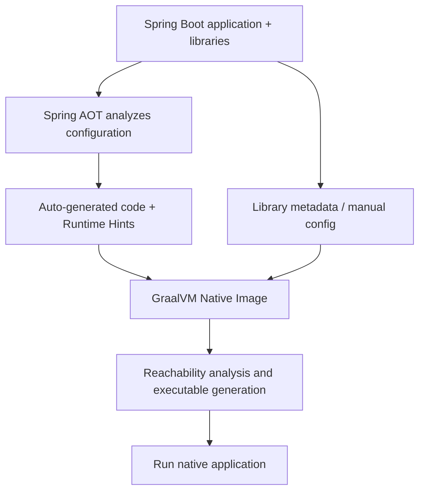

# The Role of Metadata for Reflection, Resources, Proxies, and JNI

## 1. Why Does Native Image Need Metadata?

When running a Spring Boot application on the HotSpot JVM, classes can be loaded and inspected while the application is running. Frameworks can look up classes by string name, read annotations via reflection, generate dynamic proxies, open classpath resources, or call native libraries via JNI. This dynamic discovery capability is convenient, yet poses a challenge for **GraalVM Native Image**.

Native Image uses *closed-world* analysis: during the build, the tool attempts to determine ahead of time which code and data can be accessed at runtime. Anything not recognized as *reachable* may be omitted from the executable or lack sufficient information for dynamic access. Consequently, code that runs properly on the JVM can fail only when executing the native build.

**Reachability metadata** describes elements to retain or dynamic behaviors to support, such as classes and members accessed via reflection, resources to package, dynamic proxy types created, or JNI-related elements. Metadata is not “enabling all Java features”; it supplies information that static analysis could not infer on its own.

In the **SPRING_BOOT_NATIVE_IMAGE** module, Spring AOT (Ahead-of-Time) is an important bridge: the framework analyzes many Spring configurations at build time, generating code and **Runtime Hints** so GraalVM Native Image can compile the Spring Boot application into a native executable. The goal of this workflow is to evaluate startup time and memory, practice Maven/Gradle builds, address compatibility, package containers, and operate native builds.



Some elements are detected automatically by Native Image when the call has a clear static structure; therefore **not every reflection call or every resource requires manual declaration**. Only add metadata for dynamic access paths not handled properly by the analyzer or AOT.

## 2. Reflection: Knowing Which Class and Which Operations Are Allowed

Reflection lets a program inspect classes, constructors, fields, and methods and invoke them at runtime. Example:

```java
String className = request.getParameter("type");
Class<?> type = Class.forName(className);
Object object = type.getDeclaredConstructor().newInstance();
```

Because `className` comes from the request, the build tool has difficulty knowing in advance which class will be loaded. If the required class, constructor, or metadata is not registered, the native build can encounter errors such as `ClassNotFoundException`, `NoSuchMethodException`, missing members, or reflection access errors depending on the situation.

Two needs should be distinguished:

- **Introspection**: reading type info, annotations, constructors, fields, or methods.
- **Invocation/access**: creating instances, invoking methods, or reading/writing fields via reflection.

Registering only the class type may not be enough if a library needs to call a specific constructor or method. Declare the minimal access permissions matching actual usage.

### Spring RuntimeHints Example

Suppose an application plugin loads `com.example.plugin.EmailChannel` by a name obtained from controlled configuration. Its constructor can be registered prior to native compilation:

```java
package com.example.nativeapp;

import com.example.plugin.EmailChannel;
import org.springframework.aot.hint.MemberCategory;
import org.springframework.aot.hint.RuntimeHints;
import org.springframework.aot.hint.RuntimeHintsRegistrar;
import org.springframework.context.annotation.Configuration;
import org.springframework.context.annotation.ImportRuntimeHints;

@Configuration
@ImportRuntimeHints(EmailChannelHints.class)
class NativeHintsConfiguration {
}

class EmailChannelHints implements RuntimeHintsRegistrar {
    @Override
    public void registerHints(RuntimeHints hints, ClassLoader classLoader) {
        hints.reflection().registerType(
            EmailChannel.class,
            MemberCategory.INVOKE_DECLARED_CONSTRUCTORS
        );
    }
}
```

This example illustrates that `EmailChannel` must exist, and the access type must match how the plugin actually instantiates the object. If only a public constructor is needed, you can register that exact constructor or choose the corresponding `MemberCategory`. Avoid registering all methods/fields unnecessarily, as that can increase image size and widen the exposed surface.

## 3. Resources: Present in the Project Does Not Guarantee Present in the Executable

A file under `src/main/resources` can usually be accessed via a Java application's classpath:

```java
try (var stream = getClass().getResourceAsStream("/templates/invoice.html")) {
    if (stream == null) {
        throw new IllegalStateException("Template not found");
    }
    // Read the template content
}
```

However, during a native build, the tool needs to know which resource files to embed into the executable. Spring AOT and library configurations may already provide the necessary declarations; for resources loaded dynamically by application or plugin code, inspect and supplement them if missing.

Registering a resource pattern with Spring RuntimeHints:

```java
class TemplateHints implements RuntimeHintsRegistrar {
    @Override
    public void registerHints(RuntimeHints hints, ClassLoader classLoader) {
        hints.resources().registerPattern("templates/*.html");
    }
}
```

Use `@ImportRuntimeHints(TemplateHints.class)` on a Spring configuration class so the registrar is discovered during AOT processing.

**Distinction:** classpath resources embedded into the image via metadata differ from external filesystem files mounted at runtime. For example, `/etc/myapp/secrets.yaml` is a deployment file, not a resource that should be packaged into the executable. Never embed secrets, private certificates, or environment-specific data inside the native image. Always test absolute/relative paths and resource packaging inside containers, as the working environment in native execution can differ from development.

## 4. Dynamic Proxies: Which Proxies Are Created at Runtime?

Java dynamic proxies create an object implementing one or more interfaces at runtime:

```java
interface GreetingClient {
    String hello();
}

GreetingClient client = (GreetingClient) java.lang.reflect.Proxy.newProxyInstance(
    GreetingClient.class.getClassLoader(),
    new Class<?>[]{GreetingClient.class},
    (proxy, method, args) -> "Hello!"
);
```

If the proxy's interface set is not known ahead of time, native analysis may fail to recognize the required proxy to generate. Metadata for **JDK dynamic proxies** typically declares the list of interfaces the proxy will implement. Interface order can matter for proxy identity, so preserve the exact configuration generated.

Spring RuntimeHints supports registration:

```java
class ClientProxyHints implements RuntimeHintsRegistrar {
    @Override
    public void registerHints(RuntimeHints hints, ClassLoader classLoader) {
        hints.proxies().registerJdkProxy(GreetingClient.class);
    }
}
```

Spring AOT automatically handles many proxies created from bean configurations and framework infrastructure. Distinguish **interface-based JDK dynamic proxies** from class/bytecode-based proxies (e.g., certain CGLIB mechanisms): they have different generation mechanisms, so you cannot assume every proxy error can be fixed solely by calling `registerJdkProxy`. Frameworks that generate classes dynamically at runtime may require AOT mechanisms, library-specific configuration, or redesigning so classes are generated at build time.

For example, when an application uses Spring Data repositories or AOP, do not rush to declare all proxies manually. First verify whether Spring AOT already handles that bean/proxy type, and only then add metadata for any remaining custom proxy creation paths.

## 5. JNI: The Boundary Between Java and Native Libraries

**JNI (Java Native Interface)** lets Java call functions in native libraries and lets native code interact with Java types, fields, and methods. When compiling Native Image, type and member entry points accessed from native code may need to be described upfront so the runtime retains the required information.

One case:

```java
public class NativeCodec {
    static {
        System.loadLibrary("codec");
    }

    public native byte[] compress(byte[] input);
}
```

Requirements to verify independently:

1. **JNI/reachability metadata**: Java classes/members accessed by the native library must be known to the tool upfront if they cannot be automatically analyzed.
2. **Compatible binary**: the `codec` library must be compiled for the exact operating system, CPU architecture, and ABI of the running image.
3. **Packaging and library discovery**: `.so`, `.dylib`, or `.dll` files must exist in the runtime environment if the linking mechanism requires them.
4. **Native runtime compatibility**: not every JNI usage pattern or native library is supported identically by GraalVM and HotSpot; check your specific Native Image and library versions.

**Metadata does not automatically make a JNI library compatible, nor does it automatically package the native binary into a container.** When encountering `UnsatisfiedLinkError`, check the library name/path, architecture, and OS dependencies before assuming a reachability error.

## 6. Registering Metadata Across Three Layers

There are three common complementary sources in a Spring Boot Native Image project:

| Source | Usage Scope | When to Prioritize |
|---|---|---|
| **Spring AOT and RuntimeHints** | Analyze Spring config, register reflection, resources, proxies, serialization, and AOT needs | Spring Boot apps, starters, or Spring-integrated libraries |
| **GraalVM metadata in libraries** | Reachability configuration shipped with the dependency | Libraries that already support Native Image and publish compatible metadata |
| **Application-custom metadata** | Supplement undetected dynamic paths | Plugins, name-based reflection, dynamic resources, custom proxies/JNI |

In modern GraalVM versions, reachability metadata can be declared in a unified JSON file such as `META-INF/native-image/<group-id>/<artifact-id>/reachability-metadata.json`, or via specialized configuration formats still supported by the toolchain. Exact JSON structure, fields, and compatibility depend on the GraalVM version; do not copy configuration from another version without verifying it.

Illustrative snippet following the newer reachability metadata JSON format (showing only reflection and resources):

```json
{
  "reflection": [
    {
      "type": "com.example.plugin.EmailChannel",
      "methods": [
        { "name": "<init>", "parameterTypes": [] }
      ]
    }
  ],
  "resources": [
    {
      "glob": "templates/*.html"
    }
  ]
}
```

The JSON example illustrates the declaration concept and should be cross-checked against your specific GraalVM schema before use; with Spring Boot, writing a `RuntimeHintsRegistrar` is usually easier to maintain and test within the Spring ecosystem.

### When Do Hints Take Effect?

A `RuntimeHintsRegistrar` only takes effect when actually wired into the AOT process, such as via `@ImportRuntimeHints` or a library-provided registration mechanism. Creating a registrar class and forgetting to register it will prevent Native Image from receiving the metadata.

If Spring generates code for a bean automatically, extra metadata does not necessarily need to be hand-written. Conversely, a string-based `Class.forName` call driven by a database, JSON, or external configuration that Spring AOT cannot see may need a dedicated declaration.

## 7. Diagnosing Metadata Errors with a Controlled Workflow

Suppose the JAR runs normally, but the native image starts up and then fails when a user exports an invoice:

```text
GET /invoices/123/export
→ IllegalStateException: Template not found
```

Do not immediately add an option to “keep all resources.” Trace back the actual access path:

1. **Reproduce the error on the native executable** with matching config and data; record the stack trace, endpoint, missing class, or resource name.
2. **Classify the error**: missing reflection member, resource, proxy, JNI/binary, serialization, or another bug. A single endpoint can traverse multiple mechanisms.
3. **Check existing AOT mechanisms**: was the bean discovered by Spring? Was the registrar registered? Is the resource at the right classpath path? Does the library ship metadata for that exact version?
4. **Add minimal metadata**, e.g., `templates/*.html` instead of every file in the project, or a specific constructor instead of all members.
5. **Rebuild the native image**: metadata affects compilation, so editing JSON or `RuntimeHints` and merely restarting the old executable will not fix the issue.
6. **Test on the new artifact** along the same processing path, then test inside the actual deployment container image and architecture.

To help uncover missing metadata, you can run the **GraalVM Native Image tracing agent** on the JVM exercising real-world scenarios. The agent observes dynamic operations that occurred and generates configuration; afterward, review it, strip redundant entries, add unexercised paths, and integrate the metadata into the appropriate build workflow.

Example agent usage (verify exact syntax/output modes against your GraalVM version):

```bash
java -agentlib:native-image-agent=config-output-dir=target/native-agent-config \
     -jar target/app.jar
```

After exercising the business APIs, shut down the app to collect the metadata and inspect the results. **The agent only sees code paths executed during recording**; it does not prove the entire application is native-compatible. Combining AOT integration tests, native executable tests, and load tests is necessary before going to production.

## 8. Connection to Maven, Gradle, and Containers

In a Spring Boot project using Maven, the typical command for a native executable is:

```bash
./mvnw -Pnative native:compile
```

With Gradle and the appropriate Native Build Tools plugin:

```bash
./gradlew nativeCompile
```

The commands above assume the project has compatible Spring Boot and GraalVM Native Build Tools plugins configured. When modifying `RuntimeHints` or metadata, you must re-run the AOT/native build step. When using buildpacks, configuration and metadata must also be present in the image build context.

Do not conflate three failure categories:

- **Missing reachability metadata**: a class, method, proxy, or resource was not retained properly.
- **Missing OS libraries**: the native binary needs a shared library or ABI absent from the container.
- **Environment configuration errors**: environment variables, mounted files, DNS, secrets, certificates, write permissions, or networking differ from the JAR environment.

A minimal container image can hit JNI or filesystem resource errors even when the native application has complete metadata. Classifying the root cause before fixing avoids needlessly widening reachability and bloating the image.

## 9. Checklist Before Accepting a Native Build

- APIs using reflection, serialization, dynamic proxies, template/resource loading, and JNI have been executed in native tests.
- `RuntimeHints` are registered with Spring AOT; library metadata matches library versions.
- Required classpath resources are inside the image; environment data and secrets are provided at runtime.
- Native/JNI dependencies match the executable's architecture and container base image.
- The artifact is rebuilt after hint changes and verified on the newly built artifact.
- Startup, RSS, response time, and throughput are compared between JAR/native on the same workload; do not treat build success as proof of comprehensive performance and compatibility.

## 10. Self-Check Questions

1. Why can `Class.forName` with a class name from runtime configuration run fine on HotSpot yet fail when running native?
2. When do you use `hints.reflection()` and when do you use `hints.resources()`? Give one example of each.
3. How do JDK dynamic proxies differ from class-based proxies, and why does that affect Native Image?
4. Why can declaring correct JNI metadata still lead to `UnsatisfiedLinkError` when deploying a container?
5. If the tracing agent finds no errors during a smoke test pass, can you conclude all production paths have sufficient metadata?
6. When editing a `RuntimeHintsRegistrar`, why must you rebuild the native executable?

**Remember:** metadata is a supplementary contract between Java code using dynamic features and GraalVM's pre-compilation analysis. With Spring Boot, leverage Spring AOT's built-in analysis first, supplement missing points with `RuntimeHints` or reachability metadata, and verify on the exact native executable and container you will operate.
