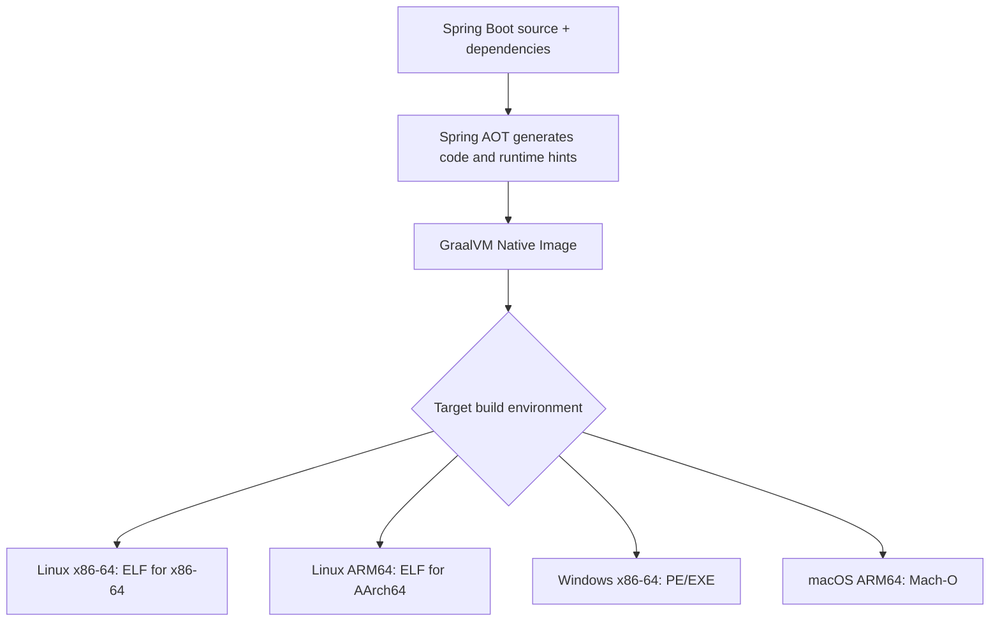
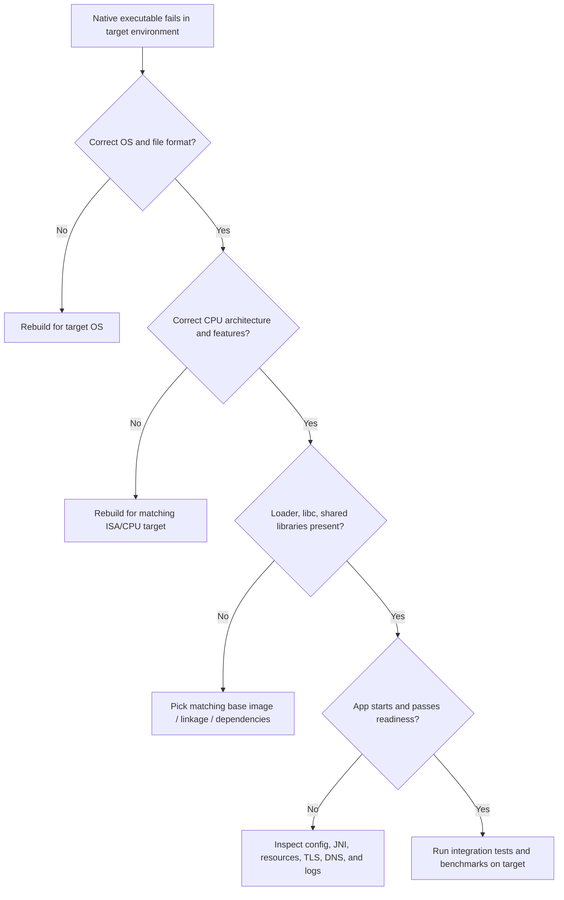

# Dependencies on Operating System, CPU Architecture, and System Libraries

## 1. Goal and Context

When compiling a Spring Boot application with **Spring AOT** and **GraalVM Native Image**, the final artifact is typically a machine-code executable for **one specific platform combination**. The application can start faster and use less memory in many scenarios, yet native packaging also changes how we build, distribute, and deploy applications.

Consider the following scenario:

1. The development team builds a Spring Boot application into an `order-service` binary on a Linux x86-64 machine.
2. The binary is copied into an Alpine Linux container to reduce image size.
3. The container is deployed onto a node with an ARM64 CPU.
4. At runtime, the process fails to start or reports an executable/system library error.

In this scenario, there are **three distinct compatibility layers** to verify:

- **Operating system and executable format:** Linux, Windows, and macOS use different binary formats and program loading mechanisms.
- **CPU instruction set architecture (ISA):** x86-64 machine code cannot execute natively on ARM64 and vice versa.
- **ABI and system libraries:** a Linux binary using `glibc` and a specific dynamic loader may not launch in an environment that only has `musl` or lacks required libraries.

After this lesson, you will be able to identify the right target platforms to build for, understand why a Native Image runs on one machine but fails on another, select a compatible runtime image, and set up verification before going to production.

## 2. Why Do Java JARs and Native Images Differ in Portability?

### 2.1. With a Spring Boot JAR

Under the traditional JVM model, the compiler produces bytecode; at runtime, the JVM matching the target OS and CPU architecture executes that bytecode:

```text
Spring Boot Source
        │
        ▼
       JAR
        │
        ├── JVM on Linux x86-64 ──► Linux process
        ├── JVM on Linux ARM64  ──► Linux process
        ├── JVM on Windows      ──► Windows process
        └── JVM on macOS        ──► macOS process
```

The advantage is that **the same JAR** can generally run on many platforms that have a compatible JVM. However, this is not an absolute guarantee: a JAR can still contain JNI/native libraries, depend on OS commands, file paths, or capabilities of a specific JVM version.

### 2.2. With GraalVM Native Image

During a native build, GraalVM analyzes reachable code, AOT-compiles it into machine code, and links the executable for the build/target platform. Spring AOT helps prepare initialization code and metadata so Spring's dynamic features work throughout that process.



A Linux x86-64 native binary is **not equivalent** to a Linux ARM64 or Windows x86-64 native binary. Filenames may look identical, but the machine code and OS linking differ.

A Native Image can run **without installing a standalone JVM** on the target machine; that **does not mean** the program is independent of the kernel, C library, dynamic loader, CPU architecture, or OS components the application uses.

> Design rule: determine **where the executable will run** before designing the build pipeline. Compatibility on a developer machine does not automatically guarantee compatibility in production.

## 3. First Layer: Operating System and Executable Format

The operating system manages processes, virtual memory, sockets, file descriptors/handles, threads, permissions, and many system calls. A native executable must be built in a format understood by the OS loader.

| Target Platform | Common Executable Format | Details to Watch Out For |
|---|---|---|
| Linux | ELF (*Executable and Linkable Format*) | Linux kernel, CPU architecture, ELF interpreter/dynamic loader if dynamically linked, libc, and required `.so` files |
| Windows | PE/COFF, typically `.exe` | Windows API, imported DLLs, and compatible toolchain/linker |
| macOS | Mach-O | Supported macOS version, Intel or Apple Silicon architecture, `.dylib`/frameworks, and code-signing rules if applicable |

Example:

```bash
# On Linux, inspect the current OS kernel and architecture
uname -s
uname -m

# Inspect the format of the built executable
file ./target/order-service
```

On Linux, `file` typically reports whether the file is **ELF** and whether it was built for **x86-64** or **aarch64**. This is a quick sanity check and is not enough on its own to prove all runtime libraries are compatible.

If you take a Windows `order-service.exe` onto Linux and invoke it directly, Linux will not natively understand a Windows PE program. Likewise, a macOS Mach-O executable does not become a Linux program merely by renaming it or stripping its extension.

### 3.1. Containers Do Not Replace the Kernel

Docker containers typically share the kernel with the Linux host. Therefore, putting a Windows or macOS native file into a Linux container **does not** turn it into a Linux program. Nor does a Linux container automatically translate x86-64 machine code into ARM64.

Containers package the filesystem, libraries, and runtime configuration; they do not remove compatibility requirements between the executable, CPU, and kernel. With Docker Desktop on Windows/macOS, Linux containers normally run inside an underlying Linux/VM environment; the program inside still needs a **Linux** executable.

## 4. Second Layer: CPU Architecture and Instruction Set

### 4.1. x86-64 and ARM64

CPUs execute machine code according to a specific instruction set. The following labels frequently appear when building Spring Boot Native Images:

| Common Label | Common Equivalent Names | Docker/OCI Label |
|---|---|---|
| `x86_64` | AMD64, x86-64 | `linux/amd64` when running Linux |
| `aarch64` | ARM64 | `linux/arm64` when running Linux |

**AMD64** does not mean it runs only on AMD CPUs; many Intel CPUs also implement the x86-64 instruction set. **ARM64/AArch64** is a different instruction set family, common on ARM servers, embedded devices, and Apple Silicon.

For example, an application built on a `linux/amd64` host cannot be expected to run directly on `linux/arm64` without an appropriate emulation/translation mechanism. When attempting to run an executable built for the wrong architecture, you may encounter:

```text
exec format error
```

The exact message depends on the shell, container runtime, and OS. Also note that `exec format error` can occur due to an invalid file format, not solely CPU mismatch.

### 4.2. Same Architecture Does Not Guarantee Same CPU Feature Set

Even within the x86-64 family, different CPU generations support different instruction set extensions. Choosing compiler flags optimized for a specific machine can produce an executable using instructions an older machine does not support.

For example, passing a GraalVM Native Image option like `-march=native` optimizes for the CPU features on the build machine. Moving that artifact to a CPU in the same family lacking those features risks failing with a signal or message such as:

```text
Illegal instruction
```

The solution is to **target a CPU baseline matching the oldest supported machine**, or build separate variants per CPU tier when the gain justifies it. Never assume every x86-64 host or every ARM64 node in a cluster shares the exact same feature flags.

### 4.3. Can You Cross-Compile?

Cross-compilation means building on one platform to produce an executable for another platform. In Native Image practice, the simplest and most reliable approach is usually **building on the OS/architecture matching the target**, with supporting GraalVM and native toolchains.

Do not assume that passing `--platform linux/arm64` to a Docker command or renaming the output turns an x86-64 binary into ARM64. Multi-platform workflows can use native runners per platform, remote builders, or appropriate emulation environments; compiling with GraalVM under emulation can consume heavy CPU/RAM and requires verifying toolchain support.

## 5. Third Layer: ABI, System Libraries, and the Dynamic Loader

Two executables that are both Linux x86-64 can still differ in how they interface with the system. This is where the **ABI (Application Binary Interface)** and **linked libraries** matter.

### 5.1. What Is an ABI?

An ABI defines binary-level conventions such as:

- How arguments are passed and return values received in function calls.
- How certain data structures are represented, aligned, or laid out.
- Symbol naming, linking, and library lookup conventions.
- Interaction conventions between executables, libraries, and the operating system.

If an API describes *which functions a program can call*, an ABI describes *the binary rules two components follow to interact*. An executable can match both OS and CPU yet still fail because of an incompatible ABI or library version.

### 5.2. `glibc` and `musl` on Linux

Two common C standard library implementations are:

| Aspect | `glibc` | `musl` |
|---|---|---|
| Common environments | Debian, Ubuntu, and many other Linux distributions | Alpine Linux and Alpine-based images |
| Typical linking traits | Linux executables dynamically link against `glibc` and related libraries | Executables can link against `musl`, serving lightweight or appropriate static runtime setups |
| Things to watch out for | Symbol versions and dynamic loader must be compatible with the target environment | Not compatible by default with executables built against `glibc` |

Example: building an application on Ubuntu (using `glibc`), then copying only the executable into Alpine (using `musl`). Even though both are Linux x86-64, the executable may lack the required **dynamic loader** or symbols/libraries and fail to run.

The error can look like:

```text
No such file or directory
```

This message is misleading: the `order-service` file **may actually exist**, yet the kernel cannot find the ELF interpreter declared inside the executable. Thus you must check both the dynamic loader and binary dependencies rather than assuming the executable path is wrong.

Furthermore, if the program was built on a system with a newer `glibc` version than the runtime environment, it may report an error like:

```text
version 'GLIBC_2.xx' not found
```

`GLIBC_2.xx` is an illustrative format. The exact version depends on the binary and system. Fixes include building on a baseline with suitable compatibility, using a runtime base image providing the required symbols, or considering a different linking configuration after testing.

### 5.3. Dynamic Linking vs. Static Linking

**Dynamic linking** retains links to shared libraries; at runtime, the dynamic loader must locate and load the required libraries—for instance `.so` files on Linux.

**Static linking** bundles supported components into the executable at build time, reducing or eliminating certain runtime shared-library dependencies. GraalVM supports static linking modes tailored to specific platforms and toolchains, such as building Linux executables using `musl`.

However, **static does not mean OS-independent**. The executable must still contain CPU-compatible machine code and requires a kernel supporting its syscalls/mechanisms. The application may also need CA certificate data, timezone data, DNS configuration, external files, or libraries loaded dynamically at runtime.

| Aspect | Dynamically Linked Native | Statically Linked Native |
|---|---|---|
| Runtime shared libraries | Needs the exact declared or dynamically loaded libraries | Can substantially reduce shared library dependencies |
| Runtime container image | Usually uses a base image with compatible libc and libraries | Can use a very minimal image if all actual dependencies are satisfied |
| Library updates | Shared libraries can be patched via the image/OS when ABI-compatible | Components linked into the executable usually require rebuilding to receive patches |
| Compatibility checks | ABI, dynamic loader, libraries, and symbols | Still must verify kernel, CPU, runtime files, and native features |

Do not choose static or dynamic solely to shrink image size. Consider patchability, observability, JNI, and your organization's container policies.

## 6. How to Discover Which Libraries an Executable Needs

After building a Linux executable, the following commands help inspect **format, CPU, and libraries**:

```bash
# Identify executable type and architecture
file ./target/order-service

# Read the ELF header; check machine/architecture
readelf -h ./target/order-service

# Find the ELF interpreter/dynamic loader (if present)
readelf -l ./target/order-service

# List libraries recorded in dynamic dependencies
readelf -d ./target/order-service

# Show linked libraries resolved on the current host
ldd ./target/order-service
```

`readelf -d` can display `NEEDED` entries such as `libc.so.6`. `readelf -l` can display the `INTERP` field (for example, a loader path like `/lib64/ld-linux-x86-64.so.2`). These paths **depend on the build**, not fixed values across all systems.

**Notes when using inspection commands:**

- `ldd` reflects library resolution **on the current machine**. A clean result on the build host does not guarantee success in the production container.
- Avoid running `ldd` on untrusted executables; for files of unknown origin, prefer static inspection with `file` and `readelf`.
- `ldd` may output differently or be unhelpful for statically linked executables.
- `readelf -d` only lists dependencies recorded in the ELF dynamic section; libraries loaded later via JNI, `dlopen`, or custom logic may not appear here.

Other platforms use equivalent tools:

```bash
# macOS: executable format and linked libraries
file ./order-service
otool -L ./order-service
```

```powershell
# Windows (in a Developer Command Prompt/PowerShell with Visual Studio tools):
dumpbin /DEPENDENTS .\order-service.exe
```

Tool names and availability depend on the environment. Before modifying Java application code, verify that the binary matches the target OS/CPU and its native dependencies are met.

## 7. Java Libraries Can Bring Native Dependencies

Not every Maven/Gradle dependency contains pure Java bytecode. Some libraries integrate:

- **JNI (Java Native Interface):** calling functions in C/C++ or native libraries.
- **JNA or similar mechanisms:** interfacing with functions in OS libraries.
- **Platform-specific I/O:** native transports, network acceleration, compression, cryptography, or specialized system libraries.
- **Bundled binaries inside dependencies:** shipping separate builds for Linux x86-64, Linux ARM64, Windows, and macOS.

For example, an application might contain:

```java
public final class NativeMathBridge {
    static {
        System.loadLibrary("fastmath");
    }

    public static native long calculate(long input);
}
```

This is an illustrative snippet, **not a complete program**. On Linux, `fastmath` might correspond to `libfastmath.so`; on Windows to `fastmath.dll`; on macOS possibly `libfastmath.dylib`, depending on packaging and loading mechanisms.

Possible scenario:

1. A Spring Boot app uses JNI and builds natively with success on Linux x86-64.
2. The pipeline copies only the executable without `libfastmath.so`, or bundles the ARM64 version.
3. A request hitting `NativeMathBridge` fails while loading the library.

When investigating, verify that **both the executable and the JNI binary** match the platform, match the ABI, and sit where the runtime can load them. Dynamically loaded components often need separate configuration and testing; AOT compilation does not turn third-party native binaries into platform-independent artifacts.

### 7.1. Distinguishing Native Library Errors from Reflection/Resource Errors

Spring AOT provides mechanisms to declare **runtime hints** for reflection, proxies, resources, serialization, or JNI when needed. Yet two questions are distinct:

1. **Metadata/reachability:** do the compiler and runtime know the class, method, or resource will be used?
2. **Binary compatibility:** can the loaded `.so`, `.dll`, or `.dylib` actually execute on the target OS/CPU/ABI?

Adding reflection hints can ensure the Java component is accessible in the native build; it **cannot fix** an x86-64 library deployed onto ARM64, or an `.so` requiring `glibc` absent from the container.

## 8. Containers: Choosing a Base Image Compatible with the Executable

### 8.1. Example of an Explicit Dockerfile

Suppose `target/order-service` was built as a **Linux x86-64 executable dynamically linked against `glibc`**. A conceptually minimal Dockerfile might look like:

```dockerfile
# Example runtime for a glibc-linked Linux executable.
# Verify actual libraries and versions with readelf/ldd.
FROM debian:bookworm-slim
WORKDIR /app
COPY target/order-service /app/order-service
EXPOSE 8080
ENTRYPOINT ["/app/order-service"]
```

For this image to work, the executable must match the image/host CPU; have execute permissions; and find its required libraries, loader, and runtime data. For production, also configure a non-root user, CA certificates, observability settings, and appropriate hardening.

Changing `FROM debian:bookworm-slim` to `FROM alpine` without changing how the executable is built can introduce a `glibc`/`musl` mismatch. Swapping the base image name does not convert the ABI already linked into the binary.

### 8.2. Shell-less Images and Missing Runtime Files

An executable may run fine on the build host yet fail inside a minimal image due to missing:

- **CA certificates:** TLS connections to APIs or databases may fail certificate validation, depending on how Java/native runtime and TLS libraries locate trust stores.
- **Timezone data:** applications performing timezone conversions or using timezone names may behave differently if expected zone data is missing.
- **DNS and resolver configuration:** hostname resolution depends on how the deployment environment provides DNS and libc/resolver config.
- **Libraries used by JNI or security providers:** loaded only when the corresponding code path runs.
- **File and filesystem permissions:** lacking permission to read config, write temp files, access certificates, or bind ports can keep the app from becoming ready.

These items are **runtime dependencies**, even though they do not necessarily show up in `readelf -d`.

When `distroless` or `scratch` images lack a shell and diagnostic tools, inspect the executable in a **compatible debug image** or in a CI step before packaging. Do not assume every native binary qualifies to run in `scratch`.

### 8.3. Docker/OCI Platform Formats

Docker and OCI use platform labels, for example:

```text
linux/amd64
linux/arm64
```

A *multi-platform image* typically has a manifest/index pointing to child images for each platform. Each child image **must contain the matching executable**. A multi-platform manifest cannot turn the same x86-64 binary into an ARM64 build.

Inspect published platforms:

```bash
docker buildx imagetools inspect registry.example.com/team/order-service:1.0.0
```

Once a pipeline produces the proper binary for each architecture, you can use `docker buildx build --platform linux/amd64,linux/arm64 ...` to publish multiple variants. However, that command is **only valid** when the Dockerfile/builder genuinely compiles or copies the artifact for each platform. Building Native Image under emulation or via remote builders must be tested, especially for resource usage and toolchain support.

## 9. Designing Maven/Gradle Build Pipelines for Target Environments

### 9.1. Define a Platform Matrix Before Building

For a Spring Boot service that must run on two Linux node types, you can build a matrix:

| Deployment Target | Build Machine or Builder | Expected Artifact | Runtime Container |
|---|---|---|---|
| `linux/amd64` | Linux x86-64 with supported GraalVM/toolchain | ELF x86-64 | Linux/amd64 image with matching libc/libraries |
| `linux/arm64` | Linux ARM64 with supported GraalVM/toolchain | ELF AArch64 | Linux/arm64 image with matching libc/libraries |
| Windows x86-64 | Windows x86-64 with supported toolchain | PE/EXE x86-64 | Windows and compatible DLLs |
| macOS ARM64 | macOS ARM64 with supported toolchain | Mach-O arm64 | Supported macOS and runtime dependencies |

If production only runs `linux/amd64`, a single artifact for that platform may suffice. If the cluster includes ARM64 nodes too, the pipeline must actively produce the corresponding variant and tag it accurately.

### 9.2. Example Build Commands

For a project **already configured** with Spring Boot native and compatible GraalVM Native Build Tools:

```bash
# Maven wrapper, native profile configured
./mvnw -Pnative native:compile

# Or Gradle wrapper, native plugin configured
./gradlew nativeCompile
```

These commands run **in the corresponding build environment**; they do not imply Maven or Gradle automatically builds Linux, Windows, macOS, amd64, and arm64 executables from any single machine. Actual output paths and artifact names depend on plugin configuration.

For CI/CD, record alongside each artifact:

- Commit/source revision, Spring Boot version, JDK/GraalVM, and build plugin versions.
- Operating system, CPU architecture, toolchain/linker, libc, and linking configuration.
- Inspection results from `file`/`readelf` or equivalent tools.
- Runtime base image details and smoke/integration test results on the target platform.

This information helps distinguish application code bugs from environment mismatches when a release succeeds on one node yet fails on another.

## 10. Troubleshooting Common Errors

| Symptom | Possible Cause | Verification Direction |
|---|---|---|
| `exec format error` when starting container/process | Wrong OS, executable format, or CPU architecture | `file`, `readelf -h`, `uname -m`, Docker manifest/platform |
| `No such file or directory` even though executable exists | Declared ELF interpreter/dynamic loader missing in target environment; or invalid path | `readelf -l`, verify loader path, file permissions, and filesystem |
| `GLIBC_2.xx not found` | Runtime `glibc` lacks symbol version required by binary | `readelf -d`, compare build/runtime libc, swap base image or build on compatible baseline |
| `error while loading shared libraries: ...` | Direct or transitive shared library missing | `ldd` in a trusted runtime-like environment, `readelf -d`, install/package dependency |
| `Illegal instruction` | Machine code uses CPU features unsupported on target node | Check CPU flags, `-march` config, and build for target CPU baseline |
| `UnsatisfiedLinkError` in JNI branch | Library not found, ABI/architecture mismatch, wrong symbol, or load condition | Check native file, load path, `file`, and library dependencies |
| TLS succeeds on build host but fails inside image | Different trust store, CA certificates, hostname, clock, or TLS config | Inspect certificate chain, trust store, and runtime environment; do not disable TLS verification |
| Works locally but fails readiness on Kubernetes | Different runtime filesystem, DNS, permissions, external connectivity, or resource limits | Check startup logs, probes, env/secret config, memory/CPU limits, and networking |

These are **diagnostic hypotheses**, not one-to-one mappings. For example, the same JNI error can stem from reachability, symbols, libraries, or architecture.

### 10.1. Ordered Root-Cause Workflow



The workflow starts with easily verifiable binary checks before diving into Spring Boot application behavior. This prevents teams from spending time tweaking reflection hints when the real culprit is a missing dynamic loader or wrong architecture.

## 11. Hands-On Exercise: Verifying Portability of a Native Image Build

**Inputs:** a simple Spring Boot service with a REST endpoint, health/readiness endpoint, and native build config in Maven or Gradle.

**Requirements:** prepare a native build for the official runtime platform; if there are two CPU architectures, produce two corresponding artifacts. There is no need to build every OS combination.

1. **Capture build metadata:** record GraalVM version, OS, `uname -m`, and builder libc.
2. **Build native:** run `./mvnw -Pnative native:compile` or `./gradlew nativeCompile` per project setup.
3. **Inspect the binary:** on Linux, run `file`, `readelf -h`, `readelf -l`, `readelf -d`; record architecture, interpreter, and `NEEDED` dependencies.
4. **Run directly on the build platform:** verify the server binds its port, readiness passes, and the API returns expected data.
5. **Package container:** use a base image compatible with the executable's CPU/libc and dependencies; run the container with production-like resource limits.
6. **Test on target platform:** run at least one smoke test and integration tests exercising JNI, resources, database, TLS, or DNS as needed.
7. **Practice diagnostics:** intentionally test a mismatched-architecture image or a runtime missing a dependency in a test environment; read the error message and identify which compatibility layer was violated.
8. **Collect benchmarks:** after confirming compatibility, measure time to readiness, RSS/peak memory, CPU, and request latency to compare against the JVM-based Spring Boot build in the same environment.

### 11.1. Sample Result Sheet

| Check Item | Value to Record |
|---|---|
| Build platform | OS, architecture, libc, toolchain |
| Runtime platform | OS/kernel, architecture, runtime image digest |
| Binary format | ELF / PE / Mach-O and CPU target |
| Linkage | Dynamic/static, loader, direct libraries |
| Extra native components | JNI, native transport, crypto/compression if any |
| Smoke test | Startup and readiness PASS/FAIL |
| Integration test | Database, TLS, DNS, serialization/resources, JNI PASS/FAIL |
| Startup and RAM | Median/p95 readiness, RSS/peak memory |
| Conclusion | Which deployment platforms are confirmed compatible |

### 11.2. Self-Check Questions

**Question 1.** Why can a single JAR run on both Linux ARM64 and Linux x86-64, whereas a Native Image executable usually must be built separately?

*Hint:* the JVM provides a bytecode execution layer per platform; a native executable contains machine code for one specific architecture.

**Question 2.** Why can a Linux x86-64 binary built on Ubuntu report `No such file or directory` when copied into Alpine, even though the file exists?

*Hint:* check the ELF interpreter and the `glibc`/`musl` difference.

**Question 3.** Can registering Spring AOT runtime hints fix an x86-64 JNI library deployed onto an ARM64 node?

*Hint:* hints address code/resource reachability; they do not translate machine code or ABI.

**Question 4.** What requirement applies to the executables inside a container image advertised as supporting both `linux/amd64` and `linux/arm64`?

*Hint:* each image variant must carry an executable and dependencies built for its respective platform.

## 12. Deployment Takeaways

GraalVM Native Image shifts part of the Java runtime's work to build time via Spring AOT and ahead-of-time machine code compilation. In return, **the release unit is no longer a cross-platform bytecode JAR**, but an executable tied to the target environment's OS, CPU architecture, and ABI/library assumptions.

Before promoting a Spring Boot Native Image to production, verify in order:

1. **OS and CPU:** matching executable format, ISA, and CPU feature baseline.
2. **ABI and libraries:** matching dynamic loader, libc, `.so`/`.dll`/`.dylib` files, and JNI-triggered dependencies.
3. **Runtime container:** certificates, DNS, timezone, configuration, and permissions needed by the app.
4. **Business behavior:** smoke tests, readiness, and integration tests on the **actual target platform**.
5. **Efficiency:** startup, RSS, CPU, and throughput measured after the native build works correctly.

Mastering these compatibility conditions makes Maven/Gradle practice, reflection/resource setup, container packaging, and operating native builds predictable, testable, and reproducible.

### Official Documentation for Further Reading

- [Spring Boot Reference — GraalVM Native Images](https://docs.spring.io/spring-boot/reference/packaging/native-image/)
- [Spring Framework Reference — Ahead-of-Time Optimizations](https://docs.spring.io/spring-framework/reference/core/aot.html)
- [GraalVM Native Image Documentation](https://www.graalvm.org/latest/reference-manual/native-image/)
- [Docker Docs — Multi-platform builds](https://docs.docker.com/build/building/multi-platform/)
