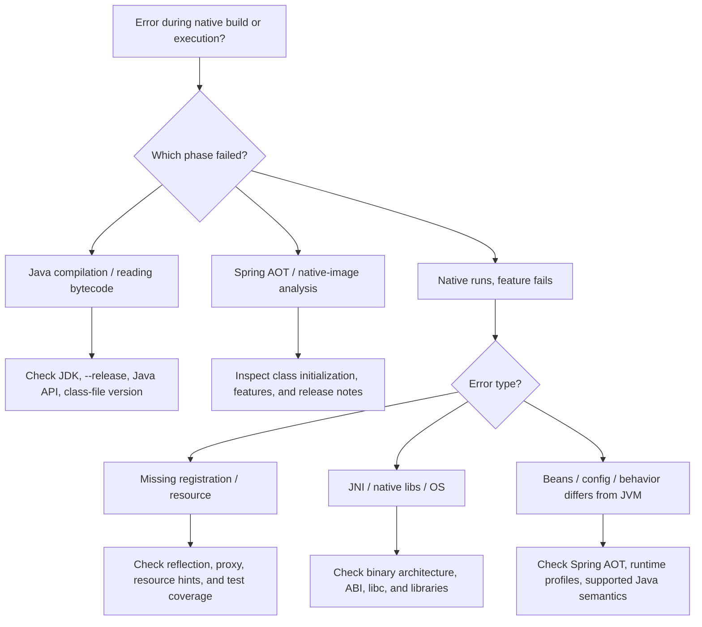

# Java Compatibility Limits to Look Up by GraalVM Version

> **Chapter: Native Image Mechanism.** In the **SPRING_BOOT_NATIVE_IMAGE** module, the goal is to compile a Spring Boot application with **Spring AOT** and **GraalVM Native Image**, verify compatibility, and evaluate startup, memory, container packaging, and operations. This lesson focuses on the fundamental question: **Does a Java feature that works on the JVM necessarily work in the native build of the exact GraalVM version in use?**

## 1. Learning Objectives

After this lesson, you can:

1. Explain why “supports Java 21/25/27” differs from “full Native Image support.”
2. Identify the compatibility layers that must be checked together: Java/JDK, GraalVM, Spring Boot/Spring AOT, Native Build Tools, dependencies, and OS/CPU.
3. Classify limits into **compilation capability**, **missing metadata**, **behavior differing from the JVM**, **unimplemented/unsupported features**, and **runtime platform issues**.
4. Look up **version-specific** documentation and release notes, and spot conditions that change across upgrades.
5. Design a verification experiment before deciding to deploy a Spring Boot Native Image.

## 2. “Java Compatibility” Has Multiple Meanings

A traditional Spring Boot application is compiled to bytecode and executed by the JVM. When creating a Native Image, GraalVM statically analyzes reachable code and compiles what is needed into an executable for a specific platform. The **closed-world** model requires the build to know most of the code needed at runtime ahead of time.

Therefore, five questions must be separated:

| Question | What Is Checked? | Example Error When Misunderstood |
|---|---|---|
| **Java language / class file** | Can the JDK used for the native build read the application's bytecode, syntax, and Java APIs? | `UnsupportedClassVersionError`, `release version ... not supported` errors |
| **GraalVM Native Image** | Does that GraalVM release handle the specific Java feature in native mode? | `invokedynamic` analysis failure, class initialization, or VM-specific feature errors |
| **Spring Boot / Spring AOT** | Does the Spring version support the chosen GraalVM/Native Build Tools, and is the bean model AOT-friendly? | Beans depending on `@Profile` / `@ConditionalOnProperty` missing unexpectedly |
| **Dependencies and metadata** | Do libraries provide appropriate reachability metadata and proxy/resource/reflection hints? | `MissingReflectionRegistrationError`, resources not found in binary |
| **Deployment platform** | Is the binary compatible with the OS, CPU, C/native libraries, image architecture, and operational setup? | `Exec format error`, `UnsatisfiedLinkError`, or missing system libraries |

**A Java program building successfully on the JVM only confirms JVM-level compatibility.** To claim the native build is compatible, it must build cleanly **and** correctly execute all critical functional flows on the target platform.

### Distinguish Four Frequently Confused Versions

- **Java language/JDK:** for instance, source code uses Java 21; you need a JDK that understands the corresponding syntax, APIs, and class-file version.
- **GraalVM:** the distribution and Native Image version, such as a GraalVM build based on JDK 21 or GraalVM 25. Some newer GraalVM release families use distinct numbering; check both **`java -version` and `native-image --version`**.
- **Spring Boot:** the framework release generating bean structures, AOT code, and hints. Spring Boot supporting a Java version on the JVM **does not automatically imply** every Native Image combination is supported.
- **Native Build Tools:** the Maven/Gradle plugin version orchestrating `native-image`. This is a separate component whose version cannot be inferred from the Java version.

In addition, library releases such as Jackson, Hibernate, JDBC drivers, Netty, or third-party SDKs have independent Native Image support lifecycles.

## 3. Version-Anchored Lookup Examples

The table below is a **snapshot from the official System Requirements pages**, captured at the time of writing (**23/11/2026**). It illustrates why you must open documentation matching your project's versions; it is not a matrix guaranteed to hold for every future release.

| Spring Boot Version | Java on JVM per System Requirements | GraalVM Native Image per System Requirements | Listed Native Build Tools |
|---|---|---|---|
| **Spring Boot 3.5.16** | Java 17–25 | GraalVM 22.3 or later | 0.10.6 |
| **Spring Boot 4.2.0** | Java 17–27 | GraalVM 25 or later | 1.1.18 |

Sources: [Spring Boot 3.5 — System Requirements](https://docs.spring.io/spring-boot/3.5/system-requirements.html) and [Spring Boot 4.2 — System Requirements](https://docs.spring.io/spring-boot/4.2/system-requirements.html).

**How to read this properly:** even if Spring Boot 4.2 allows running Java 27 on the JVM, you cannot automatically use a GraalVM Native Image built on **JDK 25** to process class files compiled for **Java 27**. You must choose a native toolchain that understands the code's actual Java level and is supported by the corresponding Spring Boot version, or adjust the target bytecode/API level and re-test. Similarly, a specific Native Build Tools version appearing in the docs table does not mean every other plugin version definitely fails; it serves as a **verified support baseline to cross-check**.

Another example shows that even a **GraalVM patch release** can affect deployment viability: the [GraalVM 25 Release Notes](https://www.graalvm.org/release-notes/JDK_25/) document a change in **macOS x64** support in the 25.0.x line. Checking only “GraalVM 25” is therefore insufficient if the build environment is an Intel macOS machine.

## 4. Java Limits to Check in the Compatibility Guide

These are **risk categories**, not a table claiming every listed feature is forbidden. The same API may require metadata in one release, be experimental in another, or change defaults across releases.

### 4.1. Reflection, Proxies, Serialization, and Resources

On the JVM, a class name, method, or resource can be determined by a string at runtime:

```java
String handlerName = request.getParameter("handler");
Class<?> handlerClass = Class.forName(handlerName);
Object handler = handlerClass.getDeclaredConstructor().newInstance();
```

In Native Image, static analysis cannot predict arbitrary strings received from a request. If the class/method/constructor is not analyzed or registered properly, the operation can fail in native execution. Similar categories include:

- `java.lang.reflect` and `MethodHandles` used with dynamically computed names.
- JDK dynamic proxies with interface sets chosen at runtime.
- Java serialization, Jackson reflection binding, certain DTO patterns, or polymorphic deserialization.
- Classpath file loading, `ResourceBundle` localization bundles, `ServiceLoader`, and custom resources.
- JNI, foreign-function access, and native libraries requiring known symbols/types or dedicated configuration.

**Approach:** verify whether Spring AOT already generated hints, look up version-matched library reachability metadata, or add a `RuntimeHintsRegistrar` or metadata file **following the schema of the GraalVM version in use**. Do not assume adding an older-style `reflect-config.json` fits every release.

Example Spring hint registering a resource and a constructor called via reflection:

```java
package com.example.nativeapp;

import org.springframework.aot.hint.MemberCategory;
import org.springframework.aot.hint.RuntimeHints;
import org.springframework.aot.hint.RuntimeHintsRegistrar;
import org.springframework.context.annotation.Configuration;
import org.springframework.context.annotation.ImportRuntimeHints;

@Configuration
@ImportRuntimeHints(NativeCompatibilityHints.class)
class NativeCompatibilityConfig {
}

class NativeCompatibilityHints implements RuntimeHintsRegistrar {
    @Override
    public void registerHints(RuntimeHints hints, ClassLoader classLoader) {
        hints.resources().registerPattern("catalog/*.json");
        hints.reflection().registerType(
            InvoiceHandler.class, MemberCategory.INVOKE_DECLARED_CONSTRUCTORS
        );
    }
}

class InvoiceHandler {
    InvoiceHandler() { }
}
```

This **illustrates declaring required capabilities**, not a way to automatically make all reflection valid: if the application also invokes methods or accesses fields via reflection, those members must be registered too. Spring can automatically generate many hints for standard controllers and beans. If third-party libraries contain dynamic logic, inspect each case.

### 4.2. Loading Classes or Generating Bytecode at Runtime

Plugin systems may use `ClassLoader.defineClass`, post-startup generated proxies, bytecode weaving, or class instrumentation. By default, those capabilities are not equivalent to the JVM under the closed-world model. Newer GraalVM releases may experiment with certain dynamic class-loading mechanisms, yet **support status, enabling flags, and limitations must be checked against your exact release**; neither conclude “all dynamic class loading is impossible” nor treat experimental features as production-ready.

For `invokedynamic`, also distinguish carefully: forms emitted by the Java compiler for **lambdas** and **string concatenation** are cases GraalVM supports; call sites that mutate arbitrarily at runtime are a different matter. Read the exact *`invokedynamic` and Method Handles* section in the compatibility guide instead of seeing `invokedynamic` bytecode and assuming the whole application is incompatible.

### 4.3. Class Initialization at Build Time vs. Runtime

Native Image can initialize certain classes during the build to speed up startup. If a `static` initializer reads the system clock, secrets, hostname, timezone, config files, or creates objects tied to the build process, those values/objects may be invalid when running in production.

```java
final class EnvironmentSnapshot {
    static final String REGION = System.getenv("APP_REGION");
}
```

If this class is initialized at build time, `REGION` risks holding the **build machine's** value rather than the runtime container's. Across GraalVM versions, initialization ordering and defaults can change. Check your release's **Class Initialization** guide, use `--initialize-at-run-time`, or redesign to read configuration at the right time. Do not blindly pass `--initialize-at-build-time` for an entire package merely to shave startup time.

### 4.4. VM APIs and Behaviors Requiring Individual Verification

| Category | Why Look Up by GraalVM Version? | How to Verify |
|---|---|---|
| JVMTI, `javaagent`, instrumentation, bytecode profilers | Tools may rely on bytecode, JIT, and runtime class redefinition | Read *Debugging and Monitoring* + Native Image release notes; test the specific agent |
| Threading, finalizers, VM management | Some APIs are deprecated or have semantics differing from the JVM | Read the *Compatibility Guide* and run lifecycle/shutdown tests |
| `sun.misc.Unsafe`, memory layout, JNI | Memory/native library access depends on analysis and ABI | Check metadata, native libraries, OS/CPU, and test on the real image |
| FFM API, Vector API, preview/incubator JDK features | Support may be added incrementally for specific platforms/flags | Check release notes for exact JDK/GraalVM and test a minimal build |
| JCA/crypto providers, TLS | Provider registration, resources, and class initialization affect available algorithms | Run real TLS handshakes/algorithms natively and verify providers |
| `Locale`, timezone, charsets, resource bundles | Data/resource packaging may differ; image is built in the build environment | Test required locale/timezone/charset on the target image |

For example: **Java supporting a JEP** in a JDK release does not mean GraalVM Native Image fully supports that JEP on every platform. Especially for preview/incubator features, inspect the JDK feature description, Native Image release notes, and experimental status.

### 4.5. Additional Limits Imposed by Spring AOT

Spring AOT determines many bean structures upfront at build time. Hence, a profile or property that **changes which beans are created** cannot be freely swapped after building native like in a regular JVM app. Clarify:

- Do `@Profile`, `@ConditionalOnProperty`, or auto-configuration conditions alter the **bean set**?
- What is the effect of changing `SPRING_PROFILES_ACTIVE` or a `*.enabled` property at runtime on the native executable?
- Are values such as database URLs, credentials, or ports merely **read at runtime**, or do they influence bean-creation decisions at build time?

Dynamic configuration supplying **bean property values** can still work. Configuration deciding **whether a bean is created at all** must be verified under Spring AOT. Cross-check [Spring Boot — Introducing GraalVM Native Images](https://docs.spring.io/spring-boot/4.2/reference/packaging/native-image/introducing-graalvm-native-images.html) for your project's exact branch.

## 5. A Repeatable Compatibility Lookup Workflow

### Step 1 — Record the Build's “Fingerprint”

Example on Linux/macOS (on Windows, use the matching executables in `bin` and `.cmd` wrapper scripts):

```bash
java -version
javac -version
native-image --version
./mvnw --version
# Or if the project uses Gradle:
./gradlew --version
```

Alongside this, record **`JAVA_HOME`, the `java`/`native-image` paths resolved on `PATH`**, toolchain settings, Spring Boot version, Spring Framework version, GraalVM Native Build Tools plugin version, dependency list, and OS/CPU of both build and runtime environments. If using Buildpacks, also record the **builder image/tag and actual GraalVM/JDK version inside the builder**. Java on your local machine may differ from Java inside the build container.

Template for recording configuration during investigation:

```text
Spring Boot:          4.2.0
Spring Framework:     <resolved-version>
Source / target Java: <project-value>
Build JDK:            <java -version>
Native Image tool:    <native-image --version>
Native Build Tools:   <resolved-plugin-version>
Suspected dependency: <group:artifact:version>
OS/architecture:      <build>  ->  <runtime>
Libc / native libs:   <glibc-or-musl-and-required-libs>
Buildpacks builder:   <tag-and-digest-if-used>
```

The `<...>` placeholders are fields to fill with actual values, not sample measurements.

### Step 2 — Open **Version-Locked** Documentation

In order of usefulness:

1. **Spring Boot System Requirements for the exact branch**: supported Java on JVM, required GraalVM for Native Image, and listed Gradle/Maven and Native Build Tools versions.
2. **GraalVM Native Image Compatibility Guide for the exact release**: enabled/disabled Java features, what needs metadata, and behaviors differing from the JVM.
3. **GraalVM Reachability Metadata and JSON Schema for the exact release**: metadata syntax, reflection, proxy, JNI, and resource support, and errors on missing registration.
4. **GraalVM Release Notes for both major and patch versions**: breaking changes, JDK features, experimental flags, and added/removed architectures.
5. **Spring AOT and library-specific documentation**: hints, bean condition constraints, and known issues; look up library versions in the [GraalVM Reachability Metadata Repository](https://github.com/oracle/graalvm-reachability-metadata).
6. **Supported Platforms and container/buildpack documentation**: build host, image OS/CPU, libc, file paths, and linking/JNI mechanisms.

**Do not look only at `/latest/` pages and extrapolate to a system running an older version.** When documentation and release notes conflict, prioritize information matching the exact release you run and check relevant patch releases.

### Step 3 — Build a Per-Feature Status Table

| Feature Used by Project | On JVM | Native per Checked Release | Action Needed |
|---|---|---|---|
| Standard REST controller, Jackson DTO | Yes | Verify AOT/binding hints | Build/test JSON request-response |
| Handler loaded by class name from DB | Yes | Depends on metadata and class loading | Register reflection; test each handler |
| JSON template from `classpath` | Yes | Depends on resource hints | Register resources and test rare paths |
| JDBC driver using native libraries | Yes | Depends on driver, metadata, JNI, and platform | Test connection inside native container |
| `javaagent` transforming bytecode at runtime | Possible | Must verify JVMTI/instrumentation limits | Check exact release; consider alternative tooling |

Record the **conclusion, verified versions, documentation URLs, proving tests, and decision owner**. If a test has not been run yet, mark **“unverified”**—never mark it “compatible.”

## 6. Diagnosing Native Build or Runtime Failures



| Symptom | Initial Hypothesis | Action |
|---|---|---|
| `UnsupportedClassVersionError`, `invalid target release` | Mismatched JDK or bytecode level | Check `java -version`, `javac -version`, toolchains, and resolved dependencies |
| `UnsupportedFeatureError`, analysis or class initialization error | Native Image/release limitation, or class initialized in the wrong phase | Read stack trace and version-matched compatibility guide; build a minimal reproducer |
| `MissingReflectionRegistrationError`, `MissingResourceRegistrationError` | Missing metadata | Add Spring `RuntimeHints`/schema-compliant metadata; re-run the functional branch |
| `ClassNotFoundException`, `NoSuchMethodException`, missing class/resource | Dynamic class lookup, reflective access, or omitted dependency/resource | Distinguish truly absent from present-but-unregistered; check reachability |
| `UnsatisfiedLinkError` or `Exec format error` | Mismatched JNI, system libraries, or OS/architecture | Check libraries/linking, build target, and container runtime |
| JVM works but native lacks beans when switching profiles | Spring AOT fixed the bean structure at build time | Compare build-time vs. runtime profiles/properties; redesign conditions if needed |

### Collecting Metadata with the Tracing Agent

When you need to uncover hard-to-spot reflection/resources/proxies, GraalVM provides the tracing agent to record dynamic accesses **on the JVM**. Illustrative example for a JAR app and a matching GraalVM JDK with the agent:

```bash
java -agentlib:native-image-agent=config-output-dir=./native-metadata \
     -jar target/app.jar
```

While the app runs, exercise endpoints and scenarios involving resource loading, serialization, and plugins, then stop the app so the agent writes configuration. Some Spring AOT apps may require running the JAR with `-Dspring.aot.enabled=true` after producing the appropriate AOT artifacts; consult the tracing agent guide for **your exact Spring Boot version**.

**Agent limitations:** it only records paths actually executed; it misses rare cases not triggered in tests. Review generated files, avoid overly broad registrations, place metadata where the project/plugin reads it, and **re-run the native executable** to verify. See [GraalVM — Collect Metadata with the Tracing Agent](https://www.graalvm.org/jdk25/reference-manual/native-image/metadata/AutomaticMetadataCollection/) and [Spring Boot — Advanced Native Images Topics](https://docs.spring.io/spring-boot/4.2/reference/packaging/native-image/advanced-topics.html).

## 7. Version-Based Verification Practice

Suppose a team has a Spring Boot app with an `/orders` controller, a JSON dependency, a JDBC driver, and a report reading templates from the `classpath`. Perform the following:

1. **Lock versions** of Spring Boot, Java target, GraalVM, Native Build Tools, dependencies, OS/CPU, and builder image (if containerized).
2. **Run the JVM build** with the same data/config; record API responses, reports, and database connectivity.
3. **Build native** from the exact same code and plugin config, e.g., Maven `./mvnw -Pnative native:compile` or Gradle `./gradlew nativeCompile`. Commands are valid only when the project has compatible GraalVM Native Build Tools configured.
4. **Run the binary** on the matching OS/architecture; verify endpoints, error logs, resources, TLS, and serialization. Do not stop once `/health` returns 200.
5. **Exercise dynamic cases**: nested DTOs, templates unused in smoke tests, data-selected handlers, profiles/runtime properties, exception paths, and database reconnection.
6. **Measure startup and memory** under uniform JVM/native comparison rules; if the build fails, fix it or record it as unsupported before evaluating performance gains.
7. **Upgrade exactly one component**, such as a GraalVM patch or JDBC driver version, and re-run the compatibility suite. If behavior changes, record the release notes and reproduction details.

For reporting, you can use a table like this:

| Test | JVM | Native | Evidence |
|---|---|---|---|
| `GET /orders` + JSON binding | Pass/Fail | Pass/Fail | Responses and logs |
| JDBC connection and query | Pass/Fail | Pass/Fail | Integration test |
| Reading template resource | Pass/Fail | Pass/Fail | Output file/record |
| Reflection-selected handler | Pass/Fail | Pass/Fail | Multi-handler dataset |
| Profile/runtime config | Pass/Fail | Pass/Fail | Explicitly recorded configs |
| Startup + RSS | Measurement | Measurement | Host, resource limits, run count |

**Definition of done:** the native build performs all required behaviors accurately, has no untested business branches tied to metadata, runs on the deployment target, and has objective measurements for startup/memory benefits. When a library is not yet supported, document the exact version combination and decision: update metadata/library, change implementation approach, or stay on JAR/JVM.

## 8. Self-Check Questions

1. Why is “Spring Boot supports Java 27” insufficient to conclude “GraalVM using JDK 25 can build a Native Image from Java 27 bytecode”?
2. What is the difference between `UnsupportedClassVersionError` and `MissingReflectionRegistrationError`?
3. A plugin loads classes from a new `.jar` file after the program starts; which section of the GraalVM documentation should you consult?
4. Why can't the tracing agent guarantee all required metadata was collected even when all current tests pass?
5. Why might a GraalVM patch upgrade require re-testing images built for macOS or Linux?
6. What kind of discrepancy can changing `SPRING_PROFILES_ACTIVE` cause in a Spring AOT application?

## Key Takeaways

**Read the right version, classify the right limit, test the right binary.** When evaluating Native Image for Spring Boot, what matters is not only whether Java compiles: you must align **JDK + GraalVM + Spring Boot/Spring AOT + Native Build Tools + libraries + target platform**. Dynamic feature limits, metadata, class initialization, and JVM tooling support can change per release; support tables only tell you where to start looking. Compatibility conclusions must rest on both version-specific documentation and real application testing.

## Official References

- [Spring Boot 3.5 — System Requirements](https://docs.spring.io/spring-boot/3.5/system-requirements.html): Java, GraalVM, and Native Build Tools baselines for the 3.5 line.
- [Spring Boot 4.2 — System Requirements](https://docs.spring.io/spring-boot/4.2/system-requirements.html): another example of how supported toolchains evolve.
- [Spring Boot — Introducing GraalVM Native Images](https://docs.spring.io/spring-boot/4.2/reference/packaging/native-image/introducing-graalvm-native-images.html): AOT limits, closed-world model, bean conditions.
- [Spring Boot — Advanced Native Images Topics](https://docs.spring.io/spring-boot/4.2/reference/packaging/native-image/advanced-topics.html): custom hints, tracing agent, common issues.
- [GraalVM for JDK 25 — Native Image Compatibility Guide](https://www.graalvm.org/jdk25/reference-manual/native-image/metadata/Compatibility/): metadata, `invokedynamic`, class initialization, and features differing from the JVM.
- [GraalVM for JDK 25 — Reachability Metadata](https://www.graalvm.org/jdk25/reference-manual/native-image/metadata/): per-release metadata, reflection, resources, JNI, proxies.
- [GraalVM — Release Notes](https://www.graalvm.org/release-notes/JDK_25/): feature, platform, and patch-specific changes.
- [GraalVM Reachability Metadata Repository](https://github.com/oracle/graalvm-reachability-metadata): community metadata for Java dependencies; cross-check coordinates and library versions.
