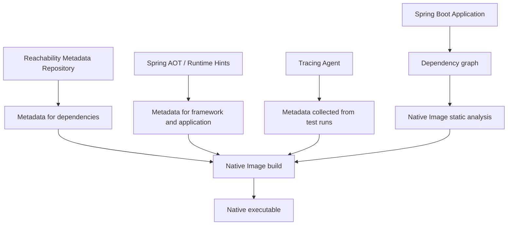

# GraalVM Reachability Metadata Repository and Native Build Tools Integration

> **Chapter: External Libraries.** The **SPRING_BOOT_NATIVE_IMAGE** module compiles Spring Boot applications into GraalVM Native Image using Spring AOT. Spring applications commonly use many third-party libraries; some access reflection, resources, JNI, serialization, or proxies in ways static analysis cannot fully identify. This lesson explains how to use the **GraalVM Reachability Metadata Repository** together with **GraalVM Native Build Tools** to supply the required configuration for dependencies.

## 1. Learning Objectives

After this lesson, you will be able to:

1. Explain what reachability metadata is and why Native Image requires metadata for certain libraries.
2. Distinguish between the metadata repository, metadata collected by the Native Image Tracing Agent, and Spring-supplied Runtime Hints.
3. Describe how Native Build Tools looks up metadata by dependency and version.
4. Configure the repository in Gradle and Maven, including the default repository, local repository, and per-module overrides.
5. Check dependencies missing metadata using built-in tasks/goals.
6. Embed metadata into the JAR when another tool or Buildpack is responsible for creating the Native Image.
7. Handle missing metadata, mismatched metadata versions, and runtime errors after a successful native build.

## 2. Why Do Third-Party Libraries Need Reachability Metadata?

Native Image analyzes code and dependencies during the build to determine which parts of the program can be used. Static analysis cannot always infer accesses decided dynamically, such as:

- Instantiating objects or invoking methods via Java Reflection.
- Reading classpath resources using names assembled at runtime.
- Creating JDK dynamic proxies with dynamically determined interface lists.
- Accessing JNI or native libraries.
- Serializing/deserializing types via reflection.
- Loading classes or resources by names taken from configuration, plugins, or external data.

For example, a JSON library might look up a type's constructor or fields using reflection:

```java
Class<?> type = Class.forName(configuredClassName);
Constructor<?> constructor = type.getDeclaredConstructor();
Object value = constructor.newInstance();
```

On a standard JVM, these elements can be discovered at runtime. With Native Image, if the build does not know in advance which constructors and classes will be accessed, they can be excluded from the executable. When running natively, the application may fail with missing registration errors even though the exact same code runs normally on the JVM.

**Reachability metadata** is configuration that tells Native Image which dynamic elements must be retained or allowed access. Metadata can describe reflection, resources, proxies, JNI, serialization, and other dynamic features.



## 3. What Is the GraalVM Reachability Metadata Repository?

This is a community repository maintained by the GraalVM ecosystem containing contributed and tested metadata for popular JVM libraries and frameworks. Its goal is to help dependencies that use dynamic features work with Native Image without every application having to rewrite the entire configuration from scratch.

Metadata is usually tied to library coordinates and supported versions. Some configurations may only apply to a specific version range or metadata version. Therefore, a library's presence in the repository does not mean every version of that library is supported equally.

### 3.1. What Does the Metadata Repository Provide?

| Metadata type | Purpose |
|---|---|
| Reflection | Declares classes, constructors, methods, and fields requiring dynamic access |
| Resources | Declares classpath resources and resource bundles |
| Dynamic proxy | Declares interfaces used to create proxies |
| JNI | Declares elements accessed through Java Native Interface |
| Serialization | Declares types requiring serialization support under Native Image |
| Other dynamic features | Additional information per the schema and capabilities of the GraalVM release |

Modern metadata can be expressed in a `reachability-metadata.json` file; older projects or dependencies may still use separate configuration files such as `reflect-config.json`, `resource-config.json`, or `proxy-config.json`. Schemas and supported capabilities evolve across Native Image releases. Use metadata published by the repository with a compatible Native Build Tools version, and avoid copying legacy config files without validating the schema.

### 3.2. The Metadata Repository Is Not a Runtime Library

The metadata repository supplies configuration for creating the native executable. It does not:

- Replace the application's actual Java dependencies.
- Add library implementations or fix logic bugs in a library.
- Automatically detect every dynamic code path in the application.
- Guarantee all versions of a dependency are compatible.
- Replace Spring AOT, application Runtime Hints, or Native Image testing.

Native Build Tools downloads and applies metadata during the build. The repository ZIP is not a dependency the application loads onto the runtime classpath.

## 4. How Does Native Build Tools Integrate the Repository?

Native Build Tools provides plugins for Gradle and Maven. When creating a native image, the plugin uses the dependency graph to look up matching metadata in the configured repository, then passes that metadata to the Native Image builder.

General workflow:

1. Gradle/Maven resolves dependencies and actual versions.
2. Native Build Tools looks up metadata by library coordinates.
3. Matching metadata is downloaded from the configured repository or read from a local repository.
4. The plugin passes the metadata to the `native-image` process.
5. Native Image combines the metadata with static analysis to produce the executable.

In current Native Build Tools versions, the metadata repository is enabled by default. Some older versions require enabling it explicitly; therefore, check the documentation for the exact plugin version you are using.

### 4.1. Distinguish Three Types of Versions

There are three distinct versions to track:

| Version | Meaning |
|---|---|
| Native Build Tools plugin version | Version of the Gradle/Maven plugin |
| Metadata repository version | Release version of the metadata collection |
| Library version | Actual dependency version in the application |

The plugin normally selects a default repository version compatible with the plugin release. You can override the repository version when needed. An individual module may also need a different metadata version if the repository lacks a dedicated entry for the exact library version your team uses and your team has verified that the alternate configuration works.

Do not confuse `metadataVersion` with the dependency version. Overriding `metadataVersion` does not upgrade or downgrade the library; it only selects a different metadata set to test compatibility.

## 5. Configuring With Gradle

Add the GraalVM Native Build Tools plugin to `build.gradle`:

```groovy
plugins {
    id "java"
    id "org.graalvm.buildtools.native" version "1.1.19"
}
```

The version in the example is an illustrative version from current Native Build Tools documentation; use a version appropriate for your project's GraalVM JDK and Gradle.

### 5.1. Default Repository

With current plugins, the metadata repository is enabled by default. You can declare it explicitly in `build.gradle` so readers can see which metadata source the native build uses:

```groovy
graalvmNative {
    metadataRepository {
        enabled = true
    }
}
```

Kotlin DSL (`build.gradle.kts`):

```kotlin
graalvmNative {
    metadataRepository {
        enabled.set(true)
    }
}
```

If you need to disable repository lookup to investigate a specific issue:

```groovy
graalvmNative {
    metadataRepository {
        enabled = false
    }
}
```

Only disable it during an intentional diagnostic run. If a dependency needs metadata while the repository is disabled, the native build or runtime may fail with registration errors.

### 5.2. Selecting a Repository Version

You can override the metadata repository version:

```groovy
graalvmNative {
    metadataRepository {
        version = "1.0.23"
    }
}
```

The value above is only an example. Choose a published repository release compatible with the Native Image/GraalVM in use. When pinning a version, document the reason for the change and re-run native tests.

### 5.3. Using a Local Repository

In CI environments without Internet access, or when reproducible builds require a controlled metadata snapshot, you can use a local repository:

```groovy
graalvmNative {
    metadataRepository {
        uri(file("metadata-repository"))
    }
}
```

The `metadata-repository` directory must follow the repository layout expected by Native Build Tools. You can obtain the corresponding repository release from the ZIP artifact on Maven Central and extract it into this folder. Do not point `uri` to a directory containing loose metadata files that do not follow the repository structure.

### 5.4. Excluding a Module or Overriding Its Metadata Version

If a module's metadata does not suit the version in use, you can exclude the module from lookup:

```groovy
graalvmNative {
    metadataRepository {
        excludes.add("com.example:legacy-client")
    }
}
```

Or force the plugin to use a specific metadata version for a module:

```groovy
graalvmNative {
    metadataRepository {
        moduleToConfigVersion.put("com.example:legacy-client", "3")
    }
}
```

Only override after verifying that the metadata matches the actual library version. If the metadata version is incompatible, Native Image may still build, yet the application will fail upon hitting the dynamic code path.

### 5.5. Task to Check Dependencies Missing Metadata

Native Build Tools provides the task:

```bash
./gradlew listLibrariesMissingMetadata
```

This task inspects direct external runtime dependencies on the main runtime classpath, checks them against the configured metadata repository, and generates a report:

```text
build/reports/native/list-libraries-missing-metadata.json
```

The report can show dependencies without metadata and provide pre-filled issue links for the team to review. The task's scope is direct dependencies; it does not replace checking transitive dependencies or the application's dynamic code paths.

Automatic issue creation options must be enabled intentionally. For example, `-PcreateIssues=true` can create issues on the public repository and requires an appropriate token; do not enable this option in normal builds.

## 6. Configuring With Maven

Add `native-maven-plugin` to `pom.xml`:

```xml
<plugin>
    <groupId>org.graalvm.buildtools</groupId>
    <artifactId>native-maven-plugin</artifactId>
    <version>1.1.19</version>
    <extensions>true</extensions>
    <configuration>
        <metadataRepository>
            <enabled>true</enabled>
        </metadataRepository>
    </configuration>
</plugin>
```

Current Native Build Tools versions enable the metadata repository by default. Explicit `enabled` is helpful to make the configuration clear; for older plugins, check whether that version requires enabling it manually.

### 6.1. Selecting a Repository Version

You can specify a repository version:

```xml
<metadataRepository>
    <enabled>true</enabled>
    <version>1.0.23</version>
</metadataRepository>
```

The version is only an example. When overriding, verify the metadata contains configurations for your application's dependency coordinates and versions.

### 6.2. Using a Repository ZIP From a URL or Local Path

If you need to use a repository ZIP from a URL:

```xml
<metadataRepository>
    <enabled>true</enabled>
    <url>https://example.org/native/metadata-repository.zip</url>
</metadataRepository>
```

Replace the example URL with the actual ZIP address managed by your organization.

To debug or use a locally downloaded repository:

```xml
<metadataRepository>
    <enabled>true</enabled>
    <localPath>metadata-repository</localPath>
</metadataRepository>
```

`localPath` can point to an extracted directory or a repository ZIP file. The path must exist and have a valid structure.

### 6.3. Excluding a Module or Selecting a Custom Metadata Version

Exclude a module from lookup:

```xml
<metadataRepository>
    <enabled>true</enabled>
    <dependencies>
        <dependency>
            <groupId>com.example</groupId>
            <artifactId>legacy-client</artifactId>
            <excluded>true</excluded>
        </dependency>
    </dependencies>
</metadataRepository>
```

Select a custom metadata version for a module:

```xml
<metadataRepository>
    <enabled>true</enabled>
    <dependencies>
        <dependency>
            <groupId>com.example</groupId>
            <artifactId>legacy-client</artifactId>
            <metadataVersion>3</metadataVersion>
        </dependency>
    </dependencies>
</metadataRepository>
```

`groupId`, `artifactId`, and `metadataVersion` must be replaced with your project's actual dependency. Excluding a module only stops using repository metadata for that module; it does not create replacement metadata. If the code path needs reflection/resources, the team must provide alternative metadata or verify the library needs no extra configuration.

### 6.4. Checking Dependencies Missing Metadata

Run the Maven goal:

```bash
./mvnw native:list-libraries-missing-metadata
```

This goal checks direct external runtime dependencies and writes a report:

```text
target/native/list-libraries-missing-metadata.json
```

Read the report alongside the dependency tree and native test results. A dependency absent from the repository does not automatically prove incompatibility; the library may not use dynamic features requiring metadata, or metadata may be supplied another way.

## 7. ZIP Artifact and Embedding Metadata Into a JAR

The repository is also published as a ZIP on Maven Central. Its artifact coordinates look like:

```xml
<dependency>
    <groupId>org.graalvm.buildtools</groupId>
    <artifactId>graalvm-reachability-metadata</artifactId>
    <version>1.1.19</version>
    <classifier>repository</classifier>
    <type>zip</type>
</dependency>
```

These are the coordinates of the repository distribution artifact, not a runtime dependency to add to a Spring Boot application. Native Build Tools can automatically download and use the repository when it builds the native image directly.

### 7.1. When Must Metadata Be Packaged in the JAR?

In some pipelines, Maven/Gradle only builds the JAR; another tool later converts that JAR into a Native Image. For example:

- The artifact is built in one pipeline, while the native image is created in a separate deployment pipeline.
- The JAR is fed into a container build using Cloud Native Buildpacks/Paketo.
- An image build platform only accepts a JAR and lacks the original project's Native Build Tools configuration.

In those cases, metadata downloaded from the repository needs to be placed into the JAR under `META-INF/native-image/...` so downstream tools can read it. If Native Build Tools builds the executable directly, this extra copy step is usually unnecessary.

### 7.2. Gradle: collectReachabilityMetadata

Native Build Tools provides the `collectReachabilityMetadata` task to download repository metadata into the build directory:

```groovy
tasks.named("jar") {
    from collectReachabilityMetadata
}
```

When packaging the JAR, the task includes the metadata files in the artifact. By default, the metadata repository is used directly during native image generation; `collectReachabilityMetadata` is for carrying metadata along inside the JAR for another tool to process.

You can inspect the JAR after building:

```bash
jar tf build/libs/orders-service.jar
```

Look for files under `META-INF/native-image/` and verify that metadata for the required dependencies was packaged.

### 7.3. Maven: add-reachability-metadata

With Maven, use the `add-reachability-metadata` goal:

```xml
<plugin>
    <groupId>org.graalvm.buildtools</groupId>
    <artifactId>native-maven-plugin</artifactId>
    <executions>
        <execution>
            <id>add-reachability-metadata</id>
            <goals>
                <goal>add-reachability-metadata</goal>
            </goals>
        </execution>
    </executions>
</plugin>
```

This goal adds repository metadata to the JAR so another tool can read it when building the Native Image. Verify your project's execution configuration and Maven lifecycle order so the goal runs before the JAR packaging step.

## 8. Combining the Metadata Repository With Spring AOT and Tracing Agent

In a Spring Boot application, three metadata sources can supplement static analysis:

| Source | Primary scope | When to use |
|---|---|---|
| Spring AOT and Runtime Hints | Spring beans, proxies, reflection/resources declared by the framework or application | Context structure and features managed by Spring |
| Reachability Metadata Repository | Third-party libraries with contributed and tested metadata | Common dependencies in the Java ecosystem |
| Native Image Tracing Agent | Actual dynamic accesses observed while running the app/tests | Dependencies without metadata or application-specific code paths |

These three sources complement each other. The metadata repository does not replace Spring AOT; nor can Spring AOT infer every internal reflection behavior of every dependency.

### 8.1. Workflow When a Dependency Lacks Metadata

1. Run the `listLibrariesMissingMetadata` task/goal to find dependencies not yet supported by the repository.
2. Check the library version, related issues, and the vendor's Native Image guide.
3. Run tests/integration scenarios exercising the dependency with the Native Image Tracing Agent.
4. Review the agent-generated metadata, strip extraneous entries, and place required metadata in `src/main/resources/META-INF/native-image/`.
5. Rebuild the native executable and run native tests covering actual business flows.
6. If the metadata applies broadly across applications, consider contributing it upstream to the Reachability Metadata Repository per the project's guidelines.

The agent only records code paths that actually execute. If tests skip a particular plugin, locale, serialization, or reflection branch, generated metadata may be incomplete. Therefore, run tests with solid business coverage and review generated files before committing.

### 8.2. Application-Managed Metadata

Custom application metadata can be placed under:

```text
src/main/resources/
  META-INF/
    native-image/
      com.example/
        orders-service/
          reachability-metadata.json
```

Illustrative example of a unified metadata structure:

```json
{
  "reflection": [
    {
      "type": "com.example.orders.LegacyPayload",
      "allDeclaredConstructors": true
    }
  ],
  "resources": [
    {
      "glob": "schemas/order-*.json"
    }
  ]
}
```

This is only a structural example; validate contents against the schema of the GraalVM Native Image version in use. In Spring applications, if something can be expressed via Spring's `RuntimeHintsRegistrar`, prefer that API so Spring AOT manages and translates the hints. Use JSON metadata when sharing configuration directly with Native Image or libraries without Spring integration.

## 9. Testing Metadata in a Native Build

Having metadata in the repository is not enough to conclude the application is compatible. Test at least three layers:

1. **Build-time:** the plugin downloads the repository, recognizes dependencies, and Native Image completes analysis.
2. **Native test:** flows involving reflection, resources, proxies, or serialization execute cleanly in the test executable.
3. **Runtime/container:** the application starts and executes business operations using the dependency in a production-like environment.

General Gradle commands:

```bash
./gradlew listLibrariesMissingMetadata
./gradlew nativeCompile
./gradlew nativeTest
```

Metadata check and native test commands with Maven:

```bash
./mvnw native:list-libraries-missing-metadata
./mvnw -Pnative test
```

The `native` profile and lifecycle goal bindings must be configured for your project. The Native Build Tools Maven plugin supports running JUnit Platform tests in a native executable; ensure Maven Surefire and JUnit Platform versions are compatible.

### 9.1. Scenarios to Verify

- Reflection-based dependencies can instantiate objects and invoke methods per configuration.
- Dynamic resources are read properly when running the binary.
- Required JDK proxies or CGLIB proxies are created successfully.
- Serialization/deserialization works with real data types.
- JNI/native libraries load properly on the deployment OS and architecture.
- Code branches not exercised in basic tests still have required metadata.
- The application runs with varying runtime configurations without relying on build-time values.

When a native build succeeds but runtime reports missing registration, enable the registration reporting mode appropriate for your GraalVM release to capture a stack trace, locate the code path, and add narrow metadata. Do not open up package-wide metadata upon hitting the first error.

## 10. Common Issues and How to Handle Them

| Symptom | Possible cause | How to handle |
|---|---|---|
| Dependency has no metadata in the report | Library version not yet supported by repository or no contribution exists | Check version, issues, and the library's Native Image guide |
| Plugin fails to download metadata repository | Network, proxy, repository URL, or ZIP artifact unreachable | Check Maven Central/URL access and try a local repository |
| Metadata found but native runtime still fails | Metadata does not cover actual code path or wrong metadata version | Run Tracing Agent, check versions, and test the failing flow |
| Forcing a metadata version passes build but fails at runtime | Metadata from another version is incompatible with the current library version | Remove override or test thoroughly before pinning |
| Direct Gradle/Maven build works but Buildpack lacks metadata | Metadata is only used by the plugin's native build, not inside the JAR | Use `collectReachabilityMetadata` or `add-reachability-metadata` |
| JAR lacks `META-INF/native-image` directory | Metadata copy goal/task did not run or JAR was packaged before copy | Check lifecycle and JAR contents |
| Transitive dependency not reported | Missing-metadata task mainly scans direct runtime dependencies | Inspect dependency graph and native build logs; do not rely solely on the report |
| Duplicate or conflicting metadata | Configuration declared simultaneously by repository, dependency, and app | Identify sources, narrow down, or exclude redundant configs |
| Native image grows noticeably larger | Overly broad metadata registration or unnecessary dynamic features | Audit entries, use conditional metadata, and check reachability |

## 11. Recommended CI/CD Workflow

To keep build results reproducible and easy to investigate:

1. Pin verified versions of Native Build Tools, GraalVM JDK, and the metadata repository.
2. Keep dependency locks/version management stable so metadata is resolved against consistent coordinates.
3. Run `listLibrariesMissingMetadata` periodically and archive the report as a build artifact.
4. When dependency versions change, re-verify metadata mappings and run native tests.
5. Do not override metadata versions without compatibility evidence.
6. If building in an air-gapped environment without Internet access, cache the repository ZIP or provide a controlled local repository.
7. If another pipeline builds the native image from the JAR, embed metadata into the JAR and verify artifact contents.
8. Run smoke/integration tests on the final native executable or container before release.

The metadata repository is part of the build inputs, so log the repository version alongside dependency versions in build logs or manifests. When native outcomes differ between two pipelines, this information helps determine whether the cause lies in code, dependencies, GraalVM, or metadata.

## 12. Hands-On Exercise

Suppose a Spring Boot service uses three dependencies:

| Dependency | Role | Scenario to verify |
|---|---|---|
| `com.h2database:h2` | Database in integration tests | Driver and database configuration during native tests |
| `com.fasterxml.jackson.core:jackson-databind` | JSON binding | Deserializing a type determined from configuration |
| `com.example:legacy-client` | Internal HTTP client | Reflection and resources loaded by name |

Steps:

1. Enable GraalVM Native Build Tools and check the metadata repository.
2. Run `listLibrariesMissingMetadata` or `native:list-libraries-missing-metadata`.
3. Read the report and identify which dependencies have metadata and which are missing it.
4. Build native and run tests exercising all three dependencies.
5. For `legacy-client`, run the Tracing Agent on real flows to collect metadata if absent from the repository.
6. Review generated metadata and move needed configuration into `META-INF/native-image` or Spring Runtime Hints.
7. If the pipeline uses a Buildpack accepting a JAR, configure the step to copy metadata into the JAR.
8. Build a native container and run smoke tests against the database, endpoints, and runtime configuration.

Report template:

| Item | Result |
|---|---|
| Native Build Tools version | … |
| GraalVM JDK version | … |
| Metadata repository version | … |
| Dependencies with metadata | … |
| Dependencies missing metadata | … |
| Native build | Pass/Fail |
| Native test | Pass/Fail |
| Agent-collected metadata | … |
| Metadata in JAR (if required) | Pass/Fail |
| Container smoke test | Pass/Fail |

## 13. Self-Check Questions

1. Why does Native Image require reachability metadata for certain dependencies?
2. How does the GraalVM Reachability Metadata Repository differ from runtime dependencies?
3. What are the three types of versions to distinguish when configuring the metadata repository?
4. Why might metadata exist for one library version without guaranteeing another version works?
5. Which tasks/goals do Native Build Tools Gradle and Maven use to check for dependencies missing metadata?
6. Why does the missing-metadata report not prove every transitive dependency has been checked?
7. When do you need `collectReachabilityMetadata` or `add-reachability-metadata`?
8. What information does the Tracing Agent provide when the repository lacks metadata?
9. Why must agent-generated metadata be reviewed before committing?
10. How do Spring AOT/Runtime Hints, the metadata repository, and application-authored metadata complement one another?

## Remember

**The GraalVM Reachability Metadata Repository provides community-tested configuration for many JVM libraries; Native Build Tools integrates this repository into the Native Image creation process.** Check dependencies and versions, use the default repository or configure local/overrides with clear justification, run native tests, supply custom metadata when missing, and embed metadata into the JAR if another tool builds the native image. The repository reduces configuration effort, but does not replace Spring AOT, the Tracing Agent, or testing on the actual native executable.

## Official References

- [GraalVM Reachability Metadata Repository](https://github.com/oracle/graalvm-reachability-metadata): community metadata for JVM libraries and frameworks.
- [Native Build Tools — Gradle Plugin](https://graalvm.github.io/native-build-tools/latest/gradle-plugin): metadata repository configuration, `listLibrariesMissingMetadata`, and `collectReachabilityMetadata`.
- [Native Build Tools — Maven Plugin](https://graalvm.github.io/native-build-tools/latest/maven-plugin.html): `metadataRepository`, `native:list-libraries-missing-metadata`, and `add-reachability-metadata`.
- [GraalVM — Reachability Metadata](https://www.graalvm.org/latest/reference-manual/native-image/metadata/): metadata format, schemas, and registration types.
- [GraalVM — Collecting Metadata Automatically](https://www.graalvm.org/latest/reference-manual/native-image/metadata/AutomaticMetadataCollection/): using the Tracing Agent to collect metadata.
- [Spring Boot — GraalVM Native Images](https://docs.spring.io/spring-boot/reference/packaging/native-image/introducing-graalvm-native-images.html): Spring AOT and Native Image in Spring Boot.
