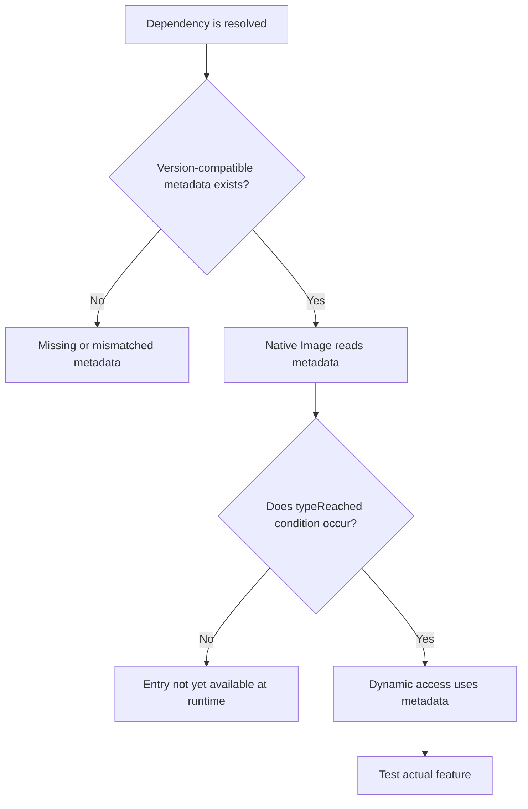

# Conditional Metadata and Compatibility With Dependency Versions

> **Chapter:** External Libraries  
> **Module:** `SPRING_BOOT_NATIVE_IMAGE`  
> **Goal:** Understand reachability metadata supplied by libraries or supplemented by the GraalVM Repository; read `typeReached` conditions and distinguish them from dependency version conditions; verify whether metadata applies to the actual resolved version; configure Maven/Gradle and test dependency changes in Spring Boot Native Image.

## 1. Why Do External Libraries Need Reachability Metadata?

GraalVM Native Image analyzes the program at build time under a closed-world assumption. The compiler can trace static calls, but it cannot always predict classes, methods, fields, proxies, or resources accessed by names coming from configuration, reflection, JNI, or a library's dynamic mechanisms.

For example, a codec library might read a class name from an annotation and instantiate an object via reflection. On a standard JVM, the classloader can look up the class on the runtime classpath. Native Image only retains elements that static analysis or metadata indicates are needed. If metadata is missing, the native executable may build successfully yet fail when the codec feature is invoked.

**Reachability metadata** describes the dynamic elements that must be retained in the native image. Metadata can come from three places:

1. **Library-bundled metadata:** authors place configuration under `META-INF/native-image/` inside the library's JAR.
2. **GraalVM Reachability Metadata Repository:** a collection of metadata maintained by the community and teams for popular libraries that do not yet bundle complete configuration themselves.
3. **Application-supplied metadata:** the application declares RuntimeHints or JSON metadata for custom access paths not described by the framework or library.

Spring Boot provides Spring AOT to analyze the application context and generate hints for Spring and application parts recognized by the framework. Spring cannot automatically know every internal dynamic behavior of every third-party dependency; that requires metadata from the library, repository, or application. [Spring Boot — Advanced Native Images Topics](https://docs.spring.io/spring-boot/reference/packaging/native-image/advanced-topics.html)

## 2. What Does Metadata Describe?

Reachability metadata can declare multiple types of dynamic access:

| Metadata type | Example scenario | Missing metadata may cause |
|---|---|---|
| Reflection | Look up class, constructor, method, or field by name | Member not found or missing registration error |
| Resource | Read templates, schemas, or properties files by path | Resource missing from executable |
| Resource bundle | Load message bundles by locale | Missing translations when running natively |
| JDK proxy | Create proxies for a dynamically determined set of interfaces | Unable to create proxy class |
| Serialization | Read/write Java object streams | Serialization runtime lacks type metadata |
| JNI | Native code looks up Java classes, methods, or fields | JNI lookup/access failure |
| Foreign Function and Memory API | Access native elements via the FFM mechanism | Missing metadata or required access information |

Metadata does not replace the dependency's code, nor does it make an arbitrary JVM library automatically compatible with Native Image. It only declares required dynamic elements that the compiler cannot fully infer.

## 3. Two Different Meanings of "Conditional"

When talking about conditional metadata, distinguish two separate questions:

- **Is metadata applied when a specific feature is used?** This is a reachability condition inside the metadata file, such as `condition.typeReached`.
- **Does the metadata match the dependency version in use?** This is version coverage managed by the library, metadata repository, and build tool.

These two conditions are independent. An entry with a valid `typeReached` can still be unsuitable if the dependency changed its class structure in a newer version. Conversely, metadata tested against the exact dependency version can still fail at runtime if its runtime condition is never triggered.



Therefore, when investigating failures, verify both the **actual library version** and the **metadata activation condition**.

## 4. Conditional Metadata With `typeReached`

In the current reachability metadata schema, an entry can contain a `condition` field with `typeReached`:

```json
{
  "reflection": [
    {
      "condition": {
        "typeReached": "com.vendor.codec.JsonCodec"
      },
      "type": "com.vendor.model.Payload",
      "allDeclaredConstructors": true,
      "allDeclaredMethods": true
    }
  ],
  "resources": [
    {
      "condition": {
        "typeReached": "com.vendor.codec.JsonCodec"
      },
      "glob": "META-INF/vendor-codec/**"
    }
  ]
}
```

In this example:

- Reflection metadata for `Payload` is tied to the execution path of `JsonCodec`.
- Codec resources only need to be available when the condition type is reached.
- If the codec feature is unused, the conditional metadata does not need to become active in that runtime.
- Once the feature is used and `JsonCodec` is reached, the corresponding entries take effect.

According to GraalVM documentation, an entry with `typeReached` is included in the image when the condition type is reachable at build time, but only becomes available at runtime when that type is actually reached. A type is considered reached right before class/interface initialization begins, or when one of its subtypes is reached. [GraalVM — Conditional Metadata Entries](https://www.graalvm.org/latest/reference-manual/native-image/metadata/)

### 4.1. `ClassName.class` Does Not Necessarily Trigger the Condition

This is an easy detail to get wrong. Obtaining a class literal:

```java
Class<?> codecType = JsonCodec.class;
```

does not initialize the class by itself. Therefore, merely referencing a class literal does not guarantee the `typeReached` condition has occurred. The condition is typically triggered when class initialization begins or when a subtype is reached per Native Image rules.

When choosing a condition type, pick a type that genuinely represents the feature and is initialized on the execution path needing the metadata. Do not pick a marker class that appears in declarations but is never initialized.

### 4.2. The Condition Is Not a Version Filter

`typeReached` does not mean "applies only to version 2.x of the library." Nor does it mean "applies only when the Spring profile is production."

It controls when metadata becomes active based on type reachability. Whether the metadata is compatible with the 2.x or 3.x JAR must be determined separately through version coverage and testing.

### 4.3. Distinguish Legacy and Current Schemas

Previous GraalVM generations used the `typeReachable` condition field. The current schema uses `typeReached`, with runtime semantics tied to the type being reached/initialized as described above.

Do not simply rename fields in legacy metadata files assuming identical semantics. Check the schema and documentation of the GraalVM/Native Image version in use; the metadata repository may also contain files matching schemas for the target toolchain. [GraalVM — JSON Schema Reference](https://www.graalvm.org/latest/reference-manual/native-image/metadata/)

## 5. Library Metadata and the GraalVM Reachability Metadata Repository

A library can bundle metadata inside its JAR, typically under a path like:

```text
META-INF/
└── native-image/
    └── com.vendor/
        └── vendor-codec/
            └── reachability-metadata.json
```

Native Image reads `reachability-metadata.json` files on the classpath following the `META-INF/native-image/<groupId>/<artifactId>/` convention. A dependency can carry its own metadata; this metadata travels with the dependency when included in a native build. [GraalVM — Specifying Metadata with JSON](https://www.graalvm.org/latest/reference-manual/native-image/metadata/)

If a library does not yet provide metadata, the GraalVM Reachability Metadata Repository maintains shared configurations for Maven library coordinates. Native Build Tools can download the metadata repository and pass matching metadata into the native image build. Because the repository is community-maintained, verify the exact supported library version instead of assuming every release has compatible metadata.

Spring Boot also relies on this repository for third-party dependencies that do not provide their own hints. [GraalVM Reachability Metadata Repository](https://github.com/oracle/graalvm-reachability-metadata)

## 6. Metadata Version and Dependency Version Are Two Different Numbers

The GraalVM Reachability Metadata Repository organizes metadata by Maven library coordinates (`groupId:artifactId`). Each artifact has an `index.json` describing metadata releases and the upstream versions tested against each release.

Abbreviated illustrative example:

```json
[
  {
    "metadata-version": "1.4.0",
    "tested-versions": ["2.8.1", "2.8.2", "2.9.0"],
    "latest": true
  },
  {
    "metadata-version": "1.2.0",
    "tested-versions": ["2.7.0", "2.7.1"]
  }
]
```

Meaning:

- `metadata-version` identifies the metadata bundle in the repository.
- `tested-versions` lists dependency versions tested with that metadata bundle.
- `latest` marks the latest default metadata bundle for the artifact in the repository.
- One metadata bundle can apply to multiple library versions if those versions have been tested.

The values above only illustrate structure and do not represent any specific library.

Do not confuse `metadata-version` with the dependency version. For example, metadata version `1.4.0` does not mean it only works with dependency version `1.4.0`. Conversely, a newer dependency version does not prove old metadata still fits. Check `tested-versions` for the exact resolved coordinates and version. [GraalVM Reachability Metadata Repository — README](https://github.com/oracle/graalvm-reachability-metadata)

### 6.1. Version Coverage Is Not a Guarantee for Future Versions

If the repository tested dependency `2.9.0`, do not infer that `2.9.1`, `2.10.0`, or `3.0.0` are automatically supported. A new release can:

- Rename or repackage internal classes.
- Change constructors/methods referenced by metadata.
- Switch from reflection to method handles or another mechanism.
- Change resource paths or resource bundle names.
- Add new proxy interfaces or subtypes.
- Alter class initialization or feature activation conditions.

An old metadata entry can become redundant, incomplete, or incorrect. Metadata is not a stable API contract of the dependency.

### 6.2. The Metadata Repository Does Not Manage Dependency Versions for the Application

The repository only provides reachability configuration. It does not upgrade JARs, select dependency versions on behalf of Maven/Gradle, or resolve dependency conflicts.

The application must still manage versions using Spring Boot dependency management/BOM, version catalogs, dependency constraints, or lockfiles. Once the dependency resolver selects the final version, check metadata coverage for that **resolved version**.

## 7. Integrating the Metadata Repository With Maven

When using `spring-boot-starter-parent` and the GraalVM Native Build Tools Maven plugin, Spring Boot provides a `native` profile wiring together the steps needed for native builds. This profile can run Spring AOT processing and configure Native Build Tools to download third-party reachability metadata.

Example plugin configuration:

```xml
<build>
    <plugins>
        <plugin>
            <groupId>org.graalvm.buildtools</groupId>
            <artifactId>native-maven-plugin</artifactId>
        </plugin>
        <plugin>
            <groupId>org.springframework.boot</groupId>
            <artifactId>spring-boot-maven-plugin</artifactId>
        </plugin>
    </plugins>
</build>
```

Build native using the profile:

```bash
./mvnw -Pnative native:compile
```

Or build a container image using Buildpacks:

```bash
./mvnw -Pnative spring-boot:build-image
```

The Spring Boot starter parent's `native` profile configures AOT processing and the goal that adds reachability metadata. Without this parent, configure the appropriate executions yourself, including Spring Boot's `process-aot` and Native Build Tools' `add-reachability-metadata`. [Spring Boot Maven Plugin — Ahead-of-Time Processing](https://docs.spring.io/spring-boot/maven-plugin/aot.html)

Native Build Tools has its own metadata repository configuration. You can declare it explicitly in the plugin configuration:

```xml
<plugin>
    <groupId>org.graalvm.buildtools</groupId>
    <artifactId>native-maven-plugin</artifactId>
    <configuration>
        <metadataRepository>
            <enabled>true</enabled>
        </metadataRepository>
    </configuration>
</plugin>
```

Current Native Build Tools documentation enables the metadata repository by default, though explicit declaration makes it clear that the build depends on this metadata source. If the build disables the repository or uses an older plugin/toolchain, do not assume community metadata was downloaded. [GraalVM Native Build Tools — Maven Plugin](https://graalvm.github.io/native-build-tools/latest/maven-plugin.html)

## 8. Integrating the Metadata Repository With Gradle

When using the Spring Boot Gradle plugin, apply the GraalVM Native Image plugin to create the corresponding AOT/native tasks:

```kotlin
plugins {
    id("org.springframework.boot")
    id("io.spring.dependency-management")
    id("org.graalvm.buildtools.native")
}
```

You can configure the metadata repository:

```kotlin
graalvmNative {
    metadataRepository {
        enabled.set(true)
    }
}
```

With proper plugin configuration, `nativeCompile` and `bootBuildImage` can consume AOT output alongside the metadata repository:

```bash
./gradlew nativeCompile
./gradlew bootBuildImage
```

Native Build Tools documentation states the metadata repository is supported and enabled by default; it can be disabled via `enabled = false`/`enabled.set(false)` depending on DSL/version. If the build needs metadata from the repository, do not disable this feature without a verified alternative source. [GraalVM Native Build Tools — Gradle Plugin](https://graalvm.github.io/native-build-tools/latest/gradle-plugin)

### 8.1. When a JAR Is Converted to a Native Image in Another Pipeline

In some pipelines, the AOT JAR is built in one job and passed to another job where Buildpacks or another tool builds the native image. In that case, verify whether repository metadata is carried over to the downstream pipeline.

Native Build Tools provides the `collectReachabilityMetadata` task to download metadata into the build directory and can configure packaging those files into the JAR. When using this mechanism, verify that the final JAR contains metadata where the native builder reads it. Do not assume metadata downloaded in an earlier Maven/Gradle job automatically appears in every repackaged artifact.

## 9. Identifying the Actual Dependency Version in Use

Metadata must match the dependency selected by the resolver, not just a version written in a configuration file.

### 9.1. Maven: Inspect the Dependency Tree

Example filtering for a specific library:

```bash
./mvnw dependency:tree -Dincludes=com.vendor:vendor-codec
```

If the application uses a BOM or multiple dependencies pull in the same artifact, the dependency tree shows the final selected version and the dependency paths leading to it. Check both dependency mediation and exclusions if the version differs from expectations.

### 9.2. Gradle: Inspect Dependency Insight

```bash
./gradlew dependencyInsight \
  --dependency vendor-codec \
  --configuration runtimeClasspath
```

The output reveals the selected version, why it was selected, and which dependencies requested it. Metadata coverage must be checked against the version on `runtimeClasspath` used by the native build.

### 9.3. Check Coordinates in the Repository

To look up a library, all three parts are needed:

```text
groupId:artifactId:resolved-version
```

Illustrative example:

```text
com.vendor:vendor-codec:2.9.0
```

Locate the exact artifact in the GraalVM Reachability Metadata Repository, open `index.json`, and check whether the version appears in the corresponding `tested-versions`. If there is no entry or the version is absent from the tested set, treat coverage as unconfirmed and run native tests in your project.

## 10. What Must Be Re-Checked When Upgrading a Dependency Version?

Upgrading a dependency can change bytecode, bundled metadata, and dynamic execution paths. Do not just run JVM unit tests and conclude the native build remains compatible.

A controlled upgrade workflow:

1. Record the current resolved coordinates and version.
2. Upgrade one dependency or a small related group, avoiding changing too many variables at once.
3. Re-inspect `dependency:tree`/`dependencyInsight` to confirm the final version.
4. Check library-supplied metadata and the metadata repository for the new version.
5. Run JVM unit/integration tests covering features using that library.
6. Run Spring AOT and native compilation with the pinned toolchain.
7. Run the native executable across code paths using the library, including reflection/resources/proxies/serialization if applicable.
8. Compare logs, metadata output, and behavior against the previous version.
9. Record versions, toolchain, metadata sources, and test results in the build report.

### 10.1. Version Compatibility Matrix

| Dependency version | Metadata source | JVM tests | Native build | Native runtime | Conclusion |
|---|---|---|---|---|---|
| Current released version | Library/repository | PASS | PASS | PASS | Verified baseline |
| New version listed in `tested-versions` | Updated repository or JAR metadata | PASS | PASS | PASS | Compatibility evidence for tested combination |
| New version without coverage | Old metadata or custom additions | PASS | PASS/FAIL | PASS/FAIL | Cannot conclude from build alone |
| New major version | Metadata and APIs may change | PASS/FAIL | PASS/FAIL | PASS/FAIL | Separate evaluation needed; new metadata may be required |

Do not mark as compatible merely because native compilation succeeds. Metadata might allow the compiler to produce an executable while an unexercised reflection or resource branch still fails in production.

## 11. When a Dependency Lacks Metadata or Metadata No Longer Fits

First, determine which dependency and dynamic operation caused the failure. Stack traces usually show class/library names and the relevant API, such as reflection, resource lookup, proxy, or serialization.

| Symptom | Likely areas to investigate |
|---|---|
| Missing reflection registration | Missing class/member or metadata not included in build |
| Resource not found in native mode | Missing resource pattern/path or metadata not activated |
| Proxy creation failure | Missing JDK proxy metadata or changed interface set |
| Serialization error | Missing serialization metadata or dependency changed classes |
| Fails only on one dependency version | Metadata untested or internal API changed |
| Build loads metadata but still fails | Entry misses feature, condition not triggered, or path missing from tests |

### 11.1. Use the Native Image Tracing Agent to Find Missing Access Paths

Spring Boot documents running the JVM application with Spring AOT and the Native Image tracing agent:

```bash
java -Dspring.aot.enabled=true \
  -agentlib:native-image-agent=config-output-dir=target/native-agent/ \
  -jar target/application.jar
```

After the application starts, exercise the use cases involving the dependency: parse payloads, load resources, create proxies, read/write data, or invoke plugins. When the JVM stops, the agent writes metadata into the output directory.

The agent only records code paths actually executed during the test session. Therefore:

- Exercise representative use cases thoroughly, including error branches and key configurations.
- Do not treat agent output as complete if tests skipped any features.
- Filter out entries belonging solely to test frameworks or mocks.
- Verify whether generated metadata belongs to the library or application code.
- For metadata targeting shared libraries, test on the specific dependency version and maintain it via the library/repository workflow.

Spring Boot documentation describes using the tracing agent to locate missing hints and storing static hints under `META-INF/native-image/`. Place custom hints in a dedicated directory to avoid colliding with Spring-generated AOT output. [Spring Boot — Using the Tracing Agent](https://docs.spring.io/spring-boot/reference/packaging/native-image/advanced-topics.html)

### 11.2. Supplementing Metadata in the Application

If the dynamic access belongs to application code or a custom integration, you can use Spring `RuntimeHintsRegistrar`, `@ImportRuntimeHints`, or a static JSON file.

Example static metadata:

```json
{
  "reflection": [
    {
      "type": "com.vendor.codec.CustomPayload",
      "allDeclaredConstructors": true,
      "allDeclaredMethods": true
    }
  ]
}
```

Place the file under an additional directory, for example:

```text
src/main/resources/META-INF/native-image/com.example/application-additional-hints/reachability-metadata.json
```

Declare only the members/resources/proxies genuinely needed. If the issue stems from a shared library, consider reporting upstream or contributing metadata to the GraalVM repository so other applications benefit. Do not maintain broad metadata inside the application once an official dependency fix is available.

## 12. Enable Strict Metadata Checking Mode

On supported Native Image versions, you can use `--exact-reachability-metadata` to detect unregistered dynamic accesses early. You can restrict this mode to specific packages during migration.

When running the test application, the flag:

```text
-XX:MissingRegistrationReportingMode=Warn
```

helps log locations missing registrations. `Exit` mode causes the application to terminate immediately on a missing registration error, helping ensure tests do not silently swallow errors inside broad catch blocks.

Flags and support levels depend on the GraalVM version. Check documentation for your Native Image toolchain before adding them to CI pipelines. [GraalVM — Reachability Metadata](https://www.graalvm.org/latest/reference-manual/native-image/metadata/)

## 13. Common Misconceptions

**"Having metadata for a library means every version works."** Incorrect. You must check `tested-versions` or compatibility evidence for the exact release.

**"`typeReached` is a version selection condition."** Incorrect. It controls when metadata becomes active based on type reachability at runtime.

**"Newer dependencies can still use old metadata if the artifact name stays the same."** Cannot be assumed. Library internals can change classes, methods, resources, or dynamic behavior.

**"Spring AOT automatically generates all hints for every dependency."** Incorrect. Spring recognizes many Spring and application access paths; third-party libraries still need dedicated metadata when performing dynamic accesses static analysis cannot infer.

**"A successful native build means the dependency is compatible."** Insufficient. Only analyzed paths and present metadata are accounted for; real use cases must be executed on the native binary.

**"Running the Tracing Agent once generates complete metadata."** Incorrect. The agent only records behavior executed during that trace run.

**"The metadata repository upgrades dependencies."** Incorrect. The repository only supplies reachability configuration; Maven/Gradle still controls JAR versions.

## 14. Pre-Release Dependency Verification Workflow

For each dependency with dynamic accesses or a critical role in the native application:

1. **Resolve:** record the actual `groupId:artifactId:version` from Maven/Gradle.
2. **Locate metadata:** determine whether metadata lives in the JAR, GraalVM Repository, or application declarations.
3. **Check version coverage:** verify whether the resolved version is tested in the metadata repository.
4. **Check conditions:** inspect entries for `typeReached` and confirm the condition type is initialized in use cases.
5. **Build:** run Spring AOT and native compilation with pinned JDK/GraalVM/Native Build Tools versions.
6. **Exercise:** run features using the dependency on the native executable.
7. **Negative tests:** verify missing resources, invalid inputs, and unsupported reflection or proxy branches.
8. **Record:** save dependency trees, metadata sources, toolchain details, and test results as a baseline for future upgrades.

## 15. Metadata and Version Compatibility Checklist

- [ ] Distinguished dependency-bundled metadata, repository metadata, and custom application hints.
- [ ] Identified the exact dependency coordinates and version chosen by the resolver.
- [ ] Checked `metadata-version` and `tested-versions` in the repository index.
- [ ] Avoided confusing metadata version with dependency version.
- [ ] Understood `condition.typeReached` is a runtime reachability condition, not a version condition.
- [ ] Used legacy/new schemas (`typeReachable` vs. `typeReached`) appropriately for the Native Image version.
- [ ] Verified condition types are initialized in use cases needing metadata.
- [ ] Configured Maven/Gradle Native Build Tools to pull from the metadata repository when needed.
- [ ] Used compatible Spring Boot AOT and native toolchain versions.
- [ ] Re-ran native builds and executable tests after upgrading dependencies.
- [ ] Ran the Tracing Agent across representative use cases and reviewed its output.
- [ ] Declared only necessary custom metadata in a location that does not conflict with AOT output.
- [ ] Logged test results by dependency version, metadata source, and toolchain.

## 16. Remember

Conditional metadata lets Native Image expose dynamic access declarations only when the relevant type is actually reached. The `typeReached` condition describes **when metadata takes effect at runtime**. It does not describe which library versions the metadata supports.

Compatibility with the dependency version must be verified separately: check the actual version resolved by Maven/Gradle, inspect library metadata or `tested-versions` in the GraalVM Reachability Metadata Repository, then run AOT/native builds and representative use cases. Whenever a dependency changes, re-verify metadata and behavior on the native executable before releasing.

### References

- [GraalVM Native Image — Reachability Metadata](https://www.graalvm.org/latest/reference-manual/native-image/metadata/)
- [GraalVM Reachability Metadata Repository](https://github.com/oracle/graalvm-reachability-metadata)
- [GraalVM Native Build Tools — Maven Plugin](https://graalvm.github.io/native-build-tools/latest/maven-plugin.html)
- [GraalVM Native Build Tools — Gradle Plugin](https://graalvm.github.io/native-build-tools/latest/gradle-plugin)
- [Spring Boot — Advanced Native Images Topics](https://docs.spring.io/spring-boot/reference/packaging/native-image/advanced-topics.html)
- [Spring Boot Maven Plugin — Ahead-of-Time Processing](https://docs.spring.io/spring-boot/maven-plugin/aot.html)
- [Spring Boot — Introducing GraalVM Native Images](https://docs.spring.io/spring-boot/reference/packaging/native-image/introducing-graalvm-native-images.html)
