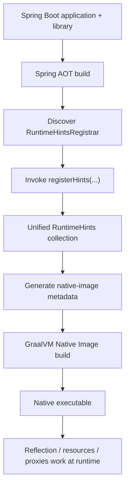

# Contributing RuntimeHintsRegistrar for Shared Libraries

## 1. Why Must a Shared Library Contribute Its Own Runtime Hints?

A Spring library can work fine on the JVM yet fail when a consuming application is compiled into a GraalVM Native Image. The usual cause is that the library performs operations Native Image needs to know about beforehand, such as reflection, reading classpath resources, creating JDK proxies, or Java serialization. Consuming applications do not always have visibility into these internal operations to declare metadata accurately themselves.

**RuntimeHintsRegistrar** is a Spring Framework extension point that lets a library describe those requirements using a strongly typed API. When Spring AOT processes an application, registrars contribute hints to a unified `RuntimeHints` instance; those hints are then translated into metadata consumed by the `native-image` toolchain.

For the **SPRING_BOOT_NATIVE_IMAGE** module, this is an essential part of library compatibility: a library should carry the runtime behavior descriptions it needs so every consuming application automatically receives the corresponding hints during AOT builds.

This lesson belongs to the **External Libraries** chapter and focuses on:

- Determining when a library needs to contribute Runtime Hints.
- Implementing a standalone, build-time-safe `RuntimeHintsRegistrar`.
- Publishing the registrar via `@ImportRuntimeHints` or `META-INF/spring/aot.factories`.
- Packaging metadata inside the JAR so consuming applications pick it up automatically.
- Handling optional dependencies and `ClassLoader`.
- Testing the registrar, inspecting packaged artifacts, and verifying the native executable.

## 2. Where Does RuntimeHintsRegistrar Fit in the Spring AOT Flow?

Spring AOT analyzes the `ApplicationContext` and registered components at build time. Requirements the framework cannot infer from static configuration can be supplemented through `RuntimeHints`.

A `RuntimeHintsRegistrar` receives two inputs:

- `RuntimeHints`: the container collecting reflection, resource, serialization, and proxy requirements.
- `ClassLoader`: the deployment unit's classloader, used to check whether types or dependencies are present. This parameter may be `null` in some environments.

Basic signature:

```java
package org.springframework.aot.hint;

public interface RuntimeHintsRegistrar {

    void registerHints(RuntimeHints hints, ClassLoader classLoader);
}
```

Workflow diagram:



The registrar runs during the AOT build phase to describe application requirements. It is not a callback invoked every time the application starts in production, nor is it a place to execute the library's business logic.

### 2.1. Distinguish Hint Categories

| Category | API | When the library needs it |
| --- | --- | --- |
| Reflection | `hints.reflection()` | Invoking constructors, methods, fields, or accessing metadata via reflection |
| Resource | `hints.resources()` | Reading classpath resources by dynamic names or patterns |
| JDK proxy | `hints.proxies()` | Creating runtime proxies for a set of interfaces |
| Java serialization | `hints.serialization()` | Using `ObjectInputStream`/`ObjectOutputStream` |

Do not register every hint category by rote. Trace the actual code and describe only the operations the library genuinely performs.

## 3. Designing a Library With Spring AOT Support

Suppose you build a shared library `acme-report-client`. The library provides:

- Reading a JSON schema from the classpath: `com/acme/report/schema/report-v1.json`.
- Instantiating the `ReportRequest` DTO via reflection for data binding.
- Creating a JDK proxy for the `ReportTransport` interface in one integration mode.
- Optional integration with an add-on module providing the `LegacyReportPayload` type.

A module structure can be organized as follows:

```text
acme-report-core/
  src/main/java/
    com/acme/report/ReportClient.java
    com/acme/report/ReportRequest.java
    com/acme/report/ReportTransport.java
  src/main/resources/
    com/acme/report/schema/report-v1.json

acme-report-spring/
  src/main/java/
    com/acme/report/spring/ReportAutoConfiguration.java
    com/acme/report/spring/aot/ReportRuntimeHints.java
  src/main/resources/
    META-INF/spring/
      aot.factories
      org.springframework.boot.autoconfigure.AutoConfiguration.imports
```

Splitting a core module and a Spring integration module is useful when a library wants to keep its pure Java API lightweight without forcing every consumer to depend on Spring just to use basic models or clients. The Spring integration module can depend on Spring Core/Context and contribute AOT hints.

If the entire library already depends on Spring, the registrar can live in the main artifact. Either way, ensure the artifact containing the registrar and metadata is on the application's compile/runtime classpath during the AOT build.

## 4. Writing a RuntimeHintsRegistrar

Example registrar for the library's types and resources:

```java
package com.acme.report.spring.aot;

import com.acme.report.ReportRequest;
import com.acme.report.ReportResponse;
import com.acme.report.ReportTransport;

import org.springframework.aot.hint.MemberCategory;
import org.springframework.aot.hint.RuntimeHints;
import org.springframework.aot.hint.RuntimeHintsRegistrar;

public final class ReportRuntimeHints implements RuntimeHintsRegistrar {

    public ReportRuntimeHints() {
    }

    @Override
    public void registerHints(RuntimeHints hints, ClassLoader classLoader) {
        hints.resources().registerPattern(
            "com/acme/report/schema/report-v1.json"
        );

        hints.reflection().registerType(
            ReportRequest.class,
            MemberCategory.INVOKE_PUBLIC_CONSTRUCTORS,
            MemberCategory.INVOKE_PUBLIC_METHODS
        );

        hints.reflection().registerType(
            ReportResponse.class,
            MemberCategory.INVOKE_PUBLIC_CONSTRUCTORS,
            MemberCategory.INVOKE_PUBLIC_METHODS
        );

        hints.proxies().registerJdkProxy(ReportTransport.class);
    }
}
```

Meaning:

1. The resource hint ensures the schema can be found in the native executable via the classpath.
2. Reflection hints describe the constructors and public methods dynamically invoked by the library on DTOs.
3. The proxy hint describes a JDK proxy implementing `ReportTransport`.
4. A no-arg constructor lets the registrar be instantiated when statically registered via metadata.

The member categories in this example illustrate a DTO with public constructors, getters, and setters. If the library accesses private fields, specific constructors, methods with parameters, or other members, register only the exact members required. Do not open full reflection for an entire package just to avoid tracing the exact call path.

### 4.1. Resource Paths Must Be Classpath Paths

If the resource is located at:

```text
src/main/resources/com/acme/report/schema/report-v1.json
```

then the registered path is:

```java
hints.resources().registerPattern(
    "com/acme/report/schema/report-v1.json"
);
```

Do not include `src/main/resources` in the pattern. That is a source directory, not part of the resource name on the classpath. Nor do resource hints create external container files, mount volumes, or replace runtime configuration.

### 4.2. Only Register Proxies When Actually Creating JDK Proxies

If the library uses `Proxy.newProxyInstance` or another mechanism creating a JDK dynamic proxy, declare the interfaces the proxy implements:

```java
hints.proxies().registerJdkProxy(
    ReportTransport.class,
    java.io.Serializable.class
);
```

The interface list must match the actual proxy. This hint does not create a concrete CGLIB proxy class and does not replace metadata for a target class if the target is also accessed via reflection.

### 4.3. Java Serialization Is a Separate Requirement

If the library genuinely uses Java object serialization, register the serializable type:

```java
hints.serialization().registerType(ReportSnapshot.class);
```

Do not confuse Java serialization with Jackson JSON serialization. DTOs bound by Jackson generally need appropriate reflection/binding metadata; calling `hints.serialization()` does not satisfy that requirement.

## 5. Publishing a Registrar via @ImportRuntimeHints

A dynamic registration approach is placing `@ImportRuntimeHints` near the component or configuration using the resources/types that need hints:

```java
package com.acme.report.spring;

import com.acme.report.spring.aot.ReportRuntimeHints;
import org.springframework.boot.autoconfigure.AutoConfiguration;
import org.springframework.context.annotation.ImportRuntimeHints;

@AutoConfiguration
@ImportRuntimeHints(ReportRuntimeHints.class)
public class ReportAutoConfiguration {
}
```

When `ReportAutoConfiguration` is included in the `ApplicationContext` during AOT, Spring discovers the registrar and calls `registerHints`.

If the library uses Spring Boot auto-configuration, the configuration class can be published in:

```text
META-INF/spring/org.springframework.boot.autoconfigure.AutoConfiguration.imports
```

Example contents:

```text
com.acme.report.spring.ReportAutoConfiguration
```

This mechanism lets Spring Boot applications import the library's auto-configuration. It differs from registering a global registrar via `META-INF/spring/aot.factories` covered next.

### 5.1. When Should You Choose @ImportRuntimeHints?

This approach fits when:

- Hints are only needed if a specific component/auto-configuration is brought into the context.
- You want to keep hints close to the component owning the runtime behavior.
- Configuration is conditional and only certain library variants need resources or proxies.
- You want to avoid contributing hints when the corresponding feature is not activated.

Spring recommends placing `@ImportRuntimeHints` close to the component needing the hints. If the component is not contributed to the `BeanFactory`, the hints attached to it do not need to be contributed either.

## 6. Publishing a Registrar Statically via META-INF/spring/aot.factories

For shared libraries, you can register a registrar globally within the artifact using:

```text
src/main/resources/META-INF/spring/aot.factories
```

Contents:

```properties
org.springframework.aot.hint.RuntimeHintsRegistrar=\
com.acme.report.spring.aot.ReportRuntimeHints
```

The key is the fully qualified name of the `org.springframework.aot.hint.RuntimeHintsRegistrar` interface. The value is the fully qualified name of the implementation class. The registrar needs a no-arg constructor so Spring can instantiate it from metadata.

When the artifact is placed on the classpath during AOT processing, Spring can discover this registrar and invoke it to contribute hints.

### 6.1. Distinguish Easily Confused Metadata Files

| File | Purpose |
| --- | --- |
| `META-INF/spring/aot.factories` | Register AOT contributions such as `RuntimeHintsRegistrar` |
| `META-INF/spring/org.springframework.boot.autoconfigure.AutoConfiguration.imports` | Publish Spring Boot auto-configuration |
| `META-INF/spring.factories` | Traditional Spring factories mechanism; not the file for registering `RuntimeHintsRegistrar` described here |
| `META-INF/native-image/...` | GraalVM Native Image metadata in reachability metadata / native-image properties format |

Do not put a registrar into `META-INF/spring.factories` or `AutoConfiguration.imports` expecting the AOT engine to recognize it as a `RuntimeHintsRegistrar`. Use the exact file and key defined by the extension point.

### 6.2. When Should You Choose Static Registration?

Static registration fits when a library always needs the same set of hints whenever its artifact is present in the deployment unit, regardless of which beans are enabled. For example, the library has an internal reflection path that is always invoked or a schema resource always needed in native executables.

Compare the two approaches:

| Criterion | @ImportRuntimeHints | aot.factories |
| --- | --- | --- |
| Scope | Tied to an imported bean/configuration | Global registration for the deployment unit |
| Activation condition | Whether the component is added to the context | Whether the artifact/metadata is present during AOT |
| Location | On a bean or `@Bean` method | In JAR resource metadata |
| Registrar constructor | Handled by Spring via annotation | Requires a no-arg constructor |
| Typical use case | Feature-specific hints | Infrastructure hints always required by the library |

Pick one mechanism as the primary registration path for the same registrar. Registering the same registrar in both places can produce duplicate contributions and make diagnostics harder. Only use both when there are genuinely two distinct hint groups with different scopes.

## 7. Supporting Optional Dependencies and ClassLoader

Shared libraries often support optional integration modules. For example, the core module does not depend on Jackson, while an adapter module may provide DTOs or converters for Jackson. A registrar should not reference optional types directly via class literals if that dependency might be absent.

Instead, use the passed-in `ClassLoader` and the conditional type registration API when available:

```java
import java.util.List;

import org.springframework.aot.hint.ExecutableMode;
import org.springframework.aot.hint.RuntimeHints;
import org.springframework.aot.hint.RuntimeHintsRegistrar;
import org.springframework.aot.hint.TypeReference;

public final class OptionalJacksonHints implements RuntimeHintsRegistrar {

    @Override
    public void registerHints(RuntimeHints hints, ClassLoader classLoader) {
        hints.reflection().registerTypeIfPresent(
            classLoader,
            "com.acme.report.jackson.LegacyReportPayload",
            typeHint -> typeHint.withConstructor(
                List.of(),
                ExecutableMode.INVOKE
            )
        );
    }
}
```

`registerTypeIfPresent` contributes the hint only if the type can be located via the provided classloader. This works well for optional integrations, though the registrar must still avoid loading optional classes via static fields, class literals, or imports that could trigger eager type resolution.

### 7.1. Using ClassLoader to Check Optional Resources

If a resource only exists when an add-on module is installed, check before registering:

```java
@Override
public void registerHints(RuntimeHints hints, ClassLoader classLoader) {
    if (classLoader != null
            && classLoader.getResource("com/acme/report/legacy/schema.json") != null) {
        hints.resources().registerPattern(
            "com/acme/report/legacy/schema.json"
        );
    }
}
```

This is a build-time presence check. Do not use production environment variables, hostnames, secrets, or network requests to decide hints. Runtime hints must reflect the classpath and behavior known during the AOT build.

### 7.2. Do Not Pull Optional Dependencies Into a Shared Registrar

A common design mistake is a core registrar importing every integration class:

```java
// Avoid this design in the core artifact:
import com.acme.report.jackson.LegacyReportPayload;
```

If a consumer does not use the integration module, the class may be missing and type resolution will break the build. Split registrars by optional module, use class names with `registerTypeIfPresent` where appropriate, or only contribute hints when the integration artifact is present.

## 8. Writing a Build-Time-Safe Registrar

The registrar runs during AOT, so keep it simple and repeatable. A good registrar typically only declares metadata and checks the classpath.

Do:

- Provide a no-arg constructor when registering statically.
- Use class literals for mandatory types belonging to the library itself.
- Use `ClassLoader` and `registerTypeIfPresent` for optional integrations.
- Register the exact resource paths and members required.
- Keep logic deterministic and independent of the build machine environment.
- Split registrars by feature/module if the hint list grows large.
- Write unit tests for each hint group.

Avoid:

- Creating or refreshing an `ApplicationContext` inside `registerHints`.
- Initializing business beans, opening database connections, or making HTTP calls.
- Reading build machine secrets or environment variables to build hints.
- Using dynamic reflection to scan entire packages unboundedly.
- Catching and swallowing exceptions, causing critical hints to be lost silently.
- Adding all reflection members or all resources when only a few entries are needed.
- Using static initializers with side effects in the registrar class.

`registerHints` may be called across different AOT build runs. Output should be consistent for the same classpath and build configuration; do not rely on mutable state or invocation timing.

## 9. Testing RuntimeHintsRegistrar

Spring provides `RuntimeHintsPredicates` to verify whether a `RuntimeHints` instance satisfies specific requirements. Unit tests can invoke the registrar directly:

```java
import static org.assertj.core.api.Assertions.assertThat;

import org.junit.jupiter.api.Test;
import org.springframework.aot.hint.RuntimeHints;
import org.springframework.aot.hint.predicate.RuntimeHintsPredicates;

class ReportRuntimeHintsTests {

    @Test
    void registersReportSchema() {
        RuntimeHints hints = new RuntimeHints();

        new ReportRuntimeHints().registerHints(
            hints,
            getClass().getClassLoader()
        );

        assertThat(
            RuntimeHintsPredicates.resource()
                .forResource("com/acme/report/schema/report-v1.json")
        ).accepts(hints);
    }
}
```

You can verify reflection methods the library actually calls:

```java
assertThat(
    RuntimeHintsPredicates.reflection()
        .onMethod(ReportRequest.class, "getReportId")
        .invoke()
).accepts(hints);
```

Tests should reflect actual runtime behavior. If the library only accesses a getter, do not assert that all private members were exposed. If the library creates a JDK proxy, add a predicate test for the corresponding proxy interfaces using the API of your Spring version.

### 9.1. Testing Optional Dependencies

For registrars using `registerTypeIfPresent`, test two cases:

1. Classloader includes the optional dependency: hint for the optional type is contributed.
2. Classloader lacks the optional dependency: registrar succeeds without attempting to resolve the missing type.

You can split tests into the core module and integration module so each module has its own classpath. This confirms the core library does not accidentally depend on the adapter.

### 9.2. Unit Tests Do Not Replace AOT Integration Tests

Calling `registerHints` directly proves the registrar code produces the right hints. It does not prove Spring finds `META-INF/spring/aot.factories` inside the JAR or that `@ImportRuntimeHints` is triggered from actual auto-configuration.

Therefore, add an artifact/application-level test:

- Build the library JAR.
- Add the JAR to a minimal consumer application.
- Run AOT processing on the application.
- Inspect generated metadata or AOT logs to confirm the registrar was discovered.
- Build and run the native executable to trigger the library's exact reflection/resource/proxy paths.

## 10. Inspecting the JAR and Metadata After Packaging

A correct registrar in source code is still useless if metadata files are not packaged into the artifact.

After building the two Maven artifacts:

```bash
jar tf target/acme-report-spring-1.0.0.jar
jar tf ../acme-report-core/target/acme-report-core-1.0.0.jar
```

In the integration JAR, check the registrar and metadata file:

```text
META-INF/spring/aot.factories
com/acme/report/spring/aot/ReportRuntimeHints.class
```

In the core JAR, check the resource:

```text
com/acme/report/schema/report-v1.json
```

You can inspect the metadata file contents:

```bash
unzip -p target/acme-report-spring-1.0.0.jar META-INF/spring/aot.factories
```

With Gradle, use the corresponding JAR paths in `build/libs`. If the library is published via an internal Maven repository, verify the exact artifact version resolved by the consumer application; do not inspect only the JAR in the library's workspace.

### 10.1. Verifying From a Consumer Application

Create a small application depending solely on the published artifact or built JAR. Then:

1. Run AOT processing.
2. Inspect generated runtime hints or native-image metadata.
3. Confirm resource paths appear in metadata when the library requires resources.
4. Confirm required reflection/proxy metadata is present.
5. Exercise the library's code paths on the native executable.

Output file names and generated metadata locations can vary across Spring Boot, Spring Framework, and Native Build Tools versions. Inspect the output of that specific build rather than hardcoding an output path from another version.

## 11. Packaging and Releasing Shared Libraries

When releasing a library containing a `RuntimeHintsRegistrar`, treat the registrar and metadata as first-class parts of the artifact:

| Component | Requirement |
| --- | --- |
| Registrar class | Present in the JAR, public, and has a constructor matching the registration method |
| AOT metadata | `META-INF/spring/aot.factories` has exact key/value if using static registration |
| Auto-configuration | If using `@ImportRuntimeHints` via auto-config, auto-config must be properly published |
| Resources | Resources referenced by the registrar must reside in the JAR or corresponding dependency |
| Dependencies | Spring Framework baseline compatible with APIs used by the registrar |
| Optional integration | Separate dependencies or check presence so core does not require optional adapters |
| Tests | Hint unit tests and consumer integration tests exist |
| Versioning | When adding/removing hints or resources, release a new version and update release notes |

### 11.1. Spring Version Compatibility

`RuntimeHintsRegistrar` was introduced in Spring Framework 6.0. If a library must support multiple Spring baselines, define the minimum supported version clearly and compile/test against that baseline. Do not compile a library against APIs only available in a newer release and expect consumers on older Spring versions to load the registrar.

Spring Boot manages Spring Framework versions through dependency management. When releasing a Spring Boot integration library, check the consumer application's dependency tree to confirm the actual resolved version, especially when multiple starters pull in different versions.

### 11.2. Do Not Confuse AOT Hints With Auto-Configuration

Auto-configuration determines which beans/configurations are added to the `ApplicationContext`. `RuntimeHintsRegistrar` describes metadata needed for runtime behavior in a native executable. The two are related but distinct:

- Auto-configuration can import a configuration annotated with `@ImportRuntimeHints`.
- `META-INF/spring/aot.factories` can register a registrar statically without needing auto-configuration as an entry point.
- Registering a registrar does not create client beans, enable features, or pull in optional dependencies.

Keeping these two responsibilities separate makes the library easier to test and control when consumers enable only a subset of features.

## 12. Common Issues and How to Handle Them

| Symptom | Cause to check | How to handle |
| --- | --- | --- |
| Registrar is not invoked | Missing `aot.factories` or wrong key/value | Check path, FQN, and JAR contents |
| `@ImportRuntimeHints` has no effect | Configuration/bean with annotation not discovered in AOT context | Check component scan, imports, and auto-configuration conditions |
| Runs fine on JVM but native misses resource | Resource not packaged or missing resource hint | Check JAR, classpath path, and predicate |
| Native reports missing constructor/method | Reflection hint does not describe the exact member called | Register needed member or use appropriate binding hint |
| Consumer without optional dependency fails AOT build | Registrar eagerly resolves optional type | Use `registerTypeIfPresent` and avoid optional class literals/imports |
| Metadata present but behavior still fails | Hint does not match real operation or another resource/dependency is missing | Use tracing agent, inspect stack trace, and test natively |
| Hints contributed twice | Same registrar registered via both annotation and `aot.factories` | Choose a single mechanism for the same hint scope |
| Resource hint cannot find file | Source path used instead of classpath path | Remove `src/main/resources` from the resource pattern |
| Consumer build does not see new metadata | Resolving older JAR version or cached artifact | Check dependency tree, version, and published artifact contents |
| Library works on newer Spring but fails on older baseline | Registrar uses API absent from consumer's Spring baseline | Pick supported baseline, compile, and test against minimum version |

## 13. Hands-On Exercise: Releasing a Library With Runtime Hints

**Scenario:** build `acme-report-spring` providing `ReportClient`. The client reads a JSON schema from the classpath and uses reflection to bind `ReportRequest`.

**Steps:**

1. Create the core module containing `ReportClient`, `ReportRequest`, and the schema resource.
2. Create the Spring integration module depending on Spring Core/Context.
3. Write `ReportRuntimeHints implements RuntimeHintsRegistrar`.
4. Register the schema resource and the exact constructors/methods invoked by the client via reflection.
5. Choose publishing via `@ImportRuntimeHints` on auto-configuration or `META-INF/spring/aot.factories`.
6. Build the JAR and verify the registrar class, metadata, and schema resource are in the artifact.
7. Write unit tests with `RuntimeHintsPredicates` for resources and reflection.
8. Create a sample consumer depending only on the built artifact and run Spring AOT.
9. Build the native executable and invoke the schema-reading/DTO-binding code path.
10. If there is an optional adapter, run another consumer without the adapter to verify the registrar does not resolve the missing type.

**Completion criteria:**

- Registrar accurately describes the reflection/resource/proxy behaviors needed by the library.
- Registration mechanism matches the hint scope.
- Metadata files reside in the exact location with accurate keys/values if using static registration.
- Optional dependencies do not break consumers that do not use that integration.
- Unit tests verify hints are contributed.
- Final JAR contains the registrar, metadata, and required resources.
- Consumer application executes the relevant code paths cleanly on the native executable.

## 14. Summary

Shared libraries can contribute metadata to Spring AOT themselves by implementing `RuntimeHintsRegistrar`. Use `@ImportRuntimeHints` when hints are tied to a specific bean or configuration; use `META-INF/spring/aot.factories` when the library needs to register a registrar statically for the deployment unit. With static registration, the key is the fully qualified name of the registrar interface and the implementation requires a no-arg constructor.

A reliable registrar only describes genuinely needed runtime operations, uses `ClassLoader` to handle optional integrations, introduces no side effects during AOT builds, and is unit tested with `RuntimeHintsPredicates`. Afterward, inspect the packaged JAR, run AOT on a consumer application, and verify the native executable. In this way, native compatibility responsibility is distributed alongside the library rather than forcing every consuming application to guess the reflection and resources the library uses.
