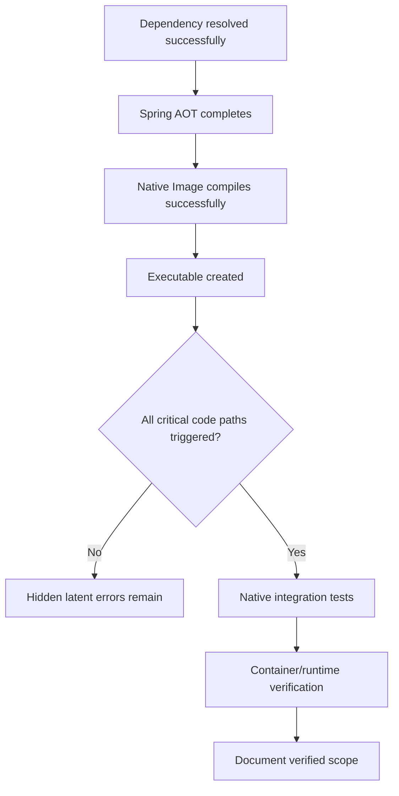

# Do Not Treat a Successful Dependency Compilation as Proof That Every Flow Works

## 1. A Successful Build Only Confirms Part of the Picture

When a Spring Boot Native Image build finishes, it shows that dependencies were resolved and that the classes and code paths analyzed by the compiler did not trigger build-stopping errors. It **does not prove that every library feature will run properly in production**.

Many libraries only perform certain operations when specific features are called: reading templates by name, loading providers, creating proxies, deserializing messages, loading native libraries, running migrations, handling rare formats, or selecting implementations by profile. If the build does not exercise those branches, failures may surface only when the first request or job triggers them.

In the **SPRING_BOOT_NATIVE_IMAGE** module, dependencies must be evaluated by the exact features and code paths the application actually uses. A green native build is a necessary milestone; compatibility evidence must also include runtime tests on the native executable and target container.



## 2. Four Stages That Should Not Be Equated

| Stage | What it proves | What it does not prove |
|---|---|---|
| Dependency resolution | Artifacts/versions were found and placed in the graph | Dynamic classes/members/resources all work |
| Spring AOT | Build-time context could be processed and generated output produced | Every runtime branch and plugin is exercised |
| Native compilation | GraalVM produced an executable from the supplied inputs | Every endpoint, message type, provider, and error path runs properly |
| Runtime/feature tests | Executed scenarios work in the test environment | Untested scenarios or other environments also work |

For example, a PDF library may resolve and compile natively without issue. Yet an endpoint exporting PDFs with embedded fonts, SVG images, or a rare locale might remain untested. Missing resource or reflection errors will appear only when that endpoint runs.

Therefore, conclusions should be scoped: "verified PDF export with font A and locale B on Linux amd64" rather than "PDF library is Native Image compatible" unless the vendor's full feature matrix has been checked.

## 3. Why Do Errors Appear Only When a Code Path Is Invoked?

Several mechanisms behave lazily or conditionally:

- Classes are loaded only when a specific endpoint is called.
- Reflection runs only when a serializer encounters an uncommon subtype.
- Providers are discovered via `ServiceLoader` when a particular format is requested.
- Resources are read using template or schema names derived from data.
- Proxies are created only when a specific bean or integration initializes.
- JNI libraries are loaded only when a native algorithm is invoked.
- Static initializers execute only when the class is used.
- Profiles/properties enable only one configuration branch.
- Error handling or fallbacks run only when the dependency encounters an error.

A test that merely hits a health endpoint rarely exercises these branches. Even an application context starting cleanly does not prove lazy operations all work.

## 4. Mapping Dependency Features and Code Paths

Before writing tests, list how the application uses the dependency. For example, a document processing library might have these features:

| Feature | Code path to trigger | Risks to check |
|---|---|---|
| Read PDF documents | Parser and fonts/resources | Resources, reflection |
| Export PDF | Renderer, fonts, image codecs | Resources, JNI, providers |
| Read SVG images | Parser and extensions | Reflection, provider discovery |
| Select locale | Message/font bundles | Resource patterns |
| Handle malformed files | Exception/fallback path | Lazy classes and error handling |
| Process large files | Streaming/temp files | Filesystem, memory, permissions |

This map must be grounded in actual features used by the application, library documentation, and code call sites. You do not have to test every feature of a dependency if the application does not use it, provided you explicitly document that boundary.

## 5. Verify the Actual Dependency and Version

Start from the runtime classpath of the exact application module. With Gradle:

```bash
./gradlew :api-app:dependencies --configuration runtimeClasspath
./gradlew :api-app:dependencyInsight --dependency document-library --configuration runtimeClasspath
```

With Maven:

```bash
./mvnw dependency:tree
```

Record:

- Artifact and resolved version.
- Transitive dependencies and exclusions.
- Selected optional modules/classifiers.
- JDK, Spring Boot, Spring Framework, and GraalVM versions.
- Profiles/properties affecting the dependency or features.
- OS/architecture of native libraries if any.

A dependency may resolve cleanly while an optional module containing a needed provider is missing from the runtime classpath. Check the exact artifacts actually packaged, not just declarations in the build file.

## 6. Checking Metadata Does Not Mean Checking Behavior

A library may ship a `RuntimeHintsRegistrar`, reachability metadata, or Native Image documentation. These are positive signals, yet you must verify that the metadata is consumed by the toolchain and covers the features you use.

For example:

- A reflection hint for a constructor does not prove other reflectively invoked methods have metadata.
- JDK `ProxyHints` do not prove class-based proxies or arbitrary bytecode generation are supported.
- A resource hint for `templates/*.html` does not prove schemas/fonts in other folders are packaged.
- A serialization hint for one DTO does not prove every subtype in the object graph is compatible.
- JNI metadata does not guarantee the native library matches the ABI or exists in the run image.

Metadata is an input to the build. Only real feature tests prove a specific execution path works.

## 7. Design Tests Around Features, Not Just Startup

Every critical feature should have at least one test invoking the dependency's actual APIs. Tests should go through the same adapter/service layer called by production code rather than merely checking class presence.

Example application using a report generation library:

```java
@SpringBootTest
class ReportGenerationNativeIT {

    @Autowired
    ReportService reportService;

    @Test
    void generatesPdfWithConfiguredTemplate() {
        byte[] pdf = reportService.generate(sampleReport());

        assertThat(pdf).isNotEmpty();
        assertThat(pdf).startsWith("%PDF-".getBytes(StandardCharsets.US_ASCII));
    }
}
```

This example only illustrates the test contract; checking a PDF signature requires proper encoding/byte handling. Better tests can reopen the output using a parser and assert expected content, pages, fonts, or metadata.

Do not merely assert "throws no exception." Verify outputs and side effects meaningful to the business domain.

## 8. JVM vs. Native Image Matrix

Run the same feature test suite on both the JVM and the native executable. Compare behavior, not just exit codes.

| Scenario | JVM | Native executable |
|---|---|---|
| Core feature | Pass/Fail | Pass/Fail |
| Lazy initialization | Pass/Fail | Pass/Fail |
| Reflection/subtype | Pass/Fail | Pass/Fail |
| Resource by name | Pass/Fail | Pass/Fail |
| Proxy/AOP | Pass/Fail | Pass/Fail |
| Serialization | Pass/Fail | Pass/Fail |
| JNI/native backend | Pass/Fail | Pass/Fail |
| Error/fallback path | Pass/Fail | Pass/Fail |

This table is a reporting template. Never mark a cell as pass if the test did not actually run on the native executable. If a feature does not apply, write `N/A` with a reason instead of leaving it blank and misleading readers.

## 9. Test Error and Fallback Paths Too

Some dependencies enter different code paths only when the primary operation fails. For example:

- Preferred provider not found, falling back to another provider.
- Primary resource missing, falling back to a default template.
- Native backend fails to load, switching to a pure Java implementation.
- Parser encounters invalid encoding or format and returns a specific error.
- Retry logic running after a timeout or connection failure.

These paths are rarely hit in smoke tests. Yet they can involve reflection, resources, or provider discovery different from the success path.

Do not intentionally break production environments to test them. Use fixtures, fake services, or controlled test containers to reproduce failure conditions and verify fallbacks.

## 10. Profiles and Configurations Affect Features

Spring AOT processes the application context using build-time profiles and properties. If a dependency is only used by conditional beans, testing under a different profile may never create those beans or activate the integration.

Record:

- Profiles used during AOT.
- Properties governing auto-configuration or features.
- Runtime properties/secrets supplied at execution time.
- Selected beans/implementations.
- Dependency graph of the application module.

If bean graphs differ by profile, build and test each corresponding native artifact. If only endpoint URLs or credentials differ, keep the bean graph stable and supply values at runtime as designed. Do not conclude a feature was tested just because a test suite ran under a profile that omitted that feature's beans.

## 11. Test on the Exact Target Container and Platform

A native executable may run on the build machine yet fail inside a container due to differences in libc, shared libraries, architecture, filesystem permissions, or environment.

Minimum checks:

1. Image matching the exact digest just built.
2. OS and CPU architecture matching the binary.
3. Run image containing required shared libraries.
4. Container user able to read resources and write temp files as needed.
5. Volumes/configurations/secrets mounted properly.
6. Feature tests exercising the dependency directly inside the container.
7. Resources, JNI backends, and providers functioning in the target environment.

If production runs on Linux ARM64 while CI only tests Linux amd64, there is insufficient evidence for ARM64. Clearly state verified platforms and run tests on every target intended for release.

## 12. Use Tracing Agent as a Supporting Tool

The GraalVM Native Image Tracing Agent can observe certain dynamic operations while running on the JVM and generate suggested metadata. It is useful for inspecting reflection, resources, proxies, serialization, or JNI along executed code paths.

However, the agent only records what test scenarios actually execute. If tests never invoke PDF export, the agent cannot infer fonts or resources needed for that feature. Generated metadata must also be reviewed to prune superfluous entries and verify version compatibility.

Sensible workflow:

1. Run a JVM test suite with clear feature coverage.
2. Collect metadata from representative scenarios.
3. Review metadata and cross-check against vendor documentation.
4. Build the Native Image.
5. Re-run the same test suite on the native executable.
6. Add tests for branches the agent did not observe.

The agent aids metadata discovery; it does not replace native integration tests.

## 13. Investigating When Build Passes but Runtime Fails

When an error occurs, record the feature, input, profile, platform, and artifact digest before fixing. Then categorize it:

| Observed error | Category to investigate |
|---|---|
| Class not found | Runtime classpath, classloader, reachability |
| Reflection constructor/method error | Member metadata and signatures |
| Resource null | Resource path, packaging, hints |
| Proxy creation error | Proxy strategy, AOT support, runtime bytecode generation |
| Serialization exception | Object graph and serialization metadata |
| UnsatisfiedLinkError | JNI library, load path, ABI, JNI metadata |
| Incorrect static value | Class initialization time |
| Fails only with specific profile | AOT profile/properties and bean graph |
| Fails only inside container | Run image, filesystem, permissions, environment |

Reproduce with the smallest possible test while preserving the failing code path. After modifying metadata or dependencies, rebuild the executable and re-run tests; never rely on results from an older binary.

## 14. Document Verification Scope Instead of Blanket Claims

A dependency report should state a clear scope:

| Field | Example content to record |
|---|---|
| Dependency | Artifact and resolved version |
| Features used | PDF generation, CSV import, native crypto… |
| Metadata | Registrar, reachability metadata, resource/JNI hints |
| JVM tests | Test suite and results |
| Native tests | Feature paths exercised on executable |
| Container target | OS, architecture, run image digest |
| Limitations | Untested features or unsupported platforms |
| Artifact identity | Commit, build ID, executable/image digest |

Use project statuses such as:

- **Verified for tested paths**: listed code paths passed on native/container.
- **Verified with configuration**: passed after adding documented metadata/configuration.
- **Partially verified**: some features/platforms remain untested.
- **Unverified**: build succeeded, insufficient runtime evidence.
- **Incompatible for current design**: mandatory code paths rely on unsupported mechanisms.

These labels are project management conventions, not official certifications from GraalVM or library vendors.

## 15. Checklist Before Concluding a Dependency Is Compatible

- Exact artifact/version identified on the runtime classpath.
- Features and code paths actually used are listed.
- Native Image documentation read for the exact dependency version.
- Metadata verified as packaged and consumed by AOT/native build.
- Tests exercise lazy initialization, reflection, proxies, resources, serialization, or JNI where relevant.
- Key error and fallback paths tested.
- Identical scenarios executed on the native executable.
- Container tests use the exact target OS/architecture/run image.
- Profiles, toolchain, artifact digest, and remaining limitations recorded.
- Conclusion covers only features/platforms actually verified.

## 16. Self-Check Questions

1. What does successful native compilation prove, and what does it fail to prove?
2. Why might lazy code paths fail to trigger when testing only startup?
3. Does a reflection hint for a constructor guarantee all dynamic methods work?
4. Why must error and fallback paths of a dependency also be tested?
5. How can an AOT profile cause a feature to go untested?
6. What does the Tracing Agent miss if the test suite omits rare functionality?
7. Why must compatibility conclusions be tied to version, feature, platform, and artifact digest?

**Remember:** successful dependency resolution and native compilation only prove the build steps completed. Conclude compatibility strictly within the scope of features and code paths actually triggered and verified on the target native executable/container; explicitly document untested areas to avoid overstating support.
