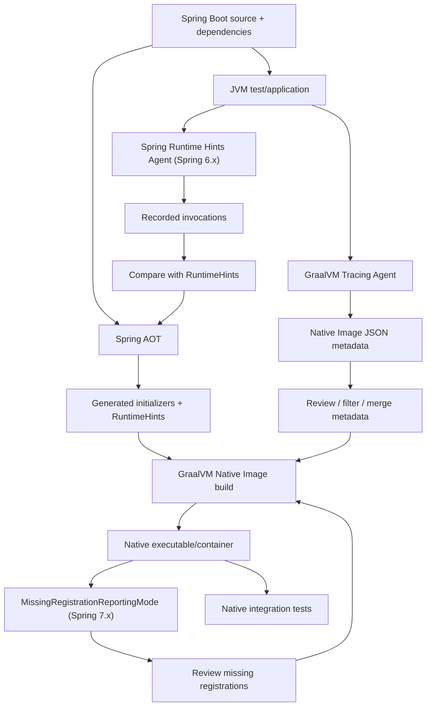

# Distinguishing the GraalVM Tracing Agent from the Spring RuntimeHints Agent

## 1. Why Are There Two Agents and What Problems Do They Solve?

When migrating a Spring Boot application to **GraalVM Native Image**, certain dynamic behaviors cannot be fully inferred from source code: reflection, reading resources by name, creating JDK proxies, Java serialization, JNI, or dynamically generated classes at runtime. Native Image needs corresponding metadata to retain those classes/members/resources and prepare the executable.

Two tools commonly mentioned in this workflow are:

- **GraalVM Native Image Tracing Agent**: runs the application on the JVM with an attached agent to observe dynamic operations that actually occur during that run, then writes JSON metadata and in some modes can capture bytecode of dynamically defined classes.
- **Spring Runtime Hints Agent**: a Java agent in `spring-core-test`, used to observe calls related to runtime hints in the test JVM and match them against `RuntimeHints` registered by Spring. This agent has been supported since Spring Framework 6.0 and was deprecated for removal starting in 7.0.

Both help uncover metadata gaps, but their observation scope and purpose differ. The GraalVM agent helps collect Native Image-level metadata from an application run; the Spring agent helps verify whether hints contributed by libraries or the application actually cover the behavior exercised by tests. With Spring Framework 7.x, prefer GraalVM's missing-registration modes over the deprecated Spring agent/recorder.

After this lesson, you can:

- Distinguish the goals, execution methods, outputs, and scope of both agents.
- Use the GraalVM Tracing Agent to generate initial configuration metadata.
- Use the Spring Runtime Hints Agent on Spring Framework 6.x and understand the replacement path on 7.x.
- Combine both tools with Spring AOT, `RuntimeHintsRegistrar`, and native builds.
- Understand why a successful agent run does not prove the application is native-compatible across all code paths.

## 2. Quick Comparison

| Criterion | GraalVM Native Image Tracing Agent | Spring Runtime Hints Agent |
|---|---|---|
| Belongs to | GraalVM Native Image | Spring Framework, test module `spring-core-test` |
| Goal | Record dynamic behavior to generate reachability metadata for Native Image | Verify whether dynamic operations are already declared in Spring `RuntimeHints` |
| Where it runs | JVM running the app or tests with `-agentlib:native-image-agent` | Spring 6.x: test JVM with `-javaagent:spring-core-test.jar`; Spring 7.x: prefer native build/run with GraalVM missing-registration mode |
| Observes | Reflection, resources, proxies, serialization, JNI, FFM, and other agent-supported cases | Invocations supported by the Spring agent, then matched against contributed `RuntimeHints` |
| Primary output | JSON metadata following the Native Image schema; may include predefined classes data in experimental mode | Report/assertion on invocations not yet declared in RuntimeHints |
| Where results are used | Configure reachability metadata, analyze, and convert into appropriate hints | Spring 6.x: add/update `RuntimeHintsRegistrar` and keep tests as a regression guard; Spring 7.x: resolve missing-registration reports from the native executable |
| Strengths | Covers runtime behavior across an application run, independent of Spring | Integrates directly with Spring's hints system and can be asserted in the test suite |
| Key limitations | Only records executed code paths; metadata may be overly broad or incomplete | Spring agent/recorder deprecated since 7.0; 6.x only observes instrumented invocations in tests and does not replace GraalVM builds/tests |

**Rule of thumb:** The GraalVM Tracing Agent asks *"During this run, what dynamic operations did the application perform?"*. The Spring Runtime Hints Agent (Spring 6.x) asks *"Have the operations the test just performed been declared in Spring's RuntimeHints?"*. On Spring 7.x, test the native executable with GraalVM's missing-registration mode.

## 3. GraalVM Native Image Tracing Agent

### 3.1. How It Works

The Tracing Agent attaches to the JVM when running the application or tests. The agent observes runtime operations for which Native Image needs metadata, such as:

- `Class.forName`, `Class.getDeclaredMethod`, and other reflection accesses.
- Reading resources or resource bundles through supported APIs.
- Creating JDK dynamic proxies.
- Java serialization.
- Calling JNI, the Foreign Function and Memory API (FFM), and other operations recognized by the agent.
- In modes supporting class definition, capturing bytecode of certain dynamically generated classes.

When the application exits, the agent writes JSON metadata to the configuration directory. GraalVM currently uses the unified `reachability-metadata.json` format; some versions or libraries may still provide the legacy split-file format. Common metadata files/groups include:

| File | Contents |
|---|---|
| `reachability-metadata.json` | Current unified format for dynamic metadata types |
| `reflect-config.json` | Legacy format for classes and members needing reflection |
| `resource-config.json` | Legacy format for resources and resource bundles to retain |
| `proxy-config.json` | Legacy format for interface combinations used to create JDK proxies |
| `serialization-config.json` | Legacy format for types using Java serialization |
| `jni-config.json` | Legacy format for classes/members accessed via JNI |
| `predefined-classes-config.json` | Metadata for predefined classes when using the corresponding class-definition mode |

Which files are generated depends on the observed behavior and the agent's features/version; not every run generates every file.

### 3.2. Running the Agent with `-agentlib`

Example of running a Spring Boot JAR application on the JVM:

```bash
java \
  -agentlib:native-image-agent=config-output-dir=target/native-agent \
  -jar target/order-service.jar
```

After the application starts, exercise key business scenarios: creating orders, reading data, exporting invoices, processing payments, calling optional integrations, and handling errors. When the process exits, inspect the `target/native-agent` directory.

On Windows PowerShell, the equivalent command is:

```powershell
java "-agentlib:native-image-agent=config-output-dir=target/native-agent" -jar target/order-service.jar
```

If you want to observe tests instead of starting the standalone application, you can pass `-agentlib` to the test JVM. With Gradle, a temporary configuration example is:

```groovy
tasks.withType(Test).configureEach {
    jvmArgs '-agentlib:native-image-agent=config-output-dir=build/native-agent'
}
```

With Maven Surefire, configure `argLine` for the forked test JVM in the way your project manages JVM arguments. Avoid overwriting an existing `argLine` if it contains JaCoCo or other agents; append the arguments instead and check the actual command Surefire constructs.

### 3.3. Merging Data from Multiple Scenarios

A large application often requires multiple agent runs. In the current workflow, each process should write to its own directory via `config-output-dir`, then merge the directories using the `native-image-utils` tool:

```bash
java \
  -agentlib:native-image-agent=config-output-dir=target/native-agent-run-1 \
  -jar target/order-service.jar

java \
  -agentlib:native-image-agent=config-output-dir=target/native-agent-run-2 \
  -jar target/order-service.jar

native-image-utils generate \
  --input-dir=target/native-agent-run-1 \
  --input-dir=target/native-agent-run-2 \
  --output-dir=target/native-agent-merged
```

Each run can use a different profile or dataset. The `native-image-utils generate` tool accepts multiple `--input-dir` arguments and produces a merged metadata directory. Some older GraalVM versions include `native-image-configure`; use the command present in your installed distribution and check `native-image-utils help` or `native-image-configure help` before automating.

### 3.4. Common Tracing Agent Options

| Option | Purpose |
|---|---|
| `config-output-dir=<dir>` | Writes the process's metadata to the specified directory |
| `caller-filter-file=<file>` | Filters metadata by the class performing the dynamic operation (caller) |
| `access-filter-file=<file>` | Filters metadata by the class/member/resource being accessed (target) |
| `trace-output=<file>` | Logs each dynamic operation as JSON trace entries for later analysis or conversion |
| `experimental-class-define-support` | Experimentally captures bytecode of dynamically defined classes to support predefined classes |

`caller-filter-file` and `access-filter-file` have their own JSON schemas; do not use an arbitrary filter file named `config-filter-file`. `experimental-class-define-support` is an experimental feature—only enable it when you truly need to capture dynamically generated classes. Options can vary across GraalVM versions; check the documentation for your installed distribution before adding them to CI.

If you need to inspect individual invocations rather than only receiving aggregated metadata, you can write a JSON trace and then convert it into configuration:

```bash
java \
  -agentlib:native-image-agent=trace-output=target/native-agent-trace.json \
  -jar target/order-service.jar

native-image-utils generate \
  --trace-input=target/native-agent-trace.json \
  --output-dir=target/native-agent-from-trace
```

A JSON trace is useful when investigating the origin of a metadata entry or analyzing the order of operations. For normal build workflows, `config-output-dir` remains the more direct choice.

## 4. Spring Runtime Hints Agent

### 4.1. Role in the Spring Ecosystem

Spring `RuntimeHints` is the API for describing dynamic accesses that need to be prepared during AOT/native builds. An application or library can contribute hints via `RuntimeHintsRegistrar`, `@ImportRuntimeHints`, `@RegisterReflectionForBinding`, or equivalent APIs.

The Spring Runtime Hints Agent is a test tool for detecting dynamic behavior that tests execute but `RuntimeHints` has not yet described. It is provided in the **`spring-core-test`** module; it is not a GraalVM agent and not an agent that generates `reflect-config.json` directly for the native-image builder.

The Spring agent is designed to run in the test JVM, observe the invocations it supports, and match them against hints registered by Spring. When a test executes an operation without a corresponding hint, the report highlights the gap so developers can add the missing metadata.

### 4.2. Adding `spring-core-test`

With Gradle:

```groovy
dependencies {
    testImplementation 'org.springframework:spring-core-test'
}
```

With Maven:

```xml
<dependency>
    <groupId>org.springframework</groupId>
    <artifactId>spring-core-test</artifactId>
    <scope>test</scope>
</dependency>
```

Use the same version/BOM as the Spring Framework version the application is running on. If the project uses Spring Boot dependency management, let Boot manage the version instead of manually choosing a different `spring-core-test` version.

### 4.3. Attaching the Spring Agent to the Test JVM on Spring Framework 6.x

The Spring Runtime Hints Agent is a Java agent packaged inside the `spring-core-test` JAR. The agent classes live in the `org.springframework.aot.agent` package, while test annotations and helpers live in `org.springframework.aot.test.agent`.

The agent is loaded using the **`-javaagent`** JVM option, rather than calling an `install()` method in tests:

```text
-javaagent:/path/to/spring-core-test.jar=+org.springframework,+com.example.orders
```

When passing arguments explicitly, list both `org.springframework` and the application packages you want to observe. By default, the agent only instruments the `org.springframework` package; you can pass multiple packages separated by commas, using `+` to include and `-` to exclude.

With Gradle Groovy DSL, you can create a dedicated configuration to resolve the exact JAR under current dependency management and pass it to each test JVM:

```groovy
configurations {
    runtimeHintsAgent
}

dependencies {
    runtimeHintsAgent 'org.springframework:spring-core-test'
    testImplementation 'org.springframework:spring-core-test'
}

tasks.withType(Test).configureEach {
    def agentJar = configurations.runtimeHintsAgent.files.find {
        it.name.startsWith('spring-core-test-')
    }
    if (agentJar == null) {
        throw new GradleException('spring-core-test agent JAR was not resolved')
    }
    jvmArgs "-javaagent:${agentJar.absolutePath}=+org.springframework,+com.example.orders"
}
```

Keep `spring-core-test` at the same version as Spring Framework. Configuring `Test.jvmArgs` applies to the forked JVM running tests; setting `-javaagent` only on the Gradle daemon does not guarantee the agent is present in the test process. If Maven Surefire is used, add the same `-javaagent:/path/to/spring-core-test.jar=+org.springframework,+com.example.orders` argument to the forked test JVM's `argLine`, preserving any other agents the project already configures.

### 4.4. Recording Invocations and Matching Against Hints

On Spring Framework 6.x, `RuntimeHintsRecorder.record(...)` records invocations observed by the agent inside a block of code. `RuntimeHintsInvocations.match(hints)` checks whether that set of invocations is covered by `RuntimeHints`.

Example:

```java
package com.example.orders;

public class OrderPlugin {
    public String code() {
        return "orders";
    }
}
```

The component's registrar:

```java
package com.example.orders;

import java.util.List;

import org.springframework.aot.hint.ExecutableMode;
import org.springframework.aot.hint.RuntimeHints;
import org.springframework.aot.hint.RuntimeHintsRegistrar;

class OrderPluginRuntimeHints implements RuntimeHintsRegistrar {
    @Override
    public void registerHints(RuntimeHints hints, ClassLoader classLoader) {
        hints.reflection().registerType(OrderPlugin.class, typeHint ->
                typeHint.withMethod("code", List.of(), ExecutableMode.INVOKE));
    }
}
```

Test performing reflection on `OrderPlugin`:

```java
package com.example.orders;

import java.lang.reflect.Method;

import org.junit.jupiter.api.Test;
import org.springframework.aot.hint.RuntimeHints;
import org.springframework.aot.test.agent.EnabledIfRuntimeHintsAgent;
import org.springframework.aot.test.agent.RuntimeHintsInvocations;
import org.springframework.aot.test.agent.RuntimeHintsRecorder;

import static org.assertj.core.api.Assertions.assertThat;

@EnabledIfRuntimeHintsAgent
class OrderRuntimeHintsTests {

    @Test
    void contributedHintsCoverTheReflectionCall() {
        RuntimeHints hints = new RuntimeHints();
        new OrderPluginRuntimeHints().registerHints(hints, getClass().getClassLoader());

        RuntimeHintsInvocations invocations = RuntimeHintsRecorder.record(() -> {
            try {
                Method method = OrderPlugin.class.getMethod("code");
                method.invoke(new OrderPlugin());
            }
            catch (ReflectiveOperationException ex) {
                throw new IllegalStateException(ex);
            }
        });

        assertThat(invocations).match(hints);
    }
}
```

`@EnabledIfRuntimeHintsAgent` only runs the test when the agent is loaded in the current JVM. If the test uses reflection directly inside an application package, add that package to the agent's instrumentation list. If the test has no invocations to inspect, a passing result does not prove all other code paths are covered.

### 4.5. Important Change Starting in Spring Framework 7.0

As of Spring Framework 7.0, `RuntimeHintsAgent` and `RuntimeHintsRecorder` are marked **deprecated for removal**. The Javadoc recommends using the GraalVM options `-XX:MissingRegistrationReportingMode=Warn` and `-XX:MissingRegistrationReportingMode=Exit` to detect missing metadata on the native executable. Therefore:

- With Spring Framework 6.x, the Spring Runtime Hints Agent is a useful tool for verifying hints in the test JVM.
- With Spring Framework 7.x, you may encounter the legacy API in `spring-core-test` and compatibility docs, but you should prefer GraalVM's missing-registration reporting mode.
- `RuntimeHintsPredicates` remains useful for testing registrars directly without needing a Java agent.

To use missing-registration checking mode, build the native image with exact reachability metadata:

```bash
./gradlew nativeCompile
```

In Gradle Native Build Tools, add the option to the `main` binary:

```groovy
graalvmNative {
    binaries {
        main {
            buildArgs.add('--exact-reachability-metadata')
        }
    }
}
```

With Maven Native Build Tools, add `--exact-reachability-metadata` to `native-maven-plugin`'s build arguments list. Exact configuration details depend on the plugin version and the project's native profile.

Then run the native executable in warn mode:

```bash
./order-service -XX:MissingRegistrationReportingMode=Warn
```

When running the integration test suite and wanting the process to exit immediately if metadata is missing, use:

```bash
./order-service -XX:MissingRegistrationReportingMode=Exit
```

`Warn` lists the locations missing registration without terminating immediately; `Exit` is useful for catching cases where the application accidentally catches `Throwable` and hides the metadata error. `--exact-reachability-metadata` was introduced in GraalVM for JDK 23; older versions have different corresponding build options. Check the documentation for the GraalVM version you are using before adding it to your pipeline.

## 5. How the Two Agents Differ in Output and Workflow

### 5.1. GraalVM Agent Produces Reachability Metadata

Typical workflow:

1. Build the JVM application.
2. Run the app/tests with the GraalVM Tracing Agent.
3. Exercise business flows.
4. Collect JSON metadata.
5. Review and filter metadata.
6. Feed metadata into the native-image build or move Spring-owned parts into `RuntimeHintsRegistrar`.
7. Build and test the native executable.

### 5.2. Spring Agent Checks Hint Quality on Spring Framework 6.x

Typical workflow:

1. Write component-level registrars/hints.
2. Add `spring-core-test` to the test classpath.
3. Load `spring-core-test.jar` into the test JVM using `-javaagent`.
4. Run tests covering reflection, resources, proxies, or serialization.
5. Review the report of undeclared invocations.
6. Add or narrow hints in the registrar.
7. Re-run tests and native integration tests.

With Spring Framework 7.x, replace steps 3–6 with building natively using `--exact-reachability-metadata`, then running scenarios with `-XX:MissingRegistrationReportingMode=Warn` or `Exit`. This checks the native executable itself, rather than a test JVM run with the old Spring agent.

### 5.3. Combined Workflow Diagram



Both agents can complement each other on Spring Framework 6.x: the GraalVM agent is helpful for discovering broad application dynamic behavior; the Spring agent is helpful for keeping Spring metadata properly declared at the component level and guarded by tests. On Spring Framework 7.x, replace the old Spring agent with GraalVM's missing-registration reporting when verifying the native executable.

## 6. When Should You Use Which Agent?

| Situation | Tool to Start With | Reason |
|---|---|---|
| Large JVM app, unsure which libraries use reflection/resources/proxies | GraalVM Tracing Agent | Observes actual runtime behavior independent of Spring |
| Writing a Spring starter with `RuntimeHintsRegistrar` on Framework 6.x | Spring Runtime Hints Agent | Verifies starter hints cover test invocations |
| A third-party library uses dynamic reflection | GraalVM Tracing Agent | Records the members actually accessed in runtime scenarios |
| Want regression tests for component `RuntimeHints` on Framework 6.x | Spring Runtime Hints Agent + `RuntimeHintsPredicates` | Brings missing-hint checks into the test suite |
| Want to check missing metadata on Framework 7.x | GraalVM exact reachability metadata + missing-registration mode | Reports missing registration sites when the native executable runs |
| App has many optional profiles/integrations | GraalVM agent and version-appropriate Spring verification tool | GraalVM agent discovers behavior; choose Spring 6.x agent or 7.x missing-registration mode |
| Dynamically generated classes exist | GraalVM agent with appropriate class-define mode | Can collect predefined class metadata; the Spring agent does not replace this capability |
| Native image builds cleanly but an endpoint fails | GraalVM missing-registration mode + native integration test; use Tracing Agent if re-investigating on JVM | Reports missing metadata site on the executable and confirms final behavior |

## 7. Limitations and Common Pitfalls

### 7.1. The Tracing Agent Only Sees What Ran

If the agent runs with the create-order flow but never runs the invoice-export flow, metadata for the invoice-export library may not appear. Similarly, the agent cannot automatically know about:

- Profiles or feature flags that are turned off.
- Plugins installed only in production.
- Rarely triggered error, retry, timeout, or fallback branches.
- Message handlers that only execute for specific message types.
- Locales, resource files, or schemas used only by one customer group.

Therefore, build a tracing scenario checklist based on real use cases and configurations. The agent does not replace test coverage.

### 7.2. GraalVM Metadata Can Be Overly Broad

The Tracing Agent records what happened; it does not know the minimal metadata set. A single run may record more methods/fields or resources than needed. Review metadata before committing:

- Identify the package/library owning each entry.
- Remove entries coming from the test harness or tooling absent in production.
- Compare against Spring-generated hints to avoid duplicate declarations.
- Prefer `RuntimeHintsRegistrar` for metadata belonging to Spring components.
- Keep separate JSON files when metadata belongs to libraries without Spring integration or is managed directly by Native Image tooling.

### 7.3. Spring Runtime Hints Agent Is Not the GraalVM Compiler

The Spring agent only checks operations it supports against `RuntimeHints` state in tests. It does not:

- Run `native-image`.
- Prove all classes/resources are reachable.
- Prove the container image runs on the target OS/CPU.
- Generate the full GraalVM JSON metadata set itself.
- Replace native integration tests or performance testing.

Starting in Spring Framework 7.0, `org.springframework.aot.agent.RuntimeHintsAgent` and `RuntimeHintsRecorder` are deprecated for removal. This is an important change when upgrading to Spring Boot 4 / Spring Framework 7: prefer checking the native executable with `--exact-reachability-metadata` and `-XX:MissingRegistrationReportingMode`, rather than building new pipelines around the legacy Spring agent.

### 7.4. Missing-Registration Mode Runs on the Native Executable

`-XX:MissingRegistrationReportingMode=Warn` and `Exit` are passed when executing the native executable. They are not Spring test JVM flags, nor do they generate JSON files like the GraalVM Tracing Agent. Use `Warn` to find missing metadata sites in realistic scenarios, then use `Exit` in integration tests to catch failures swallowed by application code.

### 7.5. Do Not Confuse the Tracing Agent with the Native Image Compiler

`native-image-agent` is an agent attached to the JVM to collect metadata. It is not a compiler option to self-verify the whole image. The Native Image compiler can still surface missing metadata at build time or runtime; error logs and native tests remain critical evidence.

### 7.6. Be Careful with Test JVM Forks

Gradle Test and Maven Surefire may run tests across one or more forked JVMs. An agent installed in one test JVM does not automatically apply to another JVM. When configuring parallel test execution, ensure each fork has the agent and separate output directories to avoid concurrent overwrites.

## 8. Combined Practical Workflow for Spring Boot

**Context:** `order-service` has a REST API, invoice export, an optional payment adapter, and a legacy library using reflection. The goal is to collect metadata and verify hints before building the Native Image.

### Step 1 — Prepare a Testable JVM Build

Build the application with Maven/Gradle as usual. Ensure the test suite covers cases for:

- REST JSON requests/responses.
- Invoice export and template/resource reading.
- Payment proxy and optional integration.
- Legacy library reflection.
- Java serialization if the app genuinely uses `ObjectInputStream`/`ObjectOutputStream`.

### Step 2 — Run the GraalVM Tracing Agent

```bash
java \
  -agentlib:native-image-agent=config-output-dir=build/native-agent \
  -jar build/libs/order-service.jar
```

Invoke the listed endpoints/scenarios. Then inspect the JSON files in `build/native-agent`. Run additional profile variants in separate tracing runs or merge into a unified directory.

### Step 3 — Review GraalVM Metadata

Classify each entry:

- Reflection/resource/proxy/serialization/JNI metadata belonging to external libraries.
- Metadata that can be replaced with the Spring RuntimeHints API.
- Metadata from the test framework, logging, or tools not present in production.
- Entries recorded by dead code paths.

Do not commit raw tracing files straight into source without review. Keep metadata organized by module/library and compliant with the GraalVM version's schema.

### Step 4 — Verify Spring Hints According to Version

If the project uses Spring Framework 6.x, add `spring-core-test` at the matching version, load the agent into the test JVM with `-javaagent`, and use `RuntimeHintsRecorder` to match invocations against your registrar. If the project uses Spring Framework 7.x, the agent/recorder is deprecated; build with `--exact-reachability-metadata` and run the native executable with `-XX:MissingRegistrationReportingMode=Warn` or `Exit`.

### Step 5 — Write Regression Tests for Hints

In addition to the agent, write `RuntimeHintsPredicates` unit tests for critical metadata:

```java
@Test
void registersOrderTemplateResource() {
    RuntimeHints hints = new RuntimeHints();
    new OrderRuntimeHints().registerHints(hints, getClass().getClassLoader());

    assertThat(RuntimeHintsPredicates.resource()
            .forResource("templates/orders/invoice.html"))
            .accepts(hints);
}
```

Predicate tests statically verify the registrar. On Spring 6.x, the Runtime Hints Agent checks invocations emitted when tests execute; on Spring 7.x, missing-registration mode checks when the native executable runs. These three checks have different scopes and complement one another.

### Step 6 — Build Native and Run Integration Tests

Run the native build via your configured plugin. Once the executable/container image is created, execute the exact scenarios from Step 1. Verify endpoints, resources, proxies, serialization, and optional integrations. If errors occur, classify whether the root cause is missing reachability metadata, a Spring hint, a native library, or runtime configuration.

## 9. Checklist Before Committing Metadata

- [ ] Ran the tracing agent across key business flows.
- [ ] Exercised all supported optional profiles/integrations.
- [ ] Verified JSON output against the target GraalVM version.
- [ ] Removed test-harness or non-production library metadata.
- [ ] Identified entries belonging to Spring components that can move to the RuntimeHints API.
- [ ] If using Spring Framework 6.x, ran the Spring Runtime Hints Agent in the test JVM; if using 7.x, checked missing-registration mode on the native executable.
- [ ] Added `RuntimeHintsPredicates` unit tests for critical registrars.
- [ ] Checked Gradle/Maven test forks so the agent is not omitted from other JVMs.
- [ ] Built the Native Image and ran integration tests on the executable/container.
- [ ] Audited metadata size and avoided retaining overly broad reflection/resources.

## 10. Remember

The GraalVM Native Image Tracing Agent and the Spring Runtime Hints Agent both help locate missing metadata, but they serve two different perspectives. The GraalVM agent observes dynamic behavior on the JVM and produces reachability metadata following the Native Image schema. The Spring agent belongs to `spring-core-test` and checks whether dynamic operations in tests are already described by Spring's `RuntimeHints`.

For Spring Boot applications, use the GraalVM agent to discover behavior across the whole application and third-party libraries; use the Spring agent alongside `RuntimeHintsPredicates` to keep Spring metadata testable and maintainable at the component level. After both steps, native builds and integration tests remain the final confirmation gate.

### Official References

- [GraalVM — Native Image Tracing Agent](https://www.graalvm.org/latest/reference-manual/native-image/metadata/AutomaticMetadataCollection/)
- [GraalVM — Agent Options](https://www.graalvm.org/latest/reference-manual/native-image/metadata/ExperimentalAgentOptions/)
- [GraalVM — Reachability Metadata and Missing Registrations](https://www.graalvm.org/latest/reference-manual/native-image/metadata/)
- [Oracle GraalVM — Troubleshoot Native Image Run-Time Errors](https://docs.oracle.com/en/graalvm/jdk/25i/docs/reference-manual/native-image/guides/troubleshoot-run-time-errors/)
- [Spring Framework — Runtime Hints and AOT](https://docs.spring.io/spring-framework/reference/core/aot.html)
- [Spring Framework — RuntimeHints Javadoc](https://docs.spring.io/spring-framework/docs/current/javadoc-api/org/springframework/aot/hint/RuntimeHints.html)
- [Spring Framework 6.2 — RuntimeHintsAgent Javadoc](https://docs.spring.io/spring-framework/docs/6.2.x/javadoc-api/org/springframework/aot/agent/RuntimeHintsAgent.html)
- [Spring Framework 6.1 — Runtime Hints test agent API](https://docs.spring.io/spring-framework/docs/6.1.19/javadoc-api/org/springframework/aot/test/agent/package-summary.html)
- [Spring Framework 7.0 — RuntimeHintsAgent deprecation](https://docs.spring.io/spring-framework/docs/7.0.0-M8/javadoc-api/org/springframework/aot/agent/RuntimeHintsAgent.html)
- [Spring Framework 7.0 — Deprecated APIs](https://docs.spring.io/spring-framework/docs/7.0.0-M6/javadoc-api/deprecated-list.html)
- [Spring Framework buildSrc — Runtime Hints Agent Gradle plugin](https://github.com/spring-projects/spring-framework/blob/main/buildSrc/README.md)
