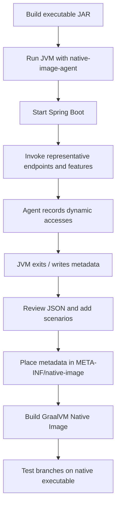

# Running the Application with `native-image-agent` and `config-output-dir`

## 1. Goal: Collecting Metadata from Real Runtime Behavior

GraalVM Native Image analyzes an application at build time. Statically resolved calls are usually handled automatically, but certain dynamic features such as reflection, dynamic proxies, JNI, serialization, or reading resources by name may require **reachability metadata**. If metadata is missing, the application may build successfully yet fail when a specific business branch runs.

The **Tracing Agent** (`native-image-agent`) helps detect dynamic accesses that actually occur while the application runs on the JVM. The agent records behavior and generates JSON files that Native Image can consume during compilation.

In this lesson, we focus on running a Spring Boot application with:

```text
-agentlib:native-image-agent=config-output-dir=<output-directory>
```

The `config-output-dir` option specifies where the agent writes metadata. We will run the application, invoke the endpoints and features to verify, stop the JVM cleanly, inspect the results, add missing scenarios, and only then feed the reviewed metadata into the native build workflow.

This lesson belongs to the **Tracing agent** chapter of the **SPRING_BOOT_NATIVE_IMAGE** module. The module uses Spring AOT and GraalVM Native Image to practice Maven/Gradle builds, reflection/resource configuration, compatibility testing, container packaging, and operating native builds. The Tracing Agent is a tool for gathering evidence of dynamic accesses; it does not replace Spring RuntimeHints or testing the native executable.

After this lesson, learners can:

- Verify the GraalVM JDK and Native Image Agent on the build machine.
- Attach the agent to the exact JVM running the Spring Boot application.
- Use `config-output-dir` to produce an initial metadata set.
- Run additional scenarios and use `config-merge-dir` to append metadata.
- Read, review, and place results under `META-INF/native-image`.
- Test the native executable to catch branches not yet observed by the agent.

## 2. What Does the Agent Do During Execution?

The Tracing Agent uses JVM instrumentation capabilities to record dynamic accesses for which Native Image may need metadata. Depending on the executed code paths, the output can describe:

| Category | Example Operations |
|---|---|
| Reflection | Looking up classes, constructors, methods, or fields by name/signature |
| Resource | Reading classpath files by dynamic name or pattern |
| Dynamic proxy | Creating proxies from an interface list |
| JNI | Accessing Java types/members from native code |
| Serialization | Serializing/deserializing types that require metadata |
| Other dynamic features | Reachability configurations supported by the agent and GraalVM version |

Overall flow:



The agent observes **what actually happens** during the session with the agent attached. It does not analyze all possible future inputs and does not guarantee complete metadata after a single startup.

For example, if an application has two serializers selected by property, but the agent run only exercises the JSON serializer, the metadata may not include the XML serializer's dynamic accesses. To cover both, you must execute both scenarios.

## 3. Preparing the GraalVM JDK and Application

### 3.1. Use the Right Java Binary with Native Image Agent

The Tracing Agent is distributed with GraalVM Native Image. Confirm that `java` and the Native Image tool come from the same GraalVM installation:

```bash
java -version
native-image --version
which java
which native-image
```

On Windows PowerShell:

```powershell
java -version
native-image --version
Get-Command java
Get-Command native-image
```

If `native-image` does not exist, install the Native Image component for your GraalVM distribution following that release's instructions. If you run the application with another JDK that lacks the agent, the JVM may report that it cannot find the agent library at startup.

In examples, prefer invoking `JAVA_HOME/bin/java` directly on Linux/macOS or `JAVA_HOME\bin\java.exe` on Windows so `PATH` does not point to the wrong JDK.

### 3.2. Build the Spring Boot Application as an Executable JAR

The agent must be attached to the **JVM running the application**. The easiest way to control this is to build the executable JAR first, then invoke `java` directly.

With Maven:

```bash
./mvnw -DskipTests package
```

With Gradle:

```bash
./gradlew bootJar
```

Identify the right JAR file in `target/` (Maven) or `build/libs/` (Gradle). If the project produces multiple JARs, pick the Spring Boot executable JAR with packaged dependencies, not `original-*.jar` or a test JAR.

### 3.3. Why Not Attach the Agent Arbitrarily to Maven/Gradle?

The `./mvnw` command launches a JVM for Maven; a plugin may launch another JVM to run the application. If you only add `-agentlib` to `MAVEN_OPTS`, the agent may observe the Maven process instead of the Spring Boot process. In that case, the output will not represent the application's code paths.

The executable JAR approach below makes it clear which JVM is instrumented. If using `spring-boot:run` or `bootRun`, you must pass the agent option to the forked JVM running the application using the plugin's mechanism, not just to the Maven/Gradle daemon.

## 4. Running the Application with `config-output-dir` on Linux/macOS

Create a fresh output directory for the first collection run. Keeping the metadata directory separate from source code makes inspection easier and avoids accidentally reusing stale results:

```bash
mkdir -p target/native-agent-run-01
"$JAVA_HOME/bin/java" -agentlib:native-image-agent=config-output-dir=target/native-agent-run-01 -Dspring.profiles.active=native-agent -jar target/my-spring-app.jar
```

Replace `my-spring-app.jar` with the actual JAR name. If the application does not have a `native-agent` profile, omit that property or replace it with an appropriate profile. The profile is only an example to select the configuration under test; it does not enable Native Image on its own.

**Argument placement matters:** `-agentlib:native-image-agent=...` and JVM options must appear before `-jar`. Any arguments after the JAR name are passed to the Spring Boot application, not treated as JVM options.

After the application starts, the terminal keeps running because it is a server. Keep the process alive to execute the scenarios in the next section. When finished, stop the application via normal shutdown (e.g., Ctrl+C and wait for Spring Boot to terminate). The agent writes metadata when the JVM exits; forcefully killing the process can lose unflushed data.

### Running with Periodic Writes for Long-Running Servers

If you cannot stop the server frequently, you can instruct the agent to write metadata periodically:

```bash
"$JAVA_HOME/bin/java" -agentlib:native-image-agent=config-output-dir=target/native-agent-run-01,config-write-period-secs=300,config-write-initial-delay-secs=10 -Dspring.profiles.active=native-agent -jar target/my-spring-app.jar
```

In this example, the agent begins writing after 10 seconds and continues every 300 seconds. These values are illustrative; choose an interval suited to your test duration. When the JVM exits, the agent still completes its final metadata write according to its lifecycle.

## 5. Running with `config-output-dir` on Windows PowerShell

PowerShell can run the same executable JAR:

```powershell
$agentConfig = ".\target\native-agent-run-01"
New-Item -ItemType Directory -Force -Path $agentConfig | Out-Null
$java = Join-Path $env:JAVA_HOME "bin\java.exe"
& $java "-agentlib:native-image-agent=config-output-dir=$agentConfig" -Dspring.profiles.active=native-agent -jar .\target\my-spring-app.jar
```

Adjust the JAR path and profile for your project. The output directory should be dedicated to a single fresh collection run. Do not mix metadata from different builds or dependency versions unless intentional.

If the Java process runs as a Windows service or is launched by another script, identify the exact child process that needs instrumentation. Adding the agent to the Gradle/Maven daemon JVM does not guarantee the Spring Boot application is observed.

## 6. Executing Representative Application Scenarios

Once the server is running with the agent, call endpoints or business actions in the proper test environment. For example:

```bash
curl --fail --silent --show-error -H 'Content-Type: application/json' -d '{"format":"json","locale":"vi"}' http://localhost:8080/api/reports
curl --fail --silent --show-error -H 'Content-Type: application/json' -d '{"format":"xml","locale":"en"}' http://localhost:8080/api/reports
```

The URLs and payloads above are illustrative; replace them with your application's real endpoints and requests. Do not call only the health endpoint and conclude metadata is complete.

List the code paths to execute:

| Feature Group | Scenarios to Run |
|---|---|
| Reflection | Every implementation/class selected from configuration or a registry |
| Serialization | Every object type serialized/deserialized, including concrete subtypes |
| Resource | Every locale, template, schema, or dynamically constructed resource path |
| Dynamic proxy | Every set of interfaces or proxy factory used |
| JNI | Every callback, class/member accessed by native libraries |
| Framework integration | Endpoints using validation, binding, expressions, mappers, or libraries with dedicated metadata |
| Conditional configuration | Profiles/properties that alter the bean graph and enabled features |

For a server, execute requests using non-sensitive data equivalent to production. If there are batch jobs, schedulers, or message listeners, trigger them in your test harness; starting the server does not mean every consumer has received a message.

### Cover Both Success and Error Branches

Do not run only happy paths. If the application has fallback serializers, exception handlers, retries, missing-plugin cases, or optional data, trigger those branches when relevant to the product. Some reflection/resource paths are only invoked inside error branches or rare configurations.

Never feed secrets, production tokens, or payloads containing personal data into a collection run just to boost coverage. The agent collects dynamic access metadata; test business data must still follow your project's data-protection rules.

## 7. Reading Metadata After the JVM Exits

After stopping the application normally, list the directory contents:

```bash
find target/native-agent-run-01 -maxdepth 2 -type f
```

With current GraalVM versions, the agent may produce a unified `reachability-metadata.json` file. Older releases may produce several separate files depending on the observed access types, such as:

- `reflect-config.json`
- `resource-config.json`
- `proxy-config.json`
- `jni-config.json`
- `serialization-config.json`

Not every file appears on every run. If the application does not use JNI or dynamic proxies in the executed scenarios, the agent may not create configuration for those categories.

Abbreviated structural example of reflection metadata:

```json
{
  "reflection": [
    {
      "type": "com.example.report.CsvReport",
      "methods": [
        {
          "name": "render",
          "parameterTypes": [
            "com.example.report.ReportRequest"
          ]
        }
      ]
    }
  ]
}
```

This is an illustrative example of unified reachability metadata structure, not output collected from the current project. Actual data must come from the files generated by the agent.

### Checking Whether Files Were Written

If the directory is empty or missing expected files:

1. Check whether the agent option was placed before `-jar`.
2. Check whether the app JVM actually ran using a GraalVM JDK with Native Image Agent.
3. Check whether the process exited normally so the agent flushed metadata.
4. Check whether the required code paths were actually executed.
5. Check write permissions on the output directory and JVM startup logs.
6. If using periodic writes, wait through a write interval or stop the process cleanly.

Do not manually create empty JSON files just to let the build proceed; an empty file does not prove the agent observed any accesses.

## 8. Collecting Across Multiple Runs with `config-merge-dir`

A single run rarely covers all behavior. After the initial run with `config-output-dir`, you can re-run the application with `config-merge-dir` pointing to the existing metadata directory. The agent will append new accesses to the existing configuration.

For example, the first run exercises only JSON reports, while the next run exercises XML and PDF:

```bash
# First run: create the initial metadata set.
"$JAVA_HOME/bin/java" -agentlib:native-image-agent=config-output-dir=target/native-agent-config -jar target/my-spring-app.jar
```

After stopping the JVM, run an additional pass:

```bash
# Subsequent run: add new accesses into the same metadata set.
"$JAVA_HOME/bin/java" -agentlib:native-image-agent=config-merge-dir=target/native-agent-config -jar target/my-spring-app.jar
```

During the second run, execute scenarios not covered in the first run and then stop the JVM normally. `config-merge-dir` is suited for accumulating metadata across sequential sessions; do not repeatedly pass `config-output-dir` to a directory that already holds metadata if your goal is to preserve prior data.

If running multiple JVMs in parallel, do not let them write into a shared output directory. Use a separate `config-output-dir` for each process, then merge the configuration sets using `native-image-utils` if your toolchain provides it:

```bash
native-image-utils generate --input-dir=target/agent-run-a --input-dir=target/agent-run-b --output-dir=target/agent-config-merged
```

Check `native-image-utils help` in your installed GraalVM distribution before using it; merging commands and bundled tools can differ by release. If running sequentially, `config-merge-dir` is usually simpler.

## 9. Reviewing Metadata Before Putting It in Source

Agent-generated metadata is **input that requires review**, not automatically approved production configuration.

During review, check:

- Do the types and members belong to the application or dependencies actually deployed?
- Are there entries present only because of a test framework, debug endpoint, or dev tool?
- Are any reflection members exposed more broadly than the needed code paths require?
- Are resource patterns overly broad, e.g., covering entire unrelated resource directories?
- Is there metadata duplicating hints already provided by Spring or libraries?
- Do the profiles/properties and dependency versions during collection match the native build configuration?
- Are any critical code paths still unexecuted?

The agent includes a default caller filter to exclude some accesses that Native Image supports directly. Do not arbitrarily disable built-in filters to make metadata files "fuller"; the resulting configuration can contain many unnecessary entries and become harder to review.

If a dependency already ships reachability metadata in its JAR or via the GraalVM Reachability Metadata Repository, check that first before adding duplicate configuration. Generated metadata should fill in what frameworks and libraries do not already describe.

### Do Not Equate Agent Coverage with Business Coverage

The agent does not produce a coverage percentage proving the application is complete. It only records observed dynamic accesses. A test suite can have high line coverage while missing a plugin selected by a rare property; conversely, a test framework can generate lots of metadata unrelated to production.

Maintain a list of scenarios to execute and map each scenario to the dynamic feature it verifies.

## 10. Adding Metadata to the Spring Boot Project

After reviewing, place the required metadata files on the application's classpath, typically under:

```text
src/main/resources/
└── META-INF/
    └── native-image/
        └── com.example/
            └── spring-app/
                └── reachability-metadata.json
```

The group/artifact path can be adjusted to match project conventions. GraalVM discovers reachability metadata under `META-INF/native-image` on the classpath. When Maven/Gradle packages resources, this file travels inside the executable JAR and is detected by the Native Image build tool.

For Maven and Gradle, the default resource directory is usually `src/main/resources`. You can keep the raw collection directory separately in `target/native-agent-config` or `build/native-agent-config`, and copy only the necessary files into source resources after review. Do not leave experimental output inside the source tree where every agent-generated file could accidentally be committed.

If using an older GraalVM version that emits separate config files, preserve the format supported by that toolchain release. If using the unified `reachability-metadata.json` format, verify the schema and version in the corresponding documentation. Do not rename a legacy file to `reachability-metadata.json` without converting its JSON structure.

## 11. Building and Testing the Native Image After Adding Metadata

Once metadata is on the classpath, run the native build as configured by your project. For example:

```bash
# Maven: use the native profile configured for Spring AOT/GraalVM.
./mvnw -Pnative native:compile

# Gradle: project already applies Spring Boot and Native Build Tools.
./gradlew nativeCompile
```

The exact goal/task depends on Spring Boot, GraalVM Native Build Tools, and your Maven/Gradle configuration. Some projects use `spring-boot:build-image` or `bootBuildImage` to build a container image. The key requirement is that the reviewed metadata sits on the native build classpath.

After building:

1. Run the newly built native executable.
2. Re-run every scenario that was executed with the agent.
3. Add tests for important branches that the agent did not observe.
4. Confirm reflection, resources, proxies, serialization, or JNI work properly.
5. Run smoke tests in the final container image if the product is deployed as a container.

If the JVM run works but the native executable fails, inspect the error to identify missing metadata or an incompatible dependency. Add the proper hint at the source and rebuild; do not treat the mere existence of an agent-generated JSON file as proof the native app works.

## 12. Running the Agent in Other Spring Boot Workflows

### Using Maven `spring-boot:run`

The Spring Boot Maven Plugin can fork a JVM for the application. If you want to attach the agent when using `spring-boot:run`, pass JVM arguments to the application process via plugin configuration, for example:

```bash
./mvnw spring-boot:run -Dspring-boot.run.jvmArguments="-agentlib:native-image-agent=config-output-dir=target/native-agent-config"
```

Verify logs and the running process to ensure the agent was loaded into the application JVM. When using an executable JAR, the approach in Section 4 is simpler and avoids confusing the Maven JVM with the application JVM.

### Using Gradle `bootRun`

Configure JVM args for the `bootRun` task in `build.gradle`:

```groovy
tasks.named("bootRun") {
    jvmArgs(
        "-agentlib:native-image-agent=config-output-dir=build/native-agent-config"
    )
}
```

Or run the task once configured. JVM args must reach the process running the application. Adding the agent only to the Gradle daemon may fail to observe the application.

### Using `JAVA_TOOL_OPTIONS`

When you do not directly control the Java launch command, you can pass the agent via `JAVA_TOOL_OPTIONS`. Use caution because this environment variable is inherited by child Java processes. If Maven, Gradle, and the application all pick up the variable, each process can write its own data; use per-process output directories as supported by the agent, or choose a method that attaches the agent directly to the application JVM.

Do not set `JAVA_TOOL_OPTIONS` globally at the machine/CI level permanently just for a collection session. Scope the variable strictly to the job or process you want to instrument.

## 13. Common Errors and Troubleshooting

| Symptom | Possible Cause | Resolution |
|---|---|---|
| `Could not find agent library native-image-agent` | JVM is not using a GraalVM JDK with the agent or Native Image component is not installed | Check `JAVA_HOME`, `java -version`, `native-image --version` |
| App runs but output directory is empty | Agent was not attached to the app JVM or did not flush on exit | Check option placement, child processes, and shutdown |
| Metadata exists but plugin class is missing | Scenario selecting that plugin was never executed | Run the missing scenario and merge with `config-merge-dir` |
| Metadata contains many unrelated entries | Agent observed test/debug/dev paths | Review callers, scenarios, and accesses; remove unneeded entries |
| Native run still reports missing reflection | Agent did not execute that branch or hints were not placed on the classpath | Check scenario, metadata files, and `META-INF/native-image` location |
| Native build ignores metadata | File placed outside classpath or wrong format/version | Place under `src/main/resources/META-INF/native-image` and verify schema |
| Subsequent run overwrites old metadata | Reused `config-output-dir` instead of merging | Use `config-merge-dir` for follow-up runs |
| Two JVMs overwrite/collide with each other | Shared output directory while running concurrently | Give each process its own directory and then merge |
| Force-killing server loses files | Agent did not have time to flush metadata | Use clean shutdown or enable periodic writes |
| Only resource config exists, missing reflection | Executed scenarios did not perform the needed reflection | Trigger reflection paths or check framework/library hints |

## 14. Hands-on Exercises

### Exercise A — Collect Metadata for a Spring Boot Endpoint

1. Build the executable JAR.
2. Run the JAR with a GraalVM JDK using `config-output-dir`.
3. Call an endpoint that uses a dynamic serializer or mapper.
4. Stop the JVM cleanly.
5. Inspect the generated JSON files and identify the entry related to the endpoint.

**Completion criteria:** metadata is written by the agent and you can explain which code path produced that entry.

### Exercise B — Merge Two Configurations

First run: invoke the JSON endpoint. Second run: invoke the XML endpoint or another plugin using `config-merge-dir`. Compare metadata before and after merging, pointing out the new entries and why the second scenario was necessary.

### Exercise C — Re-run on Native Image

Place the reviewed metadata into `src/main/resources/META-INF/native-image`. Build the native executable and invoke both endpoints again. Record any errors, add needed metadata, and rebuild/retest.

### Exercise D — Verify Coverage

List the reflection, resources, proxies, serialization, and JNI used by your application. Mark which scenarios were run with the agent and which were tested on the native executable. Explain why a single successful startup does not prove all metadata is sufficient.

## 15. Checklist Before Handing Off Metadata

- [ ] Confirmed the JVM running the application is a GraalVM JDK with Native Image Agent.
- [ ] Placed the agent option before `-jar` or the application's main class name.
- [ ] Chose a dedicated `config-output-dir` for the first collection run.
- [ ] Executed representative endpoints, plugins, profiles, and business branches.
- [ ] Stopped the JVM cleanly or enabled periodic writes where needed.
- [ ] Used `config-merge-dir` for follow-up collection runs.
- [ ] Reviewed JSON files, removing test-only metadata and unneeded entries.
- [ ] Checked hints/metadata already provided by Spring and dependencies.
- [ ] Placed reviewed metadata inside `META-INF/native-image` on the classpath.
- [ ] Built the Native Image and re-ran scenarios on the binary.
- [ ] Verified the final container image if deploying as a container.

## References

- [GraalVM — Configure Native Image with the Tracing Agent](https://www.graalvm.org/latest/reference-manual/native-image/guides/configure-with-tracing-agent/): enabling `native-image-agent`, `config-output-dir`, `config-merge-dir`, reachability metadata formats, and coverage limits.
- [GraalVM — Collect Metadata with the Tracing Agent](https://www.graalvm.org/reference-manual/native-image/Agent/): agent options, periodic metadata writes, caller/access filters, and merging outputs.
- [Spring Boot — Advanced Native Image Topics](https://docs.spring.io/spring-boot/reference/packaging/native-image/advanced-topics.html): combining Spring AOT, RuntimeHints, and Native Image.
- [GraalVM Native Build Tools](https://graalvm.github.io/native-build-tools/latest/): configuring Maven/Gradle plugins to build native executables.

## Conclusion

To collect metadata for Spring Boot Native Image, attach `native-image-agent` to the **JVM actually running the application**, using `config-output-dir` for the first run and `config-merge-dir` for supplemental runs. Execute representative scenarios, stop the JVM so the agent writes results, review the JSON, and place the required metadata in `META-INF/native-image` on the classpath. Because the agent only records executed dynamic accesses, combine a scenario checklist, Spring RuntimeHints, Native Image testing, and final container verification. When all of these steps are completed, the collected metadata provides a solid foundation for building and operating the native executable.
