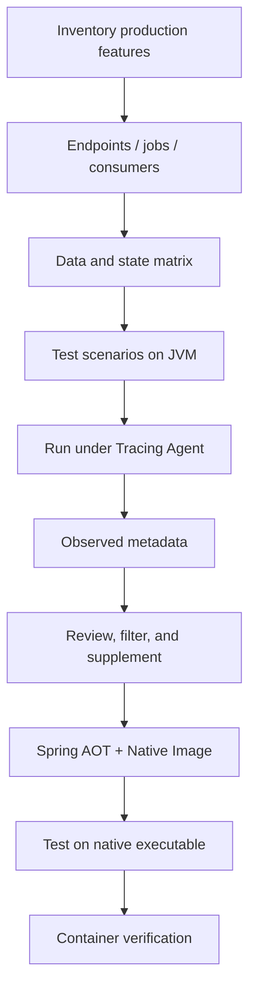

# Designing Scenarios to Exercise Endpoints, Data, and Integration Branches Requiring Support

## 1. Why Does the Tracing Agent Need Intentional Scenarios?

The GraalVM Native Image Tracing Agent observes an application running on the JVM and records certain dynamic operations that actually occurred, such as reflection, resource lookups, JDK proxies, serialization, or JNI. From those observations, the agent generates suggested metadata so Native Image can handle operations that static analysis cannot fully infer on its own.

The agent only records what was executed. If the test suite merely starts Spring Boot and calls the health endpoint, the agent cannot know on its own which classes, methods, and resources will be needed by PDF generation endpoints, CSV imports, message processing, migrations, or fallback branches.

Therefore, the quality of the generated metadata depends directly on your **test scenarios**. You need to inventory the endpoints, data types, business states, and integration branches that require support, then design tests to walk through every meaningful execution path. The goal is to gather evidence-backed metadata with adequate scope, not to produce a huge configuration file from a single app startup.

In the **SPRING_BOOT_NATIVE_IMAGE** module, this workflow sits between JVM testing and the native build: run the application under the Tracing Agent with representative data, review the output, integrate metadata into Spring AOT/Native Image, and then re-verify on the native executable and target container.



## 2. What Does the Agent Record and What Does It Not?

The Tracing Agent monitors certain dynamic activities of a JVM process. Depending on the GraalVM version and configuration options, the output may include metadata related to:

- Reflection: classes, constructors, methods, and fields accessed via reflection.
- Resource: classpath resources searched for or read.
- Proxy: JDK dynamic proxies with their generated interfaces.
- Serialization: types used in Java serialization operations.
- JNI: observed JNI interactions.

The agent is not a tool that analyzes every possibility in source code. It cannot record unexecuted branches, unseen data, uncalled endpoints, or errors that only occur on another platform. Nor does it prove a library is Native Image-compatible merely because no error occurred when running the JVM under the agent.

Some runtime mechanisms such as arbitrary bytecode generation, compiling new classes, or instrumentation cannot be made compatible simply by collecting metadata. When encountering such mechanisms, check the library's AOT/native support and consider changing the design.

## 3. Start with an Inventory of Production Features

Before running the agent, list the capabilities the application actually delivers. With Spring Boot, do not list only controller endpoints; also account for background jobs, message consumers, scheduled tasks, event listeners, and conditional initialization flows.

Example of an order-processing service:

| Group | Feature to Check | How to Trigger |
|---|---|---|
| HTTP | Create order | POST request with valid data |
| HTTP | Read order details | GET by existing ID |
| HTTP | Update status | PATCH with a valid status |
| HTTP | Validate request | Send missing fields, invalid format |
| HTTP | Export invoice | Call the PDF generation endpoint |
| Messaging | Receive payment event | Publish a representative message |
| Scheduling | Close expired orders | Run the job with expired data |
| Persistence | Migration/schema | Initialize the test database |
| Error handling | Provider timeout | Simulate timeout and trigger fallback |
| Security | Protected routes | Call with the corresponding principal/role |

The inventory should reflect production configuration and actually released features. You do not need to trigger internal-only endpoints or undeployed modules; however, explicitly document the scope excluded from the native artifact if any.

## 4. Build an Endpoint and Data-Branch Matrix

A single endpoint can have multiple internal paths. Calling an endpoint once with valid data is usually not enough.

Example import endpoint:

| Variant | Data | Branch to Traverse |
|---|---|---|
| Valid CSV | UTF-8, standard header, multiple rows | Primary parser |
| CSV with Vietnamese diacritics | Unicode characters | Charset/normalization |
| Empty CSV | Header only | Empty result |
| CSV missing columns | Incomplete schema | Validation error |
| CSV with optional columns | Optional fields present/absent | Mapping condition |
| Large file | Many rows | Streaming/buffering |
| Malformed file | Non-CSV content | Parser exception |
| Missing mapping resource | Absent mapping file | Fallback/error path |

This matrix helps distinguish **endpoint coverage** from **branch coverage**. Calling an endpoint does not mean its internal branches were executed.

You do not need to enumerate every possible data combination. Choose meaningful equivalence classes and boundaries, especially variants that can trigger different classes, resources, providers, or serializers.

## 5. Cover Branches That Affect Metadata

Prioritize branches that can change the set of used classes, members, or resources:

- Different subtype variants in JSON payloads.
- Polymorphic deserialization with discriminators.
- Serializers/mappers selecting implementations by type.
- Templates, schemas, fonts, or message bundles selected by name.
- Plugins/providers discovered from configuration.
- JDK proxies or interceptors created only when a bean/feature is used.
- Custom validators that run only on specific data.
- JNI backends invoked only for a specific algorithm or format.
- Fallbacks triggered only when an external service times out or returns an error.
- Profile/conditional beans present only in the target configuration.

For example, the same endpoint accepts the base type `PaymentMethod`, while the payload may be `CardPayment`, `BankTransfer`, or `WalletPayment`. If you only test `CardPayment`, the agent may not record reflection/serialization metadata for the other two subtypes.

## 6. Design Representative and Boundary Data

Test data should cover:

1. **Common values**: typical flows seen in production.
2. **Boundaries**: min/max, empty strings, single-element collections, or size limits.
3. **Optional/null**: omitted fields, nulls, or default values.
4. **Polymorphism**: every supported subtype.
5. **Locale/encoding**: languages and charsets declared by the application.
6. **Controlled errors**: malformed data, missing records, or exceeded limits.
7. **Volume**: small/large payloads if they alter code paths or streaming strategies.

Do not feed sensitive production data into trace runs without appropriate safeguards. Use synthetic fixtures stripped of personal data, tokens, and secrets. While the agent primarily records operation metadata, application logs, exceptions, or test outputs can still contain input data.

## 7. Cover Profiles and Build-Time Configuration

Spring AOT processes the application context according to the profiles/properties active at AOT time. Therefore, tracing runs must use configuration matching the target native artifact.

If production builds with the `prod` profile, run trace scenarios with the corresponding profile and dependency graph. If different profiles produce different bean graphs requiring separate native artifacts, run dedicated scenarios for each artifact.

Record:

- Active profiles when launching the JVM under the agent.
- Properties toggling features on/off.
- Selected beans/implementations.
- Runtime dependency graph.
- JDK and library versions.
- Locale/timezone if they affect resources or formatting.
- Executed endpoints/jobs/message consumers.

Do not assume setting `SPRING_PROFILES_ACTIVE=prod` at native runtime will recreate a bean excluded from the AOT context. Running traces on the JVM with the wrong profile can also produce metadata that does not reflect the built application structure.

## 8. Cover Message Consumers and Scheduled Jobs

Not every code path has an HTTP endpoint. For applications using Kafka/RabbitMQ or schedulers, trigger them intentionally.

Consumer examples:

- Valid messages for each event type.
- Events with optional fields or different subtypes.
- Duplicate messages to exercise idempotency paths.
- Invalid messages to exercise dead-letter/error handling.
- Failing downstream providers to exercise retry/fallback.

For scheduled jobs:

- Data present to process.
- No data present.
- Time-boundary data.
- A failing record within a batch.
- External dependency timing out or unavailable.

Use test brokers/databases and a controllable clock if possible. Do not let jobs run on random timing during tracing, as results will be hard to reproduce.

## 9. Cover External Integration Branches

An integration may have multiple implementations selected by configuration. For example, an application sends emails via SMTP or an HTTP provider; stores files locally or in object storage; or processes payments through multiple gateways.

Test each implementation packaged in the artifact. If only one provider is enabled in the production profile, document that the other providers are outside the verification scope. If runtime allows switching providers, every selectable provider must be in the graph and covered by tests.

For network failures, use a mock server or test container to reproduce:

- Success.
- Timeout.
- HTTP errors.
- Responses missing fields.
- Retry succeeding after a failure.
- Fallback when the primary provider is unavailable.

Do not depend on live production systems to produce traces; tests must be repeatable and free of unintended side effects.

## 10. Running the Tracing Agent with a Test Suite

Tracing Agent syntax depends on the GraalVM version. A common form when running a JVM application is:

```bash
java -agentlib:native-image-agent=config-output-dir=build/native-agent-config \
  -jar build/libs/api-app.jar
```

With Maven, the JAR path is usually under `target/`; with Gradle, it may be under `build/libs/`. Identify the right artifact and use the matching GraalVM JDK.

You can attach the agent to a single application run and then send requests/test scenarios to that process. For integration tests, configure the test JVM process to load the agent or run the application under the agent while executing test clients from another process. How you attach the agent to test tasks depends on Gradle/Maven and plugins; verify the actual command line of the test JVM process.

Do not assume the syntax above applies identically to every GraalVM release. Check `native-image-configure`/Tracing Agent documentation and `java -agentlib:native-image-agent=help` for your installed version to confirm supported options.

## 11. Organize Trace Runs into Repeatable Suites

Instead of one long run where it is unclear what was exercised, split scenarios into suites:

| Trace suite | Scope | Examples |
|---|---|---|
| Core API | Primary business endpoints | create/read/update |
| Validation | Valid and invalid data | missing, boundary, nested DTO |
| Serialization | JSON subtypes and Java serialization if used | polymorphic payloads |
| Resource | Templates, SQL, schemas, message bundles | each resource family |
| Proxy/AOP | Beans with advisors, transactions, security | calling through Spring proxies |
| Integration | Providers and fallbacks | timeout, retry, error |
| Background | Consumers/jobs/listeners | messages and scheduled tasks |

Suites help track which scenario produced which metadata and highlight when a suite has not been run. However, metadata outputs from multiple runs may need tool/version-specific merging; do not concatenate JSON files via manual text editing when the schema requires structured merging.

## 12. Cover Reflection and Polymorphic Data

If a library uses reflection, create scenarios that trigger each access type:

- Instantiation via constructor.
- Looking up/invoking methods if the application uses them.
- Reading/writing fields if a mapper requires it.
- Loading classes by name if a plugin system does so.
- Reading annotations or generic metadata if frameworks rely on them.

For JSON polymorphism, test every allowed subtype. For example:

```java
sealed interface PaymentCommand
        permits CardCommand, BankCommand, WalletCommand {}

record CardCommand(String token) implements PaymentCommand {}
record BankCommand(String account) implements PaymentCommand {}
record WalletCommand(String walletId) implements PaymentCommand {}
```

Testing only with `CardCommand` does not cover `BankCommand` and `WalletCommand`. Provide payload fixtures for each subtype and verify deserialization and business behavior. Hints should reflect the actually supported subtypes; do not allow arbitrary classes from external data.

## 13. Cover Resource Lookups

Create scenarios that read every resource group:

- Templates by name.
- SQL migrations or query files.
- JSON/XML schemas.
- Message bundles by locale.
- Fonts, public certificates, or default data files.
- Resources packaged inside dependency JARs.

If resource names are constructed dynamically, test valid names from an allowlist. A trace run that does not read a file will not record that resource lookup.

Distinguish classpath resources from runtime filesystem files. Classpath resources may need hints to be packaged; externally mounted files must be provisioned in the container and must not be added to resource metadata merely because the application reads them.

## 14. Cover Proxies and AOP

If the application uses Spring AOP, invoke methods through beans obtained from the Spring context so proxies and advisors are triggered. Do not instantiate the target with `new` and call it directly, as that bypasses the proxy.

Scenarios should include:

- Beans with transaction advice.
- Beans with security/interceptors.
- Methods matching a pointcut.
- Methods not matching a pointcut if you need to verify boundaries.
- Exception paths inside advice.
- Interface-based and class-based proxies if the app actually uses both.
- Self-invocation if business logic depends on that behavior.

JDK proxies and class-based proxies are two distinct mechanisms. Tracing a JDK proxy does not prove that a library generating arbitrary subclasses is supported in Native Image.

## 15. Cover Serialization and JNI

If the application uses Java serialization, test round-trips for actual root types and subtypes; trigger custom `writeObject`, `readObject`, `writeReplace`, or `readResolve` if present. Do not serialize Spring beans/proxies just to boost coverage if the architecture does not support it.

If a dependency uses JNI, actually invoke APIs that cross the native boundary. Simply starting the application or creating a bean does not guarantee the native library was loaded. Run scenarios in an environment with the exact target OS/architecture and corresponding native dependencies.

The Tracing Agent can help generate metadata for observed activities, but it does not replace verifying shared libraries, ABI, runtime images, and permissions.

## 16. Review Metadata After Tracing

Agent-generated metadata is evidence of observed operations, not a final configuration to be accepted automatically.

Review using these questions:

1. Which classes/members/resources/proxies/types were recorded?
2. Which feature/test scenario does each entry belong to?
3. Are there entries created by the test framework or tooling that are unnecessary in production?
4. Are there classes/resources originating from unsafe test data?
5. Are any entries broader than required, such as exposing all methods/fields of a class?
6. Are any important production code paths missing from the output?
7. Does the metadata match the target schema and GraalVM version?
8. Are hints already provided by Spring/frameworks being declared redundantly?

Do not delete an entry solely because a class name looks unfamiliar; first identify whether it comes from a framework, test, or runtime. Conversely, do not blindly keep every entry if the output includes test-only dependencies or classes not part of the product.

## 17. Merge Trace Outputs in a Controlled Way

If running multiple suites produces multiple output directories, use the metadata merge/conversion tool supported by that GraalVM version. Avoid merging JSON manually as text, which can introduce duplicate keys, invalid schemas, or broken structure.

Record:

- Agent invocation command and version.
- JVM args and system properties.
- Application profiles/properties.
- Executed test suites/scenarios.
- Timestamp and commit.
- Corresponding output directory.
- Merge tool and command.
- Review outcomes and the metadata fed into the build.

Retain raw trace outputs as investigation artifacts in CI if reproducibility is needed; only reviewed and approved metadata should serve as official input to the native build.

## 18. From Trace Metadata to Native Image

After reviewing:

1. Place metadata in a location supported by the Spring/GraalVM toolchain.
2. If appropriate, move library/application requirements into a `RuntimeHintsRegistrar` so metadata is managed within Spring AOT.
3. Run AOT with the right profile and dependency graph.
4. Build the Native Image.
5. Re-run all feature tests on the executable.
6. Run container integration tests on the target OS/architecture.
7. Compare runtime errors against the JVM baseline and update metadata based on evidence.

Do not treat dropping trace JSON into the source tree as the final step. Verify that the build tool actually consumes the file; discovery paths and mechanisms depend on the GraalVM/Spring Boot version.

## 19. Measurable Coverage vs. Uninferable Coverage

Tracing coverage should be tracked by feature and scenario, not merely by lines of code or endpoints called.

A tracking table:

| Feature | Planned Scenarios | Run Under Agent | Tested on Native | Notes |
|---|---|---|---|---|
| Create order | Valid + boundary | Yes/No | Yes/No | … |
| Export PDF | Font, locale, image | Yes/No | Yes/No | … |
| Import CSV | Unicode, empty, malformed | Yes/No | Yes/No | … |
| Message consumer | Each event type | Yes/No | Yes/No | … |
| Provider fallback | Timeout/error | Yes/No | Yes/No | … |
| Serialization | Each subtype/root type | Yes/No | Yes/No | … |

Agent output does not directly tell you that every production feature is covered. Coverage must be cross-checked against a test catalog maintained by the team. Do not use metadata entry count as a quality metric; many entries may just reflect a test framework or overly broad configuration.

## 20. Avoiding Common Pitfalls During Tracing

| Mistake | Consequence | How to Improve |
|---|---|---|
| Calling only the health endpoint | Misses business features | Build scenarios per endpoint/job/message |
| Using only happy-path data | Misses subtypes and fallbacks | Add boundary, optional, malformed, and error cases |
| Running with the wrong profile | Metadata does not match the AOT bean graph | Align target profiles/properties |
| Tests do not trigger JNI | Native library issues go undetected | Call APIs that actually cross JNI |
| Running tests on a different JVM version | Results do not represent the toolchain | Use the exact target JDK/GraalVM and dependencies |
| Keeping all agent output | Bloat and hard-to-audit metadata | Review and link entries to scenarios |
| Merging JSON manually as text | Risks schema breakage | Use official metadata tooling |
| Stopping once build passes | Runtime remains unverified | Run native/container feature tests |
| Using sensitive production data | Risk of data leaks in logs/fixtures | Use synthetic fixtures and secret-safe setups |

## 21. Example Trace Plan for a Spring Boot Service

Suppose a service provides an invoice-creation API, consumes payment events, and exports PDFs. A minimal plan could include:

1. Start the application with the target AOT profile.
2. Send a valid invoice-creation request.
3. Send a request with an invalid email and missing fields to trigger validation.
4. Create an invoice for each payment method subtype.
5. Publish both a payment-succeeded event and a payment-rejected event.
6. Trigger retry/fallback via a mock provider timeout.
7. Call the PDF export endpoint with each supported locale/font.
8. Run migration/schema initialization if used by the application.
9. Trigger scheduled tasks if they belong to the production artifact.
10. Stop the application, review metadata, build native, and re-run the same scenarios.

This is a scope example; your team must substitute the service's actual features. If a branch is unsupported in the native artifact, document it clearly and ensure no production configuration can accidentally trigger it.

## 22. Checklist Before Accepting a Trace Run

- The inventory of endpoints, jobs, consumers, and event listeners has been created.
- Each feature has valid, boundary, and key error test data.
- Subtypes/polymorphic payloads are exercised.
- Profiles/properties and runtime dependency graph match the target.
- Relevant reflection, resource, proxy, serialization, and JNI paths have been invoked.
- Critical provider timeout/fallback/error paths have been tested.
- The Tracing Agent ran with the exact target GraalVM/JDK version.
- Output has been reviewed rather than fed raw into the build.
- Metadata is integrated into Spring AOT/Native Image via the version-appropriate mechanism.
- The native executable and container re-run the same feature scenarios.
- Test reports are tied to commit, profile, platform, and artifact digest.

## 23. Self-Check Questions

1. Why can the Tracing Agent not detect metadata for an endpoint that was never called?
2. What is the difference between endpoint coverage and branch/data coverage?
3. Why must you test every subtype of a polymorphic payload?
4. How does the AOT profile affect metadata and the bean graph?
5. Why must you genuinely trigger JNI, serialization, and fallback paths?
6. Why does trace output need review before being used in the build?
7. How can you tell whether a metadata entry came from a test framework or a production feature?
8. What evidence is required after tracing to conclude a feature is Native Image-compatible?

**Remember:** The Tracing Agent only records dynamic operations that actually happened. Build a matrix of endpoints, data, states, and integration branches; run intentional scenarios under the right profile/toolchain; review metadata; and re-verify each feature on the native executable and target container.
