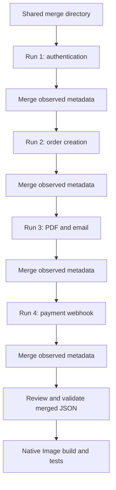

# `config-merge-dir` When Combining Multiple Collection Runs

## 1. Why Merge Multiple Tracing Runs?

GraalVM Native Image uses a closed-world model: required classes, members, resources, proxies, and dynamic access capabilities must be known during the build. With Spring Boot applications, not every path is executed in a single test run. One test pass might only go through login; another exercises report export, payment processing, or partner integrations.

The **Tracing agent** observes runtime operations during a JVM run and records corresponding metadata. If each run writes to a separate directory, the team must consolidate the results before feeding them into Native Image. The **`config-merge-dir`** option supports capturing and merging configurations observed across multiple runs into the same configuration directory.

In the **SPRING_BOOT_NATIVE_IMAGE** module, this technique is useful when building metadata from multiple test scenarios: smoke tests, integration tests, rare business flows, different profiles, or varied input data.

Remember: the tracing agent only records what actually happened during the observed runs. Merging multiple runs broadens coverage, but does not by itself prove every runtime path is covered.

## 2. What Types of Configuration Does the Tracing Agent Generate?

The tracing agent attaches to the JVM via an agent option. When the application performs dynamic operations, the agent can record corresponding metadata. Depending on the GraalVM version and the APIs used, the output directory may contain files such as:

| Config File | Typical Recorded Contents |
|---|---|
| `reflect-config.json` | Types, constructors, methods, and fields accessed via reflection |
| `resource-config.json` | Classpath resources accessed |
| `proxy-config.json` | Interface combinations used to create dynamic proxies |
| `jni-config.json` | Types/members accessed via JNI |
| `serialization-config.json` | Types used in Java serialization |
| `predefined-classes-config.json` | Certain dynamically defined classes, depending on version/configuration |
| Other metadata files | Runtime capabilities supported by the active GraalVM version |

Not every version generates all of these files. Metadata structure, schemas, and filenames can vary across GraalVM releases. Check the actual output and the documentation for your exact version.

With Spring Boot, many frameworks and dependencies already supply reachability metadata or RuntimeHints. Tracing output should be treated as supplemental workload evidence, not as a default replacement for official library metadata.

## 3. Distinguishing `config-output-dir` and `config-merge-dir`

The two options serve different purposes:

- **`config-output-dir`**: writes the configuration collected by the agent to the specified directory when the run finishes. This is the right choice when creating a separate output set for a single run.
- **`config-merge-dir`**: merges newly collected configuration into existing configuration in the specified directory, allowing multiple runs to append metadata into the same configuration set.

Example of a standalone run:

```bash
java \
  -agentlib:native-image-agent=config-output-dir=target/native-config/run-login \
  -jar target/orders-service.jar
```

Example using a merge directory:

```bash
java \
  -agentlib:native-image-agent=config-merge-dir=target/native-config/merged \
  -jar target/orders-service.jar
```

On the next pass, run the JVM again with the same `config-merge-dir` so the agent adds newly observed entries into the existing configuration set.

Do not confuse merging with overwriting output. When you need to preserve separate evidence per scenario, use separate output directories and then run a controlled consolidation step; when you want the agent to update an accumulating configuration set directly, use a merge directory as documented for your GraalVM version.

## 4. Multi-Scenario Merging Model

Suppose the Order API service has these flows:

1. User login and authentication.
2. Order creation and JSON deserialization.
3. PDF invoice export using an external library.
4. Email notifications and template loading.
5. Payment webhook handling.
6. Background job execution and proxy/service adapter creation.

A run that only executes login will not record reflection/resource/proxy operations that appear only in the other flows.



Each scenario expands coverage. When all runs target the same merge directory, the agent retains metadata observed in prior runs and adds new entries.

## 5. Preparing a Safe Merge Directory

Before collecting:

- Choose a dedicated directory inside build output, such as `target/native-config/merged`.
- Ensure the test process has read/write permissions for the directory.
- Do not place the merge directory inside a source directory packaged as application resources.
- Record the GraalVM/JDK version and command line used for collection.
- Decide whether to keep an existing configuration set or start a clean collection pass.
- If metadata is a CI artifact, store it alongside the commit/branch or build identity.

PowerShell example:

```powershell
$configDir = "target/native-config/merged"
New-Item -ItemType Directory -Force -Path $configDir | Out-Null
```

POSIX shell example:

```bash
mkdir -p target/native-config/merged
```

Do not delete the merge directory between scenarios if the goal is accumulating results. If you need to start fresh, archive it or create a new directory tagged by build identity to preserve traceability.

## 6. First Run: Collecting Baseline Metadata

Launch the application on the JVM with the agent and merge directory:

```bash
java \
  -agentlib:native-image-agent=config-merge-dir=target/native-config/merged \
  -jar target/orders-service.jar
```

After the application starts, run a baseline test group such as health checks, authentication, and configuration loading. When the process exits normally, the agent writes/merges the collected configuration according to the installed GraalVM version's behavior.

For a server application, make sure tests actually send requests to the process running the agent. Simply starting and stopping the application will not generate metadata for endpoints that were never called.

If the test runner and application run in two separate JVM processes, the agent must be attached to the application process being observed. Attaching the agent only to the Maven Surefire/Failsafe JVM does not automatically observe an independently launched server process.

## 7. Subsequent Runs: Adding More Scenarios

Keep the same merge directory and relaunch the application for remaining scenarios:

```bash
java \
  -agentlib:native-image-agent=config-merge-dir=target/native-config/merged \
  -jar target/orders-service.jar
```

Each run exercises a different integration test group. For example:

| Run | Scenario | Operations That May Be Recorded |
|---|---|---|
| 1 | Authentication | Security metadata, user model, token parsing |
| 2 | Create order | JSON DTOs, constructors, validation |
| 3 | PDF export | Templates, fonts/resources, serializer |
| 4 | Payment webhook | Polymorphic payloads, partner SDK |
| 5 | Email notification | Mail templates, message bundles |
| 6 | Scheduled job | Proxies, reflection in job framework |

This is an example of how to split coverage; exact metadata depends on implementations and libraries. Do not assume one scenario always produces a single JSON file or a single hint type.

Run passes sequentially when multiple processes update the same merge directory, unless your GraalVM version documentation explicitly confirms safe concurrent writes. Running sequentially prevents file-write contention and makes it easy to trace which scenario changed the output.

## 8. Separate Per-Run Outputs or Direct Merge?

There are two valid workflows.

**Direct merge:** every run uses the same `config-merge-dir`. This is simple when runs execute sequentially and the goal is accumulating metadata in one directory.

**Separate outputs then consolidate:** each scenario uses its own `config-output-dir`, then the team reviews and merges them using a tool-supported pipeline step. This preserves per-scenario evidence, making comparisons and tracing entry origins easier.

| Criterion | Direct Merge | Separate Outputs |
|---|---|---|
| Directories to manage | One cumulative directory | One directory per scenario |
| Tracing entry origin | Harder without saved logs | Easy to correlate per scenario |
| Re-running one scenario | Can merge more into the current set | Can generate fresh output and diff |
| CI workflow | Simpler | Needs a consolidation step |
| Debugging unexpected metadata | Must diff before/after snapshots | Can inspect individual run outputs |

Do not concatenate JSON with simple text operations. Metadata has strict structure and schemas; merging must preserve Native Image's format and semantics.

## 9. Example CI Workflow Using a Merge Directory

A pipeline can split tests by group while targeting the same output directory. Illustrative shell example:

```bash
CONFIG_DIR=target/native-config/merged
mkdir -p "$CONFIG_DIR"

java -agentlib:native-image-agent=config-merge-dir="$CONFIG_DIR" \
  -jar target/orders-service.jar &
APP_PID=$!

# Run authentication tests
./scripts/test-auth.sh

kill "$APP_PID"
wait "$APP_PID" || true

java -agentlib:native-image-agent=config-merge-dir="$CONFIG_DIR" \
  -jar target/orders-service.jar &
APP_PID=$!

# Run order and payment tests
./scripts/test-orders-and-payment.sh

kill "$APP_PID"
wait "$APP_PID" || true
```

This is pipeline pseudocode: test scripts must know the base URL, the process needs a readiness check before receiving requests, and stopping the process must give the agent a chance to flush metadata. In real CI, use a trap/cleanup handler to stop the server even if tests fail, while preserving logs and exit codes separately.

Do not use `kill -9` for normal shutdown because the process gets no chance to run shutdown hooks or flush output. Prefer graceful shutdown via an endpoint or runtime-supported signal.

## 10. Why Must the Process Shut Down Cleanly?

The tracing agent typically writes output when the JVM exits or according to the version/config flush mechanism. If the process is forcefully terminated, files may be incomplete or new data may fail to merge.

In a server test workflow:

1. Start the process and wait for readiness.
2. Send all requests for the scenario.
3. Wait for requests to finish.
4. Send a graceful shutdown signal or invoke the appropriate stop mechanism.
5. Wait for the process to exit.
6. Verify the merged output was updated before starting the next pass.

If the application does not have a safe shutdown endpoint, use a process supervisor or the test harness's process management. Do not expose a broad remote shutdown endpoint in production solely for tracing.

## 11. Inspecting Contents After Each Run

After each scenario, verify:

- Whether the merge directory has new or modified files.
- Whether the JSON parses cleanly.
- That file sizes are reasonable and not empty.
- That newly added entries relate to the scenario just executed.
- That previously needed metadata is still intact.
- That there are no local machine paths, sensitive data, or unintended entries.
- That logs confirm the agent attached to the right process.

Use a JSON parser/linter to validate syntax. Do not edit manually without understanding the schema. If metadata edits are needed, perform them in a dedicated review step, document the changes, and run native tests to confirm.

An unchanged file after a scenario is not necessarily an error: the scenario may not have hit any new dynamic access paths, or the library may already be covered by existing metadata.

## 12. Merging Does Not Mean Removing Redundant Entries

A merged config set accumulates observed entries. If tests cover many branches or environments, output may contain metadata unnecessary for the final release. For example, a test fixture might trigger a serializer for a test-only class or debug endpoint.

Therefore, after merging, review:

- Does the entry belong to production code or only test tooling?
- Is the class/member/resource still used?
- Is the entry already provided by official dependency metadata?
- Is there an overly broad configuration caused by tests running reflection scans?
- Are there paths/resources that exist only on the CI machine?
- Is there data from a profile or feature disabled in production?

Do not delete an entry merely because it looks rarely used. Verify via code paths, upstream metadata, and native integration tests. Conversely, do not blindly keep every entry if it exposes unsuitable environment details or bloats the image unnecessarily.

## 13. Different Profiles and Environments

If the application has multiple profiles, identify which profile represents the bean structure and runtime paths to be released. For example:

- `local`: uses mock clients and an in-memory database.
- `staging`: uses partner sandboxes.
- `production`: uses real adapters and security configurations.

Tracing on the `local` profile cannot by itself prove metadata for all production paths. You may need to run additional scenarios with the appropriate profile in a safe environment, without using production credentials or sending live transactions.

If profiles alter the bean graph via `@Profile` or `@ConditionalOnProperty`, metadata collected from different processes does not automatically combine into a single native image containing all beans. Tracing config only records runtime accesses; Spring AOT still builds the context structure from the structural configuration active at build time.

For multiple bean topologies, you may need separate artifacts per profile or a design where required implementations coexist and are selected via runtime properties.

## 14. Avoiding Sensitive Data in Tracing Output

Tracing output can contain class names, method names, resource paths, and metadata reflecting executed paths. Even though it is not normally intended to store request values or secrets, still inspect the written data and surrounding logs.

Practices:

- Run tracing with test credentials and synthetic data.
- Never send requests containing real passwords, tokens, or PII.
- Store output in a CI workspace with appropriate access controls.
- Do not commit logs or temporary files beyond the required metadata.
- Review paths and resource entries before committing to the repository.
- Do not publicly share an entire raw tracing directory without inspecting it first.

If using config filters or include/exclude options, check syntax for your GraalVM version and confirm the filters do not drop required metadata.

## 15. Validating and Using Output for the Native Build

After completing the collection runs:

1. Stop all tracing processes.
2. Validate JSON syntax and directory structure.
3. Review new entries and remove unsuitable metadata through a controlled process.
4. Place the config directory in a location recognized by Native Build Tools or Native Image.
5. Build the native executable.
6. Run native integration tests for every scenario used during collection.
7. Test additional untraced branches to assess coverage boundaries.

How metadata enters the build depends on the GraalVM version and plugin. Some Native Build Tools versions automatically detect default metadata directories; for custom directories, configure the corresponding option or metadata location. Do not assume any directory named `merged` is automatically picked up by the compiler.

If using `-H:ConfigurationFileDirectories` or an equivalent mechanism, verify the option name and support status in your specific GraalVM version. Prefer the configuration recommended by current plugin/Native Image documentation.

## 16. Common Errors When Using `config-merge-dir`

| Symptom | Possible Cause | Resolution |
|---|---|---|
| Subsequent run adds no entries | Scenario hit no new dynamic paths or agent attached to wrong process | Check requests and which process has the agent |
| Previous metadata disappeared | Directory was deleted/recreated or wrong output mode used | Check directory lifecycle and command line |
| Invalid JSON | Process was force-killed or output edited manually | Use graceful shutdown, restore snapshot, and re-collect |
| Two runs overwrite/collide | Concurrent runs sharing merge directory unsupported | Run sequentially or use separate output directories |
| Config contains test-only entries | Test fixture triggered non-production branch | Review and audit each entry |
| Native build ignores metadata | Merge directory not configured as input | Check plugin/Native Image config |
| Native still fails after merging | Missing scenario coverage or issue isn't reflection/resource metadata | Reproduce, check hint type, and run more tests |
| Image has overly broad metadata | Collected from unrelated scenarios/tests | Separate outputs, filter/review carefully, and re-measure |

## 17. Hands-On Lab: Merging Three Collection Runs

**Context:** the Order API service has three main flows: creating orders, exporting invoices, and receiving payment webhooks. Each flow uses a different group of dependencies.

**Step 1 — Prepare the JVM application.** Build the executable JAR with the exact source/dependency versions planned for native.

**Step 2 — Create the merge directory.** Use `target/native-config/merged`, and record the GraalVM version and command line.

**Step 3 — Run the create-order scenario.** Attach the tracing agent to the application process, run create-order tests, and stop the process gracefully.

**Step 4 — Run the export-invoice scenario.** Launch a new process with the same merge directory, run PDF export and email template scenarios, then stop gracefully.

**Step 5 — Run webhooks.** Launch a new process with the same merge directory, and send valid and error payment event payloads.

**Step 6 — Review metadata.** Compare outputs before/after each run, validate JSON, verify new entries, and remove test-only data based on evidence.

**Step 7 — Build native.** Configure the build to use the merged metadata, then run Spring AOT and GraalVM Native Image.

**Step 8 — Re-run all three scenarios on native.** Use the same fixtures and verify JSON, resources, proxies, and reflection paths. Add tests for rare branches not covered by tracing.

Completion criteria: all three runs contributed to the same metadata set, outputs are valid and traceable, the native build consumes the right directory, and all three scenarios pass on the native executable.

## 18. Conclusion

`config-merge-dir` helps accumulate metadata from multiple tracing agent runs into a single directory. This is valuable for Spring Boot services with many endpoints, profiles, or integrations that one smoke test cannot cover. For reliable results, attach the agent to the right JVM process, run intentional scenarios, shut down gracefully, inspect output after each run, and preserve collection history.

Merging only expands the observed paths; it does not guarantee complete runtime path coverage and does not replace Spring AOT or official library metadata. After reviewing the output, configure the directory as input for your GraalVM/Native Build Tools version and run native integration tests against the same fixtures before release.
