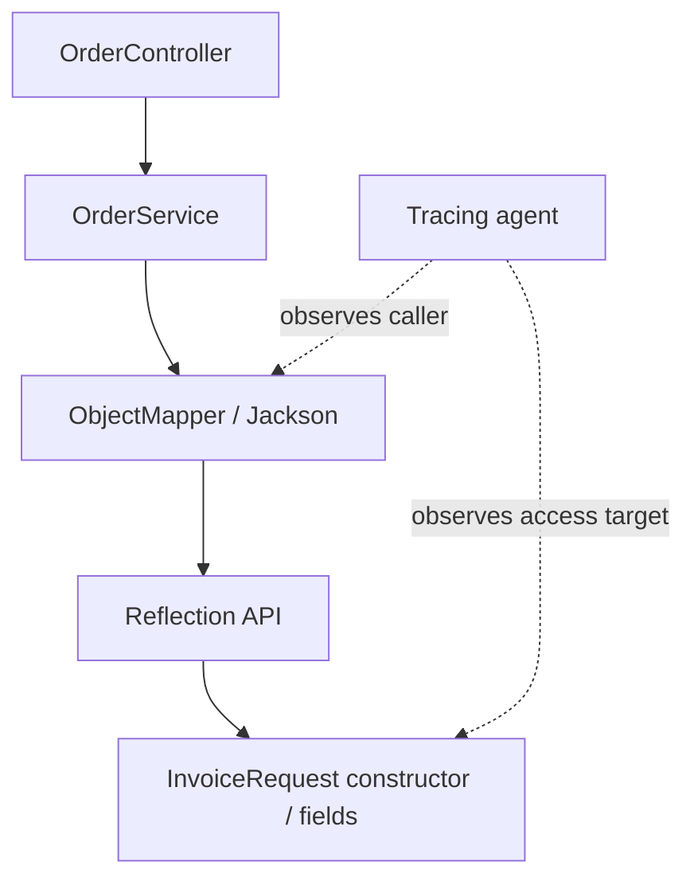
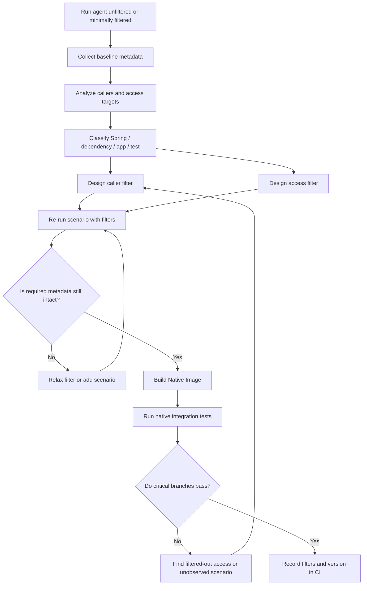

# Caller Filters, Access Filters, and Filtering Out-of-Scope Metadata

When running the **GraalVM Native Image tracing agent**, the agent observes dynamic operations that actually occur during an application run, such as reflection, resource lookups, JDK proxies, or serialization. From the observed operations, the agent generates metadata so the native-image build knows which capabilities to retain.

In a Spring Boot application, these operations can originate from business code, Spring Framework, Jackson, JDBC drivers, or third-party libraries. If everything is recorded unfiltered, output can include a lot of metadata outside the scope of the application under investigation. If filtered too aggressively, the agent can drop a required access and the native executable will fail on an unrecorded branch.

Two key filters answer two different questions:

- **Caller filter:** which class is the calling source of the dynamic operation to record?
- **Access filter:** which type/class is the dynamically accessed target to record?

Understanding both sides properly lets you narrow output while preserving necessary metadata. This lesson belongs to the **Tracing agent** chapter of the `SPRING_BOOT_NATIVE_IMAGE` module. We will cover caller/access semantics, filter formats, built-in filters, running the agent, package-based filtering examples, and a workflow for verifying metadata after filtering.

## 1. What Does the Tracing Agent Observe?

The tracing agent is a Java agent that runs alongside the application on the JVM. When code performs supported dynamic operations, the agent records details about those operations and can generate corresponding metadata for Native Image.

Commonly recorded access types include:

| Access Type | Examples | Metadata That May Be Generated |
| --- | --- | --- |
| Reflection | `Class.forName`, looking up constructors/methods/fields via reflection | Reflection configuration |
| JNI | Native code accessing Java types/members via JNI | JNI configuration |
| JDK dynamic proxy | Creating a proxy from a set of interfaces | Proxy configuration |
| Resource | Reading classpath resources by name or pattern | Resource configuration |
| Serialization | Using serialization mechanisms supported by the agent | Serialization configuration |
| Predefined/dynamic classes | Certain classes dynamically defined at runtime | Corresponding metadata per version/tooling |

The agent records what occurred during the run with the agent attached. It does not automatically infer unexecuted code paths. Therefore, results depend on the test suite, requests, profiles, configuration, and data used during observation.

## 2. Caller and Access Are Two Sides of One Operation

Consider a JSON deserialization path:

```java
ObjectMapper mapper = new ObjectMapper();
InvoiceRequest request =
        mapper.readValue(json, InvoiceRequest.class);
```

At runtime, Jackson may use reflection to find constructors, setters, or fields of `InvoiceRequest`.

- **Caller** is the code performing the reflection operation. In this example, the reflection call may originate from Jackson's packages.
- **Access target** is the type/member accessed by reflection. In this example, the target is `InvoiceRequest` and its related constructors/members.

The caller filter and access filter control these two sides. They do not mean the same thing:

| Filter | Question | Example |
| --- | --- | --- |
| Caller filter | Who counts as a valid caller for the agent to record an operation? | Record operations originating only from application code and selected libraries |
| Access filter | Which classes/types are allowed to appear as targets of dynamic access? | Keep only targets belonging to application models and specified dependency targets |
| Built-in caller filter | Should common internal callers covered by GraalVM's built-in rules be skipped? | Reduce unhelpful internal accesses |
| Built-in heuristic filter | Should the agent's built-in heuristic filters be applied? | Reduce unnecessary entries per agent version |

One way to remember: **caller filters filter where the operation originates; access filters filter the object being accessed**. When metadata is missing, check whether the operation was excluded by one of these two filters.

## 3. Example of a Multi-Layer Call Path

An HTTP request can produce a call chain like this:



If the caller filter only allows `com.example.orders.**`, reflection operations performed by Jackson may not qualify as a caller within that scope, even though the target `InvoiceRequest` is an application class.

If the access filter only allows `com.example.orders.**`, the target `InvoiceRequest` may be kept, while targets residing in dependencies that the application genuinely needs to access dynamically may be dropped.

Therefore, "collect only application metadata" should not be interpreted as "allow only application packages in both filters". A framework/dependency may be the caller while the target is an application class; or the application may be the caller while the target is a class inside a dependency.

## 4. Caller Filter: Choosing Which Call Sources to Track

A caller filter specifies which caller classes are considered when the agent records a dynamic access. It is useful when a run produces lots of noise from frameworks or internal libraries whose operations the team does not want in the metadata under analysis.

For example, an application has these packages:

```text
com.example.orders.**       # business code
com.example.billing.**      # business code
com.vendor.codec.**         # codec library
org.springframework.**      # Spring Framework
com.fasterxml.jackson.**   # Jackson
java.**                     # JDK
jdk.**                      # JDK
org.graalvm.**              # GraalVM
```

If the goal is to track dynamic operations initiated directly by business code, the caller filter might prioritize `com.example` packages. However, if Jackson performs reflection on DTOs, the caller package for the operation may be `com.fasterxml.jackson`; excluding all Jackson callers would lose evidence of accesses to DTOs.

Therefore, caller filters should be built from **actual call paths** and metadata goals, not from a list of packages the team casually considers "part of the app".

### 4.1. Package-Based Filter Files

The GraalVM Native Image Agent supports filter files for both callers and accesses. A filter file uses a JSON structure containing a list of rules. Illustrative example of a caller filter for an application and a codec library whose dynamic operations need observation:

```json
{
  "rules": [
    { "excludeClasses": "java.**" },
    { "excludeClasses": "jdk.**" },
    { "excludeClasses": "org.graalvm.**" },
    { "includeClasses": "com.example.orders.**" },
    { "includeClasses": "com.example.billing.**" },
    { "includeClasses": "com.vendor.codec.**" }
  ]
}
```

The sample above illustrates restricting callers by package. Check the filter file schema for your exact GraalVM version before placing it in CI; class/method matching capabilities and rule evaluation depend on the agent version. If a filter uses both include and exclude rules, rule ordering and precedence must follow that version's documentation.

Do not mechanically add rules excluding `org.springframework.**` or `com.fasterxml.jackson.**`. First check whether the framework/dependency is performing dynamic accesses that need metadata for the native build, and whether Spring AOT or the dependency already provides that metadata.

## 5. Access Filter: Choosing Which Targets Are Recorded

An access filter controls which classes/types are considered on the target side of a dynamic access. It is useful when the agent observes many targets outside the scope of metadata you want to collect.

Example targets may include:

- Application DTOs and models.
- Serialization or codec library types.
- Internal framework types.
- JDK or GraalVM types.
- Classes looked up by string name or reflection.

An illustrative access filter for an order-processing application and a codec library:

```json
{
  "rules": [
    { "excludeClasses": "java.**" },
    { "excludeClasses": "jdk.**" },
    { "excludeClasses": "org.graalvm.**" },
    { "includeClasses": "com.example.orders.**" },
    { "includeClasses": "com.example.billing.**" },
    { "includeClasses": "com.vendor.codec.model.**" }
  ]
}
```

This filter states that the targets of interest are application models and part of the codec's model package. If the codec performs reflection on classes in another package, include those targets within the appropriate scope.

An access filter is not a mechanism for verifying whether a class belongs in the native image. It only controls whether the agent records an access target. The class must still exist on the classpath/build input and be retained by the native compiler via reachability or corresponding metadata.

### 5.1. Avoid Confusing Target Classes with Caller Classes

A package can appear on both sides but play different roles. For example:

- `com.fasterxml.jackson.databind` can be a reflection caller.
- `com.example.orders.InvoiceRequest` can be a target.
- `com.vendor.codec.Payload` can be a target when application code calls the codec library.
- `com.example.orders.CustomMapper` can be a caller if the application itself uses reflection.

When deciding includes/excludes, build a caller-target table from logs or a small run before writing filter files. This reduces the risk of accidentally excluding required targets.

## 6. Built-in Filters and Project-Managed Filters

The tracing agent may provide built-in filters/heuristics to skip unhelpful callers or accesses. Common option names include:

- `builtin-caller-filter`
- `builtin-heuristic-filter`

Built-in filters are maintained per GraalVM version. They reduce noise from internal code or cases the agent already knows about, but they do not replace project-specific caller/access filters.

Do not assume every version has the same defaults or built-in rule coverage. Check the supported options in your installed GraalVM distribution and document your choices in build scripts.

| Filter Type | Who Manages It? | Purpose |
| --- | --- | --- |
| Built-in caller filter | GraalVM | Reduces internal callers using built-in rules |
| Built-in heuristic filter | GraalVM | Applies heuristics to skip accesses that do not need recording |
| Caller filter file | App/library team | Selects caller sources matching the goal |
| Access filter file | App/library team | Selects target classes matching the goal |

Disabling built-in filters for deep investigation can make output dramatically larger. Setting custom filters too tightly can make output small yet miss required metadata. Output size alone is not a measure of configuration quality.

## 7. Running the Tracing Agent with Caller/Access Filters

Example of running a Spring Boot application on the JVM with the agent and both filter files:

```bash
java \
  -agentlib:native-image-agent=config-output-dir=target/agent-config,caller-filter-file=config/native/caller-filter.json,access-filter-file=config/native/access-filter.json \
  -jar target/orders-service.jar
```

Where:

- `config-output-dir` is the directory where the agent writes observed metadata.
- `caller-filter-file` points to the call-source filter.
- `access-filter-file` points to the target filter.
- The application is still running on the JVM; this is the metadata collection step, not yet the native build.

If the application is launched via Maven/Gradle or a test runner, pass the JVM argument to the corresponding test process. Make sure the agent attaches to the **JVM actually running the application/tests**, not just the Maven daemon or Gradle daemon when tests fork another process.

### 7.1. Check Agent Options Before Long Runs

Options and filter schemas can change between GraalVM releases. Before adding them to a pipeline, check the docs/help of your installed GraalVM version. When paths contain commas or special characters, watch out for Java agent option separator syntax; placing filter files in simple paths avoids parsing issues.

Example toolchain check:

```bash
java -version
native-image --version
```

And check the help/documentation of your exact Native Image Agent distribution to confirm `caller-filter-file`, `access-filter-file`, and built-in filter options are supported.

## 8. Spring Boot Example: Filtering Callers While Keeping Target DTOs

Suppose an endpoint accepts JSON:

```java
@RestController
class InvoiceController {

    private final ObjectMapper objectMapper;

    InvoiceController(ObjectMapper objectMapper) {
        this.objectMapper = objectMapper;
    }

    @PostMapping("/invoices")
    InvoiceResponse create(@RequestBody InvoiceRequest request) {
        // Business processing.
        return new InvoiceResponse(request.number(), "accepted");
    }
}
```

Jackson may perform reflection operations to bind `InvoiceRequest`. In this flow:

| Role | Example Package/Class |
| --- | --- |
| Reflection caller | `com.fasterxml.jackson.databind...` |
| Accessed target | `com.example.orders.InvoiceRequest` |
| Request dispatching code | `org.springframework.web...` |
| Business controller | `com.example.orders.InvoiceController` |

If the caller filter only includes `com.example.orders.**`, reflection operations performed by Jackson may not be recorded. Including `com.example.orders.**` in the access filter is still not enough to recover accesses already dropped by the caller filter.

There are two approaches:

1. Keep the caller of the library performing the dynamic access in the caller filter if the application needs the agent to observe that operation.
2. Check whether Spring AOT and dependency metadata already provide reflection hints for this Jackson/Spring MVC path; do not collect duplicates simply because the agent can record them.

This shows that the two filters must be designed together based on call paths and metadata ownership.

## 9. Filtering Out Out-of-Scope Metadata

A single agent run can generate metadata for many components:

- Business code reflection.
- Internal framework reflection.
- Resources loaded by libraries.
- Framework-created proxies.
- Accesses from the test framework.
- Metadata created by instrumentation, profilers, or test-support libraries.
- Classes used only by a non-production profile/test scenario.

Not all of this metadata belongs in the application's own configuration. Before removing entries, classify them by source and target:

| Observed Metadata | How to Handle |
| --- | --- |
| Dynamic access in app code not covered by Spring/dependencies | Keep and test |
| Metadata already generated by Spring AOT | Avoid duplicating in app config if unnecessary |
| Metadata bundled by a dependency | Prefer letting the dependency own and update it per version |
| Internal JDK/GraalVM accesses unrelated to the app | Consider built-in filters or an appropriate caller/access filter |
| Metadata appearing only because of a test framework | Determine if needed for the production binary |
| Accesses by a library actually used by the app | Do not drop solely because the caller is a third-party package |
| Accesses on an untested production branch | Add an agent scenario before concluding it is unnecessary |

In particular, **a third-party package does not equal out-of-scope metadata**. If Jackson, Hibernate, a JDBC driver, or an SDK uses reflection to handle models/configurations your app uses, that metadata may be required for the feature to work in a native image.

## 10. Safe Filter-Creation Workflow

Start from an unfiltered or minimally scoped run, then tighten filters gradually.

1. Run the tracing agent with a dedicated output directory and documented built-in settings.
2. Execute a deliberate scenario, such as a JSON invoice-creation request.
3. Identify callers and access targets for important dynamic operations.
4. Inspect generated metadata and classify into Spring, dependency, application, and test-only.
5. Create a caller filter to reduce caller noise while retaining libraries that perform necessary accesses.
6. Create an access filter to scope targets to your goal without dropping active model/dependency targets.
7. Re-run the exact same scenario with filters enabled.
8. Diff metadata before/after; verify required entries remain.
9. Expand to additional scenarios: validation failures, polymorphic JSON, database, serialization, resources, proxies, and profiles.
10. Build the native image and run the test suite on the executable.



## 11. Comparing Output Before and After Filtering

Suppose the baseline run generates metadata for many packages. After adding filters, you can compare entry counts and contents.

Do not compare only file counts. Check:

- Do endpoint DTOs still have reflection metadata?
- Are resource templates/schemas still recorded?
- Are proxy interfaces used by the app still present?
- Are needed JNI accesses still present?
- Was metadata for critical dependencies accidentally dropped?
- Were test-only entries accidentally placed into production configuration?

Example directory structure:

```text
target/
├── agent-baseline/
│   ├── reflect-config.json
│   ├── resource-config.json
│   └── proxy-config.json
└── agent-filtered/
    ├── reflect-config.json
    ├── resource-config.json
    └── proxy-config.json
```

Actual filenames/outputs depend on the GraalVM version. Some versions merge metadata or produce additional files for JNI/serialization/predefined classes. Do not delete a file merely because it does not appear in this example.

You can use a diff tool to inspect changes:

```bash
git diff --no-index target/agent-baseline target/agent-filtered
```

This command may return a non-zero exit code when differences are found; that is normal diff behavior. Review the diff contents and confirm essential targets were not dropped.

## 12. Filters Do Not Replace Scenario Coverage

The agent only records operations that happened. Caller/access filters cannot make the agent aware of code paths that were never executed.

For example, a suite sending only standard JSON requests may miss:

- Deserialization of rare subtypes.
- An error handler serializing a custom exception type.
- A resource template used only in one locale.
- A JDBC driver invoking reflection on a metadata discovery branch.
- A JDK proxy created only when a feature flag is enabled.
- A plugin/serializer used only by a batch job.

Therefore, if output is missing metadata, the cause could be:

1. The scenario did not execute that code path.
2. The caller filter excluded the caller.
3. The access filter excluded the target.
4. The framework/dependency already supplies metadata from another source.
5. The metadata was generated in a different file or format for your version.

Do not blindly loosen filters before identifying the root cause. Add an intentional scenario and check whether the access appeared in the baseline.

## 13. Common Errors

| Symptom | Possible Cause | How to Investigate |
| --- | --- | --- |
| DTO metadata disappears after adding caller filter | Jackson caller is outside the included caller scope | Inspect call path and add the required dependency caller |
| DTO metadata disappears after access filter | Target package is excluded or misses include rule | Check access filter and full target name |
| Output remains huge | Filter was not applied, package pattern is too broad, or many scenarios ran | Check agent command, filter path, and caller classification |
| Output is unusually small | Include filter is too tight, dropping framework/dependency callers | Diff against baseline and re-run scenario |
| Native build fails despite running the agent | Agent never observed the failing branch or filter dropped the access | Run the failing scenario and compare baseline/filtered metadata |
| Test-only metadata enters production | Agent ran a broad test suite with shared output | Separate outputs per scenario/profile and review before merging |
| Filter file is not read | Wrong path, invalid JSON, or incompatible schema | Check working directory, JSON validity, and GraalVM version |
| GraalVM upgrade changes output | Built-in filters, heuristics, metadata schema, or agent behavior changed | Pin version and re-run baseline on the new version |
| Metadata duplicates a dependency | Dependency already provides equivalent metadata | Check JAR/reachability metadata before keeping an app copy |

## 14. Managing Filters in CI

Filter files are part of build configuration and should be versioned alongside source code:

```text
config/
└── native/
    ├── caller-filter.json
    └── access-filter.json
```

A pipeline can divide steps into stages:

| Stage | Activity | Artifact |
| --- | --- | --- |
| JVM scenario run | Run agent with versioned filters | Agent config output |
| Review metadata | Diff against baseline, verify critical entries | Diff/review report |
| AOT/native build | Run Spring AOT and GraalVM build | Native executable |
| Native integration test | Call endpoints and critical dynamic branches | Test report |
| Release | Record toolchain versions and filters with build metadata | Reproducibility metadata |

Do not let a pipeline automatically delete old metadata or overwrite curated output simply because the current run did not observe an access. Agent output is observational data; deleting entries requires review and testing to avoid losing metadata for rare scenarios.

When upgrading GraalVM or Spring Boot:

- Record before/after versions.
- Re-run the same scenarios.
- Review differences in generated metadata.
- Check built-in filters and agent options.
- Build and test the native executable on the target platform.

## 15. Checklist Before Finalizing Caller/Access Filters

- [ ] Clearly defined the goal: reducing caller noise, scoping targets, or separating test metadata from production.
- [ ] Understood that caller is the call source and access is the accessed target.
- [ ] Inspected actual packages in the call path before writing rules.
- [ ] Did not exclude Jackson/framework/dependency callers merely because they sit outside application packages.
- [ ] Did not exclude DTO/model/dependency targets that the app needs for reflection or serialization.
- [ ] Confirmed filter file schema compatibility with the active GraalVM version.
- [ ] Documented built-in caller/heuristic filter settings.
- [ ] Kept a baseline output for before/after diffs.
- [ ] Executed scenarios for requests, errors, resources, proxies, serialization, and integration paths.
- [ ] Reviewed excluded metadata rather than merely counting files or lines.
- [ ] Built native and ran integration tests after applying filters.
- [ ] Versioned filter files and toolchain settings in CI.

### Self-Assessment Questions

1. Which sides of a reflection operation do a caller filter and an access filter target respectively?
2. In a Jackson DTO deserialization flow, why can the caller belong to a Jackson package while the access target belongs to an application package?
3. What happens if the caller filter includes only application packages?
4. Why should you not exclude all third-party packages from an access filter?
5. What roles do the built-in caller filter and built-in heuristic filter play?
6. Can the agent generate metadata for an unexecuted code branch?
7. How can you distinguish metadata dropped by a filter from metadata that was never observed?
8. Why must you run native integration tests after trimming metadata?

## References

- [GraalVM Native Image — Tracing Agent](https://www.graalvm.org/latest/reference-manual/native-image/metadata/AutomaticMetadataCollection/): running the agent, configuring output, and collecting metadata.
- [GraalVM Native Image — Metadata](https://www.graalvm.org/latest/reference-manual/native-image/metadata/): metadata types and how Native Image consumes them.
- [GraalVM Native Build Tools](https://graalvm.github.io/native-build-tools/): native build/test integration and agent configuration in Maven/Gradle.
- [Spring Framework — AOT Optimizations](https://docs.spring.io/spring-framework/reference/core/aot.html): metadata and code generated by Spring AOT, helping distinguish it from agent output.

**Expected outcome:** you can design caller filters and access filters based on the exact call sources and targets of dynamic operations, filtering out out-of-scope metadata while preserving accesses the application genuinely needs. Filters are only tools for controlling what the agent collects. Final quality must be confirmed through scenario coverage, metadata review, and testing on the native executable.
