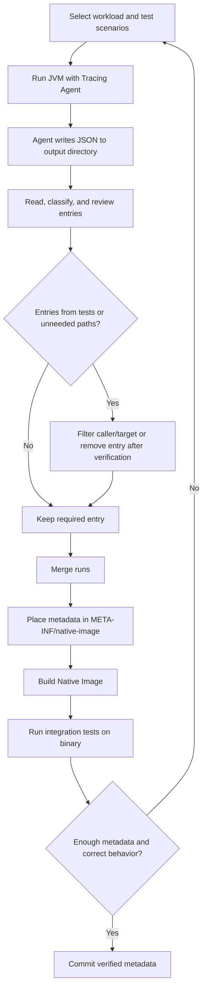

# Reviewing Generated Data and Placing Required Metadata in the Right Location

The **GraalVM Native Image Tracing Agent** records dynamic accesses that the application actually performs while running on the JVM—such as reflection, dynamic proxies, JNI, or resource lookups—in ways that static analysis cannot fully determine. After one or more runs, the agent generates JSON files to supply that information to the Native Image builder.

Agent-generated files are **evidence from executed scenarios**, not a complete metadata list for all production situations. They may contain entries needed only by test frameworks, mocks, test fixtures, or rarely used business branches. Therefore, metadata must be read, classified, filtered, merged, and tested before being committed to source control.

With Spring Boot, you must also distinguish metadata **automatically generated by Spring AOT** from static metadata managed by the development team. Spring AOT writes output to its own directory under `META-INF/native-image/{groupId}/{artifactId}/`; supplemental files should sit in a separate directory to avoid overwriting or mixing with output regenerated on every build.

## 1. Learning Objectives

After this lesson, you can:

- Explain which dynamic access types the Tracing Agent records and the limitations of the recorded data.
- Distinguish the newer `reachability-metadata.json` output from separate config files of older GraalVM versions.
- Read and classify metadata for reflection, JNI, proxies, resources, resource bundles, and serialization.
- Compare outputs across multiple run scenarios, merge agent directories, and handle multiple processes.
- Identify redundant entries created by JUnit, Mockito, Spring Test, Testcontainers, or test fixtures.
- Use caller filters and access filters for their intended purposes.
- Select truly necessary entries and avoid granting overly broad reflection permissions.
- Place metadata into `src/main/resources/META-INF/native-image/` under the proper application namespace.
- Rebuild the Native Image and verify metadata via integration tests on the real binary.

## 2. What Data Does the Tracing Agent Generate?

The Native Image builder performs static analysis to retain only required elements. However, some accesses depend on class names, method names, runtime data, or resource paths and therefore cannot be fully inferred from bytecode. The Tracing Agent runs alongside the application on the JVM to observe those dynamic accesses.

Common metadata groups:

| Group | Example Access | Supported Metadata |
| --- | --- | --- |
| **Reflection** | `Class.forName`, `getDeclaredMethod`, invoking constructors/methods/fields via reflection | Types, constructors, methods, and fields to retain |
| **Dynamic proxy** | Creating a JDK proxy from a list of interfaces | Interfaces forming the proxy |
| **JNI** | Native code looking up Java classes, calling methods, or reading fields | Types and members accessed from native code |
| **Resources** | Reading files by dynamic name via classloader or resource APIs | Resource paths/globs to embed into the image |
| **Resource bundles** | `ResourceBundle.getBundle(...)` | Bundle name and related locales/resources |
| **Serialization** | Java serialization or mechanisms requiring dynamic metadata | Types requiring serialize/deserialize support |
| **FFM** | Dynamic Foreign Function and Memory API accesses | Metadata for supported FFM components |
| **Predefined classes** | Loading dynamically generated class bytecode | Dedicated metadata for predefined classes; typically best-effort and should not be handwritten |

Not every agent version produces the same set of files or schema. Newer versions often consolidate metadata into `reachability-metadata.json`; older versions may emit separate files such as `reflect-config.json`, `proxy-config.json`, `resource-config.json`, `serialization-config.json`, and `jni-config.json`. Use the schema and accompanying tools matching your project's GraalVM version.

## 3. Workflow for Processing Output After Running the Agent

Overall workflow:



Follow traceable steps:

1. Select run scenarios representative of the real application.
2. Write output to a separate temporary directory, never directly into source resources.
3. Run additional business flows to expand coverage.
4. Compare outputs and merge required runs.
5. Review each metadata group and remove identified test-only data.
6. Move verified entries into the application's metadata namespace.
7. Build native and re-run the flows used to collect metadata.
8. Add tests/branches not yet observed by the agent, then update metadata if gaps are found.

## 4. Running a Spring Boot Application with the Tracing Agent

### 4.1. Running the Executable JAR Directly

Suppose the project builds `target/order-service-1.0.0.jar`. Enable Spring AOT when running the JAR and attach the agent:

```bash
java -Dspring.aot.enabled=true \
  -agentlib:native-image-agent=config-output-dir=target/native-agent/run-01 \
  -jar target/order-service-1.0.0.jar
```

Notes:

- `-agentlib:native-image-agent=...` must appear before `-jar` or the main class name in the `java` command.
- `-Dspring.aot.enabled=true` tells Spring to use AOT-generated infrastructure already packaged in the JAR. The project must have been built with AOT beforehand.
- `config-output-dir` is the directory where the agent writes metadata for this run. Use a separate directory per scenario for easy comparison and to avoid accidental overwrites.
- The agent typically writes files when the JVM exits. For server applications, shut down the application cleanly after exercising the required requests.

After the application starts, call endpoints and exercise flows requiring metadata. For example:

```bash
curl -fsS http://localhost:8080/actuator/health
curl -fsS http://localhost:8080/api/orders/1001
curl -fsS -X POST http://localhost:8080/api/orders/1002/confirm
```

These URLs are examples only. Replace them with real endpoints and exercise success paths, validation errors, data processing, upload/download, external integrations, and any optional features your application has.

### 4.2. Running the Agent via a Test Suite

You can attach the agent to the test JVM for automated, repeatable collection across many flows. However, a test suite also runs code from:

- JUnit/Jupiter and the test engine.
- Mockito, Byte Buddy, or mocking tools.
- Spring Test and the test context framework.
- Testcontainers, embedded servers, or test databases.
- Assertion, coverage, and test reporting libraries.

These accesses can appear in output even though production does not use them. Thus, test suites are a useful coverage source but require careful review. If a library exists only on the test classpath, do not automatically place all its entries into production metadata.

### 4.3. Long-Running Applications

For servers that cannot stop after a short scenario, the agent supports periodic metadata writes:

```bash
java -agentlib:native-image-agent=config-output-dir=target/native-agent/long-run,config-write-period-secs=60,config-write-initial-delay-secs=5 \
  -Dspring.aot.enabled=true \
  -jar target/order-service-1.0.0.jar
```

`config-write-period-secs` must be greater than 0; `config-write-initial-delay-secs` controls when the first write occurs. This configuration is useful for extended workloads, though you should manage disk space and agent runtime overhead.

## 5. Reading Output Structure

With current GraalVM versions, output typically contains:

```text
target/native-agent/run-01/
└── reachability-metadata.json
```

Older versions or legacy workflows may produce:

```text
target/native-agent/legacy-run/
├── reflect-config.json
├── proxy-config.json
├── resource-config.json
├── serialization-config.json
└── jni-config.json
```

The actual file list depends on the agent version and which access types occurred. Do not create empty files for unused categories.

### 5.1. Reading `reachability-metadata.json`

Unified metadata uses a top-level JSON object. Abbreviated example:

```json
{
  "reflection": [
    {
      "type": "com.example.legacy.LegacyOrderMapper",
      "methods": [
        {
          "name": "fromMap",
          "parameterTypes": ["java.util.Map"]
        }
      ]
    }
  ],
  "resources": [
    {
      "glob": "templates/invoice/**"
    }
  ]
}
```

Meaning:

- `reflection` describes classes/members accessed via reflection.
- `type` is the fully qualified name of the type to register.
- `methods` specifies method names and parameter type lists to disambiguate overloads.
- `resources` describes resource paths or globs to include in the native executable.

This is only a structural example. Keep the exact fields supported by your GraalVM version's schema. Do not copy an array-based legacy `reflect-config.json` directly into `reachability-metadata.json` without converting the schema.

### 5.2. Reflection Entries

When reviewing reflection, check:

- Is the class actually loaded dynamically by name?
- Is the method invoked via reflection in production?
- Do parameter types match the actual overload?
- Is the constructor required by a framework/binder?
- Is field access read, write, or introspection only?
- Does the entry request all declared members even though the application uses only one method?

Prefer declaring specific members. Broad flags like `allDeclaredMethods`, `allDeclaredFields`, or `allDeclaredConstructors` can bloat metadata and retain unnecessary elements. Keep them only when a library genuinely needs the entire member group.

### 5.3. Proxy Metadata

A JDK dynamic proxy is created from an ordered list of interfaces. Verify that the interfaces recorded by the agent match the proxies the application actually creates. A proxy entry does not imply reflection metadata for every method of an implementation class.

If Spring AOT already generates proxy hints for Spring infrastructure, agent output may duplicate them. Check AOT-generated hints before adding static duplicates. For proxies created by libraries or business code, keep metadata when native tests prove it is needed.

### 5.4. Resource Metadata

The agent can record resources accessed dynamically by name. Check:

- Does the resource path exist in `src/main/resources` or a dependency JAR?
- Is the entire directory needed, or only one specific file?
- Is a glob overly broad, such as `**` or `**/*.properties`?
- Is the file read by the production app or only by tests?
- Does the code read the resource as a stream/URL rather than assuming it is a physical file?

For example, `templates/invoice/**` is appropriate when all templates in that directory are dynamically selected. If only `templates/invoice/default.html` is used, declaring that exact file is usually cleaner.

### 5.5. JNI, Serialization, and Resource Bundles

JNI metadata should be checked against actual native methods or native libraries. If JNI calls Java methods/fields, registering only the type may not suffice; corresponding member metadata must be present.

Serialization metadata should be kept for types actually serialized/deserialized via Java serialization or mechanisms requiring corresponding metadata. Normal Spring/Jackson JSON binding may already be covered by Spring AOT hints; do not assume every DTO needs Java serialization metadata added.

Resource bundle metadata should match the base names and locales used by the application. Inspect dynamically loaded bundles and actual `.properties` files inside dependencies.

## 6. Reviewing and Removing Unnecessary Data

### 6.1. Using a Classification Table

When inspecting output, categorize entries by purpose:

| Entry Group | Review Question | Decision |
| --- | --- | --- |
| Application code | Does any production path need dynamic access? | Keep if needed and verified |
| Third-party library | Does the library provide its own reachability metadata? | Avoid duplicating; check dependency metadata |
| Test framework | Is the caller JUnit/Mockito/Spring Test? | Filter or remove if test-only |
| Mock/generated class | Does the class exist in the production artifact? | Usually remove if created only by tests |
| Debug/diagnostic endpoint | Is the endpoint enabled in production? | Keep only when actually used in deployment |
| Resource | Is the file read at runtime? | Keep exact required paths/globs |
| Broad reflection | Are all members truly needed? | Narrow down if possible |
| Proxy | Does the interface list match the real proxy? | Keep exact contract |

### 6.2. Distinguishing Caller Filter and Access Filter

The Tracing Agent supports two filter types with distinct purposes:

- **Caller filter** filters by the class containing the dynamic call. It is suited for excluding accesses originating from test frameworks or test tooling.
- **Access filter** filters by the class/member that is the target of the access. It is suited for excluding specific target packages/classes from output.

Do not confuse the two. If JUnit invokes reflection on a business class, the caller is JUnit while the target is the business class. Using an access filter to exclude the business target can accidentally delete metadata the application needs. In that situation, a caller filter is usually the better starting point.

Example caller filter excluding accesses originating from specific identified test packages:

```json
{
  "rules": [
    {
      "excludeClasses": "org.junit.**"
    },
    {
      "excludeClasses": "org.mockito.**"
    },
    {
      "excludeClasses": "org.springframework.test.**"
    }
  ]
}
```

Save the file as `caller-filter.json` and pass it to the agent:

```bash
java -agentlib:native-image-agent=caller-filter-file=caller-filter.json,config-output-dir=target/native-agent/filtered-run \
  -Dspring.aot.enabled=true \
  -jar target/order-service-1.0.0.jar
```

This is an illustrative example only. Use the actual packages observed in your trace; do not exclude all of `org.springframework.**` or application packages merely because they appear during tests.

### 6.3. When to Use an Access Filter?

Example access filter excluding an internal target package accessed only by tools absent from production:

```json
{
  "rules": [
    {
      "excludeClasses": "com.example.testfixture.**"
    }
  ]
}
```

Pass it via `access-filter-file=...`. Because an access filter acts on the target, any access to an excluded target is omitted even if the caller is production code. Use it only after verifying the target is genuinely unnecessary in native runtime.

### 6.4. Do Not Delete Entries Simply Because They Look Unfamiliar

If an unfamiliar entry appears:

1. Identify which dependency owns that class/member/resource.
2. Check the call path or trace output if needed.
3. Compare against output from a run with only one feature enabled.
4. Check whether the library bundles its own metadata.
5. Build native and run the relevant scenario before deciding to remove it.

Do not delete an entry merely because its package looks like a framework or library. Some production libraries require internal reflection that Spring AOT cannot infer automatically.

## 7. Merging Metadata from Multiple Runs

The agent only records executed code paths. A single login run does not prove that payment, upload, message listener, or error-handling flows have metadata.

### 7.1. Using `config-merge-dir` for Sequential Runs

First run creates output:

```bash
java -agentlib:native-image-agent=config-output-dir=target/native-agent/merged \
  -Dspring.aot.enabled=true \
  -jar target/order-service-1.0.0.jar
```

Then run another scenario and merge into the existing directory:

```bash
java -agentlib:native-image-agent=config-merge-dir=target/native-agent/merged \
  -Dspring.aot.enabled=true \
  -jar target/order-service-1.0.0.jar
```

`config-merge-dir` appends data to the existing configuration set. Use this when processes run sequentially and contribute to one metadata set.

### 7.2. Using Separate Outputs for Concurrent Processes

Do not let multiple agent processes write simultaneously to the same output directory. Separate outputs:

```bash
java -agentlib:native-image-agent=config-output-dir=target/native-agent/run-api \
  -Dspring.aot.enabled=true -jar target/order-service-1.0.0.jar

java -agentlib:native-image-agent=config-output-dir=target/native-agent/run-worker \
  -Dspring.aot.enabled=true -jar target/order-service-1.0.0.jar
```

After processes finish, merge them:

```bash
native-image-utils generate \
  --input-dir=target/native-agent/run-api \
  --input-dir=target/native-agent/run-worker \
  --output-dir=target/native-agent/merged
```

The merge tool name can vary by GraalVM distribution/version; older versions use `native-image-configure`. Check `native-image-utils help` or `native-image-configure help` in your installed toolchain.

### 7.3. Recording Executed Scenarios

Maintain a coverage table alongside your ticket/PR or pipeline report:

| Scenario | Process/output | Dynamic Features Exercised |
| --- | --- | --- |
| Startup and health check | `run-startup` | Spring initialization, resources |
| Read order details | `run-api` | JSON binding, mappers |
| Confirm order | `run-confirm` | Reflection/proxies or integration libraries |
| Receive message | `run-worker` | Listeners, serialization, or resources |
| Error handling and retry | `run-error` | Exception mapping, proxies/advice |
| Upload/download | `run-file` | Resources and file handling |

Not every project needs all of these scenarios. Select scenarios matching the features that actually exist in your service.

## 8. Placing Metadata in the Right Spring Boot Project Location

### 8.1. Distinguishing AOT-Generated Metadata from Static Metadata

Spring Boot AOT can generate hints and write them into:

```text
META-INF/native-image/{groupId}/{artifactId}/
```

These files are build outputs. Do not edit files directly in `target/` or equivalent generated directories because the next build can regenerate and overwrite them.

For reviewed agent metadata that you want to manage in source control, Spring Boot recommends placing it in a distinct directory to avoid conflicts, for example:

```text
src/main/resources/
└── META-INF/
    └── native-image/
        └── com.example/
            └── order-service-additional-hints/
                └── reachability-metadata.json
```

This example assumes `groupId` is `com.example` and `artifactId` is `order-service`. Replace them with your project's actual Maven coordinates.

### 8.2. Copy Only Reviewed Files, Not the Entire Temporary Directory

A temporary agent directory may contain:

- Multiple runs and duplicate output files.
- Metadata for test frameworks.
- Trace files used for investigation, not Native Image configuration files.
- Files specific to one agent version.

Move only reviewed metadata files into source resources. With current agents, that is usually `reachability-metadata.json`. With older GraalVM versions, it may be separate JSON files matching that version's schema.

Do not drop all of `target/native-agent/` into `src/main/resources/META-INF/native-image/`. The source directory should contain only verified production metadata.

### 8.3. Why Use `{artifactId}-additional-hints`?

Spring AOT uses its own namespace by `groupId`/`artifactId`. Placing static metadata in an additional directory helps:

- Prevent overwriting AOT-regenerated output.
- Distinguish Spring-discovered metadata from team-supplied metadata.
- Make diffs easy to review in pull requests.
- Make it easy to delete or update individual hint sets when libraries are upgraded.
- Keep packaging structure clean when the application is built as a JAR.

If you are developing a **shared library**, library-specific metadata should be packaged in that library's own JAR under `META-INF/native-image/{groupId}/{artifactId}/`. For metadata serving a single application, placing it in the application's resources makes sense.

## 9. Validating JSON and Rebuilding the Native Image

### 9.1. Verify File Placement Before Building

Confirm the files are in the right place:

```bash
find src/main/resources/META-INF/native-image -type f
```

On PowerShell:

```powershell
Get-ChildItem src/main/resources/META-INF/native-image -Recurse -File
```

Use a JSON parser or matching schema to check syntax. Syntactically valid JSON can still have wrong schemas, class names, parameter types, or resource paths.

### 9.2. Verify Metadata Is Packaged into the Executable JAR

After `mvn package`:

```bash
jar tf target/order-service-1.0.0.jar | grep 'META-INF/native-image'
```

On PowerShell:

```powershell
jar tf target/order-service-1.0.0.jar | Select-String 'META-INF/native-image'
```

Confirm that `reachability-metadata.json` or legacy files were packaged. If a file does not appear, check resource filtering, which module is built, and the source resource path.

### 9.3. Building the Native Image

With Maven Native Build Tools:

```bash
./mvnw -Pnative native:compile
```

With Gradle:

```bash
./gradlew nativeCompile
```

Use `-Pnative` only if the project defines that Maven profile. With Spring Boot buildpacks, run `spring-boot:build-image` or `bootBuildImage` according to your project's native configuration. Either way, check build logs to confirm the metadata directory was picked up by the build.

### 9.4. Enabling Missing-Registration Reporting Mode

With newer GraalVM versions supporting exact reachability metadata, you can build with:

```bash
native-image --exact-reachability-metadata ...
```

Then run the native executable with:

```bash
./order-service -XX:MissingRegistrationReportingMode=Warn
```

`Warn` helps detect unregistered dynamic accesses without necessarily terminating on the first occurrence. In tests, you can use `Exit` to ensure the application exits when missing registration is detected, even if code accidentally catches `Throwable`. These options depend on the GraalVM version; check your toolchain documentation before adding them to pipelines.

Not every runtime error is caused by missing metadata. Configuration errors, native libraries, TLS, databases, resource paths, or OS/architecture issues must be diagnosed separately.

## 10. Testing Metadata After Placing It in Source

### 10.1. Re-run the Exact Scenarios Used for Collection

After the native build, re-run the requests/tests previously executed under the Tracing Agent. If a scenario succeeds on the JVM with reflection but the native binary throws `MissingReflectionRegistrationError`, metadata was not transferred properly, is missing members, or was not loaded into the build.

### 10.2. Run Previously Untraced Scenarios

This is critical for uncovering coverage gaps. For example:

- JSON payloads with different subtypes.
- Error branches using a different serializer.
- Rarely triggered message listeners.
- Resources loaded only when selecting a different locale.
- Proxies created only along transaction or security paths.

If a native test fails, identify the exact dynamic access and update metadata. Do not solve every error by enabling full reflection for an entire large package.

### 10.3. Check Metadata Size and Scope

After building, monitor:

- Count of reflection/JNI/proxy/resource entries.
- Number of covered packages.
- Number of broad entries like `allDeclaredMethods`.
- Size of metadata and the native executable.
- Native build duration.

Overly broad metadata increases retained classes/members and memory footprint. The goal is sufficient metadata for production flows, not keeping every element the agent ever saw.

## 11. Common Errors and Troubleshooting

| Symptom | Possible Cause | Resolution |
| --- | --- | --- |
| Agent produces no files | JVM did not exit cleanly, option misplaced, or agent not loaded | Place `-agentlib` before `-jar`, stop JVM cleanly, and check stderr |
| Output misses a business flow | Agent only records executed code paths | Add scenarios/tests for the missing branch |
| JSON contains many JUnit/Mockito entries | Test JVM executed test framework dynamic code | Use an appropriate caller filter and review output |
| Metadata grows sharply after integration tests | Testcontainers, mocks, or test fixtures created dynamic accesses | Separate test and app outputs, filter identified callers |
| Merging loses files or fails to update | Wrong directory, concurrent writes, or wrong tool version | Use separate outputs for concurrent processes then merge with the right tool |
| Valid JSON but native build reports schema error | Metadata schema does not match GraalVM version | Use matching schema/toolchain version; do not mix legacy and unified formats |
| Native build does not see metadata | File outside classpath or wrong `META-INF/native-image` path | Inspect resources inside JAR and build classpath |
| Static file overwritten by AOT output | Placed in the same namespace as Spring AOT-generated hints | Move to `{artifactId}-additional-hints` |
| Native still lacks reflection | Did not hit right overload/member or filter was too aggressive | Check trace/caller filter and add exact entry |
| Resource exists in JAR but native cannot read it | Resource unregistered or code assumes URL is a physical file | Add required resource metadata and use stream APIs |
| Proxy works on JVM but fails on native | Proxy interface unregistered or proxy generated outside AOT scope | Check proxy hints and actual proxy creation path |
| Library upgrade breaks old metadata | APIs/classes/members or resource paths changed | Re-trace the new version, review diff, and run native regression tests |

## 12. End-to-End Practice Workflow

**Context:** `order-service` uses a legacy library to map payloads via reflection, loads templates by dynamic name, and invokes a handler via a JDK proxy. The native build is missing some hints.

Steps:

1. Build the executable JAR with Spring AOT generated assets.
2. Run the JAR on GraalVM JDK with `-Dspring.aot.enabled=true` and `config-output-dir=target/native-agent/run-01`.
3. Call endpoints to read an order, confirm an order, trigger error branches, and load templates.
4. Stop the application cleanly so the agent writes JSON.
5. Inspect `reachability-metadata.json` or legacy files; classify reflection, resources, and proxies.
6. Run an additional worker/message scenario into a separate output directory, then merge with the first run.
7. Check entries created by the test framework; use a caller filter if needed to drop test-only accesses.
8. Keep actually needed classes/methods, resources, and proxy interfaces; narrow overly broad reflection entries.
9. Move approved metadata into `src/main/resources/META-INF/native-image/com.example/order-service-additional-hints/`.
10. Validate JSON, package the JAR, and confirm metadata appears inside the JAR.
11. Build native using configured Maven/Gradle or buildpacks.
12. Re-run old scenarios and add untraced scenarios; enable missing-registration reporting if supported by your GraalVM version.
13. Commit metadata alongside test evidence and record GraalVM/Spring Boot versions.

**Self-check question:** Why should you not copy the entire Tracing Agent output from integration tests directly into `src/main/resources/META-INF/native-image/`? Because the agent records every dynamic access that occurred, including accesses from test frameworks, mocks, and fixtures. Unnecessary metadata can retain unneeded components, increase footprint, or mask missing production coverage. You must review and filter before putting it into the artifact.

## 13. Remember

- The Tracing Agent records dynamic accesses on the JVM; it only knows about code paths that executed.
- Agent output varies by GraalVM version: newer versions typically use `reachability-metadata.json`, while older ones may use separate JSON files.
- `config-output-dir` creates a new output set; `config-merge-dir` appends to an existing set; concurrent processes should write to separate outputs and merge via `native-image-utils` or the version's equivalent tool.
- Classify metadata for reflection, proxies, JNI, resources, resource bundles, and serialization; keep only entries needed for production.
- Caller filters filter by where the access originates; access filters filter by the accessed target. Choose the right filter so you do not accidentally drop application metadata.
- Spring AOT has its own output namespace under `META-INF/native-image/{groupId}/{artifactId}/`. Supplemental static metadata should live in a distinct namespace, such as `{artifactId}-additional-hints`.
- Check the JSON schema, classpath/JAR contents, and native build logs before concluding metadata was used.
- Run native regression tests, add untraced scenarios, and enable missing-registration reporting when supported by your GraalVM version.
- Store reviewed metadata alongside GraalVM and Spring Boot versions, commit hash, and test evidence for easier updates when dependencies change.

When output is properly classified and placed in the right namespace, the Tracing Agent becomes an effective tool for locating missing metadata. The final metadata set must still reflect identified production execution paths and be verified on the native executable itself.

## Official References

- [GraalVM — Collect Metadata with the Tracing Agent](https://www.graalvm.org/latest/reference-manual/native-image/metadata/AutomaticMetadataCollection/): running the agent, `config-output-dir`, `config-merge-dir`, filters, trace files, and merge tools.
- [GraalVM — Configure Native Image with the Tracing Agent](https://www.graalvm.org/latest/reference-manual/native-image/guides/configure-with-tracing-agent/): examples of collecting, adding metadata, and verifying the native executable.
- [GraalVM — Reachability Metadata](https://www.graalvm.org/latest/reference-manual/native-image/metadata/): metadata types, JSON schema, classpath locations, and conditional metadata.
- [Spring Boot — Advanced Native Images Topics](https://docs.spring.io/spring-boot/reference/packaging/native-image/advanced-topics.html): using the Tracing Agent with Spring AOT, filtering test-only data, and where to store static hints.
