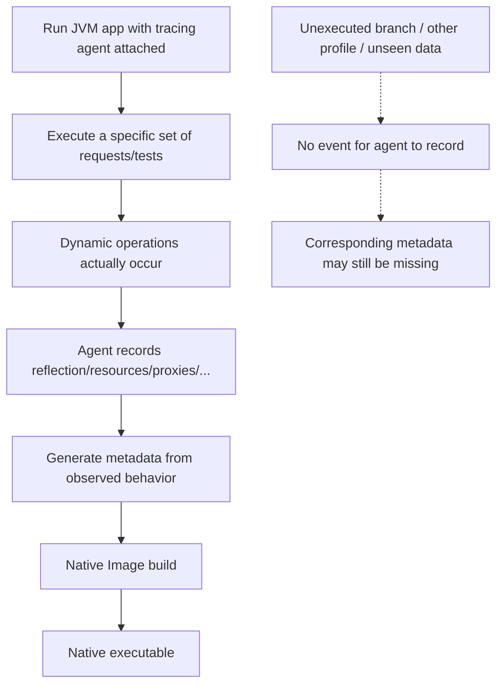
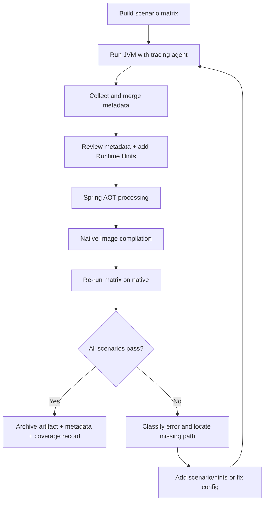

# Coverage Limits: Unexecuted Paths May Still Lack Metadata

## Lesson Objectives

The **GraalVM Native Image Tracing Agent** observes an application running on the JVM and records certain dynamic operations that Native Image needs to know upfront, such as reflection, resource access, proxy creation, JNI, or serialization. The recorded configurations can serve as inputs to building the native executable.

However, the tracing agent only records operations that actually happen during the runs with the agent attached. An unexecuted code branch, an inactive profile, an unused locale, or a data type that never appeared in tests can still lack metadata.

This is the single most important limitation when using the agent: **the generated configuration reflects the observed execution scope, not a complete list of every behavior the application can perform**.

This lesson helps you:

- Explain what the agent observes and what it cannot infer.
- Identify branches, profiles, data, and runtime situations easily missed.
- Design a test matrix to broaden observation coverage.
- Collect and merge configurations across multiple runs.
- Read output, supplement missing metadata, and verify on the native executable.
- Avoid treating successful agent file generation as proof of full application compatibility.

## 1. What Does the Tracing Agent Observe?

### 1.1. The Agent Records Dynamic Operations While the App Runs

Native Image needs to know about certain dynamic access capabilities to retain required classes, members, and resources. The tracing agent attaches to a JVM process to monitor APIs or activities tied to those capabilities.

Commonly recorded categories include:

- **Reflection:** looking up classes, constructors, methods, fields, or invoking members via reflection.
- **Resource:** opening resources from the classpath or JARs.
- **Dynamic proxy:** creating JDK proxies from a set of interfaces.
- **JNI:** accessing classes/members or native methods via JNI.
- **Serialization:** using data types and components requiring serialization metadata.
- **Predefined/dynamic classes:** certain forms of dynamically created or loaded classes, depending on GraalVM version and agent configuration.

The agent typically emits JSON configuration files per category. Filenames and output formats can change across GraalVM versions; inspect the actual output of your active toolchain.

### 1.2. The Agent Does Not Analyze Every Possibility in Source Code

The agent is not a tool that reads the entire source base and deduces all possible execution branches. It observes one concrete process:



If a conditional branch is not taken, dynamic operations inside that branch do not appear in that run's output. The agent cannot know that a different class name will be read from the database tomorrow if that class was never loaded during the observation session.

### 1.3. Static Reachability and Dynamic Metadata Are Separate Concerns

Native Image still runs reachability analysis on statically determinable code. The tracing agent helps discover accesses that the compiler cannot fully infer from static analysis alone.

Therefore:

- Code invoked directly through static references can be handled by reachability analysis without the agent recording a reflection hint.
- A constructor invoked via reflection may require metadata even though the class is already in dependencies.
- The agent cannot bundle a new plugin JAR into the executable if that JAR is absent from build inputs.
- The agent cannot make a bean excluded from the bean graph by Spring AOT reappear at runtime.

## 2. Why Can Unexecuted Paths Cause Missing Metadata?

### 2.1. Unselected Conditional Branches

Example:

```java
public PaymentProcessor createProcessor(String provider) throws Exception {
    if ("card".equals(provider)) {
        return new CardPaymentProcessor();
    }

    if ("bank".equals(provider)) {
        Class<?> type =
                Class.forName("com.example.payment.BankPaymentProcessor");
        return (PaymentProcessor) type.getDeclaredConstructor().newInstance();
    }

    throw new IllegalArgumentException("Unsupported provider");
}
```

If runs with the agent attached only use `card` as the provider, the agent never observes the `Class.forName` call and constructor reflection for `BankPaymentProcessor`. Metadata for the `bank` branch may be missing even though the code is in source and the class is in dependencies.

To observe that branch, tests must actually call with `bank` as the provider inside the process with the agent attached.

### 2.2. Different Profiles or Properties

Spring Boot can construct different sets of beans based on `@Profile` or `@ConditionalOnProperty`. If the agent only runs with the `sandbox` profile, it does not observe dynamic operations that appear only in `production`.

For example, the production gateway uses reflection to load a provider SDK whereas the sandbox gateway simply returns mock responses. Running the agent with `sandbox` cannot generate metadata for the production SDK.

With Spring AOT, distinguish two things:

- **Bean graph:** profiles/conditionals affect context structure and must be processed during the matching AOT build.
- **Runtime metadata:** the agent observes reflection/resources/proxies executed under each profile.

Observing one profile with the agent does not replace building AOT/native for another profile.

### 2.3. Unseen Input Data

Applications handling data types driven by input often miss:

- JSON containing only one subtype in tests while production has many subtypes.
- XML containing a rare element or different namespace.
- Resources selected by locale when tests only run in Vietnamese.
- Serializer/validator/handler class names read from a database or configuration.
- Message queues containing old event versions or new schemas.
- Error requests triggering a distinct error handler or fallback serializer.

The agent only records types and members actually accessed during those runs. One successful test with a single DTO does not prove every deserializable subtype has metadata.

### 2.4. Rare Scenarios and Long Lifecycles

Some paths appear only when:

- The application receives an unusual message or retries after a failure.
- A scheduled job runs at a specific time.
- A listener receives an event from an external system.
- A shutdown hook or cleanup callback is invoked.
- A cache miss, fallback, circuit breaker, or failover is triggered.
- An async task runs after the initial request has already completed.

If the agent session exits before these tasks occur, they are not recorded. For long-running applications, plan to wait/drain work and execute a controlled shutdown before ending the process.

## 3. Metadata Categories Commonly Missed

| Category | Unobserved Scenario | Possible Consequence |
|---|---|---|
| Reflection | Rare implementation-loading branch did not run | Missing class, constructor, or method metadata |
| Resource | Locale/template/schema was never opened | Resource absent from native image |
| Proxy | An interface combination or proxy factory did not run | Unable to create the corresponding proxy |
| Serialization | Subtype or schema version never appeared | Encode/decode failure in native runtime |
| JNI | Native method or callback never called | Missing metadata or JNI configuration |
| Dynamic class | Class generation/loading branch did not run | Runtime class absent from executable |
| Error handling | Exception/fallback path never triggered | Error serializer/handler metadata missing |
| Profile | Agent ran only one profile | Dynamic accesses of remaining profiles missing |
| Async/scheduled | Task did not run before agent exited | Background task metadata missing |

Not every application uses all of these categories. Base your test selection on actual libraries and business flows.

## 4. Designing a Coverage Matrix Before Running the Agent

### 4.1. List Paths to Observe

Before running the agent, list where the application uses dynamic behavior:

1. Implementations selected by profile/property.
2. Classes instantiated via reflection or names taken from configuration.
3. DTOs/subtypes serialized or deserialized.
4. Resources selected by locale, tenant, document type, or version.
5. Proxies created by frameworks/libraries.
6. Messages, scheduled jobs, retries, and error paths.
7. JNI or native library integrations.

Do not list only HTTP endpoints. One endpoint can have multiple branches by role, data, state, or error; each branch can invoke a different dynamic operation.

### 4.2. Sample Test Matrix

Suppose an application has payment providers, multilingual documents, and message listeners:

| Test Axis | Cases to Run | Reason |
|---|---|---|
| Profile | sandbox, production | Select different implementations and integrations |
| Payment provider | card, bank, provider fallback | Observe each processor-instantiation branch |
| Locale | vi, en, fallback locale | Open each template/resource |
| Serialization | Basic DTO, subtypes, old/new payload versions | Observe types needing serialization |
| Error path | Validation error, provider timeout, retry exhausted | Trigger handlers/fallbacks |
| Background work | Scheduled job, queue listener, async task | Observe work not going through HTTP requests |
| Lifecycle | Startup, shutdown, cleanup | Trigger initialization and resource release |

This is a sample matrix. You do not need to run combinations that do not exist in the application; document which combinations were run, which do not apply, and why.

### 4.3. Deliberate Branch Coverage

For a feature with multiple branches, test each branch rather than checking only that the endpoint returns HTTP 200:

```java
switch (document.getFormat()) {
    case "pdf" -> pdfRenderer.render(document);
    case "html" -> htmlRenderer.render(document);
    case "csv" -> csvRenderer.render(document);
    default -> throw new UnsupportedOperationException();
}
```

If you only test PDF, the agent does not observe resources, serializers, or reflection specific to HTML and CSV. Test every supported format and at least one error branch if it contains dynamic logic.

### 4.4. Keep Run Conditions Close to the Target Environment

Observed results are only useful when test configuration reflects how the application will run:

- Same application and dependency versions.
- Same compatible JDK/GraalVM version.
- Corresponding profiles/properties.
- Same classpath and optional modules.
- Same key data types and message formats.
- Feature flags affecting bean topology or code paths.

Do not pass production secrets into the tracing environment just to reproduce behavior. Use test credentials and mock endpoints whenever possible.

## 5. Running the Tracing Agent on the JVM

### 5.1. Preparing the Application

The agent attaches to the JVM process running the application. Use a GraalVM JDK/toolchain whose Native Image agent matches the Native Image version you will build with. Ensure the application is already packaged and runnable on the JVM before collecting.

Example with Maven:

```bash
./mvnw -DskipTests package

java \
  -agentlib:native-image-agent=config-output-dir=target/native-image-agent/sandbox \
  -Dspring.profiles.active=sandbox \
  -jar target/payment-service.jar
```

Example with Gradle:

```bash
./gradlew bootJar

java \
  -agentlib:native-image-agent=config-output-dir=build/native-image-agent/sandbox \
  -Dspring.profiles.active=sandbox \
  -jar build/libs/payment-service.jar
```

Replace the example JAR names with your actual artifact. After the application starts, run the test suite or perform actions covering the planned paths.

### 5.2. Running on Windows PowerShell

```powershell
java `
  '-agentlib:native-image-agent=config-output-dir=build/native-image-agent/sandbox' `
  '-Dspring.profiles.active=sandbox' `
  -jar build/libs/payment-service.jar
```

If an environment variable is needed:

```powershell
$env:SPRING_PROFILES_ACTIVE = 'sandbox'
java '-agentlib:native-image-agent=config-output-dir=build/native-image-agent/sandbox' `
  -jar build/libs/payment-service.jar
Remove-Item Env:SPRING_PROFILES_ACTIVE
```

Choose one consistent way to pass profiles. Do not set conflicting profiles on the command line and in the environment simultaneously without understanding Spring Boot's precedence rules.

### 5.3. Ending the Observation Session

The agent writes output when the JVM exits normally. For server applications:

1. Wait for tests/requests to complete.
2. Wait for queues and async tasks under observation to finish processing.
3. Stop scheduled/background activity in a controlled way.
4. Send a normal shutdown signal so Spring executes lifecycle callbacks.
5. Inspect the output directory after the process exits.

If you kill the process abruptly, part of the configuration may not be written completely. For long-running applications, periodic write options may be used if supported by your agent version; check `native-image-agent` help or docs for your exact GraalVM version first.

## 6. Merging Configurations Across Multiple Runs

### 6.1. Each Run Can Uncover Additional Metadata

A sandbox run may record mock payments and sandbox resources. A production-profile run may add a provider SDK, serializer, or different proxy. Running error tests may add metadata for error handlers.

Do not treat the output of a single run as the final configuration set. Design a process to accumulate results across scenarios.

### 6.2. Initial Output and Merging Subsequent Runs

Example creating the initial configuration:

```bash
java \
  -agentlib:native-image-agent=config-output-dir=target/native-image-agent/combined \
  -Dspring.profiles.active=sandbox \
  -jar target/payment-service.jar
```

For subsequent runs, the Native Image agent has an option to merge into an existing configuration directory:

```bash
java \
  -agentlib:native-image-agent=config-merge-dir=target/native-image-agent/combined \
  -Dspring.profiles.active=production \
  -jar target/payment-service.jar
```

Example continuing with tests for error paths:

```bash
java \
  -agentlib:native-image-agent=config-merge-dir=target/native-image-agent/combined \
  -Dspring.profiles.active=production \
  -jar target/payment-service.jar --test-scenario=provider-timeout
```

Agent option names and merge behavior must be verified against your GraalVM version. If a version does not support `config-merge-dir`, write each run to its own directory and follow the metadata merging procedure documented for that version. Do not overwrite output before saving it.

### 6.3. Do Not Mix Configurations from Incompatible Builds

Only merge outputs generated from the same source revision and compatible toolchains. Before merging, check:

- GraalVM/Native Image version.
- Application and dependency versions.
- Whether package/class structure has changed.
- Profiles and classpaths of each run.
- Any configuration belonging to modules/features no longer used.

Redundant metadata can bloat the executable or retain unneeded components. Missing metadata causes runtime errors. Merge deliberately and review diffs rather than keeping stale outputs indefinitely.

## 7. Reading and Organizing Agent Output

### 7.1. Common Files

Depending on the GraalVM version and observed operation types, the output directory may contain files such as:

| File | Purpose |
|---|---|
| `reflect-config.json` | Classes/members requiring reflection |
| `resource-config.json` | Resources to package |
| `proxy-config.json` | Interface combinations for JDK dynamic proxies |
| `jni-config.json` | Classes/members related to JNI |
| `serialization-config.json` | Types requiring serialization support |
| `predefined-classes-config.json` | Certain pre-generated or dynamically loaded classes |

The actual list depends on version and features. Do not create empty files just to fill out the list; use agent-generated output or intentionally authored metadata.

### 7.2. Place Metadata Where the Build Discovers It

After review, place the configuration where your project's Native Build Tools/Spring Boot plugin and Native Image version expect it. A common layout is a metadata directory under `META-INF/native-image/` in the corresponding module's resources.

Example:

```text
src/main/resources/
└── META-INF/
    └── native-image/
        └── com.example/
            └── payment-service/
                ├── reflect-config.json
                ├── resource-config.json
                ├── proxy-config.json
                └── serialization-config.json
```

Some Spring Boot/Native Build Tools versions have specific integration mechanisms and metadata locations. Verify the exact path used by your plugin; do not assume every agent output directory is automatically read by the native build.

### 7.3. Review Metadata Before Committing

Check:

- Do classes/members belong to the application or still-used dependencies?
- Is reflection access broader than actually required?
- Do resource patterns match the right files without being overly broad?
- Do proxy interfaces match the exact combinations needed?
- Does metadata contain absolute paths, hostnames, or developer-machine-specific data?
- Were files accidentally overwritten by a run with narrower coverage?

Do not hand-edit metadata by guesswork. When edits are needed, document the reason and run native tests on the exact code path.

## 8. The Tracing Agent Does Not Replace Runtime Hints

### 8.1. When Is Manual Addition Needed?

The agent cannot observe an operation that never happened. If you already know a class/member/resource is required, yet the path cannot be triggered in the test environment, declare it using Spring Runtime Hints or appropriate Native Image metadata.

Example:

```java
final class PaymentHints implements RuntimeHintsRegistrar {

    @Override
    public void registerHints(
            RuntimeHints hints,
            ClassLoader classLoader) {

        hints.reflection().registerType(
                TypeReference.of(BankPaymentPlugin.class),
                MemberCategory.INVOKE_DECLARED_CONSTRUCTORS,
                MemberCategory.INVOKE_PUBLIC_METHODS
        );

        hints.resources().registerPattern(
                "payment/schemas/*.json"
        );
    }
}
```

Registering the registrar:

```java
@Configuration(proxyBeanMethods = false)
@ImportRuntimeHints(PaymentHints.class)
class PaymentNativeConfiguration {}
```

This is an illustrative example; imports and APIs must match your project's Spring Framework version. Register only truly needed members and resources.

### 8.2. Agent and Runtime Hints Complement Each Other

| Approach | Strengths | Limitations |
|---|---|---|
| Tracing agent | Collects metadata from real operations; useful for hard-to-analyze libraries | Misses unexecuted paths |
| Spring Runtime Hints | Explicitly declares dynamic access intent; reviewable and testable | Developer must know which classes/members/resources to retain |
| Library reachability metadata | Reuses vendor-maintained configurations | Depends on metadata and library versions |
| Native Image build/test | Verifies the actual artifact | Only catches paths triggered during build/test |

When a library already provides compatible reachability metadata, prefer the library's official metadata over maintaining your own long-term copy. The agent can help uncover remaining gaps in application code or custom integrations.

## 9. Verifying After Collecting Metadata

### 9.1. A Successful Build Does Not Prove Full Coverage

Native Image can build cleanly even if metadata for an unexecuted branch is missing. The failure only surfaces when a user hits that branch at native runtime.

Therefore, after building, re-run **the exact same scenario matrix used to define coverage**, this time against the native executable/container image.

### 9.2. Verification Workflow



### 9.3. Checking Each Category

- **Reflection:** invoke each dynamically selected implementation, constructor, and method.
- **Resource:** open each packaged template, schema, config file, and supported locale.
- **Proxy:** instantiate beans/aspects for each interface combination or proxy mode.
- **Serialization:** encode/decode each subtype, payload version, and error payload.
- **JNI:** exercise functionality invoking native methods on the exact target OS/CPU.
- **Profile:** build and run each native variant with its matching profile.
- **Background work:** publish messages, run scheduled jobs, retries, async tasks, and shutdown callbacks.

When a scenario fails, distinguish missing-metadata errors from application logic bugs, bean configuration errors, OS library issues, or profile mismatches. Not every native failure is solved by adding more agent output files.

## 10. Common Mistakes

| Mistake | Why It Is Wrong | How to Fix |
|---|---|---|
| Running the agent once with one sample request then building native | Only observes that single request's path | Design a scenario matrix by branch and data |
| Testing only the `sandbox` profile | Misses production integrations | Run the agent separately for each supported profile/variant |
| Testing only success payloads | Misses subtypes, schemas, and error handlers | Test diverse payloads and error paths |
| Stopping the agent immediately after startup | Misses requests, listeners, scheduled jobs | Keep the process alive throughout testing and shut down cleanly |
| Assuming the agent finds plugins installed post-build | Plugins aren't on the classpath during observation/build | Include plugins in build inputs or isolate processes |
| Keeping stale metadata after dependency changes | May contain outdated entries or miss new ones | Re-collect and review against current source/dependency revisions |
| Copying all agent files into source without review | Risks overly broad metadata or machine-specific output | Review contents, paths, and access scope |
| Treating a passing native build as full compatibility | Unexecuted paths may still lack metadata | Re-run scenarios on the native executable |
| Expecting Runtime Hints to replace the agent completely | Manual hints can miss gaps if dynamic flows aren't fully known | Combine tests, agent, hints, and native verification |

## 11. Practical Workflow

### Step 1 — Identify Dynamic Access Points

Locate usages of reflection, dynamic resources, proxies, serialization, JNI, plugins, and class loading. Document profiles/properties affecting those points.

### Step 2 — Build the Scenario Matrix

List business branches, payloads, locales, profiles, error paths, background jobs, and lifecycle events to observe. Mark non-applicable cases.

### Step 3 — Run the Agent on the JVM

Attach `-agentlib:native-image-agent`, run tests or representative operations, wait for background tasks and clean shutdown. Save outputs separately per run.

### Step 4 — Merge and Review

Merge outputs from compatible profiles/scenarios. Check each metadata category, drop stale entries, and add Runtime Hints for paths known to be needed that cannot be triggered in test environments.

### Step 5 — Build Native

Run Spring AOT and Native Image compilation using the project toolchain. Record commit, dependencies, GraalVM version, profile, metadata, and build arguments.

### Step 6 — Re-run the Matrix on Native

Execute the same scenarios on the executable/container image. When missing metadata surfaces, add the corresponding scenario or hint, rebuild, and repeat relevant tests.

### Self-Check Questions

1. Why can the tracing agent not prove every reflection branch already has metadata?
2. If you run the agent only with the `sandbox` profile, what might be missing in the production build?
3. What kind of failure can an unseen DTO subtype cause when native runtime deserializes a production payload?
4. Why can a plugin JAR installed after build time not be supported solely by agent config?
5. When should `config-merge-dir` be used, and why check the GraalVM version?
6. Why must you re-run the scenario matrix on the native executable even after a successful native build?

**Remember:** the tracing agent is a dynamic observation tool, not a complete-coverage proof tool. Every recorded metadata entry rests on an operation that was executed. To reduce the risk of missing configuration, build a scenario matrix across profiles, branches, data, and lifecycle; merge output deliberately; add Runtime Hints where needed; and re-run the exact same matrix on the native executable.
