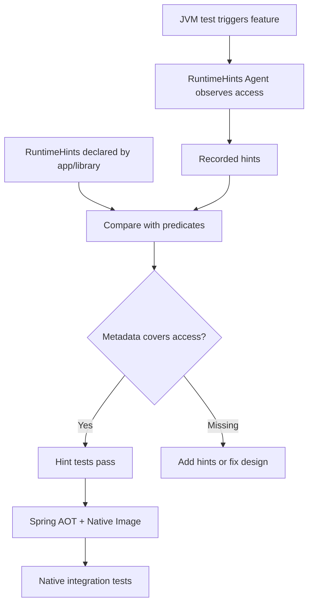

# RuntimeHints Agent in spring-core-test for Recording Accesses Requiring Hints

## 1. Why record runtime access when testing hints?

Spring AOT and GraalVM Native Image need metadata for operations that static analysis cannot fully infer, such as reflection, resource lookups, JDK dynamic proxies, and serialization. An application or library can register metadata with Spring `RuntimeHints`, typically via a `RuntimeHintsRegistrar`.

One difficulty when writing hints is pinpointing which code paths actually perform dynamic access. Registering too little can cause the native executable to fail on a rarely taken branch; registering too broadly makes metadata hard to control and can retain unnecessary components.

Spring provides the **RuntimeHints Agent** in the `spring-core-test` testing artifact to observe certain runtime operations while JVM tests run and turn them into inspectable hint data. This approach lets you write tests based on observed behavior: run the code path to support, obtain the hints recorded by the agent, and then use Spring predicates to verify that the declared metadata covers those accesses.

The agent is a testing aid. It only records paths executed in the JVM; it does not by itself prove the entire application is Native Image compatible, does not cover unexecuted branches, and does not replace native integration tests.



## 2. How do RuntimeHints Agent and RuntimeHintsPredicates differ?

The two components serve two separate roles:

- **RuntimeHints Agent** observes certain dynamic accesses during test execution and produces a set of hints reflecting the operations seen.
- **RuntimeHintsPredicates** checks whether a `RuntimeHints` set contains the desired access permissions/metadata.

You can think of the Agent as the source of observational data, and predicates as the assertion tool for verifying declared metadata.

| Component | Role | Question answered |
|---|---|---|
| `RuntimeHintsAgent` | Records observed runtime accesses | Which dynamic operations did the test run just perform? |
| `RuntimeHints` | Metadata registry declared by the app/library | What does the system ask Native Image to retain? |
| `RuntimeHintsPredicates` | Assertions on metadata | Do the declared hints satisfy the requirements? |
| Native Image test | Verifies the actual executable | Does the code path run properly in the native binary? |

The agent does not automatically edit registrars or update production configuration. The development team must analyze the results, add hints in the right place, and keep tests to prevent regressions.

## 3. Adding spring-core-test to the test classpath

RuntimeHints Agent belongs to Spring Core's testing infrastructure. Add `spring-core-test` to test scope with a version compatible with the Spring Framework version your application uses. For Spring Boot projects, prefer the version managed by Spring Boot dependency management/BOM; avoid choosing a Spring Core version different from the runtime framework.

Gradle:

```groovy
dependencies {
    testImplementation("org.springframework:spring-core-test")
}
```

Maven:

```xml
<dependency>
    <groupId>org.springframework</groupId>
    <artifactId>spring-core-test</artifactId>
    <scope>test</scope>
</dependency>
```

The examples omit the version because it is normally managed by the Spring Boot BOM or project dependency management. If the project does not use a BOM, declare a matching Spring Framework version synchronized with `spring-core`.

This dependency is for testing only. Do not put `spring-core-test` on the production runtime classpath just to collect hints.

## 4. Recording a code path in a test

Consider a library that uses reflection to instantiate a plugin and invoke a method:

```java
public class CsvPlugin {
    public CsvPlugin() {
    }

    public String export(String value) {
        return "csv:" + value;
    }
}
```

Code performing dynamic access:

```java
public String exportWithReflection(String className, String value)
        throws ReflectiveOperationException {
    Class<?> type = Class.forName(className);
    Object plugin = type.getDeclaredConstructor().newInstance();

    Method export = type.getMethod("export", String.class);
    return (String) export.invoke(plugin, value);
}
```

The test must execute this exact code path while the RuntimeHints Agent is active. How the agent is initialized/accessed and which hint-query APIs to use depend on the corresponding Spring Framework version; check the Javadoc of the `spring-core-test` resolved in your project before finalizing the test snippet. Do not create an empty `RuntimeHints` instance yourself and treat it as agent-recorded data.

What matters is that the test actually calls:

- `Class.forName` for the plugin class.
- Constructor lookup and invocation.
- Method lookup and invocation.

If the test merely instantiates the object via `new CsvPlugin()`, the Agent cannot observe the reflection operations in the example.

## 5. Retrieving data from the Agent and checking with predicates

Spring Framework provides a hint-testing API via `RuntimeHintsPredicates`. Assertion patterns typically look like:

```java
assertThat(RuntimeHintsPredicates.reflection()
        .onType(CsvPlugin.class)
        .withConstructor(List.of(), ExecutableMode.INVOKE)
        .test(runtimeHints))
    .isTrue();
```

The snippet above illustrates a predicate checking constructor invocation within a `runtimeHints` set. Imports and builder signatures may vary across Spring Framework versions; use the actual API of the resolved dependency.

A meaningful hints test needs to distinguish two sets of data:

1. Hints **declared** by the library's registrar/configuration.
2. Accesses **observed** by the Agent during the test.

The goal is to ensure declared metadata covers the required operations discovered by tests. You can check each specific member with the appropriate predicate or use the hint comparison/evaluation API provided by your Spring version.

Do not use generic assertions like “type hint exists” to conclude that all constructors, methods, and fields are accessible. Check the exact operation: introspection, invocation, field get/set, resource, proxy, or serialization.

## 6. Example registrar to test

Suppose the library wants to support the plugin reflection above. A registrar can declare the constructor and public methods that need invocation:

```java
public class PluginRuntimeHints implements RuntimeHintsRegistrar {

    @Override
    public void registerHints(RuntimeHints hints, ClassLoader classLoader) {
        hints.reflection().registerType(
            CsvPlugin.class,
            MemberCategory.INVOKE_DECLARED_CONSTRUCTORS,
            MemberCategory.INVOKE_PUBLIC_METHODS
        );
    }
}
```

Register the registrar:

```java
@Configuration
@ImportRuntimeHints(PluginRuntimeHints.class)
class PluginConfiguration {
}
```

Tests should verify that the registrar produces the right metadata. If the code only needs a public constructor, you can pick the corresponding public category; for example, use declared constructors only when the actual operation requires that scope.

RuntimeHints Agent helps uncover operations at runtime, but it does not decide for the team what the minimal hint scope is. After observing accesses, narrow the metadata to the exact classes/members and verify again with predicates.

## 7. Resource accesses also need dedicated scenarios

Example service reading a template by name:

```java
public String loadTemplate(String name) throws IOException {
    String path = "templates/" + name + ".html";
    try (InputStream input =
            getClass().getClassLoader().getResourceAsStream(path)) {
        if (input == null) {
            throw new FileNotFoundException(path);
        }
        return new String(input.readAllBytes(), StandardCharsets.UTF_8);
    }
}
```

If a test only calls `loadTemplate("invoice")`, the Agent only observes that resource. It does not automatically know that `receipt.html` or another locale template is also used in production.

Create scenarios for each resource family or each valid name. Then declare resource hints using narrow patterns, for example:

```java
hints.resources().registerPattern("templates/*.html");
```

Patterns must match the semantics of your Spring/GraalVM version and the actual resource layout. Distinguish classpath resources from runtime-mounted filesystem files; the Agent does not turn external files into embedded resources.

## 8. Proxies, serialization, and JNI must be triggered properly

Depending on version and instrumentation capabilities, RuntimeHints Agent can observe several access types beyond reflection:

- JDK dynamic proxy: create a proxy with the exact interface set.
- Serialization: serialize/deserialize the exact root type and subtypes.
- JNI: actually call the API crossing the native boundary.
- Resource: read specific classpath resources.

For Spring AOP, retrieve the bean from `ApplicationContext` and invoke methods through the bean proxy; do not instantiate the target yourself with `new` and call it directly. For JNI, invoke the dependency's actual API; merely starting the application does not prove the native library was loaded.

Do not confuse JDK proxy metadata with class-based proxy generation. The agent recording a JDK proxy does not prove that a library generating subclasses or arbitrary bytecode is supported in Native Image.

## 9. The Agent does not cover unexecuted branches

Suppose a serializer supports three subtypes: `CardPayment`, `BankPayment`, and `WalletPayment`. If a test only sends a Card payload, the Agent only observes operations triggered by that subtype. Metadata for the remaining two subtypes may be missing.

Similarly, separate tests are needed for:

- Important endpoints and HTTP methods.
- Valid, boundary, optional/null, and malformed payloads.
- Each supported polymorphic subtype.
- Templates/schemas/message bundles by name or locale.
- Primary and fallback providers.
- Consumers, scheduled jobs, and event listeners.
- Profiles/conditional beans of the target native artifact.
- Error paths that may trigger different classes/resources.

The Agent does not report an “entire application covered” percentage. Coverage must be managed via a scenario matrix built by the team.

## 10. Attaching the Agent to the test process

RuntimeHints Agent must be enabled in the JVM process executing the code to observe. If tests run in a Gradle forked test JVM or a Maven Surefire/Failsafe fork, attaching the agent to the shell process does not automatically propagate it to the test process.

Points to check:

- Which JVM actually runs the application/tests.
- Whether the agent is attached to that process.
- Whether tests run in a separate fork.
- Whether the output directory is created and writable.
- Whether the agent version matches the Spring Framework test library.
- Whether the test process exits cleanly to flush observed data.

How to pass the agent/options depends on the Spring/GraalVM version and build plugin. Consult the documentation/Javadoc for the resolved version; avoid copying JVM arguments from old examples without verifying.

## 11. Inspecting output and comparing against declared hints

After a trace run:

1. Verify that output was actually produced and is non-empty.
2. Check the types of metadata recorded.
3. Map each access group back to the scenario executed.
4. Compare with the `RuntimeHints` declared by the registrar.
5. Identify missing members/resources/proxies.
6. Remove entries belonging only to the test framework if unnecessary for production.
7. Check metadata schema and version.
8. Re-run tests to confirm assertions are stable.

Do not edit agent output directly and treat it as the library's registrar. If metadata must be maintained in source code, translate the relevant parts into `RuntimeHints`/registrars or framework-supported metadata mechanisms and keep regression tests.

## 12. What the Agent cannot prove

| Observed result | Cannot be inferred |
|---|---|
| Constructor was called on the JVM | Native Image will definitely keep the constructor if metadata is not integrated |
| Resource was read on the JVM | Resource is definitely present in the native executable |
| JDK proxy was created on the JVM | All proxy/class generation is native-compatible |
| JNI call runs on the JVM | Native library has the right ABI / exists in the container |
| One subtype deserializes successfully | All production subtypes are supported |
| Hint tests pass | Native executable definitely works |
| Startup test passes | Unexecuted endpoints/jobs/lazy paths also work |

The agent helps produce evidence about observed operations; Native Image and container tests are what verify behavior in the target environment.

## 13. Workflow from RuntimeHints Agent to native tests

A suggested pipeline:

1. Choose matching Spring Boot, Spring Framework, JDK, and GraalVM versions.
2. Add `spring-core-test` to test scope.
3. Build scenarios covering features, data variants, and integration branches.
4. Enable RuntimeHints Agent in the right test JVM process.
5. Collect observed hints.
6. Compare against declared registrars/`RuntimeHints` using predicates.
7. Add minimal metadata or fix incompatible code paths.
8. Run Spring AOT with the target profiles and dependency graph.
9. Build the Native Image.
10. Re-run feature tests on the executable and target container.

If the build/native test fails, classify the error: missing dependency, reflection, resource, proxy, serialization, JNI, class initialization, or unsupported runtime mechanism. Do not broaden hints before knowing which category the failure belongs to.

## 14. Common errors

| Symptom | Possible cause | Resolution |
|---|---|---|
| Agent records no accesses | Agent not attached to test JVM process or code path did not run | Check process arguments and scenarios |
| Empty output | Test performed no dynamic operations or agent was initialized improperly | Check agent setup/version and test |
| Predicate fails | Registrar lacks operation/member or test uses wrong expectation | Check access type and API version |
| JVM tests pass, native fails | Hints not integrated or different code path | Run AOT/native and reproduce scenario |
| Only one subtype works | Trace run did not exercise remaining subtypes | Add fixtures/tests per subtype |
| Resource missing in native | Resource not packaged / wrong hint | Check JAR, path, and resource hints |
| Proxy fails despite reflection hints | Missing JDK proxy metadata or using runtime bytecode generation | Determine proxy strategy |
| JNI fails in container | Missing native library / incompatible ABI | Check binary and run image |

## 15. Checklist for RuntimeHints Agent tests

- `spring-core-test` uses a version compatible with the Spring Framework runtime.
- Agent is enabled in the exact JVM process running the scenarios.
- Tests exercise the reflection/resource/proxy/serialization/JNI code paths to support.
- Matrix of endpoints, subtypes, boundary data, and fallbacks is defined.
- Observed hints are reconciled against declared `RuntimeHints`.
- Predicates verify specific operations, not just generic type checks.
- Output is reviewed, not copied verbatim into production.
- Registrar is discovered by Spring AOT during application build.
- Native executable re-runs the feature scenarios.
- Container tests use the exact target OS/architecture/run image.

## 16. Self-check questions

1. What does RuntimeHints Agent in `spring-core-test` help observe?
2. What is the difference between RuntimeHints Agent and `RuntimeHintsPredicates`?
3. Why must the agent be attached to the exact JVM process running the tests?
4. Why cannot testing one subtype represent all polymorphic subtypes?
5. Does the agent observing a resource on the JVM prove the resource is packaged into the Native Image?
6. Why does JDK proxy access not prove class-based runtime generation is compatible?
7. How do you turn observed results into maintainable `RuntimeHints`?
8. What steps must still be performed after hint tests pass?

**Takeaway:** RuntimeHints Agent helps record dynamic operations executed by tests; predicates verify whether declared metadata satisfies those operations. Run purposeful scenarios in the right test JVM process, review and maintain minimal hints, then re-verify on Spring AOT, the native executable, and the target container.
