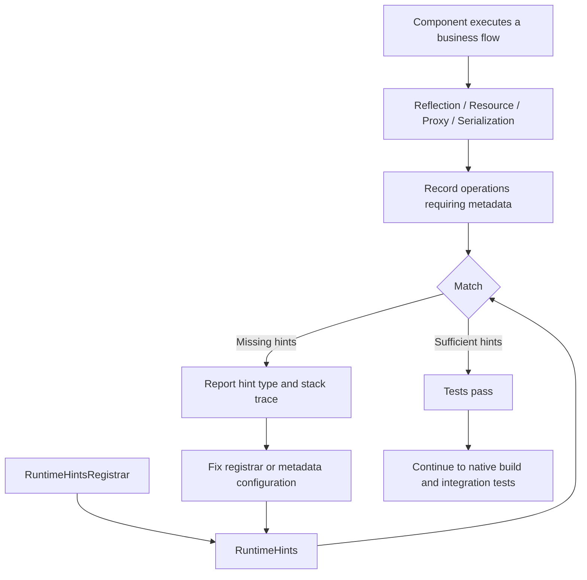

# Matching Recorded Operations Against a Component's RuntimeHints

> **Chapter: Hints Testing.** The **SPRING_BOOT_NATIVE_IMAGE** module compiles Spring Boot applications into a GraalVM Native Image using Spring AOT. When a component uses reflection, resources, serialization, or JDK proxies in ways that static analysis cannot infer, that component must declare `RuntimeHints`. This lesson teaches how to verify whether the declared hints cover the actual operations the component performs.

## 1. Learning objectives

After this lesson, you will be able to:

1. Explain the difference between checking a known hint and recording operations that require hints while code executes.
2. Use `RuntimeHintsPredicates` to test reflection, resource, serialization, and proxy hints.
3. Use a component's `RuntimeHintsRegistrar` as the hint source for unit tests.
4. Record invocations with the Runtime Hints Agent and match them against `RuntimeHints` in Spring Framework 6.x.
5. Read missing-hint reports, trace the code path causing the operation, and add precise metadata.
6. Choose a testing approach suited to your Spring Framework version, especially when migrating from 6.x to 7.x.
7. Combine hint unit tests with native executable tests to verify behavior in a production-like environment.

## 2. Why match operations against RuntimeHints?

A component may run fine on the JVM yet fail in Native Image if it performs dynamic operations that the build did not anticipate. For example:

- Looking up a class by string name and instantiating it via reflection.
- Calling a method or reading a field via reflection.
- Loading a classpath file using a name assembled from locale or configuration.
- Creating a JDK proxy from a set of interfaces.
- Serializing a data type that Spring AOT cannot infer from bean definitions or endpoints.

`RuntimeHints` describes the access permissions required for Native Image. However, just looking at the registrar class does not prove the hints are sufficient. A registrar can overlook a constructor, resource, method, or interface that the component actually uses.

There are two complementary levels of checking:

| Check approach | Question answered | Tool |
|---|---|---|
| Predicate check | Is the specific hint expected by the team registered? | `RuntimeHintsPredicates` |
| Match recorded operations | When running a business flow, are all operations requiring hints covered by `RuntimeHints`? | Runtime Hints Agent/`RuntimeHintsRecorder` in Spring 6.x; GraalVM missing-registration reporting for native runtime |

Overall flow:



## 3. RuntimeHints and RuntimeHintsRegistrar

Spring Framework provides `RuntimeHints` to collect requirements for:

- Reflection.
- Resources and resource bundles.
- Java serialization.
- JDK dynamic proxies.

A component can contribute hints using a `RuntimeHintsRegistrar`. For example, a spell-check service loading a dictionary by language:

```java
package com.example.orders.spell;

import java.util.Locale;

import org.springframework.aot.hint.RuntimeHints;
import org.springframework.aot.hint.RuntimeHintsRegistrar;
import org.springframework.context.annotation.ImportRuntimeHints;
import org.springframework.core.io.ClassPathResource;
import org.springframework.stereotype.Component;

@Component
@ImportRuntimeHints(SpellCheckService.SpellCheckRuntimeHints.class)
public class SpellCheckService {

    public ClassPathResource dictionary(Locale locale) {
        return new ClassPathResource(
                "dicts/" + locale.getLanguage() + ".txt");
    }

    static class SpellCheckRuntimeHints implements RuntimeHintsRegistrar {

        @Override
        public void registerHints(RuntimeHints hints, ClassLoader classLoader) {
            hints.resources().registerPattern("dicts/*");
        }
    }
}
```

`@ImportRuntimeHints` connects the registrar to Spring AOT. When AOT processes the component, Spring invokes `registerHints(...)` to collect metadata. Place the annotation close to the component needing the hints so that if the component is excluded from the bean factory, the corresponding hints are not contributed unnecessarily.

For unit tests, you can call the registrar directly to obtain a standalone `RuntimeHints` instance. This lets you inspect the registrar's contents without starting the entire application context.

## 4. Testing known hints with RuntimeHintsPredicates

`RuntimeHintsPredicates` creates `Predicate<RuntimeHints>` instances to test specific requirements. This is the concise approach when the team already knows the operations a component needs to perform.

Add the Spring Core test dependency matching the Spring Framework version used by your application:

```groovy
dependencies {
    testImplementation("org.springframework:spring-core")
    testImplementation("org.springframework:spring-core-test")
}
```

For Spring Boot projects, it is usually best to let Spring Boot dependency management manage versions rather than choosing a `spring-core-test` version different from `spring-core`.

### 4.1. Testing resources

Example test for the registrar above:

```java
package com.example.orders.spell;

import org.junit.jupiter.api.Test;
import org.springframework.aot.hint.RuntimeHints;
import org.springframework.aot.hint.predicate.RuntimeHintsPredicates;

import static org.assertj.core.api.Assertions.assertThat;

class SpellCheckRuntimeHintsTests {

    @Test
    void registersDictionaryResources() {
        RuntimeHints hints = new RuntimeHints();
        new SpellCheckService.SpellCheckRuntimeHints()
                .registerHints(hints, getClass().getClassLoader());

        assertThat(RuntimeHintsPredicates.resource()
                .forResource("dicts/en.txt"))
                .accepts(hints);

        assertThat(RuntimeHintsPredicates.resource()
                .forResource("dicts/vi.txt"))
                .accepts(hints);
    }
}
```

The `forResource(...)` predicate checks whether the resource is covered by the registered resource hints. It does not open the file and does not prove the file actually exists inside the JAR. Therefore, verify resource existence/contents with a separate test if the component depends on that file.

### 4.2. Testing reflection

Suppose a component invokes `SpringVersion.getVersion()` via reflection. The registrar must declare an invocation hint:

```java
public class VersionReflectionHints implements RuntimeHintsRegistrar {

    @Override
    public void registerHints(RuntimeHints hints, ClassLoader classLoader) {
        hints.reflection().registerType(SpringVersion.class, typeHint ->
                typeHint.withMethod("getVersion", List.of(), ExecutableMode.INVOKE));
    }
}
```

With Spring Framework 7.x, you can check method invocation using the new API:

```java
assertThat(RuntimeHintsPredicates.reflection()
        .onMethodInvocation(SpringVersion.class, "getVersion"))
        .accepts(hints);
```

In Spring Framework 6.x, the predicate API typically looks like:

```java
assertThat(RuntimeHintsPredicates.reflection()
        .onMethod(SpringVersion.class, "getVersion")
        .invoke())
        .accepts(hints);
```

Starting in Spring Framework 7.0, the older `onMethod(...)`-style predicates were deprecated in favor of `onMethodInvocation(...)`. Use the API matching the version managed in your project; do not mix 6.x and 7.x examples in the same source set.

### 4.3. Testing JDK proxies

If a component creates a JDK proxy for the `OrderGateway` interface, the registrar can declare:

```java
public class OrderGatewayHints implements RuntimeHintsRegistrar {

    @Override
    public void registerHints(RuntimeHints hints, ClassLoader classLoader) {
        hints.proxies().registerJdkProxy(OrderGateway.class);
    }
}
```

Test:

```java
assertThat(RuntimeHintsPredicates.proxies()
        .forInterfaces(OrderGateway.class))
        .accepts(hints);
```

Interface order matters when a proxy spans multiple interfaces. Tests must pass the exact set and order of interfaces that the component needs to create.

### 4.4. Testing serialization

If a component uses Java serialization for a `Serializable` type, register:

```java
hints.serialization().registerType(OrderSnapshot.class);
```

Then test:

```java
assertThat(RuntimeHintsPredicates.serialization()
        .onType(OrderSnapshot.class))
        .accepts(hints);
```

Serialization hints here are for the Java serialization mechanism described by Spring `RuntimeHints`. Do not confuse them with reflection hints for Jackson binding; the two cases may require different metadata.

### 4.5. Testing multiple requirements in one test

A component may require multiple hint types. You can group assertions in the same test:

```java
@Test
void registersAllRequiredHints() {
    RuntimeHints hints = new RuntimeHints();
    new OrderComponentRuntimeHints()
            .registerHints(hints, getClass().getClassLoader());

    assertThat(RuntimeHintsPredicates.resource()
            .forResource("schemas/order.json"))
            .accepts(hints);

    assertThat(RuntimeHintsPredicates.proxies()
            .forInterfaces(OrderGateway.class))
            .accepts(hints);

    assertThat(RuntimeHintsPredicates.serialization()
            .onType(OrderSnapshot.class))
            .accepts(hints);
}
```

Each assertion should correspond to an operation the component actually needs. Do not register broad hints just to make tests pass.

## 5. Why predicates alone are not enough

Predicates check the things the test author thought of. If the team forgets an operation, tests can still pass even though the registrar is incomplete.

For example, a component uses:

1. `ClassUtils.forName(...)` to load a class.
2. `ClassUtils.getMethod(...)` to find a method.
3. `Method.invoke(...)` to invoke the method.

If a test only checks a resource hint, it will not detect a missing reflection hint. If a test only checks `onType(...)`, it also may not prove that the method needing invocation was declared with the right mode.

To uncover requirements that tests did not anticipate, you can record actual operations during an execution flow and match them against the component's complete `RuntimeHints`. Spring Framework 6.x provides the Runtime Hints Agent for this purpose.

## 6. Recording operations with the Runtime Hints Agent in Spring 6.x

`spring-core-test` includes the Runtime Hints Agent, a Java agent using a bytecode transformer to record metadata-related method invocations. `RuntimeHintsRecorder.record(...)` collects invocations inside a block of code; `RuntimeHintsInvocations.match(runtimeHints)` checks whether they are covered by hints.

By default, the agent only instruments the `org.springframework` package. If your application component lives in `com.example.orders`, you must add that package to the agent configuration; otherwise, tests may fail to record operations from your component.

### 6.1. Dependency and Java agent configuration

Add `spring-core-test` at the same version as Spring Framework in test scope:

```groovy
dependencies {
    testImplementation("org.springframework:spring-core-test")
}
```

When running the test JVM, load that same JAR as a Java agent:

```text
-javaagent:/path/to/spring-core-test.jar=+org.springframework,+com.example.orders
```

The path must point to the JAR file resolved from the `spring-core-test` dependency. The part after the equals sign is the list of packages to instrument; `+` adds a package to the tracking scope, `-` excludes a package. Only add relevant packages to reduce instrumented bytecode and keep results readable.

With Gradle, you can create a dedicated configuration to resolve the exact JAR as an agent and pass the option to the test JVM:

```groovy
configurations {
    runtimeHintsAgent
}

dependencies {
    runtimeHintsAgent("org.springframework:spring-core-test")
}

tasks.withType(Test).configureEach {
    doFirst {
        jvmArgs("-javaagent:${configurations.runtimeHintsAgent.singleFile}=+org.springframework,+com.example.orders")
    }
}
 ```

Gradle uses the `runtimeHintsAgent` configuration to resolve the exact JAR file and pass it into the test JVM. The example above assumes your project's dependency management supplies the version for `spring-core-test`. With Kotlin DSL or other Gradle setups, keep the same principle: the agent must be loaded into the exact JVM running the tests, not merely added to the compile classpath.

With Maven Surefire, pass the same option in `argLine` of the forked test JVM. You can use the resolved artifact path or a build-managed property:

```xml
<plugin>
    <groupId>org.apache.maven.plugins</groupId>
    <artifactId>maven-surefire-plugin</artifactId>
    <configuration>
        <argLine>
            -javaagent:/path/to/spring-core-test.jar=+org.springframework,+com.example.orders
        </argLine>
    </configuration>
</plugin>
```

This is an illustrative configuration template; replace placeholders with actual paths in your build environment. If `argLine` is already used for JaCoCo or another agent, append to existing options rather than overwriting them.

### 6.2. Writing an invocation-matching test

Component performing a reflection operation:

```java
package com.example.orders.version;

import java.lang.reflect.Method;

import org.springframework.util.ClassUtils;

public class VersionReader {

    public String readSpringVersion() throws Exception {
        Class<?> type = ClassUtils.forName(
                "org.springframework.core.SpringVersion", null);
        Method method = ClassUtils.getMethod(type, "getVersion");
        return (String) method.invoke(null);
    }
}
```

Registrar contributing hints for the invoked method:

```java
package com.example.orders.version;

import java.util.List;

import org.springframework.aot.hint.ExecutableMode;
import org.springframework.aot.hint.RuntimeHints;
import org.springframework.aot.hint.RuntimeHintsRegistrar;
import org.springframework.core.SpringVersion;

public class VersionReaderRuntimeHints implements RuntimeHintsRegistrar {

    @Override
    public void registerHints(RuntimeHints hints, ClassLoader classLoader) {
        hints.reflection().registerType(SpringVersion.class, typeHint ->
                typeHint.withMethod("getVersion", List.of(), ExecutableMode.INVOKE));
    }
}
```

Test recording the execution flow and matching:

```java
package com.example.orders.version;

import org.junit.jupiter.api.Test;
import org.springframework.aot.hint.RuntimeHints;
import org.springframework.aot.test.agent.EnabledIfRuntimeHintsAgent;
import org.springframework.aot.test.agent.RuntimeHintsInvocations;
import org.springframework.aot.test.agent.RuntimeHintsRecorder;

import static org.assertj.core.api.Assertions.assertThat;

@EnabledIfRuntimeHintsAgent
class VersionReaderRuntimeHintsAgentTests {

    @Test
    void registeredHintsCoverRecordedInvocations() {
        RuntimeHints hints = new RuntimeHints();
        new VersionReaderRuntimeHints()
                .registerHints(hints, getClass().getClassLoader());

        RuntimeHintsInvocations invocations = RuntimeHintsRecorder.record(() -> {
            try {
                new VersionReader().readSpringVersion();
            }
            catch (Exception ex) {
                throw new IllegalStateException(ex);
            }
        });

        assertThat(invocations).match(hints);
    }
}
```

`@EnabledIfRuntimeHintsAgent` only allows the test to run when the agent has been loaded into the current JVM; the annotation also tags the test with the JUnit tag `RuntimeHints`. If a test is skipped, that does not prove the hints are correct. CI needs to verify that the agent is configured and that the required tests actually executed.

When a hint is missing, the `match(hints)` assertion fails and reports the missing hint type, method invocation, arguments, and stack trace. The stack trace helps trace backward from the recorded operation to the component that triggered it.

### 6.3. Limitations of the Runtime Hints Agent

- The agent only records operations occurring inside instrumented code executed during the test.
- By default, the agent instruments the `org.springframework` package; you must add the application or library packages you want to track.
- A business branch not executed by the test will not produce invocations to check.
- The agent only observes `RuntimeHints`-related APIs/operations supported by its transformer; it does not prove all application behavior has been tested.
- This test runs on the JVM and does not replace native executable tests.

Invoke the component's real business flows inside the recording block. If the component has multiple branches such as locales, plugins, serializers, or configuration-driven resources, write separate tests for each important branch.

## 7. Changes starting in Spring Framework 7.0

Starting in Spring Framework 7.0, `RuntimeHintsAgent` and `RuntimeHintsRecorder` were deprecated in favor of GraalVM Native Image's missing-registration reporting mechanism. This is an important difference when upgrading:

| API / Approach | Spring Framework 6.x | Spring Framework 7.x |
|---|---|---|
| `RuntimeHintsPredicates` | Used to check specific hints | Still used; for reflection prefer the new `onMethodInvocation(...)`, `onFieldAccess(...)` APIs |
| `RuntimeHintsAgent` | Targeted invocation recording method | Deprecated, for removal |
| `RuntimeHintsRecorder.record(...)` | Records invocations inside a code block | Deprecated, for removal |
| GraalVM missing-registration reporting | Available depending on GraalVM version | Recommended replacement approach by Spring |

Do not start a new test suite on Spring 7.x depending on the legacy Runtime Hints Agent if GraalVM runtime reporting already meets your testing goals. For existing 6.x projects, the agent can still be useful for testing registrars in narrowly scoped unit tests.

## 8. Matching missing registrations with GraalVM Native Image

With GraalVM for JDK 23 or later, you can enable exact reachability metadata at build time:

```bash
native-image --exact-reachability-metadata -jar target/orders-service.jar
```

Or enable it only for the package under investigation:

```bash
native-image --exact-reachability-metadata=com.example.orders -jar target/orders-service.jar
```

After producing the executable, run it in warning mode to observe locations with missing registrations:

```bash
./orders-service -XX:MissingRegistrationReportingMode=Warn
```

Once warnings have been addressed, run tests in Exit mode:

```bash
./orders-service -XX:MissingRegistrationReportingMode=Exit
```

`Warn` reports operations with missing registrations and lets the application continue; `Exit` terminates the process immediately upon encountering a missing registration. `Exit` mode is useful in tests because it even catches cases where code catches `Throwable` and accidentally swallows a missing-metadata error.

For GraalVM prior to JDK 23, the corresponding options may differ and some settings are passed at build time as `-H:`. Always check the documentation for the GraalVM version you are using before adding options to a pipeline.

### 8.1. Why real business flows must be executed

Missing-registration reporting only reports operations that actually occurred in the process. If tests do not exercise the code paths using dynamic reflection or resources, the report will contain no data about those branches.

Be sure to run:

- Unit/integration tests for components using reflection.
- API tests covering all important DTO/serializer types.
- Actually supported locales or templates/resources.
- Flows creating proxies or dynamic plugins.
- Error-handling branches, fallbacks, and configuration profiles.

`Warn` output is not a metadata list you can copy verbatim. Identify which operations truly need support, add narrow hints, rebuild, and re-run tests.

## 9. Distinguishing Runtime Hints Agent and GraalVM Tracing Agent

The two agents share related goals but differ in how they are used:

| Aspect | Spring Runtime Hints Agent | GraalVM Native Image Tracing Agent |
|---|---|---|
| Component | `spring-core-test` | GraalVM Native Image |
| Goal | Records `RuntimeHints`-related invocations and matches against a `RuntimeHints` object | Collects metadata configuration from observed dynamic operations |
| Output | `RuntimeHintsInvocations`, assertions with stack traces | JSON metadata files for Native Image |
| Scope | Can be scoped by package and recording block | Entire process run under the agent and configured filters |
| Best suited for | Infrastructure/registrar unit tests in Spring 6.x | Discovering metadata for dependencies or broader application flows |

GraalVM Tracing Agent does not automatically know which `RuntimeHintsRegistrar` belongs to a component. It collects operations needing metadata and outputs JSON. The team must review the results, remove extraneous entries, and translate appropriate entries into reachability metadata or Spring Runtime Hints.

## 10. Designing tests to avoid false positives

A good hints test must prove the right component, the right flow, and the right metadata requirements:

1. **Call the real registrar.** Do not rewrite the expected hints right inside the test and compare them against themselves.
2. **Execute the component's operations.** The recording block must call production code, not just invoke reflection/resource APIs directly from the test.
3. **Instrument the right packages.** Verify the component's package is in the agent include list.
4. **Verify tests actually run.** A test skipped due to a missing agent does not count as passing.
5. **Cover important branches.** Exercise locales, serializers, plugins, or configurations that produce different operations.
6. **Keep hints minimal.** If a broad hint makes the test pass unnecessarily, narrow it down to the specific member/resource.
7. **Test the native runtime.** Hints verified on the JVM still need verification in the native executable.

### 10.1. Reading match failures

Example error:

```text
Missing "ReflectionHints" for invocation:
java.lang.Class#forName

Arguments:
"com.example.orders.LegacyPayload"

Stack trace:
com.example.orders.PayloadReader.read(PayloadReader.java:42)
com.example.orders.PayloadService.load(PayloadService.java:27)
```

Follow the stack trace to locate the first dynamic operation performed by application or library code. Then determine which class, constructor, method, or resource needs a hint. Not every reported invocation necessarily requires adding metadata if that operation is outside supported code paths or is already handled by another mechanism.

## 11. Complete hands-on workflow

Suppose `DocumentRenderer` loads a template by name and uses reflection to instantiate a formatter:

```java
public String render(String locale, String formatterClassName) {
    Class<?> type = ClassUtils.forName(formatterClassName, null);
    Object formatter = BeanUtils.instantiateClass(type);
    Resource template = new ClassPathResource(
            "templates/" + locale + "/invoice.html");
    // Read template and render content.
    return renderDocument(template, formatter);
}
```

Steps:

1. Create `DocumentRendererRuntimeHints` registering resource patterns for supported templates.
2. Register reflection hints for the formatter types/constructors used by the component.
3. Use `RuntimeHintsPredicates` to verify known hints.
4. For Spring 6.x, enable Runtime Hints Agent for the component's package, invoke `DocumentRenderer.render(...)` inside the recording block, and match with `match(hints)`.
5. For Spring 7.x, use `--exact-reachability-metadata` and run the native executable with `MissingRegistrationReportingMode=Warn`.
6. Fix missing metadata and re-run with `Exit`.
7. Verify every locale, formatter, and the final container image.

Report template:

| Item | Result |
|---|---|
| Known resource hints | Pass/Fail |
| Known reflection hints | Pass/Fail |
| Proxy/serialization hints (if any) | Pass/Fail |
| Runtime Hints Agent loaded (Spring 6.x) | Pass/Fail/Not applicable |
| Recorded invocations match | Pass/Fail/Not applicable |
| GraalVM Warn shows no actionable missing registrations | Pass/Fail |
| GraalVM Exit completes all tests | Pass/Fail |
| Native container smoke test | Pass/Fail |

## 12. Self-check questions

1. What does `RuntimeHintsPredicates` check, and what does it not check?
2. Why does calling the registrar directly in a test help isolate hint declaration bugs?
3. Which operations does `RuntimeHintsRecorder.record(...)` capture?
4. Why must the component's package be within the Runtime Hints Agent instrumentation scope?
5. Under what circumstances can `@EnabledIfRuntimeHintsAgent` cause a test to be skipped?
6. Why can a passing predicate test still miss a required hint?
7. What information does `RuntimeHintsInvocations.match(hints)` provide when an assertion fails?
8. How does the status of Runtime Hints Agent change starting in Spring Framework 7.0?
9. How do `MissingRegistrationReportingMode=Warn` and `Exit` differ?
10. Why is it necessary to run the native executable with multiple business flows after hint unit tests pass?

## Takeaway

**Predicate checks verify known hints; recording invocations helps uncover requirements the team has not thought of yet.** Use `RuntimeHintsPredicates` for stable unit tests, use Runtime Hints Agent/`RuntimeHintsRecorder` when maintaining Spring 6.x projects, and use GraalVM missing-registration reporting as the testing direction on Spring 7.x. Run real business flows, read stack traces, add just enough hints, and re-verify on the native executable.

## Official references

- [Spring Framework — Ahead of Time Optimizations](https://docs.spring.io/spring-framework/reference/core/aot.html): Runtime Hints, `RuntimeHintsPredicates`, and testing recorded operations.
- [Spring Framework API — RuntimeHintsPredicates](https://docs.spring.io/spring-framework/docs/current/javadoc-api/org/springframework/aot/hint/predicate/RuntimeHintsPredicates.html): predicates for reflection, resources, serialization, and proxies.
- [Spring Framework API — RuntimeHintsRegistrar](https://docs.spring.io/spring-framework/docs/current/javadoc-api/org/springframework/aot/hint/RuntimeHintsRegistrar.html): contract for registering hints.
- [Spring Framework API — RuntimeHintsRecorder](https://docs.spring.io/spring-framework/docs/6.2.19/javadoc-api/org/springframework/aot/test/agent/RuntimeHintsRecorder.html): recording invocations in Spring Framework 6.x.
- [Spring Framework 7.0 — Deprecated API](https://docs.spring.io/spring-framework/docs/7.0.11/javadoc-api/deprecated-list.html): deprecation status of `RuntimeHintsAgent` and `RuntimeHintsRecorder`.
- [GraalVM — Troubleshoot Native Image Run-Time Errors](https://www.graalvm.org/latest/reference-manual/native-image/guides/troubleshoot-run-time-errors/): exact reachability metadata and missing-registration reporting.
- [GraalVM — Reachability Metadata](https://www.graalvm.org/latest/reference-manual/native-image/metadata/): metadata types and how to inspect them.
