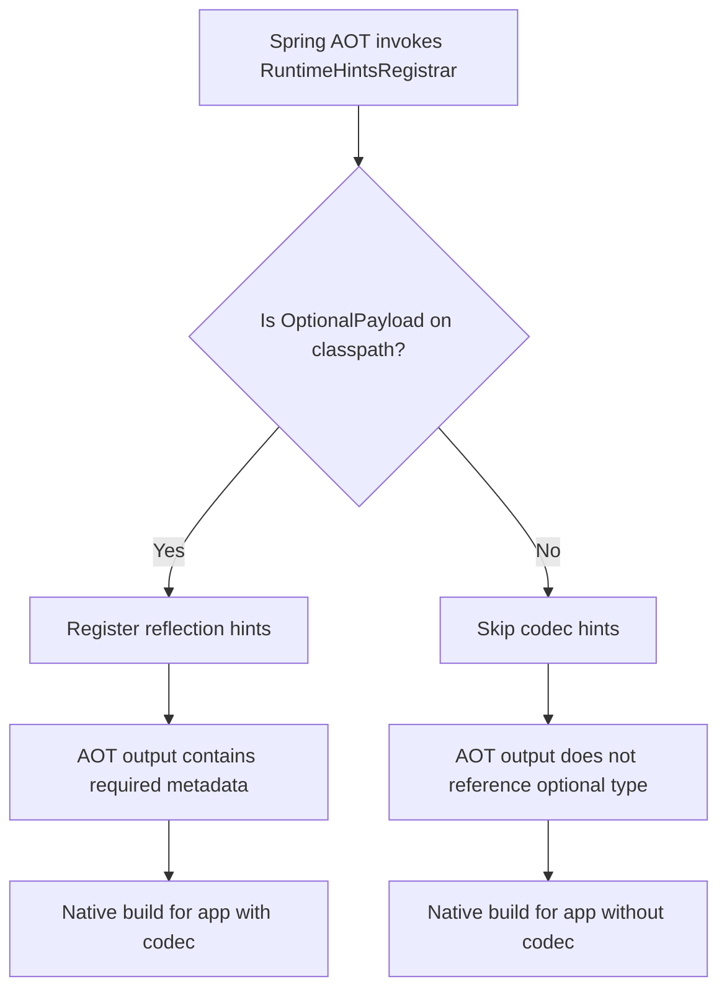

# Testing a Registrar When Optional Dependencies Are Present or Absent on the Classpath

> **Chapter:** Hints Testing  
> **Module:** `SPRING_BOOT_NATIVE_IMAGE`  
> **Goal:** Design a `RuntimeHintsRegistrar` safely when the integrated library is an optional dependency; test both the present and absent class branches on the classpath; avoid class linkage errors when the library is missing; verify that Spring AOT only generates metadata matching the actual configuration.

## 1. Why must a registrar tolerate optional dependencies?

A starter or integration module often adds support for a third-party library without requiring every application to use that library. For example:

- An integration for a codec is only added when the application uses that codec.
- A cloud connectivity module is only included when deploying to a specific provider.
- Adapters for JSON/XML libraries, database drivers, or messaging clients exist only in certain applications.
- An extension supplies reflection hints for models or APIs of an external dependency.

When the optional library is present, the registrar must register the exact reflection, resource, proxy, or serialization hints that the feature needs. When the library is absent, the registrar must skip that metadata and the application must still be able to start, run AOT analysis, and build natively.

A common mistake is for the registrar to reference the optional dependency's class directly:

```java
import com.vendor.codec.OptionalPayload;

public class OptionalCodecHints implements RuntimeHintsRegistrar {

    @Override
    public void registerHints(RuntimeHints hints, ClassLoader classLoader) {
        hints.reflection().registerType(
                OptionalPayload.class,
                MemberCategory.INVOKE_PUBLIC_CONSTRUCTORS);
    }
}
```

This code only compiles when `optional-codec` is on the compile classpath. If an application consumes the integration module without pulling that library onto the runtime classpath, loading or executing the registrar can throw `NoClassDefFoundError` or a similar linkage error. Marking the dependency as optional in Maven does not automatically make all class references in bytecode safe.

**Design rule:** an optional integration's registrar should not contain static type references to classes that exist only in the optional dependency. Use string class names, the classloader provided by Spring AOT, and conditional registration APIs.

## 2. Two classpath states to test

This walkthrough uses a hypothetical integration:

- Main module: `payment-core`, always present in the application.
- Integration module: `payment-codec-integration`, containing the registrar.
- Optional dependency: `vendor-codec`, providing `com.vendor.codec.OptionalPayload`.
- When the codec is present, the native image needs reflection metadata to instantiate `OptionalPayload`.
- When the codec is absent, no metadata is needed for that type.



| State | Expected outcome |
|---|---|
| Dependency present | Registrar registers the exact types/members needing reflection |
| Dependency absent | Registrar does not throw an exception and registers no hints for that type |
| Dependency present but incompatible version | Tests detect missing APIs/members or mismatched metadata |
| Dependency present but feature disabled | Hints cause no side effects; feature still honors integration configuration conditions |

You must test both states. Testing only with the dependency present will not catch linkage errors when users omit the integration library. Testing only with the dependency absent does not prove that the required metadata branch is registered.

## 3. Avoid referencing optional classes via Java types

A safe registrar should store the class name to check as a string:

```java
public final class OptionalCodecRuntimeHints
        implements RuntimeHintsRegistrar {

    private static final String OPTIONAL_PAYLOAD =
            "com.vendor.codec.OptionalPayload";

    @Override
    public void registerHints(RuntimeHints hints, ClassLoader classLoader) {
        hints.reflection().registerTypeIfPresent(
                classLoader,
                OPTIONAL_PAYLOAD,
                MemberCategory.INVOKE_PUBLIC_CONSTRUCTORS,
                MemberCategory.INTROSPECT_PUBLIC_METHODS);
    }
}
```

`ReflectionHints.registerTypeIfPresent(...)` is the Spring Framework 6+ API for registering a reflection hint when a type can be loaded by the supplied classloader. It has overloads accepting `MemberCategory...` or a `TypeHint.Builder` callback. [Spring Framework Javadoc — ReflectionHints](https://docs.spring.io/spring-framework/docs/6.2.x/javadoc-api/org/springframework/aot/hint/ReflectionHints.html)

In this example, when `OptionalPayload` is present, metadata permits invoking public constructors and introspecting public methods. If the use case requires invoking a specific method or accessing a specific field, declare that exact operation. Do not register all members just to avoid understanding the actual requirement.

### 3.1. Why use the passed-in classloader?

Spring AOT invokes the registrar in a build environment whose classpath and classloader correspond to the application being analyzed. Using this classloader ensures the check sees the exact dependencies of the build.

Do not substitute:

```java
ClassLoader.getSystemClassLoader()
```

The system classloader can differ from the classloader of the application, test runner, plugin, or build tool. In some environments, it may fail to see a dependency even when present on the application classpath, or it may see a different version.

Also avoid calling `Class.forName(name)` without passing a classloader: that overload can use the caller's default classloader and initialize the class unintentionally. `registerTypeIfPresent` accepts the classloader explicitly and checks presence before adding hints.

### 3.2. Using `TypeReference` when only the type name is needed

If you need to check or register a type by name yourself, `TypeReference.of("com.vendor.codec.OptionalPayload")` represents the type without requiring a class literal. However, `registerType(TypeReference, ...)` only records metadata; it does not verify that the class exists. For optional dependencies, `registerTypeIfPresent` usually expresses the intent better.

## 4. Separating optional auto-configuration from the core module

If the integration is distributed as a Spring Boot starter, make the auto-configuration conditionally enabled based on the dependency's class.

Example:

```java
@AutoConfiguration
@ConditionalOnClass(name = "com.vendor.codec.OptionalCodec")
@ImportRuntimeHints(OptionalCodecRuntimeHints.class)
public class OptionalCodecAutoConfiguration {
}
```

`@ConditionalOnClass(name = "...")` uses a string class name, so the auto-configuration metadata does not directly link to the optional class. When `OptionalCodec` is absent from the classpath, the auto-configuration is not applied.

Place `@ImportRuntimeHints` close to the configuration or component that needs the metadata. Spring Framework recommends registering registrars close to the component depending on the hints; if the component is not added to the `BeanFactory`, the associated hints do not need to be contributed either. The registrar is discovered and invoked during AOT processing. [Spring Framework Reference — Runtime Hints](https://docs.spring.io/spring-framework/reference/core/aot.html)

### 4.1. Preventing core configuration from pulling in optional dependencies

An easy-to-manage module layout:

```text
payment-core/
  src/main/java/
    com/example/payment/PaymentService.java

payment-codec-integration/
  src/main/java/
    com/example/payment/codec/OptionalCodecAutoConfiguration.java
    com/example/payment/codec/OptionalCodecRuntimeHints.java

application/
  dependencies:
    payment-core
    payment-codec-integration
    vendor-codec (optional)
```

`payment-core` knows nothing about `vendor-codec`. The integration module holds the auto-configuration and registrar without static type references to vendor classes. The application adds `vendor-codec` when it wants to use the feature.

Separating modules like this allows applications not using the codec to include the integration starter without being forced to bring along the entire runtime dependency. Check both dependency declarations and the bytecode of the integration module, because simply marking a dependency optional while still importing its classes in the registrar does not solve the problem.

## 5. Checking the dependency version before registering specific members

Checking whether a class exists only answers the question **can the type be loaded**. It does not prove that the version in use has the constructor, method, or field expected by the metadata.

For example, `OptionalPayload` may exist in both version 1.x and 2.x, while constructors or methods have changed. If the registrar registers a member that no longer exists, the native build may warn, fail, or produce ineffective metadata depending on the operation and toolchain version.

For stable APIs, you can register type-level categories. For APIs that change across versions:

- Prefer separate adapter or integration modules per major version.
- Use dependency constraints/BOMs to pin supported versions.
- If a single shared registrar is truly needed, inspect the specific member via reflection using the passed-in classloader before registering the resolved member.
- Do not infer compatibility solely from the fact that the class name still exists.

Example checking a method whose signature relies on stable JDK types:

```java
if (ClassUtils.isPresent(OPTIONAL_PAYLOAD, classLoader)) {
    Class<?> optionalType = ClassUtils.resolveClassName(
            OPTIONAL_PAYLOAD, classLoader);
    Method decode = ReflectionUtils.findMethod(
            optionalType, "decode", byte[].class);
    if (decode != null) {
        hints.reflection().registerMethod(decode, ExecutableMode.INVOKE);
    }
}
```

This snippet is only appropriate if `decode(byte[])` is a supported API and its parameter/return types do not introduce linkage to another missing dependency. In production code, handle unloadable classes and mismatched method signatures according to your published compatibility policy.

## 6. Testing the registrar when the dependency is present

Unit tests for the registrar should create a fresh `RuntimeHints`, invoke the registrar with the test's classloader, and verify that the exact metadata was added.

Example with JUnit 5 and AssertJ:

```java
class OptionalCodecRuntimeHintsTests {

    private static final String OPTIONAL_PAYLOAD =
            "com.vendor.codec.OptionalPayload";

    private final OptionalCodecRuntimeHints registrar =
            new OptionalCodecRuntimeHints();

    @Test
    void registersHintsWhenOptionalTypeIsPresent() {
        RuntimeHints hints = new RuntimeHints();

        registrar.registerHints(hints, getClass().getClassLoader());

        assertThat(RuntimeHintsPredicates.reflection()
                .onType(TypeReference.of(OPTIONAL_PAYLOAD))
                .withMemberCategory(MemberCategory.INVOKE_PUBLIC_CONSTRUCTORS)
                .test(hints))
                .isTrue();

        assertThat(RuntimeHintsPredicates.reflection()
                .onType(TypeReference.of(OPTIONAL_PAYLOAD))
                .withMemberCategory(MemberCategory.INTROSPECT_PUBLIC_METHODS)
                .test(hints))
                .isTrue();
    }
}
```

`RuntimeHintsPredicates` allows checking hints by `TypeReference`, so tests can verify the type name without using a class literal from the optional dependency. Predicates can be narrowed by `MemberCategory`, constructor, method, or specific reflection operations. [Spring Framework Javadoc — ReflectionHintsPredicates](https://docs.spring.io/spring-framework/docs/6.2.x/javadoc-api/org/springframework/aot/hint/predicate/ReflectionHintsPredicates.html)

A prerequisite for this test is that `vendor-codec` must be on the test runtime classpath. If the dependency is only on the compile classpath and missing when tests run, the registrar will take the absent branch and the assertion will fail. Fix the test dependency configuration rather than loosening the assertion.

### 6.1. Test the exact operation, not just type presence

If the registrar registers constructor invocation, assert `INVOKE_PUBLIC_CONSTRUCTORS` specifically. A hint with only `INTROSPECT_PUBLIC_CONSTRUCTORS` is not sufficient to invoke the constructor via reflection.

Similarly:

| Runtime requirement | What to verify |
|---|---|
| Instantiate via reflection | Constructor invocation |
| Invoke method by name | Method invocation |
| List methods only | Method introspection |
| Read or write a field | Appropriate field access |
| Read classpath file | Resource pattern |
| Create JDK proxy | Proxy hint for the exact interface set |
| Java object serialization | Serialization hint for the type to serialize |

Tests should accurately reflect the operation the dependency performs. If you only assert that a type hint exists, a configuration missing a member category can still slip through.

## 7. Testing the registrar when the dependency is absent

Tests for the absent branch must use a classloader that cannot load the optional class. You can create a controlled classloader in a unit test:

```java
@Test
void skipsHintsWhenOptionalTypeIsNotVisible() {
    RuntimeHints hints = new RuntimeHints();

    ClassLoader withoutOptionalCodec = new ClassLoader(
            getClass().getClassLoader()) {

        @Override
        protected Class<?> loadClass(String name, boolean resolve)
                throws ClassNotFoundException {
            if (OPTIONAL_PAYLOAD.equals(name)) {
                throw new ClassNotFoundException(name);
            }
            return super.loadClass(name, resolve);
        }
    };

    assertThat(ClassUtils.isPresent(
            OPTIONAL_PAYLOAD, withoutOptionalCodec)).isFalse();

    assertThatCode(() ->
            registrar.registerHints(hints, withoutOptionalCodec))
            .doesNotThrowAnyException();

    assertThat(RuntimeHintsPredicates.reflection()
            .onType(TypeReference.of(OPTIONAL_PAYLOAD))
            .test(hints))
            .isFalse();
}
```

The classloader above blocks the exact type name before delegating to its parent. Because the registrar uses `registerTypeIfPresent` with the passed-in classloader, it adds no reflection hint and does not throw `ClassNotFoundException`.

This is a unit test for the classloader-check branch. It is useful when the normal test runtime still contains the optional dependency, but it does not replace a run with **the dependency genuinely excluded from the runtime classpath**. A simulated classloader only blocks the specified class name; other related classes could still be served by the parent loader.

### 7.1. Testing on a classpath genuinely lacking the dependency

Create a dedicated fixture application or test module that depends only on the integration module and Spring Core, without declaring `vendor-codec`. Run tests and AOT processing in that module.

Outcomes to verify:

- The conditional auto-configuration is not activated.
- The registrar produces no hints for `OptionalPayload`.
- The application context still initializes with core beans.
- Spring AOT completes without class linkage errors.
- The native executable of the codec-free fixture still starts and executes core use cases.

This is a stronger check than a mocked classloader because the JVM, Spring AOT, and build tool all run against the application's real dependency graph.

## 8. Testing auto-configuration conditions separately from the registrar

Two mechanisms must be distinguished:

- `@ConditionalOnClass` determines whether an auto-configuration/bean enters the context.
- `RuntimeHintsRegistrar` contributes metadata during AOT processing when the configuration containing it is processed.

Do not rely solely on an `ApplicationContextRunner` test to conclude that the registrar generated hints. Normal context tests are not AOT processing.

Example checking auto-configuration when the class is missing:

```java
class OptionalCodecAutoConfigurationTests {

    private final ApplicationContextRunner contextRunner =
            new ApplicationContextRunner()
                    .withConfiguration(
                            AutoConfigurations.of(
                                    OptionalCodecAutoConfiguration.class));

    @Test
    void doesNotActivateOptionalConfigurationWithoutCodec() {
        contextRunner.run(context -> {
            assertThat(context).doesNotHaveBean(
                    "optionalCodecAdapter");
        });
    }
}
```

This test only verifies the configuration condition. To verify the registrar, call the registrar directly in a unit test or run an AOT integration test and inspect the resulting `RuntimeHints`/metadata output.

If you want to test the class-present branch, run the same fixture with `vendor-codec` on the runtime classpath and verify that the adapter bean appears. The two fixtures should differ in their dependency graph rather than using a runtime profile to simulate classpath presence/absence.

## 9. Organizing tests by dependency graph

A straightforward strategy is to maintain two fixture applications:

```text
optional-codec-tests/
  hints-with-codec/
    build configuration includes vendor-codec
    tests registrar and codec behavior

  hints-without-codec/
    build configuration excludes vendor-codec
    tests application startup and core behavior
```

| Fixture | Dependency | Verification |
|---|---|---|
| `hints-with-codec` | Includes `vendor-codec` | Registrar adds hints; adapter is configured; codec runs |
| `hints-without-codec` | Excludes `vendor-codec` | No optional hints; auto-configuration is skipped; core still runs |
| `hints-with-old-codec` | Supported older version | Members/APIs and hints match the older version |
| `hints-with-new-codec` | Supported newer version | Members/APIs and hints match the newer version |

This layout lets CI verify the exact dependency combinations advertised as supported. If there are multiple major versions, prefer separate fixtures per version or a CI matrix instead of mutating classpaths ad hoc inside a single test process.

### 9.1. Maven

You can create two separate test modules in the Maven reactor:

- `hints-with-codec` declares the `vendor-codec` dependency in test/runtime scope.
- `hints-without-codec` does not declare that dependency.

Both depend on `payment-codec-integration`. Because the registrar source only uses string class names and Spring APIs, the codec-free module still compiles.

If using a Maven profile to toggle the dependency, run each profile separately in CI and inspect the effective dependency tree. `optional=true` in a dependency declaration only affects transitive propagation to consumers; it does not remove the dependency from the module that declares it.

### 9.2. Gradle

With Gradle, you can create separate fixture subprojects or configure test tasks with distinct runtime classpaths. Note that:

- `compileOnly` does not put the dependency on the runtime classpath.
- `runtimeOnly` puts the dependency on the runtime classpath but prevents test sources from compiling directly against those types.
- `testImplementation` makes the dependency available on both test compile and test runtime classpaths.
- Dependencies declared in a parent project or convention plugin may accidentally leak the JAR into the “dependency-absent” fixture.

Inspect each fixture's `runtimeClasspath` using `dependencies` or `dependencyInsight`. Do not just read `build.gradle` and assume the dependency was excluded.

## 10. Inspecting AOT output and the native executable

Unit tests verify registrar logic. Build-level checks are still needed to confirm Spring AOT actually discovers the registrar and the native toolchain receives the metadata.

For the fixture with the dependency:

1. Run AOT processing.
2. Confirm the registrar was invoked during the AOT phase.
3. Confirm reflection metadata for the optional type/members appears in the output.
4. Build the native executable.
5. Execute a real use case using the codec, such as decoding a payload or instantiating a DTO via reflection.

For the fixture without the dependency:

1. Run AOT processing on a runtime classpath without the codec.
2. Confirm the auto-configuration is skipped.
3. Confirm no reflection hint exists for the optional type.
4. Build the native executable.
5. Run core endpoints/use cases and verify the application works without the codec.

Do not hardcode assumptions about a single output path because the locations of AOT sources, classes, and resources vary across Spring Boot/plugin versions. Use task logs and actual artifact metadata to verify.

### 10.1. Verifying native runtime matters more than a passing build

Native compilation can succeed while the feature only fails when the optional branch is invoked. Therefore, the codec-enabled fixture must execute the exact dynamic operations:

- Instantiate objects via constructor reflection if the codec does so.
- Invoke methods by name if the codec uses reflection.
- Read schema or mapping resource files if the codec needs them.
- Create JDK proxies if the library has proxy-based extension points.
- Serialize/deserialize if the codec uses Java serialization.

The codec-free fixture should verify startup and core capabilities. It should not attempt to invoke the codec's API and treat a “class not found” error as an application bug if that feature is designed to be optional.

## 11. Handling a present dependency with missing transitive dependencies

`ClassUtils.isPresent` or `registerTypeIfPresent` checks whether the target type can be loaded by the classloader. However, the class may exist in a JAR while a transitive dependency it needs is absent or the wrong version.

For example:

- `OptionalPayload` is present, but its superclass is missing.
- The type exists, but a method signature references another missing class.
- The codec is present, but its resource bundle or native library is not packaged.
- Two dependencies share a class name with binary-incompatible versions.

Therefore, a class presence check does not replace dependency resolution and integration testing. Verify the entire dependency closure and run the feature on the actual runtime classpath. If the library has API/ABI changes across major versions, use version-specific adapter modules or fixtures.

## 12. Common errors and how to diagnose them

| Symptom | Possible cause | What to check |
|---|---|---|
| `NoClassDefFoundError` during AOT | Registrar or auto-configuration references optional class directly | Search for imports, fields, method signatures, annotations, and class literals in the integration module |
| `ClassNotFoundException` in registrar | Using `Class.forName` with the wrong classloader or without checking presence | Use the AOT-supplied classloader and `registerTypeIfPresent` |
| No hints when dependency is declared | Dependency not on AOT classpath or wrong classloader used | Inspect runtime dependency graph and passed-in classloader |
| Hints appear even without the feature | Registrar imported globally instead of attached to optional auto-configuration | Place `@ImportRuntimeHints` near conditional configuration/components |
| Hints exist but native still fails | Missing other member/resource/proxy hints or wrong operation | Verify the exact API called by the library |
| Build passes but native runtime fails | Optional use case was not exercised in integration tests | Execute real feature in the executable |
| Only one dependency version fails | Incompatible metadata/member assumptions | Create fixtures for each supported version |
| Absent test passes but real app fails | Unit test only used a filtered classloader, not excluding real transitive dependencies | Run fixture on a clean runtime classpath |

## 13. Pre-release checklist for optional dependency registrars

- [ ] Registrar does not import or use class literals from the optional dependency.
- [ ] Optional class names are kept as strings or `TypeReference`.
- [ ] Registrar uses the classloader passed in by Spring AOT.
- [ ] `registerTypeIfPresent` or an equivalent condition is used for optional types.
- [ ] Auto-configuration uses `@ConditionalOnClass(name = "...")` when needed.
- [ ] `@ImportRuntimeHints` is placed close to the component/auto-configuration requiring the hints.
- [ ] The dependency-present branch is tested with exact member categories and reflection operations.
- [ ] The dependency-absent branch throws no exceptions and registers no optional hints.
- [ ] A real fixture exists whose runtime classpath omits the dependency.
- [ ] Transitive dependencies and version compatibility have been verified.
- [ ] AOT processing succeeds on both fixtures.
- [ ] Native executable with the dependency runs optional use cases.
- [ ] Native executable without the dependency still runs core use cases.
- [ ] `RuntimeHintsPredicates` unit tests are not relied upon as the sole proof of native compatibility.

## 14. Key takeaways

A registrar belonging to an optional integration must work in both classpath states. When the dependency is present, it contributes the right hints so Native Image preserves the required dynamic operations. When the dependency is absent, the registrar must skip those types without causing linkage errors or leaving behind unnecessary metadata.

Avoid referencing optional classes via Java types, use `registerTypeIfPresent` with the classloader supplied by Spring AOT, place the registrar behind appropriate auto-configuration conditions, and test both dependency graphs. Unit tests with `RuntimeHintsPredicates` verify registered metadata; dependency-free fixtures and native integration tests prove that the application actually tolerates both configurations.

### References

- [Spring Framework Reference — Ahead-of-Time Optimizations and Runtime Hints](https://docs.spring.io/spring-framework/reference/core/aot.html)
- [Spring Framework Javadoc — RuntimeHintsRegistrar](https://docs.spring.io/spring-framework/docs/6.2.x/javadoc-api/org/springframework/aot/hint/RuntimeHintsRegistrar.html)
- [Spring Framework Javadoc — ReflectionHints](https://docs.spring.io/spring-framework/docs/6.2.x/javadoc-api/org/springframework/aot/hint/ReflectionHints.html)
- [Spring Framework Javadoc — RuntimeHintsPredicates](https://docs.spring.io/spring-framework/docs/6.2.x/javadoc-api/org/springframework/aot/hint/predicate/RuntimeHintsPredicates.html)
- [Spring Boot Reference — Creating Your Own Auto-configuration](https://docs.spring.io/spring-boot/reference/features/developing-auto-configuration.html)
- [Spring Boot Javadoc — ConditionalOnClass](https://docs.spring.io/spring-boot/docs/current/api/org/springframework/boot/autoconfigure/condition/ConditionalOnClass.html)

