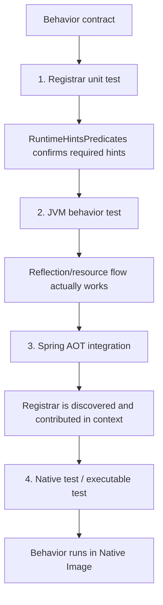
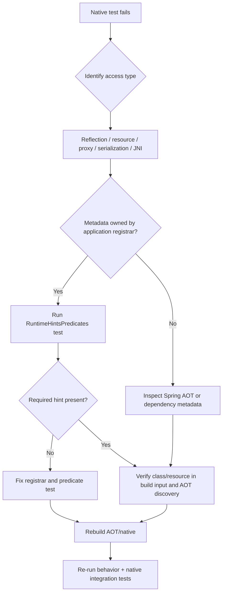

# Keeping Tests Tied to Supported Behavior Rather Than Repeating Every Configuration Line

Runtime Hints help GraalVM Native Image preserve capabilities that static analysis cannot fully infer, such as reflection, resource loading, proxy creation, or serialization. When a Spring Boot application uses Spring AOT, hints can come from the framework, dependencies, or registrars declared by the application itself.

One risk when testing hints is turning tests into a mirror of the configuration file: every JSON line has a corresponding assertion, every registered member is asserted, or tests depend on internal generated file names. Such tests can pass easily even while the real feature is broken, and can fail easily whenever Spring or GraalVM changes how metadata is represented.

A more durable testing approach starts from the **behavior the application needs to support**. If the application needs to instantiate a DTO via reflection, test the hint for that constructor and test the actual DTO creation flow. If the application needs to read a template, test the resource hint and test that the template content is actually used. Then run AOT/native integration tests to confirm the entire path works in the executable.

This lesson belongs to the **Hints Testing** chapter of the `SPRING_BOOT_NATIVE_IMAGE` module. We will structure testing in layers, use `RuntimeHintsPredicates` for application-owned registrars, test behavior on the JVM, verify AOT/native at the integration level, and identify what should not be asserted.

## 1. Start from the behavior contract

A hint exists to ensure a specific behavior continues to work in a native image. Therefore, the first question should not be "how many lines are in the JSON file?" but rather "what must the application be able to do when running natively?".

For example, an invoicing feature might need to:

- Instantiate a legacy DTO type via reflection because an integration library invokes its constructor from metadata.
- Read the `templates/invoice.html` template from the classpath.
- Read the `messages.invoice` message bundle by locale.
- Create a proxy for an integration interface if the library uses JDK dynamic proxies.

From those requirements, identify the minimal metadata and corresponding tests:

| Behavior to support | Relevant hint | Appropriate testing |
| --- | --- | --- |
| Instantiate DTO via constructor reflection | Reflection constructor hint | Registrar predicate test and DTO creation/deserialization flow test |
| Invoke public method via reflection | Reflection method hint | Predicate test and behavior test calling the exact method |
| Read classpath template | Resource hint | Predicate test and template read/render test |
| Read resource bundle | Resource bundle hint | Predicate test and real locale test |
| Create JDK proxy | Proxy hint | Proxy invocation test and native integration test |
| Native code accesses Java via JNI | JNI hint | JNI path test on the appropriate native target |

Not every feature needs an application hint. Spring AOT or a dependency may already provide the metadata. In that case, the application still needs integration behavior tests, but does not necessarily need to create another registrar just to duplicate library metadata.

## 2. Testing layers and the question each layer answers

A good strategy has multiple layers. Each layer verifies a different part of the contract.



| Layer | Scope | What it does not prove |
| --- | --- | --- |
| Registrar unit test | The registrar class adds the required hint kinds | That GraalVM received the hints or the binary runs |
| JVM behavior test | Business code and reflection/resource paths work on the JVM | That Native Image has sufficient metadata |
| Spring AOT integration test | Spring discovers the registrar, AOT processes the context, and output is generated | That every runtime branch in native works |
| Native test | Tests compiled/run via the native test workflow | That every container/production configuration is right |
| Native executable smoke/integration test | Real application binary runs key flows | That unexecuted scenarios or untested targets work |

There is no need to turn every change into a massive test suite. Pick the layer matching the risk: a new registrar needs predicate tests; changing how resources are read needs behavior tests; upgrading GraalVM or changing metadata needs appropriate native integration tests.

## 3. Testing the registrar with RuntimeHintsPredicates

Spring Framework provides `RuntimeHintsPredicates` to verify whether a `RuntimeHints` object contains the required capabilities. Predicate tests fit application-owned registrars because they verify the **metadata contract** the registrar must provide.

For example, suppose the application needs reflection for the constructor and public methods of `LegacyInvoicePayload`, as well as a template resource:

```java
package com.example.invoice;

public class LegacyInvoicePayload {

    private String invoiceNumber;

    public LegacyInvoicePayload() {
    }

    public String getInvoiceNumber() {
        return invoiceNumber;
    }

    public void setInvoiceNumber(String invoiceNumber) {
        this.invoiceNumber = invoiceNumber;
    }
}
```

Registrar declaring the exact capabilities used:

```java
package com.example.invoice;

import org.springframework.aot.hint.MemberCategory;
import org.springframework.aot.hint.RuntimeHints;
import org.springframework.aot.hint.RuntimeHintsRegistrar;

class InvoiceRuntimeHints implements RuntimeHintsRegistrar {

    @Override
    public void registerHints(RuntimeHints hints, ClassLoader classLoader) {
        hints.reflection().registerType(
                LegacyInvoicePayload.class,
                MemberCategory.INVOKE_DECLARED_CONSTRUCTORS,
                MemberCategory.INVOKE_PUBLIC_METHODS);

        hints.resources().registerPattern("templates/invoice.html");
    }
}
```

Test checking the required metadata behaviors:

```java
package com.example.invoice;

import org.junit.jupiter.api.Test;
import org.springframework.aot.hint.MemberCategory;
import org.springframework.aot.hint.RuntimeHints;
import org.springframework.aot.hint.predicate.RuntimeHintsPredicates;

import static org.assertj.core.api.Assertions.assertThat;

class InvoiceRuntimeHintsTests {

    @Test
    void registersHintsRequiredByInvoiceFlow() {
        RuntimeHints hints = new RuntimeHints();
        new InvoiceRuntimeHints().registerHints(
                hints, getClass().getClassLoader());

        assertThat(RuntimeHintsPredicates.reflection()
                .onType(LegacyInvoicePayload.class)
                .withMemberCategory(
                        MemberCategory.INVOKE_DECLARED_CONSTRUCTORS))
                .accepts(hints);

        assertThat(RuntimeHintsPredicates.reflection()
                .onType(LegacyInvoicePayload.class)
                .withMemberCategory(MemberCategory.INVOKE_PUBLIC_METHODS))
                .accepts(hints);

        assertThat(RuntimeHintsPredicates.resource()
                .forResource("templates/invoice.html"))
                .accepts(hints);
    }
}
```

This test does not need to boot a Spring context or run GraalVM. It tests the registrar directly, runs fast, and catches accidental deletion of a required hint.

### 3.1. Test the exact access permission, do not assert the entire object

Do not write tests that merely check the total count of type/member hints or compare the entire `RuntimeHints` object against a snapshot. For example:

```java
// Brittle: depends on counts and how the framework represents metadata.
assertThat(hints.reflection().typeHints()).hasSize(1);
```

A valid change may add another hint, merge metadata, or alter internal representation without changing the behavior contract. Tests should ask whether the required constructor can be accessed according to the metadata, rather than requiring the total entry count to equal a specific number.

Similarly, avoid comparing generated JSON verbatim. Use appropriate predicates/APIs to verify required capabilities, and rely on native integration tests to verify the final outcome.

## 4. Attaching the registrar to a real component

A registrar tested directly can still be forgotten when wiring into Spring AOT. If the application uses `@ImportRuntimeHints`, attach the registrar to the configuration that owns the feature:

```java
package com.example.invoice;

import org.springframework.context.annotation.Configuration;
import org.springframework.context.annotation.ImportRuntimeHints;

@Configuration(proxyBeanMethods = false)
@ImportRuntimeHints(InvoiceRuntimeHints.class)
class InvoiceNativeConfiguration {
}
```

When this configuration is imported into the `ApplicationContext`, Spring AOT can discover the registrar during analysis. If `META-INF/spring/aot.factories` is used to register the registrar globally, add an integration test confirming discovery via that exact mechanism.

A test that invokes `new InvoiceRuntimeHints().registerHints(...)` directly does not test annotation discovery or factories registration. That is why registrar tests and Spring AOT integration tests serve distinct purposes.

## 5. Testing reflection behavior on the JVM

Predicate tests verify that metadata is declared. A separate behavior test verifies that the code actually uses the access path supported by the hint.

Example of an adapter using a constructor and setter via reflection:

```java
package com.example.invoice;

import java.lang.reflect.Constructor;
import java.lang.reflect.Method;

import org.springframework.stereotype.Component;

@Component
class LegacyInvoiceFactory {

    LegacyInvoicePayload create(String invoiceNumber) {
        try {
            Constructor<LegacyInvoicePayload> constructor =
                    LegacyInvoicePayload.class.getDeclaredConstructor();
            LegacyInvoicePayload payload = constructor.newInstance();

            Method setter = LegacyInvoicePayload.class.getMethod(
                    "setInvoiceNumber", String.class);
            setter.invoke(payload, invoiceNumber);

            return payload;
        }
        catch (ReflectiveOperationException ex) {
            throw new IllegalStateException(
                    "Cannot create invoice payload", ex);
        }
    }
}
```

Test by business outcome:

```java
package com.example.invoice;

import org.junit.jupiter.api.Test;

import static org.assertj.core.api.Assertions.assertThat;

class LegacyInvoiceFactoryTests {

    @Test
    void createsPayloadThroughLegacyReflectionPath() {
        LegacyInvoiceFactory factory = new LegacyInvoiceFactory();

        LegacyInvoicePayload payload = factory.create("INV-2026-01");

        assertThat(payload.getInvoiceNumber()).isEqualTo("INV-2026-01");
    }
}
```

The JVM typically allows reflection without native metadata, so this test does not replace predicate tests. However, it helps prove that the code path supported by the metadata is still a real application behavior, rather than a hint added for code nobody uses anymore.

If reflection can be replaced by a direct constructor call or typed API, consider the simpler design. Hints are only needed when dynamic behavior is part of the contract that must be preserved.

## 6. Testing resources by the content actually used

Suppose the application reads a classpath template:

```text
src/main/resources/
└── templates/
    └── invoice.html
```

A simple reader:

```java
package com.example.invoice;

import java.io.IOException;
import java.nio.charset.StandardCharsets;

import org.springframework.core.io.ClassPathResource;
import org.springframework.stereotype.Component;

@Component
class InvoiceTemplateReader {

    String read() {
        ClassPathResource resource =
                new ClassPathResource("templates/invoice.html");

        try (var input = resource.getInputStream()) {
            return new String(
                    input.readAllBytes(), StandardCharsets.UTF_8);
        }
        catch (IOException ex) {
            throw new IllegalStateException(
                    "Cannot read invoice template", ex);
        }
    }
}
```

Tests should verify meaningful content:

```java
package com.example.invoice;

import org.junit.jupiter.api.Test;

import static org.assertj.core.api.Assertions.assertThat;

class InvoiceTemplateReaderTests {

    @Test
    void readsInvoiceTemplate() {
        String template = new InvoiceTemplateReader().read();

        assertThat(template).contains("Invoice");
        assertThat(template).contains("{{invoiceNumber}}");
    }
}
```

The JVM test verifies the file exists on the classpath and the code can read it. The predicate test verifies the registrar declared the resource hint. The native test or native executable test verifies the file is actually inside the image and readable when running natively.

If you only assert `resource.exists()`, the test may fail to verify proper content or encoding. Assert the parts of the content belonging to the template's contract without locking down the entire file if non-contract content can legitimately change.

## 7. Testing ResourceBundle by locale

If the application supports multiple locales, tests should exercise the locales actually supported. For example:

```text
src/main/resources/
└── messages/
    ├── invoice.properties
    ├── invoice_en.properties
    └── invoice_vi.properties
```

Registrar:

```java
import org.springframework.aot.hint.RuntimeHints;
import org.springframework.aot.hint.RuntimeHintsRegistrar;

class InvoiceBundleHints implements RuntimeHintsRegistrar {

    @Override
    public void registerHints(RuntimeHints hints, ClassLoader classLoader) {
        hints.resourceBundles().registerBundle("messages.invoice");
    }
}
```

Predicate test:

```java
@Test
void registersInvoiceBundle() {
    RuntimeHints hints = new RuntimeHints();
    new InvoiceBundleHints().registerHints(hints, getClass().getClassLoader());

    assertThat(RuntimeHintsPredicates.resourceBundle()
            .forBundle("messages.invoice"))
            .accepts(hints);
}
```

Behavior test:

```java
import java.util.Locale;
import java.util.ResourceBundle;

@Test
void resolvesVietnameseInvoiceMessage() {
    ResourceBundle bundle = ResourceBundle.getBundle(
            "messages.invoice", Locale.forLanguageTag("vi"));

    assertThat(bundle.getString("invoice.title"))
            .isEqualTo("Hóa đơn");
}
```

The examples need to import `java.util.Locale` and `java.util.ResourceBundle` in the test. If the application supports `vi` and `en`, test both; do not add a separate assertion for each generated file when what you need to guarantee is that users receive the right message per locale.

## 8. Testing proxies or serialization by contract

Some registrars declare JDK proxy or serialization hints. The same principle applies: test the capability the application needs to use, not every metadata field.

For a proxy example, suppose the application needs to create a JDK proxy for the `InvoiceLookup` interface:

```java
public interface InvoiceLookup {
    String findStatus(String invoiceNumber);
}
```

The registrar can register the proxy:

```java
hints.proxies().registerJdkProxy(InvoiceLookup.class);
```

Tests should invoke methods through the proxy and verify the result. The predicate API for proxies may differ across Spring Framework versions; use the predicate API of your installed version if you want to assert metadata directly. Even with predicates, you still need to test proxy behavior on the native image when this is an important integration path.

For serialization, first identify the exact mechanism in use. Java serialization, Jackson JSON binding, and a custom library's serialization are distinct mechanisms. Do not use a generic serialization hint as a substitute for Jackson JSON tests. Test data through the real serializer/deserializer and native executable.

## 9. Testing Spring AOT discovery and generated output

Registrar unit tests do not confirm that Spring found the registrar. You need an integration step verifying that the configuration containing `@ImportRuntimeHints` or factories registration is included in the AOT context.

With Maven, a project configured with the Spring Boot Maven Plugin can run:

```bash
./mvnw clean spring-boot:process-aot
```

With Gradle:

```bash
./gradlew clean processAot
```

After AOT runs, inspect the generated output under the paths used by your plugin. Common examples:

```text
target/spring-aot/main/
├── sources/
├── resources/
└── classes/

build/generated/
├── aotSources/
├── aotResources/
└── aotClasses/
```

Do not write tests tightly coupled to generated class names or file ordering in these directories. Those details can change across Spring Boot, Spring Framework, or plugin versions. The goal is to confirm the AOT build succeeds and the registrar is integrated into the context.

If you need to verify metadata output in a build-level test, check for **specific capabilities** in the generated metadata using a parser/API appropriate for the format and version. Avoid snapshotting the entire generated directory because it normally contains extensive metadata contributed by the framework and dependencies.

## 10. Native tests and native executable tests

Passing JVM tests do not prove the native image has sufficient metadata. After registrar and AOT integration tests pass, run the appropriate native workflow.

With Maven, if the project has a native test profile configured per Spring Boot/Native Build Tools:

```bash
./mvnw -PnativeTest test
```

With Gradle, the native test task depends on plugin and project configuration; in common Spring Boot Native Build Tools setups:

```bash
./gradlew nativeTest
```

Native tests compile and run tests inside the Native Image environment. They help detect reflection/resource/proxy/serialization failures in the selected tests.

In addition to native tests, you should have smoke/integration tests running the **native application executable** if production deploys that executable. The two test paths can differ in main application packaging, runtime arguments, file mounts, user permissions, and networking. For example, native executable tests should verify:

- The application starts up and creates its context.
- Endpoints using DTOs requiring reflection return expected responses.
- Classpath templates are readable.
- Critical locales return the right messages.
- Proxy/JNI/serializer integrations work if used by the application.

Do not mark native tests as passing if the command skipped native tests via a skip flag. Check logs to confirm the native test executable was actually built and executed.

## 11. Tracing agent as a source of suggestions, not a test oracle

The GraalVM tracing agent can observe dynamic accesses during executed scenarios and generate suggested metadata. Agent results are useful for finding undeclared reflection/resources/proxies, but it cannot know about unexecuted code branches.

An appropriate workflow:

1. Run business scenarios with the tracing agent.
2. Review the observed metadata.
3. Reconcile each entry against the behavior contract and metadata already provided by Spring/dependencies.
4. Add tests for behaviors that genuinely need support.
5. Declare minimal hints if missing.
6. Re-run native tests.

Do not turn the entire agent output into a test snapshot. The agent can record operations performed by the framework, test frameworks, or dependencies; the number of entries changes with versions and scenarios. Tests should focus on behaviors owned by the application.

## 12. Avoid duplicating tests for a dependency's responsibilities

If a library already provides Runtime Hints or Reachability Metadata for itself, the application does not need to copy all that metadata into its own registrar and write tests for every member of the library.

| Scenario | Whose testing scope? | What the application should verify |
| --- | --- | --- |
| Application registrar declares constructor of custom DTO | Application | Predicate test for the exact constructor/method used |
| Jackson provides metadata for internal mechanisms | Jackson/Spring integration | HTTP JSON behavior in native |
| JDBC driver provides metadata for driver | Driver | Real connection and queries in native |
| Spring AOT auto-generates metadata for bean graph | Spring integration | Context startup and endpoint behavior |
| Dependency lacks metadata, app adds temporary workaround | Application (temporary) | Version-scoped workaround test with clear removal criteria |

If a workaround is added to the application because a dependency lacks metadata, narrow its scope and record the dependency version. When upgrading to a dependency version with upstream metadata, consider removing the workaround and its dedicated test so stale metadata does not mask errors or retain unneeded access permissions.

## 13. Assertions to avoid

| Brittle assertion | Why inappropriate | Alternative |
| --- | --- | --- |
| Comparing entire generated JSON to a snapshot | Format, ordering, and framework metadata can change | Predicate tests for required capabilities |
| Asserting total count of reflection entries | Any valid new hint breaks the test | Assert specific constructors/methods/resources |
| Asserting internal generated class names | Names are implementation details | Verify AOT build and native behavior |
| Testing every line of dependency metadata in the app | Duplicates the dependency's responsibility | Test the features the application uses |
| Running only JVM tests and concluding native compatibility | JVM does not require the same metadata | Run native tests/executable |
| Running only the tracing agent and trusting all output | Agent only observes executed scenarios | Review against behavior contract and test coverage |
| Asserting a resource file exists without reading contents | Does not verify encoding or required content | Read resource and assert contract elements |

## 14. Example behavior-based test matrix

An invoicing application can maintain a small matrix:

| Behavior | Registrar test | JVM behavior | Native test/executable |
| --- | --- | --- | --- |
| Instantiate `LegacyInvoicePayload` via reflection | Yes | Yes | Yes |
| Read invoice template | Yes | Yes | Yes |
| Read Vietnamese messages | Yes | Yes | Yes |
| Invoke `InvoiceLookup` proxy | If app registrar supplies hint | Yes | Yes |
| Jackson bind request DTO | Only if app declares hints itself | HTTP integration | HTTP integration |
| Connect JDBC driver | Do not test driver internal metadata in app | Repository integration | Native DB integration |

The matrix helps avoid two extremes: checking only metadata without running behavior, or running behavior on the JVM without checking native metadata. Not every row needs its own test class; multiple related behaviors can share an integration test.

## 15. Investigation workflow when a native test fails

When a test fails only in native, follow this sequence:

1. Identify the failing operation: reflection, resource, proxy, serialization, JNI, or context initialization.
2. Identify the actual target class/member/resource in the stack trace.
3. Check whether the application owns that behavior or Spring/a dependency already provides metadata.
4. If it belongs to an application registrar, run predicate tests to confirm the hint is declared.
5. Check whether the registrar is discovered by Spring AOT and the context has the right profiles/properties configured.
6. Verify the class/resource actually exists in the build inputs; hints cannot supply missing dependencies or nonexistent files.
7. Run a minimal native test reproducing the error.
8. After fixing, re-run the related behavior tests and native tests.



Do not add hints wholesale just to make tests pass before identifying the target. Overly broad hints can mask design issues, retain unnecessary metadata, and complicate maintenance.

## 16. Checklist for a hint test suite

- [ ] Every application hint is tied to a real behavior contract.
- [ ] Registrars have unit tests using `RuntimeHintsPredicates`.
- [ ] Predicate tests check only the required constructors/members/resources/bundles.
- [ ] Behavior tests exist for actual reflection/resource paths.
- [ ] Registrars are wired into Spring via `@ImportRuntimeHints` or the chosen discovery mechanism.
- [ ] AOT integration build runs with the expected configurations/profiles.
- [ ] Entire generated JSON/sources are not snapshotted, nor do tests depend on generated class names.
- [ ] Metadata owned by dependencies is not copied and redundantly tested in the application.
- [ ] Tracing agent output is reviewed by scenario rather than treated as an oracle.
- [ ] Native tests genuinely execute the native test executable.
- [ ] The native application executable is smoke/integration tested if production deploys that executable.
- [ ] Key behavior tests are re-run after upgrading Spring/GraalVM/dependencies.
- [ ] Metadata workarounds have clear scope, version, and removal criteria.

### Self-assessment questions

1. Why can `RuntimeHintsPredicates` tests not replace native integration tests?
2. If a registrar declares constructor reflection for a DTO, which assertion is better tied to behavior: checking the constructor predicate or checking the total count of type hints?
3. Why should a resource test read and check content rather than merely asserting file existence?
4. Does a test calling the registrar directly verify `@ImportRuntimeHints` discovery?
5. Why should you not snapshot the entire generated `reflect-config.json`?
6. If Jackson already provides metadata for DTO binding, what should the application test?
7. Which code branches can the tracing agent not observe, and how does that affect test coverage?
8. When do you need to run the native test executable, and when do you also need smoke tests for the native application executable?

## References

- [Spring Framework — Runtime Hints](https://docs.spring.io/spring-framework/reference/core/aot.html): `RuntimeHints` API, registrars, and hint testing.
- [Spring Framework — RuntimeHintsPredicates API](https://docs.spring.io/spring-framework/docs/current/javadoc-api/org/springframework/aot/hint/predicate/RuntimeHintsPredicates.html): predicates for reflection, resources, and supported hint types.
- [Spring Boot — Testing Native Applications](https://docs.spring.io/spring-boot/reference/packaging/native-image/testing-native-applications.html): how to run tests with native image.
- [GraalVM Native Image — Tracing Agent](https://www.graalvm.org/latest/reference-manual/native-image/metadata/AutomaticMetadataCollection/): collecting metadata from executed scenarios.

**Expected outcome:** build a test suite proving that behaviors requiring metadata continue to work in the native image. Registrar tests verify the application's hint contract; behavior tests verify real code paths; AOT/native integration tests verify the end-to-end process. As a result, the test suite protects what users need without being locked to individual configuration lines or generated output details.
