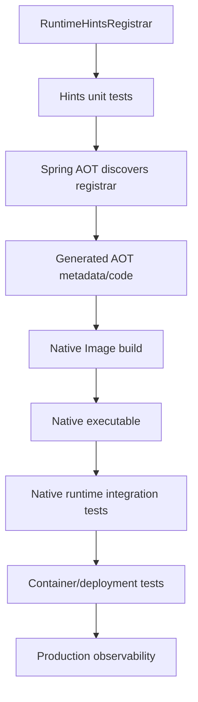

# Distinguishing Passing Hint Tests from Proof That a Native Application Runs Correctly

## 1. Why are these two outcomes not the same?

In Spring Boot Native Image, `RuntimeHints` describes the runtime capabilities GraalVM Native Image must retain, such as reflection, resources, resource bundles, proxies, serialization, or JNI. A unit test can verify that a registrar registered the right metadata, but that only proves the contents of the `RuntimeHints` object inside the test.

For the application to run properly, many more steps must succeed: Spring AOT must discover the registrar; Native Image must receive the metadata; the executable must be built with the right classpath and dependencies; runtime execution must traverse the real business paths; and files, locales, native libraries, and configuration must be present in the deployment environment.

Therefore, distinguish two conclusions:

- **Hint tests pass:** the metadata declarations checked by the tests are registered properly.
- **Native application runs correctly:** the native executable actually starts up and handles the tested scenarios under defined runtime conditions.

The first result is necessary evidence in many projects, but it does not replace the second. This lesson establishes a multi-layer testing model for the **SPRING_BOOT_NATIVE_IMAGE** module, helping you read results accurately and avoid claiming native compatibility from a single unit test.

## 2. The chain of evidence from registrar to production behavior

A complete verification path consists of multiple layers:



Each layer answers a distinct question:

| Layer | Question answered |
|---|---|
| Registrar unit test | Does the registrar declare the expected entries? |
| Spring AOT collection | Is the registrar discovered in the `ApplicationContext` build? |
| Native Image build | Does the compiler produce an executable from that configuration and metadata? |
| Native runtime test | Do the actual code paths work in the native process? |
| Container test | Are the binary, filesystem, libraries, user, and config right in the deployment image? |
| Production monitoring | Is behavior stable under real workloads and data? |

Do not skip a layer and assume the next layer passes. For example, passing unit tests do not prove the registrar is imported; a passing build does not prove an endpoint can deserialize every JSON subtype.

## 3. What do hint unit tests prove?

Spring provides `RuntimeHintsPredicates` to inspect declarations inside `RuntimeHints`. Reflection example:

```java
@Test
void registersInvoiceConstructor() throws Exception {
    RuntimeHints hints = new RuntimeHints();

    new InvoiceHints().registerHints(
            hints, getClass().getClassLoader());

    assertThat(RuntimeHintsPredicates.reflection()
            .onConstructor(
                    Invoice.class.getDeclaredConstructor())
            .test(hints))
            .isTrue();
}
```

The test proves the registrar added metadata matching the predicate for that constructor. It does not prove:

- Spring AOT found the registrar.
- The Native Image compiler received the metadata from the right source.
- The class is included in the image across every access path.
- Real runtime code actually invokes that exact constructor.
- Other dependencies have no missing reflection targets.
- The executable works inside the production container.

If the test creates a fresh `RuntimeHints` and calls the registrar directly, it also does not test `@ImportRuntimeHints` or the library's registrar registration mechanism.

## 4. Distinguishing direct registrar tests from AOT discovery tests

There are two separate questions:

**Direct registrar testing:** call `registerHints()` in a unit test and assert entries. This is fast, isolated, and easily points out wrong paths or members.

**AOT discovery testing:** run the Spring AOT process against a real `ApplicationContext`, where the registrar must be discovered via `@ImportRuntimeHints` or the corresponding registration mechanism. Confirm that the configuration containing the registrar belongs to the context being processed.

Configuration example:

```java
@Configuration(proxyBeanMethods = false)
@ImportRuntimeHints(InvoiceHints.class)
class InvoiceNativeConfiguration {
}
```

If `InvoiceNativeConfiguration` is not component-scanned or imported into the AOT `ApplicationContext`, the registrar unit test still passes while Spring AOT collects no hints.

To verify discovery, run the project's exact Maven/Gradle AOT task and inspect logs/generated output according to your Spring Boot version's mechanism. Do not rely on an annotation appearing in source code to conclude the registrar was called.

## 5. What does a passing Native Image build prove?

A passing native build proves the compiler finished analysis and generated an executable given the inputs, arguments, and metadata of that build. This is an important milestone, but it does not prove every code path works.

Some problems only appear at runtime:

- A reflection target is chosen from data absent during build tests.
- A resource pattern misses a rarely used file.
- A locale bundle is missing only for a lightly tested language.
- A proxy is created with a different interface combination or order.
- A native library is absent in the runtime container.
- Environment or external files differ from the build machine.
- Serialization encounters an uncovered subtype.
- Class initialization reads a frozen value or one that depends on runtime state.

A passing build is evidence of artifact creation; it is not complete evidence of behavior.

## 6. Native runtime tests must run the real native executable

To prove a code path works on Native Image, you must execute that code path inside the native process. You can use a plugin-supported native test mode or launch the executable and send HTTP requests.

Example running the binary:

```bash
./orders-service
```

Then send a request:

```bash
curl -i \
  -H "Content-Type: application/json" \
  --data-binary @src/test/resources/orders/valid-order.json \
  http://localhost:8080/api/orders
```

The test must check response status, schema, key fields, and expected side effects. Running `./orders-service` and seeing it start and exit cleanly is only a startup smoke test; it does not prove endpoints, serializers, or resource paths work.

For long-running services, the test harness needs a readiness check, sends scenarios, collects responses, and stops the process gracefully. Do not use a fixed sleep interval as proof that the server is ready.

## 7. Appropriate evidence per hint category

Each metadata category needs a corresponding runtime scenario:

| Hint category | Unit/predicate test | Native runtime evidence |
|---|---|---|
| Reflection | Predicate verifies registered type/member | Execute the real reflection path: instantiate object/call method/read field |
| Resource | Predicate verifies path/pattern | Read and parse the actual classpath file |
| Resource bundle | Predicate verifies base name | Load messages across supported locales |
| JDK proxy | Predicate verifies interface combination | Create real proxy, check interface order, and invoke methods |
| Serialization | Predicate/metadata test per supported API | Serialize/deserialize real payloads, including required subtypes |
| JNI | Check type/access hints | Load native library, invoke JNI, and verify callbacks |
| Dynamic proxy/AOP | Check proxy metadata | Initialize context and invoke beans through proxy/advice |

Do not use one simple endpoint as a proxy for all hint categories if that endpoint does not traverse the corresponding mechanisms.

## 8. Example: reflection hint passes yet native still fails

Registrar:

```java
final class InvoiceHints implements RuntimeHintsRegistrar {
    @Override
    public void registerHints(
            RuntimeHints hints, ClassLoader classLoader) {
        hints.reflection().registerType(
                Invoice.class,
                MemberCategory.INVOKE_PUBLIC_CONSTRUCTORS);
    }
}
```

A unit test checking the constructor can pass. However, the real library might additionally call:

```java
Method method = Invoice.class.getDeclaredMethod(
        "setCode", String.class);
method.invoke(invoice, "INV-100");
```

If the method is not registered and not covered by other framework/dependency metadata, the native runtime can fail when invoking the setter. Because the unit test only checked the constructor, it did not catch the missing method.

How to resolve:

1. Read the native stack trace and identify the actual member.
2. Check whether the library already provides official metadata.
3. Register the specific method or an appropriate category if needed.
4. Add a predicate test for the method.
5. Re-run Spring AOT and the native build.
6. Exercise the exact business path in a native integration test.

Do not open all declared methods just to silence an error if only one method is used.

## 9. Example: resource hint passes yet runtime resource is still missing

Registrar:

```java
hints.resources().registerPattern(
        "schemas/order-*.json");
```

A predicate test can confirm the pattern is registered. However, the native runtime can still fail to read the file if:

- The file is only in `src/test/resources`, not in the production artifact.
- The actual path differs in casing.
- The pattern does not match the packaged resource path.
- The registrar was not collected by AOT.
- The file is an external filesystem file while the code accesses it via the classloader.
- The resource is supplied by a dependency not included in the build inputs.

Runtime tests must open the resource from the production service itself and parse its content. Checking `InputStream != null` is just a first step; verify that the schema/content is usable and handle missing files properly.

## 10. Example: proxy hint passes yet actual proxy differs from metadata

A test may verify:

```java
hints.proxies().registerJdkProxy(
        OrderOperations.class,
        Auditable.class);
```

But Spring AOP or the real proxy factory might construct a proxy with extra interfaces or a different order:

```java
new Class<?>[] {
    Auditable.class,
    OrderOperations.class
}
```

A hint for the ordered list `[OrderOperations, Auditable]` should not be assumed to automatically cover the reversed list. Moreover, the final interfaces can change due to advisors or introductions.

Native integration tests must obtain the real proxy from `ApplicationContext` or use the exact production factory and check:

```java
assertThat(proxy.getClass().getInterfaces())
        .containsExactly(
                OrderOperations.class,
                Auditable.class);
```

Then invoke methods on each interface and verify advice/behavior. Testing predicates alone does not verify that the proxy is created or that Spring AOP works properly.

## 11. Same data and configuration between JVM and native

When comparing JVM against native, run the exact same fixtures and the same contract. If the data differs, results cannot pinpoint runtime-induced differences.

Keep consistent:

- JSON request/response fixtures.
- Classpath resources and bundle files.
- Locale and timezone.
- Spring profiles and structural properties used during AOT.
- Runtime properties, external configuration, and mounted files.
- Database fixtures or test doubles.
- Dependency versions and source revision.
- HTTP headers, content types, and expected outcomes.

Create a shared contract test suite for both processes. Do not copy/paste payloads into two separate copies, as they easily drift when APIs evolve.

If properties using `@ConditionalOnProperty` alter the bean graph, build native with the corresponding structural values. Changing environment values after the executable is built will not restore beans excluded during AOT.

## 12. Designing native integration tests by scenario

Organize tests by mechanism and business flow:

| Scenario | Paths to execute |
|---|---|
| Create order | JSON deserialization, validation, response serialization |
| Export invoice | Templates/resources, fonts, or PDF library |
| Switch locale | Resource bundles and message interpolation |
| Call AOP-advised service | JDK proxy/CGLIB proxy, transaction/advice |
| Call partner SDK | Reflection, serialization, or JNI |
| Load schema by version | Resource patterns and runtime selection |
| Multi-subtype webhook | Polymorphic JSON and subtype reachability |
| Scheduled job | Bean lifecycle, proxies, and runtime resources |

Not every project needs every scenario. Select based on your dependencies and the application's real paths. For each scenario, record inputs, expected outputs, and environment conditions for reproducibility.

## 13. Readiness, process lifecycle, and collecting results

A native executable can start up quickly, yet the test harness must still wait until the server is ready. A reliable workflow:

1. Start the native executable and capture stdout/stderr.
2. Poll the readiness endpoint with a reasonable deadline and backoff.
3. If the process exits before readiness, mark the test failed and save logs.
4. Send the exact same HTTP fixtures as JVM tests.
5. Check status, response schema, headers, and side effects.
6. Send graceful shutdown or stop the process via the test harness.
7. Save the exit code and logs.

If using Spring Boot Actuator, expose only the necessary readiness endpoint in the test environment. Do not enable sensitive management endpoints on public networks.

Do not use a single `curl` returning HTTP 200 as proof that the whole application is healthy. Health endpoints usually bypass the JSON binding, proxies, or resources used by business logic.

## 14. Testing in the target runtime container

A binary can run on the build machine yet fail inside a container due to:

- Missing shared libraries or native libraries.
- Differences in glibc/musl or architecture.
- Resource/config files not copied or mounted.
- Different working directory (CWD) than expected.
- User lacking permission to read files or bind ports.
- Different environment variables, locale, or timezone.
- Container memory/CPU limits lower than the local environment.

Native integration tests in containers must use the same runtime base image or one equivalent to production. Check user, working directory, mounts, and network policy. If the application depends on external files, mount fixtures at the exact destination path and verify the process can read them.

Container tests are evidence of the packaging/runtime environment; they complement native process tests on the build machine.

## 15. Evaluating coverage: what was tested and what was not?

The tracing agent, `RuntimeHintsPredicates`, and integration tests each have their own scope. No single tool proves every path on its own.

Build a coverage matrix:

| Capability | Hint registered | AOT discovered | Native scenario executed | Container verified |
|---|---:|---:|---:|---:|
| Invoice constructor reflection | PASS/FAIL | PASS/FAIL | PASS/FAIL | PASS/FAIL |
| Order schema resource | PASS/FAIL | PASS/FAIL | PASS/FAIL | PASS/FAIL |
| Vietnamese message bundle | PASS/FAIL | PASS/FAIL | PASS/FAIL | PASS/FAIL |
| Order JDK proxy | PASS/FAIL | PASS/FAIL | PASS/FAIL | PASS/FAIL |
| Partner JNI callback | PASS/FAIL | PASS/FAIL | PASS/FAIL | PASS/FAIL |

Mark capabilities unused in the application as `NOT APPLICABLE` and document the reason. Do not mark PASS merely because another test touched the same class without going through the corresponding mechanism.

Coverage should be tied to specific scenarios, fixtures, and commits. When dependencies or code paths change, re-evaluate the affected rows.

## 16. Classifying results and reporting

Use distinct statuses to avoid overstating conclusions:

| Status | Meaning |
|---|---|
| Hints unit tests PASS | The registrar declared the exact asserted entries |
| AOT discovery PASS | The AOT process discovered/collected the tested registrar |
| Native build PASS | The compiler built the executable successfully |
| Native runtime scenario PASS | The specific scenario ran properly on the native executable |
| Container scenario PASS | The scenario ran properly in the tested runtime image/container environment |
| Production validation PASS | Real workloads and operations meet tracked criteria |

Reports should clearly state their scope. For example: “Reflection, resource, and proxy predicate tests pass; native executable build succeeded; three HTTP scenarios verified in the staging container.” Do not compress that into “Fully Native Image compatible” without evidence for all integrations and workloads.

## 17. When native tests fail despite passing hint tests

Investigate in order:

1. Confirm the test is running the newly built native executable, not a JAR/JVM.
2. Confirm Spring AOT used the right profiles/properties.
3. Check whether the registrar was discovered during AOT.
4. Identify whether the error lies in reflection, resources, bundles, proxies, serialization, JNI, or the external environment.
5. Compare runtime inputs/configuration against JVM tests.
6. Inspect the original stack trace and compiler diagnostics.
7. Add tests for the actual member/path/interface/locale.
8. Make minimal fixes to metadata or integration wiring.
9. Rebuild and run the related regression scenarios.

If hint predicates pass but AOT did not collect the registrar, fix the registration mechanism. If AOT collected it and the build passed but runtime is missing an external file, fix the mount/path. If the error is in a native library loader, check ABI/architecture. Do not add reflection hints to cure every native failure.

## 18. Hands-on exercise: proving a feature runs properly natively

**Context:** Order API uses reflection to instantiate a handler, reads a JSON schema from the classpath, loads a Vietnamese message bundle, and creates a proxy implementing two interfaces.

**Step 1 — Write the registrar.** Register constructor/method reflection, the schema resource pattern, the bundle base name, and the JDK proxy interface list.

**Step 2 — Write hint unit tests.** Use `RuntimeHintsPredicates` to verify each specific entry; verify the exact base name and interface order.

**Step 3 — Verify AOT discovery.** Attach the registrar via `@ImportRuntimeHints`, run AOT, and verify the configuration in `ApplicationContext` is processed.

**Step 4 — Build native.** Record the source revision, GraalVM/JDK/plugin versions, profiles, and build arguments.

**Step 5 — Write native runtime scenarios.** Invoke the handler via the reflection path, parse the schema, fetch messages for the `vi` locale, and create the real proxy and invoke methods.

**Step 6 — Run the same fixtures on the JVM.** Save expected statuses, JSON outputs, messages, and proxy behavior.

**Step 7 — Run the native executable.** Use the exact same fixtures and runtime properties; compare results against the contract.

**Step 8 — Run in container.** Use an equivalent target runtime image, user, and mounts; repeat the critical scenarios.

**Step 9 — Report coverage.** Track hints, AOT discovery, native runtime, and container verification separately; explicitly note untested scenarios.

Completion criteria: hint tests pass; AOT collected the registrar; native executable builds successfully; specific scenarios run properly natively; container results are verified and coverage scope is clearly documented.

## 19. Conclusion

Passing hint tests and proving a native application runs correctly are two distinct levels of evidence. Unit tests with `RuntimeHintsPredicates` verify that a registrar declares metadata; AOT tests verify the registrar is collected; native builds verify the compiler creates an executable; and native runtime and container tests verify that specific business paths work in the execution environment.

With Spring Boot Native Image, build tests per capability and scenario, use the same fixtures/configuration for JVM and native, test the actual executable, and explicitly record achieved coverage. An accurate report states which tests passed, which artifact ran, and which environment was verified; it does not extrapolate a few predicates or a smoke test into a blanket compatibility guarantee.
