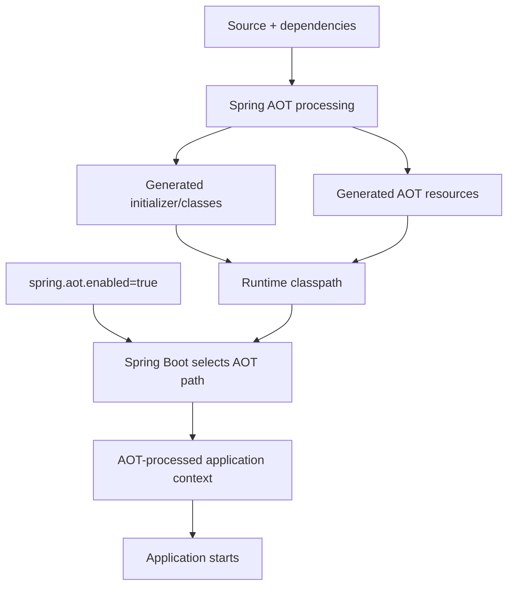

# spring.aot.enabled and the Requirement That Classpath Contains AOT Output

## 1. Two Conditions for Running an AOT-Processed Application

Spring AOT processes the application context during the build phase to analyze bean definitions, generate initialization code, and produce the resources required for the run. When starting the application, Spring Boot can use the generated output in place of certain standard configuration analysis steps.

To take the AOT path, two conditions must be satisfied simultaneously:

1. **Enable AOT mode at runtime** with the property `spring.aot.enabled=true`.
2. **Include the AOT output on the runtime classpath**: the generated initializers/classes and corresponding metadata resources must be built, packaged, and loadable by the application.

The property does not generate AOT code by itself. If the property is enabled but generated classes/resources are not on the classpath, the application cannot use the created initializer. Conversely, having the generated output without enabling AOT mode may still leave the application on the standard initialization path.

In the **SPRING_BOOT_NATIVE_IMAGE** module, this is essential to understand when testing a Spring Boot application after AOT on the JVM before building a GraalVM Native Image. Verifying the two conditions separately helps distinguish runtime configuration errors from build/packaging output errors.



## 2. What Role Does spring.aot.enabled Play?

The `spring.aot.enabled` property tells Spring Boot that the application is running with prepared AOT output. When the property is enabled, Spring Boot uses the AOT application context initializer mechanism registered in generated metadata, instead of performing the full standard bean configuration process.

Example of running an AOT-processed JVM application:

```bash
java -Dspring.aot.enabled=true -jar application.jar
```

Or using Spring Boot's command-line property:

```bash
java -jar application.jar --spring.aot.enabled=true
```

Both approaches set the property inside the application process. You can also use an environment variable following relaxed binding rules:

```bash
SPRING_AOT_ENABLED=true java -jar application.jar
```

For a native executable, the property configuration can also be passed at launch if the application requires the corresponding AOT mode. However, a native executable created from the AOT/Native Image process has its own pipeline and generated artifacts; follow the Spring Boot/GraalVM configuration for your exact version.

This property is a runtime switch to select the initialization path. It does not replace the `processAot` task, does not automatically load generated sources from the build directory, and does not add missing classes into the artifact.

## 3. What Does AOT Output Consist Of?

AOT output is not just a single configuration file. Depending on the Spring Boot/Spring Framework and build plugin versions, the output may include:

- **Generated Java sources**: application context initialization code, bean registrations, and components generated from configuration.
- **Compiled generated classes**: bytecode compiled from the AOT sources.
- **Generated resources/metadata**: initializer registration information and resources used for initialization.
- **Runtime hints**: reflection, resource, proxy, serialization, and other runtime requirements collected by Spring AOT.

Directory names and packaging layout vary by Gradle/Maven plugin version. For example, Gradle often uses directories under `build/generated/aotSources` and `build/generated/aotResources`; sources are compiled into separate class outputs or integrated into the plugin's task graph. You should not hard-code internal generated paths when the plugin already provides official tasks and classpaths.

Crucially, **the final runtime classpath must contain compiled AOT classes and generated resources**. Having source files in a generated directory without compiling and packaging them means the JVM cannot load those classes.

## 4. AOT Workflow with Gradle

With the Spring Boot Gradle Plugin, the AOT task is typically named `processAot`. This task initializes the context in the build process and generates the required sources/resources.

Illustrative steps:

```bash
./gradlew clean
./gradlew processAot
```

Then inspect the plugin's task graph and outputs:

```bash
./gradlew tasks --all
./gradlew :app:processAot
```

The project name `:app` is just an example; use the actual application module in a multi-project build. The plugin may create additional compile/package tasks to put generated output into the artifact. Run the packaging task configured for AOT instead of manually copying generated directories.

In some configurations, the `bootJar` task or native compilation task depends on AOT tasks and automatically includes the output in the artifact. Specific behavior depends on the Spring Boot Gradle Plugin version and project configuration. Confirm via task dependencies, logs, and actual archive contents.

## 5. AOT Workflow with Maven

With the Spring Boot Maven Plugin, the AOT step is executed via the `process-aot` goal. For example:

```bash
./mvnw spring-boot:process-aot
```

This goal must be run with the right target module, profile, and properties. In a multi-module Maven project, execute it on the application module or select the right project with the corresponding Maven options.

Then run the package/native lifecycle according to the project's plugin configuration. Do not assume that merely running the AOT goal produces a complete JAR with generated classes. Check the compile/package steps and the contents of the final artifact.

Gradle and Maven organize tasks/lifecycles differently; do not mix Gradle generated output paths into Maven instructions or vice versa.

## 6. The Classpath Must Contain Generated Classes and Resources

The classpath is the set of locations the classloader uses to locate classes and resources. For an AOT application, the classpath must include:

1. Regular application classes.
2. Compiled classes generated by Spring AOT.
3. Generated AOT resources/metadata.
4. Required runtime dependencies of the application.

If generated classes exist in the build output but are not on the runtime classpath, Spring cannot load the initializer. If initializer classes exist but the metadata registering the initializer is not packaged, Spring Boot may fail to locate the AOT entry point. If resources are missing, initialization or subsequent code paths may fail.

Example classpath model:

```text
runtime classpath
  ├── application classes
  ├── generated AOT classes
  ├── generated AOT resources
  ├── Spring Boot / Spring Framework
  └── application runtime dependencies
```

You should not manually add the entire generated source directory to the classpath. The JVM needs compiled bytecode and resources placed in their proper locations.

## 7. Why Is Enabling the Property Alone Not Enough?

Consider the command:

```bash
java -Dspring.aot.enabled=true -jar application.jar
```

If `application.jar` was packaged from a standard build without AOT initializers/classes/resources, the property still enables the AOT path, but the required output may not exist. The result is typically an initializer-not-found error or context initialization failure depending on version and configuration.

Similarly, running:

```bash
java -jar application.jar
```

with an artifact that contains generated AOT output but without enabling the property may fail to use the intended AOT initialization path.

Therefore, when troubleshooting, do not look only at the command line. You must verify all of the following:

- The effective property inside the process.
- Which artifact is being run.
- Whether the artifact contains generated output.
- Whether the runtime classpath can load initializers/resources.

## 8. Inspecting the Artifact with the JAR Tool

For an executable JAR, run:

```bash
jar tf build/libs/application.jar
```

With Maven, the artifact is typically in `target/`; with Gradle, typically in `build/libs/`. Names and paths depend on configuration.

Look for the generated classes/resources packaged by the Spring Boot plugin. Initializer and metadata names depend on the version, so do not insist on a fixed class name from an online example. Cross-reference the output of your own current build.

If the artifact is an executable Boot JAR, application classes and dependencies may live in a specific archive layout (for example, the `BOOT-INF` directory). Use `jar tf` to inspect contents; when you need to check the actual classpath at runtime, inspect how the Spring Boot loader sets up its classloader.

## 9. Verifying the Classpath at Runtime

You can inspect the runtime classpath by logging the classloader or running a diagnostic test under the target configuration. For example:

```java
ClassLoader loader =
    Thread.currentThread().getContextClassLoader();

Enumeration<URL> resources =
    loader.getResources("META-INF/spring/aot.factories");

while (resources.hasMoreElements()) {
    System.out.println(resources.nextElement());
}
```

This illustrates searching for a metadata resource; the actual resource/metadata name must match the Spring version in use. Do not treat finding a random metadata file as proof that all generated output is present. You must confirm that the initializer class is loaded and the context actually runs via AOT.

You can check a specific class if you know its name from the generated output:

```java
Class.forName(
    "com.example.Application__ApplicationContextInitializer",
    false,
    loader
);
```

The class name here is illustrative only. Use the actual name created by your project's build; do not hard-code example names into production code.

## 10. Testing an AOT-Processed Application on the JVM

Before Native Image compilation, testing AOT output on the JVM helps separate Spring AOT errors from GraalVM Native Image-specific errors.

A test scenario:

1. Build the AOT output.
2. Package or run the application with a classpath containing generated classes/resources.
3. Set `spring.aot.enabled=true`.
4. Start the application context.
5. Verify beans, profiles, conditional configurations, and business behavior.
6. Call critical endpoints/jobs.
7. Compare results with the standard JVM baseline.

Not every Spring Boot version provides the same task to run an AOT application directly. Check the tasks/goals of the plugin in use and how the project packages generated output. Avoid constructing a classpath manually by concatenating internal directories if the plugin already manages this.

Example integration assertion:

```java
@SpringBootTest(properties = "spring.aot.enabled=true")
class AotContextTest {

    @Autowired
    ApplicationContext context;

    @Test
    void loadsExpectedService() {
        assertThat(context.getBean(PaymentService.class))
            .isNotNull();
    }
}
```

This test snippet is only useful when the test runtime classpath actually contains the AOT output. Adding the property to a test running on the standard classpath does not automatically turn that test into an AOT test. You must configure the task/test runtime classpath to use the generated output properly.

## 11. Profiles and Properties Must Be Consistent

Spring AOT processes the application context in a build-time environment. Conditions such as `@Profile`, `@ConditionalOnProperty`, classpath conditions, and bean registrations can affect the generated bean graph.

For example, if AOT was generated with the `prod` profile, check which profiles/properties the build process actually received. Simply setting a profile when running the application does not guarantee that a bean excluded from the AOT context will reappear.

For AOT testing:

- Use the exact profile chosen for the artifact.
- Use the exact dependency graph/runtime classpath.
- Record properties that affect the bean graph.
- Verify critical beans are present in the generated context.
- If different bean graphs are needed, build/test separate AOT artifacts.

The `spring.aot.enabled` property only enables using the AOT output; it does not alter bean decisions already made during AOT.

## 12. AOT Classpath vs. Native Runtime Metadata

Do not confuse generated AOT classes/resources with all types of Native Image metadata:

| Component | Role |
|---|---|
| Generated AOT classes | Generated context initialization code |
| Generated AOT resources | Metadata/resources for Spring to find initializers and configuration |
| RuntimeHints | Descriptions of reflection, resources, proxies, serialization, etc. |
| GraalVM reachability metadata | Input for Native Image analysis |
| Native executable | Binary built from AOT output and dependencies |

AOT output must be present for Spring to use the processed context. Runtime hints are used by GraalVM to retain required elements during native compilation. Having a generated initializer does not mean reflection/resource hints are complete; the two parts must be verified separately.

## 13. Relationship with the Native Image Build

When building a Native Image, the Spring Boot plugin/Native Build Tools coordinate AOT processing and GraalVM compilation via the task graph/lifecycle. You should not manually run AOT once with a different profile/classpath and reuse that output for a different native build.

General flow:

```text
Source + runtime dependencies
        |
        v
Spring AOT processing
        |
        +--> generated sources/classes
        +--> generated resources
        +--> RuntimeHints
        |
        v
Native Image analysis and compilation
        |
        v
Native executable
```

A native executable does not run on a regular JVM classpath like a JAR. However, generated AOT output remains an essential input for Native Image to analyze and build the binary. After the build, you need to test the executable itself rather than inferring success from the presence of generated directories.

## 14. Common Errors

| Symptom | Possible Cause | How to Check |
|---|---|---|
| Property enabled but AOT initializer not found | Artifact is missing generated classes/resources | Check AOT task, packaging, and JAR contents |
| AOT output exists but app runs as standard context | Property is not effective or artifact is not using the output | Check environment/arguments and startup path |
| Generated class cannot be loaded | Not compiled or not on the runtime classpath | Check compiled output and packaging |
| Initializer metadata not found | Generated resources not packaged properly | Check archive and resource paths |
| Standard JVM works, AOT JVM fails | AOT context differs in configuration or bean graph | Check profiles/properties/conditions |
| AOT JVM passes, native fails | Missing reachability/reflection/resource/proxy/JNI metadata | Classify Native Image errors |
| Only one profile works | Artifact was AOT-processed with that profile's bean graph | Build/test separate artifacts or design a stable bean graph |
| Test has property but does not use AOT output | Test runtime classpath is still standard output | Check task graph and test classpath |

## 15. Checklist for Verifying spring.aot.enabled and Classpath

- Ran the AOT task/goal of the right application module.
- Generated sources were compiled into classes.
- Generated resources/metadata were created.
- Artifact/runtime classpath contains generated classes and resources.
- `spring.aot.enabled=true` property is effective in the target process.
- Initializer is discovered and application context initializes via AOT.
- Profiles/properties/dependency graph match the build target.
- AOT-processed application is tested on the JVM when supported by the toolchain.
- Native Image is built from the correct AOT output.
- Native executable and container are tested with realistic feature scenarios.

## 16. Self-Check Questions

1. What does `spring.aot.enabled=true` control when Spring Boot starts up?
2. Why does enabling the property not create the generated initializer on its own?
3. Which AOT components must the runtime classpath contain?
4. What is the difference between generated sources and compiled generated classes?
5. Why is finding a single metadata file insufficient proof of complete AOT output?
6. How do build-time profiles/properties affect the generated bean graph?
7. How does `RuntimeHints` differ in role from generated AOT initializers?
8. What steps are needed to verify that an artifact actually uses AOT output?

**Remember:** `spring.aot.enabled` turns on the runtime AOT usage path; generated initializers, classes, and resources must be built and present on the runtime classpath. Verify the property, artifact, and classpath together, test the AOT context on the JVM when appropriate, and then build and run the Native Image from that exact AOT output.
