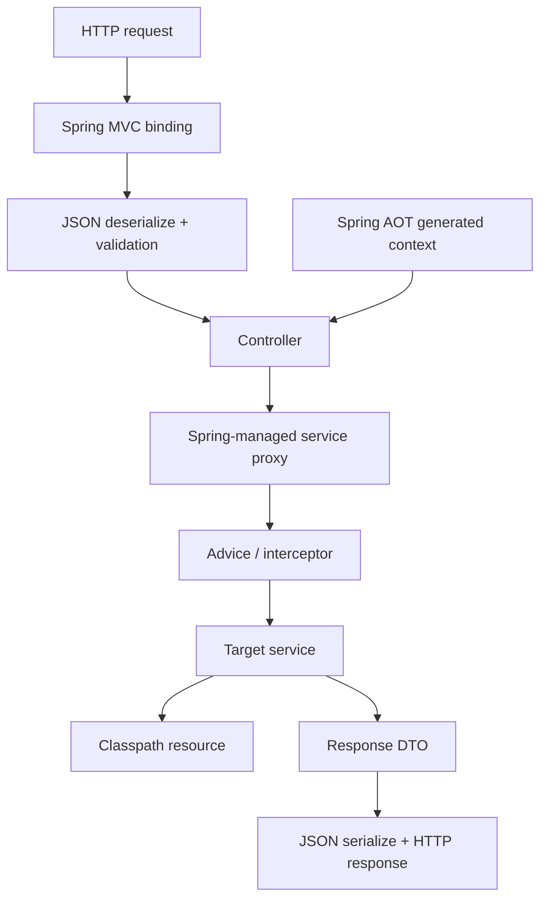

# Testing HTTP, JSON, Resources, and Proxies in AOT Mode

## 1. Objectives of AOT Integration Testing

After AOT processing, a Spring Boot application must preserve exact behavior from the HTTP endpoint down to services and supporting components. Tests need to send requests, bind JSON into DTOs, run validation, read classpath resources, invoke beans through proxies, and verify responses.

With **Spring AOT**, the application context is analyzed at build time and initialization code plus metadata are generated. When running the AOT-processed application on the JVM, Spring Boot must have AOT mode enabled and the runtime classpath must contain the corresponding generated classes/resources. When building a GraalVM Native Image, the AOT output serves as input for the compiler to build the executable.

This lesson focuses on four common areas:

- **HTTP**: routing, request binding, status codes, and exception handling.
- **JSON**: DTO serialization/deserialization, subtypes, enums, date/time, and validation.
- **Resources**: reading templates/schemas/message bundles from the classpath.
- **Proxies**: invoking services through Spring AOP proxies, transactions, or interceptors.

Distinguish JVM MockMvc/WebTestClient tests from tests sending HTTP requests to a native process. JVM tests help verify application behavior and the AOT context under matching configurations; native tests verify the binary, runtime metadata, resources, and deployment environment.



## 2. Preparing a Testable Vertical Slice

Create a small endpoint comprising a request DTO, controller, service, and resource:

```java
public record CreateInvoiceRequest(
    @NotBlank String customerId,
    @NotNull @Positive BigDecimal amount,
    @NotNull Currency currency
) {}

public record InvoiceResponse(
    String invoiceId,
    String customerId,
    BigDecimal amount,
    Currency currency,
    String templateVersion
) {}
```

Controller:

```java
@RestController
@RequestMapping("/api/invoices")
class InvoiceController {

    private final InvoiceService invoiceService;

    InvoiceController(InvoiceService invoiceService) {
        this.invoiceService = invoiceService;
    }

    @PostMapping
    ResponseEntity<InvoiceResponse> create(
            @Valid @RequestBody CreateInvoiceRequest request) {
        InvoiceResponse response = invoiceService.create(request);
        return ResponseEntity.status(HttpStatus.CREATED).body(response);
    }
}
```

The service is a Spring bean and can be proxied:

```java
@Service
class InvoiceService {

    private final TemplateCatalog templates;

    InvoiceService(TemplateCatalog templates) {
        this.templates = templates;
    }

    @Transactional
    public InvoiceResponse create(CreateInvoiceRequest request) {
        String version = templates.defaultTemplateVersion();
        return new InvoiceResponse(
            UUID.randomUUID().toString(),
            request.customerId(),
            request.amount(),
            request.currency(),
            version
        );
    }
}
```

This example uses `@Transactional` to illustrate a proxy; in a real application you need a transaction manager and suitable persistence. If there is no transaction infrastructure, remove the annotation or configure a test database.

## 3. Testing HTTP with MockMvc on the JVM

MockMvc executes requests through the Spring MVC infrastructure inside the test process without opening a real HTTP socket. This is a fast way to verify routing, JSON binding, validation, and exception mapping.

```java
@SpringBootTest
@AutoConfigureMockMvc
class InvoiceHttpTest {

    @Autowired
    MockMvc mockMvc;

    @Test
    void createsInvoice() throws Exception {
        mockMvc.perform(post("/api/invoices")
                .contentType(MediaType.APPLICATION_JSON)
                .content("""
                    {
                      "customerId": "C-100",
                      "amount": 125.50,
                      "currency": "USD"
                    }
                    """))
            .andExpect(status().isCreated())
            .andExpect(content().contentTypeCompatibleWith(
                MediaType.APPLICATION_JSON))
            .andExpect(jsonPath("$.customerId").value("C-100"))
            .andExpect(jsonPath("$.currency").value("USD"))
            .andExpect(jsonPath("$.invoiceId").isNotEmpty());
    }
}
```

This test verifies that requests pass through Spring MVC and responses serialize to JSON. Static imports, Jackson, Spring Test, and validation dependencies are required per project setup.

MockMvc does not test the network stack, port binding, container ingress, or HTTP server runtime in the native executable. Therefore, it does not replace native HTTP integration tests.

## 4. Testing Request Binding and JSON Errors

Create separate request test cases:

| Case | Example | Outcome to Verify |
|---|---|---|
| Valid JSON | All fields present and right types | HTTP 201 |
| Missing required field | No `customerId` | HTTP 400 or defined business error |
| Wrong data type | `amount` is an invalid object/string | HTTP 400 |
| Non-existent enum | `currency: "XYZ_UNKNOWN"` | HTTP 400 or defined error mapping |
| Malformed JSON | Missing brace/quote | HTTP 400 |
| Null field | `amount: null` | Validation violation |
| Boundary field | Amount equal to 0 or negative | Validation violation |

Do not assert only the status code if the API has an error contract. Verify the error code, field path, and message against the application's response schema. If using `@ControllerAdvice`, tests must trigger the exact exception handler.

Jackson may rely on constructor/record metadata, annotations, custom serializers/deserializers, or polymorphic type handling. If a subtype is only selected via a discriminator at runtime, test every subtype the application claims to support.

## 5. Testing JSON Serialization and Deserialization

Testing `ObjectMapper` directly separates JSON mapping errors from HTTP routing:

```java
@SpringBootTest
class InvoiceJsonTest {

    @Autowired
    ObjectMapper objectMapper;

    @Test
    void roundTripsResponse() throws Exception {
        InvoiceResponse source = new InvoiceResponse(
            "INV-1",
            "C-100",
            new BigDecimal("125.50"),
            Currency.USD,
            "v1"
        );

        String json = objectMapper.writeValueAsString(source);
        InvoiceResponse restored =
            objectMapper.readValue(json, InvoiceResponse.class);

        assertThat(restored).isEqualTo(source);
    }
}
```

The example assumes records and data types have appropriate equality semantics. For regular classes, compare fields or use AssertJ recursive comparison per project conventions.

Add tests for:

- Date/time and timezones.
- `BigDecimal` scale/precision.
- Enums and custom naming strategies.
- Optional/null/missing fields.
- Nested DTOs and collections.
- Custom serializers/deserializers.
- Supported polymorphic subtypes.
- Unknown fields per `ObjectMapper` policy.

If the application uses multiple `ObjectMapper` instances or custom Jackson modules, test the mapper Spring configures for HTTP. A manually instantiated mapper in a test may not reflect runtime configuration.

## 6. Testing Validation Over HTTP

When a controller accepts `@Valid @RequestBody`, Spring MVC binds JSON and then triggers Bean Validation:

```java
@Test
void rejectsInvalidInvoice() throws Exception {
    mockMvc.perform(post("/api/invoices")
            .contentType(MediaType.APPLICATION_JSON)
            .content("""
                {
                  "customerId": " ",
                  "amount": 0,
                  "currency": "USD"
                }
                """))
        .andExpect(status().isBadRequest());
}
```

Tests must confirm validation occurs before the service processes the request. You can inject a mock/spy at the appropriate boundary or use a recorder to verify the service is not invoked on invalid requests.

If using custom constraints, nested DTOs, or container element constraints, create corresponding payloads to exercise each validator. Testing one valid DTO does not prove every custom validator and nested branch works.

## 7. Testing Classpath Resources Used by Endpoints

Example resource layout:

```text
src/main/resources/
  templates/
    invoice.html
  config/
    invoice-schema.json
```

Resource loader:

```java
@Component
class TemplateCatalog {

    private final ResourceLoader resourceLoader;

    TemplateCatalog(ResourceLoader resourceLoader) {
        this.resourceLoader = resourceLoader;
    }

    String defaultTemplateVersion() {
        Resource resource = resourceLoader.getResource(
            "classpath:templates/invoice.html");

        try (InputStream input = resource.getInputStream()) {
            return readVersion(input);
        } catch (IOException ex) {
            throw new IllegalStateException(
                "Cannot read invoice template", ex);
        }
    }

    private String readVersion(InputStream input) throws IOException {
        String content = new String(
            input.readAllBytes(), StandardCharsets.UTF_8);
        return extractVersion(content);
    }
}
```

This is an illustrative example; `extractVersion` is application logic to be implemented. Classpath resources are read via streams. Do not call `Resource.getFile()` assuming resources inside a JAR or Native Image are filesystem-accessible files.

Dedicated resource test:

```java
@SpringBootTest
class InvoiceTemplateTest {

    @Autowired
    TemplateCatalog templates;

    @Test
    void loadsDefaultTemplate() {
        assertThat(templates.defaultTemplateVersion()).isEqualTo("v1");
    }
}
```

If resources are selected by runtime name, test every valid name in the allowlist and register narrowly scoped resource hints when needed. Testing an endpoint that reads only one template does not prove other templates were packaged.

## 8. Testing Spring Proxies Through Real Beans

To verify a proxy, you must obtain the bean from the Spring ApplicationContext. Do not do `new InvoiceService(...)` and call it directly, as that bypasses the Spring-created proxy.

```java
@SpringBootTest
class InvoiceProxyTest {

    @Autowired
    InvoiceService invoiceService;

    @Test
    void serviceIsProxiedWhenAdviceApplies() {
        assertThat(AopUtils.isAopProxy(invoiceService)).isTrue();
    }
}
```

This assertion only confirms the bean is an AOP proxy. To prove advice actually executes, add an observable side effect, such as a test recorder/interceptor or verifying transaction behavior against a real database transaction.

Check the proxy strategy when required by contract:

```java
assertThat(AopUtils.isJdkDynamicProxy(invoiceService)
        || AopUtils.isCglibProxy(invoiceService))
    .isTrue();
```

Do not hard-code the proxy type unless the application requires a specific strategy. When using class-based proxies, intercepted classes/methods must satisfy subclass/override constraints. When using JDK proxies, callers must work through the appropriate interface.

## 9. Verifying Proxies Actually Intercept the Request Path

An HTTP request passes through a controller and then invokes a service proxy. Tests should prove advice runs on that exact path, not merely when calling the service in a separate test.

You can use a test-only aspect or recorder:

```java
@Aspect
@TestComponent
class AdviceRecorder {
    private final AtomicInteger calls = new AtomicInteger();

    @Around("execution(* com.example.invoice.InvoiceService.create(..))")
    Object record(ProceedingJoinPoint joinPoint) throws Throwable {
        calls.incrementAndGet();
        return joinPoint.proceed();
    }

    int calls() {
        return calls.get();
    }
}
```

Ensure the test aspect is registered in the test context and its pointcut matches the actual bean. After sending a request, assert the recorder was invoked the expected number of times.

For transactions, verify commit/rollback via database state after the request. For security, send requests per principal/role and confirm access policies. For retries, use a mock server to induce failures and verify call counts. Test the effect of advice, not just the existence of a proxy object.

## 10. Distinguishing AOT Tests from Standard JVM Tests

A test carrying the `spring.aot.enabled=true` property while running on a standard runtime classpath does not automatically become an AOT test. To verify AOT mode, you must:

1. Run Spring AOT processing for the target application module.
2. Compile generated AOT sources into classes.
3. Package generated resources/metadata per the plugin mechanism.
4. Ensure the test/application runtime classpath uses the AOT output.
5. Enable `spring.aot.enabled=true` in that process.
6. Confirm the AOT initializer actually loads and the context initializes.

Task names and how to run an AOT-processed application depend on the Spring Boot Gradle/Maven Plugin version. Gradle typically has `processAot`; Maven has the `spring-boot:process-aot` goal. Check the task graph/lifecycle and docs for the version in use. Do not assume adding the property to `@SpringBootTest` alone is enough.

Some versions/plugins offer dedicated AOT test support or a task to AOT-process test contexts; exact names and capabilities depend on version. If the project does not provide a way to run AOT test contexts directly, document the test scope and verify the native executable in the next step.

## 11. Running HTTP Tests Against the Native Executable

Native HTTP tests must launch the executable as a separate process and send requests over a real socket. This additionally exercises the embedded server, port, startup, serialization runtime, and process configuration.

Example running a Gradle binary:

```bash
./build/native/nativeCompile/api-app
```

Names and paths are examples only; check the build task output. On Windows, the executable may have a `.exe` extension; Maven typically places outputs under `target/`.

Send a request:

```bash
curl -i \
  -H "Content-Type: application/json" \
  -d '{"customerId":"C-100","amount":125.50,"currency":"USD"}' \
  http://localhost:8080/api/invoices
```

Verify status, content type, JSON response, and side effects in the database/test service. Use a proper readiness wait (readiness probe or polling the health endpoint) instead of a fixed sleep. Clean up the process and port after the test.

This test confirms that the HTTP server inside the native process actually accepts requests. MockMvc on the JVM cannot test this native socket/server layer.

## 12. Organizing Tests by Layer

| Test Layer | Suggested Tool | Objective |
|---|---|---|
| DTO/JSON | `ObjectMapper` test | Serialization/deserialization |
| Validation | Validator or MockMvc | Constraint metadata and error mapping |
| MVC | MockMvc | Routing, binding, status, controller advice |
| Resource | `ResourceLoader`/`ClassLoader` test | Classpath path and contents |
| Proxy | Spring context + `AopUtils` + recorder | Proxy strategy and advice |
| AOT JVM | Runtime classpath with AOT output | Generated initializer and context |
| Native HTTP | Executable process + HTTP client | Server, JSON, resources, proxies on the binary |
| Container | Test container/deployment smoke | OS, permissions, config, volumes, network |

Small layered tests pinpoint failures: if JSON tests fail, check mappers; if resource tests fail, check packaging/hints; if proxy tests fail, check AOP; if native HTTP fails while MockMvc passes, investigate server/runtime/container layers.

## 13. Data and Behavior Matrix to Cover

| Scenario | HTTP/JSON | Resource | Proxy/AOP | Outcome |
|---|---|---|---|---|
| Valid request | Deserialize DTO | Read template | Advice runs | 201 + JSON |
| Missing `customerId` | Validation | No read needed | Service not called | 400 |
| Negative amount | Validation | No read needed | Service not called | 400 |
| Unsupported currency | Enum/mapping error | No read needed | Service not called | 400 |
| Missing template | Valid request | Resource error | Advice per design | Error response |
| Database error | Valid request | May read template | Transaction rollback | 5xx/defined error |
| Multiple requests | Serialize each response | Resource lookup | Advice per call | No state leakage |

Record results separately for standard JVM, AOT-processed JVM when toolchain-supported, native executable, and container. Do not mark a scenario as passing if it was not executed in that environment.

## 14. Verifying Profiles and AOT Configuration

The AOT bean graph is generated from conditions/profiles active during the build. If controllers/services/resource integrations exist only under a specific profile, tests must use the configuration matching the target artifact.

Record:

- Profiles active during `processAot`.
- Properties controlling auto-configuration/bean conditions.
- Runtime dependency graph.
- Controllers, services, and proxies created.
- Resource patterns used.
- Runtime properties such as port, datasource endpoint, and secrets supplied at launch.

Do not expect changing a profile at runtime to create beans excluded from AOT output. If different bean graphs are needed, consider building/testing separate AOT artifacts per configuration.

## 15. Diagnosing Failures by Layer

| Symptom | Cause Group | How to Check |
|---|---|---|
| HTTP 404 | Mapping/controller missing from context | Component scan, profiles, AOT bean graph |
| Unexpected HTTP 400 | JSON binding/validation/enum | Request payload, `ObjectMapper`, exception handler |
| JSON missing fields or wrong format | Serializer/deserializer config | Actual mapper and DTO metadata |
| Resource returns null/`IOException` | Resource absent from image or wrong path | JAR contents, `ResourceHints` |
| Advice does not run | Bean not proxied, pointcut mismatch, self-invocation | `AopUtils`, recorder, proxy strategy |
| AOT initializer not found | Generated classes/resources missing from runtime classpath | AOT task, packaging, artifact contents |
| JVM passes, native fails on reflection | Missing reachability/reflection metadata | Stack trace and `RuntimeHints` |
| Local native passes, container fails | OS/architecture, permissions, env, volumes | Image digest, run image, and runtime user |

Classify errors before adding hints. Reflection hints cannot fix a controller excluded from the AOT bean graph; resource hints cannot fix a bad filesystem mount; JDK `ProxyHints` cannot fix unsupported class-based bytecode generation.

## 16. Running Tests in a Container

Once the native executable works locally, build a container with a Dockerfile or Cloud Native Buildpacks per project configuration. Test inside the final image:

- Process runs under the expected user.
- Ports are exposed and mapped properly.
- HTTP request/response works.
- Classpath resources are inside the image.
- External files/secrets are mounted properly.
- Temporary directory is writable if needed by framework/dependencies.
- Test database/broker endpoints are reachable.
- Readiness and graceful shutdown work.
- Native libraries match OS/architecture/ABI if dependencies use JNI.

If the container enables a read-only root filesystem, provide separate writable volumes for directories requiring writes. Read-only classpath templates must not be modified in place by code.

## 17. Acceptance Checklist for HTTP/JSON/Resources/Proxies in AOT

- AOT processing ran on the target application module/profile.
- Generated classes and resources are on the runtime classpath.
- `spring.aot.enabled=true` is effective when running the AOT-processed application.
- HTTP routing and status codes are tested.
- JSON requests/responses, enums, date/time, subtypes, and malformed payloads are tested.
- Bean Validation and exception mapping work.
- Classpath resources are read via streams and have metadata where needed.
- Service proxies are obtained from the Spring context and advice is verified via side effects.
- AOT-processed JVM tests are run when supported by the toolchain.
- Native executable handles real HTTP requests and returns correct responses.
- Container tests verify platform, permissions, configuration, and external dependencies.
- Results are tied to commit, toolchain versions, and artifact/image digest.

## 18. Self-Check Questions

1. Which parts of a native HTTP server does MockMvc verify, and which parts can it not verify?
2. Why is enabling `spring.aot.enabled=true` in a test not enough to prove the test uses generated AOT output?
3. How do you test a JSON subtype that only appears in one runtime branch?
4. Why should classpath resources be read via `InputStream` rather than assuming a `File`?
5. How do you prove an HTTP request actually passed through Spring AOP advice?
6. Why is `AopUtils.isAopProxy` insufficient proof that advice actually executes?
7. When a native HTTP test fails while MockMvc passes, which layers need investigation?
8. What evidence must be recorded before accepting an AOT/native artifact?

**Remember:** AOT testing must verify that the generated context is actually used, then drive requests through the full HTTP → JSON/validation → proxy/service → resource → response path. MockMvc helps verify Spring MVC on the JVM; only native HTTP and container integration tests confirm the binary and real deployment environment.
