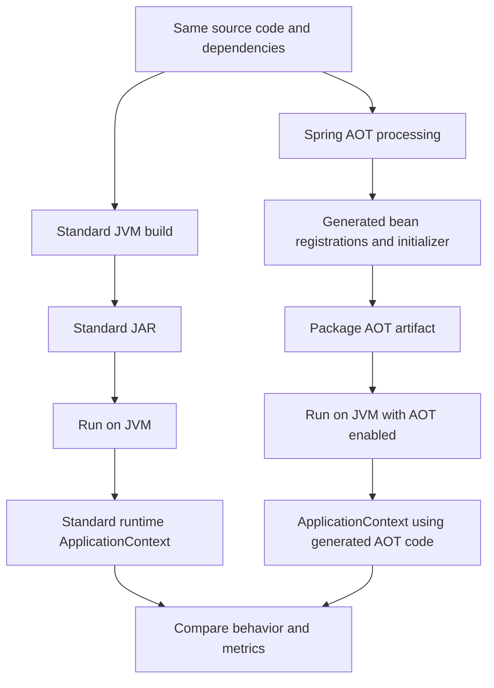

# Comparing Standard JVM Application Behavior with AOT JVM

## Lesson Objectives

Spring Boot can run on the JVM using two different context initialization paths:

- **Standard JVM:** Spring reads configuration and builds the `ApplicationContext` through the standard runtime mechanism.
- **AOT JVM:** Spring uses the bootstrap code and metadata generated during Ahead-of-Time processing, while the application still runs on the JVM.

Comparing the two execution paths helps verify whether AOT processing preserves the application's business behavior, dependency injection, configuration, proxies, and integrations. This is a useful verification step before moving on to GraalVM Native Image.

Note: **AOT JVM in this lesson means a Spring application that has been AOT-processed but still runs on the JVM.** It is not a native executable, nor does it mean the JVM has compiled the entire application into machine code prior to execution. When running on the JVM, bytecode is still executed by the JVM and may be optimized by the JIT compiler.

After this lesson, you will be able to:

- Distinguish standard context initialization from initialization using generated AOT code.
- Set up two runs with identical sources, dependencies, and runtime configuration for comparison.
- Verify the bean graph, dependency injection, conditional configuration, and profiles.
- Compare transactions, AOP proxies, resources, serialization, and business flows.
- Measure startup, memory, and runtime behavior without drawing wrong conclusions from a single measurement.
- Diagnose differences caused by AOT build-time configuration versus application bugs.

## 1. Distinguishing Standard JVM from AOT JVM

### 1.1. Standard JVM

When a Spring Boot application starts normally, Spring reads configuration, scans components, processes configuration classes, evaluates conditions, and registers bean definitions at runtime. Then, the container creates required singletons and finishes refreshing the context.

Several decisions are made when the application starts:

- Which components are discovered via component scanning.
- Which beans are registered from `@Configuration` and `@Bean`.
- Whether `@Profile`, `@ConditionalOnProperty`, `@ConditionalOnClass`, and other conditions are satisfied.
- Which dependencies are injected into each bean.
- Which proxies and interceptors need to be created.

This is Spring's flexible model on the JVM. Components depending on runtime configuration can be determined when the context is built.

### 1.2. AOT JVM

With Spring AOT, a processing step runs before the application is packaged. Spring analyzes the application context in the build environment, generates bean registrations, and produces generated code for context initialization.

When running the AOT artifact on the JVM, Spring uses those generated artifacts instead of part of the usual dynamic configuration processing. The JVM still executes the application; the difference lies in how Spring prepares and initializes the context.

High-level diagram:



### 1.3. What Is the Same and What Is Different

| Aspect | Standard JVM | AOT JVM |
|---|---|---|
| Runtime engine | JVM | JVM |
| Inputs | Bytecode and dependencies | Bytecode, dependencies, and generated AOT artifacts |
| Spring context initialization | Analyzes configuration at runtime | Uses generated registration/initializer code |
| Bean graph | Determined when context starts | AOT decisions may be fixed from the AOT processing environment |
| Runtime configuration | Read via standard Spring mechanisms | Still reads eligible runtime values; config affecting the bean graph must align with the AOT run |
| JIT compilation | Can occur | Can occur |
| Native executable | No | No |

AOT JVM can still use JIT compilation during execution. Therefore, do not call this comparison "JVM without JIT" or treat it as a direct comparison between JVM and a native executable.

### 1.4. Why Compare Before Building Native?

If an application already misbehaves on AOT JVM, compiling to native usually will not solve that problem. Conversely, if standard JVM and AOT JVM behave identically while the native executable fails, the investigation narrows down to Native Image reachability, reflection, resources, proxies, JNI, or class initialization.

Comparing standard JVM with AOT JVM separates:

- Discrepancies caused by Spring AOT bean/configuration processing.
- Pre-existing application logic or configuration bugs.
- Errors that appear only when moving from JVM to Native Image.

## 2. Which Decisions Can Change in AOT?

### 2.1. Bean Graph and Conditional Configuration

Conditions that determine whether a bean is registered may be evaluated during AOT processing. For example:

```java
@Configuration(proxyBeanMethods = false)
class PaymentConfiguration {

    @Bean
    @Profile("sandbox")
    PaymentGateway sandboxGateway() {
        return new SandboxPaymentGateway();
    }

    @Bean
    @Profile("production")
    PaymentGateway productionGateway() {
        return new ProductionPaymentGateway();
    }
}
```

If AOT processing runs with the `sandbox` profile, the generated bean graph reflects the sandbox configuration. You cannot expect that merely switching `SPRING_PROFILES_ACTIVE=production` when running the AOT artifact will generate production beans that were absent from the prepared model.

With Spring Boot AOT, active profiles used in AOT processing must align with profiles at runtime. Depending on version and configuration, Spring Boot may detect a profile mismatch and throw an error. Regardless of any check mechanism, the operational principle remains creating separate AOT artifacts when different bean graphs are needed.

### 2.2. Distinguishing Bean Structure from Runtime Configuration Values

Not every property is frozen during AOT:

| Property | Impact | How to Test |
|---|---|---|
| `spring.profiles.active` used to select beans | Can change the bean graph | Build AOT per profile and run with the corresponding profile |
| `feature.audit.enabled` used in `@ConditionalOnProperty` | Can make beans appear/disappear | Set value before AOT processing |
| Database URL | Usually a runtime value only | Use different URLs when running two equivalent artifacts |
| API key or password | Sensitive runtime value | Supply from secret manager, never bake into AOT build |
| Timeout or connection limit | Usually a runtime value | Change property at runtime and verify bean receives new value |

Runtime configuration example:

```java
@ConfigurationProperties(prefix = "payment.provider")
public record PaymentProviderProperties(
        URI baseUrl,
        Duration timeout
) {}

@Configuration(proxyBeanMethods = false)
@EnableConfigurationProperties(PaymentProviderProperties.class)
class PaymentProviderConfiguration {

    @Bean
    PaymentProviderClient paymentProviderClient(
            PaymentProviderProperties properties) {
        return new PaymentProviderClient(
                properties.baseUrl(),
                properties.timeout()
        );
    }
}
```

In this example, `baseUrl` and `timeout` can be bound from runtime configuration sources. The `PaymentProviderClient` bean still needs to be registered in the AOT artifact's bean graph.

### 2.3. Custom Bean Registration

Applications may use `BeanDefinitionRegistryPostProcessor`, `BeanFactoryPostProcessor`, or custom registry mechanisms to register beans. If this logic depends on files/databases/networks only available at deployment time, AOT results may differ from a standard runtime context.

For custom components, determine:

- Does the processor run during the AOT phase or at runtime?
- Does it produce deterministic results in the build environment?
- Is it supported by Spring AOT or does it have a corresponding AOT contribution?
- Does runtime data only change values, or does it spawn new bean definitions?

If a connector list needs to change after deployment, consider registering a fixed registry/service and reading connector config at runtime. If genuinely different bean graphs are needed, create separate AOT variants.

## 3. Preparing a Fair Comparison

### 3.1. Keep Input Factors Identical

For meaningful results, both runs must use:

- The same source code commit.
- The same Java and Spring Boot versions.
- The same dependency versions and classpath.
- The same OS/CPU, and container base image if applicable.
- The same profiles and properties affecting the bean graph.
- The same test data and dependent services.
- The same CPU/memory limits and launch setup.

Only change the bootstrap mode: standard JVM or AOT JVM.

### 3.2. Use Two Separate Artifacts

Do not overwrite the standard JAR with the AOT JAR or vice versa. Give outputs distinct names so they can be inspected, re-run, and logged independently:

| Variant | Example Artifact |
|---|---|
| Standard JVM | `payment-service-jvm.jar` |
| AOT JVM | `payment-service-aot.jar` |

File names are just a convention. Output configuration depends on Maven/Gradle and your project's Spring Boot plugin.

### 3.3. Record the Test Environment

Save the following information for each run:

- Commit SHA and dependency lock/version report.
- Java vendor/version and JVM arguments.
- Spring Boot version and build tool version.
- Profiles and properties related to the bean graph.
- CPU quota, memory limit, and container image.
- Number of warm-up runs, measurement runs, and observation duration.
- Startup time, RSS/heap, throughput, latency, and functional outcomes.

If the two runs use different JVM arguments, document them explicitly. Flags like `-Xms`, `-Xmx`, GC, or JIT options can affect measurements.

## 4. Creating the AOT JVM Artifact

### 4.1. With Gradle

The Spring Boot Gradle plugin provides the `processAot` task to process the application and generate AOT assets. Example:

```bash
./gradlew clean processAot
```

Then package the artifact per project lifecycle and configuration:

```bash
./gradlew bootJar
```

Including generated AOT classes/resources in the artifact depends on the Spring Boot Gradle plugin configuration and task wiring in the project. Check task logs, generated outputs, and JAR contents to confirm the artifact actually contains AOT assets. Do not treat `processAot` succeeding as proof that `bootJar` packaged them properly.

### 4.2. With Maven

The Spring Boot Maven plugin provides the `spring-boot:process-aot` goal:

```bash
./mvnw spring-boot:process-aot
```

After AOT processing, package the artifact using the project's lifecycle/plugin configuration:

```bash
./mvnw package
```

If the project uses a dedicated Maven profile for AOT/native, enable that configured profile. Check generated outputs and JAR contents to ensure generated classes/resources are compiled and packaged. Do not assume every Maven project automatically binds AOT processing to `package`.

### 4.3. Running the Artifact on the JVM

Run the standard JVM artifact:

```bash
java -jar payment-service-jvm.jar
```

Run the AOT-processed artifact on the JVM:

```bash
java -Dspring.aot.enabled=true -jar payment-service-aot.jar
```

`spring.aot.enabled=true` instructs Spring Boot to use AOT-generated initialization at startup. Only use this flag with artifacts containing matching AOT-generated assets. Enabling it on a standard JAR without generated assets may prevent the application from starting properly.

With Windows PowerShell:

```powershell
java -jar .\payment-service-jvm.jar
java -Dspring.aot.enabled=true -jar .\payment-service-aot.jar
```

If your project uses a different JAR name, substitute the actual path. You can run both variants in two separate processes and save separate logs for comparison.

### 4.4. Do Not Confuse AOT JVM with Native Image

| Execution Mode | Illustrative Launch Command | Runtime |
|---|---|---|
| Standard JVM | `java -jar app.jar` | JVM, Spring initializes context normally |
| AOT JVM | `java -Dspring.aot.enabled=true -jar app-aot.jar` | JVM, Spring uses generated AOT initialization |
| Native Image | `./app` or running a native container | Native executable, no JVM required to run the app |

The comparison in this lesson focuses on the first two rows. Native Image is the next step and requires its own test suite.

## 5. Checking the Bean Graph and Dependency Injection

### 5.1. Generating a Bean Report

A practical way to compare is to print beans by name and type from the context. Example:

```java
@Component
class BeanInventoryReporter implements ApplicationRunner {

    private final ConfigurableApplicationContext context;

    BeanInventoryReporter(ConfigurableApplicationContext context) {
        this.context = context;
    }

    @Override
    public void run(ApplicationArguments args) {
        ConfigurableListableBeanFactory factory =
                context.getBeanFactory();

        Arrays.stream(context.getBeanDefinitionNames())
                .sorted()
                .forEach(name -> {
                    Class<?> type = factory.getType(name);
                    System.out.printf(
                            "%s -> %s%n",
                            name,
                            type == null ? "<unknown>" : type.getName()
                    );
                });
    }
}
```

Include the same reporter in both artifacts and save outputs to two files. Compare the lists by bean name, expected type, and critical business beans.

Do not expect the two bean lists to match line-for-line. Some infrastructure beans or generated initializers may differ due to the bootstrap mechanism. Focus on business beans, adapters, repositories, controllers, integrations, and dependencies required by use cases.

### 5.2. Verifying Beans by Type and Qualifier

Beyond the name list, verify key contracts:

```java
PaymentGateway gateway =
        context.getBean(PaymentGateway.class);

assertThat(gateway).isInstanceOf(SandboxPaymentGateway.class);

assertThat(context.getBeansOfType(ProductionPaymentGateway.class))
        .isEmpty();
```

Repeat assertions for each profile/variant. If an interface has multiple implementations, verify `@Primary`, `@Qualifier`, and bean ambiguity.

### 5.3. Checking Conditions and Profiles

For each conditional configuration, record:

- Profile used during AOT processing.
- Property governing the condition and its build-time value.
- Bean expected to be present or absent.
- Runtime profile/property when running the artifact.

Example:

| Condition | Value During AOT | Expected Bean |
|---|---|---|
| `@Profile("sandbox")` | `sandbox` active | Sandbox gateway |
| `@Profile("production")` | `production` active | Production gateway |
| `audit.enabled=true` | true | Audit publisher present |
| `audit.enabled=false` | false | Audit publisher absent |

If the bean graph differs unexpectedly, check AOT build inputs before altering business logic.

### 5.4. Verifying Dependency Injection

Bean presence alone does not prove wiring is correct. Run initialization flows and verify:

- Constructor injection receives the expected implementation.
- Qualifier/primary resolution matches expectations.
- Optional dependencies and `ObjectProvider` behave properly.
- Circular dependencies do not emerge from configuration differences.
- Lazy beans initialize when invoked by use cases.
- `FactoryBean`, scoped beans, and proxies are created properly.

Some lazy beans are only created when accessed. Therefore, a successful startup does not prove the entire dependency graph of business paths has been exercised.

## 6. Comparing Business Behavior and Integrations

### 6.1. Using the Same Contract Test Suite

Run the same test suite against both artifacts. Each test should assert observable business outcomes without depending on how Spring instantiated beans.

Recommended test groups:

- HTTP endpoints and status/body/headers.
- Validation, exception mapping, and error responses.
- Database reads/writes and transaction rollbacks.
- Cache hits/misses/evictions.
- Message publishing/consumption and retries.
- Schedulers, async execution, and shutdown callbacks.
- Serialization/deserialization of every subtype.
- Resources/templates across locales and formats.

Prefer test doubles or an isolated integration environment so the two runs do not write conflicting data to production.

### 6.2. Transactions and AOP Proxies

Test methods annotated with `@Transactional`, `@Async`, `@Cacheable`, `@Retryable`, or custom aspects. Example:

```java
@SpringBootTest
class PaymentTransactionTests {

    @Autowired
    PaymentService paymentService;

    @Autowired
    PaymentRepository paymentRepository;

    @Test
    void rollsBackWhenPaymentFails() {
        assertThatThrownBy(() ->
                paymentService.payAndFail(testPayment())
        ).isInstanceOf(PaymentFailedException.class);

        assertThat(paymentRepository.findByReference("test-ref"))
                .isEmpty();
    }
}
```

This is an illustrative example; fixtures, repositories, and exceptions must be defined in the project. Run the same test on standard JVM and AOT JVM to verify transaction boundaries and rollbacks.

If a test calls an internal method via `this`, self-invocation can bypass proxies in both execution modes. Do not attribute that behavior to an AOT regression; inspect the call path.

### 6.3. Resources and Serialization

Verify files packaged inside the AOT JAR and how the application accesses them. Spring AOT can generate hints for some resources, but an AOT JVM comparison does not replace native image resource inclusion tests.

For serialization, run tests with:

- Every supported DTO and subtype.
- Old/new payload versions.
- Optional or null fields.
- Special enums/formats.
- Error payloads and error responses.

If both standard JVM and AOT JVM succeed yet the native executable fails on reflection or resources, continue investigating Native Image metadata.

## 7. Measuring Startup, Memory, and Performance

### 7.1. Measuring Time to Readiness

Do not measure only from command invocation until the process appears. The application may be running before it is ready to accept requests. Measure at least two milestones:

- **Process startup:** time from process launch until the JVM reports the application has started.
- **Readiness:** time from launch until the health/readiness endpoint returns a ready status.

If the application exposes Spring Boot Actuator, a benchmark script can poll the readiness endpoint. Keep health checks and timeouts identical for both variants.

Manual measurement example on Linux:

```bash
START=$(date +%s%3N)
java -jar payment-service-jvm.jar &
PID=$!

until curl -fsS http://localhost:8080/actuator/health/readiness >/dev/null; do
  sleep 0.1
done

END=$(date +%s%3N)
echo "readiness_ms=$((END - START))"
kill "$PID"
wait "$PID"
```

This is an illustrative script; the readiness endpoint must be enabled and configured properly. In automated benchmarks, pick separate ports or stop the process before starting the next variant so two apps do not contend for the same port.

### 7.2. Measuring Memory

Do not use a single heap number to represent the entire memory footprint. Record separately:

- Allocated JVM heap and used heap.
- Process RSS/working set.
- Metaspace and code cache when needed.
- Memory limit/container memory if running in a container.

On Windows you can inspect process working set with PowerShell:

```powershell
Get-Process -Name java |
    Select-Object Id, CPU, WorkingSet64, PrivateMemorySize64
```

On Linux, you can use `ps`, `/usr/bin/time -v`, or cgroup/container metrics. Use the same tool and sampling point for both variants.

Keep `-Xms`, `-Xmx`, GC, and container memory limits identical. If AOT JVM shows a smaller heap yet a larger RSS, report both rather than cherry-picking the favorable metric.

### 7.3. Separating Startup from Steady-State

AOT JVM still runs on the JVM and can still JIT-compile hot methods. Therefore, separate measurements into:

| Phase | What to Measure |
|---|---|
| Cold start | Time from process launch to readiness, initial memory |
| Warm-up | Time and requests needed for the JVM to stabilize |
| Steady-state | Throughput, p50/p95 latency, CPU, and memory |
| Shutdown | Shutdown time and completion of lifecycle callbacks |

Do not treat the first request as representative of steady-state throughput. Run identical warm-ups and measure repeatedly.

### 7.4. Repeat and Use Appropriate Statistics

Perform multiple independent runs for each variant. Report median and variance range; for request latency, include p95/p99 where appropriate. Never draw conclusions from a single run because CPU scheduling, filesystem cache, JIT, and system load cause jitter.

If the goal is comparing cold start, control cache and process state before each run. If the goal is steady-state, use the same warm-up duration and same workload.

### 7.5. Do Not Extrapolate AOT JVM Results to Native Image Results

AOT JVM can reduce some of Spring's configuration analysis cost at startup. However, it still carries the JVM runtime, class loading, JIT, and JVM garbage collector.

Native Image has a different memory, startup, and compilation model. Do not use AOT JVM results to claim a native executable will achieve the same startup time, RSS, or throughput.

## 8. Comparison Test Matrix

### 8.1. Minimum Matrix

| Area | Standard JVM | AOT JVM | Passing Criteria |
|---|---|---|---|
| Startup | Start standard JAR | Start JAR with AOT enabled | Context ready, no bootstrap errors |
| Bean graph | Check inventory | Check inventory | Expected business beans and implementations |
| Configuration | Read runtime properties | Read runtime properties | URLs, timeouts, and config values accurate |
| Dependency injection | Invoke use case | Invoke same use case | Correct implementation, no ambiguity |
| Transactions | Test commit/rollback | Test same commit/rollback | Identical data and rollback |
| AOP/cache/async | Test advisor | Test same advisor | Advice operates as designed |
| Resources | Open template/schema | Open same resource | Identical read and processing outcomes |
| Serialization | Encode/decode payload | Encode/decode same payload | Equivalent results |
| HTTP/messaging | Contract test | Same contract test | Correct status, payload, and side effects |
| Shutdown | Stop process | Stop process | Callbacks and cleanup complete |

### 8.2. Comparing Results Meaningfully

Some differences are not necessarily bugs:

- Generated bean or infrastructure bean names may differ.
- Internal bootstrap bean counts may differ.
- Startup time and memory may differ due to initialization mechanics.
- Log ordering or initialization ordering is not guaranteed unless the application declares explicit ordering.

Differences must be treated as regressions if they alter:

- Business results or persisted data.
- Bean implementations/qualifiers relied upon by use cases.
- Transaction boundaries, retries, caching, or async behavior.
- HTTP contracts, event schemas, or resource contents.
- Runtime configuration expected to vary across deployments.

### 8.3. Saving Reproducible Results

A short summary table should include:

| Metric | Standard JVM | AOT JVM | Notes |
|---|---:|---:|---|
| Readiness median | ... | ... | ms, run count |
| RSS at readiness | ... | ... | MiB |
| Heap used after warm-up | ... | ... | MiB |
| Throughput | ... | ... | requests/second |
| p95 latency | ... | ... | ms |
| Contract tests | ... | ... | pass/fail |
| Bean graph assertions | ... | ... | pass/fail |

Fill in measurements taken from the same environment. Do not use estimates or numbers from another machine to fill the table.

## 9. Diagnosing Divergent Behavior Between Variants

### 9.1. AOT Artifact Fails to Start

Check in order:

1. Does the artifact actually contain generated AOT classes/resources?
2. Is `spring.aot.enabled=true` passed to the right process?
3. Do runtime active profiles match the profile used during AOT processing?
4. Did build-time properties create the desired bean graph?
5. Are there bean registration processors or custom conditions incompatible with AOT?
6. Were generated sources compiled and packaged properly?

Do not add Runtime Hints to fix a missing generated initializer or profile mismatch; that is a build/AOT wiring issue.

### 9.2. Standard JVM Runs, but AOT JVM Is Missing Beans

Review profiles, properties, classpath, and conditions at AOT processing time. If a bean depends on runtime-only data, decide whether to:

- Create another AOT variant with matching build inputs.
- Keep the bean registry fixed and read runtime data inside the service.
- Write an AOT contribution for the custom component.
- Separate the dynamic plugin part into another process.

### 9.3. Bean Is Present, but Behavior Differs

Check:

- Did the injected bean get the right implementation/qualifier?
- Was the proxy created and did calls pass through the proxy?
- Is self-invocation bypassing advice?
- Is a lazy bean or factory bean created only in an untested path?
- Is there an implicit side effect or initialization order the application relies on?

In particular, self-invocation is a limitation of proxy-based AOP in both standard JVM and AOT JVM; do not automatically assume it is an AOT bug.

### 9.4. AOT JVM Succeeds, but Native Image Fails

If both JVM variants behave identically while the native executable fails, pivot investigation to:

- Reflection/serialization metadata.
- Resource inclusion.
- Dynamic proxies or bytecode generation.
- Class initialization and image heap.
- JNI, shared libraries, OS/CPU/ABI.
- Libraries lacking reachability metadata or native support.

AOT JVM verifies Spring AOT; it does not replace native builds and native runtime tests.

## 10. Complete Hands-On Workflow

### Step 1 — Create the JVM Baseline

Build the standard JAR, run it with the selected profiles/properties, and save startup logs, bean inventory, and contract test results.

### Step 2 — Create the AOT Artifact

Run the **processAot** task with Gradle or the **spring-boot:process-aot** goal with Maven. Package according to plugin configuration and verify generated assets are inside the artifact.

### Step 3 — Run AOT JVM

Launch the AOT artifact with **-Dspring.aot.enabled=true** and profiles matching AOT processing. Save logs, bean inventory, and test results.

### Step 4 — Compare Functionality

Run the same contract tests, transaction, AOP, resource, serialization, HTTP/messaging, and lifecycle tests on both variants. Investigate any discrepancy affecting business outcomes.

### Step 5 — Measure Performance

Measure readiness, memory, warm-up, and steady-state in the same environment. Repeat runs, record medians/percentiles, and save JVM arguments.

### Step 6 — Advance to Native Image

Only after AOT JVM passes required checks, build the native executable and re-run the test matrix on native. When native differs from AOT JVM, investigate metadata/reachability and library compatibility.

### Self-Check Questions

1. At which step does AOT JVM differ from standard JVM if both still use the same JVM runtime?
2. Why can you not change a profile at runtime to add beans absent from the AOT-generated bean graph?
3. Which properties can typically remain at runtime without building a new AOT variant?
4. Why must you verify generated AOT assets are packaged into the JAR before running with **spring.aot.enabled=true**?
5. Is self-invocation a limitation specific to AOT JVM? Why or why not?
6. Why must startup time and steady-state throughput be measured separately?
7. If both standard JVM and AOT JVM pass yet native fails when reading a resource, which layer needs inspection?

**Remember:** comparing standard JVM with AOT JVM is how you verify Spring AOT while keeping the JVM runtime constant. Keep sources, dependencies, profiles, and workloads identical; verify the bean graph, configuration, business behavior, and operational metrics. Once the two variants match, you have a solid foundation for moving to GraalVM Native Image testing, while still needing full native tests because Native Image imposes its own constraints.
