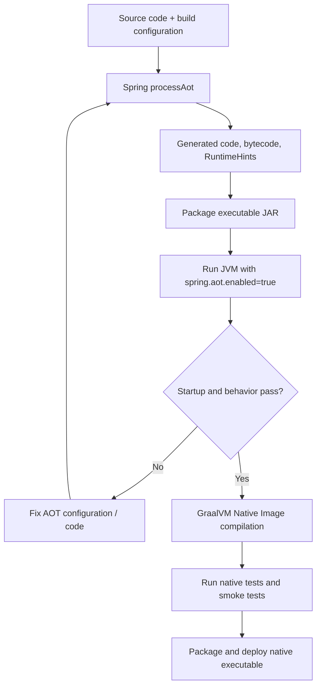

# Using AOT JVM to Shorten the Feedback Loop Before Native Build

## 1. Why Run AOT on the JVM Before Native Compilation?

Spring Boot Native Image includes a critical step prior to GraalVM compilation: **Spring AOT processing**. In this step, Spring initializes the `ApplicationContext` model in the build environment, analyzes which beans will be registered, and generates initialization code, supporting bytecode, and `RuntimeHints`. GraalVM Native Image then consumes these outputs to perform reachability analysis and produce the executable.

Native Image compilation generally consumes far more time and resources than running the application on the JVM. If you only discover a bean configuration error, broken generated initializer, or incompatible AOT callback after completing native compilation, your debugging loop becomes much longer.

Spring Boot allows you to run the AOT-processed application on the **standard JVM** using the system property `spring.aot.enabled=true`. This enables the team to verify generated initialization code, context startup, and endpoints on the JVM before investing time in Native Image compilation.

This lesson belongs to the **AOT Testing** chapter of the **SPRING_BOOT_NATIVE_IMAGE** module. The module practices compiling Spring Boot into a GraalVM Native Image with Spring AOT, evaluating startup time and memory, configuring Maven/Gradle, handling reflection/resources, compatibility testing, container packaging, and operating native builds. Here, we use AOT JVM as an intermediate verification loop to catch issues in AOT configuration early.

After this lesson, learners will be able to:

- Distinguish running on a standard JVM, running on the JVM with AOT generated code, and running a native executable.
- Build a JAR containing Spring AOT output using Maven or Gradle.
- Enable AOT runtime mode with `spring.aot.enabled=true`.
- Verify startup, the bean graph, and business flows on AOT JVM.
- Recognize the limitations of configurations decided at build time.
- Determine which errors can be caught on AOT JVM and which still require native builds/tests.

## 2. Three Execution Modes to Distinguish

| Mode | How Spring Context Initializes | Requires GraalVM Native Image Compilation? | Purpose |
|---|---|---:|---|
| Standard JVM | Spring processes configuration and beans at runtime | No | Regular development and testing |
| AOT JVM | Uses initialization code and Spring decisions generated at build time | No | Verify AOT output and app behavior with a fixed bean graph |
| Native executable | Uses AOT output compiled by GraalVM into a binary | Yes | Test and operate the native artifact |

Workflow:



AOT JVM uses the exact same Spring AOT output that the native build consumes. If the AOT generated code has a bug, lacks a bean definition, or fails to initialize the context, you can catch it before invoking the native compiler.

**AOT JVM is not a Native Image emulator.** The application still runs on the JVM and still has Java's JIT/runtime. This mode does not test native binaries, the OS dynamic linker, libc, JNI ABI, or errors that only surface when running a GraalVM-compiled executable.

## 3. What Does Spring AOT Generate?

During AOT processing, Spring produces outputs depending on your application's configuration and bean types:

- **Java source code:** bean initialization code and code restoring BeanFactory state deterministically.
- **Bytecode:** for example, bytecode for certain dynamic proxies.
- **RuntimeHints:** reflection, resource, serialization, JDK proxy, and other dynamic access information.
- **AOT test context initializers:** for supported tests using the Spring TestContext Framework, Spring can generate initializers to construct optimized test ApplicationContexts.

The goal of AOT is to shift part of the discovery and decision work normally done at runtime to build time. Therefore, generated code reflects the classpath and environment Spring saw during AOT processing.

When running AOT JVM, Spring uses the generated initializer instead of the standard context discovery process for everything processed by AOT. A log line typically indicates the application is running in AOT-processed mode, for example:

```text
Starting AOT-processed MyApplication ...
```

If a JAR is launched with `spring.aot.enabled=true` yet lacks generated output, the application cannot regenerate that output at runtime. Inspect the `processAot` step, plugin configuration, and JAR contents.

## 4. Building and Running AOT JVM with Maven

### 4.1. Using the Spring Boot Native Profile

If your project uses `spring-boot-starter-parent`, Spring Boot provides the `native` Maven profile. This profile configures the `process-aot` execution when the Spring Boot Maven Plugin is declared in the project. Because the plugin often resides in `pluginManagement`, ensure it is applied under `build/plugins`:

```xml
<build>
    <plugins>
        <plugin>
            <groupId>org.springframework.boot</groupId>
            <artifactId>spring-boot-maven-plugin</artifactId>
        </plugin>
    </plugins>
</build>
```

You can use the very JAR produced by this profile to run AOT on the JVM. If the project also configures a Native Build Tools execution bound to the `package` lifecycle, separate or skip that execution during the AOT JVM verification loop to avoid accidentally triggering native compilation.

Build:

```bash
./mvnw -Pnative package
```

After a successful build, locate the executable JAR in the `target/` directory. Example on PowerShell:

```powershell
Get-ChildItem target -Filter "*.jar"
```

On Linux/macOS you can use `find target -maxdepth 1 -name '*.jar'`. If the project produces multiple JARs, select the Spring Boot executable JAR, not the test JAR or `original-*.jar` file.

Run the JAR on the JVM with AOT mode:

```bash
java -Dspring.aot.enabled=true -jar target/my-application.jar
```

Replace `my-application.jar` with the actual filename. The JVM option `-Dspring.aot.enabled=true` must precede `-jar`.

### 4.2. When Not Using the Spring Boot Parent

If the project does not inherit from `spring-boot-starter-parent`, the `native` profile does not appear automatically. You can declare the `process-aot` execution on the Spring Boot Maven Plugin:

```xml
<build>
    <plugins>
        <plugin>
            <groupId>org.springframework.boot</groupId>
            <artifactId>spring-boot-maven-plugin</artifactId>
            <executions>
                <execution>
                    <id>process-aot</id>
                    <goals>
                        <goal>process-aot</goal>
                    </goals>
                </execution>
            </executions>
        </plugin>
    </plugins>
</build>
```

The plugin version configuration must align with the Spring Boot version the project uses. If the project uses Native Build Tools to build binaries, configure the native plugin separately per its documentation; the objective of this step is producing a JAR with AOT output for testing on the JVM.

You can invoke the AOT goal directly when investigating the processing step alone:

```bash
./mvnw spring-boot:process-aot
```

This goal writes generated sources/classes/resources into Maven's build output. To run a JAR, you still need to package the AOT outputs properly into the archive; merely running `process-aot` does not mean an existing JAR file updates automatically if the packaging lifecycle has not run.

## 5. Building and Running AOT JVM with Gradle

With Gradle, if you only want to run an AOT-processed application on the JVM without configuring Native Image compilation, apply the `org.springframework.boot.aot` plugin directly.

Groovy DSL example:

```groovy
plugins {
    id 'org.springframework.boot' version '<spring-boot-version>'
    id 'java'
}

apply plugin: 'org.springframework.boot.aot'
```

With Kotlin DSL:

```kotlin
plugins {
    id("org.springframework.boot") version "<spring-boot-version>"
    java
}

apply(plugin = "org.springframework.boot.aot")
```

Version placeholders must be replaced with the Spring Boot version in use. When the GraalVM Native Image plugin is already applied, the Spring Boot AOT plugin is applied automatically; if the goal is solely testing AOT JVM, you can apply the AOT plugin directly as shown above.

Run AOT processing and packaging:

```bash
./gradlew processAot bootJar
```

Then run the JAR:

```bash
java -Dspring.aot.enabled=true -jar build/libs/my-application.jar
```

The actual filename depends on `archiveFileName`, version, and project configuration. If the build script has custom source sets or tasks, inspect `processAot` output and confirm `bootJar` included generated classes/resources in the archive.

### 5.1. Using bootRun During Development

You can pass the system property to `bootRun`:

```groovy
tasks.named("bootRun") {
    systemProperty "spring.aot.enabled", "true"
}
```

However, `bootRun`'s runtime classpath must contain the output produced by `processAot`. If your project's task graph has not wired AOT output into `bootRun`, use the packaged JAR from the example above for more reliable verification.

## 6. Selecting Environment and Profiles at AOT Time

AOT processing prepares the BeanFactory at build time. Conditions determining which beans exist are evaluated during this step. For example:

- `@Profile("production")` determines which profile configurations enter the bean graph.
- `@ConditionalOnProperty` determines whether a bean is registered.
- Custom `@Conditional` can decide bean presence based on classpath or Environment.
- The classpath and dependencies available at build time are used to determine configuration.

Therefore, you cannot build AOT with the `dev` profile and expect switching to the `production` profile when running AOT JVM to create production beans that were not generated in the build output.

With Maven, configure profiles for `process-aot` in the Spring Boot Maven Plugin:

```xml
<plugin>
    <groupId>org.springframework.boot</groupId>
    <artifactId>spring-boot-maven-plugin</artifactId>
    <executions>
        <execution>
            <id>process-aot</id>
            <goals>
                <goal>process-aot</goal>
            </goals>
            <configuration>
                <profiles>
                    <profile>production</profile>
                </profiles>
            </configuration>
        </execution>
    </executions>
</plugin>
```

With Gradle, configure the `ProcessAot` task:

```groovy
tasks.withType(
    org.springframework.boot.gradle.tasks.aot.ProcessAot
).configureEach {
    args("--spring.profiles.active=production")
}
```

Rebuild AOT output whenever you change a profile or property that alters the bean graph. Properties affecting only configuration values of already existing beans can still be supplied at runtime, provided they do not alter bean-creation decisions or structure fixed by AOT.

## 7. What Can You Verify Using AOT JVM?

AOT JVM is especially useful for errors related to the Spring context and generated initialization code.

| Category | Verifiable on AOT JVM? | Example |
|---|---|---|
| Context startup | Yes | Can the generated initializer build the `ApplicationContext` |
| Bean registration | Yes | Which beans are present, which were conditionally excluded |
| Dependency injection | Yes | Constructor injection, qualifiers, circular dependencies |
| Auto-configuration | Yes | Does auto-configuration create beans as expected |
| AOT callbacks | Yes | Do BeanFactory-processing callbacks produce valid output |
| `RuntimeHints` generation | Build output checkable | Did registrars contribute required hints |
| REST/API behavior | Yes | Endpoints, validation, serialization on AOT JVM |
| Business workflows | Yes | Service, repository, and transaction flows on AOT JVM |

For example, a test can assert that an important bean exists in the context:

```java
@SpringBootTest
class AotContextSmokeTests {

    @Autowired
    ApplicationContext applicationContext;

    @Test
    void shouldRegisterReportService() {
        assertThat(applicationContext.getBean(ReportService.class))
            .isNotNull();
    }
}
```

This test illustrates context verification; import JUnit, Spring Test, and AssertJ per project dependencies. When running with an AOT JAR and `spring.aot.enabled=true`, tests or smoke tests can check whether the generated context provided required beans.

### Testing Endpoints via HTTP

If the application is a web service, you can start the AOT JAR and call endpoints with `curl`, Postman, or an integration test client:

```bash
curl --fail --silent --show-error http://localhost:8080/actuator/health

curl --fail --silent --show-error \
  -H "Content-Type: application/json" \
  -d '{"reportType":"monthly"}' \
  http://localhost:8080/api/reports
```

Endpoints and payloads are examples; substitute real APIs. Inspect responses, status codes, logs, and external dependencies. Do not settle for merely confirming the process started.

## 8. AOT Testing for Spring TestContext

Beyond application AOT processing, Spring also supports AOT for integration tests using the Spring TestContext Framework. Spring detects test contexts, refreshes contexts at build time, and creates corresponding `ApplicationContextInitializer` implementations. When running tests in AOT runtime mode, the TestContext Framework can use those optimized contexts.

Eligible tests typically use JUnit Jupiter or JUnit 4 with Spring TestContext annotations, such as `@SpringBootTest` or `@ContextConfiguration`. Each unique context configuration is processed and its corresponding initializer saved.

Several points to keep in mind:

- Tests must use an AOT-capable context loader; context loaders provided by Spring Framework and Spring Boot already support this.
- Custom `ContextLoader` implementations must implement `AotContextLoader`.
- Custom `TestExecutionListener` implementations must implement `AotTestExecutionListener` to participate in AOT processing.
- `@ContextHierarchy` is not supported in AOT mode.
- `@DisabledInAotMode` can exclude incompatible test classes or methods from AOT mode.
- The test context's bean graph is likewise fixed per the configuration at AOT processing time.

In Gradle, the `processTestAot` task generates initializers for eligible test contexts. In Maven, the Spring Boot Maven Plugin provides the `process-test-aot` goal. How these tasks connect to native tests depends on plugin/version. The focus of this lesson is using AOT JVM to test the application; native tests remain a separate step if you want to run the test suite inside a GraalVM executable.

## 9. Feedback Loop Workflow Before Native Build

You can organize the verification loop into the following steps:

1. **Run standard JVM tests:** confirm business logic and basic runtime configuration work.
2. **Build Spring AOT:** run `process-aot` via Maven or Gradle.
3. **Package JAR with AOT output:** ensure generated classes/resources are inside the archive.
4. **Run AOT JVM:** enable `spring.aot.enabled=true`.
5. **Run smoke/integration tests:** check the bean graph, APIs, serialization, resources, and selected configuration branches.
6. **Compare results:** if standard JVM passes while AOT JVM fails, focus on build-time conditions, generated code, `RuntimeHints`, or AOT callbacks.
7. **Fix and iterate:** fix configuration/code, re-run `process-aot` and AOT JVM.
8. **Build Native Image:** advance to GraalVM compilation only after the AOT verification loop on JVM passes.
9. **Test the native executable:** re-run smoke/integration tests on the native binary and final container image.

This flow classifies failures cleanly:

- **Standard JVM fails:** usually logic, dependency, runtime configuration, or basic Spring context issues.
- **Standard JVM passes, AOT JVM fails:** suspect AOT restrictions, build-time bean graph, generated initializers, `RuntimeHints`, or AOT callbacks.
- **AOT JVM passes, native executable fails:** suspect Native Image reachability, JNI, reflection/resource metadata, class initialization, native libraries, ABI, or native runtime differences.

## 10. Limitations to Know When Running AOT JVM

AOT JVM is helpful, but it does not represent every runtime condition.

### Fixed Classpath

The classpath must be fully determined at build time. Do not add arbitrary JARs/plugins at runtime expecting the AOT context to discover them automatically. If the dependency list changes, rebuild the AOT output.

### Fixed Bean Graph

Beans are decided at build time. Profiles and properties that change bean existence must be chosen before AOT processing.

For example, if `@ConditionalOnProperty(name = "feature.export.enabled")` decides whether to create `ExportService`, that property must have the intended value at build time. Changing the property at runtime alone cannot conjure a bean excluded from the generated context.

### Some Dynamic Configurations Are Unsupported

Bean registrations depending on runtime instances or manual singleton registrations via `BeanFactory` may not translate cleanly to AOT. Use typed bean definitions and configurations determinable at build time.

### AOT JVM Does Not Test the Native Image Compiler

AOT JVM does not verify that GraalVM can compile all code, that the native executable matches the target architecture, or that the dynamic linker finds native libraries. Those checks still require native builds and runtime tests.

## 11. Common Errors and How to Handle Them

| Symptom | Possible Cause | Resolution |
|---|---|---|
| JVM reports AOT initializer not found | JAR does not contain generated AOT output | Re-run `process-aot` and package the JAR |
| App runs but logs still show regular startup | `spring.aot.enabled=true` not enabled or option placed after `-jar` | Place JVM property before `-jar` |
| AOT build fails due to missing bean/dependency | Improper build-time condition or classpath | Check dependencies and environment when `processAot` runs |
| Standard JVM passes, AOT JVM lacks beans | Wrong profile/property chosen during AOT | Configure profiles/properties for the AOT process and rebuild |
| Changing profile at runtime does not alter bean graph | Profile was already decided at build time | Create separate AOT artifacts for each supported bean graph |
| Generated code missing from Gradle JAR | Incorrect task graph or AOT plugin setup | Check `processAot`, `bootJar`, and archive contents |
| TestContext AOT skips or fails a test | Custom test loader/listener lacks AOT support or unsupported config | Check `AotContextLoader`, `AotTestExecutionListener`, `@ContextHierarchy` |
| AOT JVM passes, native build fails | Issue in reachability metadata or GraalVM/toolchain | Read Native Image build report, add proper hints |
| AOT JVM passes, container fails | Missing native library, wrong architecture, or runtime image | Inspect final image and test on the target platform |

## 12. Hands-On Exercises

### Exercise A — Run an AOT Application on the JVM

1. Use Maven `-Pnative package` or Gradle `processAot bootJar`.
2. Confirm the executable JAR contains generated AOT output.
3. Run the JAR with `-Dspring.aot.enabled=true`.
4. Observe the AOT-processed startup log.
5. Call a critical endpoint and verify the response.

**Passing criteria:** the application starts with AOT generated code on the JVM and the endpoint works.

### Exercise B — Detect Bean Graph Drift

Create a bean controlled by `@ConditionalOnProperty`. Build AOT with the property enabled, then run AOT JVM. Try changing the property at runtime and observe the bean graph. Next, build AOT with the property disabled and compare the results.

**Question:** why can changing a property at runtime not add a bean that was never contributed to the generated context?

### Exercise C — Compare All Three Modes

Run the same test scenario in all three modes: standard JVM, AOT JVM, and Native Image. Record startup success, endpoint output, context errors, and execution times. Never substitute AOT JVM results for native runtime validation.

### Exercise D — Build a Feedback Loop in CI

Create ordered jobs: JVM unit/integration tests, Spring AOT processing, AOT JVM smoke tests, Native Image build, and native smoke tests. Save separate logs for each stage so that when a failure occurs, you can pinpoint which step it belongs to.

## 13. Checklist Before Moving to Native Build

- [ ] Build tool executed Spring AOT processing.
- [ ] Executable JAR contains generated AOT classes/resources.
- [ ] Ran the JAR with `spring.aot.enabled=true`.
- [ ] Logs confirm the application runs with the AOT-processed initializer.
- [ ] Bean graph and profile/property conditions match build configuration.
- [ ] Key smoke tests and integration tests passed on AOT JVM.
- [ ] Verified resources, serialization, reflection, and proxies in required flows.
- [ ] Documented limitations or tests excluded from AOT mode.
- [ ] Resolved AOT issues before starting native compilation.
- [ ] Planned separate tests for the native executable and container.

## References

- [Spring Boot Reference — Ahead-of-Time Processing With the JVM](https://docs.spring.io/spring-boot/reference/packaging/aot.html): how to build a JAR with AOT output and run with `spring.aot.enabled=true`, along with runtime limitations.
- [Spring Boot Gradle Plugin — Ahead-of-Time Processing](https://docs.spring.io/spring-boot/gradle-plugin/aot.html): `org.springframework.boot.aot` plugin, `processAot` and `processTestAot` tasks.
- [Spring Boot Maven Plugin — Ahead-of-Time Processing](https://docs.spring.io/spring-boot/maven-plugin/aot.html): `process-aot`, `process-test-aot` goals, and native profile.
- [Spring Framework Reference — Ahead of Time Optimizations](https://docs.spring.io/spring-framework/reference/core/aot.html): AOT engine, generated code, `RuntimeHints`, and bean graph limitations.
- [Spring Framework Reference — Ahead of Time Support for Tests](https://docs.spring.io/spring-framework/reference/testing/testcontext-framework/aot.html): AOT processing and runtime support for integration tests.

## Conclusion

Running a Spring Boot application with `spring.aot.enabled=true` on the JVM is a valuable verification step prior to GraalVM Native Image compilation. It lets you validate generated initializers, the bean graph, and business flows on the JVM with a much faster feedback cycle than a native build. For meaningful results, the JAR must contain AOT output, profiles and properties affecting the bean graph must be chosen accurately at build time, and critical scenarios must be re-run on AOT JVM. Once this check loop passes, proceed with the native build and test the binary/container separately to catch issues unique to the native environment.
