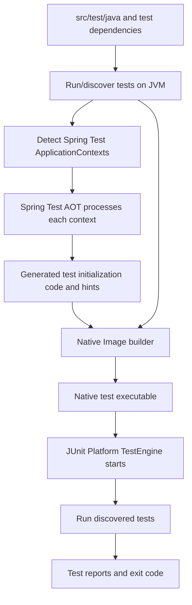
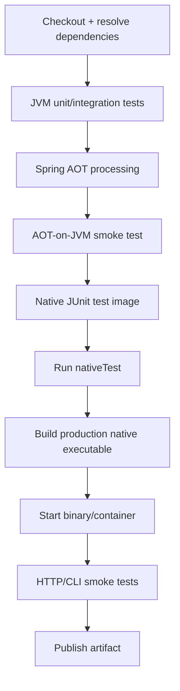

# Native Build Tools and Running JUnit Inside a Native Executable

Testing a Spring Boot application on the JVM remains the fastest and most convenient way to develop most unit tests and integration tests. However, some failures only appear after compiling into a **GraalVM Native Image**: missing reflection hints, unpacked resources, proxies that fail to generate, libraries relying on dynamic class loading, or AOT initialization code not behaving as expected.

**GraalVM Native Build Tools** provides the ability to compile the test suite itself into a native executable and run JUnit inside that executable. With Spring Boot, Spring Test AOT also analyzes test contexts, generates the corresponding initialization code, and includes the JUnit TestEngine along with the discovered test list in the native test image.

This creates a distinct layer of testing: test code and application code actually run under the Native Image model. It complements JVM tests and black-box testing on the packaged application executable.

## 1. Learning Objectives

After this lesson, you will be able to:

- Distinguish between JVM tests, Spring AOT testing on the JVM, native JUnit tests, and testing the native application over HTTP/CLI.
- Explain how the JUnit Platform TestEngine is included in the native test executable.
- Configure GraalVM Native Build Tools for Gradle and Maven.
- Run the Gradle **nativeTest** task and the Maven **nativeTest** profile.
- Understand the role of **process-test-aot** and AOT-processed test ApplicationContexts.
- Write native-compatible tests using JUnit 5 and Spring Test.
- Resolve version mismatches across JUnit Platform, Maven Surefire, and Native Build Tools.
- Diagnose missing metadata, test discovery, native-image toolchain, and CI environment failures.
- Build a CI strategy that balances JVM test speed with native test reliability.

## 2. What Testing Layers Exist?

Not every test run should be treated as equivalent. A Spring Boot Native Image can be verified across multiple layers:

| Testing Layer | How It Runs | What Is Verified | Relative Cost |
| --- | --- | --- | --- |
| **JVM tests** | JUnit running on a standard JVM | Business logic, validation, repositories, web layer, and integration according to test setup | Low |
| **Spring AOT on JVM** | Running the application JAR with AOT-generated code using system property spring.aot.enabled=true | Spring AOT-generated initialization code and prepared container configuration | Low to medium |
| **Native JUnit tests** | JUnit test classes compiled and run inside a native test executable | Test code, Spring Test context, and dynamic access in the Native Image environment | High |
| **Native application tests** | Launching the application executable, calling HTTP/CLI, or verifying behavior from another process | Startup, runtime configuration, network, filesystem, health endpoints, and packaging behavior | High |

Spring Boot recommends continuing to run most tests on the JVM for a fast development loop, then focusing native testing on areas prone to differences. Native JUnit tests are usually better suited for CI, nightly builds, or release validation rather than running after every small method change.

### 2.1. Testing Spring AOT on the JVM

Spring AOT generates code to reconstruct the ApplicationContext configuration in the native runtime. You can test this code on the JVM before paying the cost of native compilation:

```bash
java -Dspring.aot.enabled=true -jar target/order-service.jar
```

The JAR must contain the AOT-generated code. With Maven, build via the Spring Boot parent's **native** profile; with Gradle, apply the GraalVM Native Image plugin so AOT processing is configured. If the application starts successfully in this mode, you have verified part of the AOT behavior without building a native executable.

Testing AOT on the JVM **does not prove** that reflection, proxy, resource, or serialization metadata is complete for GraalVM. Native tests and native application tests are still required.

## 3. How Does JUnit Run Inside a Native Executable?

Native Build Tools does not simply run JUnit on the JVM and rename the report to native. The plugin compiles the test classes and the required test runtime into a native executable. With Spring Test, the workflow also includes a dedicated AOT step for the ApplicationContexts used by the tests.

High-level workflow:



Key steps:

1. The build tool discovers test classes and test engines on the JUnit Platform.
2. Spring Test analyzes tests to identify which ApplicationContexts are needed.
3. Spring AOT processes each context and generates the required assets.
4. GraalVM compiles application code, test code, the test engine, and generated assets into a native test executable.
5. When the executable runs, the JUnit TestEngine starts and executes the registered tests.

As a result, **@SpringBootTest**, test slices, and standard Spring Test mechanisms can still be used in native tests. Exact support still depends on the Spring Boot version, JUnit engine, Native Build Tools, and accompanying test libraries.

### 3.1. Native Test Executable vs. Application Executable

**nativeTest** produces a binary for running tests. That binary contains test classes and the JUnit runtime. It is not the production executable produced by **nativeCompile** or **native:compile**.

Therefore:

- Native JUnit tests verify that test code and application code run inside a Native Image.
- Native application tests verify that the production executable starts up and handles requests like a deployed application.
- Both are needed if you want to verify everything from internal test methods to the behavior of the final artifact.

## 4. Prerequisites Before Running Native Tests

Before configuring the build:

- Install a GraalVM JDK compatible with the project's Java version and Native Build Tools version.
- Confirm that the **native-image** command is present in the GraalVM installation selected by the build tool.
- Install a C compiler and native toolchain appropriate for the build host OS/architecture.
- Use a JUnit Platform version supported by the plugin.
- Ensure test dependencies can run inside a Native Image.
- Prepare databases, message brokers, container runtimes, or external services if the tests require them.

Native Image compilation typically consumes more CPU, RAM, and time than JVM tests. CI runners need sufficient memory; if a build is killed due to out-of-memory errors, resize the runner or reduce the number of concurrent native image builds.

### 4.1. JUnit and TestEngine Versions

Native Build Tools currently supports JUnit Platform; the plugin documentation specifies a minimum of JUnit 5.8.1 (JUnit Platform 1.8.1). The plugin explicitly supports JUnit Jupiter and JUnit Vintage. Other TestEngines may work if the engine and test language are Native Image-compatible, though they may require separate native configuration.

With Maven, Maven Surefire version 3.0.0 or higher is required to run native tests. The JUnit Platform Launcher must be compatible with engines such as Jupiter or Vintage. If the launcher and engine versions diverge, errors may appear during test discovery before any test method runs.

Let Spring Boot dependency management manage JUnit versions whenever possible. Avoid declaring multiple independent versions of junit-platform-engine, junit-platform-launcher, and Jupiter.

## 5. Gradle Configuration

### 5.1. Applying the Plugins

Example **build.gradle** using Groovy DSL:

```groovy
plugins {
    id 'java'
    id 'org.springframework.boot' version '4.2.0'
    id 'org.graalvm.buildtools.native' version '1.1.19'
}

dependencies {
    testImplementation 'org.springframework.boot:spring-boot-starter-test'
}

tasks.named('test') {
    useJUnitPlatform()
}
```

Versions in this example illustrate the declaration format. Align the Spring Boot, GraalVM JDK, Gradle, and Native Build Tools versions with your project's compatibility matrix. **spring-boot-starter-test** provides JUnit Jupiter and commonly used Spring testing libraries.

When the GraalVM Native Image plugin is applied, the Spring Boot Gradle plugin automatically configures the AOT tasks for tests. You do not need to write a custom main class to invoke the JUnit engine.

### 5.2. Running nativeTest

Run:

```bash
./gradlew nativeTest
```

The plugin builds a native image from the test source set and executes the tests in native mode. According to the Native Build Tools documentation, tests also need to be executed on the JVM before running natively to support test discovery and preparation.

Main tasks:

| Task | Purpose |
| --- | --- |
| **test** | Runs JUnit on the JVM |
| **nativeTestCompile** | Compiles the test source set into a native test executable |
| **nativeTest** | Runs the test executable in native mode |
| **nativeCompile** | Compiles the main application executable |
| **nativeRun** | Runs the generated main executable |

You can run **nativeTestCompile** separately to verify whether the test image compiles. Then run **nativeTest** to execute the tests inside the binary.

### 5.3. Tuning the Native Test Image

You can configure the binary named **test** specifically:

```groovy
graalvmNative {
    binaries {
        test {
            buildArgs.addAll('--verbose', '-O0')
        }
    }
}
```

- **--verbose** provides additional logs from the Native Image builder.
- **-O0** reduces optimization, which can be helpful when investigating failures or debugging native tests.
- Do not keep **-O0** as the default choice for the production executable simply because the test image uses it.

### 5.4. Creating a Native Binary for a Separate Integration Test Source Set

If the project has an **integTest** source set, you can register a separate native test binary:

```groovy
graalvmNative {
    registerTestBinary('integTest') {
        usingSourceSet(sourceSets.integTest)
        forTestTask(integTest)
    }
}
```

The plugin creates these tasks:

- **nativeIntegTestCompile**: compiles the integTest source set into a native executable.
- **nativeIntegTest**: runs the tests of that source set in native mode.

This is useful when you want to separate unit tests and integration tests, or only run a specific group of costly native tests. Make sure to configure the corresponding source set, dependencies, and JVM test task before registering the native binary.

## 6. Maven Configuration

### 6.1. Using Spring Boot Starter Parent

If the project uses **spring-boot-starter-parent**, the parent provides the **nativeTest** profile combining Spring Boot and Native Build Tools configuration.

Example plugins to declare in the application module:

```xml
<parent>
    <groupId>org.springframework.boot</groupId>
    <artifactId>spring-boot-starter-parent</artifactId>
    <version>4.2.0</version>
    <relativePath/>
</parent>

<dependencies>
    <dependency>
        <groupId>org.springframework.boot</groupId>
        <artifactId>spring-boot-starter-test</artifactId>
        <scope>test</scope>
    </dependency>
</dependencies>

<build>
    <plugins>
        <plugin>
            <groupId>org.springframework.boot</groupId>
            <artifactId>spring-boot-maven-plugin</artifactId>
        </plugin>

        <plugin>
            <groupId>org.graalvm.buildtools</groupId>
            <artifactId>native-maven-plugin</artifactId>
            <extensions>true</extensions>
        </plugin>

        <plugin>
            <groupId>org.apache.maven.plugins</groupId>
            <artifactId>maven-surefire-plugin</artifactId>
        </plugin>
    </plugins>
</build>
```

The parent manages many plugin and dependency versions. If you do not use the parent, you must manage compatible versions for the Spring Boot Maven Plugin, Native Build Tools, and Surefire yourself.

Run native tests:

```bash
./mvnw -PnativeTest test
```

The **nativeTest** profile configures **process-test-aot** of the Spring Boot Maven Plugin and the **test** goal of the Native Build Tools Maven Plugin. Both plugins must be declared so the profile can apply the configuration to the module.

### 6.2. Without Spring Boot Starter Parent

You need to configure two main executions manually:

- Spring Boot Maven Plugin: the **process-test-aot** goal to process test ApplicationContexts.
- Native Build Tools Maven Plugin: the **test** goal to compile and run JUnit in a native executable.

The **test** goal of Native Build Tools is bound to the Maven test phase or an appropriate phase in your pipeline. The configuration must also use the correct test classpath, compatible with JUnit Platform and Surefire. The Spring Boot parent already supplies sensible defaults, including using the raw classpath instead of the repackaged application JAR in the native test image.

Do not confuse the **native** profile with **nativeTest**:

| Maven Profile | Purpose |
| --- | --- |
| **native** | AOT processing and building the main application executable |
| **nativeTest** | AOT processing for test contexts and running JUnit in the native test executable |

Profile names and goal bindings depend on your project's parent/plugin configuration. Check the effective POM if a command does not trigger the expected execution.

### 6.3. Native Test Control Flags

Native Build Tools provides dedicated flags:

| Flag | Behavior |
| --- | --- |
| **-DskipNativeTests** | Skips building and running the native test image; JVM tests can still run |
| **-DskipTestExecution** | Still builds the native test image but does not execute the test executable |
| **-DskipTests** | Skips both JVM tests and native tests |

Example running only JVM tests:

```bash
./mvnw -PnativeTest -DskipNativeTests test
```

Example building the native test image for investigation without running it:

```bash
./mvnw -PnativeTest -DskipTestExecution test
```

Example skipping all tests:

```bash
./mvnw -PnativeTest -DskipTests package
```

Do not use **-DskipTests** when your goal is to verify native test execution; this flag skips both test layers.

## 7. Writing JUnit Tests That Run in a Native Image

### 7.1. Plain Java Unit Tests

Standalone logic tests are usually easy to run in native mode:

```java
import org.junit.jupiter.api.Test;

import static org.junit.jupiter.api.Assertions.assertEquals;

class OrderCodeGeneratorTests {

    @Test
    void normalizesOrderCode() {
        assertEquals("ORD-1001", OrderCodeGenerator.normalize(" ord-1001 "));
    }
}
```

This test does not start a Spring context, does not use custom reflection, and does not depend on external services. This is a good group of tests to start with when validating the native JUnit pipeline.

### 7.2. SpringBootTest

Spring Test supports AOT for test contexts. Example:

```java
import org.junit.jupiter.api.Test;
import org.springframework.beans.factory.annotation.Autowired;
import org.springframework.boot.test.context.SpringBootTest;

import static org.assertj.core.api.Assertions.assertThat;

@SpringBootTest
class OrderServiceNativeTests {

    @Autowired
    OrderService orderService;

    @Test
    void createsAnOrder() {
        Order order = orderService.createOrder("customer-1001");

        assertThat(order.id()).isNotBlank();
        assertThat(order.customerId()).isEqualTo("customer-1001");
    }
}
```

Spring AOT detects the context required for the test, generates initialization assets, and includes them in the native test image. Test slices such as **@WebMvcTest** can also be used when appropriate for your Spring Boot version and test configuration.

### 7.3. Avoiding Side Effects in Constructors and Static Initializers

Native tests still need to follow Native Image principles:

- Avoid dynamic class loading by name without metadata.
- Avoid runtime bytecode generation or instrumentation that Native Image does not support.
- Declare reflection, proxy, resource, and serialization hints for the code paths actually needed.
- Do not rely on files sitting on a developer's machine that are not packaged.
- Do not assume the filesystem, timezone, locale, or environment matches the JVM test host.
- Pass endpoints, credentials, and external service details explicitly in test configuration.

A test using a mocking library that generates classes at runtime may pass on the JVM yet fail in a native image. Verify test library compatibility; when necessary, use strongly typed fakes/stubs or configure appropriate native metadata.

## 8. What Native Tests Verify and What They Do Not Replace

Native JUnit tests are especially useful for catching:

- Missing reflection registrations when a framework looks up constructors, methods, or fields.
- Resources or resource bundles omitted from the image.
- Incomplete proxy interface or serialization metadata.
- Static initialization behaving differently from the JVM.
- Spring Test AOT-generated contexts failing to initialize properly.
- Code relying on class loading or runtime behavior incompatible with Native Image.

However, a native JUnit executable does not automatically prove that:

- The production Docker image has the right entrypoint, user, filesystem, and native libraries.
- The container can connect to databases, brokers, DNS, TLS, or secret providers.
- Health/readiness endpoints work when the process runs as a service.
- Production configuration and runtime environment variables are passed correctly.
- The production executable can start up and serve requests under real load.

Therefore, combine native JUnit tests with production executable testing:

1. Build the application native executable or native container image.
2. Start the binary/container in an environment similar to deployment.
3. Call endpoints via an HTTP client or run actual CLI commands.
4. Verify health, readiness, database, TLS, resources, shutdown, and logs.
5. Collect startup time, memory footprint, and exit code.

## 9. Integrating Native Tests into CI

Native compilation takes time and resources. You do not necessarily need to run the entire native test suite on every commit. A practical strategy:

| Timing | Test Suite | Goal |
| --- | --- | --- |
| Every commit/PR | JVM unit tests and most JVM integration tests | Fast feedback, catch logic errors |
| PR with AOT/native config changes | JVM tests + Spring AOT on JVM + selected native tests | Verify risky changes |
| Nightly | Selected native JUnit suite | Catch metadata and native runtime issues |
| Release candidate | Native JUnit + native application/container smoke tests | Verify production-like artifact |
| After GraalVM/Spring Boot upgrade | Broader native suite and build output comparison | Detect toolchain/metadata changes |

Example pipeline:



Recommended artifacts and details to retain:

- Java/GraalVM version and Native Build Tools version.
- Spring Boot, Gradle/Maven, and JUnit Platform versions.
- Build command, active profiles, and native-image build arguments.
- Test reports from both JVM and native execution.
- Native test executable/build logs when investigation is needed.
- Commit SHA and checksum of the production executable/container image.

## 10. Troubleshooting

| Symptom | Possible Cause | Resolution |
| --- | --- | --- |
| No **nativeTest** task in Gradle | GraalVM Native Image plugin not applied or incompatible plugin | Check the plugins block and task list |
| Maven does not run native tests | **nativeTest** not enabled, missing plugin, or **test** goal not bound | Check parent/profile/effective POM and both plugin declarations |
| Native Image builder not found | Gradle/Maven is using a standard JDK instead of GraalVM with native-image | Check toolchain, JAVA_HOME, GRAALVM_HOME, and native-image --version |
| No JUnit tests discovered | Test engine/launcher missing from test classpath or tests skipped | Check JUnit Platform dependencies and Surefire configuration |
| Maven reports Test configuration file wasn't found | Incompatible Surefire or JUnit Platform launcher | Use Surefire 3.0.0+ and align launcher with engine |
| OutputDirectoryProvider not available error | JUnit Platform engine and launcher version mismatch | Use a consistent JUnit BOM/version line |
| JVM test passes but native test reports missing reflection | Insufficient metadata for dynamic access paths | Add runtime hints or check the metadata agent; re-run native test |
| Test context AOT fails | Test ApplicationContext has dynamic configuration or missing generated test assets | Check process-test-aot, profiles/properties, and context customizers |
| Test using mocks fails in native mode | Mocking library requires runtime code generation/instrumentation | Verify support, use fakes/stubs, or configure appropriate native metadata |
| Native test cannot connect to database/broker | External service not running or environment endpoints/credentials differ | Start test dependencies and pass runtime configuration to the native process |
| No tests in a Maven module | Module has no tests or profile excluded tests | Adjust failNoTests appropriately for the module |
| Native test build takes too long or runs out of RAM | Large test image, high optimization, or multiple concurrent native builds | Split the suite, use -O0 for debugging, limit concurrency, and allocate enough RAM |
| Test image passes but app binary fails | Native test executable and production executable have different configs/entrypoints | Run additional native application smoke tests on the production binary |

## 11. Hands-on Exercise

**Scenario:** **order-service** has an **OrderService**, a REST controller, and a Spring Data repository. You want to confirm that JUnit can run inside a native executable.

Steps:

1. Write a plain Java unit test for **OrderCodeGenerator**.
2. Write a **@SpringBootTest** verifying that **OrderService** creates an order.
3. Confirm both tests pass using the JVM test task.
4. Apply the GraalVM Native Image plugin and JUnit Platform dependencies.
5. With Gradle, run **./gradlew nativeTest**; with Maven using the Spring Boot parent, run **./mvnw -PnativeTest test**.
6. Verify that the build tool performs test discovery, Spring test AOT processing, and native test compilation.
7. Inspect the test report and exit code from the native executable.
8. If metadata is missing, identify the exact reflection/resource/proxy needed and add hints.
9. Build the production native executable separately.
10. Run the executable and call the order creation endpoint with an HTTP client.
11. Re-run the same tests on a clean CI runner to catch developer-machine dependencies.
12. Add native tests to the nightly/release pipeline and retain toolchain versions alongside reports.

**Self-check question:** Why is a passing **nativeTest** run not enough to guarantee that the production container works properly? Because the native test executable contains the test engine and test code, and may use a different context/entrypoint from the application executable. You still need to run the production binary inside the container and verify runtime integrations such as HTTP, TLS, database, filesystem, and health endpoints.

## 12. Key Takeaways

- JVM tests should remain the foundation for most development due to fast execution and strong IDE support.
- Spring AOT on the JVM with **spring.aot.enabled=true** checks generated initialization code but does not replace Native Image tests.
- Native Build Tools compiles test classes and the JUnit Platform TestEngine into a native test executable.
- Spring Test AOT discovers required ApplicationContexts, processes them, and generates assets for the native test image.
- Gradle uses **nativeTest**; **nativeTestCompile** only builds the native test image. Separate native binaries can be registered for integration-test source sets.
- Maven can use **spring-boot-starter-parent**'s **nativeTest** profile; the profile combines **process-test-aot** and the **native:test** goal.
- Maven requires compatible JUnit Platform versions and Surefire 3.0.0+; avoid launcher/engine version mismatches.
- **-DskipNativeTests** skips only native tests, **-DskipTestExecution** builds without running the test image, and **-DskipTests** skips both JVM and native tests.
- Native JUnit tests catch metadata errors and internal behavior issues; production executable/container testing is still required for runtime configuration and external integrations.
- Place native tests in CI based on risk, typically running nightly or before releases to balance build time and confidence.

By combining JVM tests, Spring AOT validation, native JUnit tests, and smoke tests on the application executable, you can isolate failures layer by layer and pinpoint whether an issue lies in business code, generated context, Native Image metadata, or the deployment environment.

## Official References

- [Spring Boot — Testing GraalVM Native Images](https://docs.spring.io/spring-boot/how-to/native-image/testing-native-applications.html): JVM/AOT/native testing strategy, Spring Test AOT, Maven nativeTest profile, and Gradle nativeTest.
- [Spring Boot Maven Plugin — Ahead-of-Time Processing](https://docs.spring.io/spring-boot/maven-plugin/aot.html): process-test-aot goal and Maven native testing profile.
- [GraalVM Native Build Tools — Gradle Plugin](https://graalvm.github.io/native-build-tools/latest/gradle-plugin): nativeTest, nativeTestCompile, test binary options, and additional test suites.
- [GraalVM Native Build Tools — Maven Plugin](https://graalvm.github.io/native-build-tools/latest/maven-plugin): JUnit Platform support, Surefire/JUnit compatibility, and native test execution control flags.
