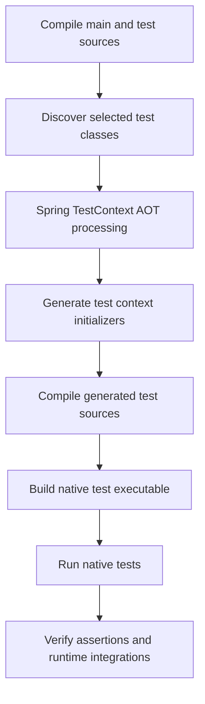

# How Spring TestContext AOT Discovers, Processes, and Generates Contexts for Tests

## 1. Why Does Spring TestContext Need Dedicated AOT?

The Spring TestContext Framework creates an ApplicationContext for tests based on test class metadata. This metadata can come from `@ContextConfiguration`, `@SpringBootTest`, `@WebMvcTest`, `@DataJpaTest`, `@ActiveProfiles`, `@TestPropertySource`, `@DynamicPropertySource`, `@TestConfiguration`, and custom `ContextCustomizerFactory` implementations.

On the JVM, TestContext can build contexts dynamically while tests run. With GraalVM Native Image, contexts must be prepared ahead of time so the compiler can analyze them and build the executable. Spring TestContext AOT runs a dedicated process: discovering the selected test classes, determining the corresponding context configurations, processing context customizations within supported bounds, and generating initialization code so contexts can be created in the AOT/native environment.

In the **SPRING_BOOT_NATIVE_IMAGE** module, TestContext AOT should be understood as part of the build pipeline. It is not simply re-running JVM tests with a different flag. This process must know which tests need support, which contexts are used, and which configurations must remain fixed so initializers can be generated.

The lesson follows the flow: test class discovery → metadata analysis → context model creation → initializer/attributes generation → native test compilation → running tests on the executable.

## 2. What Inputs Does TestContext AOT Process?

The Spring TestContext Framework builds a context from a set of metadata. Common inputs include:

| Input | Role |
|---|---|
| Test class | The test class that requires a context |
| Context configuration | Specifies configuration classes, initializers, or locations |
| Boot test annotation | Determines how to launch the application and the context type |
| Active profiles | Selects active profiles and corresponding configurations |
| Test property sources | Adds or overrides properties for the test context |
| Context customizers | Customizes the context before refresh |
| Context loader | How the ApplicationContext is created |
| Parent context | Hierarchical context relationship, if any |
| Bean overrides/mocks | Replaces beans for testing according to framework/version mechanisms |
| Test configuration | Beans/configurations used only in tests |

TestContext AOT must analyze configurations that are stable enough to create contexts at build time. Inputs that depend on data only available during test execution or that construct arbitrary context structures may be incompatible with code generation.

## 3. Distinguishing Test Discovery from Test Execution

There are two separate activities:

- **Test discovery for AOT:** the build tool locates the test classes to process and passes their metadata to the Spring TestContext AOT pipeline.
- **Test execution:** test methods actually run, evaluate assertions, and interact with the ApplicationContext.

AOT discovery does not mean test methods have been executed. Conversely, a test passing on the JVM does not guarantee that the test class was included in AOT processing.

For example, Maven Surefire or the Gradle test task may discover tests for JVM execution. Spring TestContext AOT may use a separate set of test classes and tasks to generate context initializers. You must inspect your project's build lifecycle to see which task performs each step.

## 4. How TestContext Recognizes Test Class Metadata

The TestContext Framework reads annotations on the test class and its superclasses/enclosing configurations according to framework rules. Example:

```java
@SpringBootTest
@ActiveProfiles("native-test")
@TestPropertySource(properties = {
        "orders.feature.enabled=true"
})
class OrderServiceIntegrationTest {
}
```

From this class, the framework can determine:

- Use Spring Boot to create the context.
- The `native-test` profile is active.
- Test properties are added.
- The Boot application/configuration needs to be located and loaded.
- Relevant customizers/initializers need to be applied.

TestContext AOT analyzes that metadata to prepare the context. Accurate discovery also depends on whether the test class is included in the AOT test classes list and falls within the build configuration scope.

Annotations on a source file alone are not enough; the test class must be compiled and supplied by the build tool/plugin to the AOT processor.

## 5. Common Test Annotations

| Annotation | Meaning in Test Context |
|---|---|
| `@SpringBootTest` | Creates a context based on the Spring Boot application |
| `@ContextConfiguration` | Specifies configuration sources or a context loader |
| `@ActiveProfiles` | Fixes active profiles for the context |
| `@TestPropertySource` | Provides property sources for the test |
| `@WebMvcTest` | Creates a slice context focused on MVC |
| `@DataJpaTest` | Creates a slice context focused on JPA |
| `@Import` | Adds configurations/components into the context |
| `@TestConfiguration` | Declares additional configuration dedicated to tests |
| `@DynamicPropertySource` | Registers dynamic properties via a static method |
| `@DirtiesContext` | Marks the context to be evicted from cache after the test |

Not all annotations have the same level of support in AOT/native tests across every version. In particular, custom context loaders, context customizers, or properties computed from runtime state must be verified against your Spring Framework/Spring Boot version.

## 6. From Test Class to Generated ApplicationContext Initializer

Conceptually, TestContext AOT performs these steps:

1. Receives the list of test classes to process.
2. Reads test metadata and determines context configurations.
3. Creates or prepares an ApplicationContext suitable for analysis.
4. Processes bean definitions, customizers, and configurations within supported limits.
5. Generates Java code to initialize the corresponding context.
6. Writes metadata linking the test class to the generated initializer.
7. Builds the test/native artifact that uses that initializer at runtime.

The generated code allows Native Image to see the context structure and initialization calls in the build graph. The compiler can analyze reachability of beans and dependencies instead of relying solely on dynamic discovery when tests run.

Class names, packages, and generated output directories are implementation details that can change across Spring versions and build plugins. Do not write application code that directly depends on internal generated initializer names unless the framework commits to them as public API.

## 7. What Is the Role of a Generated Initializer?

A generated initializer represents the context configuration for a test class or an equivalent group of contexts. When tests run in AOT mode, TestContext can use this initializer to create the prepared context.

Conceptual illustration:

```java
// Illustrative pseudocode, not fixed generated source
final class OrderServiceTestContextInitializer {

    void initialize(GenericApplicationContext context) {
        // Register bean definitions and configurations prepared by AOT
    }
}
```

This is only a conceptual model. Actual generated code is produced by Spring AOT and has a version-specific structure. Do not manually create a mock class named like this expecting TestContext to discover it automatically.

The initializer reduces reliance on some introspection/runtime processing steps. It does not turn the entire test environment static: test methods still run, assertions still execute, and runtime dependencies such as databases/containers still must be provided.

## 8. AOT Attributes and Test-Associated Data

Some test configurations need data prepared during the AOT phase and read back during test execution. Spring TestContext AOT provides an attributes mechanism to store values suitable for this process. Specific APIs and access patterns depend on the Spring Framework version.

The key distinction is between:

- Structural metadata needed to create the context.
- Runtime data supplied by the test during execution.
- Values known only after test containers/services start.
- Secrets or ephemeral endpoints that should not be frozen into the generated artifact.

For example, a Testcontainers database gets a random port that exists only at test execution time. Do not assume an AOT build can know that port ahead of time. Instead, use mechanisms supported by TestContext/native testing to supply runtime properties, or design integration tests with runtime-configurable endpoints.

Do not store credentials or sensitive data in generated attributes/source. Generated output may be packaged and archived in CI artifacts.

## 9. Profiles and Properties Must Be Consistent Between AOT and Test Runtime

TestContext AOT must construct contexts according to the chosen structural configuration. Example:

```java
@SpringBootTest
@ActiveProfiles("native-test")
@TestPropertySource(properties = {
        "payment.provider=stub",
        "search.enabled=false"
})
class PaymentFlowNativeTest {
}
```

If `payment.provider` or `search.enabled` is used in conditions to select beans, those values affect the bean graph. AOT must process the context with the same structural values.

Another property such as `inventory.base-url` might only be a runtime value injected into an existing bean. That URL value can be supplied when the test runs if the application design does not use it to decide bean registration.

Before running AOT, build a table:

| Property | How It Is Used | When It Must Be Fixed |
|---|---|---|
| `spring.profiles.active` | Selects configuration | AOT/context creation |
| `payment.provider` | `@ConditionalOnProperty` | AOT/context creation |
| `search.enabled` | Determines whether a bean exists | AOT/context creation |
| `inventory.base-url` | Value injected into a client | Runtime if the bean graph does not change |
| `test.datasource.url` | Connects to the test database | Runtime if the endpoint is supplied after the database is ready |

If JVM tests and AOT use different properties, the two contexts may not be equivalent. Check the actual property sources reaching the AOT process, not just the annotations on the test class.

## 10. Context Caching and Multiple Test Classes

The Spring TestContext Framework caches ApplicationContexts to avoid recreating contexts for test classes that share the same configuration. Test classes with different metadata can produce different contexts.

In AOT, each context configuration must be processed according to framework rules. If a test suite has too many profile/property/customizer variations, the number of contexts to analyze and generated outputs can grow significantly.

Group tests by context intentionally:

- Share profiles and structural properties when the bean graph is the same.
- Separate test classes only when a different configuration is genuinely needed.
- Avoid creating unnecessary property variations per test class.
- Limit custom context customizers used merely for arbitrary structural tweaks.
- Record the context configurations processed by AOT.

Do not force tests with different bean graphs into the same context just to reduce the number of initializers. Doing so may prevent the test from reflecting the configuration under test.

## 11. Test Slices vs. Full ApplicationContext

Spring Boot test slices such as `@WebMvcTest` or `@DataJpaTest` create smaller contexts than a full `@SpringBootTest`. They help test a single layer, but they have their own auto-configuration and bean graphs.

Example:

```java
@WebMvcTest(OrderController.class)
class OrderControllerTest {
}
```

This test does not create the full application context like `@SpringBootTest`. If the goal is to verify the native executable of the full application, add integration tests on the full context or black-box HTTP tests.

If you want to use test slices in a native test workflow, confirm that your Spring Boot/Spring Framework version and plugin support that test type. Do not assume that every test slice that runs on the JVM is automatically supported identically by TestContext AOT in native mode.

## 12. Context Customizers and Dynamic Configuration

TestContext allows extending context creation with customizers, initializers, and property suppliers. These extensions can make the context depend on arbitrary Java logic.

For example, `@DynamicPropertySource` is commonly used to register container URLs/ports:

```java
@DynamicPropertySource
static void databaseProperties(DynamicPropertyRegistry registry) {
    registry.add("spring.datasource.url",
            postgres::getJdbcUrl);
}
```

The supplier can only return the endpoint once the container is running. Therefore, distinguish between AOT analyzing the context structure and runtime supplying dynamic values. Certain customizers/initializers may not be supported in AOT if they require executing logic that cannot be described or generated into code.

When encountering an error, determine whether the customizer alters the bean graph or only provides a runtime value. If it is only a runtime endpoint, use the appropriate test support mechanism to supply it at runtime. If it creates arbitrary bean definitions from data unknown at build time, simplify the configuration or exclude that test from AOT/native scope.

## 13. Tests Unsuitable for AOT/Native Mode

Some tests that rely on dynamic behavior or arbitrary context structural changes may not run in AOT/native mode. Examples:

- Tests that manually build an ApplicationContext using custom logic outside TestContext support.
- Custom context loaders relying on dynamic classpath scanning.
- Context customizers generating bean definitions from data available only when test methods run.
- Tests relying on loading new plugin classes after the executable has been built.
- Tests changing structural profiles/properties after AOT has generated the initializer.
- Tests using mocking/bytecode generation frameworks incompatible with native mode.

Not every test with `@MockBean` or dynamic properties is inherently incompatible; support varies by Spring Boot version and bean override mechanism. Check your exact version, run the test individually, and read the specific error before excluding a test.

Spring Framework provides annotations such as `@DisabledInAotMode` in supported versions, allowing you to mark a test class to be skipped in AOT mode with an appropriate reason. Only use it when a test genuinely cannot be supported in the native workflow; do not use it to hide configuration errors or skip critical tests without an alternative.

## 14. Running TestContext AOT Through Build Tools

Spring Boot and Native Build Tools provide dedicated tasks/goals for AOT processing and native tests. Exact names depend on the version and configured plugins.

With Gradle, a project may expose tasks such as `processTestAot` and `nativeTest` when supported by the plugin/version. With Maven, the Spring Boot Maven Plugin provides a goal to process test AOT in corresponding versions; native test execution also depends on Native Build Tools and project configuration.

Do not copy commands from another project without verifying that the task exists:

```bash
./gradlew tasks --all
./mvnw help:describe -Dplugin=org.springframework.boot:spring-boot-maven-plugin
```

Then verify the actual lifecycle, plugin versions, and documentation for that exact version. A build may run AOT processing automatically as a dependency of the native task, or require invoking a separate task. Logs must show that test AOT processing actually took place.

## 15. Distinguishing processAot and processTestAot

Spring Boot AOT for the application and TestContext AOT for tests have different targets:

| Process | Target Processed | Output |
|---|---|---|
| Application AOT | Application's ApplicationContext | Generated application initialization |
| Test AOT | Context configurations of test classes | Generated test context initializers/metadata |
| Native application build | Application output + AOT output | Native application executable |
| Native test build/run | Test code and test AOT support per plugin | Corresponding test executable/test runtime |

A passing application AOT build does not prove that TestContext AOT processed the test classes. Conversely, passing test AOT does not replace application AOT when building the production executable.

Check the logs and task graph to verify that both pipelines run when required by the project.

## 16. Inspecting Generated Test Output

After TestContext AOT runs, inspect the generated source/resource files in the build output directory used by the plugin/version. Questions to check:

- Was the expected test class included in AOT processing?
- Is there a corresponding initializer/metadata for the context?
- Were profiles/properties recorded accurately?
- Are there warnings or excluded test classes?
- Did any customizer/initializer cause errors or lack support?
- Was the generated source compiled into the correct test/native build output?

Generated output paths can differ between Maven and Gradle, as well as across Spring versions. Use task output/logs to locate the actual directory. Do not edit generated files manually; fix the test metadata or source configuration and re-run AOT.

## 17. Testing the Context After Initializer Generation

After AOT processing, run tests in the mode that uses the generated context initializer provided by the plugin/framework. The goal is to confirm the context is created from AOT output, rather than merely re-running a regular JVM context.

Verification steps:

1. Confirm the active task/test mode enables AOT.
2. Check logs showing the AOT-generated initializer is used.
3. Run a test class with fixed profiles/properties.
4. Assert required beans exist and unwanted beans are absent.
5. Call services/endpoints to verify dependency wiring.
6. Verify the test does not silently fall back to the standard JVM context loader.

If the plugin has a dedicated task for native tests, run that task after AOT generation succeeds. Running only `test` on the JVM does not prove the test uses a native executable or generated initializer.

## 18. Native Test Execution and TestContext AOT

Native tests require an executable built with test code and the necessary context initializers/metadata. When tests run, the framework still executes test methods and assertions, while the context is prepared according to the AOT model.

A high-level workflow:



Task names and automation levels vary by build tool/plugin version. To verify genuine native execution, confirm that the test runs inside the native test executable rather than only the JVM test task.

External dependencies such as Testcontainers, databases, message brokers, or mock services still require an appropriate runtime environment. Native tests do not automatically provision databases/containers simply because context initializers were generated.

## 19. Diagnosing TestContext AOT Failures

| Symptom | Possible Cause | Investigation Steps |
|---|---|---|
| Test class has no generated initializer | Not discovered or not in AOT test set | Check test source sets, includes/excludes, and tasks |
| JVM test passes but AOT processing fails | Context customization unsupported or unstable metadata | Identify the customizer/initializer and properties |
| Generated context is missing a bean | AOT used different profiles/conditions | Inspect structural inputs |
| AOT passes but native test startup fails | Runtime dependency/resource/JNI or initialization issue | Read the native stack trace and runtime environment |
| Dynamic property has no value | Supplier is only ready after container startup | Check lifecycle and runtime property binding |
| Test slice does not run natively | Context type/test support incompatible | Check version support, replace with a suitable integration test |
| Test skipped in AOT mode | Annotated with `@DisabledInAotMode` or excluded | Verify the reason and alternative tests |
| Test runs without using generated context | Wrong task/mode or JVM fallback | Inspect logs and test execution path |

Do not conclude an error lies in TestContext AOT solely from a startup stack trace. Distinguish between discovery, context preparation, generated source compilation, native image build, and runtime execution.

## 20. Hands-on Exercise: Generating Context for OrderServiceIntegrationTest

**Scenario:** Order API has a `native-test` profile, a mock payment gateway, and a property toggling search integration. The goal is to generate the test context and run it natively.

**Step 1 — Standardize test metadata.** Add `@SpringBootTest`, `@ActiveProfiles("native-test")`, and fixed structural properties on the test class.

**Step 2 — Define the context contract.** List required beans, beans that must be absent, and implementations injected into the service.

**Step 3 — Run the JVM context test.** Use `@SpringBootTest` to verify profiles, conditions, bean wiring, and basic behavior.

**Step 4 — Configure TestContext AOT.** Identify the task/goal for your Spring Boot version, include the test class in AOT processing, and pass the correct structural properties.

**Step 5 — Inspect generated output.** Confirm the test class was processed, initializers/metadata were generated, and generated sources compiled.

**Step 6 — Run tests with the AOT context.** Use the corresponding test mode/plugin support and verify the context is created from the generated initializer.

**Step 7 — Build and run native tests.** Run the native test task or corresponding native workflow; confirm the executing process is the native test executable.

**Step 8 — Verify runtime integration.** Supply test databases/services, dynamic endpoints, and required resources; run assertions against fixtures.

**Step 9 — Document limitations.** Record any unsupported test classes, reasons for exclusion, and replacement integration/black-box tests.

Completion criteria: the test class is discovered; context metadata is processed with fixed profiles/conditions; generated initializer is created and used; native test executable runs assertions; external dependencies are provisioned with the right lifecycle.

## 21. Conclusion

Spring TestContext AOT discovers selected test classes, analyzes context metadata, and generates initializers/metadata so contexts can be created in AOT/native mode. This process depends on test annotations, profiles, property sources, context customizers, and build tool/plugin versions.

Distinguish test discovery from test execution, application AOT from test AOT, and JVM context tests from native test execution. Fix structural inputs, verify generated output is created and used, and run the native test executable with proper runtime dependencies. When a test relies on dynamic context structures that cannot be supported, document the limitation and build alternative tests for critical behavior rather than treating a JVM test pass as proof of native compatibility.
