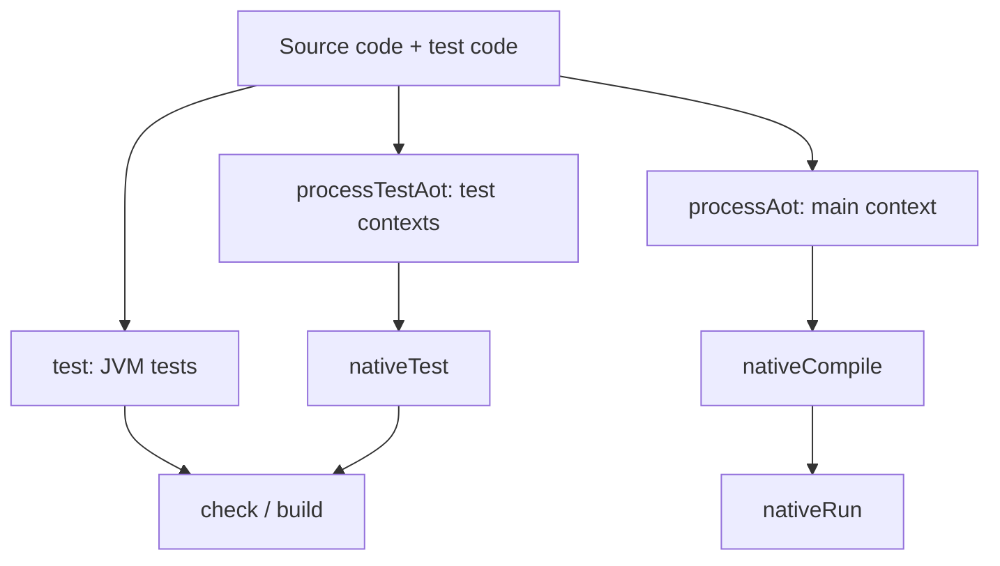
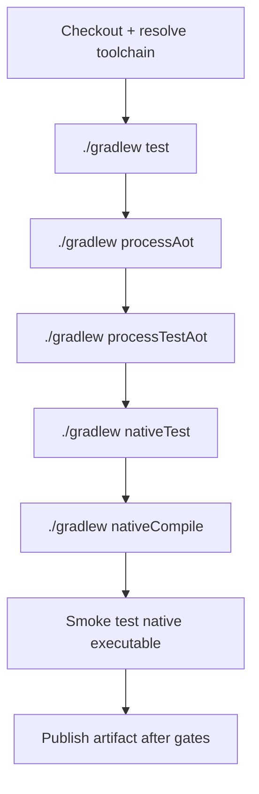
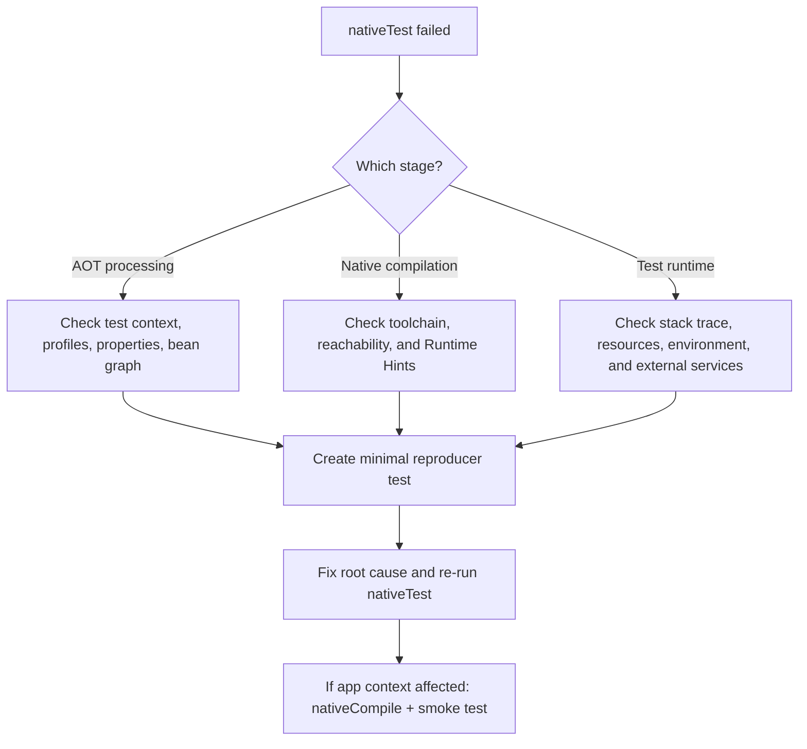

# processTestAot, nativeTest, and Related Tasks in Gradle

When testing Spring Boot on GraalVM Native Image, passing the JVM test suite alone is not enough. The JVM can perform reflection or read resources without corresponding native metadata; a native executable only works with classes, members, and resources retained during the build.

In Gradle, different tasks serve distinct roles:

- `processAot` prepares the main application's ApplicationContext.
- `processTestAot` prepares the ApplicationContexts used in tests.
- `nativeCompile` builds the application's native executable.
- `nativeTest` compiles and runs tests in the Native Image environment.
- `nativeRun` runs the application's native executable.

Understanding the boundaries between these tasks helps determine what a test is verifying, why a test passes on the JVM yet fails natively, and which step to re-run when changing test configuration or Runtime Hints.

This lesson belongs to the **Native Testing** chapter of the `SPRING_BOOT_NATIVE_IMAGE` module. We will configure Gradle Native Build Tools, distinguish main/test AOT, inspect the task graph, run `nativeTest`, verify the executable with `nativeRun`, and build a pipeline capable of diagnosing test failures.

## 1. Gradle Task Map

The Spring Boot Gradle Plugin and GraalVM Native Build Tools add tasks for two distinct phases: preparing AOT contexts and compiling/running the native image.

| Task | Provided By | Role |
| --- | --- | --- |
| `test` | Gradle Java plugin | Runs unit tests and integration tests on the JVM |
| `processAot` | Spring Boot Gradle Plugin | Analyzes the main ApplicationContext and generates AOT assets |
| `processTestAot` | Spring Boot Gradle Plugin | Analyzes test ApplicationContexts and generates AOT assets for tests |
| `bootJar` | Spring Boot Gradle Plugin | Packages the application as an executable JAR |
| `nativeCompile` | GraalVM Native Build Tools | Compiles the application's native executable |
| `nativeRun` | GraalVM Native Build Tools | Runs the built native executable |
| `nativeTest` | GraalVM Native Build Tools | Compiles and runs tests using Native Image |
| `check` | Gradle Java plugin | Aggregates verification checks attached to the lifecycle |
| `build` | Gradle Base/Java plugin | Builds the project and runs verification tasks wired into the lifecycle |

Task names and how plugins wire dependencies can vary by version. Confirm your project's actual task graph using `tasks --all` and `--dry-run`, rather than inferring it solely from task names.



This diagram illustrates logical roles, not a claim that every project has an identical task dependency graph. Plugins may auto-wire tasks; custom configurations can alter those relationships.

## 2. Gradle Plugin Configuration

A Spring Boot project using Groovy DSL can declare the plugins as follows:

```groovy
plugins {
    id 'java'
    id 'org.springframework.boot' version '3.x.y'
    id 'io.spring.dependency-management' version '1.x.y'
    id 'org.graalvm.buildtools.native' version '0.x.y'
}

group = 'com.example'
version = '1.0.0'

java {
    toolchain {
        languageVersion = JavaLanguageVersion.of(21)
    }
}

dependencies {
    implementation 'org.springframework.boot:spring-boot-starter-web'
    testImplementation 'org.springframework.boot:spring-boot-starter-test'
}

tasks.named('test') {
    useJUnitPlatform()
}
```

The version strings `3.x.y`, `1.x.y`, and `0.x.y` are placeholders for compatible versions chosen by the project. Do not use these illustrative strings verbatim in a real build. Spring Boot, Gradle, GraalVM JDK, and Native Build Tools must fall within a supported version compatibility matrix.

With Kotlin DSL, the equivalent structure is:

```kotlin
plugins {
    java
    id("org.springframework.boot") version "3.x.y"
    id("io.spring.dependency-management") version "1.x.y"
    id("org.graalvm.buildtools.native") version "0.x.y"
}

tasks.test {
    useJUnitPlatform()
}
```

Native Build Tools requires a compatible GraalVM Native Image toolchain. Check the JDK actually used by Gradle, not just the default JDK in your terminal:

```bash
./gradlew --version
java -version
native-image --version
```

The Gradle daemon may continue using a JDK from an earlier startup. If you just changed JAVA_HOME/toolchain, stop the daemon and check again to avoid environment mismatches:

```bash
./gradlew --stop
./gradlew --version
```

## 3. Distinguishing processAot and processTestAot

Both tasks use Spring AOT, but they analyze two different contexts.

### 3.1. processAot: Main Application Context

`processAot` initializes a context using the application configuration supplied to AOT, processes component scanning, configuration, auto-configuration, and conditions, and generates the sources/resources needed to recreate the context.

This task focuses on what the application needs in production: bean definitions, factory/registration code, and runtime hints provided by Spring or AOT contributions.

Run standalone:

```bash
./gradlew processAot
```

This task does not run the full test suite and does not build a native executable itself. It prepares inputs for the native build step.

### 3.2. processTestAot: Contexts Used by Tests

Spring tests often create ApplicationContexts that differ from the production context. For example:

- Tests using `@SpringBootTest` with the `test` profile.
- Tests declaring `@TestConfiguration` or `@Import` test fixtures.
- Tests replacing beans with mocks or test-specific implementations.
- Tests with their own property sources, active profiles, or context customizers.

`processTestAot` analyzes these test contexts and generates AOT assets for tests. This allows tests to be compiled and run in the native environment with the appropriate context structure.

Run standalone:

```bash
./gradlew processTestAot
```

Do not confuse test AOT with native tests: `processTestAot` prepares contexts, whereas `nativeTest` executes tests inside a Native Image.

### 3.3. Quick Comparison

| Question | `processAot` | `processTestAot` |
| --- | --- | --- |
| Which context is analyzed? | Main application context | Test application contexts |
| Are test fixture beans considered? | Not the primary target | Yes, if part of a discovered test context |
| Does changing test profiles affect it? | Not necessarily | Can affect it directly |
| Builds a native executable? | No | No |
| Replaces `nativeTest`? | No | No |

A test passing on the JVM does not mean its test context has been prepared for native execution. When tests depend on specialized configurations, inspect `processTestAot` and the test AOT environment.

## 4. Verifying the Project Task Graph

Before running a long pipeline, verify that Gradle recognizes the required tasks:

```bash
./gradlew tasks --all
```

Look for these tasks:

- `processAot`
- `processTestAot`
- `nativeCompile`
- `nativeRun`
- `nativeTest`

Inspect a specific task:

```bash
./gradlew help --task processTestAot
./gradlew help --task nativeTest
```

Preview which tasks will execute without running them:

```bash
./gradlew nativeTest --dry-run
```

`--dry-run` is useful for inspecting the dependency graph. To see which tasks actually ran or were up-to-date, use:

```bash
./gradlew nativeTest --info
```

Do not manually add `dependsOn("processTestAot")` just to see the task appear in logs. First check whether your plugin version already wires the tasks automatically. If the task graph omits AOT test processing while tests require an AOT context, consult the documentation for your exact version and configure the proper integration. Manually adding an incorrect dependency can introduce circular dependencies or run AOT with the wrong classpath.

## 5. Creating an AOT-Analyzable Test Context

Example of an application with a service and a test using a Spring Boot context:

```java
package com.example.orders;

import org.springframework.stereotype.Service;

@Service
public class OrderService {

    public String status(String orderId) {
        return "accepted:" + orderId;
    }
}
```

Test:

```java
package com.example.orders;

import org.junit.jupiter.api.Test;
import org.springframework.beans.factory.annotation.Autowired;
import org.springframework.boot.test.context.SpringBootTest;

import static org.assertj.core.api.Assertions.assertThat;

@SpringBootTest
class OrderServiceContextTests {

    @Autowired
    OrderService orderService;

    @Test
    void loadsServiceFromApplicationContext() {
        assertThat(orderService.status("ORD-100"))
                .isEqualTo("accepted:ORD-100");
    }
}
```

This is a straightforward test context: the bean is retrieved from the Spring context and invoked according to its behavioral contract. When `processTestAot` runs, Spring analyzes the test configuration to prepare the corresponding context.

For real-world tests, consider:

- `@ActiveProfiles` and property sources used by the test.
- `@TestConfiguration`, `@Import`, and bean overrides.
- Dynamic property sources or values available only at test runtime.
- Testcontainers, random ports, and external services.
- Mocking frameworks or libraries relying on dynamic proxies/reflection.
- Tests requiring filesystem/network access not provided by the native test environment.

Not every JVM test is suitable for running natively. Categorize tests by purpose: pure logic tests can stay on the JVM; tests covering contexts, serialization, and critical hints need native coverage; tests requiring special environments must be explicitly configured.

## 6. Profiles and Properties in Test AOT

A test context can use a dedicated profile:

```java
import org.springframework.boot.test.context.SpringBootTest;
import org.springframework.test.context.ActiveProfiles;

@SpringBootTest
@ActiveProfiles("test")
class OrderRepositoryTests {
    // ...
}
```

If a profile affects the bean graph, ensure AOT processing and test execution share the same assumptions. A bean excluded by `@Profile` or `@ConditionalOnProperty` during AOT will not magically appear just because runtime tests pass a different property.

Test properties can be declared on the annotation:

```java
import org.springframework.boot.test.context.SpringBootTest;

@SpringBootTest(properties = {
        "feature.audit.enabled=true",
        "app.rules.source=classpath:test-rules.json"
})
class AuditContextTests {
    // ...
}
```

Or via an `application-test.yaml` file in test resources. Pick a reproducible configuration source and verify it is read during both AOT processing and native tests.

If you use task configuration to pass arguments to AOT, check the task API in your Spring Boot version. Do not copy configuration from a different Gradle plugin version without checking the actual task type and inputs.

## 7. Running nativeTest

After configuring GraalVM Native Build Tools and the test source set, run:

```bash
./gradlew nativeTest
```

This task compiles the test suite into a native test executable and runs the tests in the Native Image environment. It can take considerable time due to native compilation; subsequent runs may be faster if Gradle build cache and incremental state remain valid.

Native tests uncover issues that JVM tests cannot catch, such as:

- Missing reflection metadata.
- Unpackaged resources.
- Proxies or serialization requiring metadata.
- Certain classes/constructors not being retained.
- Differences when initializing the Spring test context in the native runtime.

Read the logs to confirm the test executable was built and executed. A skipped, disabled, or zero-test-discovered task run must not be treated as a native test pass.

### 7.1. Running a Small Test Subset First

When investigating failures, narrow the test scope using options supported by your Gradle task/plugin version. For JVM tests, for example:

```bash
./gradlew test --tests "com.example.orders.OrderServiceContextTests"
```

The native test task does not necessarily accept all the same filter options as Gradle's `Test` task across every Native Build Tools version. Run `help --task nativeTest` before using `--tests` or custom filters. If the plugin does not support filtering as desired, separate test source sets or configure dedicated test groups in the build.

Do not start with the entire native test suite when you only need to verify a new registrar. Run registrar unit tests/JVM behavior tests first, then run a minimal meaningful native test.

## 8. Distinguishing nativeTest from nativeCompile and nativeRun

These three tasks verify three different goals:

| Task | Artifact Built/Run | Question Answered |
| --- | --- | --- |
| `nativeTest` | Native executable containing test code/test runner | Do the selected tests run inside Native Image? |
| `nativeCompile` | Application's native executable | Does the production application compile into a native executable? |
| `nativeRun` | Runs the application executable | Does the native application start and handle smoke-test flows? |

Run sequentially:

```bash
./gradlew nativeCompile
./gradlew nativeRun
```

`nativeTest` does not replace `nativeCompile`: the test executable and the main application executable have different purposes and inputs. Conversely, a successful `nativeCompile` does not prove the test suite passed natively.

`nativeRun` typically starts the application with runtime configuration defined by the task/plugin. If you need to test real endpoints or databases, run the binary in a separate terminal/container and verify via an HTTP client or integration test harness. Do not treat simply printing "Started" as proof that all features work.

## 9. Choosing Tasks by Goal

Common command sequences:

**Verify test logic on the JVM:**

```bash
./gradlew test
```

**Verify main AOT:**

```bash
./gradlew processAot
```

**Verify test AOT:**

```bash
./gradlew processTestAot
```

**Run the native test suite:**

```bash
./gradlew nativeTest
```

**Build and run the native application:**

```bash
./gradlew nativeCompile
./gradlew nativeRun
```

**Run the verification lifecycle:**

```bash
./gradlew check
```

`check` only runs verification tasks attached to the lifecycle. Do not assume `check` automatically runs `nativeTest` in every project. If CI requires native tests, invoke the task explicitly or configure lifecycle wiring intentionally after checking the task graph.

## 10. Inspecting AOT and Native Test Output

Output directories vary by Gradle/Spring Boot plugin version and project setup. Common locations include:

```text
build/
├── generated/
│   ├── aotSources/
│   ├── aotResources/
│   └── aotClasses/
├── native/
│   └── ...
└── ...
```

Do not rely solely on a sample directory tree to conclude a task did not run. Use `--info` logs, task outputs, and Gradle task properties to locate where outputs are written.

Checks to perform:

1. Did `processAot` generate main context output?
2. Did `processTestAot` process test contexts?
3. Did `nativeTest` compile the test executable?
4. Do native test reports show that tests actually executed?
5. Was the executable built for the right OS/architecture?

You can search for class/bean names inside generated sources for diagnostics, but do not write tests that depend on generated class names or exact file counts. Generated output is a diagnostic tool; behavioral contracts are what must be protected long-term.

## 11. Test Contexts with External Dependencies

Native tests can face hurdles when tests depend on external services or resources available only in CI environments.

Examples:

- Testcontainers requiring a Docker daemon and compatible images.
- Tests using random ports needing to avoid hardcoded port assumptions.
- Tests calling external APIs requiring credentials/network access.
- Tests depending on filesystem paths on a developer's machine.
- Tests using mocking frameworks that generate dynamic proxies/reflection.
- Tests depending on custom threads, processes, or native libraries.

Approaches:

- Use reproducible service containers/test fixtures in CI.
- Inject endpoints/credentials via runtime test configuration.
- Use dynamic ports and retrieve the actual port from the test context.
- Avoid calling production services during AOT processing.
- If a test is not meaningful natively, classify it clearly and keep it in the JVM test suite while maintaining native coverage for critical production paths.
- For tests requiring JNI/native dependencies, supply the right libraries matching the runner's OS/architecture.

Do not disable all native tests simply because one integration test needs a specialized environment. Separate test groups and document the reason so remaining native checks continue running.

## 12. Example CI Task Flow

A Gradle pipeline can be structured in order:



This is a conceptual flow. In a real project, one task may pull in another via the dependency graph; if so, avoid redundantly re-running the same step. Use `--dry-run` and build scans/logs to see which tasks executed, which were up-to-date, and which were skipped.

A CI setup can separate fast and slow jobs:

| Job | Work | When Run |
| --- | --- | --- |
| JVM verification | `test`, `check` | Every pull request |
| AOT verification | `processAot`, `processTestAot` | When configuration, beans, test contexts, or frameworks change |
| Native tests | `nativeTest` | Key pull requests or nightly depending on cost |
| Native app build | `nativeCompile` | Release candidates or when native artifact verification is needed |
| Runtime smoke | Run executable/container and call endpoints | Before release |

If native compilation times are long, use caching and tiered pipelines, but do not drop native tests from every release cycle.

## 13. Common Errors

| Symptom | Causes to Check | Resolution |
| --- | --- | --- |
| `processTestAot` not found | Spring Boot plugin not applied or version/config lacks the task | Check plugins block and `tasks --all` |
| `nativeTest` not found | Native Build Tools plugin missing or incompatible plugin version | Check plugin ID/version and Gradle task list |
| `processTestAot` fails initializing context | Test profile/properties/fixture or side effects running during AOT | Check logs, active profiles, and test configuration |
| JVM test passes but nativeTest fails | Missing reflection/resource/proxy metadata or native-only behavior | Read native stack trace, check hints, and verify dependency metadata |
| nativeTest runs zero tests | Test filter/source set/engine not recognized | Check task inputs, test engine, and reports |
| nativeTest build is very slow | Resource-heavy native compilation or missing cache | Run smaller test scope, check toolchain/cache and runner sizing |
| nativeCompile passes but nativeRun fails | Missing runtime config, files, ports, loader paths, or service dependencies | Run binary with production-like config and inspect logs |
| nativeTest passes but native app fails | Test executable does not cover main application packaging/runtime | Run nativeCompile and smoke/integration tests on the executable |
| AOT task runs with wrong profile | AOT process and test runtime use different configs | Align test profiles/properties and check task arguments |
| Task skipped or UP-TO-DATE | Inputs unchanged or task graph omits the desired task | Inspect `--info`, `--dry-run`, outputs, and task dependencies |

## 14. Workflow for Investigating nativeTest Failures

When `nativeTest` fails, do not rush to add Runtime Hints for every class. Follow this sequence:

1. Determine whether the failure occurred during compilation, native image generation, or executable execution.
2. Read the first error in the log; later errors may just be cascading effects.
3. If it failed in AOT, inspect the test context, profiles, properties, and bean definitions.
4. If it failed in native compile, inspect reachability, reflection/resource/proxy/serialization metadata, and toolchain.
5. If it failed during test execution, inspect the native stack trace, resource paths, environment, and external dependencies.
6. Run the corresponding test on the JVM to determine whether it is a business-logic bug or a native difference.
7. Create a minimal test reproducing the issue and fix the root cause.
8. Re-run the relevant native tests, then run the main native executable if the change affects the production context.



## 15. Gradle Native Testing Checklist

- [ ] Spring Boot Gradle Plugin and GraalVM Native Build Tools are applied with compatible versions.
- [ ] Gradle uses the target-appropriate GraalVM JDK/toolchain.
- [ ] `test` runs the JVM suite successfully.
- [ ] `processAot` processes the main application context.
- [ ] `processTestAot` processes test contexts and test profiles properly.
- [ ] The `nativeTest` task graph is verified via `--dry-run` or `--info`.
- [ ] Native tests actually compile and execute tests, without being skipped or finding zero tests.
- [ ] Test fixtures, properties, profiles, and external services have reproducible configurations.
- [ ] Runtime Hints are added only after identifying specific missing dynamic access.
- [ ] Native test reports are saved and inspected.
- [ ] `nativeCompile` is run when the main executable needs verification.
- [ ] `nativeRun` or executable/container smoke tests verify critical runtime flows.
- [ ] CI records OS/architecture/GraalVM/Gradle/Spring Boot versions for the artifact.

### Self-Assessment Questions

1. Which two types of ApplicationContext do `processAot` and `processTestAot` analyze?
2. Why does `processTestAot` not replace `nativeTest`?
3. How does `nativeTest` differ from `nativeCompile` in terms of produced artifact and testing goal?
4. When should `--dry-run` and `--info` be used to inspect the task graph?
5. Why must a test context using `@ActiveProfiles("test")` be configured consistently across AOT processing and native tests?
6. Why does a passing `nativeTest` run not prove the main application executable works correctly in a production container?
7. If `nativeTest` runs zero tests, what should be checked before concluding it passed?
8. When a test depends on Testcontainers or native libraries, what must be prepared for the CI runner?

## References

- [Spring Boot Gradle Plugin — AOT tasks](https://docs.spring.io/spring-boot/gradle-plugin/aot.html): `processAot` and `processTestAot` tasks, and configuring AOT in Gradle.
- [Spring Boot — Testing Native Applications](https://docs.spring.io/spring-boot/reference/packaging/native-image/testing-native-applications.html): testing applications and tests with native images.
- [GraalVM Native Build Tools — Gradle Plugin](https://graalvm.github.io/native-build-tools/latest/gradle-plugin.html): `nativeCompile`, `nativeRun`, `nativeTest` tasks and plugin configuration.
- [Gradle — Task Execution](https://docs.gradle.org/current/userguide/command_line_interface.html#sec:task_execution): inspecting the task graph, `--dry-run`, `--info`, and controlling task execution.

**Target outcome:** know how to select and coordinate `processAot`, `processTestAot`, `nativeTest`, `nativeCompile`, and `nativeRun`; verify the actual Gradle task graph; and test both the test executable and the native application. When native tests fail, categorize errors by AOT processing, native compilation, or runtime to fix the root cause instead of adding blanket metadata.
