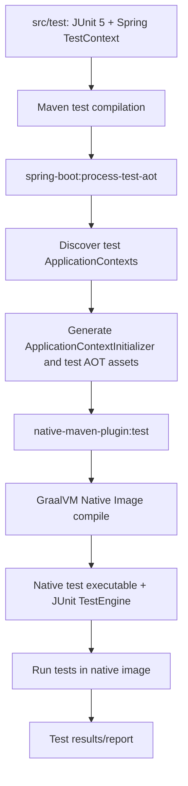

# The `nativeTest` Profile and Test AOT Configuration in Maven

## 1. Why Is a Separate Profile Needed for Native Testing?

When developing a Spring Boot Native Image, most unit tests and integration tests should still run on the JVM. The JVM offers fast build times, easy debugging, and strong IDE integration. However, some errors only surface when the application runs with AOT initialization code or is compiled into a native executable: missing reflection/resource metadata, incompatible proxies, class initialization differences, or native libraries not working as expected.

Spring Boot and GraalVM Native Build Tools support running **JUnit Platform tests inside a native image**. With Maven, `spring-boot-starter-parent` provides a profile named **`nativeTest`**. This profile connects two steps:

1. The Spring Boot Maven Plugin runs `process-test-aot` to analyze tests using the Spring TestContext Framework and generate context initialization code.
2. The GraalVM Native Build Tools Maven Plugin runs the `test` goal to build a native test executable and execute tests inside it.

Therefore, `nativeTest` is the profile dedicated to testing the test suite inside a native image. It serves a different purpose from the `native` profile, which is typically used for application AOT processing and building the application's native executable.

After this lesson, you will be able to:

- Configure the two required plugins in a Maven module.
- Activate `nativeTest` via `mvn test -PnativeTest`.
- Understand the roles of `process-test-aot` and the Native Build Tools `test` goal.
- Declare both executions manually if the project does not use `spring-boot-starter-parent`.
- Distinguish between JVM tests, JVM running AOT code, and native tests.
- Handle test-skipping flags, JUnit/Surefire versions, and multi-module build issues.

## 2. Three Testing Levels to Distinguish

Not every test in a project needs to run inside a native executable. A balanced workflow usually consists of three levels:

| Level | How It Runs | Purpose |
|---|---|---|
| Standard JVM tests | Maven Surefire runs tests on the JVM using standard runtime configuration | Broad business coverage, fast feedback, easy debugging |
| JVM with Spring AOT-generated code | Package AOT output and run JVM with `-Dspring.aot.enabled=true` | Verify AOT initialization code and build-time fixed conditions |
| Native tests | `nativeTest` triggers AOT test processing and Native Build Tools compiles/runs the test executable | Verify behavior in the actual GraalVM Native Image environment |

Spring Boot recommends keeping most tests on the JVM to reduce development time. Native tests can focus on areas prone to differences and run in CI, for example once daily or on release branches.

### 2.1. Native Test Processing Flow



During this process, Spring analyzes JUnit 5 tests that use the Spring TestContext Framework to find the required `ApplicationContext` instances. AOT processes each context and generates the corresponding `ApplicationContextInitializer`. Native Build Tools then packages the tests along with the chosen JUnit `TestEngine` into a native executable; when the executable runs, the test engine executes the discovered tests.

## 3. Prerequisites for Using the `nativeTest` Profile

### 3.1. Inheriting from `spring-boot-starter-parent`

The `nativeTest` profile is predefined in `spring-boot-starter-parent`. The project must use a parent version compatible with its current Spring Boot plugin and dependency management.

Example parent section in `pom.xml` (replace the version with the Spring Boot version your project uses):

```xml
<parent>
    <groupId>org.springframework.boot</groupId>
    <artifactId>spring-boot-starter-parent</artifactId>
    <version>4.2.0</version>
    <relativePath/>
</parent>
```

Spring Boot 3.3 also includes support for `process-test-aot` and the `nativeTest` profile; consult the documentation for your exact minor version if the project is on Boot 3.x. Do not upgrade the parent solely to obtain the profile without verifying JDK, GraalVM, and application dependency compatibility.

### 3.2. Declaring Both Plugins in the Application Module

The parent's profile only configures executions for plugins that are declared. A module that needs to run native tests must declare both:

- `org.springframework.boot:spring-boot-maven-plugin`
- `org.graalvm.buildtools:native-maven-plugin`

Minimal configuration example:

```xml
<build>
    <plugins>
        <plugin>
            <groupId>org.springframework.boot</groupId>
            <artifactId>spring-boot-maven-plugin</artifactId>
        </plugin>

        <plugin>
            <groupId>org.graalvm.buildtools</groupId>
            <artifactId>native-maven-plugin</artifactId>
            <extensions>true</extensions>
        </plugin>
    </plugins>
</build>
```

`<extensions>true</extensions>` enables the lifecycle extensions of the Native Build Tools Maven Plugin. Use the plugin versions managed by Spring Boot or your project's dependency/plugin management, and avoid declaring versions incompatible with your installed GraalVM.

### 3.3. Running Native Tests

After declaring the parent and both plugins, run:

```bash
./mvnw test -PnativeTest
```

If the machine does not have the Maven Wrapper:

```bash
mvn test -PnativeTest
```

`-PnativeTest` activates the case-sensitive profile. This command runs tests through the Maven lifecycle while triggering AOT test processing and Native Build Tools native test execution configured by the parent.

Do not confuse this with:

```bash
./mvnw -Pnative package
```

`-Pnative package` is typically used for application AOT processing and building the application native executable. `-PnativeTest test` is used to build and run the native **test executable**.

## 4. What Does `process-test-aot` Do?

### 4.1. AOT Processing of Test Contexts

`spring-boot:process-test-aot` invokes the Spring AOT engine on JUnit 5 tests that use the Spring TestContext Framework. Example:

```java
package com.example.orders;

import org.junit.jupiter.api.Test;
import org.springframework.beans.factory.annotation.Autowired;
import org.springframework.boot.test.context.SpringBootTest;

import static org.assertj.core.api.Assertions.assertThat;

@SpringBootTest
class OrderApplicationTests {

    @Autowired
    OrderService orderService;

    @Test
    void createsOrder() {
        Order order = orderService.create("SKU-100", 2);
        assertThat(order.id()).isNotBlank();
    }
}
```

Or a test slice:

```java
package com.example.orders;

import org.junit.jupiter.api.Test;
import org.springframework.beans.factory.annotation.Autowired;
import org.springframework.boot.test.autoconfigure.web.servlet.WebMvcTest;
import org.springframework.test.web.servlet.MockMvc;

import static org.springframework.test.web.servlet.request.MockMvcRequestBuilders.get;
import static org.springframework.test.web.servlet.result.MockMvcResultMatchers.status;

@WebMvcTest(OrderController.class)
class OrderControllerTests {

    @Autowired
    MockMvc mockMvc;

    @Test
    void returnsOrder() throws Exception {
        mockMvc.perform(get("/api/orders/ORD-100"))
                .andExpect(status().isOk());
    }
}
```

The Spring TestContext Framework supplies information about the context configuration, test class, customizers, and relevant annotations. The AOT engine uses that information to generate an initializer for the context. Native tests then initialize the context via the generated code.

### 4.2. Output Directories of `process-test-aot`

Per the Spring Boot Maven Plugin, default outputs are located under `${project.build.directory}/spring-aot`:

| Directory | Contents |
|---|---|
| `spring-aot/main/classes` | Generated main classes |
| `spring-aot/test/classes` | Generated test classes |
| `spring-aot/test/sources` | Generated test sources |
| `spring-aot/test/resources` | Generated test resources |

Specific paths may vary depending on plugin version or `generatedClasses`, `generatedSources`, `generatedResources`, and `generatedTestClasses` settings.

### 4.3. Which Tests Are Processed by AOT?

Support focuses on **JUnit 5 tests using the Spring TestContext Framework**. Plain JUnit tests that do not create a Spring context can still be included in the native test image via JUnit Platform, though they have no Spring context for `process-test-aot` to generate an initializer for.

Common Spring test types:

- `@SpringBootTest` for the application context.
- `@WebMvcTest`, `@WebFluxTest`, and other test slices.
- `@DataJpaTest`, `@JdbcTest`, or corresponding data slices.
- Tests using `@ContextConfiguration`, `@Import`, `@TestConfiguration`, and supported TestContext annotations.

Native tests require JUnit Platform and a compatible test engine. Native Build Tools supports JUnit Jupiter and JUnit Vintage; other engines may require dedicated native configuration. Current Native Build Tools documentation specifies a minimum of JUnit 5.8.1 / JUnit Platform 1.8.1.

### 4.4. Test Contexts and Configuration Are Fixed at Build Time

In AOT, the `BeanFactory` is prepared at build time. Bean creation conditions, profiles, and properties affecting the bean graph are evaluated at that point. Consequently:

- A profile needed by the test context must be active when `process-test-aot` runs.
- You cannot expect switching profiles when running the native test to recreate a bean already excluded from the AOT context.
- Tests requiring different context configurations must be discovered as distinct contexts during test AOT.
- Do not rely on dynamic classpath loading or adding arbitrary beans after the native test image has been built.

If you need to test multiple bean graph configurations, create distinct test contexts/build variants so each configuration is explicitly processed by AOT.

## 5. Manual Configuration Without `spring-boot-starter-parent`

If a project inherits from an internal parent or uses the `spring-boot-dependencies` BOM instead of `spring-boot-starter-parent`, the `nativeTest` profile will not exist automatically. In that case, configure the equivalent executions manually.

The example below shows the two required executions in a Maven profile:

```xml
<profiles>
    <profile>
        <id>nativeTest</id>
        <build>
            <plugins>
                <plugin>
                    <groupId>org.springframework.boot</groupId>
                    <artifactId>spring-boot-maven-plugin</artifactId>
                    <executions>
                        <execution>
                            <id>process-test-aot</id>
                            <goals>
                                <goal>process-test-aot</goal>
                            </goals>
                        </execution>
                    </executions>
                </plugin>

                <plugin>
                    <groupId>org.graalvm.buildtools</groupId>
                    <artifactId>native-maven-plugin</artifactId>
                    <extensions>true</extensions>
                    <executions>
                        <execution>
                            <id>test-native</id>
                            <phase>test</phase>
                            <goals>
                                <goal>test</goal>
                            </goals>
                        </execution>
                    </executions>
                </plugin>
            </plugins>
        </build>
    </profile>
</profiles>
```

This is a configuration template that must be adapted to your plugin versions. Without the Boot parent, you are also responsible for defaults the parent normally handles, such as the raw classpath for Native Build Tools, compatible GraalVM checks, and third-party reachability metadata. Read the Native Build Tools documentation for your version before finalizing the profile.

Activation remains:

```bash
./mvnw -PnativeTest test
```

To verify each step individually during setup, you can invoke the AOT goal directly:

```bash
./mvnw -PnativeTest spring-boot:process-test-aot
```

And invoke the native test goal:

```bash
./mvnw -PnativeTest native:test
```

Normally, use the `test` lifecycle command so Maven coordinates the proper order and runs all related steps.

## 6. Maven Surefire and JUnit Platform Compatibility

Native Build Tools uses JUnit Platform to discover tests and package the test engine into the native test executable. Versions must be mutually compatible.

### 6.1. Maven Surefire

The Native Build Tools Maven Plugin requires Maven Surefire Plugin **3.0.0 or higher** to run native tests in the currently supported mode.

Example plugin configuration:

```xml
<build>
    <plugins>
        <plugin>
            <groupId>org.apache.maven.plugins</groupId>
            <artifactId>maven-surefire-plugin</artifactId>
            <version>3.5.4</version>
        </plugin>
    </plugins>
</build>
```

Let the Spring Boot parent manage the version if the project already uses the parent. The version number in the example only illustrates declaration syntax; select a version compatible with your project's Boot, Maven, and JUnit Platform versions.

### 6.2. `junit-platform-launcher`

The native test image uses the JUnit Platform launcher to discover and register selected test engines/tests. If Surefire is too old (prior to 3.0 M4) or the dependency tree contains mismatched JUnit Platform versions, native tests may fail during discovery.

Example explicit dependency when truly needed:

```xml
<dependency>
    <groupId>org.junit.platform</groupId>
    <artifactId>junit-platform-launcher</artifactId>
    <scope>test</scope>
</dependency>
```

Do not pick an arbitrary version. Use the version managed by the JUnit BOM or Spring Boot dependency management and ensure compatibility with `junit-jupiter-engine`/`junit-vintage-engine` on the test classpath.

### 6.3. Checking the Dependency Tree

If native tests report launcher/engine errors, run:

```bash
./mvnw dependency:tree \
  -Dincludes=org.junit.platform,org.junit.jupiter,org.junit.vintage
```

Check the versions of `junit-platform-launcher`, `junit-platform-engine`, `junit-jupiter-engine`, and `junit-vintage-engine`. These components must belong to the same compatible release line.

## 7. Running Native Tests Selectively

Native compilation takes more time and resources than JVM tests. You can split test runs by purpose:

| Command | Behavior |
|---|---|
| `./mvnw test` | Runs standard JVM tests |
| `./mvnw -PnativeTest test` | Runs the JVM test lifecycle and the native test execution configured by the profile |
| `./mvnw -PnativeTest -DskipNativeTests test` | Keeps JVM tests, skips native test execution |
| `./mvnw -PnativeTest -DskipTestExecution test` | Still builds the native test image but does not run the test executable |
| `./mvnw -PnativeTest -DskipTests test` | Skips executing both JVM and native tests |
| `./mvnw -PnativeTest -Dmaven.test.skip=true test` | Skips test compilation; Spring Boot does not process test AOT when regular tests are skipped via this property |

The two flags `-DskipNativeTests` and `-DskipTestExecution` belong to Native Build Tools; check your plugin version as behavior/options may vary. During migration, `-DskipTestExecution` is helpful to confirm the native test image builds cleanly before tackling runtime execution failures.

### 7.1. Organizing Native Tests in CI

A practical pipeline can be divided into:

1. Pull request: compile + JVM unit/integration tests.
2. Pull request or main branch: run the JVM application with AOT-generated code to catch initializer failures early.
3. Nightly or release: run `nativeTest` on key test slices/flows.
4. Release candidate: run native integration tests on the target container and OS/CPU.

You do not need to move the entire test suite to native image. Select tests valuable for catching native-specific issues and keep the rest running fast on the JVM.

### 7.2. Native Test Executable and Output Directory

The Native Build Tools Maven Plugin writes the native test executable and reports into its plugin output directory, which typically defaults to `${project.build.directory}`. If you have multiple native test executions or multiple profiles generating distinct test images, configure a dedicated `outputDirectory` for each variant.

Example:

```xml
<plugin>
    <groupId>org.graalvm.buildtools</groupId>
    <artifactId>native-maven-plugin</artifactId>
    <configuration>
        <outputDirectory>${project.build.directory}/native-tests</outputDirectory>
    </configuration>
</plugin>
```

Do not use `-H:Path` to change the native test output directory. That option can relocate the file created by Native Image without updating the directory the Maven plugin uses to run the executable and write test reports. Use `outputDirectory` or `-DoutputDir=...` per the plugin documentation.

## 8. Multi-Module Maven Projects

In a multi-module project, not every module is a Spring Boot application or has tests requiring native execution. Only declare both plugins in application modules that require native testing.

Example structure:

```text
order-platform/
  pom.xml                  # parent / dependency management
  order-domain/
    pom.xml                # domain library, JVM tests
  order-service/
    pom.xml                # Spring Boot application + nativeTest
  order-contract-tests/
    pom.xml                # separate contract tests
```

The profile can be activated from the root reactor, yet a module only runs the corresponding executions if the plugins are declared and configured in that module. If the native plugin is managed in the parent's `pluginManagement`, modules must declare the plugin inside `<plugins>` to opt in.

If the native plugin is applied broadly across multiple modules while only some modules have native tests, configure `failNoTests` appropriately:

- Set `failNoTests=false` in shared configuration for modules without native tests.
- Override `failNoTests=true` in modules that must have native tests to avoid false-green builds when zero tests are found.

Do not disable `failNoTests` across the entire reactor if missing tests in an application module should be caught as a failure.

## 9. Verifying AOT Code on the JVM Before Native Tests

Native testing is not the only way to verify Spring AOT. You can build the application with AOT-generated code and run it on the JVM for faster feedback before native compilation.

With Maven, build AOT output using the `native` profile:

```bash
./mvnw -Pnative package
```

Then run the JAR with:

```bash
java -Dspring.aot.enabled=true -jar target/order-service.jar
```

This requires the JAR to already contain the generated AOT code. Spring Boot will use AOT-generated initialization code instead of standard runtime context processing. If the application starts cleanly in this mode, confidence increases that the generated code works, though it does not yet guarantee native image compilation and runtime will fully succeed.

You can run integration tests externally against the running application, such as calling endpoints with `WebClient` or inspecting HTML responses. This tests communication across the process boundary while the application runs with AOT code on the JVM.

## 10. Troubleshooting Common Issues

| Symptom | Possible Cause | Resolution |
|---|---|---|
| Maven reports profile `nativeTest` does not exist | Project does not inherit `spring-boot-starter-parent` or parent version predates the profile | Declare the profile and both `process-test-aot`/`test` executions manually |
| Only JVM tests run, no native test image | Missing `native-maven-plugin`, missing execution, or profile not active | Check `mvn help:active-profiles`, plugin declarations, and `-PnativeTest` flag |
| `process-test-aot` produces no output | Tests do not use Spring TestContext, test compilation skipped, or test config not discovered | Check test engine, `maven.test.skip`, TestContext annotations, and AOT logs |
| `maven.test.skip=true` prevents test AOT from running | This property skips test processing altogether | Remove the property when native tests are needed; use goal-appropriate skip flags |
| Native test reports no tests found | Surefire too old, missing launcher, or JUnit Platform version mismatch | Use Surefire 3.0.0+, align launcher and engine |
| `OutputDirectoryProvider not available` | JUnit Platform launcher and engine are not on compatible versions | Inspect dependency tree and manage versions via Boot/JUnit BOM |
| Native test builds but fails at runtime | Missing reflection/resource/proxy/serialization hints or native runtime difference | Collect metadata, add hints, and re-run native integration tests |
| Test context uses wrong profile | Profiles/conditions were evaluated at build time | Activate the profile when `process-test-aot` runs or create separate test contexts/variants |
| Module without tests fails the reactor | Native plugin has `failNoTests=true` on a module needing no native tests | Adjust `failNoTests` specifically for that module |
| Native test executable not found after changing output | Used `-H:Path`, desyncing the plugin-managed output path | Use `<outputDirectory>` or `-DoutputDir` |
| Build too slow on every pull request | Running native compilation too frequently for the whole test suite | Keep most tests on the JVM; run selective native tests in CI/nightly |

## 11. Hands-on Exercise: Configuring `nativeTest` for `order-service`

**Scenario:** `order-service` is a Spring Boot application using Maven, JUnit 5, and Spring TestContext. You need to run `@SpringBootTest` and `@WebMvcTest` inside a native image.

### Step 1 — Verify Parent and Plugins

- Confirm `pom.xml` inherits from `spring-boot-starter-parent`.
- Declare `spring-boot-maven-plugin`.
- Declare `native-maven-plugin` with appropriate extensions.
- Check JDK/GraalVM and Maven Surefire versions.

### Step 2 — Create Tests Using Spring TestContext

Create at least one `@SpringBootTest` testing a service and one test slice such as `@WebMvcTest` testing a controller. Verify both pass on the JVM first.

### Step 3 — Run nativeTest

```bash
./mvnw test -PnativeTest
```

Monitor the logs to confirm `process-test-aot` runs before Native Build Tools `test`, followed by GraalVM compiling and executing the test executable.

### Step 4 — Inspect Generated Output

Inspect `target/spring-aot/test` and the Native Build Tools output directory. Confirm generated context initializers/test assets and the native test executable exist.

### Step 5 — Try Skip Modes

```bash
# Run only JVM tests, skip native tests
./mvnw -PnativeTest -DskipNativeTests test

# Build the native test image without executing it
./mvnw -PnativeTest -DskipTestExecution test
```

Compare duration and output to understand which stage is skipped.

### Step 6 — Run in CI

Place native tests into a dedicated job or nightly schedule. Archive test reports and Native Image logs to diagnose metadata failures. Run on a runner with a compatible GraalVM and enough resources for native compilation.

### Result Sheet

| Item | Result to Record |
|---|---|
| Spring Boot version | _(record)_ |
| Parent | `spring-boot-starter-parent` / custom parent |
| Native Build Tools version | _(record)_ |
| Maven Surefire version | _(record)_ |
| JUnit Platform version | _(record)_ |
| `process-test-aot` | PASS/FAIL |
| Native test image build | PASS/FAIL |
| `@SpringBootTest` native | PASS/FAIL |
| Test slice native | PASS/FAIL |
| CI duration | _(record)_ |

## 12. Key Takeaways

In Maven, the `nativeTest` profile provided by `spring-boot-starter-parent` coordinates `spring-boot:process-test-aot` with the `test` goal of GraalVM Native Build Tools. A module must declare both the Spring Boot Maven Plugin and the Native Build Tools Maven Plugin; the command to run is `mvn test -PnativeTest`.

If not inheriting from the Boot parent, configure both executions manually. Native tests handle JUnit 5 tests using the Spring TestContext Framework by generating context initializers at build time, compiling the test engine and tests into a native executable, and executing them inside that binary. Keep most tests running on the JVM for fast feedback and run native tests selectively in CI. Always verify Surefire/JUnit versions, skip flags, and profile configurations evaluated at AOT build time.

### Official References

- [Spring Boot — Testing GraalVM Native Images](https://docs.spring.io/spring-boot/how-to/native-image/testing-native-applications.html)
- [Spring Boot — Maven Plugin: Ahead-of-Time Processing](https://docs.spring.io/spring-boot/maven-plugin/aot.html)
- [Spring Boot 3.3 — Maven Plugin AOT Processing](https://docs.spring.io/spring-boot/3.3/maven-plugin/aot.html)
- [Spring Boot — Ahead-of-Time Processing](https://docs.spring.io/spring-boot/how-to/aot.html)
- [GraalVM Native Build Tools — Maven Plugin](https://graalvm.github.io/native-build-tools/latest/maven-plugin.html)
- [GraalVM Native Build Tools — Maven End-to-End Guide](https://graalvm.github.io/native-build-tools/latest/end-to-end-maven-guide.html)
