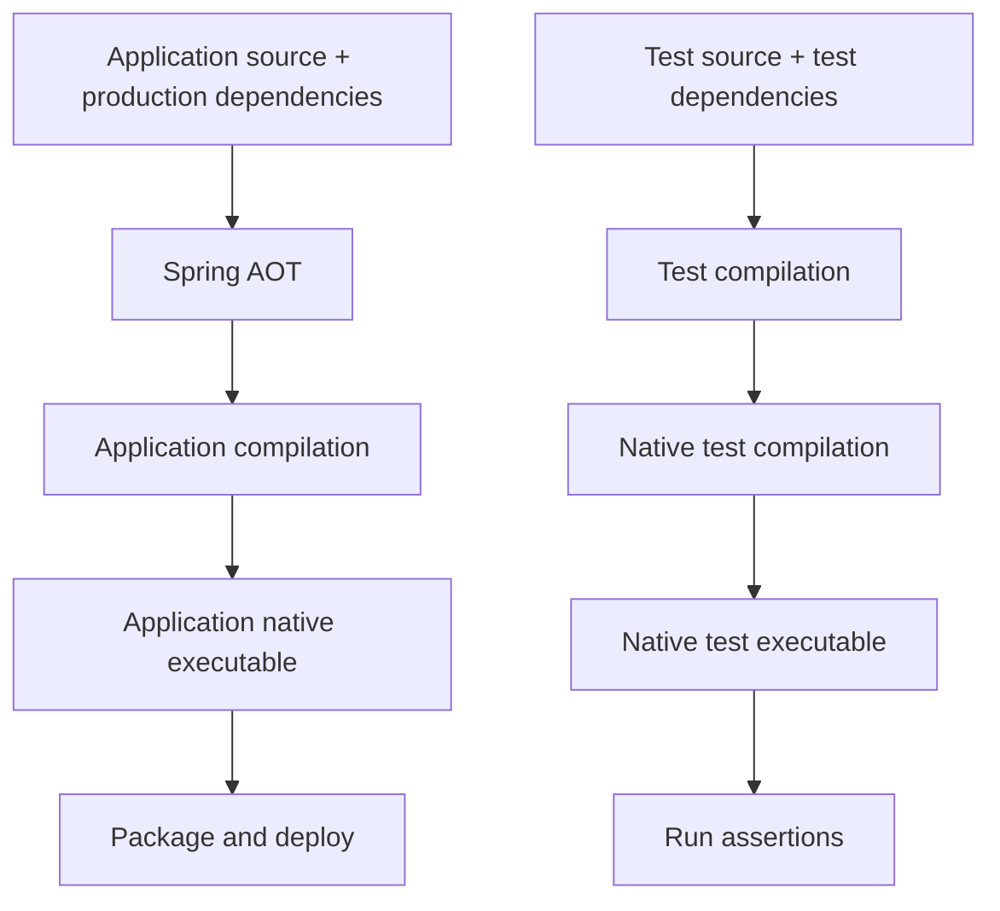

# Distinguishing the Test Suite Binary from the Deployable Application Binary

## 1. Two Executables with Different Purposes

In the Spring Boot Native Image workflow, you must distinguish the **native test executable** from the **application executable**. Both can be compiled into native binaries, yet they serve two distinct purposes:

- **Native test executable** is built to run test code and verify application/library behavior inside the Native Image environment. It can contain the test framework, test fixtures, mocks, assertions, and test code.
- **Application executable** is built from the application runtime for deployment. It contains the application code and runtime dependencies required for production, and should not carry test frameworks or test-only fixtures.

A passing native test run is important evidence that the tests ran inside the native environment. It does not turn the test binary into a production artifact, nor does it prove the application binary was packaged correctly.

In the **SPRING_BOOT_NATIVE_IMAGE** module, the ultimate goal is producing a Spring Boot executable used to run the service, verify compatibility, package containers, and operate in production. Consequently, manage the task creating the test executable separately from the task creating the application executable, and verify the exact artifact that will be released.



## 2. What Does the Application Executable Contain?

The application executable is the program launched in production. With Spring Boot Native Image, the pipeline typically consists of:

1. Resolving application runtime dependencies.
2. Running Spring AOT to analyze the application context and produce generated sources/resources along with Runtime Hints.
3. Compiling the application and generated code.
4. GraalVM Native Image analyzing reachability and building the binary.
5. Packaging the binary along with required runtime components into a container or deployment artifact.

The application executable must start as a real service, accept runtime configuration, open ports, connect to external dependencies, and handle requests/jobs per the product contract.

Test-only dependencies such as JUnit, Mockito, AssertJ, test fixtures, and test containers should not be pulled into the application runtime just because test tasks need them. Build tools separate compile/runtime classpaths from the test classpath; keep that boundary clear.

## 3. What Does the Native Test Executable Contain?

The native test executable is built from test sources alongside test runtime dependencies and the application code needed to execute tests. It may include:

- Test engines and test launchers.
- Assertion libraries.
- Mocking libraries.
- Test fixtures and sample data.
- Embedded databases or test support utilities.
- Spring Test contexts and test configurations.
- Application classes and dependencies exercised by tests.

Some test frameworks use generated test launchers or test-specific entry points. File names, output directories, and launch mechanisms depend on GraalVM Build Tools, the Spring Boot plugin, and build configuration.

Do not assume the application executable has identical contents simply because the native test binary contains application classes. The test image can have a completely different classpath and reachability profile from the production image.

## 4. Gradle: Distinguishing Native Test Tasks from Native Application Tasks

With Gradle, task names depend on plugins and versions. In many setups using GraalVM Native Build Tools, there is a task for native test compilation and a task for application native compilation, commonly:

```bash
./gradlew test
./gradlew nativeTest
./gradlew nativeCompile
```

General meaning:

- `test` runs tests on the JVM.
- `nativeTest` compiles/runs tests through the native test pipeline when configured by plugins and the project.
- `nativeCompile` builds the application native executable from the main runtime source set.

Task names, task dependencies, and behavior must be verified against the actual project:

```bash
./gradlew tasks --all
./gradlew help --task nativeTest
./gradlew help --task nativeCompile
```

In a multi-project build, invoke tasks on the specific application module, such as `:api-app:nativeTest` and `:api-app:nativeCompile`. Do not accidentally run tasks on a library module or a module containing only test fixtures.

`nativeTest` may depend on native test compilation and a dedicated toolchain; not every project has this task if the plugin has not been applied/configured. If the task does not exist, check plugin configuration and documentation for your exact version rather than guessing alternative task names.

## 5. Maven: Distinguishing Native Tests from Application Builds

With Maven, native goals/profiles depend on the plugins configured in the project. The Spring Boot Maven Plugin and the GraalVM Native Build Tools Maven Plugin can participate in different phases.

Typically:

- Maven Surefire runs unit tests on the JVM.
- Maven Failsafe runs integration tests on the JVM during the integration-test/verify lifecycle.
- Native test support (if supported by plugin/version and configured by the project) builds/runs native tests.
- Native application goals/profiles build the application executable.

There is no single native-test goal applicable to every Maven configuration. Inspect the actual plugins and profiles:

```bash
./mvnw help:effective-pom
./mvnw help:all-profiles
./mvnw help:describe -Dplugin=org.graalvm.buildtools:native-maven-plugin
```

Read the executions, goals, profiles, and classifiers. Identify precisely which command produces the test binary and which produces the application binary. Do not infer purpose from the output filename alone.

## 6. Why Is the Native Test Binary Not a Production Artifact?

The test executable often contains code that does not belong in a production application. Shipping the test binary by mistake can lead to:

- A test runner/launcher replacing the application's main entry point.
- Test dependencies and fixtures inflating size or expanding the component surface.
- The binary running tests and exiting instead of starting a server.
- Test configurations using mocks/fakes or default data unsuitable for production.
- Entrypoints, environment assumptions, and commands differing from the real application.
- Test-only resources or dummy credentials inadvertently packaged.

Conversely, the application executable should not contain a test runner and does not run the test suite at startup. That is the intended behavior for a deployable artifact.

## 7. Inspecting Contents and Behavior of Each Binary

Do not rely solely on filenames. Verify:

1. Which task/goal created the file?
2. What is the main entry point or test launcher?
3. Was the file built from the main source set or the test source set?
4. Which runtime classpath was used?
5. Are test engine/assertion/mocking libraries included?
6. Does the application executable open the expected port and handle health/readiness?
7. Does the native test executable run assertions and return the expected exit code?

Inspect task outputs and build logs, list generated files in the build/target directory, and run each binary according to its purpose. For ELF files, tools like `file` can identify binary types; however, that tool alone cannot tell an app binary apart from a test binary. You must combine task provenance with runtime behavior.

## 8. Verifying the Application Executable with Smoke Tests

After starting the native application, confirm the process behaves as a service:

```bash
./build/native/nativeCompile/api-app
```

The path and name are examples; use the actual output of your `nativeCompile` task. Once the process is ready, send an HTTP request:

```bash
curl -i http://localhost:8080/actuator/health
```

If the application does not use Spring Boot Actuator or uses a different health endpoint, substitute the appropriate endpoint. Smoke tests should confirm:

- The process does not exit immediately after startup.
- The expected port is listening.
- Readiness/health returns the expected response.
- Business endpoints can process requests.
- External dependencies connect using suitable test/production configuration.
- Shutdown signals are handled cleanly.

Do not run the application binary as a test runner, and do not treat exit code 0 from a test executable as proof that the server started.

## 9. Running the Native Test Executable

The native test executable typically runs the test suite and exits. The outputs to inspect are the test report, pass/fail/skipped counts, and the process exit code.

General example:

```bash
./gradlew nativeTest
```

Plugins may generate intermediate executables and launchers that manage execution; you do not necessarily need to invoke the binary file directly. Use the plugin-provided task to guarantee correct arguments, working directory, and test reporting.

Native tests can be slower than JVM tests due to native compilation. Therefore, run JVM unit tests frequently and schedule native tests at appropriate CI/pipeline stages, focusing on features with AOT/Native Image risk.

## 10. What Native Tests Verify Well

Native tests are valuable for catching issues when test code is compiled and executed under Native Image, such as:

- Missing reflection metadata along code paths triggered by tests.
- Unpackaged classpath resources.
- Missing serialization or proxy metadata.
- Runtime behavior differences between JVM and native.
- Certain JNI or class initialization issues exercised by tests.
- Shared test/production logic incompatible with the native runtime.

However, native tests only verify the code paths actually executed by those tests. Without tests for a rare endpoint, fallback provider, or specific JSON subtype, native tests cannot prove those branches work.

## 11. What Native Tests Do Not Prove Automatically

A passing native test run does not automatically prove that:

- The application executable was built properly.
- The application main entry point works.
- The HTTP server opens a port and handles real requests.
- The production container has all required shared libraries or the right ABI.
- Production configurations/secrets/volumes are correct.
- All endpoints, scheduled jobs, and message consumers are compatible.
- Application startup time, memory usage, or throughput meets targets.
- The test binary can be shipped as a service.

Therefore, at least two distinct forms of evidence are required: native test reports and smoke/integration tests on the application executable.

## 12. Distinguishing Artifacts in the Pipeline

| Artifact | Produced By | Purpose | Deployable as Service? |
|---|---|---|---|
| JVM test classes | Test compilation | Running tests on the JVM | No |
| JVM test reports | Surefire/Gradle Test | Test reporting | No |
| Native test executable | Native test task | Running tests in the native runtime | No |
| Native test reports/logs | Native test task/runner | Test evidence | No |
| Application native executable | Native application compile | Running the application | Yes |
| Application container image | Dockerfile/Buildpacks | Distributing and running the app | Yes |

Artifact names and locations depend on the build tool. Structure pipelines to archive test reports as CI evidence and publish the application binary/container image separately.

## 13. Avoiding Packaging Test Dependencies into the Application Image

Gradle separates configurations such as `implementation`, `runtimeOnly`, `testImplementation`, and `testRuntimeOnly`. Test dependencies belong in test configurations.

Maven uses scopes such as `compile`, `runtime`, `test`, and `provided`. Dependencies with `test` scope must not appear in the application runtime artifact.

Inspect the runtime dependency graph and packaged JAR/image contents after packaging. If a test-only library was accidentally declared with runtime scope, move it back to test scope where architecturally appropriate.

For containers, verify that the Dockerfile or Buildpacks package the actual application executable. Avoid wildcard copies from the build directory if that directory also holds test binaries, reports, or intermediate executables.

## 14. Example Dockerfile Using the Right Application Binary

Illustrative Dockerfile:

```dockerfile
FROM debian:bookworm-slim
WORKDIR /app
COPY build/native/nativeCompile/api-app /app/api-app
EXPOSE 8080
ENTRYPOINT ["/app/api-app"]
```

This is solely an example for a Linux binary compatible with the base image. The source path must point to the application compile output, not the native test output. The base image must match the binary's libc/shared libraries and runtime requirements.

If using Cloud Native Buildpacks, configure the Spring Boot plugin to build the image from the application artifact/native executable in native mode. Inspect buildpack logs and the image entrypoint to confirm the launched process is the application.

Do not copy a native executable built on Windows/macOS into a Linux container; the native binary must be compiled for the matching target OS/architecture.

## 15. CI Pipelines Should Have Two Verification Branches

A practical pipeline can be structured as:

1. **JVM tests**: fast, running unit/integration tests frequently.
2. **Native tests**: compiling and running a selected test suite in the native runtime.
3. **Native application build**: building the application executable separately.
4. **Application smoke test**: starting the binary, waiting for readiness, and calling HTTP endpoints.
5. **Container build**: packaging the application binary.
6. **Container integration test**: calling endpoints inside the final image and checking user/port/config/volumes.
7. **Publish**: publishing the application image/binary only after required gates pass.

Native tests and the native application build can run in parallel if they do not contend for outputs/caches and runners have adequate resources. Never share artifact names/paths that could cause overwrites or confusion.

## 16. Pre-Release Checklist

- Tasks creating native tests and native application binaries are identified separately.
- Native test reports show clear results and exit codes.
- The application executable is built from the main application source set.
- The application binary starts as a service and does not run a test launcher.
- HTTP smoke tests on the application executable pass.
- Runtime dependency graph contains no unintended test-only libraries.
- Container entrypoint points to the right application binary.
- Image target OS/architecture/libc match.
- Container integration tests verify health and business endpoints.
- Artifacts are identified by version/commit/digest.
- CI archives test reports separately from the application artifact.

## 17. Self-Check Questions

1. How does the native test executable differ from the application executable in purpose and contents?
2. Why does a passing native test not prove that the application binary was packaged properly?
3. Which Gradle task is typically used for native tests and which builds the application executable?
4. Why are filenames or extensions insufficient to classify a binary?
5. Do native tests verify that the HTTP server opens a port as in production?
6. How do you prevent test dependencies from leaking into the application runtime image?
7. Why must the container copy the exact application output compiled for the right target platform?
8. What gates are needed before publishing an application image?

**Key takeaway:** the native test executable is a tool for running assertions; the application native executable is the program serving production. Manage tasks, classpaths, outputs, and test reports separately; even after native tests pass, still run smoke/integration tests on the exact application binary and container image being released.
