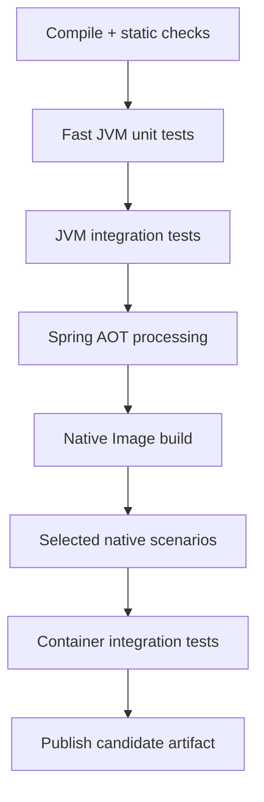

# Keeping Most Tests Fast on the JVM and Selecting Critical Paths for Native

## 1. Why Should You Not Run All Tests with Native Image?

Testing is an important part of migrating Spring Boot to GraalVM Native Image. However, building and running tests natively generally consumes far more time, CPU, and memory than running tests on the JVM. If every unit test had to go through native compilation, developer and CI feedback loops would slow down dramatically.

Most ordinary business bugs do not depend on whether the JVM or Native Image executes the code: value calculations, validation rules, pure mappings, state handling, and algorithms can all be verified quickly on the JVM. Native Image introduces specific risks around access paths such as reflection, resources, proxies, serialization, JNI, class initialization, and AOT configuration. These paths must be verified on a native executable.

An effective strategy for the **SPRING_BOOT_NATIVE_IMAGE** module is keeping a broad, fast JVM test suite, then selecting a representative set of native scenarios covering high-risk capabilities and critical business flows. The goal is fast feedback during development while still having proof that the native artifact runs properly.

## 2. Two Test Layers Serving Two Goals

| Testing Layer | Primary Goal | Examples |
|---|---|---|
| JVM test suite | Broad, fast, easily debuggable logic verification | Unit tests, mappers, validation, services, repositories, Spring integration |
| Native test suite | Verify Native Image-dependent behavior and the real artifact | Reflection, resources, proxies, JSON polymorphism, JNI, startup, containers |

The JVM suite usually accounts for the largest test count. The native suite focuses on paths that the JVM cannot prove on behalf of native execution.

This does not mean every JVM test can skip native verification. A critical business flow may need a native integration test even if it does not directly use reflection, because it combines multiple components and runtime configurations.

## 3. Classifying Tests by Risk

Before selecting native tests, classify your existing tests:

- **Pure logic:** does not start a Spring context, does not use dynamic reflection/resources. Prioritize JVM unit tests.
- **Spring wiring:** verifies beans, conditions, profiles, configuration properties. Test on the JVM; add AOT/native scenarios for critical structures.
- **Library integrations:** serializers, ORMs, HTTP clients, PDFs, SDKs, proxies, JNI. Choose native paths according to dependency risk.
- **Runtime packaging:** external files, native libraries, filesystem, locale, permissions, containers. Must be tested in the native/runtime image.
- **Business-critical flows:** payments, order creation, authorization, webhook processing. Pick at least one end-to-end native scenario per significant risk area.

A test can span multiple categories. Choose based on mechanisms likely to differ between JVM and Native Image, business impact on failure, and difficulty of detection post-deployment.

## 4. Tests Usually Kept on the JVM

The following tests deliver high value when run rapidly on the JVM:

| Test Type | Why JVM Is Suitable |
|---|---|
| Pure unit tests | Verify logic independent of runtime metadata |
| Domain models/business rules | Focus on business behavior |
| Validation rules | Verify constraints and boundary values |
| Mappers/converters | Verify input/output data |
| Algorithm tests | Easy to run across many datasets and edge cases |
| Repository tests with test database | Focus on SQL/ORM behavior, unless verifying native-specific integration |
| Controller tests with MockMvc | Verify routing, binding, and validation quickly |
| Client/server contract tests | Verify schemas and error behavior on the JVM |

A JVM test is not proof of native compatibility. It serves as the foundation for broad logic coverage so native tests do not have to repeat thousands of pure business cases.

If a library behaves specially in native mode, add a corresponding native scenario rather than moving the module's entire test suite to native.

## 5. Paths to Prioritize for Native Testing

The native suite should prioritize capabilities sensitive to closed-world assumptions and AOT:

| Capability | Required Native Scenario |
|---|---|
| Reflection | Instantiate objects/invoke members via the actual library |
| Classpath resources | Read packaged templates/schemas/config resources |
| Resource bundles | Load critical locales |
| JDK proxies/Spring AOP | Create real proxies, invoke methods, and assert advice |
| JSON serialization | Deserialize/serialize DTOs, records, subtypes, and custom serializers |
| JNI | Load native libraries, call native methods and callbacks if any |
| Class initialization | Start up in an environment different from the build environment |
| Spring AOT contexts | Initialize contexts under release profiles/conditions |
| Dependency dynamic access | Exercise the exact APIs/features the application uses |
| Container runtime | Verify files, permissions, ABI, user, and networking |

Not every application uses every capability. Mark non-applicable items with reasons; do not invent artificial native tests just to check boxes in a table.

## 6. Selecting Native Tests via a Risk Matrix

You can score each scenario across three factors:

- **Impact:** if a failure occurs, how severe is the effect on business or customers?
- **Runtime divergence:** does the path use reflection, resources, proxies, JNI, class initialization, or dynamic behavior?
- **Detection difficulty:** could the failure only appear in a specific locale, rare payload, profile, or container environment?

Example matrix:

| Scenario | Impact | Native-Specific Risk | Native Priority |
|---|---|---|---|
| Calculate order total | Medium | Low | Primarily JVM |
| Deserialize payment subtype | High | High | High |
| Read invoice template | High | High if dynamic resource | High |
| Call JNI SDK | High | Very high | Mandatory if used |
| Select implementation via condition | High | AOT structural | High |
| Simple string formatting | Low | Low | Primarily JVM |
| Vietnamese/English locale | Medium/high | Resource bundle | Select primary supported locales |
| Simple health endpoint | Low | Low | Native smoke test may suffice |

Scores are only an aid for discussion. The team should assess risks based on dependencies and actual application usage rather than applying a rigid threshold across all projects.

## 7. Maintaining a Shared Set of Fixtures

To avoid JVM and native tests validating two different datasets, place fixtures in a standard location:

```text
src/test/resources/contract/
├── orders/
│   ├── valid-order.json
│   ├── invalid-order.json
│   └── payment-card.json
├── schemas/
│   └── order-v1.json
└── rules/
    └── standard-discount.json
```

JVM tests can use fixtures to cover many cases. Native integration tests pick representative fixtures for critical paths and read the exact same files.

For production resources, place files in `src/main/resources`; do not confuse test fixtures with resources that must be packaged into the executable. You may share fixture content, but keep proper source sets and lookup paths for test purposes.

Do not copy/paste payloads into two separate sets. When a contract changes, one shared fixture set ensures both runtimes are compared against identical data.

## 8. Designing Native Tests Around Business Flows, Not Just Smoke Tests

A smoke test typically only verifies that the executable starts or the health endpoint responds. That does not exercise JSON binding, validation, proxies, resources, and real dependencies.

A valuable native scenario should traverse a representative business path. For example, order creation:

1. Send a JSON request over HTTP.
2. Deserialize into the request DTO.
3. Run nested validation.
4. Invoke the service and repository.
5. Call the payment adapter through a proxy, if present.
6. Read required rules/templates/resources.
7. Serialize the response.
8. Verify status codes, response schema, and side effects.

Not every native test has to be end-to-end. You can combine capability-focused native integration tests with a few high-value black-box flows. The goal is ensuring every significant native risk has corresponding evidence.

## 9. Example Test Split for an Order API

Suppose the Order API has pricing logic, a JSON API, a payment SDK, invoice templates, and message bundles.

| Test | JVM | Native | Reason |
|---|---:|---:|---|
| Tiered discount calculation | Extensive | No need to repeat all cases | Pure logic |
| Quantity/price boundaries | Extensive | Selected scenarios via API | Logic and validation |
| Basic DTO binding | Extensive | Yes | Verify Jackson/native |
| Polymorphic payment payload | Yes | Yes | Subtype metadata |
| Payment SDK JNI callback | Yes if JVM-testable | Yes | JNI/library behavior |
| Reading invoice template | Yes | Yes | Resource packaging |
| Vietnamese messages | Yes | Yes | Locale bundle |
| AOP transactions/security | Yes | Yes | Proxy/context behavior |
| Health endpoint | Optional | Smoke test suitable | Startup/readiness |
| Full business flow | Yes | Selected critical flows | Overall integration |

The JVM suite may run hundreds or thousands of tests. The native suite only needs to focus on paths producing additional evidence, while covering high-risk integrations.

## 10. Source Set and Test Task Structure

Organizing tests clearly by intent helps CI select the right tasks:

```text
src/
├── main/
│   ├── java/
│   └── resources/
└── test/
    ├── java/
    │   ├── unit/
    │   ├── integration/
    │   └── nativecontract/
    └── resources/
        └── contract/
```

This layout is illustrative. Maven/Gradle will not automatically treat subdirectories as separate test source sets without configuration. You can use package naming, JUnit tags, Gradle test suites, or Maven Surefire/Failsafe includes/excludes for grouping.

Example JUnit tag:

```java
@Tag("native-contract")
@SpringBootTest
class OrderNativeContractTest {
}
```

Tags help select tests in JVM or native test workflows when supported by plugins/harnesses. However, adding a tag does not automatically run a test natively; configure the corresponding task and verify the executing process is a native executable.

## 11. Layered CI Pipeline

A practical pipeline can be structured as:



Each layer has distinct costs and goals:

- JVM unit tests run frequently for fast feedback.
- JVM integration tests verify broad wiring and integration behavior.
- Spring AOT confirms contexts can be analyzed and code-generated.
- Native build verifies executable compilation succeeds.
- Native scenarios validate paths dependent on Native Image.
- Container tests validate runtime packaging and a production-like environment.

You can run JVM unit tests on every commit, while running native build/tests on key pull requests or integration branches depending on build time. For high-risk applications, native builds should be a required check before merge/release.

## 12. Distinguishing Native Builds from Native Test Tasks

Some plugins provide dedicated tasks to compile/run native tests. Task names and support levels depend on version. For instance, Gradle Native Build Tools can expose `nativeTest` when test configuration is enabled.

Before using:

```bash
./gradlew tasks --all
```

With Maven, inspect configured goals/plugins and the project lifecycle:

```bash
./mvnw help:describe -Dplugin=org.graalvm.buildtools:native-maven-plugin
```

Do not assume a task exists simply because documentation for another version mentions it. Read logs to confirm tests were built into a native executable and executed by that binary.

If not using a native test task, you can start the native application and run a black-box HTTP contract suite from a separate test process. This approach works well for verifying packaging and service behavior.

## 13. Avoiding Duplicating the Entire Test Suite Natively

Do not convert the entire JVM suite to native just to inflate coverage numbers on paper. Some tests yield no new evidence:

- Many pure calculation tests with varying datasets.
- Simple getter/setter or mapping tests without reflection.
- Algorithm tests already broadly covered on the JVM.
- Small mock tests that do not start contexts or runtime integrations.
- Repeated tests hitting the exact same endpoint without exercising distinct capabilities.

Instead, select representative tests for each capability and edge cases with concrete native risks. For example, one native test per critical JSON subtype is far more valuable than re-running hundreds of pure discount calculation tests.

Still, if failures can depend on specific payloads or serializer libraries, choose enough payloads to cover the subtypes/branches actually used in production.

## 14. Test Profiles and Structural Properties

A native executable is built from the selected AOT structure. Therefore, native tests must use profiles/conditions matching the artifact.

Example:

```java
@SpringBootTest
@ActiveProfiles("native-test")
@Tag("native-contract")
class PaymentNativeTest {
}
```

If `native-test` selects a mock gateway or disables integrations via `@ConditionalOnProperty`, clarify what the test proves. A test using mocks can verify proxies/JSON/contexts, but it does not prove the production SDK or real native library works.

For critical production integrations, add tests in a sandbox environment with matching configuration. Never place production credentials into CI native tests.

## 15. Managing External Dependencies in Native Tests

Native tests may require databases, brokers, HTTP stubs, or native libraries. Decide where each dependency runs and how it is provisioned:

- Use Testcontainers if supported by your versions/plugins and runtime environment.
- Use service containers in CI with stable endpoints.
- Use WireMock/mock servers for HTTP contracts where appropriate.
- Use database fixtures that can be reset between tests.
- Provide native libraries matching the target architecture/ABI.
- Mount external configs/resources at the exact expected paths.
- Set explicit timeouts and readiness checks.

Do not let native tests depend on a developer's local services or unstable endpoints. Pin image/service versions and fixture data so tests remain reproducible.

## 16. Handling Native-Incompatible Tests

Some tests using mocking frameworks, bytecode generation, dynamic class loading, or context customization may not run in native mode. Classify them:

1. Tests verifying pure logic already covered on the JVM: keep on the JVM.
2. Critical tests whose test framework lacks native support: write replacement native integration/black-box tests.
3. Tests exercising native capabilities needing design tweaks: replace dynamic mechanisms with static paths or add metadata.
4. Tests unable to run natively due to genuinely incompatible dependencies: document the limitation and verify service boundaries/alternative integrations.

Do not add skip annotations just to turn the native test task green without documenting reasons and replacement tests. A skipped test is not evidence that behavior was verified.

## 17. Measuring Time and Cost Across Layers

Track durations to see where the pipeline slows down:

| Metric | JVM Suite | Native Build/Test |
|---|---|---|
| Compile time | Usually shorter | Includes AOT/native compilation |
| Test execution | Well suited for many cases | Can be fast once binary exists, but building is expensive |
| CI CPU/RAM | More predictable | Native compiler can demand substantial resources |
| Feedback loop | Fast, run frequently | Slower, selective |
| Target coverage | Broad logic and integration | Runtime-specific and high-risk paths |

Record build times, test execution times, cache hit rates, peak memory, and flakiness rates. If native builds are too slow, optimize incremental builds/caching or split native test groups; do not drop critical tests just to trim pipeline duration.

## 18. Coverage Matrix for Test Decisions

Use a table linking risks to tests and evidence:

| Capability/Risk | JVM Coverage | Native Coverage | Rationale |
|---|---|---|---|
| Business pricing rules | Many unit cases | One representative flow | Pure logic |
| JSON polymorphism | Many fixtures | Key subtypes | Reachability/Jackson |
| Reflection SDK | Unit/integration | Call actual API | Dynamic member access |
| Classpath templates | JVM resource tests | Render template in binary | Resource inclusion |
| Resource bundles | Locale tests | Primary locales | Bundle metadata |
| JDK proxy/AOP | Context tests | Create proxy and invoke advice | Proxy hints/AOT |
| JNI bridge | JVM integration if feasible | Real native callbacks | JNI metadata/libraries |
| Container filesystem | JVM path tests | Container tests | Runtime packaging |

Mark `N/A` if the application does not use a capability. For each native test, record the test class/scenario, fixtures, binary revision, and execution environment. This prevents "paper-only" native coverage.

## 19. Workflow for Selecting Native Tests per Change

When a pull request modifies code or dependencies:

1. Identify affected packages/modules and business paths.
2. Check whether changes touch reflection, resources, proxies, serialization, JNI, class initialization, or AOT configuration.
3. Run relevant JVM unit/integration tests.
4. Run hints predicate tests if metadata changed.
5. Run AOT processing if context structure or registrars changed.
6. Run relevant native scenarios and mandatory smoke/contract flows.
7. Run the full native suite on schedule or before releases.
8. Update the coverage matrix whenever capabilities/dependencies change.

If a change only modifies pure algorithms, there is no need to run the entire native suite on every edit. If you upgrade a serializer or JNI SDK version, corresponding native tests must run because the risk profile changed.

## 20. Hands-on Exercise: Designing a Two-Tier Test Strategy for the Order API

**Scenario:** Order API includes pricing logic, JSON polymorphic payments, a JNI payment SDK, invoice templates, resource bundles, and Spring AOP.

**Step 1 — Build an inventory.** List existing tests and which capabilities each covers.

**Step 2 — Keep the JVM suite broad.** Cover pricing boundaries, validation, mappers, service logic, repositories, and controller behavior.

**Step 3 — Select native scenarios.** Pick order creation via JSON, each key payment subtype, JNI SDK calls, invoice rendering, loading primary locales, and invoking services through proxies.

**Step 4 — Standardize fixtures.** Use identical requests, schemas, templates, and locale data across both runtimes.

**Step 5 — Create test grouping.** Use JUnit tags/source sets or dedicated tasks; configure the build tool clearly so native tasks actually execute the native binary.

**Step 6 — Build CI tiers.** Run the JVM suite frequently, AOT/native builds and selected native scenarios on pull requests or integration branches, and container suites before releases.

**Step 7 — Record coverage.** Mark which capabilities have JVM/native/container evidence, which tests are unsupported, and their replacements.

**Step 8 — Measure the pipeline.** Record duration, peak memory, flakiness rate, and native coverage to tune the test set.

Completion criteria: JVM suite retains breadth and speed; native suite verifies key capabilities/risks; shared fixtures are used; CI layers are clearly separated; every skipped test has a documented reason and alternative evidence.

## 21. Conclusion

A sound testing strategy for Spring Boot Native Image does not require running every unit test natively. Keep most logic and integration tests fast on the JVM, and select native scenarios for paths with distinct risks such as reflection, resources, proxies, JSON polymorphism, JNI, class initialization, AOT contexts, and container runtimes.

A broad JVM test suite catches business logic errors rapidly; selective native tests verify assumptions the JVM cannot prove. Use shared fixtures, a coverage matrix, clear CI tasks, and real native executables so every result is meaningful. When dependencies or capabilities change, update the corresponding native test set rather than blindly re-running the entire suite.
