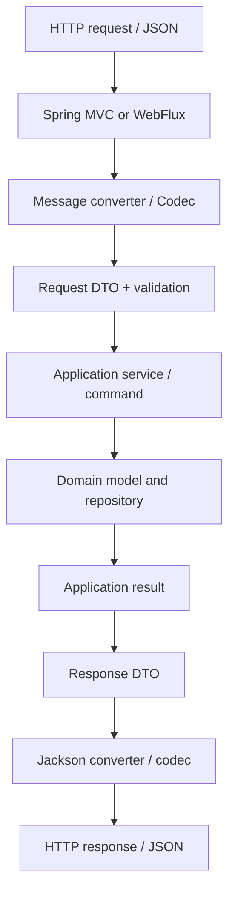

# Spring MVC, WebFlux, and Data Classes at the HTTP Boundary

## 1. The HTTP Boundary in a Spring Boot Application

A Spring Boot application typically receives data over HTTP, translates that data into a business call, and returns the result to the client. This interface is the **HTTP boundary**. It includes controllers or handlers, request/response DTOs, JSON serialization/deserialization, validation, message converters or codecs, error handling, and the data types used in requests/responses.

When the HTTP boundary runs on GraalVM Native Image, you must ensure that dynamically instantiated or accessed data types still have appropriate metadata. Spring frameworks already provide extensive AOT support for MVC, WebFlux, and Jackson mechanisms; however, DTOs selected via dynamic type IDs, nested generics, custom serializers, or custom application reflection still need to be verified in the native executable.

This lesson belongs to the **Application Integration** chapter of the **SPRING_BOOT_NATIVE_IMAGE** module. The objectives are:

- Distinguish the HTTP processing flows of Spring MVC and Spring WebFlux.
- Design request/response DTOs at the HTTP boundary.
- Understand the role of message converters, codecs, Jackson, and validation.
- Convert DTOs to application commands/domain models and return results.
- Identify reflection/binding metadata required for Native Image.
- Test endpoints and serialization on both the JVM and the native executable.

## 2. Separating HTTP DTOs from Domain and Persistence Models

The HTTP payload is the contract between the application and the client. It can change based on API version, JSON naming conventions, validation requirements, or access permissions. The domain model represents business rules; the persistence entity represents how data is stored. These three model types have different lifecycles and responsibilities.

A processing flow should look like this:



Order creation API example:

```java
public record CreateOrderLineRequest(
    @NotBlank String sku,
    @Positive int quantity
) {
}

public record CreateOrderRequest(
    @NotBlank String customerId,
    @NotEmpty List<@Valid CreateOrderLineRequest> lines
) {
}

public record OrderResponse(
    UUID id,
    String status
) {
}
```

The Request DTO reflects the data the client is allowed to send. The Response DTO exposes only the data the API intends to return. The application service can accept a separate command:

```java
public record CreateOrderCommand(
    String customerId,
    List<CreateOrderLine> lines
) {
}

public record CreateOrderLine(
    String sku,
    int quantity
) {
}
```

The controller or mapper converts the request DTO into a command. The application service executes the business logic and returns a result for the mapper to build the response DTO. You should not return a JPA entity directly over HTTP: doing so couples the API to the database structure, risks exposing internal fields, and can trigger lazy-loading outside a transaction.

### 2.1. Why Not Use a Single Class for Every Layer?

| Model | Responsibility | Typically Changes Due To |
| --- | --- | --- |
| Request DTO | Input contract, JSON naming, validation | API clients and endpoint versions |
| Response DTO | Output contract, fields allowed to be exposed | API contract and display requirements |
| Application command/result | Use case data | Business workflows |
| Domain model | Business rules and state | Domain rules |
| Persistence entity | Table mapping, keys, and relationships | Schema and storage strategy |

You can use Java records for immutable DTOs when the Jackson version and application configuration support them. For regular classes, constructors, getters/setters, and Jackson annotations need to match the chosen deserialization strategy. Always test with the exact mapper that Spring Boot uses.

## 3. How Spring MVC Processes Requests and Responses

Spring MVC runs on the Servlet API. With annotated controllers, Spring locates the matching handler method, reads the request body via `HttpMessageConverter`, invokes the controller, and then writes the response body via the corresponding converter.

Controller example:

```java
@RestController
@RequestMapping("/api/orders")
class OrderController {

    private final OrderApplicationService orders;

    OrderController(OrderApplicationService orders) {
        this.orders = orders;
    }

    @PostMapping
    ResponseEntity<OrderResponse> create(
            @Valid @RequestBody CreateOrderRequest request) {

        CreateOrderCommand command = new CreateOrderCommand(
            request.customerId(),
            request.lines().stream()
                .map(line -> new CreateOrderLine(
                    line.sku(), line.quantity()
                ))
                .toList()
        );

        OrderResult result = orders.create(command);

        OrderResponse response =
            new OrderResponse(result.id(), result.status());

        return ResponseEntity
            .created(URI.create("/api/orders/" + result.id()))
            .body(response);
    }
}
```

For JSON, Spring Boot typically configures a Jackson converter. The converter reads bytes into objects using `ObjectMapper`, and then the controller receives the deserialized DTO. When returning a DTO, the converter serializes the object to JSON and sets the appropriate content type.

Common annotations:

- `@RequestBody`: reads the request body via a message converter.
- `@ResponseBody` or `@RestController`: writes the return value via a message converter.
- `@PathVariable`: binds a path segment.
- `@RequestParam`: binds a query/form parameter.
- `@RequestHeader`: binds a header.
- `@ModelAttribute`: binds request parameters into an object.
- `@RequestPart`: reads a part of a multipart request.

Not all data goes through Jackson. Path variables, query parameters, and form fields may be converted by Spring's `ConversionService` or the corresponding binding mechanism.

### 3.1. MVC and Blocking Work

Spring MVC fits the Servlet model and is commonly used for synchronous applications where controllers call services, repositories, or JDBC in a blocking manner. A request is typically processed on a servlet request thread; when making a synchronous JDBC call, that thread waits for the I/O result.

You can use `CompletableFuture`, reactive return types, or the async Servlet API in MVC, but that does not turn the entire stack into non-blocking. If most dependencies remain blocking JDBC, WebFlux will not automatically make them non-blocking.

## 4. How Spring WebFlux Processes Requests and Responses

Spring WebFlux is a reactive web stack that can run on non-blocking servers such as Reactor Netty. It uses `HttpMessageReader` and `HttpMessageWriter`, typically configured through `ServerCodecConfigurer`, to read and write bodies. For JSON, Jackson is integrated via codecs such as the Jackson JSON decoder/encoder.

A controller can accept an object directly:

```java
@RestController
@RequestMapping("/api/orders")
class ReactiveOrderController {

    private final OrderReactiveService orders;

    ReactiveOrderController(OrderReactiveService orders) {
        this.orders = orders;
    }

    @PostMapping
    Mono<ResponseEntity<OrderResponse>> create(
            @Valid @RequestBody CreateOrderRequest request) {

        CreateOrderCommand command = mapToCommand(request);

        return orders.create(command)
            .map(result -> {
                OrderResponse response =
                    new OrderResponse(result.id(), result.status());

                return ResponseEntity
                    .created(URI.create("/api/orders/" + result.id()))
                    .body(response);
            });
    }
}
```

Or the body can be represented by a reactive type:

```java
@PostMapping
Mono<OrderResponse> create(
        @Valid @RequestBody Mono<CreateOrderRequest> request) {

    return request.flatMap(body ->
        orders.create(mapToCommand(body))
    ).map(this::toResponse);
}
```

With `Mono<T>`, the body is read and emitted when subscribed in the pipeline. With `Flux<T>`, the application can process a stream of elements, which suits certain formats or streaming endpoints. Choose the return type based on backpressure and streaming requirements; do not wrap every object in `Mono` just to call an application reactive.

### 4.1. Functional Endpoints

WebFlux also supports functional routing via `RouterFunction` and `HandlerFunction`. For example:

```java
@Bean
RouterFunction<ServerResponse> orderRoutes(OrderHandler handler) {
    return RouterFunctions.route()
        .POST("/api/orders", handler::create)
        .build();
}
```

The handler can read the body via `ServerRequest.bodyToMono(CreateOrderRequest.class)` and create a response via `ServerResponse.body(...)`. When using functional endpoints, tests need to exercise the actual handler and body types; do not assume controller annotation registration automatically covers every route function.

### 4.2. Reactive Does Not Mean Every Dependency Is Non-Blocking

If a WebFlux handler calls JDBC, `Thread.sleep`, blocking filesystem APIs, or a blocking SDK, the event-loop thread can be blocked. Use a corresponding reactive driver/client or isolate blocking calls onto an appropriate scheduler. GraalVM Native Image does not automatically convert blocking APIs to non-blocking; native compilation only changes how the program is packaged and executed.

## 5. Choosing Between MVC and WebFlux

| Criterion | Spring MVC | Spring WebFlux |
| --- | --- | --- |
| Server foundation | Servlet API | Reactive runtime, typically Netty or a supported Servlet container |
| Processing model | Primarily imperative/blocking | Reactive, non-blocking when all I/O supports it |
| Reading/writing bodies | `HttpMessageConverter` | `HttpMessageReader` / `HttpMessageWriter`, codecs |
| JSON | Jackson converter | Jackson encoder/decoder |
| Common return types | DTO, `ResponseEntity<T>`, `Callable`, `CompletableFuture` | DTO, `Mono<T>`, `Flux<T>`, `ResponseEntity<Mono<T>>` |
| Best suited for | CRUD apps, JDBC/JPA, synchronous services | Concurrent I/O, streaming, reactive data/clients |
| Main risk | Threads held during blocking I/O | Event loop blocked if calling blocking APIs |

If both Spring MVC and WebFlux starters are on the classpath, Spring Boot typically chooses MVC as the default web application type. Only include both intentionally when you have determined which stack serves the HTTP server. With Native Image, choosing MVC or WebFlux remains an architectural decision; native compilation does not make the two stacks equivalent.

## 6. JSON Binding with Jackson

Jackson converts JSON to objects and vice versa. A simple DTO can use a record:

```java
public record CustomerRequest(
    @JsonProperty("customer_id") String customerId,
    @JsonProperty("display_name") String displayName
) {
}
```

For a mutable class:

```java
public class CustomerResponse {

    private UUID id;
    private String displayName;

    public CustomerResponse() {
    }

    public UUID getId() {
        return id;
    }

    public void setId(UUID id) {
        this.id = id;
    }

    public String getDisplayName() {
        return displayName;
    }

    public void setDisplayName(String displayName) {
        this.displayName = displayName;
    }
}
```

Notes when designing a JSON contract:

- Use `@JsonProperty` when the JSON field name differs from the Java property name.
- Use `@JsonCreator`/`@JsonProperty` for constructor-based deserialization if needed.
- Clearly define how unknown fields, missing fields, and null values are handled.
- Choose a consistent date/time format, such as ISO-8601.
- Use stable logical enum values; avoid relying on internal enum names if the API needs long-term compatibility.
- For polymorphic JSON, use an allowlisted type ID and register subtypes explicitly.
- Do not enable broad Jackson default typing for JSON from untrusted clients.

Do not instantiate `new ObjectMapper()` separately inside controllers or services. Use the mapper configured by Spring Boot to preserve modules, naming strategies, date/time settings, custom serializers, and application customizers.

### 6.1. Generic Responses and Type Erasure

Java generics undergo type erasure at runtime. When reading a payload with a structure like `List<OrderResponse>`, the client needs to pass full generic type information to the decoder. With WebClient, you can use `ParameterizedTypeReference`:

```java
ParameterizedTypeReference<List<OrderResponse>> responseType =
    new ParameterizedTypeReference<>() {};

Mono<List<OrderResponse>> response = webClient.get()
    .uri("/api/orders")
    .retrieve()
    .bodyToMono(responseType);
```

With MVC controllers, the generic return type in the method signature typically provides metadata for the converter. In Native Image, ensure concrete DTOs inside generic collections are recognized and tested in the native executable, especially when types are selected via configuration or reflection.

## 7. Validation at the HTTP Boundary

Validation helps reject invalid payloads before running business logic. With Jakarta Bean Validation:

```java
public record CreateOrderRequest(
    @NotBlank String customerId,
    @NotEmpty List<@Valid CreateOrderLineRequest> lines
) {
}

public record CreateOrderLineRequest(
    @NotBlank String sku,
    @Positive int quantity
) {
}
```

In Spring MVC:

```java
@PostMapping
OrderResponse create(
        @Valid @RequestBody CreateOrderRequest request) {
    // Call the application service after validation succeeds.
}
```

In WebFlux:

```java
@PostMapping
Mono<OrderResponse> create(
        @Valid @RequestBody Mono<CreateOrderRequest> request) {
    return request.flatMap(this::createOrder);
}
```

Nested validation requires `@Valid` on the appropriate property/collection element. Constraint annotations only take effect when a validation provider is configured and invoked in the binding flow.

Validation errors are typically translated into HTTP 400 according to framework or application exception handling. Define a stable error response and never return stack traces or internal details.

### 7.1. Custom Constraints and Validators

If the application defines `@ValidSku` with a custom `ConstraintValidator`, check:

- Whether the constraint annotation is placed on the right field/record component.
- Whether the validator is instantiated by the Spring/validation provider integration mechanism.
- Whether the validator's dependencies are injected properly.
- Whether the native executable runs the validator for both valid and invalid requests.

Standard library validators/constraints usually come with supporting metadata. For custom validators or mechanisms instantiated via reflection, add runtime hints if native tests prove metadata is missing; avoid registering an entire validation package based on guesswork.

## 8. Unified HTTP Error Handling

Both Spring MVC and WebFlux support `@ControllerAdvice`/`@RestControllerAdvice` with `@ExceptionHandler` for controller-based endpoints. You can use `ProblemDetail` to return errors in a consistent structure:

```java
@RestControllerAdvice
class ApiExceptionHandler {

    @ExceptionHandler(OrderNotFoundException.class)
    ResponseEntity<ProblemDetail> handleNotFound(
            OrderNotFoundException exception) {

        ProblemDetail problem = ProblemDetail.forStatusAndDetail(
            HttpStatus.NOT_FOUND,
            exception.getMessage()
        );
        problem.setTitle("Order not found");

        return ResponseEntity.status(HttpStatus.NOT_FOUND).body(problem);
    }
}
```

Do not include stack traces, SQL, filesystem paths, or secrets in details sent to the client. You can log internal details with a correlation ID and return a safe message at the HTTP boundary.

With WebFlux functional endpoints, you can handle errors inside the handler using `onErrorResume` or configure appropriate error handling. Regardless of the mechanism used, the response schema must be consistent across endpoints and tested on native.

## 9. Multipart and Non-JSON Data

Not every request body is JSON. File uploads commonly use `multipart/form-data`.

In Spring MVC:

```java
@PostMapping(path = "/documents", consumes = MediaType.MULTIPART_FORM_DATA_VALUE)
DocumentResponse upload(
        @RequestPart("metadata") @Valid DocumentMetadata metadata,
        @RequestPart("file") MultipartFile file) {

    return documentService.store(metadata, file);
}
```

In WebFlux, a file part is represented by `FilePart`:

```java
@PostMapping(path = "/documents", consumes = MediaType.MULTIPART_FORM_DATA_VALUE)
Mono<DocumentResponse> upload(
        @RequestPart("metadata") Mono<DocumentMetadata> metadata,
        @RequestPart("file") FilePart file) {

    return metadata.flatMap(value ->
        documentService.store(value, file)
    );
}
```

`MultipartFile` and `FilePart` have different lifecycles and APIs. WebFlux typically uses file parts and reactive transfers; avoid loading large files completely into memory if they can be streamed to storage.

With Native Image, client-uploaded files are runtime data, not classpath resources needing `ResourceHints`. Check size limits, access permissions, filenames, content types, and how files are stored. Never trust a client-supplied filename and never concatenate it directly into a filesystem path.

## 10. Integrating HTTP DTOs with Application Services and Persistence

Controllers should handle data conversion and orchestration. Transactions and business rules belong in the application service/domain layer.

Synchronous service example:

```java
@Service
class OrderApplicationService {

    private final OrderRepository repository;

    OrderApplicationService(OrderRepository repository) {
        this.repository = repository;
    }

    @Transactional
    OrderResult create(CreateOrderCommand command) {
        Order order = Order.create(
            command.customerId(),
            command.lines()
        );

        Order saved = repository.save(order);

        return new OrderResult(saved.getId(), saved.getStatus().name());
    }
}
```

With WebFlux, if using a reactive database driver, the service can return `Mono<OrderResult>` or `Flux<OrderResult>`. Do not wrap blocking JPA/JDBC calls in a `Mono` and treat that as end-to-end reactive. If you must integrate a blocking dependency, isolate it from the event loop and define clear concurrency limits.

Native Image does not alter transaction boundaries or data mapping. However, ORMs, JDBC drivers, database clients, and entity models may have their own native metadata requirements. Do not register a JPA entity as an HTTP DTO just because both are serialized in one place; identify the actual access paths of each layer.

## 11. Configuring Message Converters and WebFlux Codecs

When you need to add a custom JSON converter or codec, extend the configuration managed by Spring Boot instead of rebuilding the entire stack from scratch.

With MVC, you can use `WebMvcConfigurer` and `extendMessageConverters(...)` to add or adjust converters while keeping the default converters. Be careful with `configureMessageConverters(...)`: this configuration can replace the default converter list if you do not explicitly add them back.

With WebFlux, you can use `WebFluxConfigurer.configureHttpMessageCodecs(...)` or Spring Boot's `CodecCustomizer` to configure decoders/encoders. The same `ObjectMapper` should be used consistently between server and client if the JSON contract needs to match.

If a custom converter/codec creates serializers, deserializers, subtypes, or DTOs via reflection, describe those types with runtime hints when AOT does not detect them automatically. Test both server endpoints and HTTP clients consuming the payload.

## 12. Runtime Hints for HTTP Data Binding in Native Image

Spring AOT analyzes bean definitions, controller mappings, configurations, and discovered framework components. Spring Boot also provides many native hints for web infrastructure and integrated libraries. Even so, you should not assume every type appearing in dynamic JSON is inferred automatically.

For DTOs used via reflection/binding, you can register them:

```java
import org.springframework.aot.hint.annotation.RegisterReflectionForBinding;
import org.springframework.context.annotation.Configuration;

@Configuration(proxyBeanMethods = false)
@RegisterReflectionForBinding({
    CreateOrderRequest.class,
    CreateOrderLineRequest.class,
    OrderResponse.class
})
class HttpBindingConfiguration {
}
```

This annotation asks Spring to contribute reflection metadata for binding the listed types. Use it for DTOs that code/frameworks need to introspect or instantiate via binding but are not fully discovered by AOT.

Additional consideration is needed in cases such as:

- DTOs/subtypes selected via a JSON type discriminator.
- Nested models or collection element types selected dynamically.
- Custom Jackson serializers/deserializers or `TypeIdResolver`.
- Hand-written reflection using `Class.forName`, `getDeclaredConstructor`, `Method.invoke`, or field access.
- Models from external libraries that do not yet provide suitable reachability metadata.
- Private constructors, factory methods, or immutable models with special creation patterns.

Do not register reflection for an entire DTO package by default. Start from the specific code paths and models, then verify the hints and native behavior.

### 12.1. Hints Do Not Replace HTTP Contracts or Runtime Resources

A reflection hint only describes accessibility of types/members. It does not:

- Add missing fields to JSON.
- Fix property names or date/time formats.
- Enable validation if a provider is not configured.
- Mount uploaded files or configuration files into a container.
- Make a new subtype appear in an already built binary.
- Turn blocking JDBC into reactive I/O.

When an error occurs, classify whether the issue is in the JSON mapping layer, validation, business logic, persistence, or native metadata before adding hints.

## 13. Testing the HTTP Boundary on the JVM and Native Executable

A good test suite should go through the exact converters/codecs used in production.

| Test Layer | What to Verify |
| --- | --- |
| DTO unit test | Mapping DTOs to commands/results and validation rules |
| Jackson test | Serialization/deserialization of requests/responses, enums, date/time, nested DTOs |
| MVC integration test | `@RequestBody`, `@Valid`, status, headers, and response JSON |
| WebFlux integration test | Codecs, `Mono`/`Flux`, streaming, and error mapping |
| Persistence integration test | Transactions and mapping to entities/repositories |
| Native executable test | That the flows above run inside the native binary |

For MVC, you can use `MockMvc` for integration tests on the JVM. For WebFlux, use `WebTestClient` to test controllers/codecs. These tests alone do not prove native compatibility; you need to run the native application and send real HTTP requests to that process or use a properly configured native test harness.

Example test with `WebTestClient`:

```java
webTestClient.post()
    .uri("/api/orders")
    .contentType(MediaType.APPLICATION_JSON)
    .bodyValue("""
        {
          "customerId": "cust-100",
          "lines": [
            { "sku": "SKU-1", "quantity": 2 }
          ]
        }
        """)
    .exchange()
    .expectStatus().isCreated()
    .expectBody()
    .jsonPath("$.status").isEqualTo("CREATED");
```

Run the same scenarios against the native executable and verify:

1. Valid payloads are deserialized properly.
2. Payloads failing validation receive HTTP 400 according to the contract.
3. Missing/null fields are handled as configured in Jackson.
4. Nested DTOs and collections are bound completely.
5. Responses have the expected status, headers, and JSON schema.
6. Custom serializers/deserializers or polymorphic subtypes work.
7. Multipart upload works if the endpoint supports it.
8. Application services and persistence clients work in the native runtime.

Do not only verify that the native build succeeds or that the process starts. A DTO might fail only when a specific endpoint or payload type is invoked.

Example of building the executable when the project has Spring AOT and Native Build Tools configured:

```bash
./mvnw -Pnative native:compile
./target/<application-name>
```

With Gradle:

```bash
./gradlew nativeCompile
./build/native/nativeCompile/<application-name>
```

The executable name and output path depend on the artifact name, plugin version, and build configuration. When testing HTTP, start the binary and send the same set of requests used for the JVM to the native process's port.

## 14. Common Errors When Integrating MVC/WebFlux with Native Image

| Symptom | Possible Cause | Resolution |
| --- | --- | --- |
| JVM accepts JSON but native fails to instantiate DTO | DTO/member lacks binding metadata | Check AOT hints, use `@RegisterReflectionForBinding` for required types |
| A JSON subtype is not instantiated | Type ID not mapped or subtype not retained | Use a subtype allowlist, register explicitly, and test each type ID |
| Response field is missing | Jackson visibility, naming strategy, or getter mismatch | Inspect `ObjectMapper` and JSON contract |
| Valid request receives HTTP 400 | Incorrect constraint or nested `@Valid` | Check validation annotations and provider |
| MVC converter does not use custom mapper | Converter was replaced or configured in wrong order | Extend default converters and verify which mapper is used |
| WebFlux codec does not see custom module | Codec uses a different `ObjectMapper` | Configure codec via Spring Boot and test with `WebTestClient` |
| WebFlux latency spikes abnormally | Blocking call on the event loop | Use a reactive client/driver or isolate blocking work |
| Native file upload does not work | Incorrect multipart config, limits, or runtime filesystem | Check codec/resolver, write permissions, and mounted volumes |
| API returning JPA entity causes lazy-loading error | HTTP boundary depends on persistence session | Map to a response DTO in the application layer |
| Native endpoint fails only with generic payload | Concrete generic element or subtype not recognized | Check type tokens, DTO hints, and native tests |
| Error occurs only with one HTTP client | `RestClient`/`WebClient` has a different mapper/codec than server | Test each client and configure its converter/codec accordingly |

## 15. Hands-On Exercise: Building an Order Creation Endpoint for MVC or WebFlux

**Context:** An API receives JSON to create an order, validates the data, calls an application service, and returns `OrderResponse`. Choose MVC if the data stack is primarily blocking; choose WebFlux if all required clients/databases support reactive I/O.

**Steps:**

1. Create the request DTO, nested line DTO, and response DTO.
2. Add validation for customer ID, SKU, and quantity.
3. Create separate command/result types for the application layer.
4. Write the application service handling business logic and repository access.
5. Create an MVC controller with `@RequestBody` or a WebFlux controller/functional handler.
6. Verify Jackson naming, date/time handling, and error responses.
7. Add `@RegisterReflectionForBinding` for DTOs needing binding if AOT does not detect them automatically.
8. Write unit tests for mappers/validation and integration tests with `MockMvc` or `WebTestClient`.
9. Build the native executable with Maven or Gradle according to the project configuration.
10. Send valid payloads, invalid payloads, and payloads with nested collections to the native HTTP server.
11. If custom codecs, polymorphism, or multipart are used, add native tests for each branch.
12. Compare statuses, headers, JSON responses, and business outcomes between the JVM and native.

**Acceptance Criteria:**

- MVC or WebFlux is chosen appropriately based on the application's I/O model.
- HTTP DTOs are separated from domain/persistence models.
- Requests are deserialized and validated properly.
- Response JSON is stable according to the API contract.
- Runtime hints cover only types that actually need binding/reflection.
- Tests verify both the HTTP boundary and the application service.
- The native executable handles valid payloads, invalid payloads, and nested DTOs.
- No blocking dependencies are called on the WebFlux event loop.

## 16. Summary

Spring MVC and Spring WebFlux provide two different ways of handling HTTP: MVC uses the Servlet stack and `HttpMessageConverter`; WebFlux uses the reactive stack with `HttpMessageReader`/`HttpMessageWriter` and codecs. Both can use Jackson for JSON, validation for request DTOs, and exception handlers to standardize error responses.

At the HTTP boundary, keep request/response DTOs separate from domain and persistence models. Spring AOT supports much of the web stack, but dynamically selected types or custom reflection still need verification and may require `@RegisterReflectionForBinding`. Test using the exact MVC converters or WebFlux codecs on the JVM, then send requests to the native executable to prove that the entire HTTP, binding, validation, and persistence flow works in the deployment environment.
