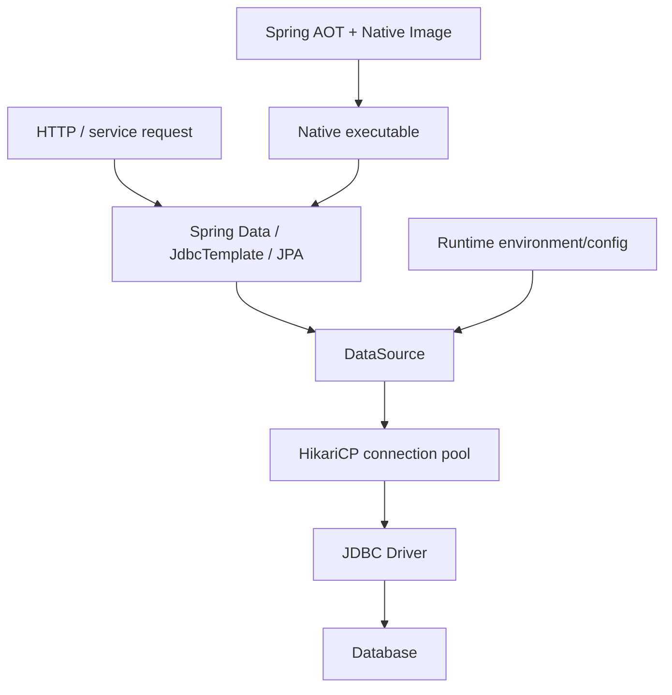

# JDBC, Drivers, Connection Pools, and Runtime Connection Configuration

## 1. JDBC in a Spring Boot Native Image Application

JDBC is the standard Java API for working with relational databases. A Spring Boot application typically uses Spring JDBC, Spring Data JPA, or another data access library on top of JDBC. At a lower level, the **JDBC driver** implements the specific database protocol such as PostgreSQL, MySQL, MariaDB, SQL Server, or Oracle.

When moving to GraalVM Native Image, the entire connection chain must be verified:

1. The right driver version is present in the runtime dependency graph.
2. The driver is discovered and initialized in an AOT/Native Image-compatible way.
3. The `DataSource` receives the URL, username, password, and TLS options from runtime configuration.
4. The connection pool creates, validates, reuses, and closes connections with the right lifecycle.
5. The native executable can connect to the database inside the real container environment.

An application can compile successfully and still fail only when acquiring the first connection, running migrations, or executing a query. Therefore, a passing build does not replace database connection integration tests on the native executable.

In the **SPRING_BOOT_NATIVE_IMAGE** module, the goal is to produce a compact, fast-starting, and operable Spring Boot executable. JDBC must be evaluated against the exact driver/version, target database, authentication/TLS, and deployment configuration.



## 2. Components in the Data Access Path

| Component | Responsibility |
|---|---|
| Spring JDBC / Spring Data JPA | Data access APIs, transaction integration, and mapping |
| DataSource | Supplies JDBC `Connection` instances to the application |
| Connection pool | Manages a set of open connections and handles reuse |
| JDBC driver | Translates JDBC calls into the database protocol |
| Database | Stores data and executes queries/transactions |
| Migration tool | Manages schema versions if the application uses Flyway/Liquibase |

Spring Boot typically auto-configures a `DataSource` when a JDBC driver and suitable datasource properties are present. HikariCP is the common connection pool used by default in Spring Boot when present and no other pool is selected.

Native Image does not change the JDBC contract at the application layer, but the AOT/Native Image build must handle how the driver and supporting libraries load classes, resources, service providers, or native libraries.

## 3. Choosing a JDBC Driver and Verifying Compatibility

There is no blanket guarantee that all JDBC drivers are equally compatible. Compatibility depends on:

- Database vendor and driver version.
- Spring Boot/Spring Framework version.
- JDK and GraalVM Native Image version.
- How the driver uses reflection, resource lookup, service loading, or JNI.
- Whether a TLS provider, authentication plugin, or native transport is used.
- OS/CPU architecture and container shared libraries.

Prefer driver versions supported by the database vendor that provide Native Image documentation or reachability metadata when needed. Check driver release notes, Spring Boot dependency management, and GraalVM compatibility information before upgrading versions.

PostgreSQL dependency example in Gradle:

```groovy
dependencies {
    runtimeOnly("org.postgresql:postgresql")
    implementation("org.springframework.boot:spring-boot-starter-jdbc")
}
```

Maven:

```xml
<dependency>
    <groupId>org.springframework.boot</groupId>
    <artifactId>spring-boot-starter-jdbc</artifactId>
</dependency>
<dependency>
    <groupId>org.postgresql</groupId>
    <artifactId>postgresql</artifactId>
    <scope>runtime</scope>
</dependency>
```

Version examples are managed by the Spring Boot BOM. If the project does not use the BOM, declare the driver version explicitly and ensure compatibility with the database server.

The driver belongs on the runtime classpath, not just the test classpath. If the driver is declared only in test scope, JVM tests may pass due to other configuration, while the application artifact will lack the driver.

## 4. Inspecting the Application Module Dependency Graph

With Gradle:

```bash
./gradlew :api-app:dependencies --configuration runtimeClasspath
./gradlew :api-app:dependencyInsight --dependency postgresql --configuration runtimeClasspath
```

With Maven:

```bash
./mvnw dependency:tree
```

Verify:

- The driver is in the runtime classpath of the right application module.
- The version resolves as intended.
- There are no unintended exclusions or version conflicts.
- The driver is not mistakenly declared in test scope.
- The driver and required database-specific modules are packaged.
- Unnecessary drivers are not pulled in if the application uses only one database.

If using multiple databases, document which datasource uses which driver and which datasource is primary. Do not assume one driver can connect to every database just because all implement the JDBC API.

## 5. Configuring the DataSource with Runtime Properties

Connection details typically vary across local, test, staging, and production. Never hard-code URLs, usernames, or passwords in source code or static fields.

Application configuration example:

```yaml
spring:
  datasource:
    url: ${DB_URL:jdbc:postgresql://localhost:5432/invoice}
    username: ${DB_USERNAME:invoice_app}
    password: ${DB_PASSWORD:}
    driver-class-name: org.postgresql.Driver
    hikari:
      maximum-pool-size: 12
      minimum-idle: 2
      connection-timeout: 3000
      validation-timeout: 1000
      max-lifetime: 1500000
      idle-timeout: 600000
```

This is an illustrative configuration; pool values must be chosen according to workload and database limits. An empty default password is only suitable for local/test when the environment provides safe values; production must supply real secrets and fail fast if they are missing.

Supply environment variables at runtime:

```bash
DB_URL="jdbc:postgresql://db.internal:5432/invoice" \
DB_USERNAME="invoice_app" \
DB_PASSWORD="secret-from-secret-manager" \
./app
```

In production, secrets should be supplied via a secret manager or the deployment platform's secret mechanism. Avoid writing passwords into command history, image layers, build args, source control, or logs.

## 6. Runtime Configuration vs. Build-Time AOT

Spring AOT processes bean graphs and configuration conditions during the build. Connection values such as database host, port, username, and password are usually **runtime configuration**.

Distinguish between:

- Driver classes and dependencies must be present in the artifact at build time.
- Bean/DataSource structure must be processed by Spring AOT under the appropriate build configuration.
- URL, credentials, pool size, and timeouts can be supplied at runtime by design.
- Profiles/conditions determining which beans exist can affect the AOT bean graph; do not expect switching profiles at runtime to instantiate a bean excluded during AOT.

Keep the datasource structure stable where possible, then supply environment values at runtime. If different profiles create different bean graphs, build/test the corresponding artifacts and document which profile was used during AOT.

## 7. How the HikariCP Connection Pool Works

Opening a new TCP/database session per request is expensive in time and resources. A connection pool retains a set of connections for reuse:

1. A service requests a connection from the `DataSource`.
2. The pool returns an idle connection or creates a new one if capacity remains.
3. The transaction/query uses the connection.
4. When the application closes the connection handle, the pool normally returns the connection to the pool rather than closing the physical connection immediately.
5. The pool checks age/validity and closes connections when needed.

HikariCP is the standard pool in Spring Boot JDBC/JPA. Common properties:

| Property | Meaning |
|---|---|
| `maximum-pool-size` | Maximum number of connections in the pool |
| `minimum-idle` | Target number of idle connections |
| `connection-timeout` | Time to wait for a connection from the pool |
| `validation-timeout` | Time to wait when validating a connection |
| `idle-timeout` | Time a connection can sit idle before removal |
| `max-lifetime` | Maximum lifetime of a connection in the pool |
| `keepalive-time` | Interval for keeping connections alive if configured |

Spring Boot property names bind to Hikari configuration. Verify against the Hikari version managed by Spring Boot.

## 8. Choosing Pool Size Based on Database and Concurrency

Do not set a large `maximum-pool-size` merely because the server has many CPUs. Every connection consumes resources on both the application and the database. Total connections across all replicas must stay within the database limit.

For example, with 4 replicas and a max pool size of 12 per replica:

```text
4 replicas × 12 connections = max 48 database connections
```

You must also account for connections reserved for migrations, monitoring, administration, batch jobs, and other services. If the database allows only 60 connections, configuring 48 may leave too little headroom.

Base sizing on:

- Maximum replica count under autoscaling.
- Real concurrency and query duration.
- Database connection limit.
- Database CPU/memory.
- Transaction duration and how often connections are held long.
- Batch/scheduled job workloads.

Measure pool saturation, acquisition latency, active/idle/pending connections, and query latency. A pool that is too small causes waiting; a pool that is too large can overload the database and increase context switching.

## 9. Connection Timeout, Query Timeout, and Transaction Timeout

These are distinct timeouts:

- **Pool connection timeout**: time spent waiting to acquire a connection from the pool.
- **Driver connect timeout**: time spent establishing a connection to the database.
- **Socket/network timeout**: time spent waiting for network I/O.
- **Query timeout**: time allowed for a single statement to execute.
- **Transaction timeout**: transaction time limit per framework/configuration.

Setting one timeout does not automatically configure the others. If the connection pool is exhausted, query timeout does not solve waiting for a connection. If the network hangs, pool acquisition timeout does not necessarily bound how long the driver spends opening a physical connection.

Choose values aligned with SLAs, retry policies, and timeouts of upstream gateways/services. Avoid infinite retries or retrying every SQL error; some errors are non-transient and retries can amplify load on the database.

## 10. Connection Lifecycle and Transactions

Use Spring's transaction abstraction to manage transactions:

```java
@Service
class InvoiceRepositoryService {

    private final JdbcTemplate jdbcTemplate;

    InvoiceRepositoryService(JdbcTemplate jdbcTemplate) {
        this.jdbcTemplate = jdbcTemplate;
    }

    @Transactional
    public void markPaid(String invoiceId) {
        jdbcTemplate.update(
            "update invoice set status = ? where id = ?",
            "PAID",
            invoiceId
        );
    }
}
```

Spring manages transactions through the transaction manager and `DataSource`. With JDBC, `JdbcTemplate` helps manage resources and release connections following Spring semantics. When using raw JDBC, always close `Connection`, `Statement`, and `ResultSet` with try-with-resources.

Do not hold a connection in a static field or global cache. Do not pass a connection across arbitrary threads; transaction context is typically bound to the framework's thread/execution model. With async/reactive processing, use appropriate mechanisms rather than assuming a JDBC connection can be safely shared.

## 11. Driver Discovery and Driver Class Configuration

Spring Boot usually infers the driver from the JDBC URL or via auto-configuration when the driver is on the classpath. You can specify:

```yaml
spring:
  datasource:
    driver-class-name: org.postgresql.Driver
```

Explicitly declaring the driver class can improve configuration readability, but it does not replace the dependency. If the class is absent from the runtime classpath, the property will not add the driver to the artifact.

Some drivers use JDBC service provider discovery via `META-INF/services/java.sql.Driver`; some mechanisms may use class loading/initialization. Native Image must handle the resource/class discovery required by the driver. Prefer drivers with official Native Image support and metadata. Add reflection/resource hints only when backed by documentation or specific native errors.

Do not scatter broad hints across every class in the driver. Doing so can retain unnecessary metadata and mask real causes such as an unsupported driver version or unpackaged resources.

## 12. TLS and Database Authentication

Production typically requires TLS and authentication mechanisms. Configuration depends on the driver/database vendor:

- JDBC URL or driver properties for TLS mode.
- Safely provisioned truststore/CA certificate.
- Client certificate/private key if using mutual TLS.
- IAM/cloud database tokens or authentication plugins.
- Credential rotation and reconnect policies.

Never disable certificate verification to work around TLS errors. Ensure trust material is provided at runtime appropriately; public certificates may be config files/resources, while private keys and secrets must be managed as secrets. If the driver uses native crypto/JNI, also verify libraries/ABIs and Native Image support.

Do not bake credentials or private keys into Native Image build-time static state. Secret rotation should have a refresh/restart mechanism compatible with the pool and driver.

## 13. Migration Tools and DataSource Startup

Flyway/Liquibase can run migrations when the application context starts. That causes datasource connections to be opened before the first HTTP request arrives.

When testing native, verify:

- The migration tool and database driver versions are compatible.
- Migration resources are packaged.
- The database is ready before the app runs migrations.
- Credentials/permissions are sufficient to execute DDL.
- Migration failure causes the app to fail per the desired policy.
- Migrations run only on the appropriate instance/role in multi-replica environments.

A passing native build does not prove migrations can run. Execute integration tests against a real database or Testcontainers on the native executable/container as your test environment allows.

## 14. Testing JDBC on the JVM and Native Image

A test suite should cover:

| Scenario | Objective |
|---|---|
| DataSource initialization | Driver is loaded and configuration is bound |
| Acquiring connection | Network/authentication works |
| Simple query | JDBC driver executes SQL |
| Transaction commit | Data is committed |
| Transaction rollback | Data is not persisted on error |
| Pool saturation | Acquisition timeout and metrics behave correctly |
| Database unavailable | Startup/retry/fail behavior is correct |
| TLS/authentication | Truststore and credentials are used |
| Migration | Schema is created/updated |
| Reconnect | Stale connections are evicted and new ones work |

JVM test:

```java
@SpringBootTest
class JdbcIntegrationTest {

    @Autowired
    JdbcTemplate jdbcTemplate;

    @Test
    void executesQuery() {
        Integer result = jdbcTemplate.queryForObject(
            "select 1", Integer.class);
        assertThat(result).isEqualTo(1);
    }
}
```

This test requires an available database endpoint or Testcontainers. It proves the query works on the JVM, not that the native binary can connect.

Next, run the native executable, supply the same runtime configuration, and invoke an endpoint/test path that actually exercises JDBC. If a native test framework is configured, run the corresponding native tests while still keeping an application executable smoke/integration test.

## 15. Running a Database in Container Integration Tests

You can use Testcontainers or a dedicated database service in CI. Ensure:

- Database image/tag is pinned and matches the driver.
- Hostname/port seen by the native process is accurate.
- Test credentials do not use production secrets.
- Database readiness is checked before tests.
- Test data is reset or isolated.
- The native application runs on a network that can reach the database container.
- The app container has the required CA/truststore and mounted files.

If the native executable runs in its own container, `localhost` points to the application container itself, not the database container. Use the service DNS/network alias of the test environment.

## 16. Packaging the Native Application with the JDBC Runtime

JDBC drivers are usually Java bytecode and are compiled into the Native Image executable. If a driver requires a native library or system library, ensure those are present and compatible in the final image.

With a Dockerfile, a simple example:

```dockerfile
FROM debian:bookworm-slim
WORKDIR /app
COPY build/native/nativeCompile/api-app /app/api-app
USER 10001
EXPOSE 8080
ENTRYPOINT ["/app/api-app"]
```

This is only an example. The run image must be compatible with the binary and shared library dependencies. If the driver needs CA certificates, timezone data, or system libraries, install/copy them per instructions. Grant the container user permissions to read CA/config files and write to temp directories if required.

With Cloud Native Buildpacks, inspect the builder/run image, native buildpack support, and dependency libraries in the final image. Do not assume libraries present in the builder automatically exist in the run image.

## 17. Observing the Connection Pool in Production

Track these metrics:

- Active connections.
- Idle connections.
- Pending threads/requests waiting for a connection.
- Connection acquisition time.
- Connection creation time.
- Connection timeout count.
- Query latency and transaction duration.
- Database-side connection count and slow queries.

Spring Boot Actuator/Micrometer can expose pool metrics when appropriate dependencies/configuration are present. Expose metrics only through protected endpoints; never allow connection URLs, usernames, or passwords to appear in logs or metric labels.

Native Image does not automatically optimize pool sizing. Benchmark under production-like load and tune based on total replicas and database capacity.

## 18. Common Errors

| Symptom | Possible Cause | Resolution |
|---|---|---|
| `Failed to determine a suitable driver class` | Missing driver or invalid URL | Check runtime dependencies and JDBC URL |
| `No suitable driver` | Driver not loaded/registered or URL mismatch | Check driver version, service metadata, and URL |
| `ClassNotFoundException` for driver | Driver missing from runtime classpath | Fix dependency scope/packaging |
| `UnsatisfiedLinkError` | Driver depends on missing/wrong-ABI native library | Check OS/architecture and shared libraries |
| Connection refused | Wrong DB host/port or DB not ready | Check network/DNS/readiness |
| Authentication failed | Wrong credentials, role, or auth plugin | Check secrets and database grants |
| TLS handshake failure | Incompatible truststore/certificate/protocol | Check CA, TLS mode, and driver properties |
| Pool timeout | Pool exhausted or queries holding connections too long | Check for leaks, transaction scope, and pool sizing |
| Migration fails at startup | DB not ready, missing permissions, or missing migration resources | Check readiness, credentials, and migration files |
| JVM passes, native fails | Metadata/driver/native library difference | Verify driver support and run native integration tests |

Do not fix `No suitable driver` by blindly adding reflection hints. First verify that the driver is in the artifact, the URL is valid, and JDBC service discovery is working.

## 19. Pre-Release Checklist

- Right JDBC driver vendor/version is on the runtime classpath.
- Spring Boot/Spring Data/JDBC dependencies are compatible.
- DataSource URL and credentials are supplied at runtime.
- No hard-coded secrets in source, images, or build output.
- Pool size fits total replicas and database connection limits.
- Connect/query/transaction timeouts are distinguished and configured.
- TLS/truststore/authentication are tested.
- Driver AOT/Native Image support and metadata are verified.
- Migration resources and startup behavior are checked.
- Native executable runs queries/transactions against a test database.
- Container uses the right network, CA, user, and runtime libraries.
- Pool metrics and database connection usage are observed.

## 20. Self-Check Questions

1. How does the role of a JDBC driver differ from a `DataSource` and a connection pool?
2. Why must the driver be on the application module's runtime classpath?
3. At which stage should `spring.datasource.url` and credentials be supplied?
4. How does HikariCP manage the connection lifecycle?
5. Why must total pool size be calculated based on replica count and database connection limits?
6. How does pool connection timeout differ from driver connect timeout and query timeout?
7. When a driver uses service loading or JNI, what must be verified for Native Image?
8. Why does a passing JVM query test not prove that the native executable can connect to the database?

**Key Takeaway:** The JDBC driver, `DataSource`, and connection pool are three distinct parts of the database access path. Put the right driver in the runtime artifact, supply URLs/secrets/TLS at runtime, size the pool for system-wide capacity, and test queries, transactions, and migrations directly on the target native executable/container.
