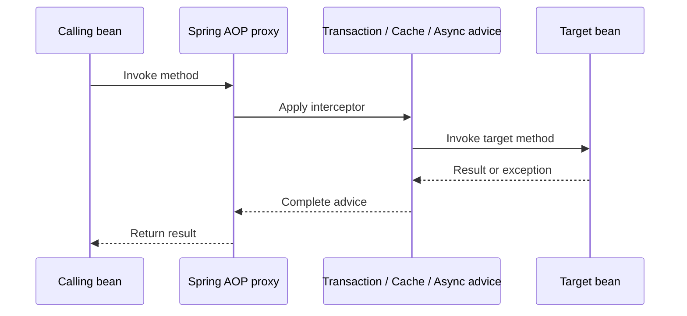
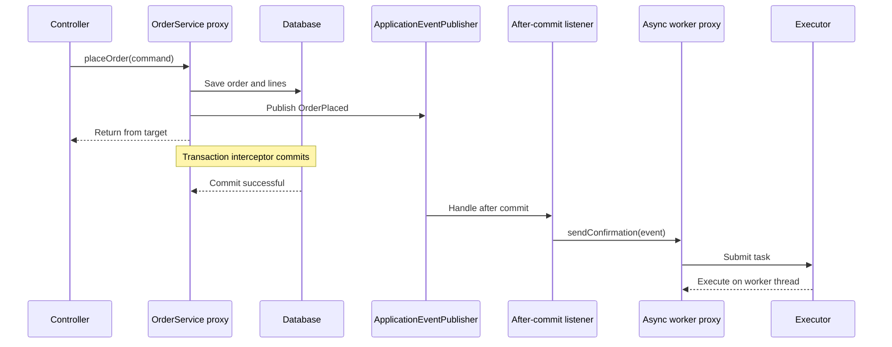

# Transactions, Caching, and Asynchronous Processing via AOP

## Lesson Objectives

In Spring Boot applications, transactions, caching, and asynchronous processing are commonly enabled using annotations such as `@Transactional`, `@Cacheable`, `@CacheEvict`, and `@Async`. Spring applies these behaviors through AOP advice, typically attached to beans via proxies.

When moving an application to **GraalVM Native Image**, proxy boundaries and resource lifecycles must be carefully examined. Spring AOT can prepare code and metadata for many framework-managed proxies, yet it does not alter Java call semantics. Self-invocation can still bypass advice; imperative transactions remain bound to the current thread; and executors and cache providers still need to be initialized and managed at runtime.

This lesson uses an order-placement flow to combine three mechanisms:

- Transactions persist orders and related data consistently.
- Caches are updated or invalidated based on committed state.
- Notifications are processed asynchronously after the transaction succeeds.

After this lesson, you will be able to:

- Explain how Spring AOP applies transaction, cache, and async advice.
- Design clear transaction boundaries and handle rollbacks properly.
- Choose appropriate cache keys, cache providers, and eviction timing.
- Configure bounded executors and manage failures in async tasks.
- Avoid self-invocation and understand why transactions do not automatically propagate to async threads.
- Test these mechanisms on JVM AOT and the native executable.

## 1. Three Mechanisms Sharing Spring AOP

### 1.1. Proxies Are the Entry Point for Advice

Spring typically creates a proxy for a bean with methods requiring advice. When another bean invokes a method through a Spring-injected reference, the proxy can run interceptors before/after invoking the target.



The three annotations serve different goals:

| Annotation | Advice Executed | Desired Result |
|---|---|---|
| `@Transactional` | Starts/joins a transaction, commits or rolls back | Group data operations within a consistent boundary |
| `@Cacheable` / `@CachePut` / `@CacheEvict` | Reads, writes, or evicts cache entries around the call | Reduce repeated queries and control cached data |
| `@Async` | Submits the call to an executor | Offload work from the calling thread |

Annotations do not automatically wrap every Java call. In proxy mode, advice executes only when the call passes through the proxy and matches the advisor's conditions.

### 1.2. Self-Invocation Bypasses the Proxy

Example:

```java
@Service
class OrderService {

    public void placeOrder(Order order) {
        this.persist(order);
    }

    @Transactional
    public void persist(Order order) {
        // Save the order
    }
}
```

When a caller invokes `placeOrder()` via the proxy, the target executes. Then `this.persist(order)` directly invokes the method on the same object; the call does not go back through the proxy. Consequently, the transaction advice on `persist()` is not triggered by self-invocation.

This limitation also applies to caching and async. Switching from JDK proxies to class-based proxies does not automatically fix self-invocation. A maintainable approach is usually to extract the advised logic into a collaborator bean and invoke it through a Spring-injected dependency.

### 1.3. Conditions for Proxies to Work

- The bean must be managed by Spring.
- The caller must invoke through the proxy reference.
- The method and proxy type must be compatible with interception.
- The corresponding advisor must be enabled and validly configured.
- The advised method must not be invoked via self-invocation.

With class-based proxies, `final` classes/methods cannot be overridden to inject advice. With JDK dynamic proxies, callers typically interact via an interface implemented by the proxy. Inspect the actual proxy type and method rather than merely checking whether an annotation is present.

## 2. Managing Transactions with `@Transactional`

### 2.1. Configuring the Transaction Manager

Spring Boot usually auto-configures transaction management when appropriate dependencies and a transaction manager are present, such as JDBC/JPA. With manual configuration, you can enable transaction management via `@EnableTransactionManagement` and provide the corresponding `PlatformTransactionManager`.

JDBC example:

```java
@Configuration(proxyBeanMethods = false)
class DatabaseConfiguration {

    @Bean
    PlatformTransactionManager transactionManager(
            DataSource dataSource) {
        return new DataSourceTransactionManager(dataSource);
    }
}
```

If the application uses JPA, it typically uses the transaction manager configured by Spring Boot/JPA. Do not create a second transaction manager unless intentionally managing multiple datasources or distinct transaction boundaries.

### 2.2. Placing Transactions at Use-Case Boundaries

A service method representing a single use case is usually a clear place to set a transaction boundary:

```java
@Service
class OrderApplicationService {

    private final OrderRepository orderRepository;
    private final OrderLineRepository lineRepository;

    OrderApplicationService(
            OrderRepository orderRepository,
            OrderLineRepository lineRepository) {
        this.orderRepository = orderRepository;
        this.lineRepository = lineRepository;
    }

    @Transactional
    public OrderId createOrder(CreateOrderCommand command) {
        Order order = Order.create(command.customerId());
        orderRepository.save(order);

        for (CreateOrderLine line : command.lines()) {
            lineRepository.save(OrderLine.from(order, line));
        }

        return order.id();
    }
}
```

If any write operation throws an exception matching the rollback rules, the transaction interceptor rolls back the entire transaction. The caller receives the result only after the proxy call completes; transaction commit happens when the interceptor finishes successfully.

Placing the transaction on the orchestrating method allows repository operations to participate in one shared boundary. Marking only an internal helper method called via `this` may fail to open a transaction as expected.

### 2.3. Default Rollback Rules

By default, `@Transactional` rolls back when a method throws a `RuntimeException` or `Error`. Checked exceptions do not trigger automatic rollback under the default rules.

If business logic requires rollback when a checked exception occurs, declare it explicitly:

```java
@Transactional(rollbackFor = PaymentDeclinedException.class)
public void capturePayment(PaymentCommand command)
        throws PaymentDeclinedException {
    // Process and persist payment result
}
```

Do not catch and swallow an exception if the transaction needs to roll back. If you must translate an exception, ensure the rethrown exception conforms to the rollback policy or mark rollback-only via the transaction API when there is a clear reason.

### 2.4. Propagation and Isolation

Common attributes:

| Attribute | Meaning |
|---|---|
| `Propagation.REQUIRED` | Joins an existing transaction or creates a new one |
| `Propagation.REQUIRES_NEW` | Suspends the current transaction and starts an independent one |
| `Propagation.MANDATORY` | Requires the caller to already have an active transaction |
| `Propagation.NEVER` | Disallows execution inside a transaction |
| `Isolation.READ_COMMITTED` | Prevents reading uncommitted data from other transactions |
| `readOnly = true` | Hints a read-only transaction to compatible providers/drivers |
| `timeout` | Transaction time limit as supported by the transaction manager |

Choose propagation/isolation based on data requirements. Do not use `REQUIRES_NEW` simply to sidestep transaction errors; it alters atomicity and can cause audit data or side effects to commit even if the outer transaction rolls back.

### 2.5. Imperative Transactions Are Bound to the Thread

With imperative transaction managers like JDBC/JPA, Spring typically binds transaction resources to the current thread. Repositories invoked on the same thread can join the active transaction.

When offloading work to another thread with `@Async`, the calling thread's imperative transaction does not propagate to the executor thread. If the async task needs its own transaction, place `@Transactional` on the async worker's method; that call will open a transaction on the async thread if the worker is properly proxied.

Reactive transactions use Reactor `Context` and a reactive transaction manager, following different rules from imperative transactions. Do not switch a reactive flow onto an arbitrary executor and assume the transaction context is preserved.

## 3. Caching with Spring Cache

### 3.1. Enabling Caching and Choosing a CacheManager

Annotation-driven caching can be enabled with `@EnableCaching`:

```java
@Configuration(proxyBeanMethods = false)
@EnableCaching
class CacheConfiguration {}
```

Spring Boot can auto-configure a cache manager based on providers present on the classpath. When no specific provider is present, simple configurations may fall back to a default cache suitable for development; production applications should choose an explicit provider and storage policy.

Example using an application-provided cache manager:

```java
@Configuration(proxyBeanMethods = false)
@EnableCaching
class ProductCacheConfiguration {

    @Bean
    CacheManager cacheManager() {
        return new ConcurrentMapCacheManager("products");
    }
}
```

`ConcurrentMapCacheManager` is suitable for simple examples and single-process in-memory caching. It does not share data across instances and does not replace Redis, Caffeine, or production cache providers with proper eviction/TTL/metrics.

### 3.2. Using `@Cacheable` for Read Data

```java
@Service
class ProductQueryService {

    private final ProductRepository repository;

    ProductQueryService(ProductRepository repository) {
        this.repository = repository;
    }

    @Cacheable(
            cacheNames = "products",
            key = "#productId"
    )
    public ProductView findById(String productId) {
        return repository.findViewById(productId)
                .orElseThrow(ProductNotFoundException::new);
    }
}
```

When the cache holds an entry for the key, Spring can return the cached result without invoking the target method. When no entry exists, the method executes and the result is stored according to cache configuration.

Key selection must reflect every factor that alters the result. If results depend on tenant, locale, or access permissions, a key containing only product ID could serve data from a different context. Avoid caching sensitive data shared across users.

### 3.3. Using `@CachePut` and `@CacheEvict`

`@CachePut` always executes the method and updates the cache with the result; `@Cacheable` may skip the method on a cache hit. Do not place both annotations on the same method without clearly understanding their interaction.

Update example:

```java
@CachePut(cacheNames = "products", key = "#result.id")
public ProductView update(ProductCommand command) {
    return productRepository.update(command);
}
```

Eviction example:

```java
@CacheEvict(cacheNames = "products", key = "#productId")
public void delete(String productId) {
    productRepository.deleteById(productId);
}
```

By default, eviction occurs after the method completes successfully. You can use `beforeInvocation = true` when you genuinely want to evict the cache even if the method throws an exception, while keeping in mind that database state may remain unchanged.

### 3.4. Keeping Caches and Transactions Consistent

A common risk is updating the cache before the database transaction commits. If the transaction later rolls back, the cache may hold data that was never committed.

Determine the ordering and semantics of transaction advice relative to cache advice; advisor ordering can affect when cache operations run. For data requiring consistency, you can:

- Emit cache update/eviction signals only after the transaction commits.
- Use transaction-aware cache integration if supported by the provider and its semantics fit requirements.
- Use post-commit events/outbox to update the cache or publish messages.
- Design caches with a TTL and the ability to reload from the authoritative data source.

Do not assume `@CacheEvict` automatically synchronizes with database transactions across all cache providers.

### 3.5. Cache Objects and Native Image

Cache managers and cache entries are typically runtime state and should be created within the application lifecycle rather than held in mutable static fields initialized at build time.

If a cache provider uses reflection, proxies, serialization, or dynamic resources, verify AOT/Native Image support for that exact provider version. Spring AOT can supply hints for framework-known components; third-party library metadata depends on library integration or bundled reachability metadata.

For distributed caches like Redis, endpoints/credentials should be supplied at runtime. Native Image does not embed Redis inside the binary; the cache service still must be deployed and connected to as an external dependency.

## 4. Asynchronous Processing with `@Async`

### 4.1. Enabling Async Execution

Spring can enable async method execution with `@EnableAsync`:

```java
@Configuration(proxyBeanMethods = false)
@EnableAsync
class AsyncConfiguration {
}
```

When an `@Async` bean method is invoked via a proxy, Spring dispatches the call to an executor instead of running the body on the calling thread.

### 4.2. Configuring a Bounded Executor

Do not leave production executors with unbounded threads and queues. Example configuration:

```java
@Configuration(proxyBeanMethods = false)
@EnableAsync
class AsyncConfiguration {

    @Bean("notificationExecutor")
    ThreadPoolTaskExecutor notificationExecutor() {
        ThreadPoolTaskExecutor executor =
                new ThreadPoolTaskExecutor();
        executor.setCorePoolSize(4);
        executor.setMaxPoolSize(8);
        executor.setQueueCapacity(200);
        executor.setThreadNamePrefix("notification-");
        executor.setWaitForTasksToCompleteOnShutdown(true);
        executor.setAwaitTerminationSeconds(30);
        return executor;
    }
}
```

Pool/queue limits should be based on processing time, load, CPU, and downstream limits. An overly large queue can retain many objects in memory; an overly small queue can reject tasks during traffic spikes.

`ThreadPoolTaskExecutor` is a Spring-managed bean, so shutdown lifecycle can be managed by the container. Avoid creating executors in static fields or forgetting to close self-managed executors.

### 4.3. Returning Future or CompletableFuture

```java
@Service
class NotificationWorker {

    @Async("notificationExecutor")
    public CompletableFuture<Void> sendOrderConfirmation(
            OrderPlaced event) {
        notificationClient.send(event);
        return CompletableFuture.completedFuture(null);
    }
}
```

The caller receives a `CompletableFuture` and can compose or observe the outcome. If the method returns `void`, exceptions raised inside the async task are not returned directly to the caller; configure an `AsyncUncaughtExceptionHandler` or corresponding error-reporting mechanism.

Do not immediately call `join()` or `get()` after every call if the goal is not blocking the request thread. Define clear timeout, retry, cancellation, and error-reporting policies.

### 4.4. Async Does Not Inherit the Caller's Transaction

Example where you must not assume the transaction propagates to the worker:

```java
@Service
class OrderService {

    private final NotificationWorker worker;

    OrderService(NotificationWorker worker) {
        this.worker = worker;
    }

    @Transactional
    public void placeOrder(Order order) {
        orderRepository.save(order);
        worker.sendOrderConfirmation(
                new OrderPlaced(order.id())
        );
    }
}
```

The worker runs on a different thread. It does not join `placeOrder()`'s imperative transaction. If the worker reads data before the transaction commits, it may miss newly written rows or process an order that subsequently rolls back.

A better solution is to dispatch the event only after commit, then let the worker process independently. If the worker needs a transaction, place a separate transaction boundary on the worker method.

### 4.5. Self-Invocation Defeats Async

The following snippet does not execute asynchronously as intended:

```java
@Service
class ReportService {

    public void generate() {
        this.generateAsync();
    }

    @Async
    public CompletableFuture<Void> generateAsync() {
        buildReport();
        return CompletableFuture.completedFuture(null);
    }
}
```

The call `this.generateAsync()` does not pass through the proxy. Extract `generateAsync()` into a separate worker bean or invoke it through a collaborator proxy. With async, this is particularly easy to overlook because the code still succeeds while running synchronously on the current thread.

## 5. Combining Transactions, Caching, and Async in One Business Flow

### 5.1. Order-Placement Flow Objectives

An order-placement use case may need to:

1. Persist the order and order lines inside one transaction.
2. After commit, invalidate cached data for the modified information.
3. After commit, send notifications asynchronously.

Diagram:



The event is published inside the transaction, yet the listener executes only when the transaction commits successfully. If the transaction rolls back, the `AFTER_COMMIT` listener phase does not run.

By default, `@TransactionalEventListener` requires an active transaction at the time the event is published. If an event is published outside a transaction, the listener will not run unless `fallbackExecution = true` is enabled. Enable fallback only when business logic genuinely wants handling even without a transaction.

After commit, the transaction has completed, though certain transaction resources may still be synchronized during lifecycle callbacks. If the listener needs to write additional data to the database, explicitly start a new transaction (for example, a collaborator with `@Transactional(propagation = Propagation.REQUIRES_NEW)`) rather than assuming writes will commit into the transaction that just ended.

### 5.2. Service Publishing the Event Inside a Transaction

```java
public record OrderPlaced(String orderId) {}

@Service
class OrderApplicationService {

    private final OrderRepository orderRepository;
    private final ApplicationEventPublisher events;

    OrderApplicationService(
            OrderRepository orderRepository,
            ApplicationEventPublisher events) {
        this.orderRepository = orderRepository;
        this.events = events;
    }

    @Transactional
    public String placeOrder(CreateOrderCommand command) {
        Order order = Order.create(command);
        orderRepository.save(order);

        events.publishEvent(new OrderPlaced(order.id()));
        return order.id();
    }
}
```

Publishing an event does not itself send an email or call an external API. It only notifies within the process; listeners can subscribe at the appropriate phase.

### 5.3. Handling After Commit and Calling Workers via Proxies

```java
@Component
class OrderPlacedListener {

    private final NotificationWorker worker;
    private final OrderCacheInvalidator cacheInvalidator;

    OrderPlacedListener(
            NotificationWorker worker,
            OrderCacheInvalidator cacheInvalidator) {
        this.worker = worker;
        this.cacheInvalidator = cacheInvalidator;
    }

    @TransactionalEventListener(phase = TransactionPhase.AFTER_COMMIT)
    public void afterCommit(OrderPlaced event) {
        cacheInvalidator.evictOrderRelatedData(event.orderId());
        worker.sendOrderConfirmation(event);
    }
}
```

The cache invalidator and worker are separate beans, so calls go through each bean's proxy. The listener runs after commit; cache eviction and async task submission begin only after the transaction succeeds.

Cache invalidator example:

```java
@Service
class OrderCacheInvalidator {

    @CacheEvict(cacheNames = "orders", key = "#orderId")
    public void evictOrderRelatedData(String orderId) {
        // Method may have an empty body; advice performs eviction
    }
}
```

Worker example:

```java
@Service
class NotificationWorker {

    private final NotificationClient client;

    NotificationWorker(NotificationClient client) {
        this.client = client;
    }

    @Async("notificationExecutor")
    public CompletableFuture<Void> sendOrderConfirmation(
            OrderPlaced event) {
        client.sendOrderConfirmation(event.orderId());
        return CompletableFuture.completedFuture(null);
    }
}
```

In systems that must guarantee no event is lost if the process crashes right after commit, an in-process event listener is insufficient. Use a transactional outbox or durable messaging mechanism: write an outbox record in the same transaction, then have a separate publisher send the message and mark it processed.

### 5.4. Separate Transaction in the Worker When Needed

If the worker must read/write the database, you can place a separate transaction on the async method:

```java
@Async("notificationExecutor")
@Transactional
public CompletableFuture<Void> processNotification(
        OrderPlaced event) {
    notificationLogRepository.save(
            NotificationLog.started(event.orderId())
    );
    notificationClient.sendOrderConfirmation(event.orderId());
    return CompletableFuture.completedFuture(null);
}
```

This method must be invoked through the async proxy; transaction advice will apply on the worker thread if advisors/configurations are set up properly. Do not rely on the caller's transaction. For operations calling external systems, consider timeouts, retries, and idempotency because a database transaction cannot roll back external side effects already sent.

## 6. What Must Be Verified for Spring AOT and Native Image?

### 6.1. Proxies Prepared by Spring AOT

Spring AOT can analyze Spring-managed beans and advisors, generating code/hints to support proxies and bootstrapping. Standard annotations such as transaction, cache, and async are generally supported in compatible framework configurations.

Still, verify:

- Are the beans discovered and registered in the AOT context?
- Are the transaction manager, cache manager, and executor created as expected?
- Are proxies created as interface-based or class-based proxies?
- Can the advised methods be intercepted?
- Do custom advisors, custom proxy factories, or external libraries have AOT/native integration?

### 6.2. Native Image Does Not Fix Proxy Design Mistakes

Native compilation does not turn self-invocation into a proxied call. If `this.method()` bypasses advice on the JVM, it will still bypass advice in the native executable.

Native Image also has specific requirements if libraries use reflection, dynamic proxies, serialization, or class generation. Spring AOT can provide hints for framework-known components; custom integrations require suitable metadata.

Do not add Runtime Hints to fix:

- Transaction boundaries placed on the wrong method.
- Async workers invoked via self-invocation.
- Cache eviction occurring before data commits.
- Executors lacking capacity or failing to shut down cleanly.

Those are design or runtime lifecycle issues, not missing reflection metadata.

### 6.3. Resources Must Be Created at Runtime

Cache managers, executors, connection pools, and external service clients usually need to bind to the runtime environment. Avoid initializing them inside static initializers that may execute at build time.

Use the Spring bean lifecycle to create and close resources. Endpoints, credentials, queue names, pool sizes, and timeouts should be supplied from runtime configuration when they do not alter the bean graph.

### 6.4. Providers and Dependencies Must Be Compatible

Native Image does not guarantee that every cache provider, database driver, transaction integration, or notification client is automatically compatible. Check:

- Does the provider have reachability metadata or suitable Spring AOT integration?
- Does it use reflection to create serializers, proxies, or connection factories?
- Does it use JNI/shared libraries?
- Do TLS, DNS, filesystem, and networking work in the target image?
- Does it support closing executors/connection pools on shutdown?

If a provider does not support native, consider switching providers, adding verified metadata, or isolating that integration into an appropriate separate process.

## 7. Testing Transactions, Caching, and Async

### 7.1. Testing Rollback

A test should prove data is absent after a use case throws an exception:

```java
@SpringBootTest
class OrderTransactionTests {

    @Autowired
    OrderApplicationService service;

    @Autowired
    OrderRepository repository;

    @Test
    void rollsBackOrderWhenUseCaseFails() {
        assertThatThrownBy(() ->
                service.placeOrder(commandThatFailsAfterSave())
        ).isInstanceOf(OrderCreationException.class);

        assertThat(repository.findByReference("test-order"))
                .isEmpty();
    }
}
```

Fixtures and repository methods must be defined in the project. Avoid annotating the test method itself with `@Transactional` if doing so masks the service's transaction boundary. Verify database state after the service proxy returns the exception.

### 7.2. Testing Cache Hit and Eviction

Use a spy/mock repository or counter to verify the target method does not run again on a cache hit:

```java
@SpringBootTest
class ProductCacheTests {

    @Autowired
    ProductQueryService queryService;

    @MockBean
    ProductRepository repository;

    @Test
    void returnsCachedProductOnSecondCall() {
        given(repository.findViewById("p-1"))
                .willReturn(Optional.of(productView("p-1")));

        queryService.findById("p-1");
        queryService.findById("p-1");

        then(repository).should(times(1))
                .findViewById("p-1");
    }
}
```

Mock annotation APIs may vary across Spring Boot versions; use the mock/spy mechanism supported by your project. Add tests for eviction after update/delete and tests for tenant/locale-differentiated keys if data depends on those factors.

### 7.3. Testing Async Completion

For async methods returning `CompletableFuture`, wait for the result in tests with a timeout:

```java
@SpringBootTest
class NotificationWorkerTests {

    @Autowired
    NotificationWorker worker;

    @MockBean
    NotificationClient client;

    @Test
    void submitsNotificationToAsyncWorker() {
        CompletableFuture<Void> result =
                worker.sendOrderConfirmation(
                        new OrderPlaced("order-1")
                );

        assertThatCode(() -> result.get(5, TimeUnit.SECONDS))
                .doesNotThrowAnyException();

        then(client).should()
                .sendOrderConfirmation("order-1");
    }
}
```

This test confirms the future completes and the client is called; if you need to prove execution actually occurred on another thread, capture thread names or use a latch/queue to compare with the caller thread. Avoid fixed sleeps when you can await a `Future` or synchronization primitive.

### 7.4. Testing That Events Run Only After Commit

Write integration tests for both scenarios:

- Transaction commits: the `AFTER_COMMIT` listener is invoked and the worker is submitted.
- Transaction rolls back: the listener neither sends notifications nor evicts cache entries for that event.

When using in-process events, tests must wait for async tasks to finish before asserting side effects. When using an outbox, confirm that the outbox record commits together with business data and that the publisher can retry safely.

### 7.5. Running the Same Tests on JVM AOT and Native

A minimum matrix:

| Check | Regular JVM | JVM AOT | Native Executable |
|---|---|---|---|
| `ApplicationContext` startup | Yes | Yes | Yes |
| Transaction commit/rollback | Yes | Yes | Yes |
| Cache hit/put/evict | Yes | Yes | Yes |
| Async executor/thread | Yes | Yes | Yes |
| Event after commit | Yes | Yes | Yes |
| Shutdown executor/client | Yes | Yes | Yes |
| Reflection/provider integration | As needed | As needed | Mandatory for dynamic paths |

JVM AOT helps verify the generated Spring context and proxies. Only running the native executable fully verifies Native Image compatibility of providers, metadata, and libraries.

## 8. Operating and Observing in Production

### 8.1. Observing Transactions

Monitor:

- Rollback and exception rates by use case.
- Transaction duration and timeouts.
- Connection pool active/idle/pending counts.
- Deadlocks, lock waits, and database errors.
- Cases where writes succeed but post-commit side effects fail.

Do not log sensitive information or payloads containing secrets when investigating transactions.

### 8.2. Observing Caching

Monitor hit/miss ratios, evictions, size, TTL, connection errors, and provider latency. Set appropriate capacity/TTL limits; prevent unbounded cache growth driven by arbitrary input keys.

With multiple instances, clarify whether caching is local or distributed. Local caches can diverge across instances; if consistency is needed, design an appropriate invalidation/event strategy.

### 8.3. Observing Async Executors

Monitor:

- Active threads and pool size.
- Queue depth and wait times.
- Task completions/failures/rejections.
- Task duration and downstream latency.
- Remaining tasks during shutdown.

When the queue fills up, define an explicit rejection policy. Do not blindly use `CallerRunsPolicy`, because it can force request threads to execute work meant to run asynchronously.

### 8.4. Shutdown and Work Durability

Executors can wait for tasks to finish within a timeout, yet the process/container can still be forcibly terminated. If notifications or messages must not be lost, use a durable queue/outbox and idempotent processing.

The native executable still requires graceful shutdown, proper readiness/liveness probes, and alignment with orchestrator termination grace periods. Never treat fast binary startup as an excuse to skip lifecycle management.

## 9. Common Errors and How to Resolve Them

| Symptom | Possible Cause | Resolution |
|---|---|---|
| `@Transactional` does not open a transaction | Self-invocation, unproxied bean, or missing transaction manager | Check proxy and place boundary on a method invoked externally |
| Checked exception does not roll back | Default rollback rules exclude checked exceptions | Declare `rollbackFor` or appropriate policy |
| Async worker does not see newly written data | Task runs before transaction commits | Emit event after commit or use an outbox |
| Async worker has no transaction | Imperative transaction does not cross threads | Place a separate transaction on the worker method |
| `@Async` runs on the caller thread | Self-invocation or async not enabled | Extract worker bean, verify `@EnableAsync` and proxy |
| Async exception invisible to caller | Method returns `void` or future is unobserved | Return `Future`/`CompletableFuture` and handle errors |
| Cache holds stale data after update | Missing eviction/update or incomplete key | Design keys and invalidation per use case |
| Cache holds uncommitted data | Cache advice runs before DB commit | Evict/update after commit or use a transaction-aware strategy |
| Native build missing proxy/provider metadata | Custom proxy or reflection-using library lacks hints | Check AOT integration/reachability metadata |
| Native app fails to connect to cache/database | Wrong endpoint/secret/network or missing native library | Check runtime config, TLS, DNS, ABI, and provider |
| Tasks lost on process restart | Relying solely on in-memory executor/events | Use durable queue/outbox and idempotent retries |

## 10. Hands-On Workflow

### Step 1 — Create the Transaction Boundary

Write a use-case service with `@Transactional` that saves an order and order lines. Add commit/rollback tests and inspect data after the service proxy completes.

### Step 2 — Add Caching

Enable caching, configure a `CacheManager`, and add `@Cacheable` for read queries. Verify hits, misses, eviction, and tenant/locale keys if applicable.

### Step 3 — Add the Async Worker

Configure a bounded executor. Extract the notification worker into its own bean, use `@Async`, and return `CompletableFuture`. Verify threads, completion, and exceptions.

### Step 4 — Coordinate After Commit

Publish an event inside the transaction, handle it with `@TransactionalEventListener(AFTER_COMMIT)`, and invoke the cache invalidator and async worker through proxies. If event durability is required, implement an outbox.

### Step 5 — Test AOT and Native

Run tests on the standard JVM, JVM AOT, and the native executable. Compare transactions, caching, async, events, resources, and shutdown. Add hints only when failures genuinely stem from reflection/resource/proxy metadata.

### Step 6 — Observe and Operate

Record transaction duration/rollbacks, cache hit/miss rates, executor queue/rejections, and shutdown behavior. Configure timeouts, retries, idempotency, and capacity according to load characteristics.

### Self-Check Questions

1. Why do `@Transactional` and `@Async` coexist in one flow without the caller thread's transaction automatically propagating to the worker?
2. Why should notifications be dispatched after commit instead of calling external systems inside the transaction?
3. When should you use `@CachePut` versus `@CacheEvict`, and what happens if the cache changes before the DB commits?
4. Why can self-invocation cause `@Async` to run synchronously?
5. Why does an executor need a bounded queue/pool and graceful shutdown?
6. What does Spring AOT do for proxies, and what issues still require separate testing on Native Image?
7. When is an in-process event insufficient and a transactional outbox needed?

**Key Takeaway:** Transactions protect data within a boundary; caches should reflect committed state; async workers run on separate threads and do not automatically inherit the caller's imperative transaction. Design these boundaries cleanly across beans/proxies, manage caches/executors within the runtime lifecycle, emit side effects after commit, and retest on the native executable. Spring AOT helps prepare proxies, but it does not fix self-invocation, transaction semantics, or task durability.
