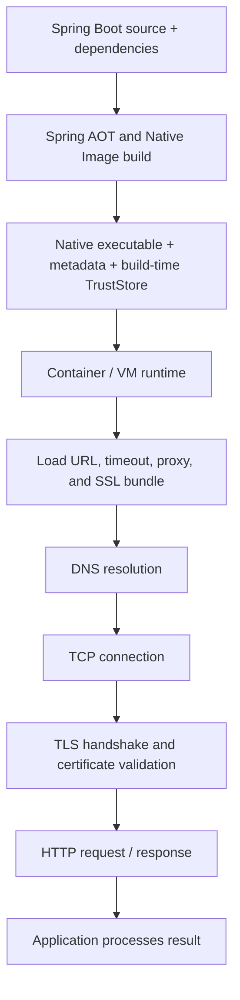

# HTTP Clients, TLS, Truststores, and Connecting to External Services

Spring Boot applications frequently need to call APIs of payment gateways, identity providers, shipping services, internal systems, or partners. When moving to **GraalVM Native Image**, HTTP calls still happen while the application runs, yet the client implementation, TLS provider, certificate store, resources, and network configuration must all be compatible with the native executable.

Spring Boot provides `RestClient` for synchronous calls and `WebClient` for reactive applications. **SSL Bundles** help manage truststores, keystores, and certificates by name for reuse across multiple clients. GraalVM Native Image adds its own rules around HTTPS and the default TrustStore: by default, the builder captures the TrustStore from the build machine and embeds it into the executable. Therefore, a binary that runs on a developer laptop may fail to connect to internal services inside a production container.

## 1. Learning Objectives

After this lesson, you will be able to:

- Choose `RestClient`, `WebClient`, or an HTTP Service Interface according to the application model.
- Configure base URLs, connect timeouts, read timeouts, proxies, and HTTP client implementations.
- Distinguish truststores, keystores, server authentication, and mutual TLS.
- Configure SSL Bundles using JKS/PKCS12 or PEM.
- Use `RestClientSsl` and `WebClientSsl` to apply trust material to outbound HTTP clients.
- Understand how GraalVM Native Image affects HTTPS, security providers, and the default TrustStore.
- Distinguish a TrustStore captured at build time from a truststore loaded from a file at runtime.
- Test HTTPS connectivity on the JVM, native executable, and final container.
- Diagnose DNS, timeout, proxy, certificate chain, hostname verification, and missing native metadata errors.

## 2. When Does HTTP Connectivity Happen in Native Image?

GraalVM Native Image compiles code and metadata into an executable. HTTP calls to external services still happen when the native process runs. Native Image does not pre-package network routes, DNS records, firewall rules, service endpoints, or deployment credentials.

This creates three layers to verify:

1. **Build:** required client implementations, protocol support, security providers, resources, and metadata must be recognized by Native Image.
2. **Runtime:** the executable must read URLs, proxies, trust material, timeouts, and credentials from the process configuration.
3. **Network environment:** the container/VM must resolve DNS, open outbound connections, and trust the server certificate chain.



A passing build only proves that the Native Image builder produced an executable. It does not prove the executable can resolve hostnames, validate certificates, open connections, or call APIs on the production network.

## 3. Choosing an HTTP Client in Spring Boot

### 3.1. RestClient for Synchronous APIs

If an application does not use Spring WebFlux or Project Reactor for reactive flows, Spring Boot recommends `RestClient`. This API uses a fluent, imperative style and is configured via the `RestClient.Builder` provided by Spring Boot.

```java
import org.springframework.stereotype.Service;
import org.springframework.web.client.RestClient;

@Service
public class PartnerClient {

    private final RestClient restClient;

    public PartnerClient(RestClient.Builder builder) {
        this.restClient = builder
            .baseUrl("https://partner.example")
            .build();
    }

    public PartnerOrder findOrder(String orderId) {
        return restClient.get()
            .uri("/api/orders/{id}", orderId)
            .retrieve()
            .body(PartnerOrder.class);
    }
}
```

Inject the auto-configured builder rather than calling `RestClient.create()` arbitrarily. Spring Boot's builder carries message converters, the request factory, and application customizers. `RestClient.create()` does not apply auto-configuration or `RestClientCustomizer` beans.

### 3.2. WebClient for Reactive Flows

If an application uses Spring WebFlux and needs non-blocking I/O, use `WebClient`:

```java
import reactor.core.publisher.Mono;
import org.springframework.stereotype.Service;
import org.springframework.web.reactive.function.client.WebClient;

@Service
public class ReactivePartnerClient {

    private final WebClient webClient;

    public ReactivePartnerClient(WebClient.Builder builder) {
        this.webClient = builder
            .baseUrl("https://partner.example")
            .build();
    }

    public Mono<PartnerOrder> findOrder(String orderId) {
        return webClient.get()
            .uri("/api/orders/{id}", orderId)
            .retrieve()
            .bodyToMono(PartnerOrder.class);
    }
}
```

Spring Boot prefers `ClientHttpConnector` implementations based on classpath dependencies: Reactor Netty, Jetty Reactive HTTP Client, Apache HttpClient, and JDK HttpClient. If multiple implementations are present, the client is chosen according to the priority order of your Spring Boot version.

Do not pick `WebClient` solely because its name sounds newer or assume it is always faster. Reactive clients fit when the processing flow is genuinely non-blocking and the whole pipeline uses reactive APIs. Calling `block()` everywhere undermines reactive benefits and complicates thread management.

### 3.3. HTTP Service Interfaces

Spring supports declaring HTTP contracts via interfaces annotated with `@HttpExchange`, `@GetExchange`, `@PostExchange`, and related annotations. Spring Boot can import these interfaces with `@ImportHttpServices`.

```java
import org.springframework.web.service.annotation.GetExchange;
import org.springframework.web.service.annotation.HttpExchange;
import org.springframework.web.bind.annotation.PathVariable;

@HttpExchange
public interface PartnerOrdersApi {

    @GetExchange("/api/orders/{id}")
    PartnerOrder findOrder(@PathVariable("id") String id);
}
```

Declaring a group in the application:

```java
import org.springframework.boot.SpringApplication;
import org.springframework.boot.autoconfigure.SpringBootApplication;
import org.springframework.web.service.registry.ImportHttpServices;

@SpringBootApplication
@ImportHttpServices(
    group = "partner",
    types = PartnerOrdersApi.class
)
public class OrderApplication {
    public static void main(String[] args) {
        SpringApplication.run(OrderApplication.class, args);
    }
}
```

Externalizing the URL to configuration:

```properties
spring.http.serviceclient.partner.base-url=${PARTNER_API_URL:https://partner.example}
spring.http.serviceclient.partner.connect-timeout=2s
spring.http.serviceclient.partner.read-timeout=5s
```

HTTP Service groups can also share timeouts, SSL bundles, default headers, and client customization. This is a strong option when an application has multiple API clients sharing one policy.

## 4. Managing Endpoints, Timeouts, and Proxies

### 4.1. Never Hard-Code Production Endpoints

Place endpoints in configuration:

```properties
partner.api.base-url=${PARTNER_API_URL:https://partner.example}
```

Or use HTTP Service client group properties:

```yaml
spring:
  http:
    serviceclient:
      partner:
        base-url: ${PARTNER_API_URL:https://partner.example}
```

That way, the exact same native executable can call staging or production endpoints based on runtime configuration. URLs should not be read in static initializers or baked into build metadata if endpoints vary across deployments.

### 4.2. Configuring Connect Timeout and Read Timeout

Connect timeout bounds the time spent establishing a connection. Read timeout bounds the time spent waiting for response data according to the chosen HTTP client's mechanism. Timeouts behave differently across client implementations, so verify the semantics of your actual connector.

Spring Boot supports global configuration:

```properties
spring.http.clients.connect-timeout=2s
spring.http.clients.read-timeout=5s
```

Or per-group configuration for an HTTP Service group:

```properties
spring.http.serviceclient.partner.connect-timeout=2s
spring.http.serviceclient.partner.read-timeout=5s
```

With `RestClient`, you can use `HttpClientSettings` and `ClientHttpRequestFactoryBuilder` to combine an SSL bundle with timeouts:

```java
import java.time.Duration;
import org.springframework.boot.http.client.ClientHttpRequestFactoryBuilder;
import org.springframework.boot.http.client.HttpClientSettings;
import org.springframework.boot.ssl.SslBundles;
import org.springframework.context.annotation.Bean;
import org.springframework.context.annotation.Configuration;
import org.springframework.http.client.ClientHttpRequestFactory;

@Configuration(proxyBeanMethods = false)
class PartnerHttpConfiguration {

    @Bean
    ClientHttpRequestFactory partnerRequestFactory(SslBundles sslBundles) {
        HttpClientSettings settings = HttpClientSettings
            .ofSslBundle(sslBundles.getBundle("partner"))
            .withReadTimeout(Duration.ofSeconds(5));

        return ClientHttpRequestFactoryBuilder.detect().build(settings);
    }
}
```

Then attach the request factory to `RestClient.Builder`. If connect timeouts, cookie handling, or redirect policies are needed, use global `spring.http.clients` properties or the corresponding builder/client implementation API.

Example attaching the configured request factory to the client:

```java
@Bean
RestClient partnerRestClient(
        RestClient.Builder builder,
        ClientHttpRequestFactory partnerRequestFactory) {
    return builder
        .baseUrl("https://partner.example")
        .requestFactory(partnerRequestFactory)
        .build();
}
```

### 4.3. Proxies and Egress

Some environments require outbound traffic to go through an HTTP proxy. Spring Boot can configure client builders using a `ProxySelector`:

```java
import java.net.ProxySelector;
import org.springframework.boot.http.client.ClientHttpRequestFactoryBuilder;
import org.springframework.context.annotation.Bean;
import org.springframework.context.annotation.Configuration;

@Configuration(proxyBeanMethods = false)
class ProxyConfiguration {

    @Bean
    ClientHttpRequestFactoryBuilder<?> clientHttpRequestFactoryBuilder(
            ProxySelector proxySelector) {
        return ClientHttpRequestFactoryBuilder.jdk()
            .withHttpClientCustomizer(
                builder -> builder.proxy(proxySelector)
            );
    }
}
```

For `WebClient`, you can configure the corresponding `ClientHttpConnectorBuilder`. Do not assume every HTTP library automatically reads `HTTP_PROXY` or `HTTPS_PROXY`; verify implementation behavior and configure proxies explicitly.

In containers/Kubernetes, verify:

- Can DNS resolve the service hostname?
- Do network policies, firewalls, and security groups allow outbound traffic to the required port?
- Can the proxy resolve the target hostname?
- Does the egress gateway require a custom CA?
- Does the runtime container have routes to private endpoints or the service mesh?

Building a Native Image on a machine with internet access does not mean the native process in production has internet access.

## 5. TLS, Truststores, and Keystores

### 5.1. Truststores and Keystores Differ

| Component | What Does It Contain? | What Is It Used For? |
| --- | --- | --- |
| **Truststore** | Trusted CA certificates or server certificates | Client verifies the server's identity during the TLS handshake |
| **Keystore** | The application's own certificate and private key | Application proves its own identity, typically in mutual TLS |
| **TrustManager** | Policy and data for validating certificate chains | Decides whether the peer's certificate is trusted |
| **KeyManager** | Selects client or server key/certificate | Supplies the certificate when requested during the TLS handshake |

In standard HTTPS:

1. The client opens a connection to the server's hostname.
2. The server presents its certificate chain.
3. The client verifies signatures, chaining to a trusted CA, validity dates, and hostname.
4. The TLS handshake completes before any HTTP request is sent.

A truststore verifies the server. A keystore is only needed when the client must present its own certificate, such as when a partner requires **mutual TLS (mTLS)**.

### 5.2. Never Disable Certificate Validation

Never use a `TrustManager` that accepts all certificates, a hostname verifier that always returns `true`, or configuration that disables TLS verification just to make requests succeed. Those workarounds turn encrypted connections into unauthenticated ones and open the door to man-in-the-middle attacks.

If you encounter `PKIX path building failed`, inspect the CA chain and truststore. If you encounter a hostname mismatch, check whether the URL hostname appears in the certificate's Subject Alternative Name. If a certificate expired, renew the server certificate or CA chain properly.

## 6. Configuring SSL Bundles in Spring Boot

Spring Boot provides SSL Bundles to group trust material, keystores, truststores, protocols, and related settings into a named bundle. Clients can retrieve that bundle to configure TLS.

### 6.1. JKS or PKCS12 Truststores

Example using a PKCS12 truststore containing an internal CA or partner certificate:

```yaml
spring:
  ssl:
    bundle:
      jks:
        partner:
          truststore:
            location: ${PARTNER_TRUSTSTORE_LOCATION:file:/run/secrets/partner-truststore.p12}
            password: ${PARTNER_TRUSTSTORE_PASSWORD}
            type: PKCS12
```

`location` can be `classpath:` if the truststore is packaged in application resources, or `file:` if the file is mounted into the runtime container. For sensitive truststores, it is usually best to mount from a secret volume and obtain passwords from a secret provider/environment rather than committing passwords into source.

### 6.2. PEM Truststores

If the partner provides a PEM-encoded CA certificate:

```yaml
spring:
  ssl:
    bundle:
      pem:
        partner:
          truststore:
            certificate: file:/run/secrets/partner-ca.crt
```

Spring Boot also supports inline PEM certificates or Base64 content prefixed with `base64:`. Use mounted files when certificates need to be managed independently of the application image.

### 6.3. Mutual TLS with a Client Certificate

When a partner requires mTLS, the bundle needs both a truststore and a keystore:

```yaml
spring:
  ssl:
    bundle:
      jks:
        partner:
          truststore:
            location: file:/run/secrets/partner-truststore.p12
            password: ${PARTNER_TRUSTSTORE_PASSWORD}
            type: PKCS12
          keystore:
            location: file:/run/secrets/client-identity.p12
            password: ${PARTNER_KEYSTORE_PASSWORD}
            type: PKCS12
          key:
            alias: order-service-client
```

The truststore holds the CA to verify the server; the keystore holds the client identity. Private keys must be protected as secrets. Ensure the client certificate is unexpired, has suitable Extended Key Usage, and the alias points to the right key entry.

## 7. Attaching SSL Bundles to RestClient and WebClient

### 7.1. RestClient with RestClientSsl

Spring Boot provides `RestClientSsl`, allowing an SSL bundle to be applied to `RestClient.Builder`:

```java
import org.springframework.boot.restclient.autoconfigure.RestClientSsl;
import org.springframework.context.annotation.Bean;
import org.springframework.context.annotation.Configuration;
import org.springframework.web.client.RestClient;

@Configuration(proxyBeanMethods = false)
class PartnerClientConfiguration {

    @Bean
    RestClient partnerRestClient(
            RestClient.Builder builder,
            RestClientSsl ssl) {
        return builder
            .baseUrl("https://partner.example")
            .apply(ssl.fromBundle("partner"))
            .build();
    }
}
```

The name `partner` must match the bundle name declared under `spring.ssl.bundle`. In a real application, the base URL should come from runtime configuration or an HTTP Service group.

### 7.2. WebClient with WebClientSsl

For reactive applications:

```java
import org.springframework.boot.webclient.autoconfigure.WebClientSsl;
import org.springframework.context.annotation.Bean;
import org.springframework.context.annotation.Configuration;
import org.springframework.web.reactive.function.client.WebClient;

@Configuration(proxyBeanMethods = false)
class ReactivePartnerClientConfiguration {

    @Bean
    WebClient partnerWebClient(
            WebClient.Builder builder,
            WebClientSsl ssl) {
        return builder
            .baseUrl("https://partner.example")
            .apply(ssl.fromBundle("partner"))
            .build();
    }
}
```

`WebClientSsl` configures SSL on the `ClientHttpConnector` used by `WebClient`. That connector may be Reactor Netty, Jetty, Apache, or the JDK client depending on dependencies and configuration. Whenever changing connectors, re-verify SSL settings, timeouts, proxies, and native compatibility for that implementation.

## 8. GraalVM Native Image and HTTPS

### 8.1. HTTPS Support and URL Protocol Handlers

Native Image provides `--enable-https` to enable HTTPS support for URL protocol handlers. This option is especially relevant when code uses `URL`, `URLConnection`, or mechanisms built on URL protocol handlers.

```bash
native-image --enable-https ...
```

HTTP can be enabled with `--enable-http` when the corresponding protocol handler is needed. Do not blindly enable all protocols or all security services if the application does not use them.

An important distinction: `--enable-https` does not automatically configure truststores, add internal CAs, open network policies, or guarantee every HTTP client library already has sufficient metadata. With `RestClient`/`WebClient`, identify the actual connector and verify build output, native tests, and the TLS handshake on the executable.

### 8.2. Security Providers

TLS relies on Java security APIs and their underlying providers. Native Image automatically detects most common execution paths, yet some applications using extra providers or algorithms may need appropriate build configuration.

When encountering provider- or algorithm-related errors:

1. Identify the exact provider class and algorithm used by the client.
2. Inspect GraalVM build output and the security report.
3. Consult Native Image documentation for your exact GraalVM version.
4. Add only the required provider via the appropriate option, such as `-H:AdditionalSecurityProviders=...` when needed.

Do not use `--enable-all-security-services` as a catch-all fix for every TLS failure. It can bloat the binary and pull unnecessary security services into the executable.

### 8.3. Default TrustStore Captured at Build Time

By default, GraalVM Native Image captures the default TrustStore from the host during build time and embeds the certificate contents into the executable. The default TrustStore is typically based on the root certificates file of the JDK used to build.

Consequences:

- A binary built on a developer laptop with internal CAs may trust endpoints that a binary built on a clean CI runner does not.
- Updating the container's CA store after building does not automatically update the TrustStore captured inside the executable.
- Building the same source on two machines with different TrustStores can produce different TLS behavior.

For reproducible builds, use a build host with a controlled CA store and explicitly document the source of trust material. For partner-specific CAs, an SSL Bundle is a clear way to configure a dedicated truststore for a client.

### 8.4. Overriding the Default TrustStore at Runtime

Native Image allows configuring the default TrustStore at runtime via system properties:

- `javax.net.ssl.trustStore`
- `javax.net.ssl.trustStoreType`
- `javax.net.ssl.trustStoreProvider`
- `javax.net.ssl.trustStorePassword`

When any property in this list is set at runtime, Native Image also requires `javax.net.ssl.trustStore` to be set and point to an accessible certificate store file. If you set only type/password/provider without a valid truststore file, the executable may throw `UnsupportedFeatureError`.

Example:

```bash
./order-service \
  -Djavax.net.ssl.trustStore=/run/secrets/runtime-truststore.p12 \
  -Djavax.net.ssl.trustStoreType=PKCS12 \
  -Djavax.net.ssl.trustStorePassword="$TRUSTSTORE_PASSWORD"
```

The path must exist inside the container and the process must have read permissions. If these properties are not set, Native Image uses the default TrustStore captured at build time.

Note: JSSE's default TrustStore and Spring Boot-managed SSL Bundles are two distinct configuration mechanisms that can operate independently. When a client uses a specific SSL Bundle, verify that the client receives that bundle instead of assuming changing the global `javax.net.ssl.trustStore` will automatically apply to every client implementation.

## 9. Resources, Metadata, and Runtime Configuration

### 9.1. Truststore Packaged on the Classpath

If an SSL Bundle references:

```yaml
spring:
  ssl:
    bundle:
      jks:
        partner:
          truststore:
            location: classpath:certificates/partner-truststore.p12
            password: ${PARTNER_TRUSTSTORE_PASSWORD}
            type: PKCS12
```

Verify that the file is packaged in the application JAR and resource access is supported in the native image. Spring AOT can supply hints for many framework components; if a library loads resources by dynamic names outside AOT's scope, register the appropriate resource metadata.

Do not assume a resource inside a JAR automatically becomes a physical file next to the executable. Use the resource/stream APIs provided by the framework rather than forcing a resource into a `File` when it may reside inside an archive or native image.

### 9.2. Truststore Mounted on the Filesystem

With `file:/run/secrets/...`, the runtime container needs:

- The file mounted at the exact path.
- Read permissions for the UID/GID running the application.
- The password supplied via a secret mechanism.
- File updates and client restarts/reloads via a supported mechanism.
- No unintentional copying of private keys or production truststores into image layers.

### 9.3. Do Not Snapshot Endpoints or Secrets in Static Initializers

Avoid patterns like:

```java
final class PartnerRuntime {
    static final String URL = System.getenv("PARTNER_API_URL");
    static final String TOKEN = System.getenv("PARTNER_API_TOKEN");
}
```

If the class is initialized at build time, the endpoint or token can be frozen into the image heap. Read configuration via Spring `Environment`, `@ConfigurationProperties`, or beans created at runtime. Secrets should be supplied via a secret manager or mounted secrets, never embedded in the binary.

## 10. Testing External Connectivity Before and After the Native Build

### 10.1. Testing Client Logic on the JVM

Use a mock server such as WireMock or MockWebServer to test:

- Request paths, queries, headers, and bodies.
- Mapping responses into DTOs.
- Handling HTTP 4xx/5xx responses.
- Connect/read timeouts.
- Retries and backoff.
- Behavior when the server drops connections or returns invalid responses.

JVM tests are fast and well suited for verifying client logic. However, mock servers do not replace testing real certificate chains or the TLS stack.

### 10.2. Testing TLS with a Test CA

Generate a CA and certificate for a local test server, then place only that test CA into the test truststore. Verify:

1. The client connects successfully when the server certificate is trusted.
2. The client fails when the CA is absent from the truststore.
3. The client fails when the hostname does not match SAN.
4. The client fails when the certificate is expired or the chain is invalid.
5. For mTLS, the server rejects clients without a certificate or with the wrong certificate.

Never use production private keys in test suites. Never disable hostname verification to make tests pass.

### 10.3. Testing the Native Executable

After building native:

```bash
./mvnw -Pnative native:compile
```

Or:

```bash
./gradlew nativeCompile
```

Start the executable and call a test HTTPS endpoint. Use the same CA/test server to compare JVM and native behavior. On failure, capture:

- GraalVM version and Java version.
- Actual HTTP client implementation.
- Native Image build arguments.
- Truststore location/type.
- Certificate chain and hostname.
- Full exception/cause chain, not only the outermost message.

### 10.4. Testing Inside the Final Container Image

A native executable may run on the build machine yet fail inside a container due to missing CA files, filesystem permissions, DNS, proxies, native shared libraries, or outbound network policies.

Run the exact final container image:

```bash
docker run --rm \
  --env PARTNER_API_URL=https://partner.test.internal \
  --env PARTNER_TRUSTSTORE_PASSWORD="$PARTNER_TRUSTSTORE_PASSWORD" \
  --mount type=bind,src="$PWD/certs/partner-truststore.p12",dst=/run/secrets/partner-truststore.p12,readonly \
  order-service:native
```

Then invoke the application endpoint or run integration tests from another container. Inspect CA bundles, timezone, DNS, proxies, UID/GID, and certificate paths inside the image.

## 11. Timeouts, Retries, and External Service Error Handling

### 11.1. Timeouts Must Be Bounded

A call without proper timeouts can tie up a thread or request context indefinitely when an external service hangs. Choose timeouts based on the parent request's latency budget:

- Connect timeout: limits socket establishment time.
- Read timeout: limits waiting for response data.
- Overall request deadline: limits total processing time if supported by the client/resilience layer.
- Pool acquisition timeout: limits waiting for a connection from the pool when using a pooling client.

If API A calls API B and then calls a database, each step's timeout must fit within the overall deadline. Setting a 30-second read timeout on every request is not a sound default.

### 11.2. Retry Only Safe Operations

Retries can help with transient network glitches, HTTP 429, or certain 5xx errors. However, retrying a `POST` that creates a payment or order can execute the business action twice if the server processed the request but the response was lost.

When retrying:

- Determine the method/idempotency of the API.
- Use an idempotency key if supported by the service.
- Bound the retry count and total duration.
- Use exponential backoff with jitter.
- Respect `Retry-After` when provided by the API.
- Do not retry authentication, certificate, or request validation errors as transient network failures.

### 11.3. Error Classification

| Error | Typical Meaning | Resolution |
| --- | --- | --- |
| `UnknownHostException` | DNS cannot resolve hostname | Check DNS, service names, namespaces, and container resolver |
| `ConnectException` | Cannot open TCP connection | Check port, route, firewall, network policy, and service availability |
| `SocketTimeoutException` | Connect/read exceeded timeout | Check service latency, timeouts, and pool saturation |
| `SSLHandshakeException` | TLS handshake failed | Check protocol, ciphers, certificate chain, truststore, and mTLS |
| `PKIX path building failed` | Cannot build chain to a trusted CA | Add the proper CA to the truststore/SSL bundle |
| `No subject alternative DNS name matching` | Hostname does not match certificate SAN | Use the right hostname or issue a certificate with the right SAN |
| `UnsupportedFeatureError` related to TrustStore | Runtime truststore properties lack a valid file or feature is unsupported | Point `javax.net.ssl.trustStore` to a readable file and verify GraalVM version |
| `Unsupported protocol https` or URL protocol error | HTTPS URL handler is not enabled | Check `URL`/`URLConnection` usage and `--enable-https` |
| `NoSuchAlgorithmException` | Security provider/algorithm absent from image | Identify required provider and configure Native Image properly |
| HTTP 401/403 | Invalid token, scope, client certificate, or authorization | Check credentials, mTLS identity, and server-side policy |
| HTTP 429 | Rate limited | Reduce concurrency, back off, and respect `Retry-After` |

## 12. Security and Protecting Outbound Clients

Outbound connections to external services are also part of an application's attack surface.

- Use HTTPS only with certificate validation enabled.
- Never log access tokens, private keys, passwords, or full authorization headers.
- Manage tokens via runtime secret mechanisms and rotate them per policy.
- Do not let users supply arbitrary URLs if the application could be vulnerable to SSRF.
- Restrict outbound destinations using firewalls, proxies, or an appropriate `InetAddressFilter`.
- Check redirect policies; never let redirects forward credentials to untrusted hosts.
- Limit response sizes and processing time to prevent resource exhaustion.
- Retry only safe operations and bound concurrency.
- Keep CA bundles updated and maintain a process for certificate expiration/rotation.

Spring Boot provides `InetAddressFilter` to restrict target IPs on certain HTTP client builders. When a client routes through a proxy, the application-level filter controls only the proxy address the application connects to; the proxy server must enforce its own policy for destination addresses.

## 13. Troubleshooting in GraalVM Native Image

| Symptom | Possible Cause | How to Check |
| --- | --- | --- |
| JVM calls HTTPS fine, native fails with protocol error | URL protocol handler not enabled | Check whether `URL`/`URLConnection` is used; try `--enable-https` |
| Native build passes, TLS handshake fails | Security provider or algorithm absent from image | Read cause chain, check providers and Native Image security config |
| Native binary trusts different CAs than container/JVM | Default TrustStore captured from build host | Inspect build host CA store and runtime properties |
| Runtime throws `UnsupportedFeatureError` when setting truststore type/password | `trustStore*` property set without a valid `javax.net.ssl.trustStore` | Provide full path and ensure file exists and is readable |
| SSL Bundle cannot find truststore | Wrong classpath/file location or resource unpackaged | Inspect application JAR, mounts, and read permissions |
| `RestClient` and `WebClient` behave differently | The two clients use different connector implementations | Inspect auto-detection and connector configuration |
| Error occurs only in Kubernetes | DNS, egress, service mesh, proxy, or CA differs from local machine | Test from the exact deployment pod/container and namespace |
| Certificate is valid, yet hostname verification fails | URL host not listed in SAN | Inspect SAN and the DNS name used by the client |
| Client certificate is not sent | Wrong keystore/alias or mTLS configuration | Check key entry, alias, chain, and server certificate request |
| Connections hang for a long time | Missing timeouts or exhausted pool | Set connect/read timeouts; inspect pool and request deadlines |
| Retries create duplicate orders/payments | Retrying non-idempotent operations | Use idempotency keys and a safe retry policy |
| Native executable lacks metadata when parsing response | DTO/serializer or library uses dynamic reflection | Check Spring AOT hints and dependency reachability metadata |

## 14. Workflow for Deploying HTTP Clients/TLS to Native Image

1. **Choose the client API:** use `RestClient` for imperative code, `WebClient` for reactive flows, or HTTP Service Interfaces for explicit contracts.
2. **Externalize endpoints:** read base URLs from Spring configuration or service group properties.
3. **Set timeouts:** define connect/read timeouts and overall deadlines based on the latency budget.
4. **Verify the HTTP implementation:** check whether Apache, Jetty, Reactor Netty, or the JDK client is auto-detected by Boot.
5. **Determine the TLS mode:** standard server authentication or mutual TLS.
6. **Configure SSL Bundles:** use JKS/PKCS12 or PEM; separate truststores from keystores.
7. **Choose trust material source:** default TrustStore captured at build time, SSL Bundle on classpath, or secret file mounted at runtime.
8. **Check Native Image options:** enable HTTPS URL handlers or extra providers only when the actual client implementation and build output require them.
9. **Run JVM tests:** verify requests/responses, statuses, timeouts, retries, and certificate behavior.
10. **Build the native executable:** verify metadata, SSL bundle resources, and Native Image logs.
11. **Test the native binary:** perform TLS handshakes with a test CA and invoke real APIs in a safe environment.
12. **Test the final container:** verify DNS, egress, proxies, CA files, secret mounts, filesystem permissions, and shutdown.
13. **Monitor production:** record latency, timeouts, connection errors, TLS failures, and HTTP statuses; scrub credentials from logs.

## 15. Capstone Hands-On Exercise

**Context:** `order-service` calls `partner-api` to confirm shipping orders. The partner uses HTTPS with a private CA and requires a client certificate. The application will be deployed as a GraalVM Native Image in Kubernetes.

Steps:

1. Create `PartnerClient` using `RestClient.Builder`.
2. Externalize the base URL to `PARTNER_API_URL` and configure connect/read timeouts.
3. Create an SSL Bundle named `partner` with a PKCS12 truststore containing the partner's CA.
4. Add a PKCS12 keystore containing the client certificate/private key if the partner enables mTLS.
5. Inject `RestClientSsl` and apply `ssl.fromBundle("partner")` to the client.
6. Write JVM integration tests using a local HTTPS server with a test CA.
7. Verify requests succeed with valid CA/client certificates and fail with invalid certificates.
8. Build the Spring Boot Native Image; add `--enable-https` or provider options only if the actual client path requires them.
9. Run the native executable and repeat the TLS tests.
10. Package the container, mount the truststore/keystore from a secret volume, and provide passwords via secret environment variables.
11. Run smoke tests from the deployment's target container/network namespace.
12. Inspect metrics, timeouts, retries, and logs to confirm no secrets are leaked.

**Self-Check Question:** Why might a native executable built on a developer laptop succeed with HTTPS while the production container fails certificate validation? Because Native Image can capture the build host's default TrustStore into the executable by default. The build host and runtime environment have different CAs; you must control the captured TrustStore or configure SSL Bundles/runtime truststores suited to the deployment.

## 16. Key Takeaways

- `RestClient` suits imperative APIs; `WebClient` is for reactive flows. Both should be built from builders auto-configured by Spring Boot.
- The HTTP client implementation is selected from dependencies and configuration; verify the actual connector because TLS, timeouts, and native compatibility depend on the implementation.
- A truststore verifies the server certificate; a keystore holds the client identity/private key, typically used for mutual TLS.
- Spring Boot SSL Bundles group JKS/PKCS12 or PEM trust material and can be applied via `RestClientSsl` or `WebClientSsl`.
- Base URLs, timeouts, proxies, certificates, and secrets must be managed per runtime environment.
- GraalVM `--enable-https` relates to URL protocol handlers; it does not automatically configure CAs, network routes, or every HTTP client library.
- Native Image captures the default TrustStore from the build host by default. If setting runtime `javax.net.ssl.trustStore*`, you must supply `javax.net.ssl.trustStore` pointing to a readable file.
- JVM tests do not replace native executable tests and final container tests. You must verify DNS, egress, proxies, TLS handshakes, certificate chains, and secret read permissions.
- Never disable certificate/hostname verification; never log credentials; retry only safe operations.

When the HTTP client, SSL Bundle, truststore, and runtime networking are explicitly configured, the exact same Spring Boot Native Image can connect securely to external services across environments without implicitly depending on the build machine's CA store or network setup.

## Official Documentation

- [Spring Boot — Calling REST Services](https://docs.spring.io/spring-boot/reference/io/rest-client.html): RestClient, WebClient, HTTP client detection, SSL support, timeouts, proxies, and HTTP Service Interfaces.
- [Spring Boot — SSL](https://docs.spring.io/spring-boot/reference/features/ssl.html): SSL Bundles, JKS/PKCS12, PEM, SslBundles, and how to apply trust material.
- [GraalVM Native Image — Certificate Management](https://www.graalvm.org/latest/reference-manual/native-image/dynamic-features/CertificateManagement/): default TrustStore capture, runtime `javax.net.ssl.trustStore*`, and certificate behavior.
- [GraalVM Native Image — Troubleshoot Run-Time Errors](https://www.graalvm.org/jdk25/reference-manual/native-image/guides/troubleshoot-run-time-errors/): HTTPS URL protocol, security providers, and missing metadata.
- [GraalVM Native Image — Security Considerations](https://www.graalvm.org/latest/security-guide/native-image/): security implications of native executables and certificate handling.
